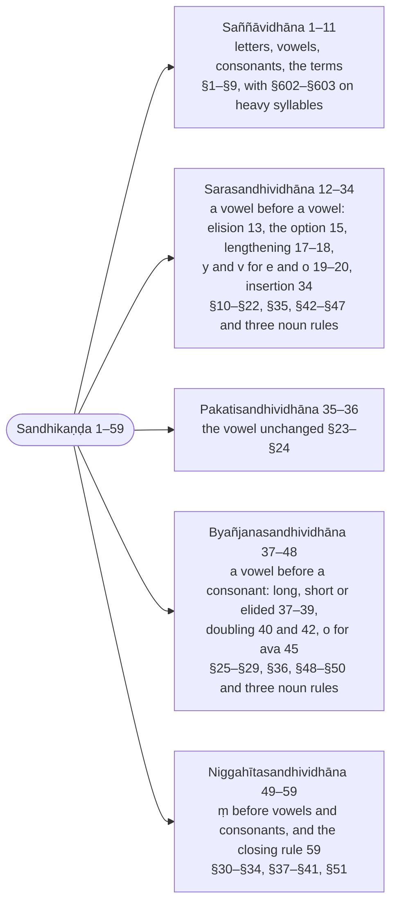

import { LinkCard } from "@astrojs/starlight/components";

:::note
The first section of the Padarūpasiddhi gathers Kaccāyana's technical terms ([`saññā`](/introduction#types-of-suttas)) and the sandhi rules of the Sandhikappa in Buddhappiya's own order — vowel sandhi, the cases where the vowel stays unchanged (`pakati`), consonant sandhi, niggahīta sandhi — and derives every example word it cites, quoting the rules by their wording. Each sutta carries the Kaccāyana number it corresponds to and a card to the Kaccāyana page, where the rule's own analysis, examples and counter-examples are.

:::

:::note[The five parts of the Sandhikaṇḍa]
Buddhappiya's order for the sandhi rules, with the Rūpasiddhi numbers and the Kaccāyana rules each part draws on.

:::

> Tattha jinasāsanādhigamassa akkharakosallamūlakattā taṃ sampādetabbanti dassetuṃ abhidheyyappayojanavākyamidamuccate.

There [after the opening verses], since the understanding of the Conqueror's teaching has skill in letters (`akkharakosalla`) as its root, this sentence, which states the subject-matter (`abhidheyya`) and the purpose (`payojana`) [of the grammar], is spoken in order to show that that [skill] is to be acquired.

---

### 1 (§1): Attho akkharasaññāto (Meaning is represented by `akkhara`) :badge[sīhagatika]{variant=caution}

:::tip[Kaccāyana]
<LinkCard title="§1 (1): Attho akkharasaññāto" href="/kaccayana/1-sandhikappa#m1" description="Meaning is represented by `akkhara`" />
:::

> Yo koci lokiyalokuttarādibhedo vacanattho, so sabbo akkhareheva saññāyate. Sithiladhanitādiakkharavipattiyañhi atthassa dunnayatā hoti, tasmā akkharakosallaṃ bahūpakāraṃ buddhavacanesu, ettha padānipi akkharasannipātarūpattā akkharesveva saṅgayhanti.

Whatever meaning a word has, whether worldly (`lokiya`), supramundane (`lokuttara`) or of any other kind, all of it is understood (`saññāyate`) only through letters (`akkhara`); for where a letter is faulty — unaspirated (`sithila`), aspirated (`dhanita`) and the like — the meaning becomes hard to make out. That is why skill in letters is of great help in the word of the Buddha. Here words (`pada`) too, being in form just combinations of letters, are included under "letters".

> Tasmā akkharakosallaṃ, sampādeyya hitatthiko; \
> Upaṭṭhahaṃ garuṃ sammā, uṭṭhānādīhi pañcahi.

Therefore one who seeks his own good should attain skill in letters, \
attending on the teacher properly with the five [duties] that begin with rising.

---

## Saññāvidhāna (Definitions)

> Tatthādo tāva saddalakkhaṇe vohāraviññāpanatthaṃ saññāvidhānamārabhīyate.

There, first of all, the assignment of technical terms (`saññāvidhāna`) is begun, so as to make known the usage (`vohāra`) of grammar (`saddalakkhaṇa`).

---

### 2 (§2): Akkharāpādayo ekacattālīsaṃ (41 akkhara starting with `a`) :badge[anvattha]{variant=note}

:::tip[Kaccāyana]
<LinkCard title="§2 (2): Akkharāpādayo ekacattālīsaṃ" href="/kaccayana/1-sandhikappa#m2" description="41 akkhara starting with `a`" />
:::

> Akkharā api ādayo ekacattālīsaṃ, te ca kho jinavacanānurūpā akārādayo niggahītantā ekacattālīsamattā vaṇṇā paccekaṃ akkharā nāma honti. Taṃ yathā – a[^1] ā i ī u ū e o, ka kha ga gha ṅa, ca cha ja jha ña, ṭa ṭha ḍa ḍha ṇa, ta tha da dha na, pa pha ba bha ma, ya ra lava sa ha ḷa aṃ-iti akkharā.

[^1]: CST4 prints the list from `ā`, dropping the `a` that heads the forty-one letters; it is supplied from the sutta's own `akārādayo`.

The letters (`akkhara`) too, beginning with `a`, are forty-one; and it is those forty-one sounds (`vaṇṇa`), from `a` to the `niggahīta`, which conform to the Conqueror's word, that are each called `akkhara`. They are: a ā i ī u ū e o, ka kha ga gha ṅa, ca cha ja jha ña, ṭa ṭha ḍa ḍha ṇa, ta tha da dha na, pa pha ba bha ma, ya ra la va sa ha ḷa, aṃ — these are the letters.

> Nakkharantīti akkharā, a ādi yesaṃ te ādayo. Akārādīnamanukkamo panesa ṭhānādikkamasannissito, tathā hi ṭhānakaraṇappayatanehi vaṇṇā jāyante, tattha cha ṭhānāni kaṇṭhatālumuddhadantaoṭṭhanāsikāvasena.

They are called `akkhara` because they do not wear away (`na kharanti`), and `ādayo` means those that have `a` as their beginning. Now this sequence of `a` and the rest rests on the sequence of place (`ṭhāna`) and so on, for sounds are produced by place, organ (`karaṇa`) and effort (`payatana`); and of these the places are six: throat, palate, head, teeth, lips and nose.

> Tattha – a vaṇṇa ka vagga ha kārā kaṇṭhajā.

Of these, the `a`-vaṇṇa, the `ka`-group and the letter `ha` are born in the throat.

> I vaṇṇa ca vagga ya kārā tālujā. Ṭa vagga ra kāra ḷa kārā muddhajā. Ta vagga la kāra sa kārā dantajā. U vaṇṇa pa vaggā oṭṭhajā. E kāro kaṇṭhatālujo. O kāro kaṇṭhoṭṭhajo.

The `i`-vaṇṇa, the `ca`-group and the letter `ya` are born at the palate; the `ṭa`-group and the letters `ra` and `ḷa` at the head; the `ta`-group and the letters `la` and `sa` at the teeth; the `u`-vaṇṇa and the `pa`-group at the lips. The letter `e` is born at the throat and palate, and the letter `o` at the throat and lips.

> Va kāro dantoṭṭhajo.

The letter `va` is born at the teeth and lips.

> Niggahītaṃ nāsikaṭṭhānajaṃ.

The `niggahīta` is born at the nose as its place.

> Ṅa ña ṇa na mā sakaṭṭhānajā, nāsikaṭṭhānajā cāti.

`ṅa`, `ña`, `ṇa`, `na` and `ma` are born both at their own place and at the nose.

> Ha kāraṃ pañcameheva, antaṭṭhāhi ca saṃyutaṃ; \
> Orasanti vadantettha, kaṇṭhajaṃ tadasaṃyutaṃ.

The letter `ha` joined with the fifth letters alone and with the semivowels (`antaṭṭha`) \
is here called chest-born (`orasa`); unjoined, it is throat-born.

> Karaṇaṃ jivhāmajjhaṃ tālujānaṃ, jivhopaggaṃ muddhajānaṃ, jivhāggaṃ dantajānaṃ, sesā sakaṭṭhānakaraṇā.

The organ (`karaṇa`) is the middle of the tongue for those born at the palate, the part near the tip of the tongue for those born at the head, and the tip of the tongue for those born at the teeth; the rest have their own place as organ.

> Payatanaṃ saṃvutādikaraṇaviseso. Saṃvutattama kārassa, vivaṭattaṃ sesasarānaṃ sa kāraha kārānañca, phuṭṭhaṃ vaggānaṃ, īsaṃphuṭṭhaṃ yaralavānanti.

Effort (`payatana`) is the organ's particular mode, closed (`saṃvuta`) and so on: the letter `a` has closure; the other vowels and the letters `sa` and `ha` have openness (`vivaṭa`); the group letters have contact (`phuṭṭha`); and `ya`, `ra`, `la` and `va` have slight contact (`īsaṃphuṭṭha`).

> Evaṃ ṭhānakaraṇappayatanasutikālabhinnesu akkharesu sarā nissayā, itare nissitā. Tattha –

Thus, among the letters, which differ in place, organ, effort, sound (`suti`) and duration (`kāla`), the vowels are the support (`nissaya`) and the others the supported (`nissita`). On this —

> Nissayādo sarā vuttā, byañjanā nissitā tato; \
> Vaggekajā bahuttādo, tato ṭhānalahukkamā.

The vowels, the support, are stated first, and then the consonants, the supported; \
the group letters come before the single-born for their greater number and so on, and after that the order is by place and by lightness.

> Vuttañca –

And it is said:

> ‘‘Pañcannaṃ pana ṭhānānaṃ, paṭipāṭivasāpi ca; \
> Nissayādippabhedehi, vutto tesamanukkamo’’ti.

"Both by way of the order of the five places, \
and by the distinctions of support and the rest, their sequence has been stated."

> Ekenādhikā cattālīsaṃ ekacattālīsaṃ, etena gaṇanaparicchedena –

Forty plus one is forty-one, and by this delimitation of the number —

> Adhikakkharavantāni, ekatālīsato ito; \
> Na buddhavacanānīti, dīpetācariyāsabho.

[Texts] that have more letters than these forty-one \
are not the word of the Buddha: so the bull among teachers makes clear.[^2]

> Api ggahaṇaṃ heṭṭhā vuttānaṃ apekkhākaraṇatthaṃ.

The mention of `api` ("too") is there to refer back to the [letters] mentioned before.

[^2]: [Rachiwong (1995)](/rupasiddhi/rachiwong) reads this verse as aimed at the forty-three letters of the Moggallāna grammar; here the bull among teachers is Kaccāyana and the verse glosses his `ekacattālīsaṃ`.

---

### 3 (§3): Tatthodantā sarā aṭṭha ([From `akkhara`] eight ending with `o`: `sara`) :badge[anvattha]{variant=note}

:::tip[Kaccāyana]
<LinkCard title="§3 (3): Tatthodantā sarā aṭṭha" href="/kaccayana/1-sandhikappa#m3" description="[From `akkhara`] eight ending with `o`: `sara`" />
:::

> Tattha tesu akkharesu a kārādīsu o kārantā aṭṭha akkharā sarā nāma honti. Taṃ yathā – a ā i ī u ū e o-iti sarā.

Of these, among the letters beginning with `a`, the eight that end with `o` are called `sara` (vowels). They are: a ā i ī u ū e o — these are the vowels.

> O anto yesaṃ te odantā, da kāro sandhijo, saranti gacchantīti sarā, byañjane sārentītipi sarā.

`odantā` are those whose end is `o`, and the letter `d` is born of sandhi. They are `sara` because they move (`saranti`), that is, go; or again `sara` because they make the consonants move (`sārenti`).

> ‘‘Tatthā’’ti vattate.

“`Tattha`” ("among these") continues.

---

### 4 (§4): Lahumattā tayo rassā (3 short vowels: `rassa`) :badge[anvattha]{variant=note}

:::tip[Kaccāyana]
<LinkCard title="§4 (4): Lahumattā tayo rassā" href="/kaccayana/1-sandhikappa#m4" description="3 short vowels: `rassa`" />
:::

> Tattha aṭṭhasu saresu lahumattā tayo sarā rassā nāma honti. Taṃ yathā – a i u-iti rassā.

Of these eight vowels, the three of light measure are called `rassa` (short). They are: a i u — these are the short vowels.

> Lahukā mattā pamāṇaṃ yesaṃ te lahumattā, mattā saddo cettha accharāsaṅghātaakkhinimīlanasaṅkhātaṃ kālaṃ vadati, tāya mattāya e kamattā rassā, dvimattā dīghā, aḍḍhamattā byañjanā. Lahu ggahaṇañcettha chandasi diyaḍḍhamattassāpi gahaṇatthaṃ. Rassakālayogato rassā, rassakālavanto vā rassā.

`lahumattā` are those whose measure (`mattā`), that is, their quantity, is light; and the word `mattā` here means the time reckoned as a snap of the fingers or a blink of the eye. By that measure the short vowels have one measure, the long vowels two, and the consonants half a measure. The word `lahu` ("light") is used here so that in verse (`chandasi`) even a vowel of one and a half measures is included. They are `rassa` because they are connected with a short time, or `rassa` because they have a short time.

> Sararassa ggahaṇāni ca vattante.

“`sara`” and “`rassa`” also continue.

---

### 5 (§5): Aññe dīghā (Other [`sarā`] are `dīgha`) :badge[anvattha]{variant=note}

:::tip[Kaccāyana]
<LinkCard title="§5 (5): Aññe dīghā" href="/kaccayana/1-sandhikappa#m5" description="Other [`sarā`] are `dīgha`" />
:::

> Tattha aṭṭhasu saresu rassehi aññe dvimattā pañca sarā dīghā nāma honti. Taṃ yathā – ā ī ū e o-iti dīghā.

Of these eight vowels, the five other than the short ones, which have two measures, are called `dīgha` (long). They are: ā ī ū e o — these are the long vowels.

> Añña ggahaṇaṃ diyaḍḍhamattikānampi saṅgahaṇatthaṃ. Dīghakāle niyuttā, tabbanto vā dīghā. Kvaci saṃyogapubbā ekārokārā rassā iva vuccante. Yathā – ettha, seyyo, oṭṭho, sotthi.

The word `añña` ("other") is used so as to include also [vowels] of one and a half measures. They are `dīgha` because they are set in a long time, or because they have one. In some places (`kvaci`) `e` and `o` standing before a conjunct are pronounced as if short, for example `ettha` ("here"), `seyyo` ("better"), `oṭṭho` ("a lip") and `sotthi` ("safety").

> Kvacī ti kiṃ? Maṃ ce tvaṃ nikhaṇaṃ vane. Putto tyāhaṃ mahārāja.

By saying `kvaci` (in some places) we exclude the `e` and `o` that keep their two measures before a conjunct: `maṃ ce tvaṃ nikhaṇaṃ vane` ("if you bury me in the forest"), `putto tyāhaṃ mahārāja` ("I am your son, great king").

:::tip[Examples]

> `mañce tvaṃ nikhaṇaṃ vane` \
> [(23J 22.1.1: Mūgapakkhajātaka)](https://tipitaka2500.github.io/tipitaka/23J/22/22.1/22.1.1#1319) \
⚧️②⨀(amha) 🔼(ce) ⚧️①⨀(tumha) 🚹①⨀(nikhaṇanta) 🚻⑦⨀(vana) \
me | if | you | burying | in the forest

> `putto tyāhaṃ mahārāja` \
> [(22J 1.1.7: Kaṭṭhahārijātaka)](https://tipitaka2500.github.io/tipitaka/22J/1/1.1/1.1.7#14) \
🚹①⨀(putta) ⚧️⑥⨀(tumha) ⚧️①⨀(amha) 🚹⓪⨀(mahārāja) \
son | your | I [am] | great king

:::

---

### 6 (§602): Dumhi garu (The syllable before a conjunct is `garu`, heavy) :badge[anvattha]{variant=note}

:::tip[Kaccāyana]
<LinkCard title="§602 (6): Dumhi garu" href="/kaccayana/7-kibbidhanakappa/4-catutthakanda#m602" description="The syllable before a conjunct is `garu`, heavy" />
:::

> Dvinnaṃ samūho du, tasmiṃ dumhi. Saṃyogabhūte akkhare pare yo pubbo rassakkharo, so garusañño hoti. Yathā – datvā, hitvā, bhutvā.

A group of two is `du`, and `dumhi` means "before that". When a letter that is a conjunct (`saṃyoga`) follows, the short letter before it is termed `garu` (heavy), for example `datvā` ("having given"), `hitvā` ("having abandoned") and `bhutvā` ("having eaten").

> ‘‘Garū’’ti vattate.

“`garu`” continues.

---

### 7 (§603): Dīgho ca (And a long vowel is `garu`, heavy) :badge[anvattha]{variant=note}

:::tip[Kaccāyana]
<LinkCard title="§603 (7): Dīgho ca" href="/kaccayana/7-kibbidhanakappa/4-catutthakanda#m603" description="And a long vowel is `garu`, heavy" />
:::

> Dīgho ca saro garusañño hoti. Yathā – nāvā, nadī, vadhū, dve, tayo. Garukato añño ‘‘lahuko’’ti veditabbo.

A long vowel, too, is termed `garu`, for example `nāvā` ("a boat"), `nadī` ("a river"), `vadhū` ("a young woman"), `dve` ("two") and `tayo` ("three"). What is other than heavy should be understood as `lahuka` (light).

---

### 8 (§6): Sesā byañjanā (Remaining are `byañjanā`) :badge[anvattha]{variant=note}

:::tip[Kaccāyana]
<LinkCard title="§6 (8): Sesā byañjanā" href="/kaccayana/1-sandhikappa#m6" description="Remaining are `byañjanā`" />
:::

> Ṭhapetvā aṭṭha sare sesā aḍḍhamattā akkharā ka kārādayo niggahītantā tettiṃsa byañjanā nāma honti. Vuttehi aññe sesā. Byañjīyati etehi atthoti byañjanā. Taṃ yathā – ka kha ga gha ṅa, ca cha ja jha ña, ṭa ṭha ḍa ḍha ṇa, ta tha da dha na, pa pha ba bha ma, ya ra lava sa ha ḷa aṃ-iti byañjanā. Ka kārādīsvakāro uccāraṇattho.

Leaving aside the eight vowels, the remaining thirty-three letters of half a measure, from the letter `ka` to the `niggahīta`, are called `byañjana` (consonants). "Remaining" means other than those already stated, and they are `byañjana` because meaning is made manifest (`byañjīyati`) by them. They are: ka kha ga gha ṅa, ca cha ja jha ña, ṭa ṭha ḍa ḍha ṇa, ta tha da dha na, pa pha ba bha ma, ya ra la va sa ha ḷa, aṃ — these are the consonants. The `a` in `ka` and the rest is for the sake of pronunciation.

> ‘‘Byañjanā’’ti vattate.

“`byañjanā`” continues.

---

### 9 (§7): Vaggā pañcapañcaso mantā (`vagga`: 5 by 5 [byañjane] ending with `ma`) :badge[anvattha]{variant=note}

:::tip[Kaccāyana]
<LinkCard title="§7 (9): Vaggā pañcapañcaso mantā" href="/kaccayana/1-sandhikappa#m7" description="`vagga`: 5 by 5 [byañjane] ending with `ma`" />
:::

> Tesaṃ kho byañjanānaṃ ka kārādayo ma kārantā pañcavīsati byañjanā pañcapañcavibhāgena vaggā nāma honti. Taṃ yathā – ka kha ga gha ṅa, ca cha ja jha ña, ṭa ṭha ḍa ḍha ṇa, ta tha da dha na, pa pha ba bha ma-iti vaggā.

Now, of those consonants, the twenty-five from the letter `ka` to the letter `ma`, divided five by five, are called `vagga` (groups). They are: ka kha ga gha ṅa, ca cha ja jha ña, ṭa ṭha ḍa ḍha ṇa, ta tha da dha na, pa pha ba bha ma — these are the groups.

> Te pana paṭhamakkharavasena ka vaggaca vaggādivohāraṃ gatā, vaggo ti samūho, tattha pañcapañcavibhāgenāti vā pañca pañca etesamatthīti vā pañcapañcaso, mo anto yesaṃ te mantā.

And these are known, after their first letter, as the `ka`-group, the `ca`-group and so on. A `vagga` is a collection. There, `pañcapañcaso` means either "by a division of five each" or "those that have five each", and `mantā` are those whose end is `ma`.

---

### 10 (§8): Aṃiti niggahītaṃ (`aṃ` represents `niggahita`) :badge[anvattha]{variant=note}

:::tip[Kaccāyana]
<LinkCard title="§8 (10): Aṃ iti niggahitaṃ" href="/kaccayana/1-sandhikappa#m8" description="`aṃ` represents `niggahita`" />
:::

> A kāro uccāraṇattho, iti saddo panānantaravuttanidassanattho, aṃiti yaṃ a kārato paraṃ vuttaṃ bindu, taṃ niggahītaṃ nāma hoti. Rassassaraṃ nissāya gayhati, karaṇaṃ niggahetvā gayhatīti vā niggahītaṃ.

The letter `a` is for pronunciation, while the word `iti` points to what has just been said: the dot (`bindu`) pronounced after the letter `a` in `aṃ` is called `niggahīta`. It is `niggahīta` because it is used (`gayhati`) in dependence on a short vowel, or because it is used with the organ (`karaṇa`) held down (`niggahetvā`).

> Karaṇaṃ niggahetvāna, mukhenāvivaṭena yaṃ; \
> Vuccate niggahītanti, vuttaṃ bindu sarānugaṃ.

What is spoken with the organ held down and the mouth not fully open \
is called `niggahīta`: the dot pronounced after a vowel.

> Idha avuttānaṃ parasamaññānampi payojane sati gahaṇatthaṃ paribhāsamāha.

So that the technical terms of other [grammars] not stated here may also be taken up when there is a use for them, a metarule ([`paribhāsā`](/introduction#types-of-suttas)) is stated:

---

### 11 (§9): Parasamaññā payoge (Other grammatical terms when applicable) :badge[saññaṅga]{variant=tip}

:::tip[Kaccāyana]
<LinkCard title="§9 (11): Parasamaññā payoge" href="/kaccayana/1-sandhikappa#m9" description="Other grammatical terms when applicable" />
:::

> Yā ca pana parasmiṃ sakkataganthe, paresaṃ vā veyyākaraṇānaṃ samaññā ghosāghosalopasavaṇṇasaṃyogaliṅgādikā, tā payoge sati etthāpi yujjante.

And whatever technical terms (`samaññā`) there are in another work, the Sanskrit book, or that belong to other grammarians — `ghosa`, `aghosa`, `lopa`, `savaṇṇa`, `saṃyoga`, `liṅga` and the rest — are applied here too when there is a use for them.

> Parasmiṃ, paresaṃ vā samaññā parasamaññā, veyyākaraṇe, veyyākaraṇamadhītānaṃ vā samaññātyattho. Payujjanaṃ payogo, viniyogo.

`parasamaññā` are terms in another [work] or terms of others, that is, terms in a grammar or of those who have studied grammar. `payoga` is applying, that is, employment.

> Tattha vaggānaṃ paṭhamadutiyā, sa kāro ca aghosā. Vaggānaṃ tatiyacatutthapañcamā, ya ra lava ha ḷā cāti ekavīsati ghosā nāma.

Among these, the first and second letters of the groups, and the letter `sa`, are `aghosa` (unvoiced); the third, fourth and fifth letters of the groups, together with `ya`, `ra`, `la`, `va`, `ha` and `ḷa` — twenty-one in all — are called `ghosa` (voiced).

> Ettha ca vaggānaṃ dutiyacatutthā dhanitā tipi vuccanti, itare sithilā ti. Vināso lopo. Rassassarā sakadīghehi aññamaññaṃ savaṇṇā nāma, ye sarūpā tipi vuccanti. Sarānantaritāni byañjanāni saṃyogo. Dhātuppaccayavibhattivajjitamatthavaṃ liṅgaṃ. Vibhatyantaṃ padaṃ. Iccevamādi.

And here the second and fourth letters of the groups are also called `dhanita` (aspirated), the others `sithila` (unaspirated). `lopa` (elision) is disappearance. The short vowels and their own long vowels are mutually `savaṇṇa` (homogeneous), and these are also called `sarūpa` (of the same form). Consonants with no vowel between them are a `saṃyoga` (conjunct). A meaningful element other than a root, a suffix or an inflection is a `liṅga` (lemma). What ends in an inflection is a `pada` (word). And so on.

---

> _Iti saññāvidhānaṃ._

Thus the assignment of technical terms.

---

## Sarasandhividhāna (Vowel sandhi)

> Atha sarasandhi vuccate.

Now vowel sandhi (`sarasandhi`) is stated.

> Loka aggapuggalo, paññā indriyaṃ, tīṇi imāni, no hi etaṃ, bhikkhunī ovādo, mātu upaṭṭhānaṃ, sametu āyasmā, abhibhū āyatanaṃ, dhanā me atthi, sabbe eva, tayo assu dhammā, asanto ettha na dissanti itīdha sarādisaññāyaṃ sabbasandhikaraṇaṭṭhāne byañjanaviyojanatthaṃ paribhāsamāha.

Here, in `loka aggapuggalo`, `paññā indriyaṃ`, `tīṇi imāni`, `no hi etaṃ`, `bhikkhunī ovādo`, `mātu upaṭṭhānaṃ`, `sametu āyasmā`, `abhibhū āyatanaṃ`, `dhanā me atthi`, `sabbe eva`, `tayo assu dhammā` and `asanto ettha na dissanti`, once the technical terms `sara` and the rest have been assigned, a metarule ([`paribhāsā`](/introduction#types-of-suttas)) is stated for separating the consonant [from its vowel] wherever sandhi is to be made.

---

### 12 (§10): Pubbamadhoṭhitamassaraṃ sarena viyojaye (In preceeding [word], detach vowel from vowelless [consonant]) :badge[vidhyaṅga]{variant=tip}

:::tip[Kaccāyana]
<LinkCard title="§10 (12): Pubbamadhoṭhita massaraṃ sarena viyojaye" href="/kaccayana/1-sandhikappa#m10" description="In preceeding [word], detach vowel from vowelless [consonant]" />
:::

> Sarenā ti nissakke karaṇavacanaṃ, sahayoge vā, sandhitabbe sarasahitaṃ pubbabyañjanaṃ anatikkamanto adhoṭhitamassarañca katvā sarato viyojayeti sarato byañjanaṃ viyojetabbaṃ. Ettha ca assara ggahaṇasāmatthiyena ‘‘byañjana’’nti laddhaṃ.

`sarena` is a third-form ③ word (`karaṇavacana`) used in the sense of the fifth form ⑤ (`nissakka`), or else in the sense of accompaniment (`sahayoga`). Where [words] are to be joined, the preceding consonant together with its vowel is not passed over: one should make it stand below (`adhoṭhita`) and vowelless (`assara`) and separate it from the vowel — that is, the consonant is to be separated from the vowel. And here "consonant" is obtained by the force of the word `assara` ("vowelless").

---

### 13 (§12): Sarā sare lopaṃ (Vowel, before vowel, is elided) :badge[utsarga]{variant=success}

:::tip[Kaccāyana]
<LinkCard title="§12 (13): Sarā sare lopaṃ" href="/kaccayana/1-sandhikappa#m12" description="Vowel, before vowel, is elided" />
:::

> Sarā kho sabbepi sare pare ṭhite lopaṃ papponti. Lopo ti adassanaṃ anuccāraṇaṃ. Ettha sarā ti kāriyīniddeso. Bahuvacanaṃ panettha ekekasmiṃ sare pare bahūnaṃ lopañāpanatthaṃ. Sare ti nimittaniddeso, nimittasattamī cāyaṃ, nimittopādānasāmatthiyato vaṇṇakālabyavadhāne sandhikāriyaṃ na hoti. Lopa nti kāriyaniddeso, idaṃ pana suttaṃ upari paralopavidhānato pubbalopavidhānanti daṭṭhabbaṃ, evaṃ sabbattha sattamīniddese pubbasseva vidhi, na parassa vidhānanti veditabbaṃ.

All vowels without exception undergo elision ([`lopa`](/introduction#types-of-vidhi-operation)) when a vowel stands next; `lopa` is non-appearance, non-pronunciation. Here `sarā` states the thing operated on (`kāriyī`), and the plural is there to make known the elision of many [vowels] before each single following vowel. `sare` states the condition (`nimitta`), and it is a seventh form ⑦ of condition (`nimittasattamī`): by the force of taking [the following vowel] as the condition, the sandhi operation does not take place when a letter or a pause intervenes (`vaṇṇakālabyavadhāna`). `lopaṃ` states the operation (`kāriya`). This sutta, moreover, should be seen as prescribing the elision of the preceding vowel, since the elision of the following one is prescribed further on; and so it should be understood that everywhere a statement in the seventh form ⑦ operates on the preceding [element] alone, and no operation is prescribed for the following one.

> ‘‘Assaraṃ, adhoṭhita’’nti ca vattate, siliṭṭhakathane paribhāsamāha.

“`assaraṃ`” and “`adhoṭhitaṃ`” also continue, and for smooth speech (`siliṭṭhakathana`) a metarule ([`paribhāsā`](/introduction#types-of-suttas)) is stated:

---

### 14 (§11): Naye paraṃ yutte (To conclude, attach next) :badge[vidhyaṅga]{variant=tip}

:::tip[Kaccāyana]
<LinkCard title="§11 (14): Naye paraṃ yutte" href="/kaccayana/1-sandhikappa#m11" description="To conclude, attach next" />
:::

> Sararahitaṃ kho byañjanaṃ adhoṭhitaṃ parakkharaṃ naye yutte ṭhāneti paranayanaṃ kātabbaṃ. Ettha yutta ggahaṇaṃ niggahītanisedhanatthaṃ, tena ‘‘akkocchi maṃ avadhi ma’’ntiādīsu paranayanasandeho na hoti.

Now a consonant deprived of its vowel and standing below should be carried to the following letter where it is fitting (`yutte`): that is, the carrying-over to the following (`paranayana`) is to be done. Here the word `yutta` is there to exclude the `niggahīta`, so that in `akkocchi maṃ avadhi maṃ` ("he abused me, he struck me") and the like there is no doubt about the carrying-over.

> Lokaggapuggalo, paññindriyaṃ, tīṇimāni, nohetaṃ, bhikkhunovādo, mātupaṭṭhānaṃ, sametāyasmā, abhibhāyatanaṃ, dhanā matthi, sabbeva, tayassu dhammā, asantettha na dissanti.

`lokaggapuggalo` ("the foremost person in the world"), `paññindriyaṃ` ("the faculty of wisdom"), `tīṇimāni` ("these three"), `nohetaṃ` ("certainly not"), `bhikkhunovādo` ("the exhortation of the nuns"), `mātupaṭṭhānaṃ` ("attending on one's mother"), `sametāyasmā` ("let the venerable one agree"), `abhibhāyatanaṃ` ("the base of mastery"), `dhanā matthi` ("I have riches"), `sabbeva` ("all indeed"), `tayassu dhammā` ("three things indeed"), `asantettha na dissanti` ("the bad are not seen here").

:::tip[Examples]

> `tayassu dhammā jahitā bhavanti` \
> [(18Kh 6: Ratanasutta)](https://tipitaka2500.github.io/tipitaka/18Kh/6#54) \
🚹①⨂(ti) 🔼(assu) 🚹①⨂(dhamma) 🚹①⨂(jahita) ▶️🤟⨂(bhavati) \
three | indeed | things | abandoned | are

> `asantettha na dissanti` \
> [(18Dh 21.8: Cūḷasubhaddāvatthu)](https://tipitaka2500.github.io/tipitaka/18Dh/21/21.8#327) \
🚹①⨂(asanta) 🔼(ettha) 🔼(na) 🔵▶️🤟⨂(dissati) \
the bad | here | not | are seen

> `sametāyasmā saṃghena` \
> [(1V 1.2.10: Saṃghabhedasikkhāpada)](https://tipitaka2500.github.io/tipitaka/1V/1/1.2/1.2.10#1679) \
⏯🤟⨀(sameti) 🚹①⨀(āyasmantu) 🚹③⨀(saṃgha) \
let … be reconciled | the venerable one | with the Saṅgha

> `akkocchi maṃ avadhi maṃ` \
> [(3V 10.2: Dīghāvuvatthu)](https://tipitaka2500.github.io/tipitaka/3V/10/10.2#1982) \
⏮🤟⨀(akkosati) ⚧️②⨀(amha) ⏮🤟⨀(vadhati) ⚧️②⨀(amha) \
he abused | me | he struck | me

:::

> Yassa idāni, saññā iti, chāyā iva, kathā eva kā, iti api, assamaṇī asi, cakkhu indriyaṃ, akataññū asi, ākāse iva, te api, vande ahaṃ, so ahaṃ, cattāro ime, vasalo iti, moggallāno āsi bījako, pāto evātīdha pubbalope sampatte ‘‘sare’’ti adhikāro, idha pana ‘‘atthavasā vibhattivipariṇāmo’’ti katvā ‘‘saro, saramhā, lopa’’nti ca vattamāne –

Here, in `yassa idāni`, `saññā iti`, `chāyā iva`, `kathā eva kā`, `iti api`, `assamaṇī asi`, `cakkhu indriyaṃ`, `akataññū asi`, `ākāse iva`, `te api`, `vande ahaṃ`, `so ahaṃ`, `cattāro ime`, `vasalo iti`, `moggallāno āsi bījako` and `pāto eva`, when elision of the preceding [vowel] would apply, “`sare`” is the governing rule ([`adhikāra`](/introduction#types-of-suttas)); but here, on the principle that "the inflection changes to suit the sense" (`atthavasā vibhattivipariṇāmo`), while “`saro`” [①], “`saramhā`” [⑤] and “`lopaṃ`” continue —

---

### 15 (§13): Vā paro asarūpā (Optionally, next dissimilar [vowel]) :badge[apavada]{variant=success}

:::tip[Kaccāyana]
<LinkCard title="§13 (15): Vā paro asarūpā" href="/kaccayana/1-sandhikappa#m13" description="Optionally, next dissimilar [vowel]" />
:::

> Asamānarūpamhā saramhā paro saro lopaṃ pappoti vā. Samānaṃ rūpaṃ assāti sarūpo, na sarūpo asarūpo, asavaṇṇo. Yasmā pana mariyādāyaṃ, abhividhimhi ca vattamāno ā upasaggo viya vā saddo dvidhā vattate, katthaci vikappe, katthaci yathāvavatthitarūpapariggahe, idha pana pacchime, tato niccamaniccamasantañca vidhimettha vā saddo dīpeti. ‘‘Naye paraṃ yutte’’ti paraṃ netabbaṃ.

After a vowel of dissimilar form, the following vowel is optionally (`vā`) elided. `sarūpa` is what has the same form, and `asarūpa` is what is not `sarūpa`: non-homogeneous (`asavaṇṇa`). Now, just as the prefix `ā` occurs in the sense of an exclusive limit (`mariyādā`) and of an inclusive limit (`abhividhi`), so the word `vā` occurs in two ways — in some places as an open option (`vikappa`), in some places as the delimitation of forms as they are fixed (`yathāvavatthitarūpapariggaha`) — and here it is the latter; therefore the word `vā` here indicates an operation that is mandatory (`nicca`), one that is optional (`anicca`) and one that does not apply (`asanta`). By [14 (§11): Naye paraṃ yutte](/rupasiddhi/1-sandhikanda#r14) the [consonant] is to be carried to the following.

> Yassadāni yassa idāni, saññāti saññā iti, chāyāva chāyā iva, kathāva kā kathā eva kā, itīpi iti api, assamaṇīsi assamaṇī asi. Cakkhundriya miti niccaṃ. Akataññūsi akataññū asi, ākāseva ākāse iva, tepi te api, vandehaṃ vande ahaṃ, sohaṃ so ahaṃ, cattārome cattāro ime, vasaloti vasalo iti, moggallānosi bījako moggallāno āsi bījako, pātova pāto eva.

`yassadāni` ("now, for whom") from `yassa idāni`; `saññāti` ("‘perception’") from `saññā iti`; `chāyāva` ("like a shadow") from `chāyā iva`; `kathāva kā` ("what talk at all?") from `kathā eva kā`; `itīpi` ("thus too") from `iti api`; `assamaṇīsi` ("you are no nun") from `assamaṇī asi`. `cakkhundriyaṃ` ("the eye faculty") — always (`niccaṃ`). `akataññūsi` ("you are a knower of the unmade") from `akataññū asi`; `ākāseva` ("as in the sky") from `ākāse iva`; `tepi` ("they too") from `te api`; `vandehaṃ` ("I pay homage") from `vande ahaṃ`; `sohaṃ` ("that I") from `so ahaṃ`; `cattārome` ("these four") from `cattāro ime`; `vasaloti` ("‘an outcast’") from `vasalo iti`; `moggallānosi bījako` ("Bījaka was Moggallāna") from `moggallāno āsi bījako`; `pātova` ("early in the morning") from `pāto eva`.

:::tip[Derivation]

|     | yassa + idāni                | rule |
| --- | ---------------------------- | ---- |
| →   | yass + (a) + (i) + dāni      | 12 (§10) |
| →   | yass + (a + ~~i~~) + dāni    | 15 (§13) |
| →   | (yass + a) + dāni            | 14 (§11) |
| →   | **yassadāni**                |      |

|     | cakkhu + indriyaṃ                 | rule |
| --- | --------------------------------- | ---- |
| →   | cakkh + (u) + (i + n) + driyaṃ    | 12 (§10) |
| →   | cakkh + (u + ~~i~~) + n + driyaṃ  | 15 (§13) |
| →   | (cakkh + u + n) + driyaṃ          | 14 (§11) |
| →   | **cakkhundriyaṃ**                 |      |

|     | moggallāno + āsi                 | rule |
| --- | -------------------------------- | ---- |
| →   | moggallān + (o) + (ā) + si       | 12 (§10) |
| →   | moggallān + (o + ~~ā~~) + si     | 15 (§13) |
| →   | (moggallān + o) + si             | 14 (§11) |
| →   | **moggallānosi**                 |      |

:::

:::tip[Examples]

> `yassadāni` \
> [(1V 1.1.3: Tatiyapārājikasikkhāpada)](https://tipitaka2500.github.io/tipitaka/1V/1/1.1/1.1.3#382) \
🚹⑥⨀(ya) 🔼(idāni) \
for whom | now

> `assamaṇīsi` \
> [(1V 1.1.2.2: Vinītavatthu)](https://tipitaka2500.github.io/tipitaka/1V/1/1.1/1.1.2/1.1.2.2#303) \
🚺①⨀(assamaṇī) ▶️🤘⨀(atthi) \
no nun | you are

> `akataññūsi` \
> [(18Dh 26.1: Pasādabahulabrāhmaṇavatthu)](https://tipitaka2500.github.io/tipitaka/18Dh/26/26.1#411) \
🚹①⨀(akataññū) ▶️🤘⨀(atthi) \
a knower of the unmade | you are

> `taṃ jaññā vasalo iti` \
> [(18Sn 1.7: Vasalasutta)](https://tipitaka2500.github.io/tipitaka/18Sn/1/1.7#136) \
🚹②⨀(ta) ⏯🤟⨀(jānāti) 🚹①⨀(vasala) 🔼(iti) \
him | one should know | an outcast | as

> `moggallānosi bījako` \
> [(23J 22.1.8: Mahānāradakassapajātaka)](https://tipitaka2500.github.io/tipitaka/23J/22/22.1/22.1.8#2676) \
🚹①⨀(moggallāna) ⏮🤟⨀(atthi) 🚹①⨀(bījaka) \
Moggallāna | was | Bījaka

> `pātova sannipatitvā` \
> [(20Ap1 1.3: Sāriputtattheraapadāna)](https://tipitaka2500.github.io/tipitaka/20Ap1/1/1.3#197) \
🔼(pāto) 🔼(eva) 🔽(sannipatitvā) \
early in the morning | just | having assembled

:::

> Idha na bhavati – pañcindriyāni, saddhindriyaṃ, sattuttamo, ekūnavīsati, yassete, sugatovādo, diṭṭhāsavo, diṭṭhogho, cakkhāyatanaṃ, taṃ kutettha labbhā iccādi.

Here it does not apply: `pañcindriyāni` ("the five faculties"), `saddhindriyaṃ` ("the faculty of faith"), `sattuttamo` ("the highest of beings"), `ekūnavīsati` ("nineteen"), `yassete` ("whose these"), `sugatovādo` ("the Well-gone One's instruction"), `diṭṭhāsavo` ("the taint of views"), `diṭṭhogho` ("the flood of views"), `cakkhāyatanaṃ` ("the eye base"), `taṃ kutettha labbhā` ("how could that be had here?") and so on.

:::tip[Examples]

> `taṃ kutettha labbhā` \
> [(1V Veranjakanda: Verañjakaṇḍa)](https://tipitaka2500.github.io/tipitaka/1V/1/Veranjakanda#36) \
🚻①⨀(ta) 🔼(kuto) 🔼(ettha) 🔼(labbhā) \
that | whence | here | could be had

> `yassete` \
> [(12S1 10.1.12: Āḷavakasutta)](https://tipitaka2500.github.io/tipitaka/12S1/10/10.1/10.1.12#1520) \
🚹⑥⨀(ya) 🚹①⨂(eta) \
whose | these

:::

> Bhavati ca vavatthitavibhāsāya.

And on the restricted option (`vavatthitavibhāsā`) there is this:

> Avaṇṇato sarodānī-tīvevādiṃ vinā paro; \
> Na luppataññato dīgho, āsevādivivajjito.

After an `a`-vaṇṇa the following vowel is not elided, except in `idāni`, `iti`, `iva`, `eva` and the like; \
after another vowel a following long vowel is not elided, apart from `āsi`, `eva` and the like.

> Bandhussa iva, upa ikkhati, upa ito, ava icca, jina īritaṃ, na upeti, canda udayo, yathā udake itīdha pubbāvaṇṇassarānaṃ lope kate ‘‘paro, asarūpe’’ti ca vattate, tathā ‘‘ivaṇṇo yaṃ navā’’ti ito ivaṇṇa ggahaṇañca, ‘‘vamodudantāna’’nti ito u ggahaṇañca sīhagatiyā idhānuvattetabbaṃ.

Here, in `bandhussa iva`, `upa ikkhati`, `upa ito`, `ava icca`, `jina īritaṃ`, `na upeti`, `canda udayo` and `yathā udake`, once the preceding `a`-vaṇṇa vowels have been elided, “`paro`” and “`asarūpe`” continue, and likewise the word `ivaṇṇa` from [21 (§21): Ivaṇṇo yaṃ navā](/rupasiddhi/1-sandhikanda#r21) and the word `u` from [20 (§18): Vamodudantānaṃ](/rupasiddhi/1-sandhikanda#r20) are to be carried here comprehensively ([`sīhagati`](/introduction#types-of-suttas)).

---

### 16 (§14): Kvacāsavaṇṇaṃ lutte (Occasionally, different vaṇṇa after elision) :badge[apavada]{variant=success}

:::tip[Kaccāyana]
<LinkCard title="§14 (16): Kvacāsavaṇṇaṃ lutte" href="/kaccayana/1-sandhikappa#m14" description="Occasionally, different vaṇṇa after elision" />
:::

:::note[Analysis]

The rule's subject, `ivaṇṇa` and `u`, is carried here comprehensively ([`sīhagati`](/introduction#types-of-suttas)) from [21 (§21): Ivaṇṇo yaṃ navā](/rupasiddhi/1-sandhikanda#r21) and [20 (§18): Vamodudantānaṃ](/rupasiddhi/1-sandhikanda#r20), rules that Buddhappiya states only later.

:::

> I vaṇṇabhūto, u kārabhūto ca paro saro asarūpe pubbassare lutte kvaci asavaṇṇaṃ pappoti. Natthi savaṇṇā etesanti asavaṇṇā, ekārokārā, tattha ṭhānāsannavasena ivaṇṇukārānamekārokārā honti.

A following vowel that is an `i`-vaṇṇa or the letter `u`, once the dissimilar preceding vowel has been elided, in some places (`kvaci`) becomes the non-homogeneous vowel. `asavaṇṇa` are those that have no homogeneous vowels, namely `e` and `o`; and there, by nearness of place, the `i`-vaṇṇa and the letter `u` become `e` and `o`.

> Bandhusseva, upekkhati, upeto, avecca, jineritaṃ, nopeti, candodayo, yathodake.

`bandhusseva` ("like a kinsman's"), `upekkhati` ("he looks on"), `upeto` ("endowed with"), `avecca` ("having understood"), `jineritaṃ` ("spoken by the Conqueror"), `nopeti` ("it does not approach"), `candodayo` ("moonrise"), `yathodake` ("as in water").

:::tip[Derivation]

|     | bandhussa + iva               | rule |
| --- | ----------------------------- | ---- |
| →   | bandhuss + (a) + (i) + va     | 12 (§10) |
| →   | bandhuss + (~~a~~ + i) + va   | 13 (§12) |
| →   | bandhuss + (i→e) + va         | 16 (§14) |
| →   | (bandhuss + e) + va           | 14 (§11) |
| →   | **bandhusseva**               |      |

|     | canda + udayo                 | rule |
| --- | ----------------------------- | ---- |
| →   | cand + (a) + (u) + dayo       | 12 (§10) |
| →   | cand + (~~a~~ + u) + dayo     | 13 (§12) |
| →   | cand + (u→o) + dayo           | 16 (§14) |
| →   | (cand + o) + dayo             | 14 (§11) |
| →   | **candodayo**                 |      |

:::

:::tip[Examples]

> `yathodake āvile appasanne` \
> [(22J 2.4.5: Anabhiratijātaka)](https://tipitaka2500.github.io/tipitaka/22J/2/2.4/2.4.5#450) \
🔼(yathā) 🚻⑦⨀(udaka) 🚻⑦⨀(āvila) 🚻⑦⨀(appasanna) \
as | in water | muddy | unclear

:::

> Kvacī ti kiṃ? Tatrime, yassindriyāni, mahiddhiko, sabbītiyo, tenupasaṅkami, lokuttaro. Lutte ti kiṃ? Cha ime dhammā, yathā idaṃ, kusalassa upasampadā. Asarūpe ti kiṃ? Cattārimāni, mātupaṭṭhānaṃ.

By saying `kvaci` (in some places) we exclude the cases where the surviving `i` or `u` stays unchanged: `tatrime` ("there these"), `yassindriyāni` ("whose faculties"), `mahiddhiko` ("of great power"), `sabbītiyo` ("all calamities"), `tenupasaṅkami` ("he approached there"), `lokuttaro` ("supramundane"). By saying `lutte` (when [the preceding vowel] has been elided) we exclude phrases in which nothing has been elided: `cha ime dhammā` ("these six things"), `yathā idaṃ` ("as this"), `kusalassa upasampadā` ("the undertaking of the good"). By saying `asarūpe` (when [the preceding vowel is] dissimilar) we exclude a homogeneous preceding vowel: `cattārimāni` ("these four"), `mātupaṭṭhānaṃ` ("attending on one's mother").

:::tip[Examples]

> `yassindriyāni samathaṅgatāni` \
> [(18Dh 7.5: Mahākaccāyanattheravatthu)](https://tipitaka2500.github.io/tipitaka/18Dh/7/7.5#101) \
🚹⑥⨀(ya) 🚻①⨂(indriya) 🚻①⨂(samathaṅgata) \
whose | faculties | have come to calm

> `kusalassa upasampadā` \
> [(7D 1.16: Cārikāanujānana)](https://tipitaka2500.github.io/tipitaka/7D/1/1.16#179) \
🚻⑥⨀(kusala) 🚺①⨀(upasampadā) \
of the good | the undertaking

:::

> Ettha ca satipi heṭṭhā vā ggahaṇe kvaci karaṇato avaṇṇe eva lutte idha vuttavidhi hotīti daṭṭhabbaṃ. Tato idha na bhavati – diṭṭhupādānaṃ, pañcahupāli, mudindriyaṃ, yo missaroti.

And here, although the word `vā` is mentioned in the rule before, it should be understood from the use of `kvaci` that the operation stated here takes place only when an `a`-vaṇṇa has been elided. Hence it does not apply in `diṭṭhupādānaṃ` ("clinging to views"), `pañcahupāli` ("with five, Upāli"), `mudindriyaṃ` ("of dull faculties") and `yo missaro` ("he who is my lord").

:::tip[Examples]

> `yo missaro tattha ahosi rājā` \
> [(23J 22.1.9.9: Kāḷāgirikaṇḍa)](https://tipitaka2500.github.io/tipitaka/23J/22/22.1/22.1.9/22.1.9.9#2948) \
🚹①⨀(ya) ⚧️⑥⨀(amha) 🚹①⨀(issara) 🔼(tattha) ⏮🤟⨀(hoti) 🚹①⨀(rāja) \
who | my | lord | there | was | king

> `mudindriyaṃ` \
> [(27Ne 4.2.2: Vicayahārasampāta)](https://tipitaka2500.github.io/tipitaka/27Ne/4/4.2/4.2.2#489) \
🚹②⨀(mudindriya) \
one of dull faculties

:::

> Tatra ayaṃ, buddha anussati, sa atthikā, paññavā assa, tadā ahaṃ, yāni idha bhūtāni, gacchāmi iti, ati ito, kikī iva, bahu upakāraṃ, madhu udakaṃ, su upadhāritaṃ, yopi ayaṃ, idāni ahaṃ, sace ayaṃ, appassuto ayaṃ, itara itarena, saddhā idha vittaṃ, kamma upanissayo, tathā upamaṃ, ratti uparato, vi upasamo iccatra pubbassarānaṃ lope kate –

Here, in `tatra ayaṃ`, `buddha anussati`, `sa atthikā`, `paññavā assa`, `tadā ahaṃ`, `yāni idha bhūtāni`, `gacchāmi iti`, `ati ito`, `kikī iva`, `bahu upakāraṃ`, `madhu udakaṃ`, `su upadhāritaṃ`, `yopi ayaṃ`, `idāni ahaṃ`, `sace ayaṃ`, `appassuto ayaṃ`, `itara itarena`, `saddhā idha vittaṃ`, `kamma upanissayo`, `tathā upamaṃ`, `ratti uparato` and `vi upasamo`, once the preceding vowels have been elided —

> ‘‘Kvacī’’ti adhikāro, ‘‘paro, lutte’’ti ca vattate.

“`kvaci`” is a governing rule ([`adhikāra`](/introduction#types-of-suttas)), and “`paro`” and “`lutte`” also continue.

---

### 17 (§15): Dīghaṃ (Long) :badge[apavada]{variant=success}

:::tip[Kaccāyana]
<LinkCard title="§15 (17): Dīghaṃ" href="/kaccayana/1-sandhikappa#m15" description="Long" />
:::

> Saro kho paro pubbassare lutte kvaci dīghabhāvaṃ pappotīti ṭhānāsannavasena rassassarānaṃ savaṇṇadīgho.

A following vowel, once the preceding vowel has been elided, in some places becomes long; that is, by nearness of place the short vowels take their homogeneous long vowel (`savaṇṇadīgha`).

> Tatrāyaṃ, buddhānussati, sātthikā, paññavāssa, tadāhaṃ, yānīdha bhūtāni, gacchāmīti, atīto, kikīva, ba hūpakāraṃ, madhūdakaṃ, sūpadhāritaṃ, yopāyaṃ, idānāhaṃ, sacāyaṃ, appassutāyaṃ, itarītarena, saddhīdha vittaṃ, kammūpanissayo, tathūpamaṃ, rattūparato, vūpasamo.

`tatrāyaṃ` ("there this"), `buddhānussati` ("recollection of the Buddha"), `sātthikā` ("beneficial"), `paññavāssa` ("let him be wise"), `tadāhaṃ` ("then I"), `yānīdha bhūtāni` ("whatever beings here"), `gacchāmīti` ("‘I go’"), `atīto` ("past"), `kikīva` ("like a blue jay"), `bahūpakāraṃ` ("of great help"), `madhūdakaṃ` ("honey-water"), `sūpadhāritaṃ` ("well considered"), `yopāyaṃ` ("and whoever this"), `idānāhaṃ` ("now I"), `sacāyaṃ` ("if this"), `appassutāyaṃ` ("this one of little learning"), `itarītarena` ("with any whatsoever"), `saddhīdha vittaṃ` ("faith is wealth here"), `kammūpanissayo` ("the support of kamma"), `tathūpamaṃ` ("like that"), `rattūparato` ("abstaining from eating at night"), `vūpasamo` ("calming").

:::tip[Derivation]

|     | tatra + ayaṃ               | rule |
| --- | -------------------------- | ---- |
| →   | tatr + (a) + (a) + yaṃ     | 12 (§10) |
| →   | tatr + (~~a~~ + a) + yaṃ   | 13 (§12) |
| →   | tatr + (a→ā) + yaṃ         | 17 (§15) |
| →   | (tatr + ā) + yaṃ           | 14 (§11) |
| →   | **tatrāyaṃ**               |      |

|     | saddhā + idha                | rule |
| --- | ---------------------------- | ---- |
| →   | saddh + (ā) + (i) + dha      | 12 (§10) |
| →   | saddh + (~~ā~~ + i) + dha    | 13 (§12) |
| →   | saddh + (i→ī) + dha          | 17 (§15) |
| →   | (saddh + ī) + dha            | 14 (§11) |
| →   | **saddhīdha**                |      |

:::

:::tip[Examples]

> `yānīdha bhūtāni samāgatāni` \
> [(18Kh 6: Ratanasutta)](https://tipitaka2500.github.io/tipitaka/18Kh/6#45) \
🚻①⨂(ya) 🔼(idha) 🚻①⨂(bhūta) 🚻①⨂(samāgata) \
whatever | here | beings | assembled

> `saddhīdha vittaṃ purisassa seṭṭhaṃ` \
> [(12S1 1.8.3: Vittasutta)](https://tipitaka2500.github.io/tipitaka/12S1/1/1.8/1.8.3#340) \
🚺①⨀(saddhā) 🔼(idha) 🚻①⨀(vitta) 🚹⑥⨀(purisa) 🚻①⨀(seṭṭha) \
faith | here | wealth | of a man | the best

> `kikīva aṇḍaṃ rakkheyya` \
> [(20Ap1 2.6: Rāhulattheraapadāna)](https://tipitaka2500.github.io/tipitaka/20Ap1/2/2.6#788) \
🚺①⨀(kikī) 🔼(iva) 🚻②⨀(aṇḍa) ⏯🤟⨀(rakkhati) \
a blue jay | like | its egg | would guard

> `paññavāssa yathā mūgo` \
> [(19Th1 8.1.1: Mahākaccāyanattheragāthā)](https://tipitaka2500.github.io/tipitaka/19Th1/8/8.1/8.1.1#794) \
🚹①⨀(paññavantu) ⏯🤟⨀(atthi) 🔼(yathā) 🚹①⨀(mūga) \
wise | let him be | as if | dumb

:::

> Kvacī ti kiṃ? Aciraṃ vata’yaṃ kāyo, kimpimāya, tīṇimāni, pañcasupādānakkhandhesu, tassattho, pañcaṅgiko, munindo, satindriyaṃ, lahuṭṭhānaṃ, gacchāmahaṃ, tatridaṃ, pañcahupāli, natthaññaṃ. Lutte ti kiṃ? Yathā ayaṃ, nimi iva rājā, kikī iva, su upadhāritaṃ.

By saying `kvaci` (in some places) we exclude the cases where the surviving vowel keeps its short measure: `aciraṃ vatayaṃ kāyo` ("before long, alas, this body"), `kimpimāya` ("what, even by her"), `tīṇimāni` ("these three"), `pañcasupādānakkhandhesu` ("in the five aggregates of clinging"), `tassattho` ("the meaning of that"), `pañcaṅgiko` ("fivefold"), `munindo` ("the lord of sages"), `satindriyaṃ` ("the faculty of mindfulness"), `lahuṭṭhānaṃ` ("agility"), `gacchāmahaṃ` ("I go"), `tatridaṃ` ("there this"), `pañcahupāli` ("with five, Upāli"), `natthaññaṃ` ("there is no other"). By saying `lutte` (when [the preceding vowel] has been elided) we exclude phrases in which nothing has been elided: `yathā ayaṃ` ("as this"), `nimi iva rājā` ("like King Nimi"), `kikī iva` ("like a blue jay"), `su upadhāritaṃ` ("well considered").

:::tip[Examples]

> `aciraṃ vatayaṃ kāyo` \
> [(18Dh 3.7: Pūtigattatissattheravatthu)](https://tipitaka2500.github.io/tipitaka/18Dh/3/3.7#44) \
🔼(aciraṃ) 🔼(vata) 🚹①⨀(ima) 🚹①⨀(kāya) \
before long | alas | this | body

> `kimpimāya aññaṃ kiñci adeyyaṃ bhavissati` \
> [(3V 6.9: Manussamaṃsapaṭikkhepakathā)](https://tipitaka2500.github.io/tipitaka/3V/6/6.9#1268) \
🔼(kiṃ) 🔼(pi) 🚺③⨀(ima) 🚻①⨀(añña) 🚻①⨀(kiñci) 🚻①⨀(adeyya) ⏯🤟⨀(bhavati) \
what | even | by this [woman] | other | anything | not to be given | will there be

:::

> Lokassa iti, deva iti, vi ati patanti, vi ati nāmenti, saṅghāṭi api, jīvitahetu api, vijju iva, kiṃsu idha vittaṃ, sādhu iti itīdha parassarānaṃ lope kate –

Here, in `lokassa iti`, `deva iti`, `vi ati patanti`, `vi ati nāmenti`, `saṅghāṭi api`, `jīvitahetu api`, `vijju iva`, `kiṃsu idha vittaṃ` and `sādhu iti`, once the following vowels have been elided —

> ‘‘Lutte, dīgha’’nti ca vattate.

“`lutte`” and “`dīghaṃ`” also continue.

---

### 18 (§16): Pubbo ca (And previous) :badge[apavada]{variant=success}

:::tip[Kaccāyana]
<LinkCard title="§16 (18): Pubbo ca" href="/kaccayana/1-sandhikappa#m16" description="And previous" />
:::

> Pubbo saro parassare lutte kvacidīghaṃ pappoti. Ca ggahaṇaṃ luttadīghaggahaṇānukaḍḍhanatthaṃ, taṃ ‘‘cā nukaḍḍhitamuttaratra nānuvattate’’ti ñāpanatthaṃ.

The preceding vowel, once the following vowel has been elided, in some places becomes long. The mention of `ca` is there to drag in (`anukaḍḍhana`) the words `lutte` and `dīghaṃ`, and that so as to make known [the maxim] "what is dragged in by `ca` does not continue further on".

> Lokassāti, devāti, vītipatanti, vītināmenti, saṅghāṭīpi, jīvitahetūpi, vijjūva, kiṃsūdha vittaṃ, sādhūti.

`lokassāti` ("‘of the world’"), `devāti` ("‘O king’"), `vītipatanti` ("they flit about"), `vītināmenti` ("they pass the time"), `saṅghāṭīpi` ("the outer robe too"), `jīvitahetūpi` ("even for life's sake"), `vijjūva` ("like lightning"), `kiṃsūdha vittaṃ` ("what here is wealth?"), `sādhūti` ("‘good’").

:::tip[Derivation]

|     | lokassa + iti               | rule |
| --- | --------------------------- | ---- |
| →   | lokass + (a) + (i) + ti     | 12 (§10) |
| →   | lokass + (a + ~~i~~) + ti   | 15 (§13) |
| →   | lokass + (a→ā) + ti         | 18 (§16) |
| →   | (lokass + ā) + ti           | 14 (§11) |
| →   | **lokassāti**               |      |

|     | kiṃsu + idha                | rule |
| --- | --------------------------- | ---- |
| →   | kiṃs + (u) + (i) + dha      | 12 (§10) |
| →   | kiṃs + (u + ~~i~~) + dha    | 15 (§13) |
| →   | kiṃs + (u→ū) + dha          | 18 (§16) |
| →   | (kiṃs + ū) + dha            | 14 (§11) |
| →   | **kiṃsūdha**                |      |

:::

:::tip[Examples]

> `vītipatanti` \
> [(18Sn 3.11: Nālakasutta)](https://tipitaka2500.github.io/tipitaka/18Sn/3/3.11#826) \
▶️🤟⨂(vītipatati) \
they flit about

> `kiṃsūdha vittaṃ purisassa seṭṭhaṃ` \
> [(12S1 1.8.3: Vittasutta)](https://tipitaka2500.github.io/tipitaka/12S1/1/1.8/1.8.3#339) \
🔼(kiṃsu) 🔼(idha) 🚻①⨀(vitta) 🚹⑥⨀(purisa) 🚻①⨀(seṭṭha) \
what | here | wealth | of a man | the best

> `jīvitahetūpi` \
> [(21Cp 2.1.5: Mahiṃsarājacariya)](https://tipitaka2500.github.io/tipitaka/21Cp/2/2.1/2.1.5#210) \
🔼(jīvitahetu) 🔼(pi) \
for life's sake | even

> `vijjūva` \
> [(21Bu 17: Dhammadassībuddhavaṃsa)](https://tipitaka2500.github.io/tipitaka/21Bu/17#743) \
🚺①⨀(vijju) 🔼(iva) \
lightning | like

:::

> Kvacī ti kiṃ? Yassadāni, itissa, idānipi, tesupi, cakkhundriyaṃ, kinnumāva.

By saying `kvaci` (in some places) we exclude the cases where the preceding vowel is not lengthened: `yassadāni` ("now, for whom"), `itissa` ("thus for him"), `idānipi` ("now too"), `tesupi` ("among them too"), `cakkhundriyaṃ` ("the eye faculty"), `kinnumāva` ("what, only these?").

:::tip[Examples]

> `itissa muhuttampi` \
> [(2V 1.5.8.7: Sañciccasikkhāpada)](https://tipitaka2500.github.io/tipitaka/2V/1/1.5/1.5.8/1.5.8.7#1381) \
🔼(iti) 🚹⑥⨀(ima) 🚹②⨀(muhutta) 🔼(pi) \
thus | for him | a moment | even

> `kinnumāva samaṇiyo` \
> [(2V 2.2.10: Sikkhaṃpaccācikkhaṇasikkhāpada)](https://tipitaka2500.github.io/tipitaka/2V/2/2.2/2.2.10#2323) \
🚻①⨀(kiṃ) 🔼(nu) 🚺①⨂(ima) 🔼(eva) 🚺①⨂(samaṇī) \
what | indeed | these | only | nuns

:::

> Adhigato kho me ayaṃ dhammo, putto te ahaṃ, te assa pahīnā, pabbate ahaṃ, ye assa itīdha pubbalope sampatte –

Here, in `adhigato kho me ayaṃ dhammo`, `putto te ahaṃ`, `te assa pahīnā`, `pabbate ahaṃ` and `ye assa`, when elision of the preceding vowel would apply —

---

### 19 (§17): Yamedantassādeso (`y` from `e` ending: replacement) :badge[apavada]{variant=success}

:::tip[Kaccāyana]
<LinkCard title="§17 (19): Yamedantassādeso" href="/kaccayana/1-sandhikappa#m17" description="`y` from `e` ending: replacement" />
:::

> Ekārassa padantabhūtassa ṭhāne sare pare kvaci ya kārādeso hoti. A kāremeteyesaddādissevāyaṃ vidhi, ya nti yaṃ rūpaṃ, e eva anto edanto, ādesiṭṭhāne ādissatīti ādeso. ‘‘Byañjane’’ti adhikicca ‘‘dīgha’’nti dīgho.

When a vowel follows, the letter `e` at the end of a word is in some places (`kvaci`) replaced by the letter `ya`. This operation applies only to words such as `me`, `te` and `ye` before the letter `a`. `yaṃ` means the form `ya`; `edanta` is that whose end is `e` itself; and `ādesa` (replacement) is what appears (`ādissati`) in the place of what it replaces. With “`byañjane`” (before a consonant) as the governing rule ([`adhikāra`](/introduction#types-of-suttas)), the lengthening is by [37 (§25): Dīghaṃ](/rupasiddhi/1-sandhikanda#r37).

> Adhigato kho myāyaṃ dhammo, putto tyāhaṃ, tyāssa pahīnā, pabbatyāhaṃ, yyāssa.

`adhigato kho myāyaṃ dhammo` ("this Dhamma has indeed been attained by me"), `putto tyāhaṃ` ("I am your son"), `tyāssa pahīnā` ("they are abandoned for him"), `pabbatyāhaṃ` ("on the mountain I"), `yyāssa` ("they who … for him").

:::tip[Derivation]

|     | me + ayaṃ                 | rule |
| --- | ------------------------- | ---- |
| →   | (m + e) + (a) + yaṃ       | 12 (§10) |
| →   | m + (e→y) + a + yaṃ       | 19 (§17) |
| →   | m + y + (a→ā) + yaṃ       | 37 (§25) |
| →   | (m + y + ā) + yaṃ         | 14 (§11) |
| →   | **myāyaṃ**                |      |

|     | te + ahaṃ                 | rule |
| --- | ------------------------- | ---- |
| →   | (t + e) + (a) + haṃ       | 12 (§10) |
| →   | t + (e→y) + a + haṃ       | 19 (§17) |
| →   | t + y + (a→ā) + haṃ       | 37 (§25) |
| →   | (t + y + ā) + haṃ         | 14 (§11) |
| →   | **tyāhaṃ**                |      |

:::

:::tip[Examples]

> `adhigato kho myāyaṃ dhammo` \
> [(3V 1.5: Brahmayācanakathā)](https://tipitaka2500.github.io/tipitaka/3V/1/1.5#25) \
🚹①⨀(adhigata) 🔼(kho) ⚧️③⨀(amha) 🚹①⨀(ima) 🚹①⨀(dhamma) \
attained | indeed | by me | this | Dhamma

> `putto tyāhaṃ mahārāja` \
> [(22J 1.1.7: Kaṭṭhahārijātaka)](https://tipitaka2500.github.io/tipitaka/22J/1/1.1/1.1.7#14) \
🚹①⨀(putta) ⚧️⑥⨀(tumha) ⚧️①⨀(amha) 🚹⓪⨀(mahārāja) \
son | your | I [am] | great king

> `tyāssa pahīnā honti` \
> [(11M 4.10: Dhātuvibhaṅgasutta)](https://tipitaka2500.github.io/tipitaka/11M/4/4.10#1037) \
🚹①⨂(ta) 🚹⑥⨀(ima) 🚹①⨂(pahīna) ▶️🤟⨂(hoti) \
they | for him | abandoned | are

> `pabbatyāhaṃ` \
> [(23J 22.1.3: Suvaṇṇasāmajātaka)](https://tipitaka2500.github.io/tipitaka/23J/22/22.1/22.1.3#1717) \
🚹⑦⨀(pabbata) ⚧️①⨀(amha) \
on the mountain | I

> `yyāssa diṭṭhānugatiṃ āpajjeyyuṃ` \
> [(15A3 2.4.11: Saṅkavāsutta)](https://tipitaka2500.github.io/tipitaka/15A3/2/2.4/2.4.11#781) \
🚹①⨂(ya) 🚹⑥⨀(ima) 🚺②⨀(diṭṭhānugati) ⏯🤟⨂(āpajjati) \
those who | his | imitation | would fall into

:::

> Kvacī ti kiṃ? Te nāgatā, puttā matthi. Anta ggahaṇaṃ kiṃ? Dhammacakkaṃ pavattento, damento cittaṃ.

By saying `kvaci` (in some places) we exclude the cases where the `e` is not replaced: `te nāgatā` ("those not yet come"), `puttā matthi` ("I have sons"). By the mention of `anta` (final) we exclude an `e` that is not word-final: `dhammacakkaṃ pavattento` ("setting the wheel of Dhamma in motion"), `damento cittaṃ` ("taming the mind").

:::tip[Examples]

> `puttā matthi dhanaṃ matthi` \
> [(18Dh 5.3: Ānandaseṭṭhivatthu)](https://tipitaka2500.github.io/tipitaka/18Dh/5/5.3#67) \
🚹①⨂(putta) ⚧️⑥⨀(amha) ▶️🤟⨀(atthi) 🚻①⨀(dhana) ⚧️⑥⨀(amha) ▶️🤟⨀(atthi) \
sons | mine | there are | wealth | mine | there is

> `dhammacakkaṃ pavattento` \
> [(20Ap1 40.1.6: Dānakathā)](https://tipitaka2500.github.io/tipitaka/20Ap1/40/40.1/40.1.6#4365) \
🚻②⨀(dhammacakka) 🚹①⨀(pavattenta) \
the wheel of Dhamma | setting in motion

:::

> Yāvatako assa kāyo, tāvatako assa byāmo, ko attho, atha kho assa, ahaṃ kho ajja, yo ayaṃ, so assa, so eva, yato adhikaraṇaṃ, anu addhamāsaṃ, anu eti, su āgataṃ, su ākāro, du ākāro, cakkhu āpāthaṃ, bahu ābādho, pātu akāsi, na tu evātīdha –

Here, in `yāvatako assa kāyo`, `tāvatako assa byāmo`, `ko attho`, `atha kho assa`, `ahaṃ kho ajja`, `yo ayaṃ`, `so assa`, `so eva`, `yato adhikaraṇaṃ`, `anu addhamāsaṃ`, `anu eti`, `su āgataṃ`, `su ākāro`, `du ākāro`, `cakkhu āpāthaṃ`, `bahu ābādho`, `pātu akāsi` and `na tu eva` —

---

### 20 (§18): Vamodudantānaṃ (`v` from `o` or `u` ending) :badge[apavada]{variant=success}

:::tip[Kaccāyana]
<LinkCard title="§18 (20): Vamodudantānaṃ" href="/kaccayana/1-sandhikappa#m18" description="`v` from `o` or `u` ending" />
:::

> Okārukārānaṃ antabhūtānaṃ sare pare kvaci va kārādeso hoti. Ka kha ya ta saddādio kārassedaṃ gahaṇaṃ.

When a vowel follows, a final letter `o` or `u` is in some places (`kvaci`) replaced by the letter `va`. The letter `o` meant here is the `o` of the words `ka`, `kha`, `ya`, `ta` and the like.

> Yāvatakvassa kāyo, tāvatakvassa byāmo, kvattho, atha khvassa, ahaṃ khvajja, yvāyaṃ, svassa, sveva, yatvādhikaraṇaṃ, anvaddhamāsaṃ, anvebhi[^3], svāgataṃ, svākāro, dvākāro, cakkhvāpāthaṃ, bahvābādho, pātvākāsi, na tveva.

[^3]: CST4 prints `anvebhi`; the lead-in at the end of the previous rule has `anu eti`, so `anveti` is read.

`yāvatakvassa kāyo` ("as long as his body"), `tāvatakvassa byāmo` ("so long his arm-span"), `kvattho` (what is the point?), `atha khvassa` ("and then his"), `ahaṃ khvajja` ("I indeed today"), `yvāyaṃ` (whoever this), `svassa` (that, for him), `sveva` (that alone), `yatvādhikaraṇaṃ` (on account of which), `anvaddhamāsaṃ` (every half-month), `anveti` (he follows), `svāgataṃ` (welcome), `svākāro` (with good qualities), `dvākāro` (with bad qualities), `cakkhvāpāthaṃ` (the range of the eye), `bahvābādho` (sickly), `pātvākāsi` (he made manifest), `na tveva` ("but not").

:::tip[Derivation]

|     | kho + assa                  | rule |
| --- | --------------------------- | ---- |
| →   | (kh + o) + (a) + ssa        | 12 (§10) |
| →   | kh + (o→v) + a + ssa        | 20 (§18) |
| →   | (kh + v + a) + ssa          | 14 (§11) |
| →   | **khvassa**                 |      |

|     | pātu + akāsi                | rule |
| --- | --------------------------- | ---- |
| →   | pāt + (u) + (a) + kāsi      | 12 (§10) |
| →   | pāt + (u→v) + a + kāsi      | 20 (§18) |
| →   | pāt + v + (a→ā) + kāsi      | 37 (§25) |
| →   | (pāt + v + ā) + kāsi        | 14 (§11) |
| →   | **pātvākāsi**               |      |

:::

:::tip[Examples]

> `yāvatakvassa kāyo` \
> [(7D 1.3: Dvattiṃsamahāpurisalakkhaṇā)](https://tipitaka2500.github.io/tipitaka/7D/1/1.3#70) \
🚹①⨀(yāvataka) 🚹⑥⨀(ima) 🚹①⨀(kāya) \
as long as | his | body

> `atha khvassa` \
> [(13S3 1.2.4.7: Khemakasutta)](https://tipitaka2500.github.io/tipitaka/13S3/1/1.2/1.2.4/1.2.4.7#554) \
🔼(atha kho) 🚹⑥⨀(ima) \
and then | his

> `ahaṃ khvajja` \
> [(15A3 2.2.10: Uposathasutta)](https://tipitaka2500.github.io/tipitaka/15A3/2/2.2/2.2.10#615) \
⚧️①⨀(amha) 🔼(kho) 🔼(ajja) \
I | indeed | today

> `yatvādhikaraṇamenaṃ` \
> [(6D 10.2: Samādhikkhandha)](https://tipitaka2500.github.io/tipitaka/6D/10/10.2#785) \
🔼(yato) 🚻①⨀(adhikaraṇa) 🚹②⨀(eta) \
on account of which | reason | him

> `anvaddhamāsaṃ` \
> [(2V 1.5.3.1: Ovādasikkhāpada)](https://tipitaka2500.github.io/tipitaka/2V/1/1.5/1.5.3/1.5.3.1#501) \
🔼(anu) 🚹②⨀(addhamāsa) \
every | half-month

> `bahvābādho` \
> [(4V 4.8: Adhikaraṇa)](https://tipitaka2500.github.io/tipitaka/4V/4/4.8#901) \
🚹①⨀(bahvābādha) \
sickly

> `pātvākāsi` \
> [(1V 1.1.4.2: Vinītavatthu)](https://tipitaka2500.github.io/tipitaka/1V/1/1.1/1.1.4/1.1.4.2#743) \
🔼(pātu) ⏮🤟⨀(karoti) \
manifest | he made

:::

> Kvacī ti kiṃ? Ko attho, atha kho aññatarā, yohaṃ, sohaṃ, cattārome, sāgataṃ, sādhāvuso, hotūti. Anta ggahaṇaṃ kiṃ? Savanīyaṃ, viravanti.

By saying `kvaci` (in some places) we exclude `ko attho` ("what is the point?"), `atha kho aññatarā` ("and then a certain one"), `yohaṃ` (I who), `sohaṃ` (that I), `cattārome` (these four), `sāgataṃ` (welcome), `sādhāvuso` ("good, friends") and `hotūti` (let it be, thus), where the `o` or `u` is not replaced; and by the mention of `anta` (final) we exclude `savanīyaṃ` (worth hearing) and `viravanti` (they cry out), where the `u` is not final.

:::tip[Examples]

> `sohaṃ` \
> [(1V 1.1.1.1: Sudinnabhāṇavāra)](https://tipitaka2500.github.io/tipitaka/1V/1/1.1/1.1.1/1.1.1.1#42) \
🚹①⨀(ta) ⚧️①⨀(amha) \
that | I

> `sādhāvuso` \
> [(3V 4.25: Bhaṇḍanakārakavatthu)](https://tipitaka2500.github.io/tipitaka/3V/4/4.25#1108) \
🔼(sādhu) 🔼(āvuso) \
good | friends

> `idaṃ ayyassa hotūti` \
> [(1V 1.4.2.8: Rūpiyasikkhāpada)](https://tipitaka2500.github.io/tipitaka/1V/1/1.4/1.4.2/1.4.2.8#2213) \
🚻①⨀(ima) 🚹⑥⨀(ayya) ⏯🤟⨀(hoti) 🔼(iti) \
this | for the master | let it be | thus

:::

> Paṭisanthāravutti assa, sabbā vitti anubhuyyate, vi añjanaṃ, vi ākato, nadī āsanno itīdha maṇḍūkagatiyā ‘‘asarūpe’’ti vattate.

Here, in `paṭisanthāravutti assa`, `sabbā vitti anubhuyyate`, `vi añjanaṃ`, `vi ākato` and `nadī āsanno`, “`asarūpe`” continues selectively ([`maṇḍūkagati`](/introduction#types-of-suttas)).

---

### 21 (§21): Ivaṇṇo yaṃ navā (`i` sound to `y` rarely) :badge[apavada]{variant=success}

:::tip[Kaccāyana]
<LinkCard title="§21 (21): Ivaṇṇo yaṃ navā" href="/kaccayana/1-sandhikappa#m21" description="`i` sound to `y` rarely" />
:::

:::note[Analysis]

`asarūpe` is carried into this rule from [15 (§13): Vā paro asarūpā](/rupasiddhi/1-sandhikanda#r15) selectively (`maṇḍūkagati`), over the rules between.

:::

> Pubbo ivaṇṇo asarūpe sare pare ya kāraṃ pappoti navā. I eva vaṇṇo ivaṇṇo, navā saddo kvaci saddapariyāyo.

When a dissimilar vowel follows, a preceding `i`-vaṇṇa in some places (`navā`) becomes the letter `ya`. An `i`-vaṇṇa (`ivaṇṇa`) is the vaṇṇa that is `i` itself, and the word `navā` is another way of saying (`pariyāya`) the word `kvaci`.

> Paṭisanthāravutyassa, sabbā vityānubhuyyate, byañjanaṃ, byākato, nadyāsanno.

`paṭisanthāravutyassa` ("let him be of friendly conduct"), `sabbā vityānubhuyyate` ("all joy is experienced"), `byañjanaṃ` (a mark; a consonant), `byākato` (declared), `nadyāsanno` (near the river).

:::tip[Derivation]

|     | vutti + assa                 | rule |
| --- | ---------------------------- | ---- |
| →   | vut + (t + i) + (a) + ssa    | 12 (§10) |
| →   | vut + t + (i→y) + a + ssa    | 21 (§21) |
| →   | (vut + t + y + a) + ssa      | 14 (§11) |
| →   | **vutyassa**                 |      |

|     | vi + añjanaṃ                 | rule |
| --- | ---------------------------- | ---- |
| →   | (v + i) + (a) + ñjanaṃ       | 12 (§10) |
| →   | v + (i→y) + a + ñjanaṃ       | 21 (§21) |
| →   | (v + y + a) + ñjanaṃ         | 14 (§11) |
| →   | **byañjanaṃ**                |      |

:::

:::tip[Examples]

> `paṭisanthāravutyassa` \
> [(18Dh 25.7: Sambahulabhikkhuvatthu)](https://tipitaka2500.github.io/tipitaka/18Dh/25/25.7#403) \
🚹①⨀(paṭisanthāravutti) ⏯🤟⨀(atthi) \
of friendly conduct | let him be

> `byākato` \
> [(8D 1.2: Korakkhattiyavatthu)](https://tipitaka2500.github.io/tipitaka/8D/1/1.2#17) \
🚹①⨀(byākata) \
declared

:::

> Navā ti kiṃ? Pañcahaṅgehi, tāni attani, gacchāmahaṃ, muttacāgī anuddhato. Asarūpe ti kiṃ? Itihidaṃ, aggīva, atthīti.

By saying `navā` (in some places) we include `pañcahaṅgehi` (with five factors), `tāni attani` ("those in oneself"), `gacchāmahaṃ` (I go) and `muttacāgī anuddhato` ("open-handed, not arrogant"), where the `i` is not replaced; and by saying `asarūpe` (before a dissimilar vowel) we exclude `itihidaṃ` (thus indeed this), `aggīva` (like fire) and `atthīti` (there is, thus), where the vowel that follows is similar.

:::tip[Examples]

> `pañcahaṅgehi samannāgato` \
> [(1V 1.4.2.8: Rūpiyasikkhāpada)](https://tipitaka2500.github.io/tipitaka/1V/1/1.4/1.4.2/1.4.2.8#2213) \
⚧️③⨂(pañca) 🚻③⨂(aṅga) 🚹①⨀(samannāgata) \
with five | factors | endowed

> `tāni attani passati` \
> [(22J 2.8.2: Cūḷanandiyajātaka)](https://tipitaka2500.github.io/tipitaka/22J/2/2.8/2.8.2#574) \
🚻②⨂(ta) 🚹⑦⨀(atta) ▶️🤟⨀(passati) \
those | in himself | he sees

> `gacchāmahaṃ` \
> [(3V 6.21: Meṇḍakagahapativatthu)](https://tipitaka2500.github.io/tipitaka/3V/6/6.21#1348) \
▶️👆⨀(gacchati) ⚧️①⨀(amha) \
I go | I

> `aggīva` \
> [(8D 8.12: Suhadamitta)](https://tipitaka2500.github.io/tipitaka/8D/8/8.12#619) \
🚹①⨀(aggi) 🔼(iva) \
fire | like

:::

> Ati antaṃ, ati odātā, pati ayo, pati āharati, pati eti, iti assa, iti etaṃ, itiādi itīdha ‘‘ivaṇṇo yaṃ navā’’ti ya kārādese sampatte –

Here, in `ati antaṃ`, `ati odātā`, `pati ayo`, `pati āharati`, `pati eti`, `iti assa`, `iti etaṃ` and `iti ādi`, when the replacement by the letter `ya` by [21 (§21): Ivaṇṇo yaṃ navā](/rupasiddhi/1-sandhikanda#r21) would apply –

---

### 22 (§19): Sabbo canti (`c` from entire `ti`) :badge[apavada]{variant=success}

:::tip[Kaccāyana]
<LinkCard title="§19 (22): Sabbo caṃti" href="/kaccayana/1-sandhikappa#m19" description="`c` from entire `ti`" />
:::

> Atipatiitīnaṃ ti saddassedaṃ gahaṇaṃ.

The sound `ti` meant here is that of `ati`, `pati` and `iti`.

> Sabbo ti icceso saddo sare pare kvaci ca kāraṃ pappoti. Tī ti niddesato akataya kārassevāyaṃ vidhi, itarathā kvaci ggahaṇassa ca ‘‘atissa cantassā’’tisuttassa ca niratthakatā siyā. ‘‘Paradvebhāvo ṭhāne’’ti dvittaṃ.

When a vowel follows, this whole sound `ti` in some places (`kvaci`) becomes the letter `ca`. Since the wording (`niddesa`) is `ti`, this operation ([`vidhi`](/introduction#types-of-suttas)) applies only to a `ti` whose [`i`] has not been made `ya`; otherwise both the mention of `kvaci` and the sutta [23 (§47): Atissa cantassa](/rupasiddhi/1-sandhikanda#r23) would be pointless. The doubling is by [40 (§28): Paradvebhāvo ṭhāne](/rupasiddhi/1-sandhikanda#r40).

> Accantaṃ, accodātā, paccayo, paccāharati, pacceti, iccassa, iccetaṃ, iccādi.

`accantaṃ` (utterly), `accodātā` (too fair-skinned), `paccayo` (a condition), `paccāharati` (he brings back), `pacceti` (he comes back to), `iccassa` (thus to him), `iccetaṃ` (thus this), `iccādi` (and so on).

:::tip[Derivation]

|     | ati + antaṃ                 | rule |
| --- | --------------------------- | ---- |
| →   | a + (ti) + (a) + ntaṃ       | 12 (§10) |
| →   | a + (ti→c) + a + ntaṃ       | 22 (§19) |
| →   | (a + c→cc) + a + ntaṃ       | 40 (§28) |
| →   | a + (cc + a) + ntaṃ         | 14 (§11) |
| →   | **accantaṃ**                |      |

|     | iti + etaṃ                  | rule |
| --- | --------------------------- | ---- |
| →   | i + (ti) + (e) + taṃ        | 12 (§10) |
| →   | i + (ti→c) + e + taṃ        | 22 (§19) |
| →   | (i + c→cc) + e + taṃ        | 40 (§28) |
| →   | i + (cc + e) + taṃ          | 14 (§11) |
| →   | **iccetaṃ**                 |      |

:::

:::tip[Examples]

> `accodātā` \
> [(2V 1.5.1.2: Omasavādasikkhāpada)](https://tipitaka2500.github.io/tipitaka/2V/1/1.5/1.5.1/1.5.1.2#88) \
🚹①⨂(accodāta) \
too fair-skinned

> `paccāharati` \
> [(1V 1.2.5: Sañcarittasikkhāpada)](https://tipitaka2500.github.io/tipitaka/1V/1/1.2/1.2.5#1273) \
▶️🤟⨀(paccāharati) \
he brings back

> `iccassa vacanīyaṃ` \
> [(7D 2.1: Paṭiccasamuppāda)](https://tipitaka2500.github.io/tipitaka/7D/2/2.1#191) \
🔼(iti) 🚹⑥⨀(ima) 🚻①⨀(vacanīya) \
thus | to him | should be said

> `iccetaṃ kusalaṃ` \
> [(1V 1.2.10: Saṃghabhedasikkhāpada)](https://tipitaka2500.github.io/tipitaka/1V/1/1.2/1.2.10#1679) \
🔼(iti) 🚻①⨀(eta) 🚻①⨀(kusala) \
thus | this | is good

:::

> Kvacī ti kiṃ? Itissa, iti ākaṅkhamānena.

By saying `kvaci` (in some places) we exclude `itissa` (thus to him) and `iti ākaṅkhamānena` ("thus, by one who wishes"), where the `ti` is not replaced.

:::tip[Example]

> `itissa muhuttampi` \
> [(2V 1.5.8.7: Sañciccasikkhāpada)](https://tipitaka2500.github.io/tipitaka/2V/1/1.5/1.5.8/1.5.8.7#1381) \
🔼(iti) 🚹⑥⨀(ima) 🚹②⨀(muhutta) 🔼(pi) \
thus | for him | a moment | even

:::

> ‘‘Te na vāivaṇṇe’’ti ito ‘‘na ivaṇṇe’’ti ca vattate.

From [26 (§46): Te na vā ivaṇṇe](/rupasiddhi/1-sandhikanda#r26), “`na`” and “`ivaṇṇe`” also continue.

---

### 23 (§47): Atissa cantassa (`ati` not replaced with `c`) :badge[apavada]{variant=success}

:::tip[Kaccāyana]
<LinkCard title="§47 (23): Atissa canatassa" href="/kaccayana/1-sandhikappa#m47" description="`ati` not replaced with `c`" />
:::

:::note[Analysis]

The `na` and `ivaṇṇe` of this prohibition are carried from [26 (§46): Te na vā ivaṇṇe](/rupasiddhi/1-sandhikanda#r26), a rule Buddhappiya states only later.

:::

> Ati iccetassa antabhūtassa ti saddassa ivaṇṇe pare ‘‘sabbo caṃ tī’’ti vuttarūpaṃ na hoti. Atissā ti ati upasaggānukaraṇametaṃ. Tenevettha vibhattilopābhāvo. Ettha ca anta saddo saddavidhinisedhappakaraṇato ati saddantabhūtaṃ ti saddameva vadati, na ivaṇṇanti daṭṭhabbaṃ, itarathā idaṃ suttameva niratthakaṃ siyā.

When an `i`-vaṇṇa follows, the sound `ti` at the end of `ati` does not take the form stated by [22 (§19): Sabbo canti](/rupasiddhi/1-sandhikanda#r22). `atissa` is an imitation (`anukaraṇa`) of the prefix (`upasagga`) `ati`, and that is exactly why its inflection is not elided here. And here, since the discussion (`pakaraṇa`) is one of forbidding an operation on a sound, the word `anta` (end) should be understood to denote only the sound `ti` at the end of the word `ati`, not the `i`-vaṇṇa; otherwise this very sutta would be pointless.

> ‘‘I vaṇṇo yaṃ navā’’tīdha, asarūpādhikārato; \
> Ivaṇṇassa sarūpasmiṃ, yā deso ca na sambhave.

Here, in [21 (§21): Ivaṇṇo yaṃ navā](/rupasiddhi/1-sandhikanda#r21), because “`asarūpe`” (before a dissimilar vowel) is a governing rule ([`adhikāra`](/introduction#types-of-suttas)), \
the replacement of an `i`-vaṇṇa by `ya` cannot arise before a similar [vowel] either.

> Ca kāro anuttasamuccayattho, tena itipatī namantassa ca na hoti. Ati isigaṇo atīsigaṇo, evaṃ atīto, atīritaṃ, itīti, itīdaṃ, patīto.

The letter `ca` has the sense of including (`samuccaya`) what is not stated (`anutta`); hence it does not take place for the end of `iti` and `pati` either. `ati isigaṇo` gives `atīsigaṇo` (beyond the company of sages); likewise `atīto` (past), `atīritaṃ` (uttered exceedingly), `itīti` ("thus", thus), `itīdaṃ` (thus this), `patīto` (pleased).

:::tip[Derivation]

|     | ati + isigaṇo                  | rule |
| --- | ------------------------------ | ---- |
| →   | a + (t + i) + (i) + sigaṇo     | 12 (§10) |
| →   | a + t + (~~i~~ + i) + sigaṇo   | 13 (§12) |
| →   | a + t + (i→ī) + sigaṇo         | 17 (§15) |
| →   | a + (t + ī) + sigaṇo           | 14 (§11) |
| →   | **atīsigaṇo**                  |      |

:::

> Abhi akkhānaṃ, abhi uggato, abhi okāso itīdha ya kāre sampatte –

Here, in `abhi akkhānaṃ`, `abhi uggato` and `abhi okāso`, when the letter `ya` would apply –

> ‘‘Sare’’ti vattate.

“`sare`” continues.

---

### 24 (§44): Abbho abhi (from `abbh` to `abhi`) :badge[apavada]{variant=success}

:::tip[Kaccāyana]
<LinkCard title="§44 (24): Abbho abhi" href="/kaccayana/1-sandhikappa#m44" description="from `abbh` to `abhi`" />
:::

> Abhiiccetassa sabbassa sare pare abbhā deso hoti.

When a vowel follows, the whole of `abhi` is replaced by `abbha`.

> ‘‘Abhī’’ti paṭhamantassa, vuttiyaṃ chaṭṭhiyojanaṃ; \
> Ādesāpekkhato vuttaṃ, ‘‘aṃmo’’tiādike viya.

For `abhi`, which ends in the first form ①, the construal in the sixth form ⑥ in the vutti \
is stated with the replacement in view, as in `Aṃ mo` and the like.

> Pubbassaralopo, abbhakkhānaṃ, abbhuggato, abbhokāso.

The preceding vowel is elided: `abbhakkhānaṃ` (slander), `abbhuggato` (spread abroad), `abbhokāso` (the open air).

:::tip[Derivation]

|     | abhi + akkhānaṃ                     | rule |
| --- | ----------------------------------- | ---- |
| →   | (abhi→abbha) + akkhānaṃ             | 24 (§44) |
| →   | abbh + (a) + (a + k) + khānaṃ       | 12 (§10) |
| →   | abbh + (~~a~~ + a) + k + khānaṃ     | 13 (§12) |
| →   | (abbh + a + k) + khānaṃ             | 14 (§11) |
| →   | **abbhakkhānaṃ**                    |      |

:::

:::tip[Examples]

> `abbhakkhānaṃ` \
> [(2V 1.5.7.10: Kaṇṭakasikkhāpada)](https://tipitaka2500.github.io/tipitaka/2V/1/1.5/1.5.7/1.5.7.10#1280) \
🚻①⨀(abbhakkhāna) \
slander

> `abbhuggato` \
> [(1V Veranjakanda: Verañjakaṇḍa)](https://tipitaka2500.github.io/tipitaka/1V/1/Veranjakanda#2) \
🚹①⨀(abbhuggata) \
spread abroad

> `abbhokāso` \
> [(5V 7.5: Pañcakavāra)](https://tipitaka2500.github.io/tipitaka/5V/7/7.5#1516) \
🚹①⨀(abbhokāsa) \
the open air

:::

> Adhi agamā, adhi upagato, adhi ogāhetvā itīdha

Here, in `adhi agamā`, `adhi upagato` and `adhi ogāhetvā` –

---

### 25 (§45): Ajjho adhi (from `adhi` to `ajjh`) :badge[apavada]{variant=success}

:::tip[Kaccāyana]
<LinkCard title="§45 (25): Ajjho adhi" href="/kaccayana/1-sandhikappa#m45" description="from `adhi` to `ajjh`" />
:::

> Adhi iccetassa sabbassa sare pare ajjhā deso hoti. Ajjhagamā, ajjhupagato, ajjhogāhetvā.

When a vowel follows, the whole of `adhi` is replaced by `ajjha`: `ajjhagamā` (he attained), `ajjhupagato` (arrived at), `ajjhogāhetvā` (having plunged into).

:::tip[Derivation]

|     | adhi + upagato                   | rule |
| --- | -------------------------------- | ---- |
| →   | (adhi→ajjha) + upagato           | 25 (§45) |
| →   | ajjh + (a) + (u) + pagato        | 12 (§10) |
| →   | ajjh + (~~a~~ + u) + pagato      | 13 (§12) |
| →   | (ajjh + u) + pagato              | 14 (§11) |
| →   | **ajjhupagato**                  |      |

:::

:::tip[Examples]

> `ajjhagamā` \
> [(12S1 8.1.2: Aratīsutta)](https://tipitaka2500.github.io/tipitaka/12S1/8/8.1/8.1.2#1311) \
⏮🤟⨀(adhigacchati) \
he attained

> `ajjhupagato` \
> [(17A10 1.5.8: Pabbajitaabhiṇhasutta)](https://tipitaka2500.github.io/tipitaka/17A10/1/1.5/1.5.8#337) \
🚹①⨀(ajjhupagata) \
gone over to

> `ajjhogāhetvā` \
> [(1V 1.1.1.1: Sudinnabhāṇavāra)](https://tipitaka2500.github.io/tipitaka/1V/1/1.1/1.1.1/1.1.1.1#62) \
🔽(ajjhogāhetvā) \
having plunged into

:::

> Abhi icchitaṃ, adhi īritaṃ itīdha

Here, in `abhi icchitaṃ` and `adhi īritaṃ` –

> ‘‘Abbho abhi, ajjho adhī’’ti ca vattate.

[24 (§44): Abbho abhi](/rupasiddhi/1-sandhikanda#r24) and [25 (§45): Ajjho adhi](/rupasiddhi/1-sandhikanda#r25) also continue.

---

### 26 (§46): Te na vā ivaṇṇe (those rules do not apply before `i` sound) :badge[apavada]{variant=success}

:::tip[Kaccāyana]
<LinkCard title="§46 (26): Te na vā ivaṇṇe" href="/kaccayana/1-sandhikappa#m46" description="those rules do not apply before `i` sound" />
:::

> Te ca kho abhiadhi iccete upasaggā i vaṇṇe pare abbho ajjhoiti vuttarūpā na honti vā. Saralopaparanayanāni.

And when an `i`-vaṇṇa follows, those prefixes `abhi` and `adhi` indeed optionally (`vā`) do not take the forms `abbha` and `ajjha` so stated; then the vowel is elided and what follows is joined on (`paranayana`).

> Abhicchitaṃ, adhīritaṃ.

`abhicchitaṃ` (desired), `adhīritaṃ` (uttered).

:::tip[Derivation]

|     | abhi + icchitaṃ                   | rule |
| --- | --------------------------------- | ---- |
| →   | abh + (i) + (i + c) + chitaṃ      | 12 (§10) |
| →   | abh + (~~i~~ + i) + c + chitaṃ    | 13 (§12) |
| →   | (abh + i + c) + chitaṃ            | 14 (§11) |
| →   | **abhicchitaṃ**                   |      |

|     | adhi + īritaṃ                     | rule |
| --- | --------------------------------- | ---- |
| →   | adh + (i) + (ī) + ritaṃ           | 12 (§10) |
| →   | adh + (~~i~~ + ī) + ritaṃ         | 13 (§12) |
| →   | (adh + ī) + ritaṃ                 | 14 (§11) |
| →   | **adhīritaṃ**                     |      |

:::

> Vā ti kiṃ? Abbhīritaṃ, ajjhiṇamutto, ajjhiṭṭho.

By saying `vā` (optionally) we include `abbhīritaṃ` (proclaimed), `ajjhiṇamutto` (freed from debt) and `ajjhiṭṭho` (requested), where the replacements are made before an `i`-vaṇṇa.

:::tip[Example]

> `ajjhiṭṭho` \
> [(18Sn Parayanatthutigatha: Pārāyanatthutigāthā)](https://tipitaka2500.github.io/tipitaka/18Sn/5/Parayanatthutigatha#1333) \
🚹①⨀(ajjhiṭṭha) \
requested

:::

> Ekamidha ahantīdha

Here, in `ekamidha ahaṃ` –

---

### 27 (§20): Do dhassa ca (And `d` from `dha`) :badge[apavada]{variant=success}

:::tip[Kaccāyana]
<LinkCard title="§20 (27): Do dhassa ca" href="/kaccayana/1-sandhikappa#m20" description="And `d` from `dha`" />
:::

> Dha iccetassa sare pare kvaci da kāro hoti. Eka saddato parassa idha ssa dha kārassevāyaṃ, saralopadīghā. Ekamidāhaṃ. Kvacī ti kiṃ? Idheva.

When a vowel follows, `dha` in some places (`kvaci`) becomes the letter `da`. This applies only to the letter `dha` of `idha` after the word `eka`, with the vowel elision and the lengthening: `ekamidāhaṃ` ("here, on one [occasion], I"). By saying `kvaci` (in some places) we exclude `idheva` (right here), where the `dha` is kept.

:::tip[Derivation]

|     | ekaṃ + idha + ahaṃ                       | rule |
| --- | ---------------------------------------- | ---- |
| →   | eka + (ṃ→m) + idha + ahaṃ                | 52 (§34) |
| →   | ekam + i + (dha→da) + ahaṃ               | 27 (§20) |
| →   | ekam + i + d + (a) + (a) + haṃ           | 12 (§10) |
| →   | ekam + i + d + (~~a~~ + a) + haṃ         | 13 (§12) |
| →   | ekam + i + d + (a→ā) + haṃ               | 17 (§15) |
| →   | ekam + i + (d + ā) + haṃ                 | 14 (§11) |
| →   | **ekamidāhaṃ**                           |      |

:::

:::tip[Examples]

> `ekamidāhaṃ bhikkhave samayaṃ` \
> [(4V 11.1: Saṅgītinidāna)](https://tipitaka2500.github.io/tipitaka/4V/11/11.1#2176) \
🚹②⨀(eka) 🔼(idha) ⚧️①⨀(amha) 🚹⓪⨂(bhikkhu) 🚹②⨀(samaya) \
one | here | I | bhikkhus | time

> `idheva` \
> [(1V 1.1.1.1: Sudinnabhāṇavāra)](https://tipitaka2500.github.io/tipitaka/1V/1/1.1/1.1.1/1.1.1.1#46) \
🔼(idha) 🔼(eva) \
here | just

:::

> Ca saddena kvaci sādhu ssa dha ssa ha kāro, yathā – sāhu dassanaṃ.

By the word `ca`, in some places the `dha` of `sādhu` becomes the letter `ha`; for example, `sāhu dassanaṃ` ("good is the sight").

:::tip[Derivation]

|     | sādhu                       | rule |
| --- | --------------------------- | ---- |
| →   | sā + (dhu→hu)               | 27 (§20) |
| →   | **sāhu**                    |      |

:::

:::tip[Example]

> `sāhu dassanamariyānaṃ` \
> [(18Dh 15.8: Sakkavatthu)](https://tipitaka2500.github.io/tipitaka/18Dh/15/15.8#222) \
🔼(sāhu) 🚻①⨀(dassana) 🚹⑥⨂(ariya) \
good | the sight | of the noble

:::

> Yathā eva tathā evātīdha

Here, in `yathā eva` and `tathā eva` –

> ‘‘Navā’’ti vattate, ‘‘saramhā’’ti ca.

“`navā`” continues, and so does “`saramhā`”.

---

### 28 (§22): Evādissa ri pubbo ca rasso (`eva` becomes `riva`, and previous becomes short) :badge[apavada]{variant=success}

:::tip[Kaccāyana]
<LinkCard title="§22 (28): Evādissa ri pubbo ca rasso" href="/kaccayana/1-sandhikappa#m22" description="`eva` becomes `riva`, and previous becomes short" />
:::

:::note[Analysis]

`navā` is carried into this rule from [21 (§21): Ivaṇṇo yaṃ navā](/rupasiddhi/1-sandhikanda#r21), over the rules between, and `saramhā` from [15 (§13): Vā paro asarūpā](/rupasiddhi/1-sandhikanda#r15).

:::

> Yathātathā dvayaparassedaṃ gahaṇaṃ. Dīghasaramhā parassa eva saddādibhūtassa e kārassa ri kāro hoti, pubbo ca saro rasso hoti navā. Yathariva, tathariva. Navā ti kiṃ? Yatheva, tatheva.

The `eva` meant here is the one that follows the pair `yathā` and `tathā`. In some places (`navā`), the letter `e` that begins the word `eva` after a long vowel becomes `ri`, and the preceding vowel becomes short: `yathariva` (just as), `tathariva` (just so). By saying `navā` (in some places) we include `yatheva` (just as) and `tatheva` (just so), where the `e` is kept.

:::tip[Derivation]

|     | yathā + eva                  | rule |
| --- | ---------------------------- | ---- |
| →   | yath + (ā) + (e) + va        | 12 (§10) |
| →   | yath + ā + (e→ri) + va       | 28 (§22) |
| →   | yath + (ā→a) + ri + va       | 28 (§22) |
| →   | (yath + a) + ri + va         | 14 (§11) |
| →   | **yathariva**                |      |

|     | yathā + eva                  | rule |
| --- | ---------------------------- | ---- |
| →   | yath + (ā) + (e) + va        | 12 (§10) |
| →   | yath + (~~ā~~ + e) + va      | 13 (§12) |
| →   | (yath + e) + va              | 14 (§11) |
| →   | **yatheva**                  |      |

:::

:::tip[Examples]

> `yathariva bhotā gotamena` \
> [(6D 3.2.1: Paṭhamaibbhavāda)](https://tipitaka2500.github.io/tipitaka/6D/3/3.2/3.2.1#357) \
🔼(yathā) 🔼(eva) 🚹③⨀(bhavanta) 🚹③⨀(gotama) \
as | just | with the honourable | Gotama

> `tathariva` \
> [(31Dht 2.7: Sattamanaya Sampayuttenavippayuttapadaniddesa)](https://tipitaka2500.github.io/tipitaka/31Dht/2/2.7#398) \
🔼(tathā) 🔼(eva) \
so | just

:::

> Ti antaṃ,ti addhaṃ, aggi agāre, sattamī atthe, pañcamī antaṃ, du aṅgikaṃ, bhikkhu āsane, puthu āsane, sayambhū āsane itīdha yavā desesu sampattesu –

Here, in `ti antaṃ`, `ti addhaṃ`, `aggi agāre`, `sattamī atthe`, `pañcamī antaṃ`, `du aṅgikaṃ`, `bhikkhu āsane`, `puthu āsane` and `sayambhū āsane`, when the replacements `ya` and `va` would apply –

> ‘‘Saññā’’ti vattate.

“`saññā`” (technical term, [`saññā`](/introduction#types-of-suttas)) continues.

---

### 29 (§58): Ivaṇṇuvaṇṇā jhalā (`jha`: `i`-words, `la`: `u`-words) :badge[rūḷhī]{variant=note}

:::tip[Kaccāyana]
<LinkCard title="§58 (29): Ivaṇṇuvaṇṇā jhalā" href="/kaccayana/2-namakappa/1-pathamakanda#m58" description="`jha`: `i`-words, `la`: `u`-words" />
:::

> Ivaṇṇauvaṇṇaiccete yathākkamaṃ jhala saññā honti. Vaṇṇa ggahaṇaṃ savaṇṇaggahaṇatthaṃ.

The `i`-vaṇṇa and the `u`-vaṇṇa are named `jha` and `la` respectively. The word `vaṇṇa` is mentioned so as to include the like vowels (`savaṇṇa`).

> Jhalasaññā pasaññāva, na liṅgantaṃva nissitā; \
> Ākhyāte liṅgamajjhe ca, dviliṅgante ca dassanā.

The designations `jha` and `la`, just like the designation `pa`, do not depend on a lemma's final alone, \
since they are seen in a verb, in the middle of a lemma, and at the end of two lemmas.

---

### 30 (§70): Jhalānamiyuvā sare vā (Optionally, `iya`, `uva` for `jha`, `la` before vowel) :badge[apavada]{variant=success}

:::tip[Kaccāyana]
<LinkCard title="§70 (30): Jhalānamiyuvā sare vā" href="/kaccayana/2-namakappa/1-pathamakanda#m70" description="Optionally, `iya`, `uva` for `jha`, `la` before vowel" />
:::

> Jhala iccetesaṃ iyauva iccete ādesā honti vā sare pare, saralopo.

When a vowel follows, `jha` and `la` are optionally (`vā`) replaced by `iya` and `uva`, with the vowel elision.

> Tiyantaṃ, tiyaddhaṃ, aggiyāgāre, sattamiyatthe, pañcamiyantaṃ, duvaṅgikaṃ, bhikkhuvāsane, puthuvāsane, sayambhuvāsane.

`tiyantaṃ` (three ends), `tiyaddhaṃ` (of three periods), `aggiyāgāre` (in the fire-house), `sattamiyatthe` (in the sense of the seventh ⑦), `pañcamiyantaṃ` (ending in the fifth ⑤), `duvaṅgikaṃ` (of two factors), `bhikkhuvāsane` (on the monk's seat), `puthuvāsane` (on a broad seat), `sayambhuvāsane` (on the Self-awakened One's seat).

:::tip[Derivation]

|     | ti + antaṃ                   | rule |
| --- | ---------------------------- | ---- |
| →   | t + (i→iya) + antaṃ          | 30 (§70) |
| →   | tiy + (a) + (a + n) + taṃ    | 12 (§10) |
| →   | tiy + (~~a~~ + a) + n + taṃ  | 13 (§12) |
| →   | (tiy + a + n) + taṃ          | 14 (§11) |
| →   | **tiyantaṃ**                 |      |

|     | bhikkhu + āsane                    | rule |
| --- | ---------------------------------- | ---- |
| →   | bhikkh + (u→uva) + āsane           | 30 (§70) |
| →   | bhikkhuv + (a) + (ā) + sane        | 12 (§10) |
| →   | bhikkhuv + (~~a~~ + ā) + sane      | 13 (§12) |
| →   | (bhikkhuv + ā) + sane              | 14 (§11) |
| →   | **bhikkhuvāsane**                  |      |

:::

:::tip[Example]

> `duvaṅgikaṃ` \
> [(29Dhs 2.1.2.1: Catukkanaya)](https://tipitaka2500.github.io/tipitaka/29Dhs/2/2.1/2.1.2/2.1.2.1#571) \
🚻①⨀(duvaṅgika) \
two-factored

:::

> Vā ti kiṃ? Agyāgāre, sattamīatthe, bhikkhuāsane nisīdati.

By saying `vā` (optionally) we include `agyāgāre` (in the fire-house), `sattamīatthe` (in the sense of the seventh ⑦) and `bhikkhuāsane nisīdati` ("he sits on the monk's seat"), where `jha` and `la` are not replaced.

:::tip[Derivation]

|     | aggi + agāre                       | rule |
| --- | ---------------------------------- | ---- |
| →   | agg + (i) + (a) + gāre             | 12 (§10) |
| →   | agg + (i→y) + a + gāre             | 21 (§21) |
| →   | a + (gg→g) + y + a + gāre          | 56 (§41) |
| →   | a + g + y + (a→ā) + gāre           | 37 (§25) |
| →   | (a + g + y + ā) + gāre             | 14 (§11) |
| →   | **agyāgāre**                       |      |

:::

:::tip[Example]

> `agyāgāre` \
> [(3V 1.12: Uruvelapāṭihāriyakathā)](https://tipitaka2500.github.io/tipitaka/3V/1/1.12#156) \
🚻⑦⨀(agyāgāra) \
in the fire-hall

:::

> Go ajinaṃ, go eḷakaṃ itīdha

Here, in `go ajinaṃ` and `go eḷakaṃ` –

> ‘‘Go, avo, samāse’’ti ca vattate.

“`go`”, “`avo`” and “`samāse`” also continue.

---

### 31 (§78): O sare ca (And `o` before vowel) :badge[apavada]{variant=success}

:::tip[Kaccāyana]
<LinkCard title="§78 (31): O sare ca" href="/kaccayana/2-namakappa/1-pathamakanda#m78" description="And `o` before vowel" />
:::

:::note[Analysis]

`go`, `avo` and `samāse` are carried here from the Nāmakaṇḍa: [174 (§73): Gāva se](/rupasiddhi/2-namakanda/1-pullinga#r174), [170 (§75): Avaṃmhi ca](/rupasiddhi/2-namakanda/1-pullinga#r170) and [175 (§77): Tato namaṃ patimhālutte ca samāse](/rupasiddhi/2-namakanda/1-pullinga#r175).

:::

> Go iccetassa o kārassa sare pare avā deso hoti samāse. Gavājinaṃ, gaveḷakaṃ. Ca saddaggahaṇena uvaṇṇassa uvaavā desā. Yathā – bhuvi, pasavo.

In a compound (`samāsa`), when a vowel follows, the letter `o` of `go` is replaced by `ava`: `gavājinaṃ` (a cow-hide), `gaveḷakaṃ` (cattle and goats). By the mention of the word `ca`, a `u`-vaṇṇa is replaced by `uva` and `ava`; for example, `bhuvi` (on the earth), `pasavo` (livestock).

:::tip[Derivation]

|     | go + ajinaṃ                     | rule |
| --- | ------------------------------- | ---- |
| →   | g + (o→ava) + ajinaṃ            | 31 (§78) |
| →   | gav + (a) + (a) + jinaṃ         | 12 (§10) |
| →   | gav + (~~a~~ + a) + jinaṃ       | 13 (§12) |
| →   | gav + (a→ā) + jinaṃ             | 17 (§15) |
| →   | (gav + ā) + jinaṃ               | 14 (§11) |
| →   | **gavājinaṃ**                   |      |

|     | go + eḷakaṃ                     | rule |
| --- | ------------------------------- | ---- |
| →   | g + (o→ava) + eḷakaṃ            | 31 (§78) |
| →   | gav + (a) + (e) + ḷakaṃ         | 12 (§10) |
| →   | gav + (~~a~~ + e) + ḷakaṃ       | 13 (§12) |
| →   | (gav + e) + ḷakaṃ               | 14 (§11) |
| →   | **gaveḷakaṃ**                   |      |

:::

> Putha evātīdha

Here, in `putha eva` –

---

### 32 (§42): Go sare puthassāgamo kvaci (Occasionally, insertion of `g` after `putha` before vowel) :badge[apavada]{variant=success}

:::tip[Kaccāyana]
<LinkCard title="§42 (32): Gosare puthassāgamo kvaci" href="/kaccayana/1-sandhikappa#m42" description="Occasionally, insertion of `g` after `putha` before vowel" />
:::

> Putha iccetassa nipātassa ante kvaci ga kārāgamo hoti sare pare. Āgacchatīti āgamo, asantuppatti āgamo. Ettha ca ‘‘sare’’ti nimittāsannavasena puthassa anteti labbhati. Puthageva, putha eva.

In some places (`kvaci`), when a vowel follows, the insertion ([`āgama`](/introduction#types-of-vidhi-operation)) of the letter `ga` is made at the end of the particle (`nipāta`) `putha`. An insertion (`āgama`) is what comes in (`āgacchati`): the arising of something that was not there is an insertion. And here, by way of proximity to the condition (`nimittāsanna`) “`sare`”, "at the end of `putha`" is understood: `puthageva` (quite separately), `putha eva` ("quite separately").

:::tip[Derivation]

|     | putha + eva                 | rule |
| --- | --------------------------- | ---- |
| →   | putha + (g) + eva           | 32 (§42) |
| →   | **puthageva**               |      |

:::

> Pā evātīdha

Here, in `pā eva` –

> ‘‘Sare, go, āgamo, kvacī’’ti ca vattate.

“`sare`”, “`go`”, “`āgamo`” and “`kvaci`” also continue.

---

### 33 (§43): Pāssa canto rasso (And after finishing [inserting `g`], `pā` is shortened) :badge[apavada]{variant=success}

:::tip[Kaccāyana]
<LinkCard title="§43 (33): Pāssa canto rasso" href="/kaccayana/1-sandhikappa#m43" description="And after finishing [inserting `g`], `pā` is shortened" />
:::

> Pā iccetassa ante sare pare kvaci ga kārāgamo hoti, pā ssa anto ca saro rasso hoti. Pageva vutyassa, pā eva.

In some places (`kvaci`), when a vowel follows, the insertion ([`āgama`](/introduction#types-of-vidhi-operation)) of the letter `ga` is made at the end of `pā`, and the final vowel of `pā` becomes short: `pageva vutyassa` ("all the more his way of life"), `pā eva` ("all the more").

:::tip[Derivation]

|     | pā + eva                    | rule |
| --- | --------------------------- | ---- |
| →   | pā + (g) + eva              | 33 (§43) |
| →   | p + (ā→a) + g + eva         | 33 (§43) |
| →   | **pageva**                  |      |

:::

:::tip[Example]

> `pageva vutyassa` \
🔼(pā + eva) 🚺①⨀(vutti) ⚧️⑥⨀(ima) \
all the more | the conduct | of this one

:::

> ‘‘Vā, sare’’ti ca vattate.

“`vā`” and “`sare`” also continue.

---

### 34 (§35): Yava ma da na ta ra lā cāgamā (And `y`, `v`, `m`, `d`, `n`, `t`, `r`, `l` insertion) :badge[apavada]{variant=success}

:::tip[Kaccāyana]
<LinkCard title="§35 (34): Ya va ma da na ta ra lā cāgamā" href="/kaccayana/1-sandhikappa#m35" description="And `y`, `v`, `m`, `d`, `n`, `t`, `r`, `l` insertion" />
:::

> Sare pare ya kārādayo aṭṭha āgamā honti vā. Ca saddena ga kārāgamo ca, vavatthitavibhāsatthoyaṃ vā saddo.

When a vowel follows, the eight insertions ([`āgama`](/introduction#types-of-vidhi-operation)) beginning with the letter `y` are optionally (`vā`) made, and by the word `ca` the insertion of the letter `g` as well. This word `vā` has the sense of a restricted option (`vavatthitavibhāsā`).

> Tattha yakārāgamo yathā dibho ikārekārādīsu. Yathā idaṃ yathayidaṃ, byañjaneti adhikicca ‘‘rassa’’nti rassattaṃ, yathā idaṃ vā, yathā eva, yathāyeva, yatheva, evaṃ māyidaṃ, māyevaṃ, taṃyidaṃ, taṃyeva, nayidaṃ, nayimassa, nayimāni, navayime dhammā, buddhānaṃyeva, santiyeva, bodhiyāyeva, satiyeva, pathavīyeva, dhātuyeva, tesuyeva, soyeva, pāṭiyekkaṃ.

Of these, the letter `y` is inserted after `yathā` and the like before the letters `i`, `e` and the like: `yathā idaṃ` becomes `yathayidaṃ` ("just as this"), with shortening by [38 (§26): Rassaṃ](/rupasiddhi/1-sandhikanda#r38) under the governing rule ([`adhikāra`](/introduction#types-of-suttas)) `byañjane` (before a consonant), or else `yathā idaṃ`; `yathā eva` becomes `yathāyeva` ("just so") or `yatheva`; and likewise `māyidaṃ` ("not this"), `māyevaṃ` ("not so"), `taṃyidaṃ` ("that this"), `taṃyeva` ("that very"), `nayidaṃ` ("not this"), `nayimassa` ("not of this"), `nayimāni` ("not these"), `navayime dhammā` ("these nine things"), `buddhānaṃyeva` ("of the Buddhas alone"), `santiyeva` ("there are indeed"), `bodhiyāyeva` ("of awakening alone"), `satiyeva` ("mindfulness alone"), `pathavīyeva` ("the earth alone"), `dhātuyeva` ("the element alone"), `tesuyeva` ("in those alone"), `soyeva` ("that very one"), `pāṭiyekkaṃ` ("separately").

:::tip[Derivation]

|     | yathā + idaṃ                 | rule |
| --- | ---------------------------- | ---- |
| →   | yathā + (y) + idaṃ           | 34 (§35) |
| →   | yath + (ā→a) + y + idaṃ      | 38 (§26) |
| →   | **yathayidaṃ**               |      |

:::

:::tip[Examples]

> `yathayidaṃ` \
> [(1V Veranjakanda: Verañjakaṇḍa)](https://tipitaka2500.github.io/tipitaka/1V/1/Veranjakanda#29) \
🔼(yathā) 🚻①⨀(ima) \
just as | this

> `māyidaṃ` \
> [(1V 1.1.2.2: Vinītavatthu)](https://tipitaka2500.github.io/tipitaka/1V/1/1.1/1.1.2/1.1.2.2#301) \
🔼(mā) 🚻①⨀(ima) \
not | this

> `nayidaṃ` \
> [(1V 1.1.1.1: Sudinnabhāṇavāra)](https://tipitaka2500.github.io/tipitaka/1V/1/1.1/1.1.1/1.1.1.1#41) \
🔼(na) 🚻①⨀(ima) \
not | this

> `pāṭiyekkaṃ` \
> [(5V 12.1: Codanādipucchāvissajjanā)](https://tipitaka2500.github.io/tipitaka/5V/12/12.1#1771) \
🔼(pāṭiyekkaṃ) \
separately

:::

> Tathā sare vipari yādito ca. Vi añjanā viyañjanā, byañjanā vā, evaṃ viyākāsi, byākāsi. Pariantaṃ pariyantaṃ, evaṃ pariyādānaṃ, pariyuṭṭhānaṃ, pariyesati, pariyosānamiti niccaṃ. Ni āyogo niyāyogo. Idha na bhavati, parikkhato, upaparikkhati.

Likewise also after `vi`, `pari` and the like, before a vowel: `vi añjanā` becomes `viyañjanā` ("the marks") or `byañjanā`, and likewise `viyākāsi` ("he declared") or `byākāsi`; `pari antaṃ` becomes `pariyantaṃ` ("the limit"), and likewise `pariyādānaṃ` ("exhaustion"), `pariyuṭṭhānaṃ` ("obsession"), `pariyesati` ("he seeks"), `pariyosānaṃ` ("the conclusion") — always (`niccaṃ`); `ni āyogo` becomes `niyāyogo` ("application"). Here it does not take place: `parikkhato` ("dug round"), `upaparikkhati` ("he investigates").

:::tip[Example]

> `viyañjanā` \
> [(10M 5.2: Selasutta)](https://tipitaka2500.github.io/tipitaka/10M/5/5.2#1208) \
🚻①⨂(viyañjana) \
the marks

:::

> Vakāro ti saddādito avaṇṇukāresu. Ti aṅgulaṃ tivaṅgulaṃ, evaṃ tivaṅgikaṃ, bhūvādayo, migī bhantā vudikkhati, pavuccati, pāguññavujutā.

The letter `v` is inserted after the word `ti` and the like, before an `a`-vaṇṇa or the letter `u`: `ti aṅgulaṃ` becomes `tivaṅgulaṃ` ("three finger-breadths"), and likewise `tivaṅgikaṃ` ("three-factored"), `bhūvādayo` ("`bhū` and the rest"), `migī bhantā vudikkhati` ("a swerving doe looks on"), `pavuccati` ("is called"), `pāguññavujutā` ("proficiency and uprightness").

:::tip[Example]

> `migī bhantāvudikkhati` \
> [(23J 18.1.2: Ummādantījātaka)](https://tipitaka2500.github.io/tipitaka/23J/18/18.1/18.1.2#319) \
🚺①⨀(migī) 🚺①⨀(bhanta) ▶️🤟⨀(udikkhati) \
a doe | startled | looks up

:::

> Makāro lahu ppabhutito sare chandānurakkhaṇādimhi. Lahu essati lahumessati, evaṃ garumessati, idhamāhu, kena te idha mijjhati, bhadro kasāmiva, ākāse mabhipūjayi, ekamekassa, yena midhekacce, āsatimeva.

The letter `m` is inserted after `lahu` and the like, before a vowel, to keep the metre and the like: `lahu essati` becomes `lahumessati` ("it will go lightly"), and likewise `garumessati` ("it will go heavily"), `idhamāhu` ("here they say"), `kena te idha mijjhati` ("by what does it prosper for you here?"), `bhadro kasāmiva` ("like a thoroughbred [under] the whip"), `ākāse mabhipūjayi` ("honoured highly in the sky"), `ekamekassa` ("of each one"), `yena midhekacce` ("by which here some"), `āsatimeva` ("just sits").

:::tip[Examples]

> `sittā te lahumessati` \
> [(18Dh 25.7: Sambahulabhikkhuvatthu)](https://tipitaka2500.github.io/tipitaka/18Dh/25/25.7#396) \
🚺①⨀(sitta) ⚧️④⨀(tumha) 🚺①⨀(lahu) ⏯🤟⨀(eti) \
bailed out | for you | light | it will go

> `kena te idha mijjhati` \
> [(19Vv 1.1.1: Paṭhamapīṭhavimānavatthu)](https://tipitaka2500.github.io/tipitaka/19Vv/1/1.1/1.1.1#3) \
⚧️③⨀(ka) ⚧️④⨀(tumha) 🔼(idha) ▶️🤟⨀(ijjhati) \
by what | for you | here | does it prosper

> `asso bhadro kasāmiva` \
> [(18Dh 10.10: Pilotikatissattheravatthu)](https://tipitaka2500.github.io/tipitaka/18Dh/10/10.10#153) \
🚹①⨀(assa) 🚹①⨀(bhadra) 🚺①⨀(kasā) 🔼(iva) \
a horse | thoroughbred | the whip | like

> `yena midhekacce` \
> [(9M 5.1: Sāleyyakasutta)](https://tipitaka2500.github.io/tipitaka/9M/5/5.1#1443) \
🔼(yena) 🔼(idha) 🚹①⨂(ekacca) \
by which | here | some

:::

> Dakāro u upasagga saki kenaci kiñci kismiñci koci sammā yāva tāva puna ya te’tattasādīhi. U upasaggato niccaṃ, u aggo udaggo, evaṃ udayo, udapādi, udāhaṭaṃ, udito, udīritaṃ, udeti.

The letter `d` is inserted after the prefix (`upasagga`) `u` and after `saki`, `kenaci`, `kiñci`, `kismiñci`, `koci`, `sammā`, `yāva`, `tāva`, `puna`, `ya`, `ta`, `eta`, `atta`, `sa` and the like. After the prefix `u` always (`niccaṃ`): `u aggo` becomes `udaggo` ("elated"), and likewise `udayo` ("rising"), `udapādi` ("arose"), `udāhaṭaṃ` ("cited"), `udito` ("risen"), `udīritaṃ` ("uttered"), `udeti` ("it rises").

> Nipātato ca, saki eva sakideva, evaṃ sakadāgāmi, mahāvuttisuttena i kārassa a kāro. Tathā kenacideva, kiñcideva, kismiñcideva, kocideva, sammā attho sammadattho, rassattaṃ. Evaṃ sammadakkhāto, sammadaññā vimuttānaṃ, sammadeva, yāvadatthaṃ, yāvadeva, tāvadeva, punadeva.

And after a particle (`nipāta`): `saki eva` becomes `sakideva` ("once only"), and likewise `sakadāgāmi` ("a once-returner"), where the letter `i` becomes the letter `a` by the `mahāvutti` rule. So too `kenacideva` ("by anyone at all"), `kiñcideva` ("anything at all"), `kismiñcideva` ("in anything at all"), `kocideva` ("anyone at all"); `sammā attho` becomes `sammadattho` ("the true goal"), with shortening, and likewise `sammadakkhāto` ("rightly proclaimed"), `sammadaññā vimuttānaṃ` ("of those freed by right final knowledge"), `sammadeva` ("rightly indeed"), `yāvadatthaṃ` ("as much as needed"), `yāvadeva` ("only so far as"), `tāvadeva` ("just so long"), `punadeva` ("once again").

:::tip[Derivation]

|     | sammā + attho                | rule |
| --- | ---------------------------- | ---- |
| →   | sammā + (d) + attho          | 34 (§35) |
| →   | samm + (ā→a) + d + attho     | 38 (§26) |
| →   | **sammadattho**              |      |

:::

:::tip[Examples]

> `sakideva` \
> [(3V 1.12: Uruvelapāṭihāriyakathā)](https://tipitaka2500.github.io/tipitaka/3V/1/1.12#187) \
🔼(saki) 🔼(eva) \
once | only

> `sammadattho vipaccati` \
> [(23J 17.1.1: Tesakuṇajātaka)](https://tipitaka2500.github.io/tipitaka/23J/17/17.1/17.1.1#37) \
🚹①⨀(sammadattha) ▶️🤟⨀(vipaccati) \
the true goal | ripens

> `sammadaññāvimuttānaṃ` \
> [(18Dh 4.11: Godhikattheraparinibbānavatthu)](https://tipitaka2500.github.io/tipitaka/18Dh/4/4.11#61) \
🚹⑥⨂(sammadaññāvimutta) \
of those freed by right knowledge

> `sammadeva` \
> [(3V 1.11: Bhaddavaggiyavatthu)](https://tipitaka2500.github.io/tipitaka/3V/1/1.11#153) \
🔼(sammā) 🔼(eva) \
rightly | indeed

> `yāvadeva` \
> [(2V 1.5.8.2: Vilekhanasikkhāpada)](https://tipitaka2500.github.io/tipitaka/2V/1/1.5/1.5.8/1.5.8.2#1319) \
🔼(yāva) 🔼(eva) \
so far | only

> `punadeva` \
> [(1V 1.2.5: Sañcarittasikkhāpada)](https://tipitaka2500.github.io/tipitaka/1V/1/1.2/1.2.5#1224) \
🔼(puna) 🔼(eva) \
again | indeed

:::

> Nāmato, yadatthaṃ, tadatthaṃ, yadantarā, tadantarā, tadaṅgavimutti, etadatthaṃ, attadatthaṃ, sadatthapasuto siyā. Yatetattasehi samāseyeva.

After a noun (`nāma`): `yadatthaṃ` ("for which purpose"), `tadatthaṃ` ("for that purpose"), `yadantarā` ("in which interval"), `tadantarā` ("in that interval"), `tadaṅgavimutti` ("liberation by that factor"), `etadatthaṃ` ("for this purpose"), `attadatthaṃ` ("one's own good"), `sadatthapasuto siyā` ("one should be intent on one's own good"). After `ya`, `ta`, `eta`, `atta` and `sa` only in a compound.

:::tip[Example]

> `sadatthapasuto siyā` \
> [(18Dh 12.10: Attadatthattheravatthu)](https://tipitaka2500.github.io/tipitaka/18Dh/12/12.10#178) \
🚹①⨀(sa + attha + pasuta) ⏯🤟⨀(atthi) \
intent on one's own good | one should be

:::

> Ādi saddena aññadatthaṃ, manasādaññā vimuttānaṃ, bahudeva rattiṃ, ahudeva bhayaṃ.

By the word `ādi` ("and the like"): `aññadatthaṃ` ("for another purpose"), `manasādaññā vimuttānaṃ` ("of those freed by understanding with the mind"), `bahudeva rattiṃ` ("much of the night indeed"), `ahudeva bhayaṃ` ("there was just fear").

:::tip[Examples]

> `bahudeva rattiṃ` \
> [(3V 5.12: Mahākaccānassapañcavaraparidassana)](https://tipitaka2500.github.io/tipitaka/3V/5/5.12#1181) \
🔼(bahu) 🔼(eva) 🚺②⨀(ratti) \
much | indeed | of the night

> `ahudeva bhayaṃ` \
> [(6D 2.2: Komārabhaccajīvakakathā)](https://tipitaka2500.github.io/tipitaka/6D/2/2.2#236) \
⏮🤟⨀(hoti) 🔼(eva) 🚻①⨀(bhaya) \
there was | just | fear

:::

> Vā ti kiṃ? Kenaci atthakāmena, sammā aññāya, yāvāhaṃ, tāvāhaṃ, punāparaṃ, attatthaṃ.

By saying `vā` (optionally) we include the forms without the insertion: `kenaci atthakāmena` ("by some well-wisher"), `sammā aññāya` ("by right final knowledge"), `yāvāhaṃ` ("as long as I"), `tāvāhaṃ` ("so long I"), `punāparaṃ` ("furthermore"), `attatthaṃ` ("one's own good").

:::tip[Examples]

> `punāparaṃ` \
> [(19Pv 2.8: Cūḷaseṭṭhipetavatthu)](https://tipitaka2500.github.io/tipitaka/19Pv/2/2.8#274) \
🔼(puna) 🚻②⨀(apara) \
again | further

> `attatthaṃ` \
> [(12S2 1.3.2: Dutiyadasabalasutta)](https://tipitaka2500.github.io/tipitaka/12S2/1/1.3/1.3.2#132) \
🚹②⨀(atta + attha) \
one's own good

:::

> Nakāro āyatādimhi. Ito āyati ito nāyati, ciraṃ nāyati.

The letter `n` is inserted before `āyati` and the like: `ito āyati` becomes `ito nāyati` ("he comes from here"); `ciraṃ nāyati` ("he comes after a long time").

> Takāro yasmā tasmā ajjādito ihaggādimhi. Yasmātiha, tasmātiha, ajjatagge.

The letter `t` is inserted after `yasmā`, `tasmā`, `ajja` and the like, before `iha`, `agga` and the like: `yasmātiha` ("since … here"), `tasmātiha` ("therefore … here"), `ajjatagge` ("from today onwards").

:::tip[Examples]

> `tasmātiha bhikkhave` \
> [(3V 1.6: Pañcavaggiyakathā)](https://tipitaka2500.github.io/tipitaka/3V/1/1.6#99) \
🔼(tasmā) 🔼(iha) 🚹⓪⨂(bhikkhu) \
therefore | here | bhikkhus

> `ajjatagge` \
> [(1V 1.1.1.1: Sudinnabhāṇavāra)](https://tipitaka2500.github.io/tipitaka/1V/1/1.1/1.1.1/1.1.1.1#58) \
🔼(ajja) 🚻⑦⨀(agga) \
today | from the start

:::

> Rakāro ni dupātu puna dhī pāta caturādito. Ni antaraṃ nirantaraṃ, evaṃ nirālayo, nirindhano, nirīhakaṃ, niruttaro, nirojaṃ. Du atikkamo duratikkamo, durāgataṃ, duruttaṃ. Pāturahosi, pāturahesuṃ. Punarāgaccheyya, punaruttaṃ, punareva, punareti. Dhiratthu. Pātarāso.

The letter `r` is inserted after `ni`, `du`, `pātu`, `puna`, `dhī`, `pāta`, `catu` and the like: `ni antaraṃ` becomes `nirantaraṃ` ("uninterrupted"), and likewise `nirālayo` ("free from attachment"), `nirindhano` ("without fuel"), `nirīhakaṃ` ("motionless"), `niruttaro` ("unsurpassed"), `nirojaṃ` ("without nourishment"); `du atikkamo` becomes `duratikkamo` ("hard to overcome"), `durāgataṃ` ("unwelcome"), `duruttaṃ` ("ill spoken"); `pāturahosi` ("it appeared"), `pāturahesuṃ` ("they appeared"); `punarāgaccheyya` ("he would come again"), `punaruttaṃ` ("repeated"), `punareva` ("again indeed"), `punareti` ("he comes again"); `dhiratthu` ("shame on it!"); `pātarāso` ("the morning meal").

:::tip[Examples]

> `pāturahosi` \
> [(3V 1.5: Brahmayācanakathā)](https://tipitaka2500.github.io/tipitaka/3V/1/1.5#29) \
🔼(pātu) ⏮🤟⨀(hoti) \
manifest | became

> `dhiratthu` \
> [(2V 1.7.7.9: Nīcāsanasikkhāpada)](https://tipitaka2500.github.io/tipitaka/2V/1/1.7/1.7.7/1.7.7.9#2050) \
🔼(dhiratthu) \
shame on it!

:::

> Catu saddādito, caturaṅgikaṃ, caturārakkhā, caturiddhipādapaṭilābho, caturoghanittharaṇatthaṃ. Bhatturatthe, vuttiresā, pathavīdhāturevesā.

After the word `catu` and the like: `caturaṅgikaṃ` ("fourfold"), `caturārakkhā` ("the four protections"), `caturiddhipādapaṭilābho` ("the attainment of the four bases of power"), `caturoghanittharaṇatthaṃ` ("for crossing the four floods"); and `bhatturatthe` ("in the master's interest"), `vuttiresā` ("this is the livelihood"), `pathavīdhāturevesā` ("this is just the earth element").

:::tip[Examples]

> `bhatturatthe parakkanto` \
> [(22J 3.4.1: Abbhantarajātaka)](https://tipitaka2500.github.io/tipitaka/22J/3/3.4/3.4.1#798) \
🚹⑥⨀(bhattu) 🚹⑦⨀(attha) 🚹①⨀(parakkanta) \
of the master | in the interest | striving

> `pathavīdhāturevesā` \
> [(9M 3.8: Mahāhatthipadopamasutta)](https://tipitaka2500.github.io/tipitaka/9M/3/3.8#1058) \
🚺①⨀(pathavīdhātu) 🔼(eva) 🚺①⨀(eta) \
the earth element | just | this

:::

> Tathā sarato ivevesu chandānurakkhaṇe. Nakkhattarājāriva tārakānaṃ, vijjurivabbhakūṭe, āraggeriva sāsapo, sāsaporiva āragge, usabhoriva, sabbhireva samāsetha.

Likewise after a vowel, before `iva` and `eva`, to keep the metre: `nakkhattarājāriva tārakānaṃ` ("like the king of stars among the stars"), `vijjurivabbhakūṭe` ("like lightning in a cloud-bank"), `āraggeriva sāsapo` ("like a mustard seed on an awl's point"), `sāsaporiva āragge` ("like a mustard seed on an awl's point"), `usabhoriva` ("like a bull"), `sabbhireva samāsetha` ("one should keep company only with the good").

:::tip[Examples]

> `nakkhattarājāriva tārakānaṃ` \
> [(22J 11.1.2: Juṇhajātaka)](https://tipitaka2500.github.io/tipitaka/22J/11/11.1/11.1.2#2132) \
🚹①⨀(nakkhattarāja) 🔼(iva) 🚺⑥⨂(tārakā) \
the king of the stars | like | among the stars

> `āraggeriva sāsapo` \
> [(10M 5.8: Vāseṭṭhasutta)](https://tipitaka2500.github.io/tipitaka/10M/5/5.8#1434) \
🚻⑦⨀(āragga) 🔼(iva) 🚹①⨀(sāsapa) \
on an awl's point | like | a mustard seed

> `sāsaporiva āraggā` \
> [(10M 5.8: Vāseṭṭhasutta)](https://tipitaka2500.github.io/tipitaka/10M/5/5.8#1440) \
🚹①⨀(sāsapa) 🔼(iva) 🚻⑤⨀(āragga) \
a mustard seed | like | from an awl's point

> `usabhoriva chetva bandhanāni` \
> [(18Sn 1.2: Dhaniyasutta)](https://tipitaka2500.github.io/tipitaka/18Sn/1/1.2#31) \
🚹①⨀(usabha) 🔼(iva) 🔽(chetvā) 🚻②⨂(bandhana) \
a bull | like | having broken | the bonds

> `sabbhireva samāsetha` \
> [(12S1 1.4.1: Sabbhisutta)](https://tipitaka2500.github.io/tipitaka/12S1/1/1.4/1.4.1#128) \
🚹③⨂(santa) 🔼(eva) ⏯🤟⨀(samāsati) \
with the good | only | one should keep company

:::

> Vā ti kiṃ? Dvādhiṭṭhitaṃ, pātvākāsi, punapi.

By saying `vā` (optionally) we include the forms without the insertion: `dvādhiṭṭhitaṃ` ("wrongly determined"), `pātvākāsi` ("he made manifest"), `punapi` ("again too").

:::tip[Examples]

> `dvādhiṭṭhitaṃ` \
> [(3V 8.30: Duggahitasuggahitādikathā)](https://tipitaka2500.github.io/tipitaka/3V/8/8.30#1739) \
🚻①⨀(dvādhiṭṭhita) \
wrongly determined

> `pātvākāsi` \
> [(1V 1.1.4.2: Vinītavatthu)](https://tipitaka2500.github.io/tipitaka/1V/1/1.1/1.1.4/1.1.4.2#743) \
🔼(pātu) ⏮🤟⨀(karoti) \
manifest | he made

:::

> Lakāro chasaṅkhyāhi. Laḷānamaviseso. Cha abhiññā chaḷabhiññā, chaḷaṅgaṃ, chaḷāsīti, chaḷaṃsā, saḷāyatanaṃ.

The letter `l` is inserted after the numeral `cha`, and there is no distinction between `l` and `ḷ`: `cha abhiññā` becomes `chaḷabhiññā` ("having the six higher knowledges"); `chaḷaṅgaṃ` ("sixfold"), `chaḷāsīti` ("eighty-six"), `chaḷaṃsā` ("six-sided"), `saḷāyatanaṃ` ("the six sense-bases").

:::tip[Examples]

> `chaḷabhiññā` \
> [(12S1 8.1.7: Pavāraṇāsutta)](https://tipitaka2500.github.io/tipitaka/12S1/8/8.1/8.1.7#1339) \
🚹①⨂(chaḷabhiñña) \
having the six higher knowledges

> `saḷāyatanaṃ` \
> [(3V 1.1: Bodhikathā)](https://tipitaka2500.github.io/tipitaka/3V/1/1.1#3) \
🚻①⨀(saḷāyatana) \
the six sense-bases

:::

> Vā ti kiṃ? Cha abhiññā.

By saying `vā` (optionally) we include `cha abhiññā` ("the six higher knowledges") without the insertion.

---

> _Iti sarasandhividhānaṃ niṭṭhitaṃ._

Thus ends the treatment of vowel sandhi.

---

## Pakatisandhividhāna (Unchanged forms)

> Atha sarānameva sandhikāriye sampatte pakatibhāvo vuccate.

Now, for when a sandhi operation would apply to the vowels themselves, the natural form (`pakatibhāva`) is stated.

> ‘‘Sarā, pakatī’’ti ca vattate.

“`sarā`” (vowels) and “`pakati`” (natural form) also continue.

---

### 35 (§24): Sare kvaci (Occasionally after vowel) :badge[apavada]{variant=success}

:::tip[Kaccāyana]
<LinkCard title="§24 (35): Sare kvaci" href="/kaccayana/1-sandhikappa#m24" description="Occasionally after vowel" />
:::

> Sarā kho sare pare kvaci chandabhedāsukhuccāraṇaṭṭhāne, sandhicchārahitaṭṭhāne ca pakatirūpāni honti, na lopādesavikāramāpajjanteti attho.

When a vowel follows, vowels in some places (`kvaci`) keep their natural form (`pakatirūpa`): where the metre would be broken or the pronunciation made awkward, and where no sandhi is wanted (`sandhicchārahitaṭṭhāna`). The meaning is that they undergo no modification ([`vikāra`](/introduction#types-of-vidhi-operation)) by elision ([`lopa`](/introduction#types-of-vidhi-operation)) or replacement ([`ādesa`](/introduction#types-of-vidhi-operation)).

> Tattha pakatiṭṭhānaṃ nāma ālapanantā anitismiṃ acchandānurakkhaṇe asamāse padantadīghā ca ikārukārā ca nāmapadantātītakriyādimhīti evamādi.

Here the places of the natural form (`pakatiṭṭhāna`) are the following and the like: the final of a vocative (`ālapananta`), when `iti` does not follow and the metre need not be kept; a word-final long vowel outside a compound; and the letters `i` and `u` at the end of a noun (`nāmapada`) or of a past-tense verb (`atītakriyā`) and the like.

> Ālapanantesu tāva – katamā cānanda aniccasaññā, katamā cānanda ādīnavasaññā, sāriputta idhekacco, ehi sivika uṭṭhehi, upāsakā idhekacco, bhoti ayye, bhikkhu arogaṃ tava sīlaṃ, siñca bhikkhu imaṃ nāvaṃ, bhikkhave evaṃ vadāmi, pañcime gahapatayo ānisaṃsā iccevamādīsu pakatibhāvo, pubbassaralopayavā desādayo na honti.

First, at the final of a vocative: in `katamā cānanda aniccasaññā` ("and which, Ānanda, is the perception of impermanence?"), `katamā cānanda ādīnavasaññā` ("and which, Ānanda, is the perception of danger?"), `sāriputta idhekacco` ("Sāriputta, here a certain one"), `ehi sivika uṭṭhehi` ("come, Sivika, get up"), `upāsakā idhekacco` ("lay followers, here a certain one"), `bhoti ayye` ("madam, lady"), `bhikkhu arogaṃ tava sīlaṃ` ("bhikkhu, your virtue is unimpaired"), `siñca bhikkhu imaṃ nāvaṃ` ("bail out this boat, bhikkhu"), `bhikkhave evaṃ vadāmi` ("bhikkhus, thus I say"), `pañcime gahapatayo ānisaṃsā` ("householders, these are the five benefits") and the like, the natural form remains: the elision of the preceding vowel, the replacements `y` and `v` and the rest do not take place.

:::tip[Examples]

> `katamā cānanda aniccasaññā` (no `sandhi` for `ānanda + aniccasaññā`) \
> [(17A10 2.1.10: Girimānandasutta)](https://tipitaka2500.github.io/tipitaka/17A10/2/2.1/2.1.10#431) \
🚺①⨀(katama) 🔼(ca) 🚹⓪⨀(ānanda) 🚺①⨀(aniccasaññā) \
which | and | Ānanda | the perception of impermanence

> `katamā cānanda ādīnavasaññā` (no `sandhi` for `ānanda + ādīnavasaññā`) \
> [(17A10 2.1.10: Girimānandasutta)](https://tipitaka2500.github.io/tipitaka/17A10/2/2.1/2.1.10#434) \
🚺①⨀(katama) 🔼(ca) 🚹⓪⨀(ānanda) 🚺①⨀(ādīnavasaññā) \
which | and | Ānanda | the perception of danger

> `sāriputta idhekacco` (no `sandhi` for `sāriputta + idhekacco`) \
> [(17A9 1.2.2: Saupādisesasutta)](https://tipitaka2500.github.io/tipitaka/17A9/1/1.2/1.2.2#107) \
🚹⓪⨀(sāriputta) 🔼(idha) 🚹①⨀(ekacca) \
Sāriputta | here | a certain one

> `ehi sivika uṭṭhehi` (no `sandhi` for `sivika + uṭṭhehi`) \
⏯🤘⨀(eti) 🚹⓪⨀(sivika) ⏯🤘⨀(uṭṭhahati) \
come | Sivika | get up

> `upāsakā idhekacco` (no `sandhi` for `upāsakā + idhekacco`) \
🚹⓪⨂(upāsaka) 🔼(idha) 🚹①⨀(ekacca) \
lay followers | here | a certain one

> `bhoti ayye` (no `sandhi` for `bhoti + ayye`) \
🚺⓪⨀(bhotī) 🚺⓪⨀(ayyā) \
madam | lady

> `bhikkhu arogaṃ tava sīlaṃ` (no `sandhi` for `bhikkhu + arogaṃ`) \
🚹⓪⨀(bhikkhu) 🚻①⨀(aroga) ⚧️⑥⨀(tumha) 🚻①⨀(sīla) \
bhikkhu | unimpaired | your | virtue

> `siñca bhikkhu imaṃ nāvaṃ` (no `sandhi` for `bhikkhu + imaṃ`) \
> [(18Dh 25.7: Sambahulabhikkhuvatthu)](https://tipitaka2500.github.io/tipitaka/18Dh/25/25.7#396) \
⏯🤘⨀(siñcati) 🚹⓪⨀(bhikkhu) 🚺②⨀(ima) 🚺②⨀(nāvā) \
bail out | bhikkhu | this | boat

> `bhikkhave evaṃ vadāmi` (no `sandhi` for `bhikkhave + evaṃ`) \
🚹⓪⨂(bhikkhu) 🔼(evaṃ) ▶️👆⨀(vadati) \
bhikkhus | thus | I say

> `pañcime gahapatayo ānisaṃsā` (no `sandhi` for `gahapatayo + ānisaṃsā`; `pañca + ime` does join) \
> [(3V 6.14: Pāṭaligāmavatthu)](https://tipitaka2500.github.io/tipitaka/3V/6/6.14#1295) \
⚧️①⨂(pañca) 🚹①⨂(ima) 🚹⓪⨂(gahapati) 🚹①⨂(ānisaṃsa) \
five | these | householders | benefits

:::

> Kvaci ggahaṇena iti smiṃ chandānurakkhaṇe sandhi hoti, yathā – sakkā devīti, namo te buddha vīratthu.

By the mention of `kvaci` there is sandhi before `iti` and where the metre is to be kept, as in `sakkā devīti` ("‘it is possible, O queen’") and `namo te buddha vīratthu` ("homage be to you, Buddha, hero").

:::tip[Derivation]

|     | devi + iti            | rule |
| --- | --------------------- | ---- |
| →   | devi + (~~i~~)ti      | 15 (§13) |
| →   | dev(i→ī) + ti         | 18 (§16) |
| →   | **devīti**            |      |

|     | vīra + atthu          | rule |
| --- | --------------------- | ---- |
| →   | vīr(~~a~~) + atthu    | 13 (§12) |
| →   | **vīratthu**          |      |

:::

:::tip[Examples]

> `sakkā devīti` (`devi + iti`, the vocative joined before `iti`) \
🔼(sakkā) 🚺⓪⨀(devī) 🔼(iti) \
it is possible | O queen | (end of quotation)

> `namo te buddha vīratthu` (`vīra + atthu`, joined for the metre) \
> [(12S1 2.1.9: Candimasutta)](https://tipitaka2500.github.io/tipitaka/12S1/2/2.1/2.1.9#413) \
🚹①⨀(nama) ⚧️④⨀(tumha) 🚹⓪⨀(buddha) 🚹⓪⨀(vīra) ⏯🤟⨀(atthi) \
homage | to you | Buddha | hero | be

:::

> Sare ti kiṃ? Sādhu mahārājāti, evaṃ kira bhikkhūti.

By saying `sare` (before a vowel) we exclude a following consonant: `sādhu mahārājāti` ("‘good, great king’"), `evaṃ kira bhikkhūti` ("‘so it seems, bhikkhu’").

:::tip[Derivation]

|     | mahārāja + iti           | rule |
| --- | ------------------------ | ---- |
| →   | mahārāja + (~~i~~)ti     | 15 (§13) |
| →   | mahārāj(a→ā) + ti        | 37 (§25) |
| →   | **mahārājāti**           |      |

:::

:::tip[Examples]

> `sādhu mahārājāti` (`mahārāja + iti`) \
🔼(sādhu) 🚹⓪⨀(mahārāja) 🔼(iti) \
good | great king | (end of quotation)

> `evaṃ kira bhikkhūti` (`bhikkhu + iti`) \
🔼(evaṃ) 🔼(kira) 🚹⓪⨀(bhikkhu) 🔼(iti) \
so | it seems | bhikkhu | (end of quotation)

:::

> Asamāse padantadīghesu – āyasmā ānando gāthā ajjhabhāsi, devā ābhassarā yathā, tevijjā iddhippattā ca, bhagavā uṭṭhāyāsanā, bhagavā etadavoca, abhivādetvā ekamantaṃ aṭṭhāsi, gantvā olokento, bhūtavādī atthavādī, yaṃ itthī arahā assa, sāmāvatī āha, pāpakārī ubhayattha tappati, nadī ottharati, ye te bhikkhū appicchā, bhikkhū āmantesi, bhikkhū ujjhāyiṃsu, bhikkhū evamāhaṃsu, imasmiṃ gāme ārakkhakā, sabbe ime, katame ekādasa, gambhīre odakantike, appamādo amatapadaṃ, saṅgho āgacchatu, ko imaṃ pathaviṃ viccessati, āloko udapādi, eko ekāya, cattāro oghā.

For word-final long vowels outside a compound: `āyasmā ānando gāthā ajjhabhāsi` ("the venerable Ānanda spoke verses"), `devā ābhassarā yathā` ("like the gods of streaming radiance"), `tevijjā iddhippattā ca` ("masters of the three knowledges and attained to power"), `bhagavā uṭṭhāyāsanā` ("the Blessed One, having risen from the seat"), `bhagavā etadavoca` ("the Blessed One said this"), `abhivādetvā ekamantaṃ aṭṭhāsi` ("having paid homage, he stood to one side"), `gantvā olokento` ("having gone, looking"), `bhūtavādī atthavādī` ("a speaker of fact, a speaker of what is beneficial"), `yaṃ itthī arahā assa` ("that a woman should be an arahant"), `sāmāvatī āha` ("Sāmāvatī said"), `pāpakārī ubhayattha tappati` ("the evil-doer grieves in both places"), `nadī ottharati` ("the river overflows"), `ye te bhikkhū appicchā` ("those bhikkhus who are of few wishes"), `bhikkhū āmantesi` ("he addressed the bhikkhus"), `bhikkhū ujjhāyiṃsu` ("the bhikkhus complained"), `bhikkhū evamāhaṃsu` ("the bhikkhus said thus"), `imasmiṃ gāme ārakkhakā` ("guards in this village"), `sabbe ime` ("all these"), `katame ekādasa` ("which eleven?"), `gambhīre odakantike` ("in a deep [pit] reaching down to the water"), `appamādo amatapadaṃ` ("heedfulness is the path to the deathless"), `saṅgho āgacchatu` ("let the Saṅgha come"), `ko imaṃ pathaviṃ viccessati` ("who will examine this earth?"), `āloko udapādi` ("light arose"), `eko ekāya` ("one [man] with one [woman]"), `cattāro oghā` ("the four floods").

:::tip[Examples]

> `āyasmā ānando gāthā ajjhabhāsi` (no `sandhi` for `āyasmā + ānando`, `gāthā + ajjhabhāsi`) \
🚹①⨀(āyasmantu) 🚹①⨀(ānanda) 🚺②⨂(gāthā) ⏮🤟⨀(ajjhabhāsati) \
the venerable | Ānanda | verses | spoke

> `devā ābhassarā yathā` (no `sandhi` for `devā + ābhassarā`) \
> [(12S1 4.2.8: Piṇḍasutta)](https://tipitaka2500.github.io/tipitaka/12S1/4/4.2/4.2.8#861) \
🚹①⨂(deva) 🚹①⨂(ābhassara) 🔼(yathā) \
gods | of streaming radiance | like

> `tevijjā iddhippattā ca` (no `sandhi` for `tevijjā + iddhippattā`; the Tipiṭaka spells `iddhipattā`) \
> [(12S1 6.1.5: Aññatarabrahmasutta)](https://tipitaka2500.github.io/tipitaka/12S1/6/6.1/6.1.5#1059) \
🚹①⨂(tevijja) 🚹①⨂(iddhippatta) 🔼(ca) \
masters of the three knowledges | attained to power | and

> `bhagavā uṭṭhāyāsanā` (no `sandhi` for `bhagavā + uṭṭhāya`; `uṭṭhāya + āsanā` does join) \
> [(1V 1.2.8: Duṭṭhadosasikkhāpada)](https://tipitaka2500.github.io/tipitaka/1V/1/1.2/1.2.8#1570) \
🚹①⨀(bhagavantu) 🔽(uṭṭhāya) 🚻⑤⨀(āsana) \
the Blessed One | having risen | from the seat

> `bhagavā etadavoca` (no `sandhi` for `bhagavā + etad`) \
> [(1V Veranjakanda: Verañjakaṇḍa)](https://tipitaka2500.github.io/tipitaka/1V/1/Veranjakanda#36) \
🚹①⨀(bhagavantu) 🚻②⨀(eta) ⏮🤟⨀(vacati) \
the Blessed One | this | said

> `abhivādetvā ekamantaṃ aṭṭhāsi` (no `sandhi` for `abhivādetvā + ekamantaṃ`) \
> [(1V 1.2.8: Duṭṭhadosasikkhāpada)](https://tipitaka2500.github.io/tipitaka/1V/1/1.2/1.2.8#1569) \
🔽(abhivādetvā) 🔼(ekamantaṃ) ⏮🤟⨀(tiṭṭhati) \
having paid homage | to one side | stood

> `gantvā olokento` (no `sandhi` for `gantvā + olokento`) \
🔽(gantvā) 🚹①⨀(olokenta) \
having gone | looking

> `bhūtavādī atthavādī` (no `sandhi` for `bhūtavādī + atthavādī`) \
> [(6D 1.2.1: Cūḷasīla)](https://tipitaka2500.github.io/tipitaka/6D/1/1.2/1.2.1#16) \
🚹①⨀(bhūtavādī) 🚹①⨀(atthavādī) \
a speaker of fact | a speaker of what is beneficial

> `yaṃ itthī arahā assa` (no `sandhi` for `itthī + arahā`) \
🚻①⨀(ya) 🚺①⨀(itthī) 🚹①⨀(arahanta) ⏯🤟⨀(atthi) \
that | a woman | an arahant | should be

> `sāmāvatī āha` (no `sandhi` for `sāmāvatī + āha`) \
🚺①⨀(sāmāvatī) ⏮🤟⨀(āha) \
Sāmāvatī | said

> `pāpakārī ubhayattha tappati` (no `sandhi` for `pāpakārī + ubhayattha`) \
> [(18Dh 1.12: Devadattavatthu)](https://tipitaka2500.github.io/tipitaka/18Dh/1/1.12#18) \
🚹①⨀(pāpakārī) 🔼(ubhayattha) ▶️🤟⨀(tappati) \
the evil-doer | in both places | grieves

> `nadī ottharati` (no `sandhi` for `nadī + ottharati`) \
🚺①⨀(nadī) ▶️🤟⨀(ottharati) \
the river | overflows

> `ye te bhikkhū appicchā` (no `sandhi` for `bhikkhū + appicchā`) \
> [(1V 1.1.2: Dutiyapārājikasikkhāpada)](https://tipitaka2500.github.io/tipitaka/1V/1/1.1/1.1.2#203) \
🚹①⨂(ya) 🚹①⨂(ta) 🚹①⨂(bhikkhu) 🚹①⨂(appiccha) \
who | those | bhikkhus | of few wishes

> `bhikkhū āmantesi` (no `sandhi` for `bhikkhū + āmantesi`) \
> [(1V 1.1.1.1: Sudinnabhāṇavāra)](https://tipitaka2500.github.io/tipitaka/1V/1/1.1/1.1.1/1.1.1.1#71) \
🚹②⨂(bhikkhu) ⏮🤟⨀(āmanteti) \
the bhikkhus | he addressed

> `bhikkhū ujjhāyiṃsu` (no `sandhi` for `bhikkhū + ujjhāyiṃsu`) \
🚹①⨂(bhikkhu) ⏮🤟⨂(ujjhāyati) \
the bhikkhus | complained

> `bhikkhū evamāhaṃsu` (no `sandhi` for `bhikkhū + evaṃ`) \
> [(1V 1.1.2: Dutiyapārājikasikkhāpada)](https://tipitaka2500.github.io/tipitaka/1V/1/1.1/1.1.2#208) \
🚹①⨂(bhikkhu) 🔼(evaṃ) ⏮🤟⨂(āha) \
the bhikkhus | thus | said

> `imasmiṃ gāme ārakkhakā` (no `sandhi` for `gāme + ārakkhakā`) \
🚹⑦⨀(ima) 🚹⑦⨀(gāma) 🚹①⨂(ārakkhaka) \
in this | village | guards

> `sabbe ime` (no `sandhi` for `sabbe + ime`) \
🚹①⨂(sabba) 🚹①⨂(ima) \
all | these

> `katame ekādasa` (no `sandhi` for `katame + ekādasa`) \
> [(17A11 1.2.5: Mettāsutta)](https://tipitaka2500.github.io/tipitaka/17A11/1/1.2/1.2.5#141) \
🚹①⨂(katama) ⚧️①⨂(ekādasa) \
which | eleven

> `gambhīre odakantike` (no `sandhi` for `gambhīre + odakantike`) \
> [(18Kh 8: Nidhikaṇḍasutta)](https://tipitaka2500.github.io/tipitaka/18Kh/8#78) \
🚹⑦⨀(gambhīra) 🚹⑦⨀(odakantika) \
in a deep [pit] | reaching down to the water

> `appamādo amatapadaṃ` (no `sandhi` for `appamādo + amatapadaṃ`) \
> [(18Dh 2.1: Sāmāvatīvatthu)](https://tipitaka2500.github.io/tipitaka/18Dh/2/2.1#23) \
🚹①⨀(appamāda) 🚻①⨀(amatapada) \
heedfulness | the path to the deathless

> `saṅgho āgacchatu` (no `sandhi` for `saṅgho + āgacchatu`) \
🚹①⨀(saṅgha) ⏯🤟⨀(āgacchati) \
the Saṅgha | let it come

> `ko imaṃ pathaviṃ viccessati` (no `sandhi` for `ko + imaṃ`; the Tipiṭaka spells `vicessati`) \
> [(18Dh 4.1: Pathavikathāpasutapañcasatabhikkhuvatthu)](https://tipitaka2500.github.io/tipitaka/18Dh/4/4.1#48) \
🚹①⨀(ka) 🚺②⨀(ima) 🚺②⨀(pathavī) ⏯🤟⨀(vicinati) \
who | this | earth | will comprehend

> `āloko udapādi` (no `sandhi` for `āloko + udapādi`) \
> [(3V 1.6: Pañcavaggiyakathā)](https://tipitaka2500.github.io/tipitaka/3V/1/1.6#75) \
🚹①⨀(āloka) ⏮🤟⨀(uppajjati) \
light | arose

> `eko ekāya` (no `sandhi` for `eko + ekāya`) \
> [(1V 1.3.1: Paṭhamaaniyatasikkhāpada)](https://tipitaka2500.github.io/tipitaka/1V/1/1.3/1.3.1#1803) \
🚹①⨀(eka) 🚺③⨀(eka) \
one [man] | with one [woman]

> `cattāro oghā` (no `sandhi` for `cattāro + oghā`) \
> [(8D 10.4: Catukka)](https://tipitaka2500.github.io/tipitaka/8D/10/10.4#921) \
🚹①⨂(catu) 🚹①⨂(ogha) \
four | floods

:::

> Nipātesupi – are ahampi, sace imassa kāyassa, no abhikkamo, aho acchariyo, atho anto ca, atha kho āyasmā, atho oṭṭhavacittakā, tato āmantayī satthā.

Among particles too: `are ahampi` ("what! I too"), `sace imassa kāyassa` ("if, of this body"), `no abhikkamo` ("no increase"), `aho acchariyo` ("oh, wonderful!"), `atho anto ca` ("and then the end too"), `atha kho āyasmā` ("then the venerable one"), `atho oṭṭhavacittakā` ("and then the Oṭṭhavacittaka [birds]"), `tato āmantayī satthā` ("then the Teacher addressed [them]").

:::tip[Examples]

> `are ahampi` (no `sandhi` for `are + ahaṃ`) \
🔼(are) ⚧️①⨀(amha) 🔼(api) \
hey | I | too

> `sace imassa kāyassa` (no `sandhi` for `sace + imassa`) \
🔼(sace) 🚹⑥⨀(ima) 🚹⑥⨀(kāya) \
if | of this | body

> `no abhikkamo` (no `sandhi` for `no + abhikkamo`) \
> [(10M 5.7: Dhanañjānisutta)](https://tipitaka2500.github.io/tipitaka/10M/5/5.7#1392) \
🔼(no) 🚹①⨀(abhikkama) \
not | increase

> `aho acchariyo` (no `sandhi` for `aho + acchariyo`) \
🔼(aho) 🚹①⨀(acchariya) \
oh | wonderful

> `atho anto ca` (no `sandhi` for `atho + anto`) \
🔼(atho) 🚹①⨀(anta) 🔼(ca) \
and further | the end | and

> `atha kho āyasmā` (no `sandhi` for `kho + āyasmā`) \
🔼(atha) 🔼(kho) 🚹①⨀(āyasmantu) \
then | indeed | the venerable one

> `atho oṭṭhavacittakā` (no `sandhi` for `atho + oṭṭhavacittakā`) \
> [(8D 9.1: Paṭhamabhāṇavāra)](https://tipitaka2500.github.io/tipitaka/8D/9/9.1#687) \
🔼(atho) 🚹①⨂(oṭṭhavacittaka) \
and further | the Oṭṭhavacittaka [birds]

> `tato āmantayī satthā` (no `sandhi` for `tato + āmantayī`) \
> [(7D 7.1: Devatāsannipāta)](https://tipitaka2500.github.io/tipitaka/7D/7/7.1#759) \
🔼(tato) ⏮🤟⨀(āmanteti) 🚹①⨀(satthu) \
then | addressed [them] | the Teacher

:::

> Kvaci ggahaṇena a kāra itīvevetthādīsu sandhipi. Yathā – āgatattha, āgatamhā, katamāssu cattāro, appassutāyaṃ puriso, itthīti, ca marīva, sabbeva, sveva, eseva nayo, parisuddhetthāyasmanto, nettha, taṃ kutettha labbhā, sacesa brāhmaṇa, tathūpamaṃ, yathāha.

By the mention of `kvaci` there is sandhi as well before the letter `a`, `iti`, `iva`, `eva`, `ettha` and the like, as in `āgatattha` ("you have come"), `āgatamhā` ("we have come"), `katamāssu cattāro` ("which, then, are the four?"), `appassutāyaṃ puriso` ("this man is of little learning"), `itthīti` ("‘a woman’"), `camarīva` ("like a yak-cow"), `sabbeva` ("all indeed"), `sveva` ("he himself"), `eseva nayo` ("this very method"), `parisuddhetthāyasmanto` ("the venerable ones are pure in this"), `nettha` ("not here"), `taṃ kutettha labbhā` ("how could that be got here?"), `sacesa brāhmaṇa` ("if this, brahmin"), `tathūpamaṃ` ("similar to that"), `yathāha` ("as he said").

:::tip[Examples]

> `appassutāyaṃ puriso` \
> [(18Dh 11.7: Lāḷudāyītheravatthu)](https://tipitaka2500.github.io/tipitaka/18Dh/11/11.7#163) \
🚹①⨀(appassuta) 🚹①⨀(ima) 🚹①⨀(purisa) \
of little learning | this | man

> `parisuddhetthāyasmanto` \
> [(1V 1.1.4.2: Vinītavatthu)](https://tipitaka2500.github.io/tipitaka/1V/1/1.1/1.1.4/1.1.4.2#769) \
🚹①⨂(parisuddha) 🔼(ettha) 🚹①⨂(āyasmantu) \
pure | in this | the venerable ones

> `taṃ kutettha labbhā` \
> [(1V Veranjakanda: Verañjakaṇḍa)](https://tipitaka2500.github.io/tipitaka/1V/1/Veranjakanda#36) \
🚻①⨀(ta) 🔼(kuto) 🔼(ettha) 🔼(labbhā) \
that | whence | here | could be got

:::

> Asamāse ti kiṃ? Jivhāyatanaṃ, avijjogho, itthindriyaṃ, abhibhāyatanaṃ, bhayatupaṭṭhānaṃ. Acchandānurakkhaṇe ti kiṃ? Saddhīdha vittaṃ purisassa seṭṭhaṃ, yo missaro.

By saying `asamāse` (outside a compound) we exclude a compound: `jivhāyatanaṃ` ("the tongue base"), `avijjogho` ("the flood of ignorance"), `itthindriyaṃ` ("the faculty of femininity"), `abhibhāyatanaṃ` ("a base of mastery"), `bhayatupaṭṭhānaṃ` ("the appearance as fearful"). By saying `acchandānurakkhaṇe` (where the metre need not be kept) we exclude where the metre must be kept: `saddhīdha vittaṃ purisassa seṭṭhaṃ` ("faith is here a man's best wealth"), `yo missaro` ("he who is the lord").

:::tip[Derivation]

|     | saddhā + idha              | rule |
| --- | -------------------------- | ---- |
| →   | saddh(~~ā~~) + idha        | 13 (§12) |
| →   | saddh + (i→ī)dha           | 17 (§15) |
| →   | **saddhīdha**              |      |

:::

:::tip[Examples]

> `saddhīdha vittaṃ purisassa seṭṭhaṃ` (`saddhā + idha`) \
> [(12S1 1.8.3: Vittasutta)](https://tipitaka2500.github.io/tipitaka/12S1/1/1.8/1.8.3#340) \
🚺①⨀(saddhā) 🔼(idha) 🚻①⨀(vitta) 🚹⑥⨀(purisa) 🚻①⨀(seṭṭha) \
faith | here | wealth | of a man | the best

> `yo missaro` (`yo + issaro`) \
> [(23J 22.1.9.9: Kāḷāgirikaṇḍa)](https://tipitaka2500.github.io/tipitaka/23J/22/22.1/22.1.9/22.1.9.9#2948) \
🚹①⨀(ya) 🚹①⨀(issara) \
who | lord

:::

> Nāmapadantaikārukāresu – gāthāhi ajjhabhāsi, pupphāni āhariṃsu, satthu adāsi.

For the letters `i` and `u` at the end of a noun: `gāthāhi ajjhabhāsi` ("he spoke in verses"), `pupphāni āhariṃsu` ("they brought flowers"), `satthu adāsi` ("he gave to the teacher").

:::tip[Examples]

> `gāthāhi ajjhabhāsi` (no `sandhi` for `gāthāhi + ajjhabhāsi`) \
> [(1V 1.2.6: Kuṭikārasikkhāpada)](https://tipitaka2500.github.io/tipitaka/1V/1/1.2/1.2.6#1424) \
🚺③⨂(gāthā) ⏮🤟⨀(ajjhabhāsati) \
in verses | he spoke

> `pupphāni āhariṃsu` (no `sandhi` for `pupphāni + āhariṃsu`) \
🚻②⨂(puppha) ⏮🤟⨂(āharati) \
flowers | they brought

> `satthu adāsi` (no `sandhi` for `satthu + adāsi`) \
🚹④⨀(satthu) ⏮🤟⨀(deti) \
to the teacher | he gave

:::

> Kvacī ti kiṃ? Manasākāsi.

By saying `kvaci` (in some places) we exclude the natural form elsewhere: `manasākāsi` ("he did with the mind").

:::tip[Derivation]

|     | manasā + akāsi            | rule |
| --- | ------------------------- | ---- |
| →   | manas(~~ā~~) + akāsi      | 13 (§12) |
| →   | manas + (a→ā)kāsi         | 17 (§15) |
| →   | **manasākāsi**            |      |

:::

:::tip[Example]

> `manasākāsi` (`manasā + akāsi`) \
> [(3V 1.1: Bodhikathā)](https://tipitaka2500.github.io/tipitaka/3V/1/1.1#2) \
🚹③⨀(mana) ⏮🤟⨀(karoti) \
with the mind | he did

:::

---

### 36 (§23): Sarā pakati byañjane (Vowel before consonant retains original form) :badge[utsarga]{variant=success}

:::tip[Kaccāyana]
<LinkCard title="§23 (36): Sarā pakati byañjane" href="/kaccayana/1-sandhikappa#m23" description="Vowel before consonant retains original form" />
:::

> Sarā kho byañjane pare pakatirūpā hontīti yebhuyyena dīgharassalopehi vikārābhāvo. Yathā – accayo, paccayo, bhāsati vā karoti vā, vedanākkhandho, bhāgyavā, bhadro kasāmiva, dīyati, tuṇhībhūto, so dhammaṃ deseti.

When a consonant follows, vowels keep their natural form; that is, for the most part (`yebhuyyena`) there is no modification ([`vikāra`](/introduction#types-of-vidhi-operation)) by lengthening, shortening or elision. For example, `accayo` ("passing"), `paccayo` ("condition"), `bhāsati vā karoti vā` ("speaks or acts"), `vedanākkhandho` ("the aggregate of feeling"), `bhāgyavā` ("fortunate"), `bhadro kasāmiva` ("like a thoroughbred [under] the whip"), `dīyati` ("is given"), `tuṇhībhūto` ("fallen silent"), `so dhammaṃ deseti` ("he teaches the Dhamma").

:::tip[Examples]

> `bhāsati vā karoti vā` \
> [(18Dh 1.1: Cakkhupālattheravatthu)](https://tipitaka2500.github.io/tipitaka/18Dh/1/1.1#2) \
▶️🤟⨀(bhāsati) 🔼(vā) ▶️🤟⨀(karoti) 🔼(vā) \
speaks | or | acts | or

> `bhadro kasāmiva` \
> [(18Dh 10.10: Pilotikatissattheravatthu)](https://tipitaka2500.github.io/tipitaka/18Dh/10/10.10#153) \
🚹①⨀(bhadra) 🚺①⨀(kasā) 🔼(iva) \
a good [horse] | the whip | like

:::

---

> _Iti pakatisandhividhānaṃ niṭṭhitaṃ._

Thus ends the treatment of the sandhi of the natural form (`pakatisandhi`).

---

## Byañjanasandhividhāna (Consonant sandhi)

> Atha byañjanasandhi vuccate.

Now consonant sandhi (`byañjanasandhi`) is stated.

> ‘‘Byañjane’’ti adhikāro, ‘‘sarā, kvacī’’ti ca vattate.

“`byañjane`” (before a consonant) is a governing rule ([`adhikāra`](/introduction#types-of-suttas)), and “`sarā`” (vowels) and “`kvaci`” (in some places) also continue.

---

### 37 (§25): Dīghaṃ (Long) :badge[apavada]{variant=success}

:::tip[Kaccāyana]
<LinkCard title="§25 (37): Dīghaṃ" href="/kaccayana/1-sandhikappa#m25" description="Long" />
:::

> Sarā kho byañjane pare kvaci dīghaṃ pappontīti suttasukhuccāraṇachandānurakkhaṇaṭṭhānesu dīgho.

When a consonant follows, vowels in some places become long; that is, lengthening occurs in the suttas (`sutta`), for ease of pronunciation and to keep the metre.

> Tyassa pahīnā tyāssa pahīnā, svassa svāssa, madhuva maññati bālo madhuvā maññatī bālo, tathā evaṃ gāme munī care, khantī paramaṃ tapo titikkhā, na maṅkū bhavissāmi, svākkhāto, yvāhaṃ, kāmato jāyatī soko, kāmato jāyatī bhayaṃ, sakko ujū ca suhujū ca, anūpaghāto, dūrakkhaṃ, dūramaṃ, sūrakkhaṃ, dūharatā.

`tyassa pahīnā` becomes `tyāssa pahīnā` ("those are abandoned for him"), `svassa` becomes `svāssa` ("he, for him"), `madhuva maññati bālo` becomes `madhuvā maññatī bālo` ("the fool thinks it is like honey"); so too `evaṃ gāme munī care` ("so should the sage go about the village"), `khantī paramaṃ tapo titikkhā` ("patience, forbearance, is the highest austerity"), `na maṅkū bhavissāmi` ("I shall not be despondent"), `svākkhāto` ("well proclaimed"), `yvāhaṃ` ("I who"), `kāmato jāyatī soko` ("from sensual desire grief is born"), `kāmato jāyatī bhayaṃ` ("from sensual desire fear is born"), `sakko ujū ca suhujū ca` ("able, upright and very upright"), `anūpaghāto` ("no harm"), `dūrakkhaṃ` ("hard to guard"), `dūramaṃ` ("hard to take delight in"), `sūrakkhaṃ` ("well guarded"), `dūharatā` ("the state of being hard to take").

:::tip[Examples]

> `tyāssa pahīnā` \
> [(11M 4.10: Dhātuvibhaṅgasutta)](https://tipitaka2500.github.io/tipitaka/11M/4/4.10#1037) \
🚹①⨂(ta) 🚹⑥⨀(ta) 🚹①⨂(pahīna) \
those | for him | abandoned

> `madhuṃvā maññati bālo` (the Tipiṭaka's reading of Buddhappiya's `madhuvā maññatī bālo`) \
> [(18Dh 5.10: Uppalavaṇṇattherīvatthu)](https://tipitaka2500.github.io/tipitaka/18Dh/5/5.10#74) \
🚻②⨀(madhu) 🔼(iva) ▶️🤟⨀(maññati) 🚹①⨀(bāla) \
honey | like | thinks | the fool

> `evaṃ gāme munī care` \
> [(18Dh 4.5: Macchariyakosiyaseṭṭhivatthu)](https://tipitaka2500.github.io/tipitaka/18Dh/4/4.5#53) \
🔼(evaṃ) 🚹⑦⨀(gāma) 🚹①⨀(muni) ⏯🤟⨀(carati) \
so | in the village | the sage | should go about

> `khantī paramaṃ tapo titikkhā` \
> [(7D 1.16: Cārikāanujānana)](https://tipitaka2500.github.io/tipitaka/7D/1/1.16#178) \
🚺①⨀(khanti) 🚻①⨀(parama) 🚹①⨀(tapa) 🚺①⨀(titikkhā) \
patience | the highest | austerity | forbearance

> `yvāhaṃ` \
> [(3V 10.2: Dīghāvuvatthu)](https://tipitaka2500.github.io/tipitaka/3V/10/10.2#1971) \
🚹①⨀(ya) ⚧️①⨀(amha) \
who | I

> `kāmato jāyatī soko, kāmato jāyatī bhayaṃ` \
> [(18Dh 16.5: Anitthigandhakumāravatthu)](https://tipitaka2500.github.io/tipitaka/18Dh/16/16.5#233) \
🚹⑤⨀(kāma) ▶️🤟⨀(jāyati) 🚹①⨀(soka) 🚹⑤⨀(kāma) ▶️🤟⨀(jāyati) 🚻①⨀(bhaya) \
from sensual desire | is born | grief | from sensual desire | is born | fear

> `sakko ujū ca suhujū ca` \
> [(18Kh 9: Mettasutta)](https://tipitaka2500.github.io/tipitaka/18Kh/9#95) \
🚹①⨀(sakka) 🚹①⨀(uju) 🔼(ca) 🚹①⨀(suhuju) 🔼(ca) \
able | upright | and | truly upright | and

> `anūpaghāto` \
> [(7D 1.16: Cārikāanujānana)](https://tipitaka2500.github.io/tipitaka/7D/1/1.16#180) \
🚹①⨀(anūpaghāta) \
not harming

:::

> Kvacī ti kiṃ? Tyajja, svassa, patiliyyati.

By saying `kvaci` (in some places) we exclude lengthening elsewhere: `tyajja` ("they today"), `svassa` ("he, for him"), `patiliyyati` ("withdraws").

:::tip[Example]

> `tyajja` \
> [(22J 8.1.2: Aṭṭhasaddajātaka)](https://tipitaka2500.github.io/tipitaka/22J/8/8.1/8.1.2#1683) \
🚹①⨂(ta) 🔼(ajja) \
they | today

:::

> Yiṭṭhaṃ vā hutaṃ vā loke, yadi vā sāvake, puggalā dhammadasā te, bhovādī nāma so hoti, yathābhāvī guṇena so itīdha –

Here, in `yiṭṭhaṃ vā hutaṃ vā loke`, `yadi vā sāvake`, `puggalā dhammadasā te`, `bhovādī nāma so hoti` and `yathābhāvī guṇena so` —

> Pubbasmiṃyevādhikāre –

under the very same governing rule ([`adhikāra`](/introduction#types-of-suttas)) as before —

---

### 38 (§26): Rassaṃ (Short) :badge[apavada]{variant=success}

:::tip[Kaccāyana]
<LinkCard title="§26 (38): Rassaṃ" href="/kaccayana/1-sandhikappa#m26" description="Short" />
:::

> Sarā kho byañjane pare kvaci rassaṃ pappontīti chandānurakkhaṇe, āgame, saṃyoge ca rassattaṃ.

When a consonant follows, vowels in some places become short; that is, shortening occurs to keep the metre, before an insertion ([`āgama`](/introduction#types-of-vidhi-operation)) and before a conjunct (`saṃyoga`).

> Chandānurakkhaṇe tāva yiṭṭhaṃva hutaṃva loke, yadiva sāvake, puggala dhammadasā te, bhovādi nāma so hoti, yathābhāvi guṇena so.

First, to keep the metre: `yiṭṭhaṃva hutaṃva loke` ("whatever is sacrificed or offered in the world"), `yadiva sāvake` ("or [their] disciples"), `puggala dhammadasā te` ("those persons are seers of the Dhamma"), `bhovādi nāma so hoti` ("he is a ‘bho-sayer’ by name"), `yathābhāvi guṇena so` ("he is such by his quality").

:::tip[Examples]

> `yiṭṭhaṃ va hutaṃ va loke` \
> [(18Dh 8.7: Sāriputtatherassa sahāyakabrāhmaṇavatthu)](https://tipitaka2500.github.io/tipitaka/18Dh/8/8.7#116) \
🚻①⨀(yiṭṭha) 🔼(vā) 🚻①⨀(huta) 🔼(vā) 🚹⑦⨀(loka) \
sacrificed | or | offered | or | in the world

> `yadi va sāvake` \
> [(18Dh 14.9: Kassapadasabalassasuvaṇṇacetiyavatthu)](https://tipitaka2500.github.io/tipitaka/18Dh/14/14.9#209) \
🔼(yadi) 🔼(vā) 🚹②⨂(sāvaka) \
if | or | disciples

> `bhovādi nāma so hoti` \
> [(10M 5.8: Vāseṭṭhasutta)](https://tipitaka2500.github.io/tipitaka/10M/5/5.8#1429) \
🚹①⨀(bhovādī) 🔼(nāma) 🚹①⨀(ta) ▶️🤟⨀(hoti) \
one who says "bho" | indeed | he | is

:::

> Āgame yathayidaṃ, sammadakkhāto.

Before an insertion: `yathayidaṃ` ("just as this"), `sammadakkhāto` ("rightly proclaimed").

:::tip[Examples]

> `yathayidaṃ` \
> [(1V Veranjakanda: Verañjakaṇḍa)](https://tipitaka2500.github.io/tipitaka/1V/1/Veranjakanda#29) \
🔼(yathā) 🚻①⨀(ima) \
just as | this

> `sammadakkhāto` \
> [(8D 10.1: Ekaka)](https://tipitaka2500.github.io/tipitaka/8D/10/10.1#782) \
🔼(sammā) 🚹①⨀(akkhāta) \
rightly | proclaimed

:::

> Saṃyoge parākamo parakkamo, āsādo assādo, evaṃ taṇhakkhayo, jhānassa lābhimhi, vasimhi, thullaccayo.

Before a conjunct: `parākamo` becomes `parakkamo` ("exertion"), `āsādo` becomes `assādo` ("enjoyment"); so too `taṇhakkhayo` ("the destruction of craving"), `jhānassa lābhimhi` ("I am an obtainer of jhāna"), `vasimhi` ("I am a master"), `thullaccayo` ("a grave offence").

> Kvacī ti kiṃ? Māyidaṃ, manasā daññā vimuttānaṃ, yathākkamaṃ, ākhyātikaṃ, dīyyati, sūyyati.

By saying `kvaci` (in some places) we exclude shortening elsewhere: `māyidaṃ` ("not this"), `manasā daññā vimuttānaṃ` ("of those freed by understanding with the mind"), `yathākkamaṃ` ("in due order"), `ākhyātikaṃ` ("the verb"), `dīyyati` ("is given"), `sūyyati` ("is heard").

:::tip[Example]

> `māyidaṃ` \
> [(1V 1.1.2.2: Vinītavatthu)](https://tipitaka2500.github.io/tipitaka/1V/1/1.1/1.1.2/1.1.2.2#301) \
🔼(mā) 🚻①⨀(ima) \
not | this

:::

> Eso kho byantiṃ kāhiti, so gacchaṃ na nivattati iccatra –

Here, in `eso kho byantiṃ kāhiti` and `so gacchaṃ na nivattati` —

> Tasmiṃyevādhikāre –

under that very same governing rule ([`adhikāra`](/introduction#types-of-suttas)) —

---

### 39 (§27): Lopañca tatrākāro (After elision, in that place `a`) :badge[apavada]{variant=success}

:::tip[Kaccāyana]
<LinkCard title="§27 (39): Lopañca tatrākāro" href="/kaccayana/1-sandhikappa#m27" description="After elision, in that place `a`" />
:::

> Sarā kho byañjane pare kvaci lopaṃ papponti, tatra lutte ṭhāne a kārāgamo ca hoti. Etata saddantokārassevāyaṃ lopo.

When a consonant follows, vowels are in some places elided, and in the place of the elided vowel the letter `a` is inserted. This elision applies only to the final `o` of the words `eta` and `ta`.

> Esa kho byantiṃ kāhiti, sa gacchaṃ na nivattati, evaṃ esa dhammo, esa pattosi, sa muni, sa sīlavā.

`esa kho byantiṃ kāhiti` ("this one will indeed make an end"), `sa gacchaṃ na nivattati` ("he, going, does not turn back"); in the same way `esa dhammo` ("this is the nature of things"), `esa pattosi` ("this you have attained"), `sa muni` ("that sage"), `sa sīlavā` ("he is virtuous").

:::tip[Derivation]

| lemma | derivation | rule |
| ----- | ---------- | ---- |
| 🚹①⨀(eta) 🔼(kho) | eso + kho → es(~~o~~) + kho → es + (a) + kho → **esa kho** | 39 (§27) |
| 🚹①⨀(ta) 🚹①⨀(gacchanta) | so + gacchaṃ → s(~~o~~) + gacchaṃ → s + (a) + gacchaṃ → **sa gacchaṃ** | 39 (§27) |
| 🚹①⨀(eta) 🚹①⨀(dhamma) | eso + dhammo → **esa dhammo** | 39 (§27) |
| 🚹①⨀(eta) 🚹①⨀(patta) ▶️🤘⨀(atthi) | eso + pattosi → **esa pattosi** | 39 (§27) |
| 🚹①⨀(ta) 🚹①⨀(muni) | so + muni → **sa muni** | 39 (§27) |
| 🚹①⨀(ta) 🚹①⨀(sīlavantu) | so + sīlavā → **sa sīlavā** | 39 (§27) |

:::

:::tip[Examples]

> `esa kho byanti kāhiti` (the Tipiṭaka spells `byanti`) \
> [(18Dh 24.7: Cūḷadhanuggahapaṇḍitavatthu)](https://tipitaka2500.github.io/tipitaka/18Dh/24/24.7#376) \
🚹①⨀(eta) 🔼(kho) 🚻②⨀(byanti) ⏯🤟⨀(karoti) \
this one | indeed | an end | will make

> `esa pattosi` \
> [(18Dh 10.4: Koṇḍadhānattheravatthu)](https://tipitaka2500.github.io/tipitaka/18Dh/10/10.4#144) \
🚹①⨀(eta) 🚹①⨀(patta) ▶️🤘⨀(atthi) \
this | attained | you are

> `sa sīlavā` \
> [(18Dh 6.9: Dhammikattheravatthu)](https://tipitaka2500.github.io/tipitaka/18Dh/6/6.9#90) \
🚹①⨀(ta) 🚹①⨀(sīlavantu) \
he | virtuous

:::

> Kvacī ti kiṃ? Eso dhammo, so muni, so sīlavā.

By saying `kvaci` (in some places) we exclude the forms in which the `o` remains: `eso dhammo` ("this is the nature of things"), `so muni` ("that sage"), `so sīlavā` ("he is virtuous").

> Ca saddena eta saddantassa sarepi kvaci lopo. Yathā – esa attho, esa ābhogo, esa idāni.

By the word `ca`, the final of the word `eta` is in some places elided before a vowel too, for example `esa attho` ("this is the meaning"), `esa ābhogo` ("this is the inclination"), `esa idāni` ("this one now").

:::tip[Derivation]

| lemma | derivation | rule |
| ----- | ---------- | ---- |
| 🚹①⨀(eta) 🚹①⨀(attha) | eso + attho → es(~~o~~) + (a) + attho → **esa attho** | 39 (§27) |
| 🚹①⨀(eta) 🚹①⨀(ābhoga) | eso + ābhogo → **esa ābhogo** | 39 (§27) |
| 🚹①⨀(eta) 🔼(idāni) | eso + idāni → **esa idāni** | 39 (§27) |

:::

> Vipariṇāmena ‘‘saramhā, byañjanassā’’ti ca vattate.

With a change of inflection (`vipariṇāma`), “`saramhā`” ("after a vowel") and “`byañjanassa`” ("of a consonant") also continue.

---

### 40 (§28): Paradvebhāvo ṭhāne (Next doubled in place) :badge[apavada]{variant=success}

:::tip[Kaccāyana]
<LinkCard title="§28 (40): Para dvebhāvo ṭhāne" href="/kaccayana/1-sandhikappa#m28" description="Next doubled in place" />
:::

> Saramhā parassa byañjanassa dvebhāvo hoti ṭhāne. Dvinnaṃ bhāvo dvibhāvo, so eva dvebhāvo.

After a vowel, the consonant that follows is doubled in the proper place (`ṭhāna`). `dvibhāva` is the state of being two (`dvinnaṃ bhāvo`), and `dvebhāva` is the very same.

> Ettha ca ṭhānaṃ nāma rassākārato paraṃ pa pati paṭikamukusa kudha kī gaha juta ñāsi su sambhū sara sasādīnamādibyañjanānaṃ dvebhāvaṃ, tika taya tiṃsa vatādīnamādi ca, vatu vaṭudisādīnamantañca, u du ni-upasagga ta catu cha santasaddādesādiparañca, apadantā nākāradīghato ya kārādi ca,

And here what is called the place (`ṭhāna`) is: after a short `a`, the doubling of the initial consonant of `pa`, `pati`, `paṭi`, `kamu`, `kusa`, `kudha`, `kī`, `gaha`, `juta`, `ñā`, `si`, `su`, `sambhū`, `sara`, `sasa` and the like; the initial of `tika`, `taya`, `tiṃsa`, `vata` and the like; the final of `vatu`, `vaṭu`, `disa` and the like; what follows the prefixes `u`, `du` and `ni`, and `ta`, `catu`, `cha`, the replacement of the word `santa` and the like; and `y` and the like after a long vowel other than `ā` that is not at the end of a word;

> Yavataṃ talanādīna-mādeso ca sayādinaṃ; \
> Saha dhātvantassādeso, sīsakāro tapādito.

and the replacement of `t`, `l`, `n` and the rest that carry a `y`; the replacement, together with the root-final, in [forms with] `ya` and the like; \
and the `s` of `sī` after `tapa` and the like;

> Chandānurakkhaṇe ca – ghara jhe dhaṃsu bhamādīnamādi ca, rassākārato vaggānaṃ catutthadutiyā ca iccevamādi.

and to keep the metre (`chandānurakkhaṇa`); and the initial of `ghara`, `jhe`, `dhaṃsu`, `bhama` and the like, and the fourth and second letters of the classes after a short `a` — and so on.

> Tattha pa pati paṭīsu tāva – idha pamādo idhappamādo, evaṃ appamādo, vippayutto, suppasanno, sammā padhānaṃ sammappadhānaṃ, rassattaṃ, appativattiyo, adhipatippaccayo, suppatiṭṭhito, appaṭipuggalo, vippaṭisāro, suppaṭipanno, suppaṭipatti.

Of these, first for `pa`, `pati` and `paṭi`: `idha pamādo` becomes `idhappamādo` ("negligence here"), and in the same way `appamādo` ("heedfulness"), `vippayutto` ("disjoined"), `suppasanno` ("very clear"); `sammā padhānaṃ` becomes `sammappadhānaṃ` ("right endeavour"), with shortening (`rassatta`); `appativattiyo` ("not to be turned back"), `adhipatippaccayo` ("the predominance condition"), `suppatiṭṭhito` ("well established"), `appaṭipuggalo` ("without a peer"), `vippaṭisāro` ("remorse"), `suppaṭipanno` ("practising well"), `suppaṭipatti` ("good practice").

:::tip[Derivation]

| lemma | derivation | rule |
| ----- | ---------- | ---- |
| 🔼(idha) 🚹①⨀(pamāda) | idha + pamādo → idha + (p→pp)amādo → **idhappamādo** | 40 (§28) |
| 🚹①⨀(appamāda) | a + pamādo → a + (p→pp)amādo → **appamādo** | 40 (§28) |
| 🚹①⨀(vippayutta) | vi + payutto → **vippayutto** | 40 (§28) |
| 🚹①⨀(suppasanna) | su + pasanno → **suppasanno** | 40 (§28) |
| 🚻①⨀(sammappadhāna) | sammā + padhānaṃ → samm(ā→a) + (p→pp)adhānaṃ → **sammappadhānaṃ** | 40 (§28), 38 (§26) |
| 🚹①⨀(appativattiya) | a + pativattiyo → **appativattiyo** | 40 (§28) |
| 🚹①⨀(adhipatippaccaya) | adhipati + paccayo → **adhipatippaccayo** | 40 (§28) |
| 🚹①⨀(suppatiṭṭhita) | su + patiṭṭhito → **suppatiṭṭhito** | 40 (§28) |
| 🚹①⨀(appaṭipuggala) | a + paṭipuggalo → **appaṭipuggalo** | 40 (§28) |
| 🚹①⨀(vippaṭisāra) | vi + paṭisāro → **vippaṭisāro** | 40 (§28) |
| 🚹①⨀(suppaṭipanna) | su + paṭipanno → **suppaṭipanno** | 40 (§28) |
| 🚺①⨀(suppaṭipatti) | su + paṭipatti → **suppaṭipatti** | 40 (§28) |

:::

> Kamādidhātūsu – pakkamo, paṭikkamo, hetukkamo, ākamati akkamati, evaṃ parakkamati, yathākkamaṃ.

For the roots `kamu` and the rest: `pakkamo` ("departure"), `paṭikkamo` ("stepping back"), `hetukkamo` ("the sequence of causes"); `ākamati` becomes `akkamati` ("treads upon"), and in the same way `parakkamati` ("strives"), `yathākkamaṃ` ("in due order").

:::tip[Derivation]

| lemma | derivation | rule |
| ----- | ---------- | ---- |
| 🚹①⨀(pakkama) | pa + kamo → pa + (k→kk)amo → **pakkamo** | 40 (§28) |
| 🚹①⨀(paṭikkama) | paṭi + kamo → **paṭikkamo** | 40 (§28) |
| 🚹①⨀(hetukkama) | hetu + kamo → **hetukkamo** | 40 (§28) |
| ▶️🤟⨀(akkamati) | ā + kamati → (ā→a) + (k→kk)amati → **akkamati** | 40 (§28), 38 (§26) |
| ▶️🤟⨀(parakkamati) | parā + kamati → par(ā→a) + (k→kk)amati → **parakkamati** | 40 (§28), 38 (§26) |
| 🔼(yathākkamaṃ) | yathā + kamaṃ → yathā + (k→kk)amaṃ → **yathākkamaṃ** | 40 (§28) |

:::

> Pakkosati, paṭikkosati, anukkosati, ākosati, akkosati.

`pakkosati` ("calls, summons"), `paṭikkosati` ("objects to"), `anukkosati` ("calls after"); `ākosati` becomes `akkosati` ("abuses").

:::tip[Derivation]

| lemma | derivation | rule |
| ----- | ---------- | ---- |
| ▶️🤟⨀(pakkosati) | pa + kosati → **pakkosati** | 40 (§28) |
| ▶️🤟⨀(paṭikkosati) | paṭi + kosati → **paṭikkosati** | 40 (§28) |
| ▶️🤟⨀(anukkosati) | anu + kosati → **anukkosati** | 40 (§28) |
| ▶️🤟⨀(akkosati) | ā + kosati → (ā→a) + (k→kk)osati → **akkosati** | 40 (§28), 38 (§26) |

:::

> Akkuddho, atikkodho.

`akkuddho` ("not angered"), `atikkodho` ("excessive anger").

:::tip[Derivation]

| lemma | derivation | rule |
| ----- | ---------- | ---- |
| 🚹①⨀(akkuddha) | a + kuddho → **akkuddho** | 40 (§28) |
| 🚹①⨀(atikkodha) | ati + kodho → **atikkodho** | 40 (§28) |

:::

> Dhanakkīto, vikkayo, anukkayo.

`dhanakkīto` ("bought with money"), `vikkayo` ("sale"), `anukkayo` ("buying in turn").

:::tip[Derivation]

| lemma | derivation | rule |
| ----- | ---------- | ---- |
| 🚹①⨀(dhanakkīta) | dhana + kīto → **dhanakkīto** | 40 (§28) |
| 🚹①⨀(vikkaya) | vi + kayo → **vikkayo** | 40 (§28) |
| 🚹①⨀(anukkaya) | anu + kayo → **anukkayo** | 40 (§28) |

:::

> Paggaho, viggaho, anuggaho, niggaho, candaggaho, diṭṭhiggāho.

`paggaho` ("exertion"), `viggaho` ("quarrel"), `anuggaho` ("assistance"), `niggaho` ("restraint"), `candaggaho` ("eclipse of the moon"), `diṭṭhiggāho` ("clinging to a view").

:::tip[Derivation]

| lemma | derivation | rule |
| ----- | ---------- | ---- |
| 🚹①⨀(paggaha) | pa + gaho → **paggaho** | 40 (§28) |
| 🚹①⨀(viggaha) | vi + gaho → **viggaho** | 40 (§28) |
| 🚹①⨀(anuggaha) | anu + gaho → **anuggaho** | 40 (§28) |
| 🚹①⨀(niggaha) | ni + gaho → **niggaho** | 40 (§28) |
| 🚹①⨀(candaggaha) | canda + gaho → **candaggaho** | 40 (§28) |
| 🚹①⨀(diṭṭhiggāha) | diṭṭhi + gāho → **diṭṭhiggāho** | 40 (§28) |

:::

> Pajjoto, vijjotati, ujjoto.

`pajjoto` ("a lamp"), `vijjotati` ("shines forth"), `ujjoto` ("radiance").

:::tip[Derivation]

| lemma | derivation | rule |
| ----- | ---------- | ---- |
| 🚹①⨀(pajjota) | pa + joto → **pajjoto** | 40 (§28) |
| ▶️🤟⨀(vijjotati) | vi + jotati → **vijjotati** | 40 (§28) |
| 🚹①⨀(ujjota) | u + joto → **ujjoto** | 40 (§28) |

:::

> Kataññū, viññū, paññāṇaṃ, viññāṇaṃ, anuññā, manuññā, samaññā.

`kataññū` ("grateful"), `viññū` ("discerning"), `paññāṇaṃ` ("a mark, a sign"), `viññāṇaṃ` ("consciousness"), `anuññā` ("permission"), `manuññā` ("pleasing"), `samaññā` ("designation").

:::tip[Derivation]

| lemma | derivation | rule |
| ----- | ---------- | ---- |
| 🚹①⨀(kataññū) | kata + ñū → **kataññū** | 40 (§28) |
| 🚹①⨀(viññū) | vi + ñū → **viññū** | 40 (§28) |
| 🚻①⨀(paññāṇa) | pa + ñāṇaṃ → **paññāṇaṃ** | 40 (§28) |
| 🚻①⨀(viññāṇa) | vi + ñāṇaṃ → **viññāṇaṃ** | 40 (§28) |
| 🚺①⨀(anuññā) | anu + ñā → **anuññā** | 40 (§28) |
| 🚺①⨀(manuññā) | manu + ñā → **manuññā** | 40 (§28) |
| 🚺①⨀(samaññā) | sama + ñā → **samaññā** | 40 (§28) |

:::

> Avassayo, nissayo, samussayo.

`avassayo` ("support"), `nissayo` ("reliance"), `samussayo` ("accumulation; the body").

:::tip[Derivation]

| lemma | derivation | rule |
| ----- | ---------- | ---- |
| 🚹①⨀(avassaya) | ava + sayo → **avassayo** | 40 (§28) |
| 🚹①⨀(nissaya) | ni + sayo → **nissayo** | 40 (§28) |
| 🚹①⨀(samussaya) | samu + sayo → **samussayo** | 40 (§28) |

:::

> Appassuto, vissuto, bahussuto, āsavā assavā.

`appassuto` ("of little learning"), `vissuto` ("renowned"), `bahussuto` ("very learned"); `āsavā` becomes `assavā` ("attentive, obedient").

:::tip[Derivation]

| lemma | derivation | rule |
| ----- | ---------- | ---- |
| 🚹①⨀(appassuta) | appa + suto → **appassuto** | 40 (§28) |
| 🚹①⨀(vissuta) | vi + suto → **vissuto** | 40 (§28) |
| 🚹①⨀(bahussuta) | bahu + suto → **bahussuto** | 40 (§28) |
| 🚹①⨂(assava) | ā + savā → (ā→a) + (s→ss)avā → **assavā** | 40 (§28), 38 (§26) |

:::

> Passambhanto, vissambhati.

`passambhanto` ("becoming calm"), `vissambhati` ("is confident").

:::tip[Derivation]

| lemma | derivation | rule |
| ----- | ---------- | ---- |
| 🚹①⨀(passambhanta) | pa + sambhanto → **passambhanto** | 40 (§28) |
| ▶️🤟⨀(vissambhati) | vi + sambhati → **vissambhati** | 40 (§28) |

:::

> Aṭṭassaro, vissarati, anussarati.

`aṭṭassaro` ("a cry of distress"), `vissarati` ("forgets"), `anussarati` ("recollects").

:::tip[Derivation]

| lemma | derivation | rule |
| ----- | ---------- | ---- |
| 🚹①⨀(aṭṭassara) | aṭṭa + saro → **aṭṭassaro** | 40 (§28) |
| ▶️🤟⨀(vissarati) | vi + sarati → **vissarati** | 40 (§28) |
| ▶️🤟⨀(anussarati) | anu + sarati → **anussarati** | 40 (§28) |

:::

> Passasanto, vissasanto, mahussasanto, āsāso assāso.

`passasanto` ("breathing out"), `vissasanto` ("trusting"), `mahussasanto` ("sighing deeply"); `āsāso` becomes `assāso` ("breathing in; comfort").

:::tip[Derivation]

| lemma | derivation | rule |
| ----- | ---------- | ---- |
| 🚹①⨀(passasanta) | pa + sasanto → **passasanto** | 40 (§28) |
| 🚹①⨀(vissasanta) | vi + sasanto → **vissasanto** | 40 (§28) |
| 🚹①⨀(mahussasanta) | mahu + sasanto → **mahussasanto** | 40 (§28) |
| 🚹①⨀(assāsa) | ā + sāso → (ā→a) + (s→ss)āso → **assāso** | 40 (§28), 38 (§26) |

:::

> Avissajjento, vissajjento, pariccajanto, upaddavo, upakkiliṭṭho, mittaddu, āyabbayo, udabbahi iccādi.

`avissajjento` ("not letting go"), `vissajjento` ("giving away; answering"), `pariccajanto` ("giving up"), `upaddavo` ("misfortune"), `upakkiliṭṭho` ("defiled"), `mittaddu` ("a betrayer of friends"), `āyabbayo` ("income and expenditure"), `udabbahi` ("pulled out"), and so on.

:::tip[Derivation]

| lemma | derivation | rule |
| ----- | ---------- | ---- |
| 🚹①⨀(avissajjenta) | avi + sajjento → **avissajjento** | 40 (§28) |
| 🚹①⨀(vissajjenta) | vi + sajjento → **vissajjento** | 40 (§28) |
| 🚹①⨀(pariccajanta) | pari + cajanto → **pariccajanto** | 40 (§28) |
| 🚹①⨀(upaddava) | upa + davo → **upaddavo** | 40 (§28) |
| 🚹①⨀(upakkiliṭṭha) | upa + kiliṭṭho → **upakkiliṭṭho** | 40 (§28) |
| 🚹①⨀(mittaddu) | mitta + du → **mittaddu** | 40 (§28) |
| 🚹①⨀(āyabbaya) | āya + vayo → āya + (v→bb)ayo → **āyabbayo** | 40 (§28) |
| ⏮🤟⨀(udabbahati) | uda + vahi → uda + (v→bb)ahi → **udabbahi** | 40 (§28) |

:::

> Saramhā ti kiṃ? Sampayutto, sampatijāto, sampaṭicchannaṃ, saṅkamanto, saṅgaho.

By saying `saramhā` (after a vowel) we exclude doubling after a `niggahīta`: `sampayutto` ("conjoined"), `sampatijāto` ("just born"), `sampaṭicchannaṃ` ("concealed"), `saṅkamanto` ("passing over"), `saṅgaho` ("support").

> Ṭhāne ti kiṃ? Mā ca pamādo, patigayhati, vacīpakopaṃ rakkheyya, ye pamattā yathā matā, manopakopaṃ rakkheyya, idha modati, pecca modati.

By saying `ṭhāne` (in the proper place) we exclude the cases where the consonant stays single: `mā ca pamādo` ("and let there be no negligence"), `patigayhati` ("is received"), `vacīpakopaṃ rakkheyya` ("one should guard against anger in speech"), `ye pamattā yathā matā` ("those who are negligent are as if dead"), `manopakopaṃ rakkheyya` ("one should guard against anger in mind"), `idha modati` ("here he rejoices"), `pecca modati` ("after death he rejoices").

:::tip[Examples]

> `mā ca pamādo` (no doubling of `pa`) \
> [(4V 7.2.5: Nāḷāgiripesana)](https://tipitaka2500.github.io/tipitaka/4V/7/7.2/7.2.5#1554) \
🔼(mā) 🔼(ca) 🚹①⨀(pamāda) \
not | and | negligence

> `patigayhati` (no doubling of `pati`) \
🔵▶️🤟⨀(patigayhati) \
is received

> `vacīpakopaṃ rakkheyya` (no doubling of `pa`) \
> [(18Dh 17.8: Chabbaggiyavatthu)](https://tipitaka2500.github.io/tipitaka/18Dh/17/17.8#251) \
🚹②⨀(vacīpakopa) ⏯🤟⨀(rakkhati) \
anger in speech | one should guard against

> `ye pamattā yathā matā` (no doubling of `pa`) \
> [(18Dh 2.1: Sāmāvatīvatthu)](https://tipitaka2500.github.io/tipitaka/18Dh/2/2.1#23) \
🚹①⨂(ya) 🚹①⨂(pamatta) 🔼(yathā) 🚹①⨂(mata) \
those who | are negligent | as if | dead

> `manopakopaṃ rakkheyya` (no doubling of `pa`) \
> [(18Dh 17.8: Chabbaggiyavatthu)](https://tipitaka2500.github.io/tipitaka/18Dh/17/17.8#252) \
🚹②⨀(manopakopa) ⏯🤟⨀(rakkhati) \
anger in mind | one should guard against

> `idha modati pecca modati` (no doubling of `m`) \
> [(18Dh 1.11: Dhammikaupāsakavatthu)](https://tipitaka2500.github.io/tipitaka/18Dh/1/1.11#17) \
🔼(idha) ▶️🤟⨀(modati) 🔼(pecca) ▶️🤟⨀(modati) \
here | rejoices | hereafter | rejoices

:::

> Tikādīsu – kusalattikaṃ, pītittikaṃ, hetuttikaṃ, vedanāttikaṃ, lokattayaṃ, bodhittayaṃ, vatthuttayaṃ. Ekattiṃsa, dvattiṃsa, catuttiṃsa. Sīlabbataṃ, subbato, sappītiko, samannāgato, punappunaṃ iccādi.

For `tika` and the rest: `kusalattikaṃ` ("the triad of the wholesome"), `pītittikaṃ` ("the triad of rapture"), `hetuttikaṃ` ("the triad of roots"), `vedanāttikaṃ` ("the triad of feeling"), `lokattayaṃ` ("the three worlds"), `bodhittayaṃ` ("the three awakenings"), `vatthuttayaṃ` ("the three objects [of refuge]"); `ekattiṃsa` ("thirty-one"), `dvattiṃsa` ("thirty-two"), `catuttiṃsa` ("thirty-four"); `sīlabbataṃ` ("precepts and observances"), `subbato` ("of good conduct"), `sappītiko` ("accompanied by rapture"), `samannāgato` ("endowed with"), `punappunaṃ` ("again and again"), and so on.

:::tip[Derivation]

| lemma | derivation | rule |
| ----- | ---------- | ---- |
| 🚻①⨀(kusalattika) | kusala + tikaṃ → kusala + (t→tt)ikaṃ → **kusalattikaṃ** | 40 (§28) |
| 🚻①⨀(pītittika) | pīti + tikaṃ → **pītittikaṃ** | 40 (§28) |
| 🚻①⨀(hetuttika) | hetu + tikaṃ → **hetuttikaṃ** | 40 (§28) |
| 🚻①⨀(vedanāttika) | vedanā + tikaṃ → **vedanāttikaṃ** | 40 (§28) |
| 🚻①⨀(lokattaya) | loka + tayaṃ → **lokattayaṃ** | 40 (§28) |
| 🚻①⨀(bodhittaya) | bodhi + tayaṃ → **bodhittayaṃ** | 40 (§28) |
| 🚻①⨀(vatthuttaya) | vatthu + tayaṃ → **vatthuttayaṃ** | 40 (§28) |
| ⚧️①⨀(ekattiṃsa) | eka + tiṃsa → **ekattiṃsa** | 40 (§28) |
| ⚧️①⨀(dvattiṃsa) | dva + tiṃsa → **dvattiṃsa** | 40 (§28) |
| ⚧️①⨀(catuttiṃsa) | catu + tiṃsa → **catuttiṃsa** | 40 (§28) |
| 🚻①⨀(sīlabbata) | sīla + vataṃ → sīla + (v→bb)ataṃ → **sīlabbataṃ** | 40 (§28) |
| 🚹①⨀(subbata) | su + vato → **subbato** | 40 (§28) |
| 🚹①⨀(sappītika) | sa + pītiko → **sappītiko** | 40 (§28) |
| 🚹①⨀(samannāgata) | samanu + āgato → saman(~~u~~) + (n→nn)āgato → **samannāgato** | 13 (§12), 40 (§28) |
| 🔼(punappunaṃ) | puna + punaṃ → **punappunaṃ** | 40 (§28) |

:::

> Vatu vaṭu disādīnamante yathā – vattati, vaṭṭati, dassanaṃ, phasso iccādi.

At the end of `vatu`, `vaṭu`, `disa` and the like, for example `vattati` ("goes on, exists"), `vaṭṭati` ("is proper"), `dassanaṃ` ("seeing"), `phasso` ("contact"), and so on.

:::tip[Derivation]

| lemma | derivation | rule |
| ----- | ---------- | ---- |
| ▶️🤟⨀(vattati) | vat + ti → va(t→tt)i → **vattati** | 40 (§28) |
| ▶️🤟⨀(vaṭṭati) | vaṭ + ti → va(ṭ→ṭṭ)i → **vaṭṭati** | 40 (§28) |
| 🚻①⨀(dassana) | das + anaṃ → da(s→ss)anaṃ → **dassanaṃ** | 40 (§28) |
| 🚹①⨀(phassa) | phas + o → pha(s→ss)o → **phasso** | 40 (§28) |

:::

> U du ni upasaggādiparesu – ukaṃso ukkaṃso. Dukaraṃ dukkaraṃ, nikaṅkho nikkaṅkho[^4].

[^4]: CST4 prints the second form as `nikkaṅkhe`; the source form `nikaṅkho` requires `nikkaṅkho` ("free from doubt").

After the prefixes `u`, `du`, `ni` and the rest: `ukaṃso` becomes `ukkaṃso` ("excellence"), `dukaraṃ` becomes `dukkaraṃ` ("hard to do"), `nikaṅkho` becomes `nikkaṅkho`.

:::tip[Derivation]

| lemma | derivation | rule |
| ----- | ---------- | ---- |
| 🚹①⨀(ukkaṃsa) | u + kaṃso → u + (k→kk)aṃso → **ukkaṃso** | 40 (§28) |
| 🚻①⨀(dukkara) | du + karaṃ → **dukkaraṃ** | 40 (§28) |
| 🚹①⨀(nikkaṅkha) | ni + kaṅkho → **nikkaṅkho** | 40 (§28) |

:::

> Evaṃ uggataṃ, duccaritaṃ, nijjaṭaṃ, uññātaṃ, unnati, uttaro, dukkaro, niddaro, unnato, duppañño, dubbalo, nimmalo, uyyutto, dullabho, nibbatto, ussāho, dussaho, nissāro.

In the same way `uggataṃ` ("risen"), `duccaritaṃ` ("misconduct"), `nijjaṭaṃ` ("disentangled"), `uññātaṃ` ("despised"), `unnati` ("elevation"), `uttaro` ("higher"), `dukkaro` ("difficult"), `niddaro` ("free from anguish"), `unnato` ("raised"), `duppañño` ("foolish"), `dubbalo` ("weak"), `nimmalo` ("stainless"), `uyyutto` ("on the march"), `dullabho` ("hard to obtain"), `nibbatto` ("arisen"), `ussāho` ("effort"), `dussaho` ("hard to bear"), `nissāro` ("without substance").

:::tip[Derivation]

| lemma | derivation | rule |
| ----- | ---------- | ---- |
| 🚻①⨀(uggata) | u + gataṃ → **uggataṃ** | 40 (§28) |
| 🚻①⨀(duccarita) | du + caritaṃ → **duccaritaṃ** | 40 (§28) |
| 🚻①⨀(nijjaṭa) | ni + jaṭaṃ → **nijjaṭaṃ** | 40 (§28) |
| 🚻①⨀(uññāta) | u + ñātaṃ → **uññātaṃ** | 40 (§28) |
| 🚺①⨀(unnati) | u + nati → **unnati** | 40 (§28) |
| 🚹①⨀(uttara) | u + taro → **uttaro** | 40 (§28) |
| 🚹①⨀(dukkara) | du + karo → **dukkaro** | 40 (§28) |
| 🚹①⨀(niddara) | ni + daro → **niddaro** | 40 (§28) |
| 🚹①⨀(unnata) | u + nato → **unnato** | 40 (§28) |
| 🚹①⨀(duppañña) | du + pañño → **duppañño** | 40 (§28) |
| 🚹①⨀(dubbala) | du + balo → **dubbalo** | 40 (§28) |
| 🚹①⨀(nimmala) | ni + malo → **nimmalo** | 40 (§28) |
| 🚹①⨀(uyyutta) | u + yutto → **uyyutto** | 40 (§28) |
| 🚹①⨀(dullabha) | du + labho → **dullabho** | 40 (§28) |
| 🚹①⨀(nibbatta) | ni + vatto → ni + (v→bb)atto → **nibbatto** | 40 (§28) |
| 🚹①⨀(ussāha) | u + sāho → **ussāho** | 40 (§28) |
| 🚹①⨀(dussaha) | du + saho → **dussaho** | 40 (§28) |
| 🚹①⨀(nissāra) | ni + sāro → **nissāro** | 40 (§28) |

:::

> Tathā takkaro, tajjo, tanninno, tappabhavo, tammayo.

Likewise `takkaro` ("the doer of that"), `tajjo` ("related to that"), `tanninno` ("inclining to that"), `tappabhavo` ("originating from that"), `tammayo` ("made of that, identified with that").

:::tip[Derivation]

| lemma | derivation | rule |
| ----- | ---------- | ---- |
| 🚹①⨀(takkara) | ta + karo → **takkaro** | 40 (§28) |
| 🚹①⨀(tajja) | ta + jo → **tajjo** | 40 (§28) |
| 🚹①⨀(tanninna) | ta + ninno → **tanninno** | 40 (§28) |
| 🚹①⨀(tappabhava) | ta + pabhavo → **tappabhavo** | 40 (§28) |
| 🚹①⨀(tammaya) | ta + mayo → **tammayo** | 40 (§28) |

:::

> Catukkaṃ, catuddisaṃ, catuppādo, catubbidhaṃ, catussālaṃ.

`catukkaṃ` ("a set of four"), `catuddisaṃ` ("the four quarters"), `catuppādo` ("four-footed"), `catubbidhaṃ` ("fourfold"), `catussālaṃ` ("a building with four halls").

:::tip[Derivation]

| lemma | derivation | rule |
| ----- | ---------- | ---- |
| 🚻①⨀(catukka) | catu + kaṃ → **catukkaṃ** | 40 (§28) |
| 🚻①⨀(catuddisa) | catu + disaṃ → **catuddisaṃ** | 40 (§28) |
| 🚹①⨀(catuppāda) | catu + pādo → **catuppādo** | 40 (§28) |
| 🚻①⨀(catubbidha) | catu + vidhaṃ → catu + (v→bb)idhaṃ → **catubbidhaṃ** | 40 (§28) |
| 🚻①⨀(catussāla) | catu + sālaṃ → **catussālaṃ** | 40 (§28) |

:::

> Chakkaṃ, channavuti, chappadikā, chabbassāni.

`chakkaṃ` ("a set of six"), `channavuti` ("ninety-six"), `chappadikā` ("six-footed"), `chabbassāni` ("six years").

:::tip[Derivation]

| lemma | derivation | rule |
| ----- | ---------- | ---- |
| 🚻①⨀(chakka) | cha + kaṃ → **chakkaṃ** | 40 (§28) |
| 🚺①⨀(channavuti) | cha + navuti → **channavuti** | 40 (§28) |
| 🚺①⨀(chappadikā) | cha + padikā → **chappadikā** | 40 (§28) |
| 🚻①⨂(chabbassa) | cha + vassāni → cha + (v→bb)assāni → **chabbassāni** | 40 (§28) |

:::

> Sakkāro, sakkato, saddiṭṭhi, sappuriso, mahabbalo.

`sakkāro` ("honour"), `sakkato` ("honoured"), `saddiṭṭhi` ("right view"), `sappuriso` ("a good man"), `mahabbalo` ("very powerful").

:::tip[Derivation]

| lemma | derivation | rule |
| ----- | ---------- | ---- |
| 🚹①⨀(sakkāra) | sa + kāro → **sakkāro** | 40 (§28) |
| 🚹①⨀(sakkata) | sa + kato → **sakkato** | 40 (§28) |
| 🚺①⨀(saddiṭṭhi) | sa + diṭṭhi → **saddiṭṭhi** | 40 (§28) |
| 🚹①⨀(sappurisa) | sa + puriso → **sappuriso** | 40 (§28) |
| 🚹①⨀(mahabbala) | mahā + balo → mah(ā→a) + (b→bb)alo → **mahabbalo** | 40 (§28), 38 (§26) |

:::

> Ṭhāne ti kiṃ? Nikāyo, nidānaṃ, nivāso, nivāto, tato, catuvīsati, chasaṭṭhi.

By saying `ṭhāne` (in the proper place) we exclude the cases where the consonant is not doubled: `nikāyo` ("a collection"), `nidānaṃ` ("a source"), `nivāso` ("a dwelling"), `nivāto` ("humility"), `tato` ("from that"), `catuvīsati` ("twenty-four"), `chasaṭṭhi` ("sixty-six").

> Yakārādimhi – nīyyati, sūyyati, abhibhūyya, viceyya, vineyya, dheyyaṃ, neyyaṃ, seyyo, jeyyo, veyyākaraṇo.

For `y` and the like: `nīyyati` ("is led"), `sūyyati` ("is heard"), `abhibhūyya` ("having overcome"), `viceyya` ("having discerned"), `vineyya` ("having removed"), `dheyyaṃ` ("a domain"), `neyyaṃ` ("to be inferred"), `seyyo` ("better"), `jeyyo` ("to be conquered"), `veyyākaraṇo` ("a grammarian").

:::tip[Derivation]

| lemma | derivation | rule |
| ----- | ---------- | ---- |
| 🔵▶️🤟⨀(nīyati) | nī + yati → nī + (y→yy)ati → **nīyyati** | 40 (§28) |
| 🔵▶️🤟⨀(sūyati) | sū + yati → **sūyyati** | 40 (§28) |
| 🔽(abhibhūyya) | abhibhū + ya → **abhibhūyya** | 40 (§28) |
| 🔽(viceyya) | vice + ya → **viceyya** | 40 (§28) |
| 🔽(vineyya) | vine + ya → **vineyya** | 40 (§28) |
| 🚻①⨀(dheyya) | dhe + yaṃ → **dheyyaṃ** | 40 (§28) |
| 🚻①⨀(neyya) | ne + yaṃ → **neyyaṃ** | 40 (§28) |
| 🚹①⨀(seyya) | se + yo → **seyyo** | 40 (§28) |
| 🚹①⨀(jeyya) | je + yo → **jeyyo** | 40 (§28) |
| 🚹①⨀(veyyākaraṇa) | ve + yākaraṇo → **veyyākaraṇo** | 40 (§28) |

:::

> Ādi saddena etto, ettāvatā.

By the word `ādi` (and the like): `etto` ("from here"), `ettāvatā` ("to this extent").

:::tip[Derivation]

| lemma | derivation | rule |
| ----- | ---------- | ---- |
| 🔼(etto) | e + to → e + (t→tt)o → **etto** | 40 (§28) |
| 🔼(ettāvatā) | e + tāvatā → **ettāvatā** | 40 (§28) |

:::

> Anākāra ggahaṇaṃ kiṃ? Mālāya, dolāya, samādāya.

By the mention of `anākāra` (other than `ā`) we exclude the `y` after `ā`: `mālāya` ("with a garland"), `dolāya` ("with a swing"), `samādāya` ("having taken up").

> Ṭhāne ti kiṃ? Upanīyati, sūyati, toyaṃ.

By saying `ṭhāne` (in the proper place) we exclude the cases where the `y` stays single: `upanīyati` ("is led on"), `sūyati` ("is heard"), `toyaṃ` ("water").

> Yavatamādese – jāti andho, vipali āso, ani āyo, yadi evaṃ, api ekacce, api ekadā iccatra, i kārassa ‘‘ivaṇṇo yaṃ navā’’ti ya kāre kate –

For the replacement of consonants that carry a `y`: in `jāti andho`, `vipali āso`, `ani āyo`, `yadi evaṃ`, `api ekacce` and `api ekadā` — here, once the `i` has been made the letter `y` by [21 (§21): Ivaṇṇo yaṃ navā](/rupasiddhi/1-sandhikanda#r21) —

> ‘‘Sabbassa so dāmhi vā’’ti ito maṇḍūkagatiyā vā ti vattate.

from [277 (§260): Sabbassa so dāmhi vā](/rupasiddhi/2-namakanda/6-vibhattippaccaya#r277), selectively ([`maṇḍūkagati`](/introduction#types-of-suttas)), “`vā`” continues.

---

### 41 (§269): Yavataṃ talanadakārānaṃ byañjanāni calañajakārattaṃ (`t`, `l`, `ṇ`, `d` with `y` become `c`, `l`, `ñ`, `j`) :badge[apavada]{variant=success}

:::tip[Kaccāyana]
<LinkCard title="§269 (41): Yavataṃ ta la ṇa dakārānaṃ byañjanāni ca la ña jakārattaṃ" href="/kaccayana/2-namakappa/5-pancamakanda#m269" description="`t`, `l`, `ṇ`, `d` with `y` become `c`, `l`, `ñ`, `j`" />
:::

> Ya kāravantānaṃ talanada kārānaṃ saṃyogabyañjanāni yathākkamaṃ calañaja kārattamāpajjante vā.

The conjunct consonants `t`, `l`, `n` and `d` that carry a `y` optionally become `c`, `l`, `ñ` and `j` respectively.

> Kāra ggahaṇaṃ ya vataṃ sa kāra ka ca ṭa pa vaggānaṃ sa kārakacaṭapa vaggādesatthaṃ, tathā ya vataṃ ta dha ṇa kārānaṃ cha jhaña kārādesatthañca, tato yavatamādesassa anena dvibhāvo.

The mention of `kāra` is there so that an `s`, or a letter of the `k`, `c`, `ṭ` or `p` class, that carries a `y` is replaced by [that] `s` or class letter, and likewise so that a `t`, `dh` or `ṇ` that carries a `y` is replaced by `ch`, `jh` or `ñ`; and then the replacement of the consonant that carried the `y` is doubled by this [rule], [40 (§28): Paradvebhāvo ṭhāne](/rupasiddhi/1-sandhikanda#r40).

> Jaccandho, vipallāso, aññāyo, yajjevaṃ, appekacce appekadā.

`jaccandho` ("blind from birth"), `vipallāso` ("distortion"), `aññāyo` ("unjust conduct"), `yajjevaṃ` ("if so"), `appekacce` ("some, however"), `appekadā` ("sometimes").

:::tip[Derivation]

| lemma | derivation | rule |
| ----- | ---------- | ---- |
| 🚹①⨀(jaccandha) | jāti + andho → jāt(i→y)andho → jā(ty→cc)andho → j(ā→a)ccandho → **jaccandho** | 21 (§21), 41 (§269), 40 (§28), 38 (§26) |
| 🚹①⨀(vipallāsa) | vipali + āso → vipal(i→y)āso → vipa(ly→ll)āso → **vipallāso** | 21 (§21), 41 (§269) |
| 🚹①⨀(aññāya) | ani + āyo → an(i→y)āyo → a(ny→ññ)āyo → **aññāyo** | 21 (§21), 41 (§269) |
| 🔼(yadi) 🔼(evaṃ) | yadi + evaṃ → yad(i→y)evaṃ → ya(dy→jj)evaṃ → **yajjevaṃ** | 21 (§21), 41 (§269) |
| 🔼(api) 🚹①⨂(ekacca) | api + ekacce → ap(i→y)ekacce → a(py→pp)ekacce → **appekacce** | 21 (§21), 41 (§269) |
| 🔼(api) 🔼(ekadā) | api + ekadā → a(py→pp)ekadā → **appekadā** | 21 (§21), 41 (§269) |

:::

> Vā ti kiṃ? Paṭisanthāravutyassa, bālyaṃ, ālasyaṃ.

By saying `vā` (optionally) we include the forms where the conjunct with `y` stays unchanged: `paṭisanthāravutyassa` ("one's conduct should be one of kindly welcome"), `bālyaṃ` ("foolishness"), `ālasyaṃ` ("laziness").

:::tip[Example]

> `paṭisanthāravutyassa` \
> [(18Dh 25.7: Sambahulabhikkhuvatthu)](https://tipitaka2500.github.io/tipitaka/18Dh/25/25.7#403) \
🚺①⨀(paṭisanthāravutti) ⏯🤟⨀(atthi) \
conduct of kindly welcome | should be

:::

> Saramhā ti kiṃ? Añāyo, ākāsānañcāyatanaṃ.

By saying `saramhā` (after a vowel) we exclude the cases where the replacement stays single: `añāyo` ("injustice"), `ākāsānañcāyatanaṃ` ("the base of infinite space").

> Tapā dito si mhi – tapassī, yasassī.

After `tapa` and the like, before `sī`: `tapassī` ("an ascetic"), `yasassī` ("famous").

:::tip[Derivation]

| lemma | derivation | rule |
| ----- | ---------- | ---- |
| 🚹①⨀(tapassī) | tapa + sī → tapa + (s→ss)ī → **tapassī** | 40 (§28) |
| 🚹①⨀(yasassī) | yasa + sī → **yasassī** | 40 (§28) |

:::

> Chandānurakkhaṇe – nappajjahe vaṇṇabalaṃ purāṇaṃ, ujjugatesu seyyo, gacchanti suggatinti.

To keep the metre: `nappajjahe vaṇṇabalaṃ purāṇaṃ` ("he would not give up his former beauty and strength"), `ujjugatesu seyyo` ("better among the upright"), `gacchanti suggatinti` ("they go to a good destination").

:::tip[Derivation]

| lemma | derivation | rule |
| ----- | ---------- | ---- |
| 🔼(na) ⏯🤟⨀(pajahati) | na + pajahe → na + (p→pp)a(j→jj)ahe → **nappajjahe** | 40 (§28) |
| 🚹⑦⨂(ujjugata) | ujugatesu → u(j→jj)ugatesu → **ujjugatesu** | 40 (§28) |
| 🚺②⨀(suggati) | sugatiṃ → su(g→gg)atiṃ → **suggatiṃ** | 40 (§28) |

:::

:::tip[Examples]

> `nappajjahe vaṇṇabalaṃ purāṇaṃ` \
> [(22J 4.1.3: Ekarājajātaka)](https://tipitaka2500.github.io/tipitaka/22J/4/4.1/4.1.3#893) \
🔼(na) ⏯🤟⨀(pajahati) 🚻②⨀(vaṇṇabala) 🚻②⨀(purāṇa) \
not | would give up | complexion and strength | former

> `ujjugatesu seyyo` \
> [(18Dh 8.7: Sāriputtatherassa sahāyakabrāhmaṇavatthu)](https://tipitaka2500.github.io/tipitaka/18Dh/8/8.7#116) \
🚹⑦⨂(ujjugata) 🔼(seyyo) \
to the upright | better

> `gacchanti suggatiṃ` \
> [(12S1 2.3.1: Sivasutta)](https://tipitaka2500.github.io/tipitaka/12S1/2/2.3/2.3.1#483) \
▶️🤟⨂(gacchati) 🚺②⨀(suggati) \
they go | to a good destination

:::

> Vaggacatutthadutiyesu pana tasmiṃyevādhikāre ‘‘paradvebhāvo ṭhāne’’ti ca vattate.

But for the fourth and second letters of the classes, under that very same governing rule ([`adhikāra`](/introduction#types-of-suttas)), [40 (§28): Paradvebhāvo ṭhāne](/rupasiddhi/1-sandhikanda#r40) also continues.

> Vaggacatutthadutiyānaṃ sadisavasena dvibhāve sampatte niyamatthamāha.

When doubling of the fourth and second letters of the classes by a like letter would apply, [the next rule] is stated as a restriction (`niyama`):

---

### 42 (§29): Vagge ghosāghosānaṃ tatiyapaṭhamā (Voiced and unvoiced groups: third and first) :badge[apavada]{variant=success}

:::tip[Kaccāyana]
<LinkCard title="§29 (42): Vagge ghosāghosānaṃ tatiyapaṭhamā" href="/kaccayana/1-sandhikappa#m29" description="Voiced and unvoiced groups: third and first" />
:::

> Saramhā parabhūtānaṃ vagge ghosāghosānaṃ byañjanānaṃ yathākkamaṃ vaggatatiya paṭhamakkharā dvibhāvaṃ gacchanti ṭhāneti ṭhānāsannavasena tabbagge tatiyapaṭhamāva honti.

For the voiced and unvoiced consonants of a class that follow a vowel, it is the third and the first letters of the class respectively that undergo the doubling, in the proper place; “in the proper place” means that, by nearness of place of articulation (`ṭhānāsanna`), only the third and first letters of that same class result.

> Ettha ca sampatte niyamattā ghosāghosa ggahaṇena catutthadutiyāva adhippetā, itarathā aniṭṭhappasaṅgosiyā. Tena ‘‘kataññū, tannayo, tammayo’’tiādīsu vaggapañcamānaṃ satipi ghosatte tatiyappasaṅgona hoti, ṭhānādhikārato vā.

And here, since this is a restriction (`niyama`) on what would already apply, the mention of `ghosa` and `aghosa` ("voiced and unvoiced") means only the fourth and second letters; otherwise an unwanted result would follow. So in `kataññū`, `tannayo`, `tammayo` and the like, although the fifth letters of the classes are voiced, there is no occasion for the third letter — or else because of the governing rule ([`adhikāra`](/introduction#types-of-suttas)) `ṭhāne`.

> Gharādīsu pa u du niādiparacatutthesu tāva – pagharati paggharati, evaṃ uggharati, ugghāṭeti, dugghoso, nigghoso, eseva cajjhānaphalo, paṭhamajjhānaṃ, abhijjhāyati, ujjhāyati, viddhaṃseti, uddhaṃsito, uddhāro, niddhāro, niddhano, niddhuto, vibbhanto, ubbhato, dubbhikkhaṃ, nibbhayaṃ, tabbhāvo, catuddhā, catubbhi[^5], chaddhā, saddhammo, sabbhūto, mahaddhano, mahabbhayaṃ.

[^5]: CST4 prints `cabhubbhi`; the word is `catubbhi` ("by four"), ③⨂ of `catu`.

First, for `ghara` and the like, in the fourth letters after `pa`, `u`, `du`, `ni` and the rest: `pagharati` becomes `paggharati` ("trickles"), and in the same way `uggharati` ("oozes out"), `ugghāṭeti` ("unfastens"), `dugghoso` ("an ill sound"), `nigghoso` ("an utterance"), `eseva cajjhānaphalo` ("and just this is the fruit of jhāna"), `paṭhamajjhānaṃ` ("the first jhāna"), `abhijjhāyati` ("covets"), `ujjhāyati` ("complains"), `viddhaṃseti` ("destroys"), `uddhaṃsito` ("ruined"), `uddhāro` ("removal"), `niddhāro` ("specification"), `niddhano` ("penniless"), `niddhuto` ("shaken off"), `vibbhanto` ("gone astray"), `ubbhato` ("withdrawn"), `dubbhikkhaṃ` ("famine"), `nibbhayaṃ` ("fearless"), `tabbhāvo` ("that state"), `catuddhā` ("in four ways"), `catubbhi`, `chaddhā` ("in six ways"), `saddhammo` ("the true Dhamma"), `sabbhūto` ("real"), `mahaddhano` ("very rich"), `mahabbhayaṃ` ("great danger").

:::tip[Derivation]

| lemma | derivation | rule |
| ----- | ---------- | ---- |
| ▶️🤟⨀(paggharati) | pa + gharati → pa + (gh→ggh)arati → **paggharati** | 42 (§29) |
| ▶️🤟⨀(uggharati) | u + gharati → **uggharati** | 42 (§29) |
| ▶️🤟⨀(ugghāṭeti) | u + ghāṭeti → **ugghāṭeti** | 42 (§29) |
| 🚹①⨀(dugghosa) | du + ghoso → **dugghoso** | 42 (§29) |
| 🚹①⨀(nigghosa) | ni + ghoso → **nigghoso** | 42 (§29) |
| 🔼(ca) 🚹①⨀(jhānaphala) | ca + jhānaphalo → ca + (jh→jjh)ānaphalo → **cajjhānaphalo** | 42 (§29) |
| 🚻①⨀(paṭhamajjhāna) | paṭhama + jhānaṃ → **paṭhamajjhānaṃ** | 42 (§29) |
| ▶️🤟⨀(abhijjhāyati) | abhi + jhāyati → **abhijjhāyati** | 42 (§29) |
| ▶️🤟⨀(ujjhāyati) | u + jhāyati → **ujjhāyati** | 42 (§29) |
| ▶️🤟⨀(viddhaṃseti) | vi + dhaṃseti → vi + (dh→ddh)aṃseti → **viddhaṃseti** | 42 (§29) |
| 🚹①⨀(uddhaṃsita) | u + dhaṃsito → **uddhaṃsito** | 42 (§29) |
| 🚹①⨀(uddhāra) | u + dhāro → **uddhāro** | 42 (§29) |
| 🚹①⨀(niddhāra) | ni + dhāro → **niddhāro** | 42 (§29) |
| 🚹①⨀(niddhana) | ni + dhano → **niddhano** | 42 (§29) |
| 🚹①⨀(niddhuta) | ni + dhuto → **niddhuto** | 42 (§29) |
| 🚹①⨀(vibbhanta) | vi + bhanto → vi + (bh→bbh)anto → **vibbhanto** | 42 (§29) |
| 🚹①⨀(ubbhata) | u + bhato → **ubbhato** | 42 (§29) |
| 🚻①⨀(dubbhikkha) | du + bhikkhaṃ → **dubbhikkhaṃ** | 42 (§29) |
| 🚻①⨀(nibbhaya) | ni + bhayaṃ → **nibbhayaṃ** | 42 (§29) |
| 🚹①⨀(tabbhāva) | ta + bhāvo → **tabbhāvo** | 42 (§29) |
| 🔼(catuddhā) | catu + dhā → **catuddhā** | 42 (§29) |
| ⚧️③⨂(catu) | catu + bhi → **catubbhi** | 42 (§29) |
| 🔼(chaddhā) | cha + dhā → **chaddhā** | 42 (§29) |
| 🚹①⨀(saddhamma) | sa + dhammo → **saddhammo** | 42 (§29) |
| 🚹①⨀(sabbhūta) | sa + bhūto → **sabbhūto** | 42 (§29) |
| 🚹①⨀(mahaddhana) | mahā + dhano → mah(ā→a) + (dh→ddh)ano → **mahaddhano** | 42 (§29), 38 (§26) |
| 🚻①⨀(mahabbhaya) | mahā + bhayaṃ → mah(ā→a) + (bh→bbh)ayaṃ → **mahabbhayaṃ** | 42 (§29), 38 (§26) |

:::

> Yavata mādesādīsu – bojjhaṅgā, āsabbhaṃ, bujjhitabbaṃ, bujjhati.

In the replacements of consonants carrying a `y`, and the like: `bojjhaṅgā` ("the factors of awakening"), `āsabbhaṃ` ("befitting a bull"), `bujjhitabbaṃ` ("to be understood"), `bujjhati` ("understands").

:::tip[Derivation]

| lemma | derivation | rule |
| ----- | ---------- | ---- |
| 🚹①⨂(bojjhaṅga) | bodhi + aṅgā → bodh(i→y)aṅgā → bo(dhy→jjh)aṅgā → **bojjhaṅgā** | 21 (§21), 41 (§269), 42 (§29) |
| 🚻①⨀(āsabbha) | āsabha + ya → āsa(bhy→bbh)aṃ → **āsabbhaṃ** | 41 (§269), 42 (§29) |
| 🚻①⨀(bujjhitabba) | budh + ya → bu(dhy→jjh)itabbaṃ → **bujjhitabbaṃ** | 41 (§269), 42 (§29) |
| ▶️🤟⨀(bujjhati) | budh + ya + ti → bu(dhy→jjh)ati → **bujjhati** | 41 (§269), 42 (§29) |

:::

> Ṭhāne ti kiṃ? Sīlavantassa jhāyino, ye jhānappasutā dhīrā, nidhānaṃ, mahādhanaṃ.

By saying `ṭhāne` (in the proper place) we exclude the cases where the aspirate stays single: `sīlavantassa jhāyino` ("of the virtuous meditator"), `ye jhānappasutā dhīrā` ("those wise ones who are intent on jhāna"), `nidhānaṃ` ("a treasure store"), `mahādhanaṃ` ("great wealth").

:::tip[Examples]

> `sīlavantassa jhāyino` (no doubling of `jh`) \
> [(18Dh 8.9: Saṅkiccasāmaṇeravatthu)](https://tipitaka2500.github.io/tipitaka/18Dh/8/8.9#118) \
🚹⑥⨀(sīlavantu) 🚹⑥⨀(jhāyī) \
of the virtuous | meditator

> `ye jhānappasutā dhīrā` (no doubling of `jh`; the Tipiṭaka spells `jhānapasutā`) \
> [(18Dh 14.2: Devorohaṇavatthu)](https://tipitaka2500.github.io/tipitaka/18Dh/14/14.2#195) \
🚹①⨂(ya) 🚹①⨂(jhānappasuta) 🚹①⨂(dhīra) \
those who | are devoted to jhāna | the wise

:::

> Rassākāratoparaṃ vaggadutiyesu – pañca khandhā pañcakkhandhā, evaṃrūpakkhandho, akkhamo, abhikkhaṇaṃ, avikkhepo, jātikkhettaṃ, dhātukkhobho, āyukkhayo. Setachattaṃ setacchattaṃ, evaṃ sabbacchannaṃ, vicchinnaṃ, bodhicchāyā, jambucchāyā, samucchedo. Tatra ṭhito tatraṭṭhito, evaṃ thalaṭṭhaṃ, jalaṭṭhaṃ, adhiṭṭhitaṃ, niṭṭhitaṃ, cattāriṭṭhānāni, garuṭṭhāniyo, samuṭṭhito, suppaṭṭhāno. Yasatthero, yattha, tattha, pattharati, vitthāro, abhitthuto, vitthambhito, anutthunaṃ, catuttho, kuttha. Papphoṭeti, mahapphalaṃ, nipphalaṃ, vipphāro, paripphuseyya, madhupphāṇitaṃ.

For the second letters of the classes after a short `a`: `pañca khandhā` becomes `pañcakkhandhā` ("the five aggregates"), and in the same way `rūpakkhandho` ("the aggregate of form"), `akkhamo` ("impatient"), `abhikkhaṇaṃ` ("constantly"), `avikkhepo` ("non-distraction"), `jātikkhettaṃ` ("the field of birth"), `dhātukkhobho` ("disturbance of the elements"), `āyukkhayo` ("the end of life"); `setachattaṃ` becomes `setacchattaṃ` ("the white parasol"), and in the same way `sabbacchannaṃ` ("completely covered"), `vicchinnaṃ` ("cut off"), `bodhicchāyā` ("the shade of the Bodhi tree"), `jambucchāyā` ("the shade of a rose-apple tree"), `samucchedo` ("cutting off"); `tatra ṭhito` becomes `tatraṭṭhito` ("standing there"), and in the same way `thalaṭṭhaṃ` ("standing on dry land"), `jalaṭṭhaṃ` ("standing in the water"), `adhiṭṭhitaṃ` ("resolved upon"), `niṭṭhitaṃ` ("finished"), `cattāriṭṭhānāni` ("the four states"), `garuṭṭhāniyo` ("one in a teacher's place"), `samuṭṭhito` ("arisen"), `suppaṭṭhāno` ("well established"); `yasatthero` ("the Elder Yasa"), `yattha` ("where"), `tattha` ("there"), `pattharati` ("spreads out"), `vitthāro` ("extent, detail"), `abhitthuto` ("praised"), `vitthambhito` ("inflated"), `anutthunaṃ` ("lamenting"), `catuttho` ("fourth"), `kuttha` ("where"); `papphoṭeti` ("shakes off"), `mahapphalaṃ` ("of great fruit"), `nipphalaṃ` ("fruitless"), `vipphāro` ("pervasion"), `paripphuseyya` ("would touch all over"), `madhupphāṇitaṃ` ("honey and molasses").

:::tip[Derivation]

| lemma | derivation | rule |
| ----- | ---------- | ---- |
| 🚹①⨂(pañcakkhandha) | pañca + khandhā → pañca + (kh→kkh)andhā → **pañcakkhandhā** | 42 (§29) |
| 🚹①⨀(rūpakkhandha) | rūpa + khandho → **rūpakkhandho** | 42 (§29) |
| 🚹①⨀(akkhama) | a + khamo → **akkhamo** | 42 (§29) |
| 🔼(abhikkhaṇaṃ) | abhi + khaṇaṃ → **abhikkhaṇaṃ** | 42 (§29) |
| 🚹①⨀(avikkhepa) | avi + khepo → **avikkhepo** | 42 (§29) |
| 🚻①⨀(jātikkhetta) | jāti + khettaṃ → **jātikkhettaṃ** | 42 (§29) |
| 🚹①⨀(dhātukkhobha) | dhātu + khobho → **dhātukkhobho** | 42 (§29) |
| 🚹①⨀(āyukkhaya) | āyu + khayo → **āyukkhayo** | 42 (§29) |
| 🚻①⨀(setacchatta) | seta + chattaṃ → seta + (ch→cch)attaṃ → **setacchattaṃ** | 42 (§29) |
| 🚻①⨀(sabbacchanna) | sabba + channaṃ → **sabbacchannaṃ** | 42 (§29) |
| 🚻①⨀(vicchinna) | vi + chinnaṃ → **vicchinnaṃ** | 42 (§29) |
| 🚺①⨀(bodhicchāyā) | bodhi + chāyā → **bodhicchāyā** | 42 (§29) |
| 🚺①⨀(jambucchāyā) | jambu + chāyā → **jambucchāyā** | 42 (§29) |
| 🚹①⨀(samuccheda) | samu + chedo → **samucchedo** | 42 (§29) |
| 🚹①⨀(tatraṭṭhita) | tatra + ṭhito → tatra + (ṭh→ṭṭh)ito → **tatraṭṭhito** | 42 (§29) |
| 🚻①⨀(thalaṭṭha) | thala + ṭhaṃ → **thalaṭṭhaṃ** | 42 (§29) |
| 🚻①⨀(jalaṭṭha) | jala + ṭhaṃ → **jalaṭṭhaṃ** | 42 (§29) |
| 🚻①⨀(adhiṭṭhita) | adhi + ṭhitaṃ → **adhiṭṭhitaṃ** | 42 (§29) |
| 🚻①⨀(niṭṭhita) | ni + ṭhitaṃ → **niṭṭhitaṃ** | 42 (§29) |
| 🚻①⨂(catu) 🚻①⨂(ṭhāna) | cattāri + ṭhānāni → **cattāriṭṭhānāni** | 42 (§29) |
| 🚹①⨀(garuṭṭhāniya) | garu + ṭhāniyo → **garuṭṭhāniyo** | 42 (§29) |
| 🚹①⨀(samuṭṭhita) | samu + ṭhito → **samuṭṭhito** | 42 (§29) |
| 🚹①⨀(suppaṭṭhāna) | suppa + ṭhāno → **suppaṭṭhāno** | 42 (§29) |
| 🚹①⨀(yasatthera) | yasa + thero → yasa + (th→tth)ero → **yasatthero** | 42 (§29) |
| 🔼(yattha) | ya + tha → **yattha** | 42 (§29) |
| 🔼(tattha) | ta + tha → **tattha** | 42 (§29) |
| ▶️🤟⨀(pattharati) | pa + tharati → **pattharati** | 42 (§29) |
| 🚹①⨀(vitthāra) | vi + thāro → **vitthāro** | 42 (§29) |
| 🚹①⨀(abhitthuta) | abhi + thuto → **abhitthuto** | 42 (§29) |
| 🚹①⨀(vitthambhita) | vi + thambhito → **vitthambhito** | 42 (§29) |
| 🚹①⨀(anutthunanta) | anu + thunaṃ → **anutthunaṃ** | 42 (§29) |
| 🚹①⨀(catuttha) | catu + tho → **catuttho** | 42 (§29) |
| 🔼(kuttha) | ku + tha → **kuttha** | 42 (§29) |
| ▶️🤟⨀(papphoṭeti) | pa + phoṭeti → pa + (ph→pph)oṭeti → **papphoṭeti** | 42 (§29) |
| 🚻①⨀(mahapphala) | maha + phalaṃ → **mahapphalaṃ** | 42 (§29) |
| 🚻①⨀(nipphala) | ni + phalaṃ → **nipphalaṃ** | 42 (§29) |
| 🚹①⨀(vipphāra) | vi + phāro → **vipphāro** | 42 (§29) |
| ⏯🤟⨀(paripphusati) | pari + phuseyya → **paripphuseyya** | 42 (§29) |
| 🚻①⨀(madhupphāṇita) | madhu + phāṇitaṃ → **madhupphāṇitaṃ** | 42 (§29) |

:::

:::tip[Example]

> `cattāri ṭhānāni naro pamatto` (the Tipiṭaka prints the words apart) \
> [(18Dh 22.4: Khemakaseṭṭhiputtavatthu)](https://tipitaka2500.github.io/tipitaka/18Dh/22/22.4#333) \
🚻②⨂(catu) 🚻②⨂(ṭhāna) 🚹①⨀(nara) 🚹①⨀(pamatta) \
four | states | a man | negligent

:::

> Ākārato – ākhāto ākkhāto, evaṃ taṇhākkhayo, āṇākkhettaṃ, saññākkhandho, āchādayati, ācchādayati, evaṃ ācchindati, nāvāṭṭhaṃ, āttharati, āpphoṭeti.

After `ā`: `ākhāto` becomes `ākkhāto` ("proclaimed"), and in the same way `taṇhākkhayo` ("the destruction of craving"), `āṇākkhettaṃ` ("the field of authority"), `saññākkhandho` ("the aggregate of perception"); `āchādayati` becomes `ācchādayati` ("covers, clothes"), and in the same way `ācchindati` ("snatches away"), `nāvāṭṭhaṃ` ("standing in a boat"), `āttharati` ("spreads over"), `āpphoṭeti` ("claps").

:::tip[Derivation]

| lemma | derivation | rule |
| ----- | ---------- | ---- |
| 🚹①⨀(ākkhāta) | ā + khāto → ā + (kh→kkh)āto → **ākkhāto** | 42 (§29) |
| 🚹①⨀(taṇhākkhaya) | taṇhā + khayo → **taṇhākkhayo** | 42 (§29) |
| 🚻①⨀(āṇākkhetta) | āṇā + khettaṃ → **āṇākkhettaṃ** | 42 (§29) |
| 🚹①⨀(saññākkhandha) | saññā + khandho → **saññākkhandho** | 42 (§29) |
| ▶️🤟⨀(ācchādeti) | ā + chādayati → ā + (ch→cch)ādayati → **ācchādayati** | 42 (§29) |
| ▶️🤟⨀(ācchindati) | ā + chindati → **ācchindati** | 42 (§29) |
| 🚻①⨀(nāvāṭṭha) | nāvā + ṭhaṃ → nāvā + (ṭh→ṭṭh)aṃ → **nāvāṭṭhaṃ** | 42 (§29) |
| ▶️🤟⨀(āttharati) | ā + tharati → ā + (th→tth)arati → **āttharati** | 42 (§29) |
| ▶️🤟⨀(āpphoṭeti) | ā + phoṭeti → ā + (ph→pph)oṭeti → **āpphoṭeti** | 42 (§29) |

:::

> Saramhā ti kiṃ? Saṅkhāro, taṅkhaṇe, sañchannaṃ, taṇṭhānaṃ, santhuto, tamphalaṃ.

By saying `saramhā` (after a vowel) we exclude doubling after a `niggahīta`: `saṅkhāro` ("a formation"), `taṅkhaṇe` ("at that moment"), `sañchannaṃ` ("covered"), `taṇṭhānaṃ` ("that place"), `santhuto` ("acquainted"), `tamphalaṃ` ("that fruit").

> Ṭhāne ti kiṃ? Pūvakhajjakaṃ, tassa chaviyādīni chinditvā, yathā ṭhitaṃ, kathaṃ, kammaphalaṃ.

By saying `ṭhāne` (in the proper place) we exclude the cases where the second letters stay single: `pūvakhajjakaṃ` ("cakes and sweetmeats"), `tassa chaviyādīni chinditvā` ("having cut his skin and the rest"), `yathā ṭhitaṃ` ("as it stands"), `kathaṃ` ("how"), `kammaphalaṃ` ("the fruit of action").

> Nikamati, nipatti, nicayo, nicarati, nitaraṇaṃ iccatra – ‘‘do dhassa cā’’ti ettha caggahaṇassa bahulatthattā tena ca ggahaṇena yathāpayogaṃ bahudhā ādeso siyā.

In `nikamati`, `nipatti`, `nicayo`, `nicarati` and `nitaraṇaṃ` — here, since the mention of `ca` in [27 (§20): Do dhassa ca](/rupasiddhi/1-sandhikanda#r27) has the sense of `bahula` ("variously"), by that mention of `ca` the replacement may take many forms according to usage.

> Yathā – ni upasaggato kamu pada ci cara tarānaṃ paṭhamassa vaggadutiyo iminā dvittaṃ, nikkhamati, nipphatti, nicchayo, niccharati, nittharaṇaṃ.

For example, after the prefix `ni` the first letter of `kamu`, `pada`, `ci`, `cara` and `tara` becomes the second of its class, and by this [rule] it is doubled: `nikkhamati` ("goes out"), `nipphatti` ("accomplishment"), `nicchayo` ("decision"), `niccharati` ("issues forth"), `nittharaṇaṃ` ("crossing over").

:::tip[Derivation]

| lemma | derivation | rule |
| ----- | ---------- | ---- |
| ▶️🤟⨀(nikkhamati) | ni + kamati → ni + (k→kh)amati → ni + (kh→kkh)amati → **nikkhamati** | 27 (§20), 42 (§29) |
| 🚺①⨀(nipphatti) | ni + patti → ni + (p→ph)atti → ni + (ph→pph)atti → **nipphatti** | 27 (§20), 42 (§29) |
| 🚹①⨀(nicchaya) | ni + cayo → ni + (c→ch)ayo → ni + (ch→cch)ayo → **nicchayo** | 27 (§20), 42 (§29) |
| ▶️🤟⨀(niccharati) | ni + carati → ni + (c→ch)arati → **niccharati** | 27 (§20), 42 (§29) |
| 🚻①⨀(nittharaṇa) | ni + taraṇaṃ → ni + (t→th)araṇaṃ → **nittharaṇaṃ** | 27 (§20), 42 (§29) |

:::

> Tathā bo vassa kuva diva siva vajādīnaṃ dvirūpassāti va kāradvayassa ba kāradvayaṃ, yathā – kubbanto, evaṃ kubbāno, kubbanti, sadhātvantayādesassa dvittaṃ. Divati dibbati, evaṃ dibbanto, sibbati, sibbanto, pavajati pabbajati, pabbajanto, nivānaṃ nibbānaṃ, nibbuto, nibbindati, udabbayaṃ iccādi.

Likewise `b` for `v` applies to the doubled form of `kuva`, `diva`, `siva`, `vaja` and the like, that is, a pair of `b`s for the pair of `v`s: for example `kubbanto` ("doing"), and in the same way `kubbāno` ("doing") and `kubbanti` ("they do"), where the replacement of `ya` together with the root-final is doubled. `divati` becomes `dibbati` ("plays"), and in the same way `dibbanto` ("playing"); `sibbati` ("sews"), `sibbanto` ("sewing"); `pavajati` becomes `pabbajati` ("goes forth"), `pabbajanto` ("going forth"); `nivānaṃ` becomes `nibbānaṃ` ("nibbāna"); `nibbuto` ("quenched"), `nibbindati` ("becomes disenchanted"), `udabbayaṃ` ("rise and fall"), and so on.

:::tip[Derivation]

| lemma | derivation | rule |
| ----- | ---------- | ---- |
| 🚹①⨀(kubbanta) | kuv + ya + anto → ku(vv→bb)anto → **kubbanto** | 27 (§20), 40 (§28) |
| 🚹①⨀(kubbāna) | ku(vv→bb)āno → **kubbāno** | 27 (§20), 40 (§28) |
| ▶️🤟⨂(kubbati) | ku(vv→bb)anti → **kubbanti** | 27 (§20), 40 (§28) |
| ▶️🤟⨀(dibbati) | divati → di(vv→bb)ati → **dibbati** | 27 (§20), 40 (§28) |
| 🚹①⨀(dibbanta) | di(vv→bb)anto → **dibbanto** | 27 (§20), 40 (§28) |
| ▶️🤟⨀(sibbati) | si(vv→bb)ati → **sibbati** | 27 (§20), 40 (§28) |
| 🚹①⨀(sibbanta) | si(vv→bb)anto → **sibbanto** | 27 (§20), 40 (§28) |
| ▶️🤟⨀(pabbajati) | pavajati → pa(vv→bb)ajati → **pabbajati** | 27 (§20), 40 (§28) |
| 🚹①⨀(pabbajanta) | pa(vv→bb)ajanto → **pabbajanto** | 27 (§20), 40 (§28) |
| 🚻①⨀(nibbāna) | nivānaṃ → ni(vv→bb)ānaṃ → **nibbānaṃ** | 27 (§20), 40 (§28) |
| 🚹①⨀(nibbuta) | ni(vv→bb)uto → **nibbuto** | 27 (§20), 40 (§28) |
| ▶️🤟⨀(nibbindati) | ni(vv→bb)indati → **nibbindati** | 27 (§20), 40 (§28) |
| 🚹②⨀(udabbaya) | uda + vayaṃ → uda(vv→bb)ayaṃ → **udabbayaṃ** | 27 (§20), 40 (§28) |

:::

> Lo rassa pari taruṇādīnaṃ kvaci. Paripanno palipanno, evaṃ palibodho, pallaṅkaṃ, taruṇo taluno, mahāsālo, māluto, sukhumālo.

`l` for the `r` of `pari`, `taruṇa` and the like, in some places: `paripanno` becomes `palipanno` ("sunk into"), and in the same way `palibodho` ("an obstruction"), `pallaṅkaṃ` ("the cross-legged posture"); `taruṇo` becomes `taluno` ("tender"); `mahāsālo` ("very wealthy"), `māluto` ("wind"), `sukhumālo` ("delicate").

:::tip[Derivation]

| lemma | derivation | rule |
| ----- | ---------- | ---- |
| 🚹①⨀(palipanna) | pa(r→l)ipanno → **palipanno** | 27 (§20) |
| 🚹①⨀(palibodha) | pa(r→l)ibodho → **palibodho** | 27 (§20) |
| 🚹②⨀(pallaṅka) | pa(ry→ll)aṅkaṃ → **pallaṅkaṃ** | 27 (§20) |
| 🚹①⨀(taluna) | ta(r→l)uno → **taluno** | 27 (§20) |
| 🚹①⨀(mahāsāla) | mahāsā(r→l)o → **mahāsālo** | 27 (§20) |
| 🚹①⨀(māluta) | mā(r→l)uto → **māluto** | 27 (§20) |
| 🚹①⨀(sukhumāla) | sukhumā(r→l)o → **sukhumālo** | 27 (§20) |

:::

> Ṭo tassa dukkatādīnaṃ kvaci. Yathā – dukkataṃ dukkaṭaṃ, evaṃ sukaṭaṃ, pahaṭo, patthaṭo, uddhaṭo, visaṭo iccādi.

`ṭ` for the `t` of `dukkata` and the like, in some places; for example `dukkataṃ` becomes `dukkaṭaṃ` ("a wrong deed"), and in the same way `sukaṭaṃ` ("well done"), `pahaṭo` ("struck"), `patthaṭo` ("spread out"), `uddhaṭo` ("pulled out"), `visaṭo` ("spread wide"), and so on.

:::tip[Derivation]

| lemma | derivation | rule |
| ----- | ---------- | ---- |
| 🚻①⨀(dukkaṭa) | dukka(t→ṭ)aṃ → **dukkaṭaṃ** | 27 (§20) |
| 🚻①⨀(sukaṭa) | suka(t→ṭ)aṃ → **sukaṭaṃ** | 27 (§20) |
| 🚹①⨀(pahaṭa) | paha(t→ṭ)o → **pahaṭo** | 27 (§20) |
| 🚹①⨀(patthaṭa) | pattha(t→ṭ)o → **patthaṭo** | 27 (§20) |
| 🚹①⨀(uddhaṭa) | uddha(t→ṭ)o → **uddhaṭo** | 27 (§20) |
| 🚹①⨀(visaṭa) | visa(t→ṭ)o → **visaṭo** | 27 (§20) |

:::

> Ko tassa niyatādīnaṃ kvaci. Niyato niyako.

`k` for the `t` of `niyata` and the like, in some places: `niyato` becomes `niyako` ("one's own").

:::tip[Derivation]

| lemma | derivation | rule |
| ----- | ---------- | ---- |
| 🚹①⨀(niyaka) | niya(t→k)o → **niyako** | 27 (§20) |

:::

> Yo jassa nijādissa vā, nijaṃputtaṃ niyaṃputtaṃ.

`y` for the `j` of `nija` and the like, optionally: `nijaṃputtaṃ` becomes `niyaṃputtaṃ` ("one's own son").

:::tip[Derivation]

| lemma | derivation | rule |
| ----- | ---------- | ---- |
| 🚹②⨀(niya) 🚹②⨀(putta) | ni(j→y)aṃputtaṃ → **niyaṃputtaṃ** | 27 (§20) |

:::

> Ko gassa kulūpagādīnaṃ, kulūpago kulūpako.

`k` for the `g` of `kulūpaga` and the like: `kulūpago` becomes `kulūpako` ("one who frequents families").

:::tip[Derivation]

| lemma | derivation | rule |
| ----- | ---------- | ---- |
| 🚹①⨀(kulūpaka) | kulūpa(g→k)o → **kulūpako** | 27 (§20) |

:::

> Tathā ṇo nassa pa pariādito. Panidhānaṃ paṇidhānaṃ, evaṃ paṇipāto, paṇāmo, paṇītaṃ, pariṇato, pariṇāmo, ninnayo niṇṇayo, evaṃ uṇṇato, oṇato iccādi.

Likewise `ṇ` for `n` after `pa`, `pari` and the rest: `panidhānaṃ` becomes `paṇidhānaṃ` ("aspiration"), and in the same way `paṇipāto` ("prostration"), `paṇāmo` ("bowing down"), `paṇītaṃ` ("excellent"), `pariṇato` ("matured"), `pariṇāmo` ("change"); `ninnayo` becomes `niṇṇayo` ("decision"), and in the same way `uṇṇato` ("raised"), `oṇato` ("bent down"), and so on.

:::tip[Derivation]

| lemma | derivation | rule |
| ----- | ---------- | ---- |
| 🚻①⨀(paṇidhāna) | pa(n→ṇ)idhānaṃ → **paṇidhānaṃ** | 27 (§20) |
| 🚹①⨀(paṇipāta) | pa(n→ṇ)ipāto → **paṇipāto** | 27 (§20) |
| 🚹①⨀(paṇāma) | pa(n→ṇ)āmo → **paṇāmo** | 27 (§20) |
| 🚻①⨀(paṇīta) | pa(n→ṇ)ītaṃ → **paṇītaṃ** | 27 (§20) |
| 🚹①⨀(pariṇata) | pari(n→ṇ)ato → **pariṇato** | 27 (§20) |
| 🚹①⨀(pariṇāma) | pari(n→ṇ)āmo → **pariṇāmo** | 27 (§20) |
| 🚹①⨀(niṇṇaya) | ni(nn→ṇṇ)ayo → **niṇṇayo** | 27 (§20) |
| 🚹①⨀(uṇṇata) | u(nn→ṇṇ)ato → **uṇṇato** | 27 (§20) |
| 🚹①⨀(oṇata) | o(n→ṇ)ato → **oṇato** | 27 (§20) |

:::

> Patiaggi, patihaññati itīdha –

In `pati aggi`, `pati haññati` — here,

---

### 43 (§48): Kvaci paṭi patissa (Occasionally, `pati` becomes `paṭi`) :badge[apavada]{variant=success}

:::tip[Kaccāyana]
<LinkCard title="§48 (43): Kvaci paṭi patissa" href="/kaccayana/1-sandhikappa#m48" description="Occasionally, `pati` becomes `paṭi`" />
:::

> Pati iccetassa upasaggassa sare vā byañjane vā pare kvaci paṭi ādeso hoti pubbassaralopo. Paṭaggi, paṭihaññati.

The prefix `pati`, when a vowel or a consonant follows, is in some places replaced by `paṭi`, and the preceding vowel is elided: `paṭaggi` ("a counter-fire"), `paṭihaññati` ("is repelled").

:::tip[Derivation]

| lemma | derivation | rule |
| ----- | ---------- | ---- |
| 🚹①⨀(paṭaggi) | pati + aggi → (pati→paṭi) + aggi → paṭ(~~i~~) + aggi → **paṭaggi** | 43 (§48), 13 (§12) |
| 🔵▶️🤟⨀(paṭihaññati) | pati + haññati → (pati→paṭi) + haññati → **paṭihaññati** | 43 (§48) |

:::

:::tip[Example]

> `paṭaggi` \
> [(4V 5.1: Khuddakavatthu)](https://tipitaka2500.github.io/tipitaka/4V/5/5.1#1244) \
🚹①⨀(paṭaggi) \
a counter-fire

:::

> Kvacī ti kiṃ? Paccattaṃ, patilīyati.

By saying `kvaci` (in some places) we exclude the cases where `pati` is not replaced: `paccattaṃ` ("individual"), `patilīyati` ("withdraws").

:::tip[Derivation]

| lemma | derivation | rule |
| ----- | ---------- | ---- |
| 🚻①⨀(paccatta) | pati + attaṃ → pa(ti→c) + (c→cc)attaṃ → **paccattaṃ** | 22 (§19), 40 (§28) |

:::

> Puthajano puthabhūtaṃ itīdha ‘‘anto’’ti vattate.

In `putha jano`, `putha bhūtaṃ` — here “`anto`” ("the final") continues.

---

### 44 (§49): Puthassu byañjane (`putha` ending becomes `u` before consonant) :badge[apavada]{variant=success}

:::tip[Kaccāyana]
<LinkCard title="§49 (44): Puthassu byañjane" href="/kaccayana/1-sandhikappa#m49" description="`putha` ending becomes `u` before consonant" />
:::

:::note[Analysis]

The word `anto`, said to continue into this rule, comes from [33 (§43): Pāssa canto rasso](/rupasiddhi/1-sandhikanda#r33).

:::

> Putha iccetassa anto saro u kāro hoti byañjane pare, dvittaṃ. Puthujjano, puthubhūtaṃ.

When a consonant follows, the final vowel of the word `putha` becomes the letter `u`, and the doubling takes place: `puthujjano` ("an ordinary person"), `puthubhūtaṃ` ("widespread").

:::tip[Derivation]

| lemma | derivation | rule |
| ----- | ---------- | ---- |
| 🚹①⨀(puthujjana) | putha + jano → puth(a→u) + jano → puthu + (j→jj)ano → **puthujjano** | 44 (§49), 40 (§28) |
| 🚻①⨀(puthubhūta) | putha + bhūtaṃ → puth(a→u) + bhūtaṃ → **puthubhūtaṃ** | 44 (§49) |

:::

> Byañjane ti kiṃ? Putha ayaṃ. ‘‘Puthassa a putha’’iti[^6] samāseneva siddhe puna anta ggahaṇādhikārena kvaci aputhantassāpi uttaṃ sare.

[^6]: CST4 prints `‘‘Puthassa a putha’’iti samāseneva siddhe`; the quoted words are taken as a citation of [676 (§666): Puthassa puthupathāmo vā](/rupasiddhi/7-kibbidhanakanda/6-unadi#r676).

By saying `byañjane` (before a consonant) we exclude a following vowel, before which the `a` of `putha` stays: `putha ayaṃ` ("this one apart"). Since [`puthujjano`] would be established by the compound alone, through [676 (§666): Puthassa puthupathāmo vā](/rupasiddhi/7-kibbidhanakanda/6-unadi#r676), `anta` (the final) is mentioned again by way of a governing rule ([`adhikāra`](/introduction#types-of-suttas)), so that in some places the final of a word other than `putha` too becomes `u` before a vowel.

> Mano aññaṃ manuññaṃ, evaṃ imaṃ evumaṃ, paralopo, iti evaṃ itvevaṃ, u kārassa va kāro.

`mano aññaṃ` becomes `manuññaṃ` ("pleasing"); `evaṃ imaṃ` becomes `evumaṃ` ("thus this"), with elision of the following vowel; `iti evaṃ` becomes `itvevaṃ` ("thus, in this way"), with the letter `v` for the letter `u`.

:::tip[Derivation]

| lemma | derivation | rule |
| ----- | ---------- | ---- |
| 🚻①⨀(manuñña) | mano + aññaṃ → man(o→u) + aññaṃ → manu + (~~a~~)ññaṃ → **manuññaṃ** | 44 (§49), 15 (§13) |
| 🔼(evaṃ) 🚹②⨀(ima) | evaṃ + imaṃ → ev(aṃ→u) + imaṃ → evu + (~~i~~)maṃ → **evumaṃ** | 44 (§49), 15 (§13) |
| 🔼(iti) 🔼(evaṃ) | iti + evaṃ → it(i→u) + evaṃ → it(u→v) + evaṃ → **itvevaṃ** | 44 (§49), 20 (§18) |

:::

> Avakāso, avanaddho, avavadati, avasānamitīdha –

In `avakāso`, `avanaddho`, `avavadati`, `avasānaṃ` — here,

> ‘‘Kvaci byañjane’’ti ca vattate.

“`kvaci byañjane`” (in some places, before a consonant) also continues.

---

### 45 (§50): O avassa (From `ava` to `o`) :badge[apavada]{variant=success}

:::tip[Kaccāyana]
<LinkCard title="§50 (45): O avassa" href="/kaccayana/1-sandhikappa#m50" description="From `ava` to `o`" />
:::

> Ava iccetassa upasaggassa o kāro hoti kvaci byañjane pare. Okāso, onaddho, ovadati, osānaṃ.

In some places, when a consonant follows, the prefix `ava` becomes the letter `o`: `okāso` ("room, opportunity"), `onaddho` ("covered over"), `ovadati` ("advises"), `osānaṃ` ("ending").

:::tip[Derivation]

| lemma | derivation | rule |
| ----- | ---------- | ---- |
| 🚹①⨀(okāsa) | ava + kāso → (ava→o) + kāso → **okāso** | 45 (§50) |
| 🚹①⨀(onaddha) | ava + naddho → **onaddho** | 45 (§50) |
| ▶️🤟⨀(ovadati) | ava + vadati → **ovadati** | 45 (§50) |
| 🚻①⨀(osāna) | ava + sānaṃ → **osānaṃ** | 45 (§50) |

:::

> Kvacī ti kiṃ? Avasānaṃ, avasussatu.

By saying `kvaci` (in some places) we exclude `avasānaṃ` ("ending") and `avasussatu` ("let it dry up"), where `ava` stays.

> Byañjane ti kiṃ? Avayāgamanaṃ, avekkhati.

By saying `byañjane` (before a consonant) we exclude a following vowel, before which there is no `o`: `avayāgamanaṃ` ("coming down"), `avekkhati` ("looks at").

:::tip[Derivation]

| lemma | derivation | rule |
| ----- | ---------- | ---- |
| 🚻①⨀(avayāgamana) | ava + āgamanaṃ → ava + (y) + āgamanaṃ → **avayāgamanaṃ** | 34 (§35) |
| ▶️🤟⨀(avekkhati) | ava + ikkhati → av(~~a~~) + (i→e)kkhati → **avekkhati** | 13 (§12), 16 (§14) |

:::

> Avagate sūriye, avagacchati, avagahetvā itīdha –

In `avagate sūriye`, `avagacchati`, `avagahetvā` — here,

> ‘‘Avasse’’ti vattate oggahaṇañca.

“`avassa`” (of `ava`) continues, and so does the mention of `o`.

---

### 46 (§79): Tabbiparītūpapade byañjane ca (And inverse of that in `upapada` [auxiliary word] before consonant) :badge[apavada]{variant=success}

:::tip[Kaccāyana]
<LinkCard title="§79 (46): Tabbiparītūpapade byañjane ca" href="/kaccayana/2-namakappa/1-pathamakanda#m79" description="And inverse of that in `upapada` [auxiliary word] before consonant" />
:::

> Ava saddassa upapade tiṭṭhamānassa tassokārassa viparīto ca hoti byañjane pare.

When the word `ava` stands as an auxiliary word (`upapada`), the reverse of that letter `o` is also used when a consonant follows.

> Tassa viparīto tabbiparīto, upoccāritaṃ padaṃ upapadaṃ, okāraviparīto ti ukārassetaṃ adhivacanaṃ. Ca saddo katthaci nivattanattho, dvittaṃ. Uggate sūriye, uggacchati, u ggahetvā.

`tabbiparīta` means the reverse of that (`tassa viparīto`); an `upapada` is a word pronounced alongside (`upoccāritaṃ padaṃ`); and "the reverse of the letter `o`" (`okāraviparīto`) is a name for the letter `u`. The word `ca` has the sense of stopping (`nivattana`) in some places. Then the doubling: `uggate sūriye` ("when the sun has risen"), `uggacchati` ("rises"), `uggahetvā` ("having learnt").

:::tip[Derivation]

| lemma | derivation | rule |
| ----- | ---------- | ---- |
| 🚹⑦⨀(uggata) | ava + gate → (ava→o→u) + gate → u + (g→gg)ate → **uggate** | 45 (§50), 46 (§79), 40 (§28) |
| ▶️🤟⨀(uggacchati) | ava + gacchati → u + (g→gg)acchati → **uggacchati** | 45 (§50), 46 (§79), 40 (§28) |
| 🔽(uggahetvā) | ava + gahetvā → u + (g→gg)ahetvā → **uggahetvā** | 45 (§50), 46 (§79), 40 (§28) |

:::

> Atippakho tāva, parasataṃ, parasahassaṃ itīdha –

In `atippa kho tāva`, `para sataṃ`, `para sahassaṃ` — here,

> ‘‘Āgamo’’ti vattate.

“`āgamo`” (insertion) continues.

---

### 47 (§36): Kvaci o byañjane (Occasionally, `o` before consonant) :badge[apavada]{variant=success}

:::tip[Kaccāyana]
<LinkCard title="§36 (47): Kvaci o byañjane" href="/kaccayana/1-sandhikappa#m36" description="Occasionally, `o` before consonant" />
:::

:::note[Analysis]

The word `āgamo`, said to continue into this rule, comes from [34 (§35): Yava ma da na ta ra lā cāgamā](/rupasiddhi/1-sandhikanda#r34).

:::

> Byañjane pare kvaci okārāgamo hotīti atippa para saddehi okārāgamo ‘‘yavamada’’iccādisutte ca saddena atippa to ga kārāgamo ca.

When a consonant follows, the letter `o` is inserted in some places: that is, the letter `o` is inserted after the words `atippa` and `para`, and by the word `ca` in the rule [34 (§35): Yava ma da na ta ra lā cāgamā](/rupasiddhi/1-sandhikanda#r34) the letter `g` is inserted after `atippa` as well.

> Atippago kho tāva, parosataṃ, parosahassaṃ, ettha ‘‘sarā sare lopa’’nti pubbassaralopo.

`atippago kho tāva` ("it is still too early"), `parosataṃ` ("more than a hundred"), `parosahassaṃ` ("more than a thousand"); here the preceding vowel is elided by [13 (§12): Sarā sare lopaṃ](/rupasiddhi/1-sandhikanda#r13).

:::tip[Derivation]

| lemma | derivation | rule |
| ----- | ---------- | ---- |
| 🔼(atippago) 🔼(kho) | atippa + kho → atippa + (g) + (o) + kho → **atippago kho** | 34 (§35), 47 (§36) |
| 🚻①⨀(parosata) | para + sataṃ → para + (o) + sataṃ → par(~~a~~) + o + sataṃ → **parosataṃ** | 47 (§36), 13 (§12) |
| 🚻①⨀(parosahassa) | para + sahassaṃ → par(~~a~~) + (o) + sahassaṃ → **parosahassaṃ** | 47 (§36), 13 (§12) |

:::

:::tip[Examples]

> `atippago kho tāva` \
> [(6D 9.1: Poṭṭhapādaparibbājakavatthu)](https://tipitaka2500.github.io/tipitaka/6D/9/9.1#686) \
🔼(atippago) 🔼(kho) 🔼(tāva) \
too early | indeed | still

:::

> Manamayaṃ, ayamayaṃ itīdha ‘‘manogaṇādīna’’nti vattate.

In `manamayaṃ`, `ayamayaṃ` — here “`manogaṇādīnaṃ`” (of the `mano` group and the rest) continues.

---

### 48 (§183): Etesamo lope (`o` for the final of these when the inflection is elided) :badge[apavada]{variant=success}

:::tip[Kaccāyana]
<LinkCard title="§183 (48): Etesamo lope" href="/kaccayana/2-namakappa/3-tatiyakanda#m183" description="`o` for the final of these when the inflection is elided" />
:::

:::note[Analysis]

The word `manogaṇādīnaṃ`, said to continue into this rule, is from [95 (§181): Manogaṇādito smiṃnānamiā](/rupasiddhi/2-namakanda/1-pullinga#r95), stated later; the governing `vā` taken comprehensively ([`sīhagati`](/introduction#types-of-suttas)) is the one carried at [40 (§28): Paradvebhāvo ṭhāne](/rupasiddhi/1-sandhikanda#r40) from [277 (§260): Sabbassa so dāmhi vā](/rupasiddhi/2-namakanda/6-vibhattippaccaya#r277).

:::

> Etesaṃ manogaṇādīnamanto ottamāpajjate vibhattilope kate.

The final of these, the words of the `mano` group and the rest, becomes `o` once the inflection has been elided.

> Manomayaṃ, ayomayaṃ, evaṃ manoseṭṭhā, ayopatto, tapodhano, tamonudo, siroruho, tejokasiṇaṃ, rajojallaṃ, ahorattaṃ, rahogato.

`manomayaṃ` ("made of mind"), `ayomayaṃ` ("made of iron"), and in the same way `manoseṭṭhā` ("having mind as chief"), `ayopatto` ("an iron bowl"), `tapodhano` ("one whose wealth is austerity"), `tamonudo` ("dispeller of darkness"), `siroruho` ("hair of the head"), `tejokasiṇaṃ` ("the fire kasiṇa"), `rajojallaṃ` ("dust and dirt"), `ahorattaṃ` ("day and night"), `rahogato` ("gone into seclusion").

:::tip[Derivation]

| lemma | derivation | rule |
| ----- | ---------- | ---- |
| 🚻①⨀(manomaya) | mana + mayaṃ → man(a→o) + mayaṃ → **manomayaṃ** | 48 (§183) |
| 🚻①⨀(ayomaya) | aya + mayaṃ → ay(a→o) + mayaṃ → **ayomayaṃ** | 48 (§183) |
| 🚹①⨂(manoseṭṭha) | mana + seṭṭhā → **manoseṭṭhā** | 48 (§183) |
| 🚹①⨀(ayopatta) | aya + patto → **ayopatto** | 48 (§183) |
| 🚹①⨀(tapodhana) | tapa + dhano → **tapodhano** | 48 (§183) |
| 🚹①⨀(tamonuda) | tama + nudo → **tamonudo** | 48 (§183) |
| 🚹①⨀(siroruha) | sira + ruho → **siroruho** | 48 (§183) |
| 🚻①⨀(tejokasiṇa) | teja + kasiṇaṃ → **tejokasiṇaṃ** | 48 (§183) |
| 🚻①⨀(rajojalla) | raja + jallaṃ → **rajojallaṃ** | 48 (§183) |
| 🚻①⨀(ahoratta) | aha + rattaṃ → **ahorattaṃ** | 48 (§183) |
| 🚹①⨀(rahogata) | raha + gato → **rahogato** | 48 (§183) |

:::

> Ādi saddena āpodhātu, vāyodhātu.

By the word `ādi` (and the rest): `āpodhātu` ("the water element"), `vāyodhātu` ("the air element").

:::tip[Derivation]

| lemma | derivation | rule |
| ----- | ---------- | ---- |
| 🚺①⨀(āpodhātu) | āpa + dhātu → āp(a→o) + dhātu → **āpodhātu** | 48 (§183) |
| 🚺①⨀(vāyodhātu) | vāya + dhātu → vāy(a→o) + dhātu → **vāyodhātu** | 48 (§183) |

:::

> Sīhagatiyā vā dhikārato idha na bhavati, manamattena manacchaṭṭhānaṃ, ayakapallaṃ, tamavinodano, manaāyatanaṃ.

Because of the governing `vā`, taken comprehensively ([`sīhagati`](/introduction#types-of-suttas)), this does not occur here: `manamattena` ("by mere mind"), `manacchaṭṭhānaṃ` ("of those with mind as the sixth"), `ayakapallaṃ` ("an iron pan"), `tamavinodano` ("dispelling darkness"), `manaāyatanaṃ` ("the mind base").

---

> _Iti byañjanasandhividhānaṃ niṭṭhitaṃ._

Thus ends the treatment of consonant sandhi.

---

## Niggahītasandhividhāna (Niggahīta sandhi)

> Atha niggahītasandhi vuccate.

Now `niggahīta` sandhi is stated.

> Taṇhaṃ karo, raṇaṃ jaho, saṃ ṭhito, jutiṃ dharo, saṃ mato itīdha ‘‘niggahīta’’nti adhikāro, ‘‘byañjane’’ti vattate.

In `taṇhaṃ karo`, `raṇaṃ jaho`, `saṃ ṭhito`, `jutiṃ dharo`, `saṃ mato` — here “`niggahītaṃ`” (the `niggahīta`) is a governing rule ([`adhikāra`](/introduction#types-of-suttas)), and “`byañjane`” (before a consonant) continues.

---

### 49 (§31): Vaggantaṃ vā vagge (Optionally, Before group, to end of group) :badge[apavada]{variant=success}

:::tip[Kaccāyana]
<LinkCard title="§31 (49): Vaggantaṃ vā vagge" href="/kaccayana/1-sandhikappa#m31" description="Optionally, Before group, to end of group" />
:::

:::note[Analysis]

`niggahītaṃ`, the governing rule ([`adhikāra`](/introduction#types-of-suttas)) of this section, is taken from [58 (§30): Aṃ byañjane niggahītaṃ](/rupasiddhi/1-sandhikanda#r58), which Buddhappiya states last; `byañjane` continues from [36 (§23): Sarā pakati byañjane](/rupasiddhi/1-sandhikanda#r36).

:::

> Vaggabhūte byañjane pare niggahītaṃ kho vaggantaṃ vā pappotīti nimittānusvarānaṃ ṭhānāsannavasena tabbaggapañcamo hoti. Vavatthitavibhāsatthoyaṃ vā saddo. Tena ‘‘taṇhaṅkaro, raṇañjaho, saṇṭhito, jutindharo, sammato’’tiādīsu niccaṃ.

When a consonant of a class follows, the `niggahīta` optionally becomes the final of that class: that is, through the nearness of place (`ṭhānāsanna`) between the conditioning consonant (`nimitta`) and the `anusvāra`, it becomes the fifth letter of that class. This word `vā` has the sense of a restricted option (`vavatthitavibhāsā`), and so in `taṇhaṅkaro` ("Taṇhaṅkara, a former Buddha"), `raṇañjaho` ("one who has abandoned strife"), `saṇṭhito` ("settled"), `jutindharo` ("bearer of light"), `sammato` ("agreed upon") and the like the change is obligatory (`nicca`).

:::tip[Derivation]

| lemma | derivation | rule |
| ----- | ---------- | ---- |
| 🚹①⨀(taṇhaṅkara) | taṇhaṃ + karo → taṇha(ṃ→ṅ) + karo → **taṇhaṅkaro** | 49 (§31) |
| 🚹①⨀(raṇañjaha) | raṇaṃ + jaho → raṇa(ṃ→ñ) + jaho → **raṇañjaho** | 49 (§31) |
| 🚹①⨀(saṇṭhita) | saṃ + ṭhito → sa(ṃ→ṇ) + ṭhito → **saṇṭhito** | 49 (§31) |
| 🚹①⨀(jutindhara) | jutiṃ + dharo → juti(ṃ→n) + dharo → **jutindharo** | 49 (§31) |
| 🚹①⨀(sammata) | saṃ + mato → sa(ṃ→m) + mato → **sammato** | 49 (§31) |

:::

> Taṅkaroti taṃ karoti, taṅkhaṇaṃ taṃkhaṇaṃ, saṅgaho saṃgaho, taṅghataṃ taṃ ghataṃ. Dhammañcare dhammaṃ care, tañchannaṃ taṃ channaṃ, tañjātaṃ taṃ jātaṃ, taññāṇaṃ taṃ ñāṇaṃ. Taṇṭhānaṃ taṃ ṭhānaṃ, taṇḍahati taṃ ḍahati[^7]. Tantanoti taṃ tanoti, tanthiraṃ taṃ thiraṃ, tandānaṃ taṃ dānaṃ, tandhanaṃ taṃ dhanaṃ, tanniccutaṃ taṃ niccutaṃ. Tampatto taṃ patto, tamphalaṃ taṃ phalaṃ, tesambodho tesaṃ bodho, sambhūto saṃbhūto, tammittaṃ taṃ mittaṃ. Kiṅkato kiṃ kato, dātuṅgato dātuṃ gatoti evamādīsu vikappena.

[^7]: CST4 prints `bhaṃ ḍahati`; the source form of `taṇḍahati` is `taṃ ḍahati`.

In `taṅkaroti` for `taṃ karoti` ("he does that"), `taṅkhaṇaṃ` for `taṃ khaṇaṃ` ("that moment"), `saṅgaho` for `saṃ gaho` ("inclusion"), `taṅghataṃ` for `taṃ ghataṃ` ("that ghee"); `dhammañcare` for `dhammaṃ care` ("one should live by the Dhamma"), `tañchannaṃ` for `taṃ channaṃ` ("that is covered"), `tañjātaṃ` for `taṃ jātaṃ` ("that has arisen"), `taññāṇaṃ` for `taṃ ñāṇaṃ` ("that knowledge"); `taṇṭhānaṃ` for `taṃ ṭhānaṃ` ("that place"), `taṇḍahati` for `taṃ ḍahati` ("burns that"); `tantanoti` for `taṃ tanoti` ("stretches that"), `tanthiraṃ` for `taṃ thiraṃ` ("that is firm"), `tandānaṃ` for `taṃ dānaṃ` ("that gift"), `tandhanaṃ` for `taṃ dhanaṃ` ("that wealth"), `tanniccutaṃ` for `taṃ niccutaṃ` ("that is imperishable"); `tampatto` for `taṃ patto` ("having reached that"), `tamphalaṃ` for `taṃ phalaṃ` ("that fruit"), `tesambodho` for `tesaṃ bodho` ("their awakening"), `sambhūto` for `saṃ bhūto` ("arisen"), `tammittaṃ` for `taṃ mittaṃ` ("that friend"); `kiṅkato` for `kiṃ kato` ("done what?"), `dātuṅgato` for `dātuṃ gato` ("gone to give"), and the like, the change is optional (`vikappena`).

:::tip[Derivation]

| lemma | derivation | rule |
| ----- | ---------- | ---- |
| 🚻②⨀(ta) ▶️🤟⨀(karoti) | taṃ karoti → ta(ṃ→ṅ)karoti → **taṅkaroti** | 49 (§31) |
| 🚹②⨀(taṅkhaṇa) | taṃ khaṇaṃ → ta(ṃ→ṅ)khaṇaṃ → **taṅkhaṇaṃ** | 49 (§31) |
| 🚹①⨀(saṅgaha) | saṃ gaho → sa(ṃ→ṅ)gaho → **saṅgaho** | 49 (§31) |
| 🚻②⨀(ta) 🚻②⨀(ghata) | taṃ ghataṃ → ta(ṃ→ṅ)ghataṃ → **taṅghataṃ** | 49 (§31) |
| 🚹②⨀(dhamma) ⏯🤟⨀(carati) | dhammaṃ care → dhamma(ṃ→ñ)care → **dhammañcare** | 49 (§31) |
| 🚻①⨀(ta) 🚻①⨀(channa) | taṃ channaṃ → ta(ṃ→ñ)channaṃ → **tañchannaṃ** | 49 (§31) |
| 🚻①⨀(ta) 🚻①⨀(jāta) | taṃ jātaṃ → ta(ṃ→ñ)jātaṃ → **tañjātaṃ** | 49 (§31) |
| 🚻①⨀(ta) 🚻①⨀(ñāṇa) | taṃ ñāṇaṃ → ta(ṃ→ñ)ñāṇaṃ → **taññāṇaṃ** | 49 (§31) |
| 🚻①⨀(ta) 🚻①⨀(ṭhāna) | taṃ ṭhānaṃ → ta(ṃ→ṇ)ṭhānaṃ → **taṇṭhānaṃ** | 49 (§31) |
| 🚻②⨀(ta) ▶️🤟⨀(ḍahati) | taṃ ḍahati → ta(ṃ→ṇ)ḍahati → **taṇḍahati** | 49 (§31) |
| 🚻②⨀(ta) ▶️🤟⨀(tanoti) | taṃ tanoti → ta(ṃ→n)tanoti → **tantanoti** | 49 (§31) |
| 🚻①⨀(ta) 🚻①⨀(thira) | taṃ thiraṃ → ta(ṃ→n)thiraṃ → **tanthiraṃ** | 49 (§31) |
| 🚻①⨀(ta) 🚻①⨀(dāna) | taṃ dānaṃ → ta(ṃ→n)dānaṃ → **tandānaṃ** | 49 (§31) |
| 🚻①⨀(ta) 🚻①⨀(dhana) | taṃ dhanaṃ → ta(ṃ→n)dhanaṃ → **tandhanaṃ** | 49 (§31) |
| 🚻①⨀(ta) 🚻①⨀(niccuta) | taṃ niccutaṃ → ta(ṃ→n)niccutaṃ → **tanniccutaṃ** | 49 (§31) |
| 🚻②⨀(ta) 🚹①⨀(patta) | taṃ patto → ta(ṃ→m)patto → **tampatto** | 49 (§31) |
| 🚻①⨀(ta) 🚻①⨀(phala) | taṃ phalaṃ → ta(ṃ→m)phalaṃ → **tamphalaṃ** | 49 (§31) |
| 🚹⑥⨂(ta) 🚹①⨀(bodha) | tesaṃ bodho → tesa(ṃ→m)bodho → **tesambodho** | 49 (§31) |
| 🚹①⨀(sambhūta) | saṃ bhūto → sa(ṃ→m)bhūto → **sambhūto** | 49 (§31) |
| 🚻①⨀(ta) 🚻①⨀(mitta) | taṃ mittaṃ → ta(ṃ→m)mittaṃ → **tammittaṃ** | 49 (§31) |
| 🚻①⨀(kiṃ) 🚹①⨀(kata) | kiṃ kato → ki(ṃ→ṅ)kato → **kiṅkato** | 49 (§31) |
| 🔼(dātuṃ) 🚹①⨀(gata) | dātuṃ gato → dātu(ṃ→ṅ)gato → **dātuṅgato** | 49 (§31) |

:::

> Idha na bhavati, na taṃ kammaṃ kataṃ sādhu, saraṇaṃ gacchāmi.

It does not occur here: `na taṃ kammaṃ kataṃ sādhu` ("that deed was not well done"), `saraṇaṃ gacchāmi` ("I go for refuge").

:::tip[Examples]

> `na taṃ kammaṃ kataṃ sādhu` (no `sandhi` for `taṃ + kammaṃ`) \
> [(12S1 2.3.2: Khemasutta)](https://tipitaka2500.github.io/tipitaka/12S1/2/2.3/2.3.2#489) \
🔼(na) 🚻①⨀(ta) 🚻①⨀(kamma) 🚻①⨀(kata) 🔼(sādhu) \
not | that | deed | done | well

> `saraṇaṃ gacchāmi` (no `sandhi` for `saraṇaṃ + gacchāmi`) \
> [(1V Veranjakanda: Verañjakaṇḍa)](https://tipitaka2500.github.io/tipitaka/1V/1/Veranjakanda#18) \
🚻②⨀(saraṇa) ▶️👆⨀(gacchati) \
for refuge | I go

:::

> Sati copari vā ggahaṇe vijjhantare vā idha vā ggahaṇakaraṇamatthantaraviññāpanatthaṃ, tena niggahītassa saṃ upasaggapumantassa le la kāro. Yathā – paṭisaṃlīno paṭisallīno, evaṃ paṭisallāṇo, sallakkhaṇā, sallekho, sallāpo, puṃliṅgaṃ pulliṅgaṃ.

And since there is a mention of `vā` further on, or in another rule, the mention of `vā` is made here to make known a further meaning: by it, the `niggahīta` at the end of the prefix `saṃ` and of `puṃ` becomes the letter `l` before `l`. For example, `paṭisaṃlīno` becomes `paṭisallīno` ("secluded"), and likewise `paṭisallāṇo` ("seclusion"), `sallakkhaṇā` ("discernment"), `sallekho` ("effacement"), `sallāpo` ("conversation"); and `puṃliṅgaṃ` becomes `pulliṅgaṃ` ("the masculine gender").

:::tip[Derivation]

| lemma | derivation | rule |
| ----- | ---------- | ---- |
| 🚹①⨀(paṭisallīna) | paṭisaṃ + līno → paṭisa(ṃ→l)līno → **paṭisallīno** | 49 (§31) |
| 🚹①⨀(paṭisallāṇa) | paṭisaṃ + lāṇo → **paṭisallāṇo** | 49 (§31) |
| 🚺①⨀(sallakkhaṇā) | saṃ + lakkhaṇā → **sallakkhaṇā** | 49 (§31) |
| 🚹①⨀(sallekha) | saṃ + lekho → **sallekho** | 49 (§31) |
| 🚹①⨀(sallāpa) | saṃ + lāpo → **sallāpo** | 49 (§31) |
| 🚹②⨀(pulliṅga) | puṃ + liṅgaṃ → pu(ṃ→l)liṅgaṃ → **pulliṅgaṃ** | 49 (§31) |

:::

:::tip[Examples]

> `paṭisallīno` \
> [(6D 6.1: Brāhmaṇadūtavatthu)](https://tipitaka2500.github.io/tipitaka/6D/6/6.1#598) \
🚹①⨀(paṭisallīna) \
secluded

:::

> Paccattaṃ eva, taṃ eva, taṃ hi tassa, evaṃ hi vo[^8] itīdha ‘‘vā’’ti adhikāro.

[^8]: CST4 prints `tañhi tassa, evañhi vo` here; the lead-in needs the unjoined `taṃ hi tassa`, `evaṃ hi vo`.

In `paccattaṃ eva`, `taṃ eva`, `taṃ hi tassa`, `evaṃ hi vo` — here “`vā`” is a governing rule ([`adhikāra`](/introduction#types-of-suttas)).

---

### 50 (§32): Ehe ñaṃ (Before `e` or `h`, becomes `ñ`) :badge[apavada]{variant=success}

:::tip[Kaccāyana]
<LinkCard title="§32 (50): Ehe ñaṃ" href="/kaccayana/1-sandhikappa#m32" description="Before `e` or `h`, becomes `ñ`" />
:::

> E kāraha kāre pare niggahītaṃ kho ña kāraṃ pappoti vā, e kāre ñā desassa dvibhāvo.

When the letter `e` or the letter `h` follows, the `niggahīta` optionally becomes the letter `ñ`, and before `e` the replacing `ñ` is doubled.

> Paccattaññeva paccattaṃ eva, taññeva taṃ eva, tañhi tassa taṃ hi tassa, evañhi vo evaṃ hi vo[^9].

[^9]: CST4 prints the source forms of the last two pairs as `tañhi tassa`, `evañhi vo`; the derivation requires `taṃ hi tassa`, `evaṃ hi vo`.

`paccattaññeva` ("individually indeed") for `paccattaṃ eva`, `taññeva` ("that very") for `taṃ eva`, `tañhi tassa` ("for that, of his") for `taṃ hi tassa`, `evañhi vo` ("for thus, by you") for `evaṃ hi vo`.

:::tip[Derivation]

| lemma | derivation | rule |
| ----- | ---------- | ---- |
| 🚻①⨀(paccatta) 🔼(eva) | paccattaṃ eva → paccatta(ṃ→ñ)eva → paccatta(ñ→ññ)eva → **paccattaññeva** | 50 (§32), 40 (§28) |
| 🚻①⨀(ta) 🔼(eva) | taṃ eva → ta(ṃ→ñ)eva → ta(ñ→ññ)eva → **taññeva** | 50 (§32), 40 (§28) |
| 🚻①⨀(ta) 🔼(hi) 🚹⑥⨀(ta) | taṃ hi tassa → ta(ṃ→ñ)hi tassa → **tañhi tassa** | 50 (§32) |
| 🔼(evaṃ) 🔼(hi) ⚧️③⨂(tumha) | evaṃ hi vo → eva(ṃ→ñ)hi vo → **evañhi vo** | 50 (§32) |

:::

:::tip[Examples]

> `paccattaññeva` \
> [(6D 1.3.1.1: Sassatavāda)](https://tipitaka2500.github.io/tipitaka/6D/1/1.3/1.3.1/1.3.1.1#71) \
🚻①⨀(paccatta) 🔼(eva) \
individually | indeed

> `taññeva` \
> [(1V 1.1.1.5: Vinītavatthu)](https://tipitaka2500.github.io/tipitaka/1V/1/1.1/1.1.1/1.1.1.5#152) \
🚻①⨀(ta) 🔼(eva) \
that | very

> `tañhi tassa` \
> [(9M 1.3: Dhammadāyādasutta)](https://tipitaka2500.github.io/tipitaka/9M/1/1.3#88) \
🚻①⨀(ta) 🔼(hi) 🚹⑥⨀(ta) \
that | for | of his

> `evañhi vo` \
> [(3V 2.10: Uposathabhedādi)](https://tipitaka2500.github.io/tipitaka/3V/2/2.10#623) \
🔼(evaṃ) 🔼(hi) ⚧️③⨂(tumha) \
thus | for | by you

:::

> Vavatthitavibhāsattā vā saddassa evahi nipātato aññattha na hoti, yathā – evametaṃ, evaṃ hoti.

Since the word `vā` is a restricted option, this does not occur elsewhere than before the particles `eva` and `hi`; for example `evametaṃ` ("so this"), `evaṃ hoti` ("so it is").

:::tip[Examples]

> `evametaṃ` \
> [(1V 1.1.4.2: Vinītavatthu)](https://tipitaka2500.github.io/tipitaka/1V/1/1.1/1.1.4/1.1.4.2#769) \
🔼(evaṃ) 🚻①⨀(eta) \
so | this

> `evaṃ hoti` (no `sandhi`) \
🔼(evaṃ) ▶️🤟⨀(hoti) \
so | it is

:::

> Saṃyogo, saṃyojanaṃ, saṃyato, saṃyācikāya, yaṃ yadeva, ānantarikaṃ yamāhu itīdha ‘‘ña’’miti vattate.

In `saṃyogo`, `saṃyojanaṃ`, `saṃyato`, `saṃyācikāya`, `yaṃ yadeva`, `ānantarikaṃ yamāhu` — here “`ñaṃ`” continues.

---

### 51 (§33): Sa ye ca (And `y`) :badge[apavada]{variant=success}

:::tip[Kaccāyana]
<LinkCard title="§33 (51): Sa ye ca" href="/kaccayana/1-sandhikappa#m33" description="And `y`" />
:::

> Niggahītaṃ kho ya kāre pare saha ya kārena ña kāraṃ pappoti vā, ñā desassa dvittaṃ.

When the letter `y` follows, the `niggahīta` together with the letter `y` optionally becomes the letter `ñ`, and the replacing `ñ` is doubled.

> Saññogo saṃyogo, saññojanaṃ saṃyojanaṃ, saññato saṃyato, saññācikāya saṃyācikāya, yaññadeva yaṃ yadeva, ānantarikaññamāhu ānantarikaṃ yamāhu.

`saññogo` ("attachment") for `saṃyogo`, `saññojanaṃ` ("a fetter") for `saṃyojanaṃ`, `saññato` ("restrained") for `saṃyato`, `saññācikāya` ("by one's own begging") for `saṃyācikāya`, `yaññadeva` ("whatever it is") for `yaṃ yadeva`, `ānantarikaññamāhu` ("which they call immediate") for `ānantarikaṃ yamāhu`.

:::tip[Derivation]

| lemma | derivation | rule |
| ----- | ---------- | ---- |
| 🚹①⨀(saññoga) | saṃyogo → sa(ṃy→ñ)ogo → sa(ñ→ññ)ogo → **saññogo** | 51 (§33), 40 (§28) |
| 🚻①⨀(saññojana) | saṃyojanaṃ → sa(ñ→ññ)ojanaṃ → **saññojanaṃ** | 51 (§33), 40 (§28) |
| 🚹①⨀(saññata) | saṃyato → **saññato** | 51 (§33), 40 (§28) |
| 🚺③⨀(saññācikā) | saṃyācikāya → **saññācikāya** | 51 (§33), 40 (§28) |
| 🚻①⨀(ya) 🚻①⨀(ya) 🔼(eva) | yaṃ yadeva → ya(ṃy→ñ)adeva → **yaññadeva** | 51 (§33), 40 (§28) |
| 🚹②⨀(ānantarika) 🚹②⨀(ya) ⏮🤟⨂(āha) | ānantarikaṃ yamāhu → ānantarika(ṃy→ñ)amāhu → **ānantarikaññamāhu** | 51 (§33), 40 (§28) |

:::

:::tip[Examples]

> `saññogo` \
> [(26Ps 1.2.1: Assādadiṭṭhiniddesa)](https://tipitaka2500.github.io/tipitaka/26Ps/1/1.2/1.2.1#742) \
🚹①⨀(saññoga) \
attachment

> `saññācikāya` \
> [(1V 1.2.6: Kuṭikārasikkhāpada)](https://tipitaka2500.github.io/tipitaka/1V/1/1.2/1.2.6#1437) \
🚺③⨀(saññācikā) \
by one's own begging

> `yaññadeva` \
> [(3V 6.14: Pāṭaligāmavatthu)](https://tipitaka2500.github.io/tipitaka/3V/6/6.14#1294) \
🚻①⨀(ya) 🚻①⨀(ya) 🔼(eva) \
whatever | which | indeed

> `samādhimānantarikaññamāhu` (the Ratanasutta's line, with `samādhiṃ` joined before it) \
> [(18Kh 6: Ratanasutta)](https://tipitaka2500.github.io/tipitaka/18Kh/6#49) \
🚹②⨀(samādhi) 🚹②⨀(ānantarika) 🚹②⨀(ya) ⏮🤟⨂(āha) \
the concentration | immediate | which | they call

:::

> Vā saddassa vavatthitavibhāsattāva saṃ padantato ca sabbanāmaya kāraparato ca niggahītā aññattha na hoti. Yathā – etaṃ yojanaṃ, taṃ yānaṃ, saraṇaṃ yanti.

Precisely because the word `vā` is a restricted option, this does not occur elsewhere than after the `niggahīta` at the end of the word `saṃ` and after a `niggahīta` followed by the letter `y` of a pronoun; for example `etaṃ yojanaṃ` ("that league"), `taṃ yānaṃ` ("that vehicle"), `saraṇaṃ yanti` ("they go for refuge").

:::tip[Examples]

> `saraṇaṃ yanti` \
> [(18Dh 14.6: Aggidattabrāhmaṇavatthu)](https://tipitaka2500.github.io/tipitaka/18Dh/14/14.6#202) \
🚻②⨀(saraṇa) ▶️🤟⨂(yāti) \
for refuge | they go

:::

> Ettha ca ‘‘saha ye cā’’ti vattabbe ‘‘sa ye cā’’ti vacanato suttantesu sukhuccāraṇatthamakkharalopopīti daṭṭhabbaṃ, tena paṭisaṅkhāya yoniso paṭisaṅkhā yoniso, sayaṃ abhiññāya sacchikatvā sayaṃ abhiññā sacchikatvā, pariyesanāya pariyesanātiādi sijjhati.

And here, since the rule says `sa ye ca` where `saha ye ca` should have been said, it should be understood that in the suttantas a letter is also elided for ease of pronunciation; by this, `paṭisaṅkhā yoniso` ("reflecting wisely") for `paṭisaṅkhāya yoniso`, `sayaṃ abhiññā sacchikatvā` ("having realised it by his own direct knowledge") for `sayaṃ abhiññāya sacchikatvā`, `pariyesanā` ("by seeking") for `pariyesanāya`, and the like are established.

:::tip[Derivation]

| lemma | derivation | rule |
| ----- | ---------- | ---- |
| 🔽(paṭisaṅkhāya) 🔼(yoniso) | paṭisaṅkhā(~~ya~~) yoniso → **paṭisaṅkhā yoniso** | 51 (§33) |
| 🔼(sayaṃ) 🔽(abhiññāya) 🔽(sacchikatvā) | sayaṃ abhiññā(~~ya~~) sacchikatvā → **sayaṃ abhiññā sacchikatvā** | 51 (§33) |
| 🚺③⨀(pariyesanā) | pariyesanā(~~ya~~) → **pariyesanā** | 51 (§33) |

:::

:::tip[Examples]

> `paṭisaṅkhā yoniso` \
> [(9M 1.2.2: Saṃvarāpahātabbaāsava)](https://tipitaka2500.github.io/tipitaka/9M/1/1.2/1.2.2#65) \
🔽(paṭisaṅkhāya) 🔼(yoniso) \
reflecting | wisely

> `sayaṃ abhiññā sacchikatvā` \
> [(1V Veranjakanda: Verañjakaṇḍa)](https://tipitaka2500.github.io/tipitaka/1V/1/Veranjakanda#2) \
🔼(sayaṃ) 🔽(abhiññāya) 🔽(sacchikatvā) \
by himself | with direct knowledge | having realised

:::

> Taṃ ahaṃ brūmi, yaṃ āhu, dhanaṃ eva, kiṃ etaṃ, nindituṃ arahati, yaṃ aniccaṃ, taṃ anattā, etaṃ avoca, etaṃ eva iccatra –

In `taṃ ahaṃ brūmi`, `yaṃ āhu`, `dhanaṃ eva`, `kiṃ etaṃ`, `nindituṃ arahati`, `yaṃ aniccaṃ`, `taṃ anattā`, `etaṃ avoca`, `etaṃ eva` — here,

---

### 52 (§34): Madā sare (Before vowel, `m` or `d`) :badge[apavada]{variant=success}

:::tip[Kaccāyana]
<LinkCard title="§34 (52): Madā sare" href="/kaccayana/1-sandhikappa#m34" description="Before vowel, `m` or `d`" />
:::

> Niggahītassa kho sare pare ma kārada kārādesā honti vā. Ettha ca vā saddādhikārassa vavatthitavibhāsattā da kāro yateta saddato parasseva.

When a vowel follows, the `niggahīta` is optionally replaced by the letters `m` and `d`. And here, since the governing rule ([`adhikāra`](/introduction#types-of-suttas)) `vā` is a restricted option, the letter `d` is used only after the words `ya`, `ta` and `eta`.

> Tamahaṃ brūmi, yamāhu, dhanameva, kimetaṃ, ninditumarahati, yadaniccaṃ, tadanattā, etadavoca, etadeva.

`tamahaṃ brūmi` ("him I call"), `yamāhu` ("which they have called"), `dhanameva` ("wealth indeed"), `kimetaṃ` ("what is this?"), `ninditumarahati` ("deserves blame"), `yadaniccaṃ` ("what is impermanent"), `tadanattā` ("that is not-self"), `etadavoca` ("he said this"), `etadeva` ("this very").

:::tip[Derivation]

| lemma | derivation | rule |
| ----- | ---------- | ---- |
| 🚹②⨀(ta) ⚧️①⨀(amha) | taṃ ahaṃ → ta(ṃ→m)ahaṃ → **tamahaṃ** | 52 (§34) |
| 🚻②⨀(ya) ⏮🤟⨂(āha) | yaṃ āhu → ya(ṃ→m)āhu → **yamāhu** | 52 (§34) |
| 🚻①⨀(dhana) 🔼(eva) | dhanaṃ eva → dhana(ṃ→m)eva → **dhanameva** | 52 (§34) |
| 🚻①⨀(kiṃ) 🚻①⨀(eta) | kiṃ etaṃ → ki(ṃ→m)etaṃ → **kimetaṃ** | 52 (§34) |
| 🔼(nindituṃ) ▶️🤟⨀(arahati) | nindituṃ arahati → ninditu(ṃ→m)arahati → **ninditumarahati** | 52 (§34) |
| 🚻①⨀(ya) 🚻①⨀(anicca) | yaṃ aniccaṃ → ya(ṃ→d)aniccaṃ → **yadaniccaṃ** | 52 (§34) |
| 🚻①⨀(ta) 🚹①⨀(anatta) | taṃ anattā → ta(ṃ→d)anattā → **tadanattā** | 52 (§34) |
| 🚻②⨀(eta) ⏮🤟⨀(vacati) | etaṃ avoca → eta(ṃ→d)avoca → **etadavoca** | 52 (§34) |
| 🚻①⨀(eta) 🔼(eva) | etaṃ eva → eta(ṃ→d)eva → **etadeva** | 52 (§34) |

:::

:::tip[Examples]

> `tamahaṃ brūmi` \
> [(10M 5.8: Vāseṭṭhasutta)](https://tipitaka2500.github.io/tipitaka/10M/5/5.8#1429) \
🚹②⨀(ta) ⚧️①⨀(amha) ▶️👆⨀(brūti) \
him | I | call

> `yamāhu` \
> [(18It 3.5.9: Dānasutta)](https://tipitaka2500.github.io/tipitaka/18It/3/3.5/3.5.9#709) \
🚻②⨀(ya) ⏮🤟⨂(āha) \
which | they have called

> `kimetaṃ` \
> [(6D 3.2.4: Dāsiputtavāda)](https://tipitaka2500.github.io/tipitaka/6D/3/3.2/3.2.4#371) \
🚻①⨀(kiṃ) 🚻①⨀(eta) \
what | this

> `ninditumarahati` \
> [(15A4 1.1.6: Appassutasutta)](https://tipitaka2500.github.io/tipitaka/15A4/1/1.1/1.1.6#42) \
🔼(nindituṃ) ▶️🤟⨀(arahati) \
to blame | deserves

> `yadaniccaṃ` \
> [(11M 1.6: Āneñjasappāyasutta)](https://tipitaka2500.github.io/tipitaka/11M/1/1.6#140) \
🚻①⨀(ya) 🚻①⨀(anicca) \
what | impermanent

> `etadavoca` \
> [(10M 1.1: Kandarakasutta)](https://tipitaka2500.github.io/tipitaka/10M/1/1.1#2) \
🚻②⨀(eta) ⏮🤟⨀(vacati) \
this | he said

:::

> Vā ti kiṃ? Taṃ ahaṃ, etaṃ eva, akkocchi maṃ avadhi maṃ.

By saying `vā` (optionally) we include the forms where the `niggahīta` stands before the vowel: `taṃ ahaṃ` ("him I"), `etaṃ eva` ("this very"), `akkocchi maṃ avadhi maṃ` ("he abused me, he struck me").

:::tip[Examples]

> `akkocchi maṃ avadhi maṃ` (no `sandhi`) \
> [(3V 10.2: Dīghāvuvatthu)](https://tipitaka2500.github.io/tipitaka/3V/10/10.2#1982) \
⏮🤟⨀(akkosati) ⚧️②⨀(amha) ⏮🤟⨀(vadhati) ⚧️②⨀(amha) \
he abused | me | he struck | me

:::

> Ettha ca madā ti yogavibhāgena byañjanepi vā ma kāro. Tena ‘‘buddhama saraṇama gacchāmī’’tiādi sijjhati.

And here, by splitting the rule (`yogavibhāga`) at `madā`, the letter `m` is optionally used before a consonant as well; by this `buddhama saraṇama gacchāmi` ("I go to the Buddha for refuge") and the like are established.

:::tip[Derivation]

| lemma | derivation | rule |
| ----- | ---------- | ---- |
| 🚹②⨀(buddha) 🚻②⨀(saraṇa) ▶️👆⨀(gacchati) | buddhaṃ saraṇaṃ gacchāmi → buddha(ṃ→m) saraṇa(ṃ→m) gacchāmi → **buddhama saraṇama gacchāmi** | 52 (§34) |

:::

> Tāsaṃ ahaṃ santike, vidūnaṃ aggaṃ, tassa adāsiṃ ahaṃ itīdha ‘‘sare’’ti vattate.

In `tāsaṃ ahaṃ santike`, `vidūnaṃ aggaṃ`, `tassa adāsiṃ ahaṃ` — here “`sare`” (before a vowel) continues.

---

### 53 (§38): Kvaci lopaṃ (Occasionally, elision) :badge[apavada]{variant=success}

:::tip[Kaccāyana]
<LinkCard title="§38 (53): Kvaci lopaṃ" href="/kaccayana/1-sandhikappa#m38" description="Occasionally, elision" />
:::

> Niggahītaṃ kho sare pare lopaṃ pappoti kvaci chandānurakkhaṇe sukhuccāraṇaṭṭhāne. Pubbassaralopo, parassa asaṃyogantassa dīgho.

When a vowel follows, the `niggahīta` is elided in some places, to keep the metre and where pronunciation is eased. The preceding vowel is then elided, and the following vowel, when it is not followed by a conjunct, is lengthened.

> Tāsāhaṃ santike, vidūnaggaṃ, tassa adāsāhaṃ, tathāgatāhaṃ, evāhaṃ, kyāhaṃ.

`tāsāhaṃ santike` ("I, in their presence"), `vidūnaggaṃ` ("the foremost of the wise"), `tassa adāsāhaṃ` ("I gave to him"), `tathāgatāhaṃ` ("I, the Tathāgata"), `evāhaṃ` ("thus I"), `kyāhaṃ` ("what shall I").

:::tip[Derivation]

| lemma | derivation | rule |
| ----- | ---------- | ---- |
| 🚺⑥⨂(tā) ⚧️①⨀(amha) | tāsaṃ ahaṃ → tāsa(~~ṃ~~) + ahaṃ → tās(~~a~~) + ahaṃ → tās + (a→ā)haṃ → **tāsāhaṃ** | 53 (§38), 13 (§12), 17 (§15) |
| 🚹⑥⨂(vidū) 🚻①⨀(agga) | vidūnaṃ aggaṃ → vidūna(~~ṃ~~) + aggaṃ → vidūn(~~a~~) + aggaṃ → **vidūnaggaṃ** | 53 (§38), 13 (§12) |
| ⏮👆⨀(deti) ⚧️①⨀(amha) | adāsiṃ ahaṃ → adāsi(~~ṃ~~) + ahaṃ → adās(~~i~~) + ahaṃ → adās + (a→ā)haṃ → **adāsāhaṃ** | 53 (§38), 13 (§12), 17 (§15) |
| 🚹②⨀(tathāgata) ⚧️①⨀(amha) | tathāgataṃ ahaṃ → tathāgata(~~ṃ~~) + ahaṃ → tathāgat(~~a~~) + (a→ā)haṃ → **tathāgatāhaṃ** | 53 (§38), 13 (§12), 17 (§15) |
| 🔼(evaṃ) ⚧️①⨀(amha) | evaṃ ahaṃ → ev(~~a~~) + (a→ā)haṃ → **evāhaṃ** | 53 (§38), 13 (§12), 17 (§15) |
| 🚻①⨀(kiṃ) ⚧️①⨀(amha) | kiṃ ahaṃ → ki(~~ṃ~~) + ahaṃ → k(i→y)ahaṃ → ky(a→ā)haṃ → **kyāhaṃ** | 53 (§38), 21 (§21), 37 (§25) |

:::

:::tip[Examples]

> `tāsāhaṃ santike` \
> [(2V 2.2.10: Sikkhaṃpaccācikkhaṇasikkhāpada)](https://tipitaka2500.github.io/tipitaka/2V/2/2.2/2.2.10#2323) \
🚺⑥⨂(tā) ⚧️①⨀(amha) 🚻⑦⨀(santika) \
of them | I | in the presence

> `kyāhaṃ` \
> [(1V 1.2.4.2: Vinītavatthu)](https://tipitaka2500.github.io/tipitaka/1V/1/1.2/1.2.4/1.2.4.2#1216) \
🚻①⨀(kiṃ) ⚧️①⨀(amha) \
what | I

:::

> Kvacī ti kiṃ? Evamassa, kimahaṃ.

By saying `kvaci` (in some places) we exclude `evamassa` ("so it would be") and `kimahaṃ` ("what shall I"), where the `niggahīta` is not elided.

:::tip[Derivation]

| lemma | derivation | rule |
| ----- | ---------- | ---- |
| 🔼(evaṃ) ⏯🤟⨀(atthi) | evaṃ assa → eva(ṃ→m)assa → **evamassa** | 52 (§34) |
| 🚻①⨀(kiṃ) ⚧️①⨀(amha) | kiṃ ahaṃ → ki(ṃ→m)ahaṃ → **kimahaṃ** | 52 (§34) |

:::

> Ariyasaccānaṃ dassanaṃ, etaṃ buddhānaṃ sāsanaṃ, saṃratto, saṃrāgo, saṃrambho, avisaṃhāro, ciraṃ pavāsiṃ, gantuṃ kāmo, gantuṃ mano itīdha ‘‘kvaci lopa’’nti vattate.

In `ariyasaccānaṃ dassanaṃ`, `etaṃ buddhānaṃ sāsanaṃ`, `saṃratto`, `saṃrāgo`, `saṃrambho`, `avisaṃhāro`, `ciraṃ pavāsiṃ`, `gantuṃ kāmo`, `gantuṃ mano` — here “`kvaci lopaṃ`” (in some places, elision) continues.

---

### 54 (§39): Byañjane ca (And before consonant) :badge[apavada]{variant=success}

:::tip[Kaccāyana]
<LinkCard title="§39 (54): Byañjane ca" href="/kaccayana/1-sandhikappa#m39" description="And before consonant" />
:::

> Niggahītaṃ kho byañjane ca pare lopaṃ pappoti kvaci chandānurakkhaṇādimhi. Ra kāraha kāresu upasaggantassa dīgho.

When a consonant follows as well, the `niggahīta` is elided in some places, to keep the metre and the like. Before the letters `r` and `h` the final of the prefix is lengthened.

> Ariyasaccāna dassanaṃ, etaṃ buddhāna sāsanaṃ, sāratto, sārāgo, sārambho, avisāhāro, cirappavāsiṃ, dvittaṃ, gantukāmo, gantumano.

`ariyasaccāna dassanaṃ` ("the seeing of the noble truths"), `etaṃ buddhāna sāsanaṃ` ("this is the teaching of the Buddhas"), `sāratto` ("impassioned"), `sārāgo` ("passion"), `sārambho` ("violence"), `avisāhāro` ("non-distraction"), `cirappavāsiṃ` ("one long absent from home") with doubling, `gantukāmo` ("wishing to go"), `gantumano` ("minded to go").

:::tip[Derivation]

| lemma | derivation | rule |
| ----- | ---------- | ---- |
| 🚻⑥⨂(ariyasacca) 🚻①⨀(dassana) | ariyasaccānaṃ dassanaṃ → ariyasaccāna(~~ṃ~~) dassanaṃ → **ariyasaccāna dassanaṃ** | 54 (§39) |
| 🚹⑥⨂(buddha) 🚻①⨀(sāsana) | buddhānaṃ sāsanaṃ → buddhāna(~~ṃ~~) sāsanaṃ → **buddhāna sāsanaṃ** | 54 (§39) |
| 🚹①⨀(sāratta) | saṃ + ratto → sa(~~ṃ~~) + ratto → s(a→ā)ratto → **sāratto** | 54 (§39), 37 (§25) |
| 🚹①⨀(sārāga) | saṃ + rāgo → s(a→ā)rāgo → **sārāgo** | 54 (§39), 37 (§25) |
| 🚹①⨀(sārambha) | saṃ + rambho → s(a→ā)rambho → **sārambho** | 54 (§39), 37 (§25) |
| 🚹①⨀(avisāhāra) | avisaṃ + hāro → avis(a→ā)hāro → **avisāhāro** | 54 (§39), 37 (§25) |
| 🚹②⨀(cirappavāsī) | ciraṃ + pavāsiṃ → cira(~~ṃ~~) + (p→pp)avāsiṃ → **cirappavāsiṃ** | 54 (§39), 40 (§28) |
| 🚹①⨀(gantukāma) | gantuṃ + kāmo → gantu(~~ṃ~~)kāmo → **gantukāmo** | 54 (§39) |
| 🚹①⨀(gantumana) | gantuṃ + mano → gantu(~~ṃ~~)mano → **gantumano** | 54 (§39) |

:::

:::tip[Examples]

> `ariyasaccāna dassanaṃ` \
> [(18Kh 5: Maṅgalasutta)](https://tipitaka2500.github.io/tipitaka/18Kh/5#41) \
🚻⑥⨂(ariyasacca) 🚻①⨀(dassana) \
of the noble truths | the seeing

> `etaṃ buddhāna sāsanaṃ` \
> [(18Dh 14.4: Ānandattherapañhavatthu)](https://tipitaka2500.github.io/tipitaka/18Dh/14/14.4#197) \
🚻①⨀(eta) 🚹⑥⨂(buddha) 🚻①⨀(sāsana) \
this | of the Buddhas | the teaching

> `cirappavāsiṃ` \
> [(18Dh 16.9: Nandiyavatthu)](https://tipitaka2500.github.io/tipitaka/18Dh/16/16.9#237) \
🚹②⨀(cirappavāsī) \
one long absent from home

:::

> Kvacī ti kiṃ? Etaṃ maṅgalamuttamaṃ.

By saying `kvaci` (in some places) we exclude `etaṃ maṅgalamuttamaṃ` ("this is the highest blessing"), where the `niggahīta` is not elided.

:::tip[Examples]

> `etaṃ maṅgalamuttamaṃ` \
> [(18Kh 5: Maṅgalasutta)](https://tipitaka2500.github.io/tipitaka/18Kh/5#33) \
🚻①⨀(eta) 🚻①⨀(maṅgala) 🚻①⨀(uttama) \
this | blessing | the highest

:::

> Kataṃ iti, kiṃ iti, abhinanduṃ iti, uttattaṃ iva, cakkaṃ iva, kaliṃ idāni, kiṃ idāni, tvaṃ asi, idaṃ api, uttariṃ api, dātuṃ api, sadisaṃ eva itīdha ‘‘niggahītamhā, lopa’’nti ca vattate.

In `kataṃ iti`, `kiṃ iti`, `abhinanduṃ iti`, `uttattaṃ iva`, `cakkaṃ iva`, `kaliṃ idāni`, `kiṃ idāni`, `tvaṃ asi`, `idaṃ api`, `uttariṃ api`, `dātuṃ api`, `sadisaṃ eva` — here “`niggahītamhā`” (after a `niggahīta`) and “`lopaṃ`” (elision) also continue.

---

### 55 (§40): Paro vā saro (Optionally, next vowel) :badge[apavada]{variant=success}

:::tip[Kaccāyana]
<LinkCard title="§40 (55): Paro vāsaro" href="/kaccayana/1-sandhikappa#m40" description="Optionally, next vowel" />
:::

> Niggahītamhā paro saro lopaṃ pappoti vā. Niggahītassa vaggantattaṃ.

After a `niggahīta`, the following vowel is optionally elided, and the `niggahīta` then becomes the final of its class.

> Katanti, kinti, abhinandunti, uttattaṃva, cakkaṃva, kalindāni, kindāni, tvaṃsi, idampi, uttarimpi, dātumpi, sadisaṃva.

`katanti` ("“done”"), `kinti` ("“what?”"), `abhinandunti` ("“they rejoiced”"), `uttattaṃva` ("like molten [gold]"), `cakkaṃva` ("like a wheel"), `kalindāni` ("now the losing throw"), `kindāni` ("what now?"), `tvaṃsi` ("you are"), `idampi` ("this too"), `uttarimpi` ("further too"), `dātumpi` ("even to give"), `sadisaṃva` ("just like").

:::tip[Derivation]

| lemma | derivation | rule |
| ----- | ---------- | ---- |
| 🚻①⨀(kata) 🔼(iti) | kataṃ iti → kataṃ (~~i~~)ti → kata(ṃ→n)ti → **katanti** | 55 (§40), 49 (§31) |
| 🚻①⨀(kiṃ) 🔼(iti) | kiṃ iti → kiṃ (~~i~~)ti → ki(ṃ→n)ti → **kinti** | 55 (§40), 49 (§31) |
| ⏮🤟⨂(abhinandati) 🔼(iti) | abhinanduṃ iti → abhinandu(ṃ→n)ti → **abhinandunti** | 55 (§40), 49 (§31) |
| 🚻①⨀(uttatta) 🔼(iva) | uttattaṃ iva → uttattaṃ (~~i~~)va → **uttattaṃva** | 55 (§40) |
| 🚻①⨀(cakka) 🔼(iva) | cakkaṃ iva → cakkaṃ (~~i~~)va → **cakkaṃva** | 55 (§40) |
| 🚹②⨀(kali) 🔼(idāni) | kaliṃ idāni → kaliṃ (~~i~~)dāni → kali(ṃ→n)dāni → **kalindāni** | 55 (§40), 49 (§31) |
| 🚻①⨀(kiṃ) 🔼(idāni) | kiṃ idāni → ki(ṃ→n)dāni → **kindāni** | 55 (§40), 49 (§31) |
| ⚧️①⨀(tumha) ▶️🤘⨀(atthi) | tvaṃ asi → tvaṃ (~~a~~)si → **tvaṃsi** | 55 (§40) |
| 🚻①⨀(ima) 🔼(api) | idaṃ api → idaṃ (~~a~~)pi → ida(ṃ→m)pi → **idampi** | 55 (§40), 49 (§31) |
| 🔼(uttariṃ) 🔼(api) | uttariṃ api → uttari(ṃ→m)pi → **uttarimpi** | 55 (§40), 49 (§31) |
| 🔼(dātuṃ) 🔼(api) | dātuṃ api → dātu(ṃ→m)pi → **dātumpi** | 55 (§40), 49 (§31) |
| 🚻①⨀(sadisa) 🔼(eva) | sadisaṃ eva → sadisaṃ (~~e~~)va → **sadisaṃva** | 55 (§40) |

:::

:::tip[Examples]

> `cakkaṃva` \
> [(18Dh 1.1: Cakkhupālattheravatthu)](https://tipitaka2500.github.io/tipitaka/18Dh/1/1.1#2) \
🚻①⨀(cakka) 🔼(iva) \
a wheel | like

> `tvaṃsi` \
> [(19Vv 2.3.9: Maṭṭhakuṇḍalīvimānavatthu)](https://tipitaka2500.github.io/tipitaka/19Vv/2/2.3/2.3.9#1077) \
⚧️①⨀(tumha) ▶️🤘⨀(atthi) \
you | are

:::

> Vā ti kiṃ? Kataṃ iti, kimiti, dātumapi, sāmaṃ eva.

By saying `vā` (optionally) we include the forms where the vowel stands: `kataṃ iti` ("“done”"), `kimiti` ("“what?”"), `dātumapi` ("even to give"), `sāmaṃ eva` ("by oneself indeed").

> Ayampi vā saddassa vavatthitavibhāsattā itīvīdānisīpevādito aññattha na hoti. Yathā – ahaṃ ettha, etaṃ ahosi.

This too, since the word `vā` is a restricted option, does not occur elsewhere than before `iti`, `iva`, `idāni`, `asi`, `api`, `eva` and the like; for example `ahaṃ ettha` ("I, here"), `etaṃ ahosi` ("this was").

> Evaṃ assa te āsavā, pupphaṃ assā uppajjati itīdha sare pare lutte vipariṇāmena ‘‘parasmiṃ, sare, lutte’’ti ca vattate.

In `evaṃ assa te āsavā`, `pupphaṃ assā uppajjati` — here, once the following vowel has been elided, “`parasmiṃ`”, “`sare`” and “`lutte`” (when the following vowel has been elided) also continue, with a change of inflection form (`vipariṇāma`).

---

### 56 (§41): Byañjano ca visaññogo (And consonant detached) :badge[apavada]{variant=success}

:::tip[Kaccāyana]
<LinkCard title="§41 (56): Byañjano ca visaññogo" href="/kaccayana/1-sandhikappa#m41" description="And consonant detached" />
:::

> Niggahītamhā parasmiṃ sare lutte byañjano saññogo ce, visaññogova hotīti saṃyogekadesassa purimabyañjanassa lopo.

When the vowel following a `niggahīta` has been elided, if the consonant is a conjunct it simply becomes non-conjunct: that is, the former consonant, one member of the conjunct, is elided.

> Dvinnaṃ byañjanānamekatra ṭhiti saññogo, idha pana saṃyujjatīti saññogo, purimo vaṇṇo, vigato saññogo assāti visaññogo, paro.

A `saññoga` is two consonants standing together; here, however, `saññoga` means that which is conjoined (`saṃyujjati`), the former letter, and `visaññoga` means that whose conjunct has gone, the latter.

> Evaṃ sa te āsavā, pupphaṃsā uppajjati.

`evaṃ sa te āsavā` ("thus for him those taints"), `pupphaṃsā uppajjati` ("her menstruation arises").

:::tip[Derivation]

| lemma | derivation | rule |
| ----- | ---------- | ---- |
| 🔼(evaṃ) 🚹④⨀(ta) | evaṃ assa → evaṃ (~~a~~)ssa → evaṃ (~~s~~)sa → **evaṃ sa** | 55 (§40), 56 (§41) |
| 🚻①⨀(puppha) 🚺⑥⨀(ta) | pupphaṃ assā → pupphaṃ (~~a~~)ssā → pupphaṃ (~~s~~)sā → **pupphaṃsā** | 55 (§40), 56 (§41) |

:::

:::tip[Examples]

> `evaṃsa te āsavā` \
> [(9M 1.2.2: Saṃvarāpahātabbaāsava)](https://tipitaka2500.github.io/tipitaka/9M/1/1.2/1.2.2#65) \
🔼(evaṃ) 🚹④⨀(ta) 🚹①⨂(ta) 🚹①⨂(āsava) \
thus | for him | those | taints

> `pupphaṃsā uppajji` (the Tipiṭaka's wording of Buddhappiya's `pupphaṃsā uppajjati`) \
> [(1V 1.1.1.1: Sudinnabhāṇavāra)](https://tipitaka2500.github.io/tipitaka/1V/1/1.1/1.1.1/1.1.1.1#61) \
🚻①⨀(puppha) 🚺⑥⨀(ta) ⏮🤟⨀(uppajjati) \
menstruation | her | arose

:::

> Lutte ti kiṃ? Evamassa.

By saying `lutte` (when elided) we exclude `evamassa` ("thus for him"), where the vowel is not elided and the conjunct is kept.

> Ca saddena tiṇṇaṃ byañjanānaṃ sarūpasaṃyogopi visaññogo hoti. Yathā – agyāgāraṃ, vutyassa.

By the word `ca`, a conjunct of three consonants of like form also becomes non-conjunct; for example `agyāgāraṃ` ("a fire-hall"), `vutyassa` ("his conduct").

:::tip[Derivation]

| lemma | derivation | rule |
| ----- | ---------- | ---- |
| 🚻①⨀(agyāgāra) | aggi + agāraṃ → agg(i→y)agāraṃ → aggy(a→ā)gāraṃ → a(gg→g)yāgāraṃ → **agyāgāraṃ** | 21 (§21), 17 (§15), 56 (§41) |
| 🚺①⨀(vutti) 🚹⑥⨀(ta) | vutti + assa → vutt(i→y)assa → vu(tt→t)yassa → **vutyassa** | 21 (§21), 56 (§41) |

:::

:::tip[Examples]

> `agyāgāraṃ` \
> [(2V 1.5.6.1: Surāpānasikkhāpada)](https://tipitaka2500.github.io/tipitaka/2V/1/1.5/1.5.6/1.5.6.1#1019) \
🚻①⨀(agyāgāra) \
a fire-hall

:::

> Cakkhu udapādi, ava siro, yāvacidha bhikkhave, aṇuthūlāni, ta sampayuttā itīdha[^10] ‘‘sare, āgamo, kvaci, byañjane’’ti ca vattate.

[^10]: CST4 prints `ibhīdha` for `itīdha`.

In `cakkhu udapādi`, `ava siro`, `yāva cidha bhikkhave`, `aṇu thūlāni`, `ta sampayuttā` — here “`sare`” (before a vowel), “`āgamo`” (insertion), “`kvaci`” (in some places) and “`byañjane`” (before a consonant) also continue.

---

### 57 (§37): Niggahitañca (And `niggahita`) :badge[apavada]{variant=success}

:::tip[Kaccāyana]
<LinkCard title="§37 (57): Niggahitañca" href="/kaccayana/1-sandhikappa#m37" description="And `niggahita`" />
:::

:::note[Analysis]

The word `āgamo`, said to continue into this rule, comes from [34 (§35): Yava ma da na ta ra lā cāgamā](/rupasiddhi/1-sandhikanda#r34).

:::

> Niggahītañca āgamo hoti sare vā byañjane vā kvaci sukhuccāraṇaṭṭhāne. Niggahītassa rassānugatattā rassatoyevāyaṃ.

A `niggahīta` too is inserted, before a vowel or a consonant, in some places, where it eases pronunciation. Since a `niggahīta` follows a short vowel, this insertion comes only after a short vowel.

> Cakkhuṃ udapādi, avaṃsiro, yāvañcidha bhikkhave, aṇuṃthūlāni, taṃsampayuttā, evaṃ taṅkhaṇe, taṃsabhāvo.

`cakkhuṃ udapādi` ("vision arose"), `avaṃsiro` ("head downwards"), `yāvañcidha bhikkhave` ("and in so far as here, bhikkhus"), `aṇuṃthūlāni` ("fine and coarse"), `taṃsampayuttā` ("associated with that"), and likewise `taṅkhaṇe` ("at that moment"), `taṃsabhāvo` ("of that nature").

:::tip[Derivation]

| lemma | derivation | rule |
| ----- | ---------- | ---- |
| 🚻①⨀(cakkhu) ⏮🤟⨀(uppajjati) | cakkhu udapādi → cakkhu + (ṃ) udapādi → **cakkhuṃ udapādi** | 57 (§37) |
| 🚹①⨀(avaṃsira) | ava siro → ava + (ṃ) siro → **avaṃsiro** | 57 (§37) |
| 🔼(yāva) 🔼(ca) 🔼(idha) | yāva cidha → yāva + (ṃ) cidha → yāva(ṃ→ñ)cidha → **yāvañcidha** | 57 (§37), 49 (§31) |
| 🚻①⨂(aṇuṃthūla) | aṇu thūlāni → aṇu + (ṃ) thūlāni → **aṇuṃthūlāni** | 57 (§37) |
| 🚹①⨂(taṃsampayutta) | ta sampayuttā → ta + (ṃ) sampayuttā → **taṃsampayuttā** | 57 (§37) |
| 🚹⑦⨀(taṅkhaṇa) | ta khaṇe → ta + (ṃ) khaṇe → ta(ṃ→ṅ)khaṇe → **taṅkhaṇe** | 57 (§37), 49 (§31) |
| 🚹①⨀(taṃsabhāva) | ta sabhāvo → ta + (ṃ) sabhāvo → **taṃsabhāvo** | 57 (§37) |

:::

:::tip[Examples]

> `cakkhuṃ udapādi` \
> [(3V 1.6: Pañcavaggiyakathā)](https://tipitaka2500.github.io/tipitaka/3V/1/1.6#75) \
🚻①⨀(cakkhu) ⏮🤟⨀(uppajjati) \
vision | arose

:::

> Kvacī ti kiṃ? Na hi etehi, idha ceva.

By saying `kvaci` (in some places) we exclude `na hi etehi` ("not indeed by these") and `idha ceva` ("and here indeed"), where no `niggahīta` is inserted.

:::tip[Examples]

> `na hi etehi` (no `niggahīta` after `hi`) \
> [(18Dh 23.2: Hatthācariyapubbakabhikkhuvatthu)](https://tipitaka2500.github.io/tipitaka/18Dh/23/23.2#348) \
🔼(na) 🔼(hi) 🚻③⨂(eta) \
not | for | by these

> `idha ceva` (no `niggahīta` after `idha`) \
> [(19Vv 1.2.1: Dāsivimānavatthu)](https://tipitaka2500.github.io/tipitaka/19Vv/1/1.2/1.2.1#192) \
🔼(idha) 🔼(ca) 🔼(eva) \
here | and | indeed

:::

> Evaṃ vutte, taṃ sādhu, ekaṃ samayaṃ bhagavā, aggiṃva sandhamaṃ[^11] itīdha lopādesakāriye sampatte yebhuyyena tadapavādatthamāha.

[^11]: CST4 prints `sanamaṃ`; the word is `sandhamaṃ`.

In `evaṃ vutte`, `taṃ sādhu`, `ekaṃ samayaṃ bhagavā`, `aggiṃva sandhamaṃ` — here, where the operation of elision or replacement would apply, [the next rule] is stated as an exception ([`apavāda`](/introduction#types-of-suttas)) to them for the most part (`yebhuyyena`).

---

### 58 (§30): Aṃ byañjane niggahītaṃ (`ṃ` before consonant [remains] niggahita) :badge[utsarga]{variant=success}

:::tip[Kaccāyana]
<LinkCard title="§30 (58): Aṃ byañjane niggahitaṃ" href="/kaccayana/1-sandhikappa#m30" description="`ṃ` before consonant [remains] niggahita" />
:::

> Niggahītaṃ kho byañjane pare aṃiti hoti.

When a consonant follows, the `niggahīta` is `aṃ`.

> A kāro uccāraṇattho, ‘‘saralopo’’tiādinā pubbassaralopo vā.

The letter `a` is for pronunciation; or else the preceding vowel is elided by the rule beginning `saralopo`, [67 (§83): Saralopo’mādesappaccayādimhi saralope tu pakati](/rupasiddhi/2-namakanda/1-pullinga#r67).

> Evaṃ vutte, taṃ sādhu, ekaṃ samayaṃ bhagavā, aggiṃva sandhamaṃ.

`evaṃ vutte` ("when this was said"), `taṃ sādhu` ("that is good"), `ekaṃ samayaṃ bhagavā` ("at one time the Blessed One"), `aggiṃva sandhamaṃ` ("like [a smith] blowing on a fire").

:::tip[Examples]

> `evaṃ vutte` (no `sandhi`) \
> [(1V 1.1.1.1: Sudinnabhāṇavāra)](https://tipitaka2500.github.io/tipitaka/1V/1/1.1/1.1.1/1.1.1.1#43) \
🔼(evaṃ) 🚻⑦⨀(vutta) \
thus | when said

:::

> Idha avuttavisesānampi vuttanayātidesatthamatidesamāha.

Here, to extend the method already stated to the particular cases not stated as well, an extension (`atidesa`) is stated:

---

### 59 (§51): Anupadiṭṭhānaṃ vuttayogato (Following previously articulated grammatical rules) :badge[vidhyaṅga]{variant=tip}

:::tip[Kaccāyana]
<LinkCard title="§51 (59): Anupadiṭṭhānaṃ vuttayogato" href="/kaccayana/1-sandhikappa#m51" description="Following previously articulated grammatical rules" />
:::

> Ye idha amhehi visesato na upadiṭṭhā upasagganipātādayo, tesaṃ vuttayogato vuttanayena sarasandhādīsu vuttanayānusārena rūpasiddhi veditabbā.

For the prefixes, particles and the like that we have not separately treated here, the formation of the forms (`rūpasiddhi`) should be understood from the rules already stated, by the method stated, following the method set out under vowel sandhi and the rest.

> Tena ‘‘do dhassa cā’’ti sutte ca saddena pariyādīnaṃ rahanādivaṇṇassa vipariyayo yavādīhi, yathā – pariyudāhāsi payirudāhāsi, ariyassa ayirassa, bahvābādho bavhābādho, na abhineyya anabhineyya.

Hence, by the word `ca` in the rule [27 (§20): Do dhassa ca](/rupasiddhi/1-sandhikanda#r27), in `pari` and the like there is metathesis (`vipariyaya`) of the letters `r`, `h`, `n` and so on with `y`, `v` and so on; for example `pariyudāhāsi` becomes `payirudāhāsi` ("he uttered"), `ariyassa` `ayirassa` ("to the master"), `bahvābādho` `bavhābādho` ("sickly"), `na abhineyya` `anabhineyya` ("he would not bring").

:::tip[Derivation]

| lemma | derivation | rule |
| ----- | ---------- | ---- |
| ⏮🤟⨀(pariyudāharati) | pariyudāhāsi → pa(riy→yir)udāhāsi → **payirudāhāsi** | 27 (§20) |
| 🚹④⨀(ayira) | ariyassa → a(riy→yir)assa → **ayirassa** | 27 (§20) |
| 🚹①⨀(bavhābādha) | bahvābādho → ba(hv→vh)ābādho → **bavhābādho** | 27 (§20) |
| 🔼(na) ⏯🤟⨀(abhineti) | na abhineyya → (na→an)abhineyya → **anabhineyya** | 27 (§20) |

:::

:::tip[Examples]

> `payirudāhāsi` \
> [(7D 6.2: Aṭṭhayathābhuccavaṇṇa)](https://tipitaka2500.github.io/tipitaka/7D/6/6.2#653) \
⏮🤟⨀(pariyudāharati) \
he uttered

> `bavhābādho` \
> [(11M 3.9: Bālapaṇḍitasutta)](https://tipitaka2500.github.io/tipitaka/11M/3/3.9#691) \
🚹①⨀(bavhābādha) \
sickly

> `anabhineyya` \
> [(1V 1.2.6: Kuṭikārasikkhāpada)](https://tipitaka2500.github.io/tipitaka/1V/1/1.2/1.2.6#1437) \
🔼(na) ⏯🤟⨀(abhineti) \
not | would bring

:::

> ‘‘Taṃ imināpi jānāthā’’ti ettha ‘‘paro vā saro’’ti sare lutte ‘‘tatrākāro’’ti yogavibhāgena a kāro niggahītassa da kāro, tadamināpi jānātha iccādi.

In `taṃ imināpi jānātha` ("know that by this too"), once the following vowel has been elided by [55 (§40): Paro vā saro](/rupasiddhi/1-sandhikanda#r55), the letter `a` comes in by splitting the rule (`yogavibhāga`) at `tatrākāro`, [39 (§27): Lopañca tatrākāro](/rupasiddhi/1-sandhikanda#r39), and the `niggahīta` becomes the letter `d`: `tadamināpi jānātha`, and so on.

:::tip[Derivation]

|     | taṃ + imināpi        | rule |
| --- | ---------------------------- | ---- |
| →   | taṃ + (~~i~~)mināpi           | 55 (§40) |
| →   | taṃ + (a)mināpi               | 39 (§27) |
| →   | ta(ṃ→d) + amināpi             | 52 (§34) |
| →   | **tadamināpi**        |      |

:::

:::tip[Examples]

> `tadamināpi jānātha` \
> [(4V 7.3.1: Saṃghabhedakathā)](https://tipitaka2500.github.io/tipitaka/4V/7/7.3/7.3.1#1586) \
🚻②⨀(ta) 🚹③⨀(ima) 🔼(api) ⏯🤘⨂(jānāti) \
that | by this | too | know

:::

---

> _Iti niggahītasandhividhānaṃ niṭṭhitaṃ._

Thus ends the treatment of `niggahīta` sandhi.

---

> Saññāvidhānaṃ sarasandhi sandhi, \
> Nisedhanaṃ byañjanasandhi sandhi; \
> Yo niggahītassa ca sandhikappe, \
> Sunicchayo sopi mayettha vutto.

The laying down of terms, the joining that is vowel sandhi, \
the withholding [of sandhi], the joining that is consonant sandhi, \
and whatever sure determination there is of the `niggahīta` in the chapter on sandhi — \
that too has been set out by me here.

> _Iti rūpasiddhiyaṃ sandhikaṇḍo paṭhamo._

Thus ends the Sandhikaṇḍa, the first chapter of the Rūpasiddhi.

---
