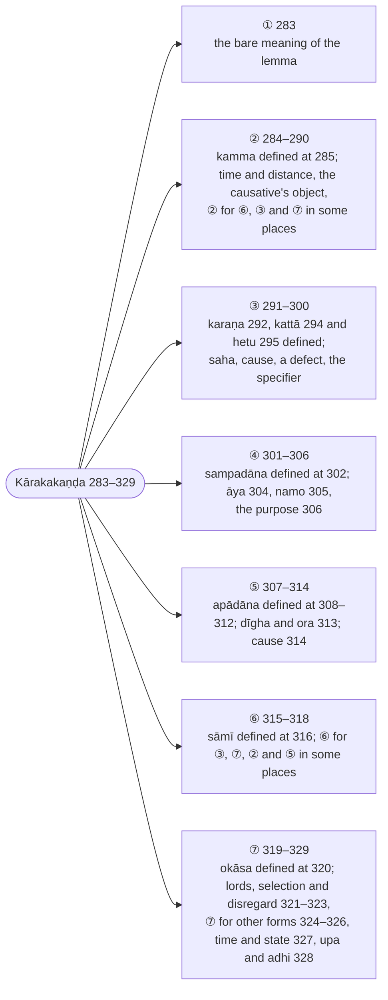

import { LinkCard } from "@astrojs/starlight/components";

:::note
Buddhappiya takes the inflection forms in order, ① to ⑦, assigns each to its meaning and defines the `kāraka` — agent, object, instrument, recipient, source, owner, location — where its form comes up, whereas Kaccāyana defined the `kāraka` first (§271–§283) and assigned the forms afterwards. His commentary adds the traditional definitions and defends them.

:::

:::note[The forms in Buddhappiya's order]
Kaccāyana defines the `kāraka` first (§271–§283) and assigns the forms afterwards; Buddhappiya takes the seven forms in order and defines each `kāraka` where its form is assigned. The numbers are Rūpasiddhi numbers.

:::

> Atha vibhattīnamatthabhedā vuccante.

Now the different meanings of the inflections (`vibhatti`) are stated.

> Tattha ekampi atthaṃ kammādivasena, ekattādivasena ca vibhajantīti vibhattiyo, syādayo. Tā pana paṭhamādibhedena sattavidhā.

Here "inflections" (`vibhatti`) means `si` and the rest, because they divide (`vibhajanti`) even a single meaning according to its being an object (`kamma`) and so on, and according to its being one and so on. And they are of seven kinds by the division into the first form ① and the rest.

> Tattha kasmiṃ atthe paṭhamā?

Among these, in what sense is there the first form ①?

---

### 283 (§284): Liṅgatthe paṭhamā (the first form ① for the bare meaning of the lemma) :badge[utsarga]{variant=success}

:::tip[Kaccāyana]
<LinkCard title="§284 (283): Liṅgatthe paṭhamā" href="/kaccayana/3-karakakappa#m284" description="the first form ① for the bare meaning of the lemma" />
:::

> Liṅgatthābhidhānamatte paṭhamāvibhatti hoti.

The first inflection ① is used merely to express the meaning of the lemma (`liṅgattha`).

> Liṅgassa attho liṅgattho. Ettha ca līnaṃ aṅganti liṅgaṃ, apākaṭo avayavo, purisotiādīnañhi pakatippaccayādivibhāgakappanāya nipphāditānaṃ saddappatirūpakānaṃ nāmikapadānaṃ paṭhamaṃ ṭhapetabbaṃ pakatirūpaṃ apākaṭattā, avayavattā ca liṅganti vuccati. Atha vā visadāvisadobhayarahitākāravohārasaṅkhātena tividhaliṅgena sahitatthassa, tabbinimuttassupasaggādīnamatthassa ca līnassa gamanato, liṅganato vā liṅganti anvatthanāmavasena vā ‘‘dhātuppaccayavibhattivajjitamatthavaṃ liṅga’’nti vacanato parasamaññāvasena vā liṅganti idha pāṭipadikāparanāmadheyyaṃ syā divibhatyantapadapakatirūpameva vuccatīti daṭṭhabbaṃ.

`liṅgattha` is the meaning (`attha`) of the lemma (`liṅga`). And here a `liṅga` is a hidden limb (`līnaṃ aṅgaṃ`), an unmanifest component: for nominal words such as `puriso`, which are produced by positing a division into lemma, suffix and the rest and are only semblances of words (`saddappatirūpaka`), the lemma form (`pakatirūpa`) that has to be set up first is called `liṅga` because it is unmanifest and because it is a component. Or else it is called `liṅga` as a meaningful ([`anvattha`](/introduction#types-of-suttas)) name, because a hidden meaning is made known (`gamanato`) or indicated (`liṅganato`) — both a meaning accompanied by the threefold gender, which is the conventional usage of the clear, the unclear and the neither, and the meaning of prefixes and the like, which is free of that; or else it is called `liṅga` by the terminology of others (`parasamaññā`), from the statement "a `liṅga` is what has meaning apart from root, suffix and inflection". It should be understood that `liṅga` here means only the lemma form of a word ending in the inflections `si` and the rest, whose other name is `pāṭipadika` (a nominal base).

> Liṅgassattho nāma pabandhavisesākārena pavattamāne rūpādayo upādāya paññāpīyamāno tadaññānaññabhāvena anibbacanīyo samūhasantānādibhedo upādāpaññattisaṅkhāto ghaṭapaṭādivohārattho ca pathavīdhātuphassādīnaṃ sabhāvadhammānaṃ kāladesādibhedabhinnānaṃ vijātiyavinivatto sajātiyasādhāraṇo yathāsaṅketamāropasiddho tajjāpaññattisaṅkhāto kakkhaḷattaphusanādisāmaññākāro ca.

The meaning of a lemma is both the conventional meaning (`vohārattha`) of "pot", "cloth" and the like — a group, a continuum or the like, made known in dependence on material form and the rest as they occur in the form of a particular series, not to be described as either identical with them or different from them, and called a derived concept (`upādāpaññatti`) — and the general character (`sāmaññākāra`) of hardness, touching and the like that belongs to real phenomena (`sabhāvadhamma`) such as the earth element and contact, which differ by differences of time, place and so on: a character that excludes what is of another kind, is common to what is of the same kind, is established by imposition according to convention, and is called a concept of the corresponding kind (`tajjāpaññatti`).

> So pana kammādisaṃsaṭṭho, suddho cāti duvidho. Tattha kammādīsu dutiyādīnaṃ vidhīyamānattā kammādisaṃsaggarahito liṅgasaṅkhyāparimāṇayutto, tabbinimuttupasaggādipadatthabhūto ca suddho saddattho idha liṅgattho nāma.

And that meaning is of two kinds: mixed with the object (`kamma`) and the rest, and bare (`suddha`). Of these, since the second form and the rest are prescribed for the object and the rest, what is here called `liṅgattha` is the bare meaning of a word: a meaning free of connection with the object and the rest and possessed of gender, number and measure, and also the meaning of a word such as a prefix, which is free even of those.

> Yo pana ākhyātakitakataddhitasamāsehi vutto kammādisaṃsaṭṭho attho, sopi dutiyādīnaṃ puna attanā vattabbassa atthavisesassābhāvena avisayattā, liṅgatthamattassa sambhavato ca paṭhamāyeva visayo.

But a meaning mixed with the object and the rest that is expressed (`vutta`) by a verb, a `kita` word, a `taddhita` word or a compound is also the province (`visaya`) of the first form alone, since it is not the province of the second form and the rest — there being no further particular of meaning for them to express — and since only the bare meaning of the lemma is possible.

> Hoti cettha –

And here there is [the verse]:

> Paṭhamāvupasaggatthe, kesañcatthe nipātasaddānaṃ; \
> Liṅgādike ca suddhe-bhihite kammādiatthepi.

The first form is used in the sense of a prefix and in the sense of some particle words, \
in the bare [meaning] of gender and the rest, and also in the sense of the object and the rest when it is already expressed.

> Saliṅge tāva – eso puriso, ete purisā, esā kaññā, etā kaññāyo, etaṃ cittaṃ, etāni cittāni.

First, with gender: `eso puriso` ("this man"), `ete purisā` ("these men"), `esā kaññā` ("this girl"), `etā kaññāyo` ("these girls"), `etaṃ cittaṃ` ("this mind"), `etāni cittāni` ("these minds").

> Sasaṅkhye – eko dve.

With number: `eko` ("one"), `dve` ("two").

> Saparimāṇe – doṇo khārī āḷhakaṃ.

With measure: `doṇo` ("a `doṇa` measure"), `khārī` ("a `khārī` measure"), `āḷhakaṃ` ("an `āḷhaka` measure").

> Liṅgādivinimutte sattāmatte – ca vā ha ahaṃ atthi sakkālabbhā iccādi.

In mere existence (`sattāmatta`), free of gender and the rest: `ca` ("and"), `vā` ("or"), `ha` ("indeed"), `ahaṃ` ("ah!"), `atthi` ("there is"), `sakkā` ("one is able"), `labbhā` ("it is possible") and so on.

> ‘‘Liṅgatthe paṭhamā’’ti adhikicca ‘‘ālapane cā’’ti ālapanatthe ca paṭhamā, abhimukhaṃ katvā lapanaṃ ālapanaṃ, āmantanaṃ avhānanti attho.

Taking “`Liṅgatthe paṭhamā`” as the governing rule ([`adhikāra`](/introduction#types-of-suttas)), by [§285 (70): Ālapane ca](/kaccayana/3-karakakappa#m285) the first form ① is used in the sense of the vocative (`ālapana`) as well. The vocative (`ālapana`) is speaking (`lapana`) face to face (`abhimukhaṃ katvā`): the meaning is calling to (`āmantana`), summoning (`avhāna`).

> Ettha ca āmantanaṃ nāma pageva laddhasarūpassa saddena abhimukhīkaraṇaṃ, katābhimukho pana ‘‘gacchā’’tiādinā nayena kriyāya yojīyati, tasmā āmantanasamaye kriyāyogābhāvato idaṃ kārakavohāraṃ na labhati.

And here calling to (`āmantana`) means turning someone who already has his own identity (`sarūpa`) towards oneself by means of a word; once turned, he is joined to an action in the manner of "go" and the like. Therefore, since there is no connection with an action at the moment of calling, the vocative does not receive the designation `kāraka`.

> Vuttañca

And it is said:

> ‘‘Saddenābhimukhīkāro, vijjamānassa vatthuno; \
> Āmantanaṃ vidhātabbe, natthi ‘rājā bhave’tida’’nti.

"Calling to (`āmantana`) is turning an existing thing towards oneself by means of a word; \
where the thing is still to be brought about, as in 'may there be a king', there is none."

> Bho purisa ehi, bho purisā vā, bhavanto purisā etha.

`bho purisa ehi` ("come, man!"), or `bho purisā`; `bhavanto purisā etha` ("come, men!").

> Kasmiṃ atthe dutiyā?

In what sense is the second form ② used?

---

### 284 (§297): Kammatthe dutiyā (② for the `kamma` [object]) :badge[utsarga]{variant=success}

:::tip[Kaccāyana]
<LinkCard title="§297 (284): Kammatthe dutiyā" href="/kaccayana/3-karakakappa#m297" description="② for the `kamma` [object]" />
:::

> Kammatthe liṅgamhā dutiyāvibhatti hoti.

The second inflection ② is used after the lemma in the sense of the object (`kamma`).

> Anabhihite evāyaṃ, ‘‘kammani dutiyāyaṃ tto’’ti vacanañcettha ñāpakaṃ.

This applies only when the object is not already expressed (`anabhihita`), and here the statement [§626 (634): Kammani dutiyāya tto](/kaccayana/8-unadikappa#m626) is the indicator (`ñāpaka`) of that.

> Kiṃ kammaṃ?

What is the object (`kamma`)?

> ‘‘Yena vā kayirate taṃ karaṇa’’nti ito ‘‘vā’’ti vattate.

“`vā`” continues from [§279 (292): Yena vā kayirate taṃ karaṇaṃ](/kaccayana/3-karakakappa#m279).

---

### 285 (§280): Yaṃ karoti taṃ kammaṃ (what one does: `kamma`) :badge[anvattha]{variant=note}

:::tip[Kaccāyana]
<LinkCard title="§280 (285): Yaṃ karoti taṃ kammaṃ" href="/kaccayana/3-karakakappa#m280" description="what one does: `kamma`" />
:::

> Yaṃ vā karoti, yaṃ vā vikaroti, yaṃ vā pāpuṇāti, taṃ kārakaṃ kammasaññaṃ hoti.

Whatever one makes, alters or reaches — that `kāraka` is termed the object (`kamma`).

> Idha liṅgakālavacanamatantaṃ. Karīyatīti kammaṃ. Tattha kārakaṃ, sādhakaṃ kriyānipphattiyā kāraṇamuccate, taṃ pana kārakaṃ chabbidhaṃ kammaṃ kattā karaṇaṃ sampadānamapādānamokāso cāti. Tattha sabhāvato, parikappato vā kammādimhi satiyeva kriyābhāvato kammādīnaṃ channampi kārakavohāro siddhova hoti.

Here gender, tense and number are not essential (`atanta`). The object (`kamma`) is what is done (`karīyati`). There, a `kāraka` is said to be the accomplisher (`sādhaka`), the cause of bringing an action about, and that `kāraka` is of six kinds: the object (`kamma`), the agent (`kattā`), the instrument (`karaṇa`), the recipient (`sampadāna`), the point of departure (`apādāna`) and the location (`okāsa`). And since an action exists only when the object and the rest are present, whether in fact (`sabhāvato`) or in thought (`parikappato`), the designation `kāraka` is indeed established for all six of them, the object and the rest.

> Taṃ pana kammaṃ tividhaṃ nibbattanīyaṃ vikaraṇīyaṃ pāpaṇīyañcāti. Yathā – mātā puttaṃ vijāyati, āhāro sukhaṃ janayati. Ghaṭaṃ karoti devadatto, kaṭṭhamaṅgāraṃ karoti, suvaṇṇaṃ keyūraṃ, kaṭakaṃ vā karoti, vīhayo lunāti. Devadatto nivesanaṃ pavisati, ādiccaṃ passati, dhammaṃ suṇāti, paṇḍite payirupāsati.

And that object is of three kinds: what is to be produced (`nibbattanīya`), what is to be altered (`vikaraṇīya`) and what is to be reached (`pāpaṇīya`). For example, `mātā puttaṃ vijāyati` ("the mother gives birth to a son"), `āhāro sukhaṃ janayati` ("food produces pleasure"); `ghaṭaṃ karoti devadatto` ("Devadatta makes a pot"), `kaṭṭhamaṅgāraṃ karoti` ("he makes the wood into charcoal"), `suvaṇṇaṃ keyūraṃ, kaṭakaṃ vā karoti` ("he makes the gold into an armlet or a bracelet"), `vīhayo lunāti` ("he reaps the rice"); `devadatto nivesanaṃ pavisati` ("Devadatta enters the house"), `ādiccaṃ passati` ("he sees the sun"), `dhammaṃ suṇāti` ("he hears the teaching"), `paṇḍite payirupāsati` ("he waits upon the wise").

> Vuttañca

And it is said:

> ‘‘Nibbattivikatippatti-bhedena tividhaṃ mataṃ; \
> Kattu kriyābhigammaṃ taṃ, sukhaṅgāraṃ nivesana’’nti.

"By the division into production, alteration and attainment it is held to be of three kinds: \
what the agent's action reaches — pleasure, charcoal, a dwelling."

> Ettha ca icchitānicchitakathitākathitādibhedamanapekkhitvā sabbasaṅgāhakavasena ‘‘yaṃ karoti taṃ kamma’’nti vuttattā, atthantaravikappanavādhikārato ca sabbattha imināva kammasaññā hoti.

And here, because "what one does is the object" is stated all-inclusively, without regard to the divisions into wished and unwished, stated and unstated and so on, and because the `vā` that opens the option of other senses (`atthantaravikappana`) is a governing rule ([`adhikāra`](/introduction#types-of-suttas)), it is by this rule alone that the term `kamma` is given in every case.

> Tattha anicchitakammaṃ yathā – kaṇṭakaṃ maddati, visaṃ gilati, gāmaṃ gacchanto rukkhamūlaṃ upagacchati.

Among these, an unwished object (`anicchitakamma`) is, for example, `kaṇṭakaṃ maddati` ("he treads on a thorn"), `visaṃ gilati` ("he swallows poison"), `gāmaṃ gacchanto rukkhamūlaṃ upagacchati` ("going to the village, he comes to the foot of a tree").

> Akathitakammaṃ yathā – yaññadattaṃ kambalaṃ yācate brāhmaṇo. Ettha hi ‘‘kambala’’miti kathitakammaṃ dvikammikāya yācanakriyāya pattumicchitatarattā. ‘‘Yaññadatta’’miti appadhānattā akathitakammaṃ. Tathā samiddhaṃ dhanaṃ bhikkhate, ajaṃ gāmaṃ nayati, parābhavantaṃ purisaṃ, mayaṃ pucchāma gotamaṃ, bhagavā bhikkhū etadavoca iccādi.

An unstated object (`akathitakamma`) is, for example, `yaññadattaṃ kambalaṃ yācate brāhmaṇo` ("the brahmin begs Yaññadatta for a blanket"). For here `kambalaṃ` is the stated object (`kathitakamma`), because, for the action of begging, which takes two objects, it is the one more desired to be obtained, while `yaññadattaṃ`, being subordinate (`appadhāna`), is the unstated object. Likewise `samiddhaṃ dhanaṃ bhikkhate` ("he begs the rich man for money"), `ajaṃ gāmaṃ nayati` ("he leads the goat to the village"), `parābhavantaṃ purisaṃ, mayaṃ pucchāma gotamaṃ` ("we ask Gotama about the declining man"), `bhagavā bhikkhū etadavoca` ("the Blessed One said this to the monks") and so on.

:::tip[Examples]

> `parābhavantaṃ purisaṃ, mayaṃ pucchāma gotamaṃ` \
> [(18Sn 1.6: Parābhavasutta)](https://tipitaka2500.github.io/tipitaka/18Sn/1/1.6#107) \
🚹②⨀(parābhavanta) 🚹②⨀(purisa) ⚧️①⨂(amha) ▶️👆⨂(pucchati) 🚹②⨀(gotama) \
about the declining | man | we | ask | Gotama

> `bhagavā bhikkhū etadavoca` \
> [(12S1 11.2.2: Sakkanāmasutta)](https://tipitaka2500.github.io/tipitaka/12S1/11/11.2/11.2.2#1615) \
🚹①⨀(bhagavantu) 🚹②⨂(bhikkhu) ⚧️②⨀(eta) ⏮🤟⨀(vacati) \
the Blessed One | to the monks | this | said

:::

> Abhihitakamme pana na hoti, yathā – kaṭo karīyate devadattena, sugatena desito dhammo, yaññadatto kambalaṃ yācīyate brāhmaṇena iccādi.

But when the object is already expressed (`abhihitakamma`), the second form is not used; for example, `kaṭo karīyate devadattena` ("the mat is being made by Devadatta"), `sugatena desito dhammo` ("the teaching taught by the Well-gone One"), `yaññadatto kambalaṃ yācīyate brāhmaṇena` ("Yaññadatta is begged by the brahmin for a blanket") and so on.

> ‘‘Dutiyā’’ti adhikāro.

“`dutiyā`” ("the second") is a governing rule ([`adhikāra`](/introduction#types-of-suttas)).

---

### 286 (§300): Gati buddhi bhuja paṭha hara kara sayādīnaṃ kārite vā (optionally ② for the one made to act in a causative) :badge[apavada]{variant=success}

:::tip[Kaccāyana]
<LinkCard title="§300 (286): Gati buddhi bhuja paṭha hara kara sayādīnaṃ kārite vā" href="/kaccayana/3-karakakappa#m300" description="optionally ② for the one made to act in a causative" />
:::

> Gamu sappa gatimhi, budha bodhane, budha avagamane vā, bhuja pālanabyavaharaṇesu, paṭha byattiyaṃ vācāyaṃ, hara haraṇe, kara karaṇe, si saye iccevamādīnaṃ dhātūnaṃ payoge kārite sati payojjakakattubhūte kammani liṅgamhā dutiyāvibhatti hoti vā. Niccasampatte vikappatthoyaṃ, tena tassa pakkhe tatiyā hoti.

When a causative (`kārita`) is used with the roots `gamu` and `sappa` in the sense of going, `budha` in the sense of awakening or `budha` in the sense of understanding, `bhuja` in the senses of protecting and eating, `paṭha` in the sense of distinct speech, `hara` in the sense of carrying, `kara` in the sense of doing, `si` in the sense of lying down, and others like them, the second inflection ② is optionally used after the lemma for the object that is the agent set to work (`payojjakakattā`). This `vā` has the sense of an option (`vikappa`) where the second form would apply obligatorily (`niccasampatta`), and so in the other branch of the option the third form ③ is used.

> Yo koci puriso gāmaṃ gacchati, tamañño payojayati. Puriso purisaṃ gāmaṃ gamayati, purisena vā gāmaṃ gamayati. Evaṃ sissaṃ dhammaṃ bodheti ācariyo, mātā puttaṃ bhojanaṃ bhojayati, sissaṃ dhammaṃ pāṭheti ācariyo, puriso purisaṃ bhāraṃ hāreti, tathā puriso purisaṃ kammaṃ kārayati, purisena vā kammaṃ kārāpayati, puriso purisaṃ sayāpayati. Evaṃ sabbattha kārite kattukammani dutiyā.

Some man goes to the village, and another sets him to it: `puriso purisaṃ gāmaṃ gamayati` ("the man makes the man go to the village"), `purisena vā gāmaṃ gamayati` ("or he makes the man go to the village", with the man in the third form ③). Likewise `sissaṃ dhammaṃ bodheti ācariyo` ("the teacher makes the pupil understand the teaching"), `mātā puttaṃ bhojanaṃ bhojayati` ("the mother feeds the son the meal"), `sissaṃ dhammaṃ pāṭheti ācariyo` ("the teacher makes the pupil recite the teaching"), `puriso purisaṃ bhāraṃ hāreti` ("the man makes the man carry the load"); so too `puriso purisaṃ kammaṃ kārayati` ("the man makes the man do the work"), `purisena vā kammaṃ kārāpayati` ("or he has the work done by the man"), `puriso purisaṃ sayāpayati` ("the man makes the man lie down"). So everywhere in a causative the second form is used for the agent that has become the object (`kattukamma`).

> Kārite ti kiṃ? Puriso gāmaṃ gacchati.

By saying `kārite` (in a causative) we exclude `puriso gāmaṃ gacchati` ("the man goes to the village").

> Abhihite na bhavati, purisena puriso gāmaṃ gamīyate, sisso dhammaṃ bodhīyate iccādi.

When already expressed (`abhihite`), the second form is not used: `purisena puriso gāmaṃ gamīyate` ("the man is made by the man to go to the village"), `sisso dhammaṃ bodhīyate` ("the pupil is made to understand the teaching") and so on.

---

### 287 (§298): Kāladdhānamaccantasaṃyoge (② for time and distance in unbroken connection) :badge[apavada]{variant=success}

:::tip[Kaccāyana]
<LinkCard title="§298 (287): Kāladdhānamaccantasaṃyoge" href="/kaccayana/3-karakakappa#m298" description="② for time and distance in unbroken connection" />
:::

> Accantaṃ nirantaraṃ saṃyogoaccantasaṃyogo. Kāladdhānaṃ dabbaguṇakriyāhi accantasaṃyoge tehi kāladdhānavācīhi liṅgehi dutiyāvibhatti hoti.

Unbroken connection (`accantasaṃyoga`) is connection that is unbroken (`accanta`), that is, uninterrupted (`nirantara`). When time or distance is in unbroken connection with a thing, a quality or an action, the second inflection ② is used after the lemmas that express that time or distance.

> Kāle tāva – sattāhaṃ gavapānaṃ, māsaṃ maṃsodanaṃ, saradaṃ ramaṇīyā nadī, sabbakālaṃ ramaṇīyaṃ nandanaṃ, māsaṃ sajjhāyati, tayo māse abhidhammaṃ desesi.

First, with time: `sattāhaṃ gavapānaṃ` ("for seven days, the drink of milk-rice"), `māsaṃ maṃsodanaṃ` ("for a month, rice with meat"), `saradaṃ ramaṇīyā nadī` ("through the autumn the river is delightful"), `sabbakālaṃ ramaṇīyaṃ nandanaṃ` ("at all times the Nandana grove is delightful"), `māsaṃ sajjhāyati` ("for a month he recites"), `tayo māse abhidhammaṃ desesi` ("for three months he taught the Abhidhamma").

> Addhāne – yojanaṃ vanarāji, yojanaṃ dīgho pabbato, kosaṃ sajjhāyati.

With distance: `yojanaṃ vanarāji` ("the belt of forest [runs] for a league"), `yojanaṃ dīgho pabbato` ("the mountain is a league long"), `kosaṃ sajjhāyati` ("for a `kosa` [of the way] he recites").

> Accantasaṃyoge ti kiṃ? Māse māse bhuñjati, yojane yojane vihāraṃ patiṭṭhāpesi.

By saying `accantasaṃyoge` (in unbroken connection) we exclude `māse māse bhuñjati` ("he eats every month") and `yojane yojane vihāraṃ patiṭṭhāpesi` ("at every league he established a monastery").

---

### 288 (§299): Kammappavacanīyayutte (② with a `kammappavacanīya` [governing particle]) :badge[apavada]{variant=success}

:::tip[Kaccāyana]
<LinkCard title="§299 (288): Kammappavacanīyayutte" href="/kaccayana/3-karakakappa#m299" description="② with a `kammappavacanīya` [governing particle]" />
:::

> Kammappavacanīyehi nipātopasaggehi yutte yoge sati liṅgamhā dutiyāvibhatti hoti.

When a lemma is joined in construction with particles or prefixes that are `kammappavacanīya`, the second inflection ② is used after it.

> Kammaṃ pavacanīyaṃ yesaṃ te kammappavacanīyā, parasamaññāvasena vā anvādayo kammappavacanīyā.

`kammappavacanīya` are those by which an action (`kamma`) is to be expressed (`pavacanīya`); or else, by the terminology of others (`parasamaññā`), `anu` and the rest are the `kammappavacanīya`.

> Tattha anu saddassa lakkhaṇe, sahatthe, hīne ca kammappavacanīyasaññā vuttā. Yathā – pabbajitamanu pabbajiṃsu, nadimanvavasitā bārāṇasī, nadiyā saha avabaddhāti attho, anu sāriputtaṃ paññavā.

Among them, the word `anu` is given the term `kammappavacanīya` in the sense of a mark (`lakkhaṇa`), in the sense of "together with" (`sahattha`) and in the sense of inferiority (`hīna`). For example, `pabbajitamanu pabbajiṃsu` ("they went forth after the one who had gone forth"), `nadimanvavasitā bārāṇasī` ("Benares lies along the river"), which means `nadiyā saha avabaddhā` ("bound together with the river"), and `anu sāriputtaṃ paññavā` ("wise, second to Sāriputta").

:::tip[Examples]

> `pabbajitamanupabbajiṃsu` \
> [(7D 1.10: Mahājanakāyaanupabbajjā)](https://tipitaka2500.github.io/tipitaka/7D/1/1.10#110) \
🚹②⨀(pabbajita) 🔼(anu) ⏮🤟⨂(pabbajati) \
the one who had gone forth | after | they went forth

:::

> Lakkhaṇādīsu ‘‘lakkhaṇi’tthambhūtakkhānabhāga vicchāsu pati pari anavo’’ti pati pari anūnaṃ kammappavacanīyasaññā vuttā.

In the senses of a mark and the rest, by the rule "`pati`, `pari` and `anu` in the senses of a mark, of the statement of someone's condition, of a share and of distribution", `pati`, `pari` and `anu` are given the term `kammappavacanīya`.

> Lakkhaṇe sūriyuggamanaṃ pati dibbā bhakkhā pātubhaveyyuṃ, rukkhaṃ pati vijjotate cando, rukkhaṃ pari, rukkhaṃ anu.

In the sense of a mark (`lakkhaṇa`): `sūriyuggamanaṃ pati dibbā bhakkhā pātubhaveyyuṃ` ("towards sunrise heavenly foods may appear"), `rukkhaṃ pati vijjotate cando` ("the moon shines towards the tree"), `rukkhaṃ pari` ("round the tree"), `rukkhaṃ anu` ("along the tree").

:::tip[Examples]

> `sūriyuggamanaṃ pati dibbā bhakkhā pātubhaveyyuṃ` \
> [(19Pv 2.9: Aṅkurapetavatthu)](https://tipitaka2500.github.io/tipitaka/19Pv/2/2.9#322) \
🚻②⨀(sūriyuggamana) 🔼(pati) 🚹①⨂(dibba) 🚹①⨂(bhakkha) ⏯🤟⨂(pātubhavati) \
sunrise | towards | heavenly | foods | may appear

:::

> Itthambhūtakkhāne sādhu devadatto mātaraṃ pati, mātaraṃ pari, mātaraṃ anu.

In the statement of someone's condition (`itthambhūtakkhāna`): `sādhu devadatto mātaraṃ pati` ("Devadatta is good towards his mother"), `mātaraṃ pari`, `mātaraṃ anu` ("towards his mother").

> Bhāge yadettha maṃ pati siyā, maṃ pari, maṃ anu, taṃ dīyatu.

In the sense of a share (`bhāga`): `yadettha maṃ pati siyā, taṃ dīyatu` ("whatever here would fall to me, let that be given"), or `maṃ pari`, `maṃ anu` ("to me").

> Vicchāyoge atthamatthaṃ pati saddo nivisati, rukkhaṃ rukkhaṃ pati vijjotate cando, rukkhaṃ rukkhaṃ pari, rukkhaṃ rukkhaṃ anu.

In construction with distribution (`vicchā`): `atthamatthaṃ pati saddo nivisati` ("a word settles on each meaning in turn"), `rukkhaṃ rukkhaṃ pati vijjotate cando` ("the moon shines on tree after tree"), `rukkhaṃ rukkhaṃ pari`, `rukkhaṃ rukkhaṃ anu` ("round each tree", "along each tree").

> ‘‘Abhirabhāge’’ti abhissa bhāgavajjitesu lakkhaṇādīsu kammappavacanīyasaññā vuttā. Taṃ kho pana bhavantaṃ gotamaṃ evaṃ kalyāṇo kittisaddo abbhuggato, sādhu devadatto mātaraṃ abhi.

By the rule "`abhi`, except in the sense of a share", `abhi` is given the term `kammappavacanīya` in the senses of a mark and the rest, the sense of a share excepted: `taṃ kho pana bhavantaṃ gotamaṃ evaṃ kalyāṇo kittisaddo abbhuggato` ("now about that venerable Gotama such a fair report has spread"), `sādhu devadatto mātaraṃ abhi` ("Devadatta is good towards his mother").

:::tip[Examples]

> `taṃ kho pana bhavantaṃ gotamaṃ evaṃ kalyāṇo kittisaddo abbhuggato` \
> [(1V Veranjakanda: Verañjakaṇḍa)](https://tipitaka2500.github.io/tipitaka/1V/1/Veranjakanda#2) \
🚹②⨀(ta) 🔼(kho) 🔼(pana) 🚹②⨀(bhavanta) 🚹②⨀(gotama) 🔼(evaṃ) 🚹①⨀(kalyāṇa) 🚹①⨀(kittisadda) 🚹①⨀(abbhuggata) \
that | indeed | now | the venerable | Gotama | such | a fair | report | has spread about

:::

> Nipāte dhi brāhmaṇassa hantāra miccevamādi.

With a particle (`nipāta`): `dhi brāhmaṇassa hantāraṃ` ("fie upon the killer of a brahmin") and so on.

:::tip[Example]

> `dhī brāhmaṇassa hantāraṃ` \
> [(18Dh 26.7: Sāriputtattheravatthu)](https://tipitaka2500.github.io/tipitaka/18Dh/26/26.7#417) \
🔼(dhī) 🚹⑥⨀(brāhmaṇa) 🚹②⨀(hantu) \
fie | of a brahmin | upon the killer

:::

---

### 289 (§306): Kvaci dutiyā chaṭṭhīnamatthe (sometimes ② in the sense of the sixth) :badge[apavada]{variant=success}

:::tip[Kaccāyana]
<LinkCard title="§306 (289): Kvaci dutiyā chaṭṭhīnamatthe" href="/kaccayana/3-karakakappa#m306" description="sometimes ② in the sense of the sixth" />
:::

> Chaṭṭhīnaṃ atthe kvaci dutiyāvibhatti hoti. Antarāabhito parito pati paṭibhātiyoge ayaṃ. Antarā ca rājagahaṃ antarā ca nāḷandaṃ addhānamaggappaṭipanno, rājagahassa ca nāḷandāya ca majjheti attho. Abhito gāmaṃ vasati, parito gāmaṃ vasati, nadiṃ nerañjaraṃ pati, nerañjarāya nadiyā samīpeti attho. Paṭibhantu taṃ cunda bojjhaṅgā, upamā maṃ paṭibhāti, upamā mayhaṃ upaṭṭhahatīti attho.

In some places the second inflection ② is used in the sense of the sixth [inflections]. This applies in construction with `antarā`, `abhito`, `parito`, `pati` and `paṭibhāti`: `antarā ca rājagahaṃ antarā ca nāḷandaṃ addhānamaggappaṭipanno` ("travelling the high road between Rājagaha and Nāḷandā"), which means `rājagahassa ca nāḷandāya ca majjhe` ("in the middle of Rājagaha and Nāḷandā"); `abhito gāmaṃ vasati` ("he lives near the village"), `parito gāmaṃ vasati` ("he lives round about the village"); `nadiṃ nerañjaraṃ pati` ("beside the river Nerañjarā"), which means `nerañjarāya nadiyā samīpe` ("near the river Nerañjarā"); `paṭibhantu taṃ cunda bojjhaṅgā` ("let the factors of awakening occur to you, Cunda"), `upamā maṃ paṭibhāti` ("a simile occurs to me"), which means `upamā mayhaṃ upaṭṭhahati` ("a simile presents itself to me").

:::tip[Examples]

> `antarā ca rājagahaṃ antarā ca nāḷandaṃ addhānamaggappaṭipanno` \
> [(6D 1.1: Paribbājakakathā)](https://tipitaka2500.github.io/tipitaka/6D/1/1.1#2) \
🔼(antarā) 🔼(ca) 🚻②⨀(rājagaha) 🔼(antarā) 🔼(ca) 🚺②⨀(nāḷandā) 🚹①⨀(addhānamaggappaṭipanna) \
between | and | Rājagaha | between | and | Nāḷandā | travelling the high road

> `nadiṃ nerañjaraṃ pati` \
> [(18Sn 3.2: Padhānasutta)](https://tipitaka2500.github.io/tipitaka/18Sn/3/3.2#493) \
🚺②⨀(nadī) 🚺②⨀(nerañjarā) 🔼(pati) \
the river | Nerañjarā | beside

> `paṭibhantu taṃ, cunda, bojjhaṅgā` \
> [(14S5 2.2.6: Tatiyagilānasutta)](https://tipitaka2500.github.io/tipitaka/14S5/2/2.2/2.2.6#442) \
⏯🤟⨂(paṭibhāti) ⚧️②⨀(tumha) 🚹⓪⨀(cunda) 🚹①⨂(bojjhaṅga) \
let occur | to you | Cunda | the factors of awakening

> `paṭibhāti maṃ, bhagavā` \
> [(12S1 3.2.2: Pañcarājasutta)](https://tipitaka2500.github.io/tipitaka/12S1/3/3.2/3.2.2#648) \
▶️🤟⨀(paṭibhāti) ⚧️②⨀(amha) 🚹⓪⨀(bhagavantu) \
it occurs | to me | Blessed One

:::

> ‘‘Kvaci dutiyā, atthe’’ti ca vattate.

“`kvaci`”, “`dutiyā`” and “`atthe`” also continue.

---

### 290 (§307): Tatiyāsattamīnañca (and [sometimes ②] in the sense of the third and seventh) :badge[apavada]{variant=success}

:::tip[Kaccāyana]
<LinkCard title="§307 (290): Tatiyāsattamīnañca" href="/kaccayana/3-karakakappa#m307" description="and [sometimes ②] in the sense of the third and seventh" />
:::

> Tatiyāsattamīnamatthe ca kvaci liṅgamhā dutiyāvibhatti hoti.

And in some places the second inflection ② is used after the lemma in the sense of the third and the seventh [inflections].

> Tatiyatthe sace maṃ nālapissati, tvañca maṃ nābhibhāsasi, vinā saddhammaṃ kuto sukhaṃ, upāyamantarena na atthasiddhi.

In the sense of the third: `sace maṃ nālapissati` ("if he will not converse with me"), `tvañca maṃ nābhibhāsasi` ("and you do not speak with me"), `vinā saddhammaṃ kuto sukhaṃ` ("without the true Dhamma, whence happiness?"), `upāyamantarena na atthasiddhi` ("without a means there is no success").

:::tip[Examples]

> `sace maṃ samaṇo gotamo ālapissati` \
> [(12S1 7.2.5: Mānatthaddhasutta)](https://tipitaka2500.github.io/tipitaka/12S1/7/7.2/7.2.5#1260) \
🔼(sace) ⚧️②⨀(amha) 🚹①⨀(samaṇa) 🚹①⨀(gotama) ⏯🤟⨀(ālapati) \
if | with me | the ascetic | Gotama | will converse

> `tvañca maṃ nābhibhāsasi` \
> [(23J 22.1.10.9: Maddīpabba)](https://tipitaka2500.github.io/tipitaka/23J/22/22.1/22.1.10/22.1.10.9#3577) \
⚧️①⨀(tumha) 🔼(ca) ⚧️②⨀(amha) 🔼(na) ▶️🤘⨀(abhibhāsati) \
you | and | with me | not | speak

:::

> Sattamiyatthe – kāle, upānvajjhāvasassa payoge, adhisiṭṭhāvasānaṃ payoge, tappānacāre ca dutiyā.

In the sense of the seventh, the second form is used for time, in construction with the root `vasa` preceded by `upa`, `anu`, `adhi` or `ā`, in construction with `si`, `ṭhā` and `vasa` preceded by `adhi`, and for drinking or roaming in a place (`tappānacāra`).

> Kāle tāva – pubbaṇhasamayaṃ nivāsetvā, ekaṃ samayaṃ bhagavā. Imaṃ rattiṃ cattāro mahārājāno.

First, for time: `pubbaṇhasamayaṃ nivāsetvā` ("having dressed in the forenoon"), `ekaṃ samayaṃ bhagavā` ("at one time the Blessed One"), `imaṃ rattiṃ cattāro mahārājāno` ("this night the four great kings").

:::tip[Examples]

> `pubbaṇhasamayaṃ nivāsetvā` \
> [(1V 1.1.1.1: Sudinnabhāṇavāra)](https://tipitaka2500.github.io/tipitaka/1V/1/1.1/1.1.1/1.1.1.1#53) \
🚹②⨀(pubbaṇhasamaya) 🔽(nivāsetvā) \
in the forenoon | having dressed

> `ekaṃ samayaṃ bhagavā` \
> [(10M 1.1: Kandarakasutta)](https://tipitaka2500.github.io/tipitaka/10M/1/1.1#2) \
⚧️②⨀(eka) 🚹②⨀(samaya) 🚹①⨀(bhagavantu) \
at one | time | the Blessed One

:::

> Upā dipubbassa vasa dhātussa payoge – gāmaṃ upavasati, gāmaṃ anuvasati, vihāraṃ adhivasati, gāmaṃ āvasati, agāraṃ ajjhāvasati. Tathā pathaviṃ adhisessati, gāmaṃ adhitiṭṭhati, gāmaṃ ajjhāvasati.

In construction with the root `vasa` preceded by `upa` and the rest: `gāmaṃ upavasati` ("he dwells near the village"), `gāmaṃ anuvasati` ("he dwells in the village"), `vihāraṃ adhivasati` ("he dwells in the monastery"), `gāmaṃ āvasati` ("he inhabits the village"), `agāraṃ ajjhāvasati` ("he lives in a house"). Likewise `pathaviṃ adhisessati` ("he will lie on the earth"), `gāmaṃ adhitiṭṭhati` ("he stands over the village"), `gāmaṃ ajjhāvasati` ("he lives in the village").

:::tip[Examples]

> `agāraṃ ajjhāvasati` \
> [(1V 1.4.1.6: Aññātakaviññattisikkhāpada)](https://tipitaka2500.github.io/tipitaka/1V/1/1.4/1.4.1/1.4.1.6#1987) \
🚻②⨀(agāra) ▶️🤟⨀(ajjhāvasati) \
a house | he lives in

> `aciraṃ vatayaṃ kāyo, pathaviṃ adhisessati` \
> [(18Dh 3.7: Pūtigattatissattheravatthu)](https://tipitaka2500.github.io/tipitaka/18Dh/3/3.7#44) \
🔼(aciraṃ) 🔼(vata) 🚹①⨀(ima) 🚹①⨀(kāya) 🚺②⨀(pathavī) ⏯🤟⨀(adhiseti) \
soon | alas | this | body | on the earth | will lie

:::

> Tappānacāresu – nadiṃ pivati, gāmaṃ carati iccādi.

For drinking or roaming in a place: `nadiṃ pivati` ("he drinks at the river"), `gāmaṃ carati` ("he roams in the village") and so on.

> Kasmiṃ atthe tatiyā?

In what sense is the third form ③ used?

---

### 291 (§286): Karaṇe tatiyā (the third form ③ for the instrument) :badge[utsarga]{variant=success}

:::tip[Kaccāyana]
<LinkCard title="§286 (291): Karaṇe tatiyā" href="/kaccayana/3-karakakappa#m286" description="the third form ③ for the instrument" />
:::

> Karaṇakārake tatiyāvibhatti hoti.

The third inflection ③ is used for the instrument (`karaṇa`) `kāraka`.

> Kiṃ karaṇaṃ?

What is the instrument (`karaṇa`)?

---

### 292 (§279): Yena vā kayirate taṃ karaṇaṃ (that by which [the action] is done: `karaṇa`) :badge[anvattha]{variant=note}

:::tip[Kaccāyana]
<LinkCard title="§279 (292): Yena vā kayirate taṃ karaṇaṃ" href="/kaccayana/3-karakakappa#m279" description="that by which [the action] is done: `karaṇa`" />
:::

> Yena vā kattā upakaraṇabhūtena vatthunā kriyaṃ abyavadhānena karoti, yena vā vikaroti, yena vā pāpuṇāti, taṃ kārakaṃ karaṇasaññaṃ hoti.

The thing serving as an aid (`upakaraṇa`) by which the agent does the action without anything intervening (`abyavadhāna`), or by which he alters or reaches [it] — that `kāraka` is termed the instrument (`karaṇa`).

> Karīyate anenāti karaṇaṃ, ettha ca satipi sabbakārakānaṃ kriyāsādhakatte ‘‘yena vā kayirate’’ti visesetvā vacanaṃ kattūpakaraṇabhūtesu kārakesu sādhakatamasseva gahaṇatthaṃ.

The instrument (`karaṇa`) is that by which [the action] is done (`karīyate anena`). And here, although all the `kāraka` accomplish the action, the specific wording "that by which it is done" is there to take in only the most effective (`sādhakatama`) among the `kāraka` that serve as the agent's aids.

> Vuttañca

And it is said:

> ‘‘Yassa sabbavisesena, kriyāsaṃsiddhihetutā; \
> Sambhāvīyati taṃ vuttaṃ, karaṇaṃ nāma kāraka’’nti.

"That whose being the cause of the action's accomplishment \
is conceived as surpassing all the rest is the `kāraka` called the instrument (`karaṇa`)."

> Taṃ pana duvidhaṃ ajjhattika bāhiravasena.

And it is of two kinds, internal (`ajjhattika`) and external (`bāhira`).

> Yathā – hatthena kammaṃ karoti, cakkhunā rūpaṃ passati, manasā dhammaṃ viññāya. Dattena vīhayo lunāti, agginā kuṭiṃ jhāpeti.

For example, `hatthena kammaṃ karoti` ("he does the work with his hand"), `cakkhunā rūpaṃ passati` ("he sees a form with the eye"), `manasā dhammaṃ viññāya` ("having cognized a mental object with the mind"); `dattena vīhayo lunāti` ("he reaps the rice with a sickle"), `agginā kuṭiṃ jhāpeti` ("he burns the hut with fire").

:::tip[Examples]

> `cakkhunā rūpaṃ passati` \
> [(13S4 1.3.4.2: Khaṇasutta)](https://tipitaka2500.github.io/tipitaka/13S4/1/1.3/1.3.4/1.3.4.2#777) \
🚻③⨀(cakkhu) 🚻②⨀(rūpa) ▶️🤟⨀(passati) \
with the eye | a form | he sees

> `manasā dhammaṃ viññāya` \
> [(6D 2.4.3.2.1: Indriyasaṃvara)](https://tipitaka2500.github.io/tipitaka/6D/2/2.4/2.4.3/2.4.3.2/2.4.3.2.1#304) \
🚹③⨀(mana) 🚹②⨀(dhamma) 🔽(viññāya) \
with the mind | a mental object | having cognized

:::

> ‘‘Tatiyā’’ti adhikāro.

“`tatiyā`” ("the third") is a governing rule ([`adhikāra`](/introduction#types-of-suttas)).

---

### 293 (§288): Kattari ca (and for the agent) :badge[utsarga]{variant=success}

:::tip[Kaccāyana]
<LinkCard title="§288 (293): Kattari ca" href="/kaccayana/3-karakakappa#m288" description="and for the agent" />
:::

> Kattari ca kārake liṅgamhā tatiyāvibhatti hoti. Caggahaṇena itthambhūtalakkhaṇe, kriyāpavagge, pubbasadisasamūnattha kalaha nipuṇa missaka sakhilatthādiyoge, kāladdhānesu, paccattakammatthapañcamiyatthādīsu ca tatiyā.

The third inflection ③ is used after the lemma for the agent (`kattā`) `kāraka` as well. By the mention of `ca`, the third form is used also for the mark of someone's condition (`itthambhūtalakkhaṇa`), for the completion of an action (`kriyāpavagga`), in construction with words in the sense of `pubba` (earlier), `sadisa` (like), `sama` (equal) and `ūna` (less), with `kalaha` (quarrel), `nipuṇa` (skilled) and `missaka` (mixed), and with words in the sense of `sakhila` (kindly) and the like, for time and distance, and in the senses of the first form (`paccatta`), of the object, of the fifth form and so on.

> Ko ca kattā?

And what is the agent (`kattā`)?

---

### 294 (§281): Yo karoti sa kattā (the one who does: `kattā`) :badge[anvattha]{variant=note}

:::tip[Kaccāyana]
<LinkCard title="§281 (294): Yo karoti sa kattā" href="/kaccayana/3-karakakappa#m281" description="the one who does: `kattā`" />
:::

> Yo kriyaṃ attappadhāno hutvā karoti, so kattusañño hoti.

Whoever does the action as the principal (`attappadhāna`) is termed `kattā` (the agent).

> So tividho suddhakattā hetukattā kammakattāti. Tattha yo sayameva kriyaṃ karoti, so suddhakattā. Yo aññaṃ kātuṃ samatthaṃ akarontaṃ kammaṃ niyojeti, so hetukattā, yathā – gantuṃ samattho devadatto, tamañño payojeti ‘‘gamayati devadatta’’nti.

The agent is of three kinds: the plain agent (`suddhakattā`), the causal agent (`hetukattā`) and the object-agent (`kammakattā`). Of these, the one who does the action by himself is the plain agent. The one who sets to a task another who is able to do it but is not doing it is the causal agent; for example, `gantuṃ samattho devadatto` ("Devadatta is able to go"), and another sets him to it: `gamayati devadattaṃ` ("he makes Devadatta go").

> Yaṃ pana tattha tattha gacchati devadatto, tamañño payojayati ‘‘gamayati devadatta’’nti hetvatthanidassanaṃ, tampi sāmatthiyadassanavasena vuttanti gahetabbaṃ. Aññathā yadi sayameva gacchati, kiṃ tattha payojakabyāpārena akarontaṃ balena kārayati, pāsāṇaṃ uṭṭhāpayatītiādikañca na sijjheyya.

As for the illustration of the causative sense (`hetvattha`) given here and there — `gacchati devadatto` ("Devadatta goes"), and another sets him to it: `gamayati devadattaṃ` ("he makes Devadatta go") — it too should be taken as stated to show his ability (`sāmatthiya`). Otherwise, if he goes by himself, what would there be for the instigator's activity to do? And `akarontaṃ balena kārayati` ("he forcibly makes one who is not acting act"), `pāsāṇaṃ uṭṭhāpayati` ("he makes the stone rise") and the like could not be accounted for.

> Ettha pana

And here

> ‘‘Kattā’’ti vattate.

“`kattā`” continues.

---

### 295 (§282): Yo kāreti sa hetu (the one who makes [the agent] act: `hetu`) :badge[anvattha]{variant=note}

:::tip[Kaccāyana]
<LinkCard title="§282 (295): Yo kāreti sa hetu" href="/kaccayana/3-karakakappa#m282" description="the one who makes [the agent] act: `hetu`" />
:::

> Yo kattāraṃ kāreti, so hetusañño hoti, kattā cāti hetukattusaññā.

The one who makes the agent act is termed `hetu` (the cause), and `kattā` (agent) as well: hence the term `hetukattā` (causal agent).

> Yo pana parassa kriyaṃ paṭicca kammabhūtopi sukarattā sayameva sijjhanto viya hoti, so kammakattā nāma, yathā – sayaṃ karīyate kaṭo, sayameva paccate odanoti.

But what is called the object-agent (`kammakattā`) is that which, though it is an object depending on another's action, seems to be accomplished by itself because it is easily done (`sukara`); for example, `sayaṃ karīyate kaṭo` ("the mat gets made by itself"), `sayameva paccate odano` ("the rice cooks by itself").

> Vuttañca

And it is said:

> ‘‘Attappadhāno kiriyaṃ, yo nibbatteti kārako; \
> Appayutto payutto vā, sa kattāti pavuccati.

"The `kāraka` that brings the action about as the principal, \
whether not set to it or set to it [by another], is called the agent (`kattā`).

> Hetukattāti kathito, \
> Kattuno yo payojako; \
> Kammakattāti sukaro, \
> Kammabhūto kathīyate’’ti.

The one who sets the agent to work \
is called the causal agent (`hetukattā`); \
an object that is easily done \
is called the object-agent (`kammakattā`)."

> Nanu ca ‘‘saṃyogo jāyate’’tiādīsu kathaṃ pure asato jananakriyāya kattubhāvosiyāti? Vuccate – lokasaṅketasiddho hi saddappayogo, avijjamānampi hi loko saddābhidheyyatāya vijjamānaṃ viya gahetvā voharati, vikappabuddhigahitākāroyeva hi saddenābhidhīyate, na tu vatthusabhāvo, aññathā sutamayañāṇenapi paccakkhena viya vatthusabhāvasacchikaraṇappasaṅgo ca musāvāda kudiṭṭhivādādīnamabhāvappasaṅgo ca siyā, tasmā buddhiparikappitapaññattivasenapi saddappavatti hotīti asato saṃyogādissapi hoteva jananakriyāya kattukārakatāti.

But, it may be objected, how in `saṃyogo jāyate` ("a contact arises") and the like can what did not exist before be the agent of the action of arising? The answer is that the use of words is established by worldly convention (`lokasaṅketa`): the world speaks even of what does not exist, treating it as if it existed, because it can be denoted by a word; for what a word denotes is only the form grasped by the conceiving mind (`vikappabuddhi`), not the real nature of the thing. Otherwise it would follow that the real nature of a thing could be realized by knowledge born of hearing as if by direct perception, and that false speech, wrong views and the like could not exist. Therefore, since words occur also by way of concepts constructed by the mind, a contact and the like, though non-existent, is indeed the agent `kāraka` of the action of arising.

> Yathāha

As [the verse] says:

> ‘‘Vohāravisayo saddo, nekantaparamatthiko; \
> Buddhisaṅkappito attho, tassatthoti pavuccati.

"A word has convention as its province and does not always bear on what is ultimately real; \
the meaning conceived by the mind is what is called its meaning.

> Buddhiyā gahitattā hi, saṃyogo jāyate iti; \
> Saṃyogo vijjamānova, kattā bhavati jātiyā’’ti.

For because it is grasped by the mind, in 'a contact arises' \
the contact, as though it existed, is the agent of the arising."

> Tatra tatiyā jinena desito dhammo, buddhena jito māro, ahinā daṭṭho naro, buddhena bodhito loko, saddhehi kārito vihāro.

There, the third form ③ is used: `jinena desito dhammo` ("the teaching taught by the Conqueror"), `buddhena jito māro` ("Māra conquered by the Buddha"), `ahinā daṭṭho naro` ("the man bitten by a snake"), `buddhena bodhito loko` ("the world awakened by the Buddha"), `saddhehi kārito vihāro` ("the monastery the faithful had built").

:::tip[Examples]

> `aññataro bhikkhu ahinā daṭṭho hoti` \
> [(2V 1.5.9.3: Vikālagāmappavisanasikkhāpada)](https://tipitaka2500.github.io/tipitaka/2V/1/1.5/1.5.9/1.5.9.3#1508) \
🚹①⨀(aññatara) 🚹①⨀(bhikkhu) 🚹③⨀(ahi) 🚹①⨀(daṭṭha) ▶️🤟⨀(hoti) \
a certain | monk | by a snake | bitten | is

:::

> Abhihite na bhavati. Kaṭaṃ karoti devadatto, kāreti vā.

When already expressed (`abhihite`), the third form is not used: `kaṭaṃ karoti devadatto` ("Devadatta makes a mat"), or `kāreti` ("has [it] made").

> Itthambhūtassa lakkhaṇe – sā bhinnena sīsena paggharantena lohitena paṭivissakānaṃ ujjhāpesi, ūnapañcabandhanena pattena aññaṃ navaṃ pattaṃ cetāpeyya, tidaṇḍakena paribbājakamaddakkhi.

For the mark of someone's condition (`itthambhūtalakkhaṇa`): `sā bhinnena sīsena paggharantena lohitena paṭivissakānaṃ ujjhāpesi` ("she, with her head broken and blood streaming, complained to the neighbours"), `ūnapañcabandhanena pattena aññaṃ navaṃ pattaṃ cetāpeyya` ("with a bowl of fewer than five mends he should get another new bowl in exchange"), `tidaṇḍakena paribbājakamaddakkhi` ("he saw the wanderer with his three-staffed stand").

:::tip[Examples]

> `kāḷī dāsī bhinnena sīsena lohitena galantena paṭivissakānaṃ ujjhāpesi` \
> [(9M 3.1: Kakacūpamasutta)](https://tipitaka2500.github.io/tipitaka/9M/3/3.1#760) \
🚺①⨀(kāḷī) 🚺①⨀(dāsī) 🚻③⨀(bhinna) 🚻③⨀(sīsa) 🚻③⨀(lohita) 🚻③⨀(galanta) 🚹④⨂(paṭivissaka) ⏮🤟⨀(ujjhāpeti) \
Kāḷī | the maid | with broken | head | with blood | streaming | to the neighbours | complained

> `ūnapañcabandhanena pattena aññaṃ navaṃ pattaṃ cetāpeyya` \
> [(1V 1.4.3.2: Ūnapañcabandhanasikkhāpada)](https://tipitaka2500.github.io/tipitaka/1V/1/1.4/1.4.3/1.4.3.2#2281) \
🚹③⨀(ūnapañcabandhana) 🚹③⨀(patta) 🚹②⨀(añña) 🚹②⨀(nava) 🚹②⨀(patta) ⏯🤟⨀(cetāpeti) \
with fewer than five mends | with a bowl | another | new | bowl | should he get in exchange

:::

> Apavagge – ekāheneva bārāṇasiṃ pāyāsi, navahi māsehi vihāraṃ niṭṭhāpesi, yojanena adhītaṃ byākaraṇaṃ, kriyāpavaggo ti kriyāya āsuṃ pariniṭṭhāpanaṃ.

For completion (`apavagga`): `ekāheneva bārāṇasiṃ pāyāsi` ("in a single day he went to Benares"), `navahi māsehi vihāraṃ niṭṭhāpesi` ("in nine months he finished the monastery"), `yojanena adhītaṃ byākaraṇaṃ` ("the grammar learnt within a league's journey"). The completion of an action (`kriyāpavagga`) is bringing an action quickly (`āsuṃ`) to its end.

> Pubbādiyoge – māsena pubbo, pitarā sadiso, mātarā samo, kahāpaṇena ūno, dhanena vikalo, asinā kalaho, ācārena nipuṇo, vācāya nipuṇo, guḷena missakaṃ, tilena missakaṃ, vācāya sakhilo, maṇinā attho, dhanena attho, pitarā tulyo.

In construction with `pubba` and the rest: `māsena pubbo` ("earlier by a month"), `pitarā sadiso` ("like his father"), `mātarā samo` ("equal to his mother"), `kahāpaṇena ūno` ("short by a `kahāpaṇa`"), `dhanena vikalo` ("lacking in wealth"), `asinā kalaho` ("a quarrel with swords"), `ācārena nipuṇo` ("skilled in conduct"), `vācāya nipuṇo` ("skilled in speech"), `guḷena missakaṃ` ("mixed with molasses"), `tilena missakaṃ` ("mixed with sesame"), `vācāya sakhilo` ("kindly in speech"), `maṇinā attho` ("need of a jewel"), `dhanena attho` ("need of wealth"), `pitarā tulyo` ("comparable to his father").

:::tip[Examples]

> `vācāya sakhilo` \
> [(22J 6.1.9: Dhammadhajajātaka)](https://tipitaka2500.github.io/tipitaka/22J/6/6.1/6.1.9#1394) \
🚺③⨀(vācā) 🚹①⨀(sakhila) \
in speech | kindly

:::

> Kāladdhānesu – māsena bhuñjati, yojanena gacchati.

For time and distance: `māsena bhuñjati` ("he eats after a month"), `yojanena gacchati` ("he goes a league").

> Paccatte – attanāva attānaṃ sammannati.

In the sense of the first form (`paccatta`): `attanāva attānaṃ sammannati` ("he himself appoints himself").

:::tip[Example]

> `attanāva attānaṃ sammannitabbaṃ` \
> [(3V 1.63: Upasampadāvidhi)](https://tipitaka2500.github.io/tipitaka/3V/1/1.63#521) \
🚹③⨀(atta) 🔼(eva) 🚹②⨀(atta) 🚻①⨀(sammannitabba) \
by oneself | just | oneself | is to be appointed

:::

> Kammatthe – tilehi khette vapati.

In the sense of the object: `tilehi khette vapati` ("he sows sesame in the field").

> Pañcamiyatthe – sumuttā mayaṃ tena mahāsamaṇena.

In the sense of the fifth form: `sumuttā mayaṃ tena mahāsamaṇena` ("we are well freed from that great ascetic").

:::tip[Example]

> `sumuttā mayaṃ tena mahāsamaṇena` \
> [(4V 11.1: Saṅgītinidāna)](https://tipitaka2500.github.io/tipitaka/4V/11/11.1#2179) \
🚹①⨂(sumutta) ⚧️①⨂(amha) 🚹③⨀(ta) 🚹③⨀(mahāsamaṇa) \
well freed | we | from that | great ascetic

:::

---

### 296 (§287): Sahādiyoge ca (and in construction with `saha` and the like) :badge[apavada]{variant=success}

:::tip[Kaccāyana]
<LinkCard title="§287 (296): Sahādiyoge ca" href="/kaccayana/3-karakakappa#m287" description="and in construction with `saha` and the like" />
:::

> Saha saddhiṃ samaṃ nānā vinā alaṃ ki miccevamādīhi yoge liṅgamhā tatiyāvibhatti hoti, ca saddena sahatthepi.

The third inflection ③ is used after a lemma in construction with `saha`, `saddhiṃ`, `samaṃ`, `nānā`, `vinā`, `alaṃ`, `kiṃ` and the like, and, by the word `ca`, also in the sense of `saha` [without the word].

> Tattha saha saddena yogo kriyā guṇa dabba samavāye sambhavati. Yathā – vitakkena saha vattati, puttena saha thūlo, antevāsikasaddhivihārikehi saha ācariyupajjhāyānaṃ lābho, nisīdi bhagavā saddhiṃ bhikkhusaṅghena, sahassena samaṃ mitā, sabbehi me piyehi manāpehi nānābhāvo vinābhāvo, saṅgho vināpi gaggena uposathaṃ kareyya, alaṃ te idha vāsena, kiṃ me ekena tiṇṇena, purisena thāmadassinā, kiṃ te jaṭāhi dummedha, kiṃ te ajinasāṭiyā.

Here, construction with the word `saha` occurs in the combination (`samavāya`) of an action, of a quality or of a thing. For example: `vitakkena saha vattati` ("it occurs together with thought"), `puttena saha thūlo` ("stout together with his son"), `antevāsikasaddhivihārikehi saha ācariyupajjhāyānaṃ lābho` ("the gain of the teachers and preceptors together with their pupils and co-residents"), `nisīdi bhagavā saddhiṃ bhikkhusaṅghena` ("the Blessed One sat down together with the community of monks"), `sahassena samaṃ mitā` ("reckoned as equal to a thousand"), `sabbehi me piyehi manāpehi nānābhāvo vinābhāvo` ("separation and parting from all that is dear and pleasing to me"), `saṅgho vināpi gaggena uposathaṃ kareyya` ("the Saṅgha may perform the observance even without Gagga"), `alaṃ te idha vāsena` ("enough of your staying here"), `kiṃ me ekena tiṇṇena, purisena thāmadassinā` ("what use is it to me, a man who knows his strength, to have crossed over alone?"), `kiṃ te jaṭāhi dummedha` ("what use to you are matted locks, fool?"), `kiṃ te ajinasāṭiyā` ("what use to you is a hide garment?").

:::tip[Examples]

> `nisīdi saddhiṃ bhikkhusaṃghena` \
> [(1V Veranjakanda: Verañjakaṇḍa)](https://tipitaka2500.github.io/tipitaka/1V/1/Veranjakanda#38) \
⏮🤟⨀(nisīdati) 🔼(saddhiṃ) 🚹③⨀(bhikkhusaṅgha) \
he sat down | together | with the community of monks

> `appasmā dakkhiṇā dinnā, sahassena samaṃ mitā` \
> [(12S1 1.4.2: Maccharisutta)](https://tipitaka2500.github.io/tipitaka/12S1/1/1.4/1.4.2#150) \
🚻⑤⨀(appa) 🚺①⨀(dakkhiṇā) 🚺①⨀(dinna) 🚻③⨀(sahassa) 🔼(samaṃ) 🚺①⨀(mita) \
from little | a gift | given | with a thousand | equal | is reckoned

> `sabbehi me piyehi manāpehi nānābhāvo vinābhāvo` \
> [(16A5 2.1.7: Abhiṇhapaccavekkhitabbaṭhānasutta)](https://tipitaka2500.github.io/tipitaka/16A5/2/2.1/2.1.7#359) \
🚹③⨂(sabba) ⚧️⑥⨀(amha) 🚹③⨂(piya) 🚹③⨂(manāpa) 🚹①⨀(nānābhāva) 🚹①⨀(vinābhāva) \
from all | my | dear | pleasing [ones] | separation | parting

> `saṃgho saha vā gaggena vinā vā gaggena uposathaṃ kareyya` \
> [(3V 2.23: Ummattakasammuti)](https://tipitaka2500.github.io/tipitaka/3V/2/2.23#697) \
🚹①⨀(saṅgha) 🔼(saha) 🔼(vā) 🚹③⨀(gagga) 🔼(vinā) 🔼(vā) 🚹③⨀(gagga) 🚹②⨀(uposatha) ⏯🤟⨀(karoti) \
the Saṅgha | with | or | Gagga | without | or | Gagga | the observance | may perform

> `kiṃ me ekena tiṇṇena, purisena thāmadassinā` \
> [(21Bu 2: Sumedhapatthanākathā)](https://tipitaka2500.github.io/tipitaka/21Bu/2#139) \
⚧️①⨀(kiṃ) ⚧️④⨀(amha) 🚹③⨀(eka) 🚹③⨀(tiṇṇa) 🚹③⨀(purisa) 🚹③⨀(thāmadassī) \
what [use] | to me | alone | crossed over | a man | who knows his strength

> `kiṃ te jaṭāhi dummedha, kiṃ te ajinasāṭiyā` \
> [(18Dh 26.11: Kuhakabrāhmaṇavatthu)](https://tipitaka2500.github.io/tipitaka/18Dh/26/26.11#422) \
⚧️①⨀(kiṃ) ⚧️④⨀(tumha) 🚺③⨂(jaṭā) 🚹⓪⨀(dummedha) ⚧️①⨀(kiṃ) ⚧️④⨀(tumha) 🚺③⨀(ajinasāṭī) \
what [use] | to you | matted locks | fool | what [use] | to you | a hide garment

:::

> Sahatthe – devadatto rājagahaṃ pāvisi kokālikena pacchāsamaṇena, dukkho bālehi saṃvāso.

In the sense of `saha` [without the word]: `devadatto rājagahaṃ pāvisi kokālikena pacchāsamaṇena` ("Devadatta entered Rājagaha with Kokālika as his accompanying monk"), `dukkho bālehi saṃvāso` ("living together with fools is painful").

:::tip[Examples]

> `dukkho bālehi saṃvāso` \
> [(18Dh 15.8: Sakkavatthu)](https://tipitaka2500.github.io/tipitaka/18Dh/15/15.8#223) \
🚹①⨀(dukkha) 🚹③⨂(bāla) 🚹①⨀(saṃvāsa) \
painful | with fools | is living together

:::

---

### 297 (§289): Hetvatthe ca (and in the sense of cause) :badge[apavada]{variant=success}

:::tip[Kaccāyana]
<LinkCard title="§289 (297): Hetvatthe ca" href="/kaccayana/3-karakakappa#m289" description="and in the sense of cause" />
:::

> Yoga ggahaṇamihānuvattate, hetvatthe, hetvatthappayoge ca liṅgamhā tatiyāvibhatti hoti.

The mention of `yoga` (construction) continues here. The third inflection ③ is used after a lemma in the sense of cause (`hetu`), and in construction with a word meaning cause.

> Kismiñci phale diṭṭhasāmatthiyaṃ kāraṇaṃ hetu, soyeva attho, tasmiṃ hetvatthe, annena vasati, dhammena vasati, vijjāya vasati.

A cause (`hetu`) is a reason (`kāraṇa`) whose efficacy is seen in some result; that itself is the sense, and in that sense of cause: `annena vasati` ("he lives by food"), `dhammena vasati` ("he lives by the Dhamma"), `vijjāya vasati` ("he lives by knowledge").

> Na jaccāvasalo hoti, \
> Na jaccā hoti brāhmaṇo; \
> Kammunā vasalo hoti, \
> Kammunā hoti brāhmaṇo.

Not by birth does one become an outcaste, \
not by birth does one become a brahmin; \
by action one becomes an outcaste, \
by action one becomes a brahmin.

:::tip[Example]

> `na jaccā vasalo hoti, na jaccā hoti brāhmaṇo; kammunā vasalo hoti, kammunā hoti brāhmaṇo` \
> [(18Sn 1.7: Vasalasutta)](https://tipitaka2500.github.io/tipitaka/18Sn/1/1.7#156) \
🔼(na) 🚺③⨀(jāti) 🚹①⨀(vasala) ▶️🤟⨀(hoti) 🔼(na) 🚺③⨀(jāti) ▶️🤟⨀(hoti) 🚹①⨀(brāhmaṇa) 🚻③⨀(kamma) 🚹①⨀(vasala) ▶️🤟⨀(hoti) 🚻③⨀(kamma) ▶️🤟⨀(hoti) 🚹①⨀(brāhmaṇa) \
not | by birth | an outcaste | one is | not | by birth | one is | a brahmin | by action | an outcaste | one is | by action | one is | a brahmin

:::

> Dānena bhogavā, ācārena kulī.

`dānena bhogavā` ("wealthy through giving"), `ācārena kulī` ("of good family through conduct").

> Kena pāṇi kāmadado, kena pāṇi madhussavo; \
> Kena te brahmacariyena, puññaṃ pāṇimhi ijjhati.

By what is [your] hand a giver of wishes, by what does [your] hand flow with honey? \
By what holy life of yours does merit take effect in your hand?

:::tip[Example]

> `kena te brahmacariyena, puññaṃ pāṇimhi ijjhati` \
> [(19Pv 2.9: Aṅkurapetavatthu)](https://tipitaka2500.github.io/tipitaka/19Pv/2/2.9#293) \
⚧️③⨀(kiṃ) ⚧️⑥⨀(tumha) 🚻③⨀(brahmacariya) 🚻①⨀(puñña) 🚹⑦⨀(pāṇi) ▶️🤟⨀(ijjhati) \
by what | your | holy life | merit | in the hand | takes effect

:::

> Hetvatthappayoge – kena nimittena, kena payojanena, kenaṭṭhena, kena hetunā vasati.

In construction with a word meaning cause: `kena nimittena` ("for what reason"), `kena payojanena` ("for what purpose"), `kenaṭṭhena` ("on what account"), `kena hetunā vasati` ("for what cause does he live?").

---

### 298 (§290): Sattamyatthe ca (and in the sense of the seventh) :badge[apavada]{variant=success}

:::tip[Kaccāyana]
<LinkCard title="§290 (298): Sattamyatthe ca" href="/kaccayana/3-karakakappa#m290" description="and in the sense of the seventh" />
:::

> Sattamyatthe ca liṅgamhā tatiyāvibhatti hoti.

The third inflection ③ is also used after a lemma in the sense of the seventh form ⑦.

> Kāladdhānadisādesādīsu cāyaṃ. Tena samayena, tena kālena, kālena dhammassavaṇaṃ, so vo mamaccayena satthā, māsena bhuñjati, yojanena dhāvati. Puratthimena dhataraṭṭho, dakkhiṇena virūḷhako, pacchimena virūpakkho, uttarena kasivanto janoghamaparena ca, yena bhagavā tenupasaṅkami iccādi.

And this [inflection] applies to time, distance, direction, place and the like: `tena samayena` ("at that time"), `tena kālena` ("at that time"), `kālena dhammassavaṇaṃ` ("hearing the Dhamma at the right time"), `so vo mamaccayena satthā` ("that [will be] your teacher after my passing"), `māsena bhuñjati` ("he eats in a month"), `yojanena dhāvati` ("he runs at a league's distance"); `puratthimena dhataraṭṭho` ("Dhataraṭṭha in the east"), `dakkhiṇena virūḷhako` ("Virūḷhaka in the south"), `pacchimena virūpakkho` ("Virūpakkha in the west"), `uttarena kasivanto janoghamaparena ca` ("Kasivanta in the north and Janogha in the west"), `yena bhagavā tenupasaṅkami` ("where the Blessed One was, there he approached") and so on.

:::tip[Examples]

> `tena samayena buddho bhagavā rājagahe viharati` \
> [(1V 1.1.2: Dutiyapārājikasikkhāpada)](https://tipitaka2500.github.io/tipitaka/1V/1/1.1/1.1.2#191) \
⚧️③⨀(ta) 🚹③⨀(samaya) 🚹①⨀(buddha) 🚹①⨀(bhagavantu) 🚻⑦⨀(rājagaha) ▶️🤟⨀(viharati) \
at that | time | the Buddha | the Blessed One | at Rājagaha | dwells

> `kālena dhammassavanaṃ, etaṃ maṅgalamuttamaṃ` \
> [(18Kh 5: Maṅgalasutta)](https://tipitaka2500.github.io/tipitaka/18Kh/5#39) \
🚹③⨀(kāla) 🚻①⨀(dhammassavana) 🚻①⨀(eta) 🚻①⨀(maṅgala) 🚻①⨀(uttama) \
at the right time | hearing the Dhamma | this | a blessing | supreme

> `so vo mamaccayena satthā` \
> [(7D 3.35: Tathāgatapacchimavācā)](https://tipitaka2500.github.io/tipitaka/7D/3/3.35#484) \
🚹①⨀(ta) ⚧️⑥⨂(tumha) 🚹③⨀(mama + accaya) 🚹①⨀(satthu) \
that | your | after my passing | teacher

> `purimaṃ disaṃ dhataraṭṭho, dakkhiṇena virūḷhako; pacchimena virūpakkho, kuvero uttaraṃ disaṃ` \
> [(7D 7.1: Devatāsannipāta)](https://tipitaka2500.github.io/tipitaka/7D/7/7.1#779) \
🚺②⨀(purima) 🚺②⨀(disā) 🚹①⨀(dhataraṭṭha) 🚹③⨀(dakkhiṇa) 🚹①⨀(virūḷhaka) 🚹③⨀(pacchima) 🚹①⨀(virūpakkha) 🚹①⨀(kuvera) 🚺②⨀(uttara) 🚺②⨀(disā) \
the eastern | quarter | Dhataraṭṭha | in the south | Virūḷhaka | in the west | Virūpakkha | Kuvera | the northern | quarter

> `uttarena kasivanto, janoghamaparena ca` \
> [(8D 9.1: Paṭhamabhāṇavāra)](https://tipitaka2500.github.io/tipitaka/8D/9/9.1#682) \
🚹③⨀(uttara) 🚹①⨀(kasivanta) 🚻①⨀(janogha) 🚹③⨀(apara) 🔼(ca) \
in the north | Kasivanta | Janogha | in the west | and

> `yena bhagavā tenupasaṅkami` \
> [(10M 1.4: Potaliyasutta)](https://tipitaka2500.github.io/tipitaka/10M/1/1.4#66) \
⚧️③⨀(ya) 🚹①⨀(bhagavantu) ⚧️③⨀(ta) ⏮🤟⨀(upasaṅkamati) \
where | the Blessed One [was] | there | he approached

:::

---

### 299 (§291): Yenaṅgavikāro (the limb by which a bodily defect is marked) :badge[apavada]{variant=success}

:::tip[Kaccāyana]
<LinkCard title="§291 (299): Yenaṅgavikāro" href="/kaccayana/3-karakakappa#m291" description="the limb by which a bodily defect is marked" />
:::

> Yena byādhimatā aṅgena aṅgino vikāro lakkhīyate, tattha tatiyāvibhatti hoti. Ettha ca aṅgamassa atthīti aṅgī[^1], sarīraṃ. Akkhinā kāṇo, hatthena kuṇī, pādena khañjo, piṭṭhiyā khujjo.

The third inflection ③ is used for the diseased limb by which the defect of the one that has the limb is marked. And here "that which has a limb" (`aṅgaṃ assa atthi`) is the `aṅgī`: the body. `akkhinā kāṇo` ("blind in one eye"), `hatthena kuṇī` ("crippled in the hand"), `pādena khañjo` ("lame in the foot"), `piṭṭhiyā khujjo` ("hunchbacked in the back").

:::tip[Examples]

> `na, bhikkhave, kāṇo pabbājetabbo … na, bhikkhave, kuṇī pabbājetabbo … na, bhikkhave, khañjo pabbājetabbo` \
> [(3V 1.57: Napabbājetabbadvattiṃsavāra)](https://tipitaka2500.github.io/tipitaka/3V/1/1.57#502) \
🔼(na) 🚹⓪⨂(bhikkhu) 🚹①⨀(kāṇa) 🚹①⨀(pabbājetabba) 🔼(na) 🚹⓪⨂(bhikkhu) 🚹①⨀(kuṇī) 🚹①⨀(pabbājetabba) 🔼(na) 🚹⓪⨂(bhikkhu) 🚹①⨀(khañja) 🚹①⨀(pabbājetabba) \
not | monks | a one-eyed man | is to be given the going forth | not | monks | a cripple | is to be given the going forth | not | monks | a lame man | is to be given the going forth

:::

[^1]: CST4 prints `aṅgaṃ`; read `aṅgī`, the possessor of the limb (the vutti's `aṅgino`) that the gloss `sarīraṃ` explains.

---

### 300 (§292): Visesane ca (and for the distinguishing attribute) :badge[apavada]{variant=success}

:::tip[Kaccāyana]
<LinkCard title="§292 (300): Visesane ca" href="/kaccayana/3-karakakappa#m292" description="and for the distinguishing attribute" />
:::

> Visesīyati visesitabbaṃ anenāti visesanaṃ, gottādi. Tasmiṃ gottanāmajātisippavayoguṇasaṅkhāte visesanatthe tatiyāvibhatti hoti, ca saddena pakati ādīhi ca. Gottena gotamo nātho.

A distinguishing attribute (`visesana`) is that by which what is to be distinguished is distinguished: the clan and the like. The third inflection ③ is used in that sense of a distinguishing attribute, namely clan, name, birth, craft, age or quality; and by the word `ca`, also after `pakati` (nature) and the like: `gottena gotamo nātho` ("by clan the Protector is a Gotama").

> Sāriputtoti nāmena, vissuto paññavā ca so; \
> Jātiyā khattiyo buddho, loke appaṭipuggalo.

By name he is renowned as Sāriputta, and he is wise; \
by birth the Buddha is a khattiya, without equal in the world.

:::tip[Examples]

> `sāriputtoti nāmena, tikkhapañño bhavissati` \
> [(20Ap1 1.3: Sāriputtattheraapadāna)](https://tipitaka2500.github.io/tipitaka/20Ap1/1/1.3#257) \
🚹①⨀(sāriputta) 🔼(iti) 🚻③⨀(nāma) 🚹①⨀(tikkhapañña) ⏯🤟⨀(bhavati) \
Sāriputta | thus | by name | keen in wisdom | he will be

:::

> Tadahu pabbajito santo, jātiyā sattavassiko; \
> Sopi maṃ anusāseyya, sampaṭicchāmi matthake.

One gone forth that very day, seven years old by birth — \
should he too instruct me, I accept [it] on my head.

:::tip[Example]

> `tadahu pabbajito santo, jātiyā sattavassiko; sopi maṃ anusāseyya, sampaṭicchāmi matthake` \
> [(28Mi 7.4.8: Gorūpaṅgapañha)](https://tipitaka2500.github.io/tipitaka/28Mi/7/7.4/7.4.8#1870) \
🚻①⨀(tadahu) 🚹①⨀(pabbajita) 🚹①⨀(santa) 🚺③⨀(jāti) 🚹①⨀(sattavassika) 🚹①⨀(ta) 🔼(api) ⚧️②⨀(amha) ⏯🤟⨀(anusāsati) ▶️👆⨀(sampaṭicchati) 🚹⑦⨀(matthaka) \
that very day | gone forth | being | by birth | seven years old | he | too | me | should instruct | I accept | on the head

:::

> Sippena naḷakāro so, ekūnatiṃso vayasā, vijjāya sādhu, paññāya sādhu, tapasā uttamo, suvaṇṇena abhirūpo.

`sippena naḷakāro so` ("by craft he is a basket-maker"), `ekūnatiṃso vayasā` ("twenty-nine by age"), `vijjāya sādhu` ("good in learning"), `paññāya sādhu` ("good in wisdom"), `tapasā uttamo` ("supreme in austerity"), `suvaṇṇena abhirūpo` ("handsome in complexion").

:::tip[Examples]

> `ekūnatiṃso vayasā subhadda, yaṃ pabbajiṃ kiṃkusalānuesī` \
> [(7D 3.34: Subhaddaparibbājakavatthu)](https://tipitaka2500.github.io/tipitaka/7D/3/3.34#479) \
🚹①⨀(ekūnatiṃsa) 🚹③⨀(vaya) 🚹⓪⨀(subhadda) 🔼(yaṃ) ⏮👆⨀(pabbajati) 🚹①⨀(kiṃkusalānuesī) \
twenty-nine | by age | Subhadda | when | I went forth | seeking what is wholesome

:::

> Pakati ādīsu – pakatiyā abhirūpo, yebhuyyena mattikā, samena dhāvati, visamena dhāvati, dvidoṇena dhaññaṃ kiṇāti, sahassena assake kiṇāti iccādi.

After `pakati` and the like: `pakatiyā abhirūpo` ("handsome by nature"), `yebhuyyena mattikā` ("for the most part clay"), `samena dhāvati` ("he runs on level ground"), `visamena dhāvati` ("he runs on rough ground"), `dvidoṇena dhaññaṃ kiṇāti` ("he buys grain at two `doṇa`"), `sahassena assake kiṇāti` ("he buys horses for a thousand") and so on.

> Kasmiṃ atthe catutthī?

In what sense is the fourth form ④ used?

---

### 301 (§293): Sampadāne catutthī (④ for the `sampadāna` [recipient]) :badge[utsarga]{variant=success}

:::tip[Kaccāyana]
<LinkCard title="§293 (85, 301): Sampadāne catutthī" href="/kaccayana/3-karakakappa#m293" description="④ for the `sampadāna` [recipient]" />
:::

> Sampadānakārake liṅgamhā catutthīvibhatti hoti.

The fourth inflection ④ is used after a lemma for the recipient (`sampadāna`) `kāraka`.

> Kiñca sampadānaṃ?

And what is the recipient (`sampadāna`)?

---

### 302 (§276): Yassa dātukāmo rocate dhārayate vā taṃ sampadānaṃ (the one to whom one wishes to give, who is pleased, or to whom one owes: `sampadāna`) :badge[anvattha]{variant=note}

:::tip[Kaccāyana]
<LinkCard title="§276 (302): Yassa dātukāmo rocate dhārayate vā taṃ sampadānaṃ" href="/kaccayana/3-karakakappa#m276" description="the one to whom one wishes to give, who is pleased, or to whom one owes: `sampadāna`" />
:::

> Yassa vā dātukāmo, yassa vā rocate, yassa vā dhārayate, taṃ kārakaṃ sampadānasaññaṃ hoti. Sammā padīyate assāti sampadānaṃ, paṭiggāhako.

The one to whom [someone] wishes to give, the one whom [something] pleases, or the one to whom [someone] owes — that `kāraka` is termed `sampadāna` (the recipient). It is called `sampadāna` because [something] is duly handed over (`sammā padīyate`) to it: the receiver (`paṭiggāhaka`).

> Taṃ pana tividhaṃ diyyamānassānivāraṇajjhesanānumativasena. Yathā – buddhassa pupphaṃ yajati, bodhirukkhassa jalaṃ dadāti. Ajjhesane – yācakānaṃ dhanaṃ dadāti. Anumatiyaṃ – bhikkhūnaṃ dānaṃ deti.

It is, moreover, of three kinds: by the non-refusal (`anivāraṇa`) of what is being given, by request (`ajjhesanā`) and by consent (`anumati`). For example: `buddhassa pupphaṃ yajati` ("he offers a flower to the Buddha"), `bodhirukkhassa jalaṃ dadāti` ("he gives water to the Bodhi tree"). By request: `yācakānaṃ dhanaṃ dadāti` ("he gives money to beggars"). By consent: `bhikkhūnaṃ dānaṃ deti` ("he gives the monks a gift").

> Yathāha

As it is said:

> ‘‘Anirākaraṇārādha-nābbhanuññavasena hi; \
> Sampadānaṃ tidhā vuttaṃ, rukkha yācaka bhikkhavo’’ti.

"For by way of non-refusal, of soliciting and of consent \
the recipient is said to be threefold: the tree, the beggar, the monks."

> Dātukāmo ti kiṃ? Rañño daṇḍaṃ dadāti.

By saying `dātukāmo` (wishing to give) we exclude the one to whom something is given unwillingly: `rañño daṇḍaṃ dadāti` ("he pays the king's fine").

> Rocanā dīsu pana – samaṇassa rocate saccaṃ, māyasmantānampi saṅghabhedo ruccittha, yassāyasmato khamati, devadattassa suvaṇṇacchattaṃ dhārayate yaññadatto.

But with `rocate` and the rest: `samaṇassa rocate saccaṃ` ("truth is pleasing to the ascetic"), `māyasmantānampi saṅghabhedo ruccittha` ("let not a schism be pleasing to the venerable ones too"), `yassāyasmato khamati` ("to whichever venerable one it is acceptable"), `devadattassa suvaṇṇacchattaṃ dhārayate yaññadatto` ("Yaññadatta owes Devadatta a golden parasol").

:::tip[Examples]

> `māyasmantānampi saṃghabhedo ruccittha` \
> [(1V 1.2.11: Bhedānuvattakasikkhāpada)](https://tipitaka2500.github.io/tipitaka/1V/1/1.2/1.2.11#1706) \
🔼(mā) 🚹④⨂(āyasmantu) 🔼(api) 🚹①⨀(saṅghabheda) ⏮🤟⨀(ruccati) \
let not | to the venerable ones | too | a schism | be pleasing

> `yassāyasmato khamati` \
> [(1V 1.2.10: Saṃghabhedasikkhāpada)](https://tipitaka2500.github.io/tipitaka/1V/1/1.2/1.2.10#1691) \
🚹④⨀(ya) 🚹④⨀(āyasmantu) ▶️🤟⨀(khamati) \
to whichever | venerable one | it is acceptable

:::

> ‘‘Sampadānaṃ, vā’’ti ca vattate.

“`sampadānaṃ`” (the recipient) and “`vā`” also continue.

---

### 303 (§277): Silāgha hanu ṭhā sapa dhāra piha kudha duhi ssāsūya rādhikkha paccāsuṇa anupatigiṇapubbakattārocanatthatadattha tumatthālamattha maññānādarappāṇini gatyatthakammani āsisattha sammuti bhiyyasattamyatthesu ca (and twenty-odd further constructions that take the term `sampadāna`) :badge[anvattha]{variant=note}

:::tip[Kaccāyana]
<LinkCard title="§277 (303): Silāgha hanu ṭhā sapa dhāra piha kudha duhisso ssūya rādhikkha paccāsuṇa anupatigiṇa pubbakattārocanattha tadattha tumatthālamattha maññānādarappāṇini gatyatthakammaniāsisatthasammutibhiyyasattamyatthesu ca" href="/kaccayana/3-karakakappa#m277" description="and twenty-odd further constructions that take the term `sampadāna`" />
:::

> Catuppadamidaṃ. Silāgha katthane, hanu apanayane, ṭhā gatinivattimhi, sapa akkose, dhara dhāraṇe, piha icchāyaṃ iccetesaṃ dhātūnaṃ payoge, kudha kope, duha jighaṃsāyaṃ, issa issāyaṃ, usūya dosāvikaraṇe iccetesaṃ tadatthavācīnañca dhātūnaṃ payoge ca rādha hiṃsāsaṃrādhesu, ikkha dassanaṅkesūti imesaṃ payoge ca pati ā pubbassa su savaṇeti imassa ca anupati pubbassa ge saddeti imassa ca pubbakattā ca ārocanatthappayoge, tadatthe, tumatthe, alamatthappayoge ca maññatippayoge anādare appāṇini ca gatyatthānaṃ kammani ca āsisatthappayoge ca sammuti bhiyyappayogesu ca sattamyatthe cāti taṃ kammādikārakaṃ sampadānasaññaṃ hoti, ca saddaggahaṇena pahiṇatikappati pahoti upamāñjalikaraṇa phāsu atthaseyyappabhutiyoge ca pure viya catutthī.

This [sutta] has four lines. That `kāraka` — the object and the rest — is termed `sampadāna` in construction with the roots `silāgha` in the sense of praising, `hanu` in the sense of denying, `ṭhā` in the sense of stopping a movement, `sapa` in the sense of cursing, `dhara` in the sense of holding and `piha` in the sense of wishing; in construction with the roots `kudha` in the sense of anger, `duha` in the sense of wishing to harm, `issa` in the sense of jealousy and `usūya` in the sense of disclosing faults, and with roots that express those same senses; in construction with `rādha` in the senses of harming and satisfying, and `ikkha` in the senses of seeing and marking; for the prior agent (`pubbakattā`), with `su` in the sense of hearing preceded by `pati` and `ā`, and with `ge` in the sense of sounding preceded by `anu` and `pati`; in construction with words meaning announcing; in the sense of purpose (`tadattha`); in the sense of an infinitive (`tumattha`); in construction with `alaṃ`; in construction with `maññati`, in contempt and regarding an inanimate thing; for the object of roots meaning going; in construction with words of wishing well; in construction with `sammuti` and `bhiyya`; and in the sense of the seventh. And by the mention of the word `ca`, the fourth form ④ is used as before in construction with `pahiṇati`, `kappati`, `pahoti`, `upamā`, `añjalikaraṇa`, `phāsu`, `attha`, `seyya` and so on.

> Silāghādippayoge tāva – buddhassa silāghate. Upajjhāyassa silāghate, thometīti attho.

First, in construction with `silāgha` and the rest: `buddhassa silāghate` ("he praises the Buddha"), `upajjhāyassa silāghate` ("he praises his preceptor"); the meaning is `thometi` ("he extols").

> Hanute mayhameva, hanute tuyhameva, apalapatīti attho.

`hanute mayhameva` ("he denies [it] to me alone"), `hanute tuyhameva` ("he denies [it] to you alone"); the meaning is `apalapati` ("he disowns").

> Upatiṭṭheyya sakyaputtānaṃ vaḍḍhakī, ettha ca upaṭṭhānaṃ nāma upagamanaṃ. Bhikkhussa bhuñjamānassa pānīyena vā vidhūpanena vā upatiṭṭheyya.

`upatiṭṭheyya sakyaputtānaṃ vaḍḍhakī` ("the carpenter would attend on the sons of the Sakyans"), and here attending (`upaṭṭhāna`) means approaching (`upagamana`); `bhikkhussa bhuñjamānassa pānīyena vā vidhūpanena vā upatiṭṭheyya` ("she should attend on a monk while he eats, with drinking water or with a fan").

:::tip[Examples]

> `bhikkhussa bhuñjantassa pānīyena vā vidhūpanena vā upatiṭṭheyya` \
> [(2V 2.4.1.6: Upatiṭṭhanasikkhāpada)](https://tipitaka2500.github.io/tipitaka/2V/2/2.4/2.4.1/2.4.1.6#2612) \
🚹④⨀(bhikkhu) 🚹④⨀(bhuñjanta) 🚻③⨀(pānīya) 🔼(vā) 🚻③⨀(vidhūpana) 🔼(vā) ⏯🤟⨀(upatiṭṭhati) \
on a monk | while eating | with drinking water | or | with a fan | or | should [she] attend

:::

> Tuyhaṃ sapate, mayhaṃ sapate, ettha ca sapanaṃ nāma saccakaraṇaṃ.

`tuyhaṃ sapate` ("he swears to you"), `mayhaṃ sapate` ("he swears to me"); and here swearing (`sapana`) means taking an oath (`saccakaraṇa`).

> Dhārayatippayoge dhanikoyeva sampadānaṃ, suvaṇṇaṃ te dhārayate, iṇaṃ dhārayatīti attho. Tassa rañño mayaṃ nāgaṃ dhārayāma.

In construction with `dhārayati`, only the creditor (`dhanika`) is the `sampadāna`: `suvaṇṇaṃ te dhārayate` ("he owes you gold"), the meaning being `iṇaṃ dhārayati` ("he holds a debt"); `tassa rañño mayaṃ nāgaṃ dhārayāma` ("we owe that king an elephant").

> Pihappayoge icchitoyeva, devāpi tassa pihayanti tādino, devāpi tesaṃ pihayanti, sambuddhānaṃ satīmataṃ, patthentīti attho.

In construction with `piha`, only the one longed for [is the `sampadāna`]: `devāpi tassa pihayanti tādino` ("even the gods long for such a one"), `devāpi tesaṃ pihayanti, sambuddhānaṃ satīmataṃ` ("even the gods long for them, the awakened and mindful"); the meaning is `patthenti` ("they long for").

:::tip[Examples]

> `devāpi tassa pihayanti tādino` \
> [(18Dh 7.5: Mahākaccāyanattheravatthu)](https://tipitaka2500.github.io/tipitaka/18Dh/7/7.5#101) \
🚹①⨂(deva) 🔼(api) 🚹④⨀(ta) ▶️🤟⨂(pihayati) 🚹④⨀(tādī) \
the gods | even | him | long for | such a one

> `devāpi tesaṃ pihayanti, sambuddhānaṃ satīmataṃ` \
> [(18Dh 14.2: Devorohaṇavatthu)](https://tipitaka2500.github.io/tipitaka/18Dh/14/14.2#195) \
🚹①⨂(deva) 🔼(api) 🚹④⨂(ta) ▶️🤟⨂(pihayati) 🚹④⨂(sambuddha) 🚹④⨂(satimantu) \
the gods | even | them | long for | the awakened | the mindful

:::

> Kodhādiatthānaṃ payoge yaṃ pati kopo, tassa kujjha mahāvīra, yadihaṃ tassa kuppeyyaṃ.

In construction with [roots] meaning anger and the rest, the one towards whom the anger is directed [is the `sampadāna`]: `tassa kujjha mahāvīra` ("be angry with him, great hero"), `yadihaṃ tassa kuppeyyaṃ` ("if I were angry with him").

:::tip[Examples]

> `tassa kujjha mahāvīra` \
> [(22J 4.2.3: Khantīvādījātaka)](https://tipitaka2500.github.io/tipitaka/22J/4/4.2/4.2.3#945) \
🚹④⨀(ta) ⏯🤘⨀(kujjhati) 🚹⓪⨀(mahāvīra) \
with him | be angry | great hero

> `yadihaṃ tassa kuppeyyaṃ` \
> [(21Cp 2.1.8: Dhammadevaputtacariya)](https://tipitaka2500.github.io/tipitaka/21Cp/2/2.1/2.1.8#239) \
🔼(yadi) ⚧️①⨀(amha) 🚹④⨀(ta) ⏯👆⨀(kuppati) \
if | I | with him | were angry

:::

> Duhayati disānaṃ megho, yo mittānaṃ na dubbhati.

`duhayati disānaṃ megho` ("the cloud is hostile to the quarters"), `yo mittānaṃ na dubbhati` ("one who does not betray his friends").

:::tip[Examples]

> `yo mittānaṃ na dubbhati` \
> [(23J 22.1.1: Mūgapakkhajātaka)](https://tipitaka2500.github.io/tipitaka/23J/22/22.1/22.1.1#1326) \
🚹①⨀(ya) 🚹④⨂(mitta) 🔼(na) ▶️🤟⨀(dubbhati) \
who | his friends | not | betrays

:::

> Titthiyā issanti samaṇānaṃ.

`titthiyā issanti samaṇānaṃ` ("the sectarians are jealous of the ascetics").

> Dujjanā guṇavantānaṃ usūyanti, kā usūyā vijānataṃ.

`dujjanā guṇavantānaṃ usūyanti` ("bad people envy the virtuous"), `kā usūyā vijānataṃ` ("what envy is there in those who understand?").

:::tip[Examples]

> `dhammena nayamānānaṃ, kā usūyā vijānataṃ` \
> [(3V 1.14.1: Abhiññātānaṃpabbajjā)](https://tipitaka2500.github.io/tipitaka/3V/1/1.14/1.14.1#244) \
🚹③⨀(dhamma) 🚹④⨂(nayamāna) ⚧️①⨀(ka) 🚺①⨀(usūyā) 🚹④⨂(vijānanta) \
by the Dhamma | towards those who lead | what | envy | in those who understand

:::

> Rādhikkhappayoge yassa vipucchanaṃ kammavikhyāpanatthaṃ, vā dhikārato dutiyā ca. Ārādho me rañño, rañño aparajjhati, rājānaṃ vā aparajjhati, kyāhaṃ ayyānaṃ aparajjhāmi, kyāhaṃ ayye aparajjhāmi vā.

In construction with `rādha` and `ikkha`, the one about whom there is enquiry (`vipucchana`) for the sake of making the action known [is the `sampadāna`]; and because `vā` governs, the second form ② as well: `ārādho me rañño` ("I have satisfied the king"), `rañño aparajjhati` ("he offends against the king"), or `rājānaṃ vā aparajjhati` with the second form ②; `kyāhaṃ ayyānaṃ aparajjhāmi` ("what wrong do I do the masters?"), or `kyāhaṃ ayye aparajjhāmi vā` with the second form ②.

:::tip[Examples]

> `kyāhaṃ ayyānaṃ aparajjhāmi` \
> [(1V 1.2.8: Duṭṭhadosasikkhāpada)](https://tipitaka2500.github.io/tipitaka/1V/1/1.2/1.2.8#1569) \
⚧️②⨀(kiṃ) ⚧️①⨀(amha) 🚹④⨂(ayya) ▶️👆⨀(aparajjhati) \
what | I | against the masters | do wrong

:::

> Āyasmato upālittherassa upasampadāpekkho upatisso, āyasmantaṃ vā.

`āyasmato upālittherassa upasampadāpekkho upatisso` ("Upatissa looks to the venerable elder Upāli for higher ordination"), or `āyasmantaṃ vā` with the second form ②.

:::tip[Examples]

> `itthannāmassa āyasmato upasampadāpekkho` \
> [(3V 1.17: Paṇāmitakathā)](https://tipitaka2500.github.io/tipitaka/3V/1/1.17#299) \
🚹④⨀(itthannāma) 🚹④⨀(āyasmantu) 🚹①⨀(upasampadāpekkha) \
to so-and-so | the venerable | one who seeks higher ordination

:::

> Paccāsuṇa anupatigiṇānaṃ pubbakattā ca suṇotissa dhātussa paccāyoge, giṇassa ca anupatiyoge pubbassa kammuno yo kattā, so sampadānasañño hoti. Yathā – bhagavā bhikkhū etadavoca, ettha ‘‘bhikkhū’’ti akathitakammaṃ, ‘‘eta’’nti kathitakammaṃ, pubbassa vacanakammassa kattā bhagavā. Bhikkhū bhagavato paccassosuṃ, āsuṇanti buddhassa bhikkhū, tathā bhikkhu janaṃ dhammaṃ sāveti, tassa bhikkhuno jano anugiṇāti, tassa bhikkhuno jano patigiṇāti, sādhukāradānādinā taṃ ussāhayatīti attho.

And the prior agent of `paccāsuṇa` and `anupatigiṇa`: in the construction of the root `su` with `pati` and `ā`, and of `ge` with `anu` and `pati`, the agent of the prior action is termed `sampadāna`. For example, in `bhagavā bhikkhū etadavoca` ("the Blessed One said this to the monks"), `bhikkhū` is the unstated object (`akathitakamma`), `etaṃ` the stated object (`kathitakamma`), and the agent of the prior action of speaking is the Blessed One: `bhikkhū bhagavato paccassosuṃ` ("the monks assented to the Blessed One"), `āsuṇanti buddhassa bhikkhū` ("the monks listen assenting to the Buddha"). Likewise `bhikkhu janaṃ dhammaṃ sāveti` ("a monk makes the people hear the Dhamma"), `tassa bhikkhuno jano anugiṇāti` ("the people approve of that monk"), `tassa bhikkhuno jano patigiṇāti` ("the people respond approvingly to that monk"); the meaning is that they encourage him by giving applause (`sādhukāradāna`) and the like.

:::tip[Examples]

> `bhikkhū bhagavato paccassosuṃ` \
> [(3V 8.18: Visākhāvatthu)](https://tipitaka2500.github.io/tipitaka/3V/8/8.18#1655) \
🚹①⨂(bhikkhu) 🚹④⨀(bhagavantu) ⏮🤟⨂(paṭissuṇāti) \
the monks | to the Blessed One | assented

:::

> Yo vadeti sa kattāti, vuttaṃ kammanti vuccati; \
> Yo paṭiggāhako tassa, sampadānaṃ vijāniyāti.

The one who speaks is the agent; what is spoken is called the object; \
the one who receives it — know him as the recipient.

> Ārocanatthappayoge yassa āroceti, taṃ sampadānaṃ. Ārocayāmi vo bhikkhave, paṭivedayāmi vo bhikkhave, āmantayāmi te mahārāja, āmanta kho taṃ gacchāmāti vā. Ettha ca ārocana saddassa kathanappakāratthattā desanatthādippayogepi catutthī. Dhammaṃ vo desessāmi, desetu bhante bhagavā dhammaṃ bhikkhūnaṃ, yathā no bhagavā byākareyya, niruttiṃ te pavakkhāmi iccādi.

In construction with words meaning announcing, the one to whom one announces is the `sampadāna`: `ārocayāmi vo bhikkhave` ("I announce to you, monks"), `paṭivedayāmi vo bhikkhave` ("I make known to you, monks"), `āmantayāmi te mahārāja` ("I address you, great king"), or `āmanta kho taṃ gacchāma` ("taking leave of you, we go"). And here, since the word `ārocana` (announcing) has the sense of a kind of telling, the fourth form ④ is used also in construction with words meaning teaching and the like: `dhammaṃ vo desessāmi` ("I shall teach you the Dhamma"), `desetu bhante bhagavā dhammaṃ bhikkhūnaṃ` ("venerable sir, let the Blessed One teach the Dhamma to the monks"), `yathā no bhagavā byākareyya` ("as the Blessed One would explain to us"), `niruttiṃ te pavakkhāmi` ("I shall tell you the explanation") and so on.

:::tip[Examples]

> `ārocayāmi vo, bhikkhave, paṭivedayāmi vo, bhikkhave` \
> [(9M 4.9: Mahāassapurasutta)](https://tipitaka2500.github.io/tipitaka/9M/4/4.9#1395) \
▶️👆⨀(āroceti) ⚧️④⨂(tumha) 🚹⓪⨂(bhikkhu) ▶️👆⨀(paṭivedeti) ⚧️④⨂(tumha) 🚹⓪⨂(bhikkhu) \
I announce | to you | monks | I make known | to you | monks

> `āmanta kho taṃ gacchāmi` \
> [(22J 11.1.4: Udayajātaka)](https://tipitaka2500.github.io/tipitaka/22J/11/11.1/11.1.4#2161) \
🔽(āmanta) 🔼(kho) ⚧️②⨀(tumha) ▶️👆⨀(gacchati) \
having taken leave | indeed | of you | I go

> `dhammaṃ vo, bhikkhave, desessāmi` \
> [(11M 5.6: Chachakkasutta)](https://tipitaka2500.github.io/tipitaka/11M/5/5.6#1192) \
🚹②⨀(dhamma) ⚧️④⨂(tumha) 🚹⓪⨂(bhikkhu) ⏯👆⨀(deseti) \
the Dhamma | to you | monks | I shall teach

> `desetu, bhante, bhagavā dhammaṃ` \
> [(3V 1.5: Brahmayācanakathā)](https://tipitaka2500.github.io/tipitaka/3V/1/1.5#29) \
⏯🤟⨀(deseti) 🚹⓪⨀(bhadanta) 🚹①⨀(bhagavantu) 🚹②⨀(dhamma) \
let teach | venerable sir | the Blessed One | the Dhamma

> `yathā no bhagavā byākareyya` \
> [(9M 2.8: Madhupiṇḍikasutta)](https://tipitaka2500.github.io/tipitaka/9M/2/2.8#707) \
🔼(yathā) ⚧️④⨂(amha) 🚹①⨀(bhagavantu) ⏯🤟⨀(byākaroti) \
as | to us | the Blessed One | would explain

:::

> Tadatthe sampadānasaññā, catutthī ca.

In the sense of purpose (`tadattha`), the term `sampadāna` applies and the fourth form ④ is used.

> ‘‘Ato, vā’’ti ca vattate.

“`ato`” (after [a lemma ending in] `a`) and “`vā`” also continue.

---

### 304 (§109): Āya catutthekavacanassa tu (`āya` for ④⨀ inflections) :badge[apavada]{variant=success}

:::tip[Kaccāyana]
<LinkCard title="§109 (304): Āya catutthekavacanassatu" href="/kaccayana/2-namakappa/1-pathamakanda#m109" description="`āya` for ④⨀ inflections" />
:::

:::note[Analysis]

`ato` and `vā`, carried into this rule, come from its Kaccāyana neighbours in the Nāmakaṇḍa: `ato` from [79 (§103): Ato nena](/rupasiddhi/2-namakanda/1-pullinga#r79) and `vā` from [90 (§108): Smāsmiṃna vā](/rupasiddhi/2-namakanda/1-pullinga#r90).

:::

> A kārantato liṅgamhā parassa catutthekavacanassa āyā deso hoti vā, saralopādi.

After a lemma ending in `a`, the singular inflection of the fourth form ④⨀ that follows is optionally replaced by `āya`, with the elision of the vowel and the rest.

:::tip[Derivation]

|     | buddha + sa (④⨀)       | rule |
| --- | ---------------------- | ---- |
| →   | buddha + (sa→āya)      | 304 (§109) |
| →   | buddh + (~~a~~ + āya)  | 67 (§83) |
| →   | **buddhāya**           |      |

:::

> Buddhassatthāya dhammassatthāya saṅghassatthāya jīvitaṃ pariccajāmi, piṇḍapātaṃ paṭisevāmi neva davāya na madāya na maṇḍanāya na vibhūsanāya, ūnassa pāripūriyā, atthāya hitāya sukhāya saṃvattati.

`buddhassatthāya dhammassatthāya saṅghassatthāya jīvitaṃ pariccajāmi` ("for the sake of the Buddha, the Dhamma and the Saṅgha I give up my life"), `piṇḍapātaṃ paṭisevāmi neva davāya na madāya na maṇḍanāya na vibhūsanāya` ("I use almsfood not for amusement, nor for intoxication, nor for adornment, nor for beautification"), `ūnassa pāripūriyā` ("for the completion of what is lacking"), `atthāya hitāya sukhāya saṃvattati` ("it leads to welfare, benefit and happiness").

:::tip[Examples]

> `piṇḍapātaṃ paṭisevāmi neva davāya na madāya na maṇḍanāya na vibhūsanāya` \
> [(9M 1.2.3: Paṭisevanāpahātabbaāsava)](https://tipitaka2500.github.io/tipitaka/9M/1/1.2/1.2.3#68) \
🚹②⨀(piṇḍapāta) ▶️👆⨀(paṭisevati) 🔼(na) 🔼(eva) 🚹④⨀(dava) 🔼(na) 🚹④⨀(mada) 🔼(na) 🚻④⨀(maṇḍana) 🔼(na) 🚻④⨀(vibhūsana) \
almsfood | I use | not | at all | for amusement | not | for intoxication | not | for adornment | not | for beautification

> `ūnassa pāripūriyā` \
> [(1V 1.4.1.3: Tatiyakathinasikkhāpada)](https://tipitaka2500.github.io/tipitaka/1V/1/1.4/1.4.1/1.4.1.3#1924) \
🚻⑥⨀(ūna) 🚺④⨀(pāripūrī) \
of what is lacking | for the completion

> `hitāya sukhāya saṃvattati` \
> [(15A2 1.2.9)](https://tipitaka2500.github.io/tipitaka/15A2/1/1.2/1.2.9#49) \
🚻④⨀(hita) 🚻④⨀(sukha) ▶️🤟⨀(saṃvattati) \
to welfare | to happiness | it leads

:::

> Tumatthe – lokānukampāya, lokamanukampitunti attho. Tathā phāsuvihārāya.

In the sense of an infinitive (`tumattha`): `lokānukampāya` ("for compassion on the world"); the meaning is `lokaṃ anukampituṃ` ("to have compassion on the world"). Likewise `phāsuvihārāya` ("for comfortable living").

:::tip[Examples]

> `lokānukampāya` \
> [(3V 1.8: Mārakathā)](https://tipitaka2500.github.io/tipitaka/3V/1/1.8#131) \
🚺④⨀(lokānukampā) \
for compassion on the world

> `bhikkhūnaṃ phāsuvihārāya` \
> [(1V 1.1.1.1: Sudinnabhāṇavāra)](https://tipitaka2500.github.io/tipitaka/1V/1/1.1/1.1.1/1.1.1.1#71) \
🚹⑥⨂(bhikkhu) 🚹④⨀(phāsuvihāra) \
of the monks | for the comfortable living

:::

> Alaṃ saddassa atthā arahapaṭikkhepā. Arahatthe – alaṃ me rajjaṃ, alaṃ bhikkhu pattassa, akkhadhutto purisapuggalo nālaṃ dārabharaṇāya, alaṃ mallo mallassa, arahati mallo mallassa.

The meanings of the word `alaṃ` are fitness (`araha`) and refusal (`paṭikkhepa`). In the sense of fitness: `alaṃ me rajjaṃ` ("kingship is fitting for me"), `alaṃ bhikkhu pattassa` ("the monk is worthy of the bowl"), `akkhadhutto purisapuggalo nālaṃ dārabharaṇāya` ("a person who is a gambler is not fit to maintain a wife"), `alaṃ mallo mallassa` ("the wrestler is a match for the wrestler"), `arahati mallo mallassa` ("the wrestler is fit for the wrestler").

> Paṭikkhepe – alaṃ te idha vāsena, alaṃ me hiraññasuvaṇṇena, kiṃ me ekena tiṇṇena, kiṃ te jaṭāhi dummedha, kiṃ tettha catumaṭṭhassa.

In the sense of refusal: `alaṃ te idha vāsena` ("enough of your staying here"), `alaṃ me hiraññasuvaṇṇena` ("enough of unwrought and wrought gold for me"), `kiṃ me ekena tiṇṇena` ("what use to me is crossing over alone?"), `kiṃ te jaṭāhi dummedha` ("what use to you are matted locks, fool?"), `kiṃ tettha catumaṭṭhassa` ("what is there here for you, Catumaṭṭha?").

:::tip[Examples]

> `kiṃ tettha catumaṭṭhassa` \
> [(22J 2.4.7: Catumaṭṭhajātaka)](https://tipitaka2500.github.io/tipitaka/22J/2/2.4/2.4.7#457) \
⚧️①⨀(kiṃ) ⚧️④⨀(tumha) 🔼(ettha) 🚹④⨀(catumaṭṭha) \
what [business] | for you | here | for the smooth-on-four-sides [jackal]

:::

> Maññatippayoge anādare appāṇini kammaniyeva – kaṭṭhassa tuvaṃ maññe, kaḷiṅgarassa tuvaṃ maññe, jīvitaṃ tiṇāyapi na maññamāno.

In construction with `maññati`, in contempt, and only for an inanimate object: `kaṭṭhassa tuvaṃ maññe` ("I take you for a stick"), `kaḷiṅgarassa tuvaṃ maññe` ("I take you for a log"), `jīvitaṃ tiṇāyapi na maññamāno` ("not reckoning his life worth even a straw").

> Anādare ti kiṃ? Suvaṇṇaṃ taṃ maññe. Appāṇinī ti kiṃ? Gadrabhaṃ tuvaṃ maññe.

By saying `anādare` (in contempt) we exclude regard: `suvaṇṇaṃ taṃ maññe` ("I deem that gold"). By saying `appāṇini` (inanimate) we exclude a living being: `gadrabhaṃ tuvaṃ maññe` ("I take you for a donkey").

> Gatyatthakammani vā dhikārato dutiyā ca. Appo saggāya gacchati, appo saggaṃ gacchati, nibbānāya vajantiyā, mūlāya paṭikasseyya, mūlaṃ paṭikasseyya.

For the object of [roots] meaning going; and because `vā` governs, the second form ② as well: `appo saggāya gacchati` ("few go to heaven"), or `appo saggaṃ gacchati` with the second form ②; `nibbānāya vajantiyā` ("for her who goes to Nibbāna"), `mūlāya paṭikasseyya` ("he should send [him] back to the beginning"), or `mūlaṃ paṭikasseyya` with the second form ②.

:::tip[Examples]

> `appo saggāya gacchati` \
> [(18Dh 13.7: Pesakāradhītāvatthu)](https://tipitaka2500.github.io/tipitaka/18Dh/13/13.7#187) \
🚹①⨀(appa) 🚹④⨀(sagga) ▶️🤟⨀(gacchati) \
few | to heaven | go

> `nibbānāya vajantiyā` \
> [(20Ap2 2.7: Mahāpajāpatigotamītherīapadāna)](https://tipitaka2500.github.io/tipitaka/20Ap2/2/2.7#315) \
🚻④⨀(nibbāna) 🚺④⨀(vajantī) \
to Nibbāna | for her who goes

> `mūlāya paṭikasseyya` \
> [(3V 9.5: Pārivāsikādikathā)](https://tipitaka2500.github.io/tipitaka/3V/9/9.5#1806) \
🚻④⨀(mūla) ⏯🤟⨀(paṭikassati) \
to the beginning | it should send back

:::

> Āsīsanatthe āyubhaddakusalā diyogeyeva, āyasmato dīghāyu hotu, ‘‘totitā sasmiṃnāsū’’ti ntu ssa savibhattissa to ādeso. Bhaddaṃ bhavato hotu, kusalaṃ bhavato hotu, anāmayaṃ bhavato hotu, sukhaṃ bhavato hotu, atthaṃ bhavato hotu, hitaṃ bhavato hotu, svāgataṃ bhavato hotu, sotthi hotu sabbasattānaṃ.

In the sense of wishing, only in construction with `āyu` (long life), `bhadda` (good fortune), `kusala` (wellbeing) and the like: `āyasmato dīghāyu hotu` ("long life to the venerable one") — by [§127 (102): To titā sasmiṃnāsu](/kaccayana/2-namakappa/2-dutiyakanda#m127), `ntu` together with its inflection is replaced by `to`; `bhaddaṃ bhavato hotu` ("good fortune to you, sir"), `kusalaṃ bhavato hotu` ("wellbeing to you, sir"), `anāmayaṃ bhavato hotu` ("health to you, sir"), `sukhaṃ bhavato hotu` ("happiness to you, sir"), `atthaṃ bhavato hotu` ("welfare to you, sir"), `hitaṃ bhavato hotu` ("benefit to you, sir"), `svāgataṃ bhavato hotu` ("welcome to you, sir"), `sotthi hotu sabbasattānaṃ` ("safety to all beings").

:::tip[Derivation]

|     | āyasmantu + sa (④⨀)        | rule |
| --- | -------------------------- | ---- |
| →   | āyasma + (ntu + sa → to)   | 102 (§127) |
| →   | **āyasmato**               |      |

:::

> Sammutippayoge – sādhu sammuti me tassa bhagavato dassanāya.

In construction with `sammuti` (permission): `sādhu sammuti me tassa bhagavato dassanāya` ("it would be good if I had permission to see that Blessed One").

> Bhiyyappayoge bhiyyoso mattāya.

In construction with `bhiyya` (more): `bhiyyoso mattāya` ("to an even greater measure").

:::tip[Example]

> `bhiyyoso mattāya` \
> [(1V 1.2.6: Kuṭikārasikkhāpada)](https://tipitaka2500.github.io/tipitaka/1V/1/1.2/1.2.6#1427) \
🔼(bhiyyoso) 🚺④⨀(mattā) \
still more | to a measure

:::

> Sattamiyatthe āvikaraṇa pātubhavanā diyoge – tuyhañcassa āvikaromi, tassa me sakko pāturahosi.

In the sense of the seventh, in construction with `āvikaraṇa` (making plain), `pātubhavana` (appearing) and the like: `tuyhañcassa āvikaromi` ("I make [it] plain to you and to him"), `tassa me sakko pāturahosi` ("thereupon Sakka appeared to me").

:::tip[Examples]

> `te te āvikaromi sakkhipuṭṭho` \
> [(18Sn 1.5: Cundasutta)](https://tipitaka2500.github.io/tipitaka/18Sn/1/1.5#98) \
⚧️②⨂(ta) ⚧️④⨀(tumha) ▶️👆⨀(āvikaroti) 🚹①⨀(sakkhipuṭṭha) \
them | to you | I make plain | asked face to face

:::

> Ca saddaggahaṇena pahiṇādikriyāyoge, phāsuādināmapayoge ca – tassa pahiṇeyya, bhikkhūnaṃ dūtaṃ pāhesi, kappati samaṇānaṃ āyogo, ekassa dinnaṃ dvinnaṃ tiṇṇaṃ pahoti, upamaṃ te karissāmi, añjaliṃ te paggaṇhāmi. Tathā tassa phāsu hoti, lokassattho, maṇinā me attho, seyyo me attho iccādi.

By the mention of the word `ca`, in construction with the verbs `pahiṇati` and the rest, and with the nouns `phāsu` and the rest: `tassa pahiṇeyya` ("he should send to him"), `bhikkhūnaṃ dūtaṃ pāhesi` ("he sent a messenger to the monks"), `kappati samaṇānaṃ āyogo` ("the practice is allowable for ascetics"), `ekassa dinnaṃ dvinnaṃ tiṇṇaṃ pahoti` ("what is given to one suffices for two or three"), `upamaṃ te karissāmi` ("I shall make a simile for you"), `añjaliṃ te paggaṇhāmi` ("I raise my joined hands to you"). Likewise `tassa phāsu hoti` ("it is comfortable for him"), `lokassattho` ("benefit to the world"), `maṇinā me attho` ("I have need of a jewel"), `seyyo me attho` ("the better thing is my aim") and so on.

:::tip[Examples]

> `na kappati samaṇānaṃ sakyaputtiyānaṃ evarūpaṃ kātuṃ` \
> [(1V 1.2.5: Sañcarittasikkhāpada)](https://tipitaka2500.github.io/tipitaka/1V/1/1.2/1.2.5#1237) \
🔼(na) ▶️🤟⨀(kappati) 🚹④⨂(samaṇa) 🚹④⨂(sakyaputtiya) 🚻②⨀(evarūpa) 🔼(kātuṃ) \
not | it is allowable | for ascetics | for the followers of the Sakyan's son | such a thing | to do

> `upamaṃ te karissāmi` \
> [(7D 10.2.10: Aggikajaṭilaupamā)](https://tipitaka2500.github.io/tipitaka/7D/10/10.2/10.2.10#1117) \
🚺②⨀(upamā) ⚧️④⨀(tumha) ⏯👆⨀(karoti) \
a simile | for you | I shall make

> `añjaliṃ te paggaṇhāmi` \
> [(22J 15.1.10: Campeyyajātaka)](https://tipitaka2500.github.io/tipitaka/22J/15/15.1/15.1.10#3114) \
🚹②⨀(añjali) ⚧️④⨀(tumha) ▶️👆⨀(paggaṇhāti) \
my joined hands | to you | I raise

> `maṇinā me attho` \
> [(1V 1.2.6: Kuṭikārasikkhāpada)](https://tipitaka2500.github.io/tipitaka/1V/1/1.2/1.2.6#1421) \
🚹③⨀(maṇi) ⚧️④⨀(amha) 🚹①⨀(attha) \
with a jewel | for me | [there is] need

:::

> ‘‘Catutthī’’ti vattate.

“`catutthī`” (the fourth form) continues.

---

### 305 (§294): Namoyogādīsvapi ca (and ④ in construction with `namo` and the like) :badge[apavada]{variant=success}

:::tip[Kaccāyana]
<LinkCard title="§294 (305): Namoyogādīsvapi ca" href="/kaccayana/3-karakakappa#m294" description="and ④ in construction with `namo` and the like" />
:::

:::note[Analysis]

`catutthī`, carried into this rule, comes from [301 (§293): Sampadāne catutthī](/rupasiddhi/3-karakakanda#r301), over 302–304.

:::

> Namo saddayoge, sotthisvāgatādī hi ca yoge liṅgamhā catutthīvibhatti hoti. Namo te buddha vīratthu, namo karohi nāgassa, namatthu buddhānaṃ, namatthu bodhiyā, sotthi pajānaṃ, svāgataṃ te mahārāja, atho te adurāgataṃ.

The fourth inflection ④ is used after a lemma in construction with the word `namo`, and in construction with `sotthi`, `svāgata` and the like: `namo te buddha vīratthu` ("homage be to you, O Buddha, O hero"), `namo karohi nāgassa` ("make homage to the nāga"), `namatthu buddhānaṃ` ("homage be to the Buddhas"), `namatthu bodhiyā` ("homage be to awakening"), `sotthi pajānaṃ` ("safety to the people"), `svāgataṃ te mahārāja, atho te adurāgataṃ` ("welcome to you, great king, and you are not unwelcome").

:::tip[Examples]

> `namo te buddha vīratthu` \
> [(12S1 2.1.9: Candimasutta)](https://tipitaka2500.github.io/tipitaka/12S1/2/2.1/2.1.9#413) \
🔼(namo) ⚧️④⨀(tumha) 🚹⓪⨀(buddha) 🚹⓪⨀(vīra) ⏯🤟⨀(atthi) \
homage | to you | O Buddha | O hero | let there be

> `namo karohi nāgassa` \
> [(9M 3.3: Vammikasutta)](https://tipitaka2500.github.io/tipitaka/9M/3/3.3#838) \
🔼(namo) ⏯🤘⨀(karoti) 🚹④⨀(nāga) \
homage | make | to the nāga

> `namatthu buddhānaṃ, namatthu bodhiyā` \
> [(22J 2.1.9: Morajātaka)](https://tipitaka2500.github.io/tipitaka/22J/2/2.1/2.1.9#365) \
🔼(namo) ⏯🤟⨀(atthi) 🚹④⨂(buddha) 🔼(namo) ⏯🤟⨀(atthi) 🚺④⨀(bodhi) \
homage | let there be | to the Buddhas | homage | let there be | to awakening

> `svāgataṃ te mahārāja, atho te adurāgataṃ` \
> [(19Pv 4.3: Nandakapetavatthu)](https://tipitaka2500.github.io/tipitaka/19Pv/4/4.3#722) \
🚻①⨀(svāgata) ⚧️④⨀(tumha) 🚹⓪⨀(mahārāja) 🔼(atho) ⚧️④⨀(tumha) 🚻①⨀(adurāgata) \
welcome | to you | great king | and | to you | no ill-coming

:::

> ‘‘Kāle, bhavissatī’’ti ca vattate.

“`kāle`” (in the time) and “`bhavissati`” (future) also continue.

---

### 306 (§653): Bhāvavācimhi catutthī (the fourth form ④ with a word of action, for the purpose) :badge[apavada]{variant=success}

:::tip[Kaccāyana]
<LinkCard title="§653 (306): Bhāvavācimhi catutthī" href="/kaccayana/8-unadikappa#m653" description="the fourth form ④ with a word of action, for the purpose" />
:::

:::note[Analysis]

`kāle` and `bhavissati`, carried into this rule, come from its Kaccāyana neighbours, which Buddhappiya states in the Kibbidhānakaṇḍa: [651 (§650): Kāle vattamānātīte ṇvādayo](/rupasiddhi/7-kibbidhanakanda/6-unadi#r651) and [647 (§651): Bhavissati gamādīhi ṇī ghiṇa](/rupasiddhi/7-kibbidhanakanda/5-vattamana-anagata#r647).

:::

> Bhāvavācimhi catutthīvibhatti hoti bhavissatikāle. Bhavanaṃ bhāvo. Paccissate, pacanaṃ vā pāko, pākāya vajati, pacituṃ gacchatīti attho. Evaṃ bhogāya vajati iccādi.

With a word that expresses an action (`bhāva`), the fourth inflection ④ is used in future time. `bhāva` is happening (`bhavana`). `pāko` means `paccissate` ("it will be cooked") or `pacanaṃ` ("cooking"); `pākāya vajati` ("he goes for cooking"), the meaning being `pacituṃ gacchati` ("he goes in order to cook"). Likewise `bhogāya vajati` ("he goes for enjoyment") and so on.

> Kasmiṃ atthe pañcamī?

In what sense is the fifth form ⑤ used?

---

### 307 (§295): Apādāne pañcamī (⑤ for the `apādāna` [point of departure]) :badge[utsarga]{variant=success}

:::tip[Kaccāyana]
<LinkCard title="§295 (307): Apādāne pañcamī" href="/kaccayana/3-karakakappa#m295" description="⑤ for the `apādāna` [point of departure]" />
:::

> Kimapādānaṃ?

What is the point of departure (`apādāna`)?

---

### 308 (§271): Yasmādapeti bhayamādatte vā tadapādānaṃ (that from which one departs, fears or takes: `apādāna`) :badge[anvattha]{variant=note}

:::tip[Kaccāyana]
<LinkCard title="§271 (88, 308): Yasmā dapeti bhayamādatte vā tadapādānaṃ" href="/kaccayana/3-karakakappa#m271" description="that from which one departs, fears or takes: `apādāna`" />
:::

> Yasmā vā avadhito apeti, yasmā vā bhayahetuto bhayaṃ bhavati, yasmā vā akkhātārā vijjaṃ ādadāti, taṃ kārakaṃ apādānasaññaṃ hoti. Apanetvā ito ādadātīti apādānaṃ.

The limit (`avadhi`) from which one departs, the cause of fear from which fear arises, or the expounder (`akkhātā`) from whom one takes knowledge: that `kāraka` is termed `apādāna` (the point of departure). It is called `apādāna` because one takes [something] away from it (`apanetvā ito ādadāti`).

> Taṃ pana tividhaṃ visayabhedena niddiṭṭhavisayaṃ, upāttavisayaṃ, anumeyyavisayañcāti.

Moreover, by the difference of its province (`visaya`) it is of three kinds: of stated province (`niddiṭṭhavisaya`), of implied province (`upāttavisaya`) and of inferred province (`anumeyyavisaya`).

> Apādānasaññāvisayassa kriyāvisesassa niddiṭṭhattā niddiṭṭhavisayaṃ. Yathā – gāmā apenti munayo, nagarā niggato rājā.

It is of stated province when the particular action that is the province of the term `apādāna` is itself stated. For example: `gāmā apenti munayo` ("the sages depart from the village"), `nagarā niggato rājā` ("the king has gone out from the city").

> Ettha ca ‘‘pāpā cittaṃ nivāraye, pāpā nivārentī’’tiādīsu yadipi kāyasaṃyogapubbakāpagamanaṃ natthi, tathāpi cittasaṃyogapubbakassa apagamanassa sambhavato iminā ca apādānasaññā.

And here, in `pāpā cittaṃ nivāraye` ("one should restrain the mind from evil"), `pāpā nivārenti` ("they restrain [him] from evil") and the like, although there is no departure preceded by bodily contact (`kāyasaṃyoga`), a departure preceded by mental contact (`cittasaṃyoga`) is still possible, and so the term `apādāna` is given by this rule as well.

:::tip[Examples]

> `pāpā cittaṃ nivāraye` \
> [(18Dh 9.1: Cūḷekasāṭakabrāhmaṇavatthu)](https://tipitaka2500.github.io/tipitaka/18Dh/9/9.1#125) \
🚻⑤⨀(pāpa) 🚻②⨀(citta) ⏯🤟⨀(nivāreti) \
from evil | the mind | one should hold back

> `pāpā nivārenti` \
> [(8D 8.13: Chaddisāpaṭicchādanakaṇḍa)](https://tipitaka2500.github.io/tipitaka/8D/8/8.13#624) \
🚻⑤⨀(pāpa) ▶️🤟⨂(nivāreti) \
from evil | they keep [him] back

:::

> Yattha pana apagamanakriyaṃ upāttaṃ ajjhāhaṭaṃ visayaṃ katvā pavattati, taṃ upāttavisayaṃ. Yathā – valāhakā vijjotate vijju, kusūlato pacatīti. Ettha ca ‘‘valāhakā nikkhamma, kusūlato apanetvā’’ti ca pubbakriyā ajjhāharīyati.

It is of implied province where [the term] operates by making an implied (`upātta`), that is, supplied (`ajjhāhaṭa`), action of departure its province. For example: `valāhakā vijjotate vijju` ("the lightning flashes from the cloud"), `kusūlato pacati` ("he cooks from the granary"). Here the prior action `valāhakā nikkhamma` ("having come out of the cloud") or `kusūlato apanetvā` ("having taken [it] out of the granary") is supplied.

> Anumeyyavisayaṃ yathā – māthurā pāṭaliputtakehi abhirūpā. Ettha hi kenaci guṇena ukkaṃsīyantīti anumeyyova kriyāviseso. Idha pana dūrantikā disutte vibhatta ggahaṇena apādānasaññā.

Of inferred province, for example: `māthurā pāṭaliputtakehi abhirūpā` ("the Mathurans are handsomer than the Pāṭaliputrans"). For here the particular action — that they are exalted above [the others] by some quality — can only be inferred. In this case, however, the term `apādāna` comes from the mention of `vibhatta` ("distinction") in the rule [312 (§275): Dūrantikaddhakālanimmānatvālopadisāyogavibhattārappayoga suddhappamocana hetu vivittappamāṇa pubbayoga bandhana guṇavacana pañha kathanathokākattūsu ca](/rupasiddhi/3-karakakanda#r312).

> Vuttañca

And it is said:

> ‘‘Niddiṭṭhavisayaṃ kiñci, upāttavisayaṃ tathā; \
> Anumeyyavisayañcāti, apādānaṃ tidhā mata’’nti.

"Some is of stated province, some likewise of implied province, \
and some of inferred province: thus the `apādāna` is held to be threefold."

> Tadeva calācalavasena duvidhampi hoti.

The same is also twofold, as moving (`cala`) and unmoving (`acala`).

> Calaṃ yathā – dhāvatā hatthimhā patito aṅkusadhārī.

Moving, for example: `dhāvatā hatthimhā patito aṅkusadhārī` ("the goad-bearer fell from the running elephant").

> Acalaṃ yathā – pabbatā otaranti vanacarā.

Unmoving, for example: `pabbatā otaranti vanacarā` ("the foresters come down from the mountain").

> Bhayahetumhi – corā bhayaṃ jāyati, taṇhāya jāyatī bhayaṃ, pāpato uttasati, akkhātari – upajjhāyā sikkhaṃ gaṇhāti, ācariyamhā adhīte, ācariyato suṇāti.

For the cause of fear: `corā bhayaṃ jāyati` ("fear arises from a thief"), `taṇhāya jāyatī bhayaṃ` ("fear arises from craving"), `pāpato uttasati` ("he is afraid of evil"). For the expounder: `upajjhāyā sikkhaṃ gaṇhāti` ("he takes the training from his preceptor"), `ācariyamhā adhīte` ("he learns from his teacher"), `ācariyato suṇāti` ("he hears from his teacher").

:::tip[Example]

> `taṇhāya jāyatī bhayaṃ` \
> [(18Dh 16.6: Aññatarabrāhmaṇavatthu)](https://tipitaka2500.github.io/tipitaka/18Dh/16/16.6#234) \
🚺⑤⨀(taṇhā) ▶️🤟⨀(jāyati) 🚻①⨀(bhaya) \
from craving | arises | fear

:::

> ‘‘Apādāna’’nti adhikāro.

“`apādāna`” (the point of departure) is a governing rule ([`adhikāra`](/introduction#types-of-suttas)).

---

### 309 (§272): Dhātunāmānamupasaggayogādīsvapi ca (and [the term] with certain roots, nouns, prefixes and the like) :badge[anvattha]{variant=note}

:::tip[Kaccāyana]
<LinkCard title="§272 (309): Dhātunāmānamupasaggayogādīsvapi ca" href="/kaccayana/3-karakakappa#m272" description="and [the term] with certain roots, nouns, prefixes and the like" />
:::

> Dhātavo ca nāmāni ca dhātunāmāni, tesaṃ avihitalakkhaṇānaṃ dhātunāmānaṃ payoge, upasaggayoge ca ādi saddena nipātayoge ca taṃyuttaṃ kārakaṃ apādānasaññaṃ hoti.

`dhātunāmāni` means roots (`dhātu`) and nouns (`nāma`). In construction with those roots and nouns for which no rule (`lakkhaṇa`) has been laid down, in construction with prefixes (`upasagga`), and, by the word `ādi`, in construction with particles (`nipāta`), the `kāraka` joined with them is termed `apādāna`.

> Dhātuppayoge tāva – parāji yoge yo asayho, pabhūyoge pabhavo, janiyoge jāyamānassa pakati ca. Yathā – buddhasmā parājenti aññatitthiyā. Himavatā pabhavanti pañca mahānadiyo, anavatattamhā mahāsarā pabhavanti, aciravatiyā pabhavanti kunnadiyo. Kāmato jāyatī soko, yasmā so jāyate gini, urasmā jāto putto, kammato jātaṃ indriyaṃ.

First, in construction with roots: with `parā` + `ji` ("to be defeated"), the one who cannot be overcome (`asayha`); with `pa` + `bhū` ("to originate"), the source (`pabhava`); and with `jana` ("to be born"), the origin (`pakati`) of what is born. For example: `buddhasmā parājenti aññatitthiyā` ("the followers of other sects lose to the Buddha"); `himavatā pabhavanti pañca mahānadiyo` ("the five great rivers originate from the Himavant"), `anavatattamhā mahāsarā pabhavanti` ("the great streams originate from Anotatta"), `aciravatiyā pabhavanti kunnadiyo` ("the small streams originate from the Aciravatī"); `kāmato jāyatī soko` ("grief arises from sensual desire"), `yasmā so jāyate gini` ("from which that fire is born"), `urasmā jāto putto` ("a son born from the breast"), `kammato jātaṃ indriyaṃ` ("a faculty born of kamma").

:::tip[Examples]

> `kāmato jāyatī soko` \
> [(18Dh 16.5: Anitthigandhakumāravatthu)](https://tipitaka2500.github.io/tipitaka/18Dh/16/16.5#233) \
🚹⑤⨀(kāma + to) ▶️🤟⨀(jāyati) 🚹①⨀(soka) \
from sensual desire | arises | grief

> `yasmā so jāyate gini` \
> [(22J 10.1.5: Cūḷabodhijātaka)](https://tipitaka2500.github.io/tipitaka/22J/10/10.1/10.1.5#1970) \
🚻⑤⨀(ya) 🚹①⨀(ta) ▶️🤟⨀(jāyati) 🚹①⨀(gini) \
from which | that | is born | fire

:::

> Nāmappayoge aññatthitarā dīhi yutte – nāññatra dukkhā sambhoti, nāññaṃ dukkhā nirujjhati, tato aññena kammena, tato itaraṃ, ubhato sujāto putto iccādi.

In construction with nouns, when joined with `aññatra` ("other than"), `itara` ("other") and the like: `nāññatra dukkhā sambhoti` ("nothing other than suffering comes to be"), `nāññaṃ dukkhā nirujjhati` ("nothing other than suffering ceases"), `tato aññena kammena` ("by an action other than that"), `tato itaraṃ` ("the other than that"), `ubhato sujāto putto` ("a son well born on both sides"), and so on.

:::tip[Examples]

> `nāññatra dukkhā sambhoti, nāññaṃ dukkhā nirujjhati` \
> [(12S1 5.1.10: Vajirāsutta)](https://tipitaka2500.github.io/tipitaka/12S1/5/5.1/5.1.10#1002) \
🔼(na) 🔼(aññatra) 🚻⑤⨀(dukkha) ▶️🤟⨀(sambhoti) 🔼(na) 🚻①⨀(añña) 🚻⑤⨀(dukkha) ▶️🤟⨀(nirujjhati) \
not | other than | suffering | comes to be | not | other | than suffering | ceases

> `ubhato sujāto` \
> [(2V 1.5.9.1: Antepurasikkhāpada)](https://tipitaka2500.github.io/tipitaka/2V/1/1.5/1.5.9/1.5.9.1#1464) \
⚧️⑤⨀(ubha + to) 🚹①⨀(sujāta) \
on both sides | well born

:::

> Upasaggayuttesu apaparī hi vajjanatthehi yoge, mariyādābhividhiatthe āyoge pati nā patinidhipatidānatthena yoge ca. Yathā – apasālāya āyanti vāṇijā, sālaṃ vajjetvāti attho. Tathā paripabbatā devo vassati, pabbataṃ vajjetvāti attho. Mariyādāyaṃ – āpabbatā khettaṃ. Abhividhimhi – ābrahmalokā saddo abbhuggacchati, brahmalokaṃ abhibyāpetvāti attho. Patinidhimhi – buddhasmā pati sāriputto dhammadesanāya ālapati temāsaṃ. Patidāne – ghatamassa telasmā pati dadāti, kanakamassa hiraññasmā pati dadāti.

Among constructions with prefixes: in construction with `apa` and `pari` in the sense of avoiding (`vajjana`), with `ā` in the sense of a limit (`mariyādā`) or of inclusion (`abhividhi`), and with `pati` in the sense of a substitute (`patinidhi`) or of an exchange (`patidāna`). For example: `apasālāya āyanti vāṇijā` ("the merchants come, avoiding the hall"), meaning `sālaṃ vajjetvā` ("having avoided the hall"); likewise `paripabbatā devo vassati` ("it rains all round, avoiding the mountain"), meaning `pabbataṃ vajjetvā` ("having avoided the mountain"). For a limit: `āpabbatā khettaṃ` ("the field [extends] up to the mountain"). For inclusion: `ābrahmalokā saddo abbhuggacchati` ("the sound rises up as far as the Brahmā world"), meaning `brahmalokaṃ abhibyāpetvā` ("pervading the Brahmā world"). For a substitute: `buddhasmā pati sāriputto dhammadesanāya ālapati temāsaṃ` ("in place of the Buddha, Sāriputta addresses [the monks] with a Dhamma talk for three months"). For an exchange: `ghatamassa telasmā pati dadāti` ("he gives him ghee in exchange for oil"), `kanakamassa hiraññasmā pati dadāti` ("he gives him gold in exchange for bullion").

> Nipātayuttesu rite nānā vinā dīhi yoge – rite saddhammā kuto sukhaṃ labhati. Te bhikkhū nānākulā pabbajitā. Vinā saddhammā natthañño koci nātho loke vijjati. Ariyehi puthagevāyaṃ jano, yāva brahmalokā saddo abbhuggacchati.

Among constructions with particles, in construction with `rite` ("apart from"), `nānā` ("various"), `vinā` ("without") and the like: `rite saddhammā kuto sukhaṃ labhati` ("apart from the true Dhamma, whence does one get happiness?"), `te bhikkhū nānākulā pabbajitā` ("those bhikkhus have gone forth from various families"), `vinā saddhammā natthañño koci nātho loke vijjati` ("without the true Dhamma there is no other protector at all to be found in the world"), `ariyehi puthagevāyaṃ jano` ("these people are quite apart from the noble ones"), `yāva brahmalokā saddo abbhuggacchati` ("the sound rises up as far as the Brahmā world").

:::tip[Examples]

> `nānākulā pabbajitā` \
> [(1V 1.2.12: Dubbacasikkhāpada)](https://tipitaka2500.github.io/tipitaka/1V/1/1.2/1.2.12#1729) \
🔼(nānā) 🚻⑤⨀(kula) 🚹①⨂(pabbajita) \
from various | families | gone forth

> `yāva brahmalokā saddo abbhuggacchati` \
> [(16A7 2.2.5: Pāricchattakasutta)](https://tipitaka2500.github.io/tipitaka/16A7/2/2.2/2.2.5#536) \
🔼(yāva) 🚹⑤⨀(brahmaloka) 🚹①⨀(sadda) ▶️🤟⨀(abbhuggacchati) \
as far as | the Brahmā world | the sound | rises up

:::

> Api ggahaṇena kammāpādānakārakamajjhepi pañcamī kāladdhānehi, pakkhasmā vijjhati migaṃ luddako, ito pakkhasmā migaṃ vijjhatīti vuttaṃ hoti. Evaṃ māsasmā bhuñjati bhojanaṃ, kosā vijjhati kuñjaraṃ.

By the mention of `api`, the fifth ⑤ is used with [words of] time and distance even in the middle, between the object `kāraka` and the point-of-departure `kāraka`: `pakkhasmā vijjhati migaṃ luddako` ("a fortnight from now the hunter shoots the deer"), which is to say `ito pakkhasmā migaṃ vijjhati` ("from now, a fortnight on, he shoots the deer"). Likewise `māsasmā bhuñjati bhojanaṃ` ("a month from now he eats the meal"), `kosā vijjhati kuñjaraṃ` ("from a `kosa` away he shoots the elephant").

> Ca saddaggahaṇena pabhutyā diatthe, tadatthappayoge ca – yatohaṃ bhagini ariyāya jātiyā jāto, yato sarāmi attānaṃ, yato pattosmi viññutaṃ, yatvādhikaraṇamenaṃ, yato pabhuti, yato paṭṭhāya, tato paṭṭhāya iccādi.

By the mention of the word `ca`, [the fifth ⑤ is used] in the sense of `pabhuti` ("starting from") and the like, and in construction with words of that sense: `yatohaṃ bhagini ariyāya jātiyā jāto` ("since I, sister, was born with the noble birth"), `yato sarāmi attānaṃ` ("since I can remember myself"), `yato pattosmi viññutaṃ` ("since I reached discretion"), `yatvādhikaraṇamenaṃ` ("on account of which … him"), `yato pabhuti` ("from which time onwards"), `yato paṭṭhāya` ("starting from which"), `tato paṭṭhāya` ("starting from then"), and so on.

:::tip[Examples]

> `yatohaṃ, bhagini, ariyāya jātiyā jāto` \
> [(10M 4.6: Aṅgulimālasutta)](https://tipitaka2500.github.io/tipitaka/10M/4/4.6#1014) \
⚧️⑤⨀(ya + to) ⚧️①⨀(amha) 🚺⓪⨀(bhaginī) 🚺③⨀(ariya) 🚺③⨀(jāti) 🚹①⨀(jāta) \
since | I | sister | with the noble | birth | was born

> `yato sarāmi attānaṃ, yato pattosmi viññutaṃ` \
> [(20Ap1 40.1.8.35: Bhisiānisaṃsa)](https://tipitaka2500.github.io/tipitaka/20Ap1/40/40.1/40.1.8/40.1.8.35#4476) \
⚧️⑤⨀(ya + to) ▶️👆⨀(sarati) 🚹②⨀(atta) ⚧️⑤⨀(ya + to) 🚹①⨀(patta) ▶️👆⨀(atthi) 🚺②⨀(viññutā) \
since | I remember | myself | since | arrived | I am | at discretion

> `yatvādhikaraṇamenaṃ` \
> [(6D 2.4.3.2.1: Indriyasaṃvara)](https://tipitaka2500.github.io/tipitaka/6D/2/2.4/2.4.3/2.4.3.2/2.4.3.2.1#304) \
🔼(yatvādhikaraṇaṃ) ⚧️②⨀(eta) \
on account of which | him

:::

---

### 310 (§273): Rakkhaṇatthānamicchitaṃ (with verbs of guarding, the thing one wants kept safe) :badge[anvattha]{variant=note}

:::tip[Kaccāyana]
<LinkCard title="§273 (310): Rakkhaṇatthānamicchitaṃ" href="/kaccayana/3-karakakappa#m273" description="with verbs of guarding, the thing one wants kept safe" />
:::

> Rakkhaṇatthānaṃ dhātūnaṃ payoge yaṃ icchitaṃ, taṃ kārakaṃ apādānasaññaṃ hoti, ca kārādhikārato anicchitañca. Rakkhaṇañcettha nivāraṇaṃ, tāyanañca. Kāke rakkhanti taṇḍulā, yavā paṭisedhenti gāvo.

In construction with roots meaning guarding (`rakkhaṇa`), what is wanted (`icchita`) — that `kāraka` is termed `apādāna`; and since the letter `ca` is a governing rule ([`adhikāra`](/introduction#types-of-suttas)), so is what is not wanted (`anicchita`). Guarding here is both warding off (`nivāraṇa`) and protecting (`tāyana`): `kāke rakkhanti taṇḍulā` ("they keep the crows off the rice"), `yavā paṭisedhenti gāvo` ("they ward the cattle off the barley").

> Anicchitaṃ yathā – pāpā cittaṃ ni vāraye, pāpānivārenti, rājato vā corato vā aggito vā udakato vā nānābhayato vā nānārogato vā nānāupaddavato vā ārakkhaṃ gaṇhantu.

What is not wanted, for example: `pāpā cittaṃ nivāraye` ("one should restrain the mind from evil"), `pāpā nivārenti` ("they restrain [him] from evil"), `rājato vā corato vā aggito vā udakato vā nānābhayato vā nānārogato vā nānāupaddavato vā ārakkhaṃ gaṇhantu` ("let them take protection from the king or from thieves, from fire or from water, from the various dangers, the various diseases or the various calamities").

:::tip[Examples]

> `pāpā cittaṃ nivāraye` \
> [(18Dh 9.1: Cūḷekasāṭakabrāhmaṇavatthu)](https://tipitaka2500.github.io/tipitaka/18Dh/9/9.1#125) \
🚻⑤⨀(pāpa) 🚻②⨀(citta) ⏯🤟⨀(nivāreti) \
from evil | the mind | one should restrain

> `yā tā honti āpadā aggito vā udakato vā rājato vā corato vā appiyato vā dāyādato` \
> [(15A4 2.2.1: Pattakammasutta)](https://tipitaka2500.github.io/tipitaka/15A4/2/2.2/2.2.1#452) \
🚺①⨂(ya) 🚺①⨂(ta) ▶️🤟⨂(hoti) 🚺①⨂(āpadā) 🚹⑤⨀(aggi + to) 🔼(vā) 🚻⑤⨀(udaka + to) 🔼(vā) 🚹⑤⨀(rāja + to) 🔼(vā) 🚹⑤⨀(cora + to) 🔼(vā) 🚹⑤⨀(appiya + to) 🔼(vā) 🚹⑤⨀(dāyāda + to) \
whatever | those | are | misfortunes | from fire | or | from water | or | from the king | or | from thieves | or | from an enemy | or | from an heir

:::

> ‘‘Icchita’’miti vattate.

“`icchitaṃ`” ("what is wanted") continues.

---

### 311 (§274): Yena vā’dassanaṃ (optionally, the one from whose sight one hides) :badge[anvattha]{variant=note}

:::tip[Kaccāyana]
<LinkCard title="§274 (311): Yena vā’ dassanaṃ" href="/kaccayana/3-karakakappa#m274" description="optionally, the one from whose sight one hides" />
:::

> Yena adassanamicchitaṃ antaradhāyantena, taṃ kārakaṃ apādānasaññaṃ hoti vā, antaradhānevāyaṃ. Upajjhāyā antaradhāyati sisso, nilīyatīti attho. Mātāpitūhi antaradhāyati putto.

The one by whom a person who is vanishing (`antaradhāyanta`) wishes not to be seen — that `kāraka` is optionally termed `apādāna`; and this applies only to vanishing (`antaradhāna`). `upajjhāyā antaradhāyati sisso` ("the pupil disappears from the preceptor"), meaning `nilīyati` ("he hides"); `mātāpitūhi antaradhāyati putto` ("the son disappears from his mother and father").

> Vā ti kiṃ? Jetavane antarahito. Yenā ti kiṃ? Yakkho tattheva antaradhāyati.

By saying `vā` (optionally) we include the form that takes no `apādāna` term: `jetavane antarahito` ("vanished in Jeta's Grove"). By saying `yena` (by whom) we exclude a vanishing from no one's sight: `yakkho tattheva antaradhāyati` ("the yakkha vanishes right there").

:::tip[Counter-example]

> `jetavane antarahito` \
> [(3V 6.7: Paṭiggahitādianujānana)](https://tipitaka2500.github.io/tipitaka/3V/6/6.7#1261) \
🚻⑦⨀(jetavana) 🚹①⨀(antarahita) \
in Jeta's Grove | vanished

:::

---

### 312 (§275): Dūrantikaddhakālanimmānatvālopadisāyogavibhattārappayoga suddhappamocana hetu vivittappamāṇa pubbayoga bandhana guṇavacana pañha kathanathokākattūsu ca (and in twenty further senses, from distance to non-agency) :badge[anvattha]{variant=note}

:::tip[Kaccāyana]
<LinkCard title="§275 (312): Dūranti kaddha kāla nimmāna tvālopa disāyogavibhattārappayoga suddhappamocana hetu vivittappamāṇa pubbayogabandhana guṇavacana pañha kathana thokākattūsu ca" href="/kaccayana/3-karakakappa#m275" description="and in twenty further senses, from distance to non-agency" />
:::

> Dūratthe, antikatthe, addhanimmāne, kālanimmāne, tvālope, disāyoge, vibhatte, āratippayoge, suddhatthappayoge, pamocanatthappayoge, hetvatthe, vivittatthappayoge, pamāṇatthe, pubbayoge, bandhanatthappayoge, guṇavacane, pañhe, kathane, thokatthe, akattari ca yadavadhibhūtaṃ, hetukammādibhūtañca, taṃ kārakaṃ apādānasaññaṃ hoti, ca saddena yathāyogaṃ dutiyā, tatiyā, chaṭṭhī ca.

In the sense of distance, in the sense of nearness, in a measure of distance, in a measure of time, in the elision of `tvā`, in construction with a direction, in distinction, in construction with [a word of] abstaining, in construction with [a word] meaning purity, in construction with [a word] meaning release, in the sense of cause, in construction with [a word] meaning seclusion, in the sense of measure, in construction with `pubba`, in construction with [a word] meaning bondage, in the statement of a quality, in a question, in an answer, in the sense of "a little", and for a non-agent — whatever is the boundary (`avadhi`), and whatever is the cause, the object and the like — that `kāraka` is termed `apādāna`; and by the word `ca` the second ②, the third ③ and the sixth ⑥ are used as applicable.

> E ttha ca dūrantikañca dūrantikatthañcāti dūrantika nti sarūpekasesaṃ katvā vuttanti daṭṭhabbaṃ, tena dūrantikatthappayoge, tadatthe ca apādānasañño hoti.

And here it should be understood that `dūrantika` is stated with a retention of one of like forms (`sarūpekasesa`) of `dūrantika` and `dūrantikattha`; so the term `apādāna` applies both in construction with [a word] meaning far or near and in that sense itself.

> Dūratthappayoge tāva – kīvadūro ito naḷakāragāmo, tato have dūrataraṃ vadanti, gāmato nātidūre. Ārakā te moghapurisā imasmā dhammavinayā, ārakā tehi bhagavā. Dūratthe – dūratova namassanti, addasa dūratova āgacchantaṃ.

First, in construction with a word meaning far: `kīvadūro ito naḷakāragāmo` ("how far from here is Naḷakāragāma?"), `tato have dūrataraṃ vadanti` ("farther than that indeed, they say"), `gāmato nātidūre` ("not too far from the village"), `ārakā te moghapurisā imasmā dhammavinayā` ("far are those foolish men from this Dhamma and discipline"), `ārakā tehi bhagavā` ("far from them is the Blessed One"). In the sense of far: `dūratova namassanti` ("from afar they pay homage"), `addasa dūratova āgacchantaṃ` ("he saw [him] coming from afar").

:::tip[Examples]

> `tato have dūrataraṃ vadanti, satañca dhammaṃ asatañca dhammaṃ` \
> [(15A4 1.5.7: Suvidūrasutta)](https://tipitaka2500.github.io/tipitaka/15A4/1/1.5/1.5.7#329) \
⚧️⑤⨀(ta + to) 🔼(have) 🚻②⨀(dūratara) ▶️🤟⨂(vadati) 🚹⑥⨂(santa) 🔼(ca) 🚹②⨀(dhamma) 🚹⑥⨂(asanta) 🔼(ca) 🚹②⨀(dhamma) \
than that | indeed | farther | they say | of the good | and | the Dhamma | of the bad | and | the Dhamma

> `dūratova namassanti, mahantaṃ vītasāradaṃ` \
> [(8D 9.1: Paṭhamabhāṇavāra)](https://tipitaka2500.github.io/tipitaka/8D/9/9.1#655) \
⚧️⑤⨀(dūra + to) 🔼(eva) ▶️🤟⨂(namassati) 🚹②⨀(mahanta) 🚹②⨀(vītasārada) \
from afar | indeed | they pay homage | to the great one | free of diffidence

> `dūratova āgacchantaṃ` \
> [(1V 1.2.6: Kuṭikārasikkhāpada)](https://tipitaka2500.github.io/tipitaka/1V/1/1.2/1.2.6#1423) \
⚧️⑤⨀(dūra + to) 🔼(eva) 🚹②⨀(āgacchanta) \
from afar | indeed | coming

:::

> Antikatthappayoge – antikaṃ gāmā, āsannaṃ gāmā, samīpaṃ gāmā, gāmassa samīpanti attho.

In construction with a word meaning near: `antikaṃ gāmā` ("near the village"), `āsannaṃ gāmā` ("close to the village"), `samīpaṃ gāmā` ("in the vicinity of the village"), meaning `gāmassa samīpaṃ` ("the vicinity of the village").

> Dutiyā, tatiyā ca, dūraṃ gāmaṃ āgato, dūrena gāmena āgato, dūrato gāmā āgatoti attho. Dūraṃ gāmena vā. Antikaṃ gāmaṃ āgato, antikaṃ gāmena vā, āsannaṃ gāmaṃ, āsannaṃ gāmena vā iccādi.

The second ② and the third ③ as well: `dūraṃ gāmaṃ āgato`, `dūrena gāmena āgato` ("come from the far village"), meaning `dūrato gāmā āgato` ("come from the village far away"); or `dūraṃ gāmena` ("far from the village"); `antikaṃ gāmaṃ āgato` ("come from near the village"), or `antikaṃ gāmena` ("near the village"); `āsannaṃ gāmaṃ` ("close to the village"), or `āsannaṃ gāmena`; and so on.

> Addhakālanimmāne nimmānaṃ nāma parimāṇaṃ, tasmiṃ gamyamāne – ito mathurāya catūsu yojanesu saṅkassaṃ, rājagahato pañcacattālīsayojanamatthake sāvatthi.

In a measure of distance or of time — `nimmāna` means measure (`parimāṇa`) — when that is understood: `ito mathurāya catūsu yojanesu saṅkassaṃ` ("four leagues from here, from Mathurā, is Saṅkassa"), `rājagahato pañcacattālīsayojanamatthake sāvatthi` ("Sāvatthī lies forty-five leagues from Rājagaha").

> Kālanimmāne – ito ekanavutikappamatthake vipassī bhagavā loke udapādi, ito vassasahassaccayena buddho loke uppajjissati.

In a measure of time: `ito ekanavutikappamatthake vipassī bhagavā loke udapādi` ("ninety-one aeons from now the Blessed One Vipassī arose in the world"), `ito vassasahassaccayena buddho loke uppajjissati` ("a thousand years from now a Buddha will arise in the world").

:::tip[Example]

> `ito so, bhikkhave, ekanavutikappe yaṃ vipassī bhagavā arahaṃ sammāsambuddho loke udapādi` \
> [(7D 1.1: Pubbenivāsapaṭisaṃyuttakathā)](https://tipitaka2500.github.io/tipitaka/7D/1/1.1#6) \
⚧️⑤⨀(ima + to) ⚧️①⨀(ta) 🚹⓪⨂(bhikkhu) 🚹⑦⨀(ekanavutikappa) ⚧️①⨀(ya) 🚹①⨀(vipassī) 🚹①⨀(bhagavantu) 🚹①⨀(arahanta) 🚹①⨀(sammāsambuddha) 🚹⑦⨀(loka) ⏮🤟⨀(uppajjati) \
from now | that | monks | in the ninety-first aeon | when | Vipassī | the Blessed One | the Arahant | the fully awakened | in the world | arose

:::

> Tvāpaccayantassa lopo nāma tadatthasambhavepi avijjamānatā, tasmiṃ tvālope kammādhikaraṇesu – pāsādā saṅkameyya, pāsādaṃ abhiruhitvā saṅkameyyāti attho. Tathā hatthikkhandhā saṅkameyya, abhidhammā pucchanti, abhidhammaṃ sutvā vā, abhidhammā kathayanti, abhidhammaṃ paṭhitvā vā, āsanā vuṭṭhaheyya, āsane nisīditvā vā.

The elision of [a word] ending in the suffix `tvā` means that the word is absent although its sense is present. In that elision of `tvā`, for the object (`kamma`) and the locus (`adhikaraṇa`): `pāsādā saṅkameyya` ("he may step across from the palace"), meaning `pāsādaṃ abhiruhitvā saṅkameyya` ("having climbed the palace, he may step across"). Likewise `hatthikkhandhā saṅkameyya` ("he may step across from the elephant's back"); `abhidhammā pucchanti` ("they ask from the Abhidhamma"), or `abhidhammaṃ sutvā` ("having heard the Abhidhamma"); `abhidhammā kathayanti` ("they speak from the Abhidhamma"), or `abhidhammaṃ paṭhitvā` ("having recited the Abhidhamma"); `āsanā vuṭṭhaheyya` ("he may rise from the seat"), or `āsane nisīditvā` ("having sat on the seat").

> Disatthavācīhi yoge, disatthe ca – ito sā purimā disā, ito sā dakkhiṇā disā, ito sā pacchimā disā, ito sā uttarā disā, avīcito uparibhavaggā, uddhaṃ pādatalā, adho kesamatthakā iccādi. Disatthe – puratthimato dakkhiṇatotiādi. Ettha pana sattamiyatthe to paccayopi bhavissati.

In construction with words that express a direction, and in the sense of a direction: `ito sā purimā disā` ("from here, that is the eastern quarter"), `ito sā dakkhiṇā disā` ("from here, that is the southern quarter"), `ito sā pacchimā disā` ("… the western quarter"), `ito sā uttarā disā` ("… the northern quarter"), `avīcito uparibhavaggā` ("from Avīci up to the peak of existence"), `uddhaṃ pādatalā` ("upward from the soles of the feet"), `adho kesamatthakā` ("downward from the top of the hair"), and so on. In the sense of a direction: `puratthimato`, `dakkhiṇato` ("from the east", "from the south"), and the like. Here, however, the suffix `to` may also be in the sense of the seventh ⑦.

:::tip[Example]

> `uddhaṃ pādatalā adho kesamatthakā` \
> [(7D 9.1.4: Kāyānupassanāpaṭikūlamanasikārapabba)](https://tipitaka2500.github.io/tipitaka/7D/9/9.1/9.1.4#959) \
🔼(uddhaṃ) 🚻⑤⨀(pādatala) 🔼(adho) 🚹⑤⨀(kesamatthaka) \
upward | from the soles of the feet | downward | from the top of the hair

:::

> Vibhattaṃ nāma sayaṃ vibhattasseva tadaññato guṇena vibhajanaṃ, tasmiṃ vibhatte – yato paṇītataro vā visiṭṭhataro vā natthi, attadanto tato varaṃ. Kiñcāpi dānato sīlameva varaṃ, tato mayā sutā assutameva bahutaraṃ, sīlameva sutā seyyo. Chaṭṭhī ca, channavutīnaṃ pāsaṇḍānaṃ pavaraṃ yadidaṃ sugatavinayo.

Distinction (`vibhatta`) means the separating (`vibhajana`), by a quality, of something that is itself already distinct from another. In that distinction: `yato paṇītataro vā visiṭṭhataro vā natthi` ("than which there is nothing more excellent or more distinguished"), `attadanto tato varaṃ` ("one who has tamed himself is better than those"), `kiñcāpi dānato sīlameva varaṃ` ("although virtue indeed is better than giving"), `tato mayā sutā assutameva bahutaraṃ` ("compared with what I have heard, what I have not heard is far more"), `sīlameva sutā seyyo` ("virtue alone is better than learning"). The sixth ⑥ as well: `channavutīnaṃ pāsaṇḍānaṃ pavaraṃ yadidaṃ sugatavinayo` ("of the ninety-six sectarian doctrines the foremost is this, the discipline of the Sugata").

:::tip[Examples]

> `kuñjarā ca mahānāgā, attadanto tato varaṃ` \
> [(18Dh 23.1: Attadantavatthu)](https://tipitaka2500.github.io/tipitaka/18Dh/23/23.1#347) \
🚹①⨂(kuñjara) 🔼(ca) 🚹①⨂(mahānāga) 🚹①⨀(attadanta) ⚧️⑤⨀(ta + to) 🚻①⨀(vara) \
elephants | and | great tuskers | one who has tamed himself | than those | is better

> `sīlameva sutā seyyo, iti me natthi saṃsayo` \
> [(22J 5.2.2: Sīlavīmaṃsajātaka)](https://tipitaka2500.github.io/tipitaka/22J/5/5.2/5.2.2#1223) \
🚻①⨀(sīla) 🔼(eva) 🚻⑤⨀(suta) 🔼(seyyo) 🔼(iti) ⚧️⑥⨀(amha) 🔼(na) ▶️🤟⨀(atthi) 🚹①⨀(saṃsaya) \
virtue | alone | than learning | is better | thus | for me | not | there is | doubt

:::

> Āratippayogo nāma viramaṇatthasaddappayogo. Tattha – asaddhammā ārati, virati pāpā, pāṇātipātā veramaṇī, adinnādānā paṭivirato, appaṭivirato musāvādā.

Construction with [a word of] abstaining (`ārati`) means construction with a word meaning to desist (`viramaṇa`). There: `asaddhammā ārati` ("abstaining from wrong practice"), `virati pāpā` ("refraining from evil"), `pāṇātipātā veramaṇī` ("abstention from killing living beings"), `adinnādānā paṭivirato` ("refraining from taking what is not given"), `appaṭivirato musāvādā` ("not refraining from false speech").

:::tip[Examples]

> `pāṇātipātā veramaṇī` \
> [(3V 1.42: Sikkhāpadakathā)](https://tipitaka2500.github.io/tipitaka/3V/1/1.42#473) \
🚹⑤⨀(pāṇātipāta) 🚺①⨀(veramaṇī) \
from killing living beings | abstention

> `adinnādānaṃ pahāya adinnādānā paṭivirato samaṇo gotamo` \
> [(6D 1.2.1: Cūḷasīla)](https://tipitaka2500.github.io/tipitaka/6D/1/1.2/1.2.1#11) \
🚻②⨀(adinnādāna) 🔽(pahāya) 🚻⑤⨀(adinnādāna) 🚹①⨀(paṭivirata) 🚹①⨀(samaṇa) 🚹①⨀(gotama) \
taking what is not given | having given up | from taking what is not given | refraining | the ascetic | Gotama

> `musāvādā appaṭivirato` \
> [(18It 3.3.5: Puttasutta)](https://tipitaka2500.github.io/tipitaka/18It/3/3.3/3.3.5#482) \
🚹⑤⨀(musāvāda) 🚹①⨀(appaṭivirata) \
from false speech | not refraining

:::

> Suddhatthappayoge – lobhanīyehi dhammehi suddho asaṃsaṭṭho, mātito ca pitito ca suddho anupakkuṭṭho agarahito.

In construction with a word meaning pure: `lobhanīyehi dhammehi suddho asaṃsaṭṭho` ("pure of, unmixed with, things that provoke greed"), `mātito ca pitito ca suddho anupakkuṭṭho agarahito` ("pure on the mother's side and the father's, unreproached, unblamed").

:::tip[Example]

> `ubhato sujāto mātito ca pitito ca, saṃsuddhagahaṇiko yāva sattamā pitāmahayugā akkhitto anupakkuṭṭho jātivādena` \
> [(6D 4.2: Soṇadaṇḍaguṇakathā)](https://tipitaka2500.github.io/tipitaka/6D/4/4.2#431) \
⚧️⑤⨀(ubha + to) 🚹①⨀(sujāta) 🚺⑤⨀(mātu + to) 🔼(ca) 🚹⑤⨀(pitu + to) 🔼(ca) 🚹①⨀(saṃsuddhagahaṇika) 🔼(yāva) 🚻⑤⨀(sattama) 🚻⑤⨀(pitāmahayuga) 🚹①⨀(akkhitta) 🚹①⨀(anupakkuṭṭha) 🚹③⨀(jātivāda) \
on both sides | well born | on the mother's side | and | on the father's side | and | of pure descent | as far as | the seventh | generation of forefathers | unchallenged | unreproached | in respect of talk about birth

:::

> Pamocanatthappayoge – parimutto dukkhasmāti vadāmi, mutto mārabandhanā, na te muccanti maccunā, muttohaṃ sabbapāsehi.

In construction with a word meaning release: `parimutto dukkhasmāti vadāmi` ("he is released from suffering, I say"), `mutto mārabandhanā` ("freed from Māra's bond"), `na te muccanti maccunā` ("they are not freed from death"), `muttohaṃ sabbapāsehi` ("I am freed from all snares").

:::tip[Examples]

> `na parimuccati dukkhasmāti vadāmi` \
> [(12S2 1.2.9: Bālapaṇḍitasutta)](https://tipitaka2500.github.io/tipitaka/12S2/1/1.2/1.2.9#116) \
🔼(na) ▶️🤟⨀(parimuccati) 🚻⑤⨀(dukkha) 🔼(iti) ▶️👆⨀(vadati) \
not | he is released | from suffering | thus | I say

> `yāya dhīrā pamuccanti, jhāyino mārabandhanā` \
> [(12S1 1.4.5: Ujjhānasaññisutta)](https://tipitaka2500.github.io/tipitaka/12S1/1/1.4/1.4.5#191) \
🚺③⨀(ya) 🚹①⨂(dhīra) ▶️🤟⨂(pamuccati) 🚹①⨂(jhāyī) 🚻⑤⨀(mārabandhana) \
by which | the wise | are released | the meditators | from Māra's bond

> `muttāhaṃ, bhikkhave, sabbapāsehi, ye dibbā ye ca mānusā` \
> [(3V 1.8: Mārakathā)](https://tipitaka2500.github.io/tipitaka/3V/1/1.8#131) \
🚹①⨀(mutta) ⚧️①⨀(amha) 🚹⓪⨂(bhikkhu) 🚹⑤⨂(sabbapāsa) 🚹①⨂(ya) 🚹①⨂(dibba) 🚹①⨂(ya) 🔼(ca) 🚹①⨂(mānusa) \
freed | I | monks | from all snares | those that | are divine | those that | and | are human

:::

> Hetvatthe, sarūpekasesassa gahitattā hetvatthappayoge ca sabbanāmato – kasmā nu tumhaṃ daharā na mīyare, kasmā idheva maraṇaṃ bhavissati, kasmā hetunā, yasmā ca kammāni karonti, yasmā tiha bhikkhave, tasmā tiha bhikkhave evaṃ sikkhitabbaṃ, tasmā buddhosmi brāhmaṇa, yasmā kāraṇā, tasmā kāraṇā, kiṃ kāraṇā. Dutiyā, chaṭṭhī ca, kiṃ kāraṇaṃ, taṃ kissa hetu, kissa tumhe kilamatha.

In the sense of cause and — since a retention of one of like forms (`sarūpekasesa`) is taken — in construction with a word meaning cause, after a pronoun: `kasmā nu tumhaṃ daharā na mīyare` ("why then do your young ones not die?"), `kasmā idheva maraṇaṃ bhavissati` ("why will death come right here?"), `kasmā hetunā` ("for what reason?"), `yasmā ca kammāni karonti` ("and because they do deeds"), `yasmā tiha bhikkhave` ("since here, monks, …"), `tasmā tiha bhikkhave evaṃ sikkhitabbaṃ` ("therefore here, monks, you should train thus"), `tasmā buddhosmi brāhmaṇa` ("therefore, brahmin, I am a Buddha"), `yasmā kāraṇā`, `tasmā kāraṇā`, `kiṃ kāraṇā` ("for which reason", "for that reason", "for what reason"). The second ② and the sixth ⑥ as well: `kiṃ kāraṇaṃ` ("for what reason?"), `taṃ kissa hetu` ("for what reason is that?"), `kissa tumhe kilamatha` ("why do you weary yourselves?").

:::tip[Examples]

> `kasmā nu tumhaṃ daharā na miyyare` \
> [(22J 10.1.9: Mahādhammapālajātaka)](https://tipitaka2500.github.io/tipitaka/22J/10/10.1/10.1.9#2008) \
⚧️⑤⨀(kiṃ) 🔼(nu) ⚧️⑥⨂(tumha) 🚹①⨂(dahara) 🔼(na) ▶️🤟⨂(mīyati) \
why | then | your | young ones | not | die

> `tasmātiha, bhikkhave, evaṃ sikkhitabbaṃ` \
> [(12S2 5.1.1: Santuṭṭhasutta)](https://tipitaka2500.github.io/tipitaka/12S2/5/5.1/5.1.1#902) \
⚧️⑤⨀(ta) 🔼(ti) 🔼(ha) 🚹⓪⨂(bhikkhu) 🔼(evaṃ) 🚻①⨀(sikkhitabba) \
therefore | indeed | here | monks | thus | it should be trained

> `pahātabbaṃ pahīnaṃ me, tasmā buddhosmi brāhmaṇa` \
> [(10M 5.1: Brahmāyusutta)](https://tipitaka2500.github.io/tipitaka/10M/5/5.1#1177) \
🚻①⨀(pahātabba) 🚻①⨀(pahīna) ⚧️③⨀(amha) ⚧️⑤⨀(ta) 🚹①⨀(buddha) ▶️👆⨀(atthi) 🚹⓪⨀(brāhmaṇa) \
what is to be abandoned | abandoned | by me | therefore | a Buddha | I am | brahmin

> `taṃ kissa hetu` \
> [(1V 1.1.1.1: Sudinnabhāṇavāra)](https://tipitaka2500.github.io/tipitaka/1V/1/1.1/1.1.1/1.1.1.1#57) \
⚧️①⨀(ta) ⚧️⑥⨀(kiṃ) 🚹①⨀(hetu) \
that | of what | is the reason

:::

> Kena hetunā, kena kāraṇena, yena midhekacce sattā, tena nimittena, tena vuttamiccādīsu ‘‘hetvatthe cā’’ti tatiyā.

In `kena hetunā` ("by what reason?"), `kena kāraṇena` ("by what cause?"), `yena midhekacce sattā` ("by reason of which some beings here …"), `tena nimittena` ("on that account"), `tena vuttaṃ` ("therefore it is said") and the like, the third ③ is by [§289 (297): Hetvatthe ca](/kaccayana/3-karakakappa#m289).

:::tip[Example]

> `ko nu kho, bho gotama, hetu, ko paccayo, yena midhekacce sattā kāyassa bhedā paraṃ maraṇā apāyaṃ duggatiṃ vinipātaṃ nirayaṃ upapajjanti` \
> [(9M 5.1: Sāleyyakasutta)](https://tipitaka2500.github.io/tipitaka/9M/5/5.1#1443) \
⚧️①⨀(ka) 🔼(nu) 🔼(kho) 🔼(bho) 🚹⓪⨀(gotama) 🚹①⨀(hetu) ⚧️①⨀(ka) 🚹①⨀(paccaya) ⚧️③⨀(ya) 🔼(idha) ⚧️①⨂(ekacca) 🚹①⨂(satta) 🚹⑥⨀(kāya) 🚹⑤⨀(bheda) 🔼(paraṃ) 🚻⑤⨀(maraṇa) 🚹②⨀(apāya) 🚺②⨀(duggati) 🚹②⨀(vinipāta) 🚹②⨀(niraya) ▶️🤟⨂(upapajjati) \
what | then | indeed | sir | Gotama | is the reason | what | the condition | by which | here | some | beings | of the body | after the breaking up | after | death | to a state of loss | to a bad destination | to ruin | to hell | are reborn

:::

> Vivittaṃ nāma vivecanaṃ, tadatthappayoge – vivitto pāpakā dhammā, vivicceva kāmehi, vivicca akusalehi dhammehi.

Seclusion (`vivitta`) means separation (`vivecana`); in construction with a word of that sense: `vivitto pāpakā dhammā` ("secluded from an evil state"), `vivicceva kāmehi` ("quite secluded from sense pleasures"), `vivicca akusalehi dhammehi` ("secluded from unwholesome states").

:::tip[Example]

> `vivicceva kāmehi vivicca akusalehi dhammehi` \
> [(1V Veranjakanda: Verañjakaṇḍa)](https://tipitaka2500.github.io/tipitaka/1V/1/Veranjakanda#14) \
🔽(vivicca) 🔼(eva) 🚹⑤⨂(kāma) 🔽(vivicca) 🚹⑤⨂(akusala) 🚹⑤⨂(dhamma) \
secluded | quite | from sense pleasures | secluded | from unwholesome | states

:::

> Pamāṇatthe tatiyā ca, āyāmato ca vitthārato ca yojanaṃ, gambhīrato ca puthulato ca yojanaṃ candabhāgāya parimāṇaṃ, parikkhepato navayojanasataparimāṇo majjhimapadeso.

In the sense of measure, the third ③ as well: `āyāmato ca vitthārato ca yojanaṃ` ("a league in length and in breadth"), `gambhīrato ca puthulato ca yojanaṃ candabhāgāya parimāṇaṃ` ("a league in depth and in width is the measure of the Candabhāgā"), `parikkhepato navayojanasataparimāṇo majjhimapadeso` ("in circumference the Middle Country measures nine hundred leagues").

> Dīghaso nava vidatthiyo sugatavidatthiyā pamāṇikā kāretabbā.

`dīghaso nava vidatthiyo sugatavidatthiyā pamāṇikā kāretabbā` ("in length nine spans by the Sugata's span: [robes] of that measure are to be made").

:::tip[Example]

> `dīghaso nava vidatthiyo, sugatavidatthiyā; tiriyaṃ cha vidatthiyo` \
> [(2V 1.5.9.10: Nandasikkhāpada)](https://tipitaka2500.github.io/tipitaka/2V/1/1.5/1.5.9/1.5.9.10#1587) \
🚹⑤⨀(dīgha) ⚧️①⨂(nava) 🚺①⨂(vidatthi) 🚺⑤⨀(sugatavidatthi) 🔼(tiriyaṃ) ⚧️①⨂(cha) 🚺①⨂(vidatthi) \
in length | nine | spans | by the Sugata's span | across | six | spans

:::

> Ettha ca ‘‘smāhismiṃna’’miccādito ‘‘smā’’ti ca ‘‘so, vā’’ti ca vattamāne

And here, while “`smā`” continues from [§99 (81): Smāhismiṃnaṃ mhābhimhi vā](/kaccayana/2-namakappa/1-pathamakanda#m99), and “`so`” and “`vā`” continue too —

---

### 313 (§106): Dīghorehi (With `dīgha`, `ora`) :badge[apavada]{variant=success}

:::tip[Kaccāyana]
<LinkCard title="§106 (313): Dīghorehi" href="/kaccayana/2-namakappa/1-pathamakanda#m106" description="With `dīgha`, `ora`" />
:::

:::note[Analysis]

A Nāma rule of Kaccāyana (§106), stated here for the `dīghaso` of 312; the `so` and `vā` of its gloss continue from [§105 (0): So vā](/kaccayana/2-namakappa/1-pathamakanda#m105), a rule the Rūpasiddhi does not state.

:::

> Dīgha ora icceteti smā vacanassa so ādeso hoti vā.

After `dīgha` ("long") and `ora` ("this side"), the inflection `smā` is optionally replaced by `so`.

> Dīghaso, dīghamhā vā, [oraso, oramhā vā] tatiyā ca, yojanaṃ āyāmena, yojanaṃ vitthārena, yojanaṃ ubbedhena sāsaparāsi.

`dīghaso` or `dīghamhā` ("in length"), [`oraso` or `oramhā` ("from this side")]. The third ③ as well: `yojanaṃ āyāmena, yojanaṃ vitthārena, yojanaṃ ubbedhena sāsaparāsi` ("a heap of mustard seed a league in length, a league in breadth, a league in height").

:::tip[Derivation]

|     | dīgha + smā (⑤⨀)       | rule |
| --- | ---------------------- | ---- |
| →   | dīgha + (smā→so)       | 313 (§106) |
| →   | **dīghaso**            |      |

|     | dīgha + smā (⑤⨀)       | rule |
| --- | ---------------------- | ---- |
| →   | dīgha + (smā→mhā)      | 81 (§99)  |
| →   | **dīghamhā**           |      |

:::

:::tip[Example]

> `mahāselo pabbato yojanaṃ āyāmena yojanaṃ vitthārena yojanaṃ ubbedhena` \
> [(12S2 4.1.5: Pabbatasutta)](https://tipitaka2500.github.io/tipitaka/12S2/4/4.1/4.1.5#839) \
🚹①⨀(mahāsela) 🚹①⨀(pabbata) 🚻①⨀(yojana) 🚹③⨀(āyāma) 🚻①⨀(yojana) 🚹③⨀(vitthāra) 🚻①⨀(yojana) 🚹③⨀(ubbedha) \
a great rock | mountain | a league | in length | a league | in breadth | a league | in height

:::

> Paṭhamatthavācakena pubba saddena yogo pubbayogo, ettha ca pubba ggahaṇaṃ adisatthavuttino pubbā diggahaṇassupalakkhaṇanti daṭṭhabbaṃ, tena parā diyogepi. Yathā – pubbeva me bhikkhave sambodhā, ito pubbenāhosi, tato paraṃ paccantimā janapadā, dhātuliṅgehi parā paccayā, tato aparena samayena, tato uttarimpi iccādi.

Construction with `pubba` (`pubbayoga`) is construction with the word `pubba` in the sense of "first"; and here it should be understood that the mention of `pubba` is an indication (`upalakkhaṇa`) standing for the mention of `pubba` and the like when they do not have the sense of a direction; hence also in construction with `para` ("after") and the like. For example: `pubbeva me bhikkhave sambodhā` ("even before my awakening, monks"), `ito pubbenāhosi` ("before this it was not [so]"), `tato paraṃ paccantimā janapadā` ("beyond that are the border countries"), `dhātuliṅgehi parā paccayā` ("suffixes come after roots and lemmas"), `tato aparena samayena` ("at a time later than that"), `tato uttarimpi` ("even beyond that"), and so on.

:::tip[Examples]

> `pubbeva me, bhikkhave, sambodhā anabhisambuddhassa bodhisattasseva sato etadahosi` \
> [(9M 2.9: Dvedhāvitakkasutta)](https://tipitaka2500.github.io/tipitaka/9M/2/2.9#718) \
🔼(pubbe) 🔼(eva) ⚧️⑥⨀(amha) 🚹⓪⨂(bhikkhu) 🚹⑤⨀(sambodha) 🚹⑥⨀(anabhisambuddha) 🚹⑥⨀(bodhisatta) 🔼(eva) 🚹⑥⨀(santa) ⚧️①⨀(eta) ⏮🤟⨀(hoti) \
before | even | my | monks | awakening | of the not yet awakened | of the bodhisatta | still | being | this | occurred

> `tato parā paccantimā janapadā, orato majjhe` \
> [(3V 5.12: Mahākaccānassapañcavaraparidassana)](https://tipitaka2500.github.io/tipitaka/3V/5/5.12#1184) \
⚧️⑤⨀(ta + to) 🚹①⨂(para) 🚹①⨂(paccantima) 🚹①⨂(janapada) ⚧️⑤⨀(ora + to) 🔼(majjhe) \
from that | beyond | the border | countries | on this side | in the middle

> `tato aparena samayena samanuggāhīyamāno vā asamanuggāhīyamāno vā` \
> [(1V 1.1.4: Catutthapārājikasikkhāpada)](https://tipitaka2500.github.io/tipitaka/1V/1/1.1/1.1.4#551) \
⚧️⑤⨀(ta + to) 🚹③⨀(apara) 🚹③⨀(samaya) 🔵🚹①⨀(samanuggāhīyamāna) 🔼(vā) 🔵🚹①⨀(asamanuggāhīyamāna) 🔼(vā) \
than that | at a later | time | being questioned | or | not being questioned | or

:::

> Bandhanatthappayoge bandhanahetumhi iṇe pañcamī, tatiyā ca hoti, satasmā baddho naro raññā, satena vā baddho naro.

In construction with a word meaning bondage, the fifth ⑤, and the third ③ as well, is used for the debt (`iṇa`) that is the cause of the binding: `satasmā baddho naro raññā` ("the man was bound by the king for a hundred"), or `satena baddho naro` ("the man was bound for a hundred").

> Phalasādhanahetubhūtassa guṇassa vacanaṃ guṇavacanaṃ, tasmiṃ guṇavacane pañcamī, tatiyā ca, issariyā janaṃ rakkhati rājā, issariyena vā, sīlato naṃ pasaṃsanti, sīlena vā, paññāya vimuttimano iccādi.

The statement of a quality (`guṇavacana`) is the statement of a quality that is the cause producing a result; in that statement of a quality the fifth ⑤, and the third ③ as well, is used: `issariyā janaṃ rakkhati rājā` ("by his lordship the king protects the people"), or `issariyena`; `sīlato naṃ pasaṃsanti` ("they praise him for his virtue"), or `sīlena`; `paññāya vimuttimano` ("by wisdom, a mind released"); and so on.

> Pañhakathanesu – kutosi tvaṃ, kuto bhavaṃ, pāṭaliputtato. Ettha ca kathanaṃ nāma vissajjanaṃ.

In a question and in an answer: `kutosi tvaṃ` ("where are you from?"), `kuto bhavaṃ` ("where is your honour from?"), `pāṭaliputtato` ("from Pāṭaliputta"). And here `kathana` ("telling") means answering (`vissajjana`).

> Thokatthe asatvavacane karaṇe tatiyā ca, thokā muccati, thokena muccati vā, appamattakā muccati, appamattakena vā, kicchā muccati, kicchena vā.

In the sense of "a little", when the instrument (`karaṇa`) expressed is not a substance (`asatvavacana`), the third ③ as well: `thokā muccati` ("he escapes by a little"), or `thokena muccati`; `appamattakā muccati` ("he escapes by a trifle"), or `appamattakena`; `kicchā muccati` ("he escapes with difficulty"), or `kicchena`.

> Akattari akārake ñāpakahetumhi – kammassa katattā upacitattā ussannattā vipulattā uppannaṃ hoti cakkhuviññāṇaṃ[^2], na tāvidaṃ nāmarūpaṃ ahetukaṃ sabbattha sabbadā sabbesañca ekasadisabhāvāpattito.

For a non-agent (`akattā`), a cause that is an indicator (`ñāpakahetu`) and not a `kāraka`: `kammassa katattā upacitattā ussannattā vipulattā uppannaṃ hoti cakkhuviññāṇaṃ` ("because the deed has been done, accumulated, become abundant and extensive, eye-consciousness has arisen"), `na tāvidaṃ nāmarūpaṃ ahetukaṃ sabbattha sabbadā sabbesañca ekasadisabhāvāpattito` ("to begin with, this mind-and-matter is not without a cause, since [otherwise] it would turn out alike everywhere, always and for all").

:::tip[Example]

> `kāmāvacarassa kusalassa kammassa katattā upacitattā vipākaṃ cakkhuviññāṇaṃ uppannaṃ hoti` \
> [(29Dhs 2.1.7.1: Kusalavipākapañcaviññāṇa)](https://tipitaka2500.github.io/tipitaka/29Dhs/2/2.1/2.1.7/2.1.7.1#905) \
🚻⑥⨀(kāmāvacara) 🚻⑥⨀(kusala) 🚻⑥⨀(kamma) 🚻⑤⨀(katatta) 🚻⑤⨀(upacitatta) 🚻①⨀(vipāka) 🚻①⨀(cakkhuviññāṇa) 🚻①⨀(uppanna) ▶️🤟⨀(hoti) \
of the sense-sphere | wholesome | deed | because of having been done | because of having been accumulated | as result | eye-consciousness | arisen | is

:::

> Hutvā abhāvato ’niccā[^3], udayabbayapīḷanā; \
> Dukkhā avasavattittā, anattāti tilakkhaṇaṃ.

[Things are] impermanent, since they cease to be after having been; from the oppression of rise and fall \
they are painful; and not-self, since they do not submit to one's will: such are the three characteristics.

> ‘‘Pañcamī’’ti vattate.

“`pañcamī`” ("the fifth") continues.

[^2]: CST4 prints `cakkhuviññāṇa`; `cakkhuviññāṇaṃ`, the subject of `uppannaṃ hoti`, is read here, as in the Kaccāyana vutti of §275.

[^3]: CST4 prints `niccā`; the sense and the metre require `aniccā`, its initial `a` elided after `abhāvato`, as written here.

---

### 314 (§296): Kāraṇatthe ca (and ⑤ in the sense of cause) :badge[apavada]{variant=success}

:::tip[Kaccāyana]
<LinkCard title="§296 (314): Kāraṇatthe ca" href="/kaccayana/3-karakakappa#m296" description="and ⑤ in the sense of cause" />
:::

:::note[Analysis]

“`pañcamī`”, which the end of 313 says continues into this rule, comes from [307 (§295): Apādāne pañcamī](/rupasiddhi/3-karakakanda#r307).

:::

> Karoti attano phalanti kāraṇaṃ, kārakahetu [janakahetu], tasmiṃ kāraṇatthe ca pañcamīvibhatti hoti, vikappenāyaṃ, hetvatthe tatiyāya ca vihitattā, ananubodhā appaṭivedhā catunnaṃ ariyasaccānaṃ yathābhūtaṃ adassanā evamidaṃ dīghamaddhānaṃ sandhāvitaṃ saṃsaritaṃ, avijjāpaccayā saṅkhārā, saṅkhārapaccayā viññāṇaṃ, avijjāya tveva asesavirāganirodhā saṅkhāranirodho, saṅkhāranirodhā viññāṇanirodho, viññāṇanirodhā iccādi.

A cause (`kāraṇa`) is what produces its own result: the productive cause (`kārakahetu`) [the generating cause (`janakahetu`)]. In that sense of cause too the fifth inflection ⑤ is used, and this optionally (`vikappena`), because the third ③ has also been prescribed in the sense of cause: `ananubodhā appaṭivedhā catunnaṃ ariyasaccānaṃ yathābhūtaṃ adassanā evamidaṃ dīghamaddhānaṃ sandhāvitaṃ saṃsaritaṃ` ("through not understanding, not penetrating and not seeing the four noble truths as they really are, this long course has been run and wandered"), `avijjāpaccayā saṅkhārā` ("with ignorance as condition, formations"), `saṅkhārapaccayā viññāṇaṃ` ("with formations as condition, consciousness"), `avijjāya tveva asesavirāganirodhā saṅkhāranirodho` ("but with the utter fading away and cessation of ignorance, the cessation of formations"), `saṅkhāranirodhā viññāṇanirodho` ("with the cessation of formations, the cessation of consciousness"), `viññāṇanirodhā …` ("with the cessation of consciousness …"), and so on.

:::tip[Examples]

> `catunnaṃ, bhikkhave, ariyasaccānaṃ ananubodhā appaṭivedhā evamidaṃ dīghamaddhānaṃ sandhāvitaṃ saṃsaritaṃ` \
> [(3V 6.16: Koṭigāmesaccakathā)](https://tipitaka2500.github.io/tipitaka/3V/6/6.16#1309) \
⚧️⑥⨂(catu) 🚹⓪⨂(bhikkhu) 🚻⑥⨂(ariyasacca) 🚹⑤⨀(ananubodha) 🚹⑤⨀(appaṭivedha) 🔼(evaṃ) 🚻①⨀(ima) 🚻②⨀(dīgha) 🚻②⨀(addhāna) 🚻①⨀(sandhāvita) 🚻①⨀(saṃsarita) \
of the four | monks | noble truths | through not understanding | through not penetrating | thus | this | long | course | has been run | has been wandered

> `avijjāpaccayā saṅkhārā, saṅkhārapaccayā viññāṇaṃ` \
> [(3V 1.1: Bodhikathā)](https://tipitaka2500.github.io/tipitaka/3V/1/1.1#3) \
🚹⑤⨀(avijjāpaccaya) 🚹①⨂(saṅkhāra) 🚹⑤⨀(saṅkhārapaccaya) 🚻①⨀(viññāṇa) \
with ignorance as cause | formations | with formations as cause | consciousness

> `avijjāya tveva asesavirāganirodhā saṅkhāranirodho, saṅkhāranirodhā viññāṇanirodho` \
> [(3V 1.1: Bodhikathā)](https://tipitaka2500.github.io/tipitaka/3V/1/1.1#4) \
🚺⑥⨀(avijjā) 🔼(tu) 🔼(eva) 🚹⑤⨀(asesavirāganirodha) 🚹①⨀(saṅkhāranirodha) 🚹⑤⨀(saṅkhāranirodha) 🚹①⨀(viññāṇanirodha) \
of ignorance | but | indeed | with the utter fading away and cessation | the cessation of formations | with the cessation of formations | the cessation of consciousness

:::

> Kasmiṃ atthe chaṭṭhī?

In what sense is the sixth ⑥ used?

---

### 315 (§301): Sāmismiṃ chaṭṭhī (⑥ for the `sāmī` [owner]) :badge[utsarga]{variant=success}

:::tip[Kaccāyana]
<LinkCard title="§301 (315): Sāmismiṃ chaṭṭhī" href="/kaccayana/3-karakakappa#m301" description="⑥ for the `sāmī` [owner]" />
:::

> Ko ca sāmī?

And who is the `sāmī` (owner)?

---

### 316 (§283): Yassa vā pariggaho taṃ sāmī (the one whose possession [a thing] is: `sāmī`) :badge[anvattha]{variant=note}

:::tip[Kaccāyana]
<LinkCard title="§283 (316): Yassa vā pariggaho taṃ sāmī" href="/kaccayana/3-karakakappa#m283" description="the one whose possession [a thing] is: `sāmī`" />
:::

> Pariggayhatīti pariggaho, yo yassa pariggaho āyatto sambandhī, taṃ pati so attho sāmisañño hoti. Vā ggahaṇena sāmitabba rujādiyogepi.

A possession (`pariggaha`) is what is taken as one's own (`pariggayhati`). When something is someone's possession — dependent on him (`āyatta`), related to him (`sambandhī`) — then, with respect to it, that meaning (`attha`) is termed `sāmī` (the owner). By the mention of `vā`, the term applies also in construction with `sāmī`, `tabba`, `ruja` ("to pain") and the like.

> Ettha ca kriyābhisambandhābhāvā na kārakatā sambhavati. Sāmibhāvo hi kriyākārakabhāvassa phalabhāvena gahito, tathā hi ‘‘rañño puriso’’ti vutte yasmā rājā dadāti, puriso ca patiggaṇhāti, tasmā ‘‘rājapuriso’’ti viññāyati. Evaṃ yo yassa āyatto sevakādibhāvena vā bhaṇḍabhāvena vā samīpa samūhāvayavavikāra kāriyaavatthā jāti guṇa kriyādivasena vā, tassa sabbassāpi so sambandhādhārabhūto visesanaṭṭhānī āgamīvasena tividhopi attho sāmī nāmāti gahetabbo.

And here, since there is no direct connection with an action, being a `kāraka` is not possible. For ownership (`sāmibhāva`) is taken as the fruit of the relation between an action and its `kāraka`s: when `rañño puriso` ("the king's man") is said, it is because the king gives and the man receives that he is understood as `rājapuriso` ("the king's man"). So whatever is dependent on someone — by being his servant (`sevaka`) and the like, or by being his property (`bhaṇḍa`), or by way of proximity (`samīpa`), group (`samūha`), part (`avayava`), transformation (`vikāra`), effect (`kāriya`), state (`avatthā`), kind (`jāti`), quality (`guṇa`), action (`kriyā`) and the like — for all of these too, the meaning that is the bearer of the relation (`sambandha`), though threefold as qualifier (`visesana`), substituend (`ṭhānī`) and receiver of an insertion ([`āgamī`](/introduction#types-of-vidhi-operation)), is to be taken as what is called `sāmī`.

> Vuttañca

And it is said:

> ‘‘Kriyākārakasañjāto, \
> Assedaṃ bhāvahetuko; \
> Sambandho nāma so attho, \
> Tattha chaṭṭhī vidhīyate.

Born of an action and its `kāraka`s, \
grounded in the notion "this is his", \
that meaning is called relation (`sambandha`); \
there the sixth ⑥ is prescribed.

> Pāratantyañhi sambandho, \
> Tattha chaṭṭhī bhavetito; \
> Upādhiṭṭhānā gamito, \
> Na visesyādito tito’’ti.

For relation is dependence (`pāratantya`); \
there the sixth ⑥ arises from the three: \
from the qualifier, the substituend and the receiver of an insertion, \
not from the qualified and the rest — [only] from those three.

> Visesanato tāva – rañño purisoti, ettha ca rājā purisaṃ aññasāmito viseseti nivattetīti visesanaṃ, puriso tena visesīyatīti visesitabbo, evaṃ sabbattha visesitabbayoge visesanatova chaṭṭhī.

First, from the qualifier: `rañño puriso` ("the king's man"). Here the king distinguishes (`viseseti`) the man — sets him apart (`nivatteti`) — from [those who have] other masters, and so is the qualifier (`visesana`); the man is distinguished by him, and so is the thing qualified (`visesitabba`). In this way, wherever there is construction with a thing qualified, the sixth ⑥ comes from the qualifier alone.

> Bhaṇḍena sambandhe – pahūtaṃ me dhanaṃ sakka, etassa paṭivīso, bhikkhussa pattacīvaraṃ.

In the relation through property: `pahūtaṃ me dhanaṃ sakka` ("abundant is my wealth, Sakka"), `etassa paṭivīso` ("his share"), `bhikkhussa pattacīvaraṃ` ("the bhikkhu's bowl and robe").

:::tip[Example]

> `pahūtaṃ me dhanaṃ sakka, balaṃ koso canappako` \
> [(22J 15.1.3: Sivijātaka)](https://tipitaka2500.github.io/tipitaka/22J/15/15.1/15.1.3#2926) \
🚻①⨀(pahūta) ⚧️⑥⨀(amha) 🚻①⨀(dhana) 🚹⓪⨀(sakka) 🚻①⨀(bala) 🚹①⨀(kosa) 🔼(ca) 🚹①⨀(anappaka) \
abundant | my | wealth | Sakka | army | treasury | and | not small

:::

> Samīpasambandhe – ambavanassa avidūre, nibbānasseva santike.

In the relation of proximity: `ambavanassa avidūre` ("not far from the mango grove"), `nibbānasseva santike` ("in the presence of Nibbāna itself").

:::tip[Example]

> `sa ve etena yānena, nibbānasseva santike` \
> [(12S1 1.5.6: Accharāsutta)](https://tipitaka2500.github.io/tipitaka/12S1/1/1.5/1.5.6#254) \
🚹①⨀(ta) 🔼(ve) ⚧️③⨀(eta) 🚻③⨀(yāna) 🚻⑥⨀(nibbāna) 🔼(eva) 🚻⑦⨀(santika) \
he | indeed | by this | vehicle | of Nibbāna | itself | in the presence

:::

> Samūhasambandhe – suvaṇṇassa rāsi, bhikkhūnaṃ samūho.

In the relation of a group [to its members]: `suvaṇṇassa rāsi` ("a heap of gold"), `bhikkhūnaṃ samūho` ("a group of bhikkhus").

> Avayavasambandhe – manussasseva te sīsaṃ, rukkhassa sākhā.

In the relation of a part [to its whole]: `manussasseva te sīsaṃ` ("your head is indeed a man's"), `rukkhassa sākhā` ("the branch of the tree").

> Vikārasambandhe – suvaṇṇassa vikati, bhaṭṭhadhaññānaṃ sattu.

In the relation of a transformation [to its material]: `suvaṇṇassa vikati` ("an article wrought of gold"), `bhaṭṭhadhaññānaṃ sattu` ("meal of parched grain").

> Kāriyasambandhe – yavassa aṅkuro, meghassa saddo, puttāpi tassa bahavo, kammānaṃ phalaṃ vipāko.

In the relation of an effect [to its cause]: `yavassa aṅkuro` ("the sprout of the barley"), `meghassa saddo` ("the sound of the cloud"), `puttāpi tassa bahavo` ("many too are his sons"), `kammānaṃ phalaṃ vipāko` ("the fruit, the result, of deeds").

> Avatthāsambandhe – khandhānaṃ pātubhāvo, khandhānaṃ jarā, khandhānaṃ bhedo.

In the relation of a state [to what is in it]: `khandhānaṃ pātubhāvo` ("the manifestation of the aggregates"), `khandhānaṃ jarā` ("the ageing of the aggregates"), `khandhānaṃ bhedo` ("the breaking up of the aggregates").

> Jātisambandhe – manussassa bhāvo, manussānaṃ jāti.

In the relation of a kind [to its members]: `manussassa bhāvo` ("the state of a human being"), `manussānaṃ jāti` ("the kind [that is the birth] of human beings").

:::tip[Examples]

> `manussasseva te sīsaṃ, hatthapādā ca vānara` \
> [(22J 4.3.1: Kuṭidūsakajātaka)](https://tipitaka2500.github.io/tipitaka/22J/4/4.3/4.3.1#987) \
🚹⑥⨀(manussa) 🔼(eva) ⚧️⑥⨀(tumha) 🚻①⨀(sīsa) 🚹①⨂(hatthapāda) 🔼(ca) 🚹⓪⨀(vānara) \
of a man | indeed | your | head | hands and feet | and | monkey

> `puttāpi tassa bahavo, indanāmā mahabbalā` \
> [(7D 7.1: Devatāsannipāta)](https://tipitaka2500.github.io/tipitaka/7D/7/7.1#772) \
🚹①⨂(putta) 🔼(api) ⚧️⑥⨀(ta) 🚹①⨂(bahu) 🚹①⨂(indanāma) 🚹①⨂(mahabbala) \
sons | too | his | many | named Inda | of great strength

> `atthi sukatadukkaṭānaṃ kammānaṃ phalaṃ vipāko` \
> [(6D 1.3.1.4: Amarāvikkhepavāda)](https://tipitaka2500.github.io/tipitaka/6D/1/1.3/1.3.1/1.3.1.4#108) \
▶️🤟⨀(atthi) 🚻⑥⨂(sukatadukkaṭa) 🚻⑥⨂(kamma) 🚻①⨀(phala) 🚹①⨀(vipāka) \
there is | of well done and ill done | deeds | fruit | result

> `jāti sañjāti okkanti abhinibbatti khandhānaṃ pātubhāvo āyatanānaṃ paṭilābho` \
> [(7D 9.4.5.1: Dukkhasaccaniddesa)](https://tipitaka2500.github.io/tipitaka/7D/9/9.4/9.4.5/9.4.5.1#1037) \
🚺①⨀(jāti) 🚺①⨀(sañjāti) 🚺①⨀(okkanti) 🚺①⨀(abhinibbatti) 🚹⑥⨂(khandha) 🚹①⨀(pātubhāva) 🚻⑥⨂(āyatana) 🚹①⨀(paṭilābha) \
birth | coming to be | descent | production | of the aggregates | manifestation | of the sense bases | obtaining

:::

> Guṇasambandhe – suvaṇṇassa vaṇṇo, vaṇṇo na khīyetha tathāgatassa, buddhassa guṇaghoso, pupphānaṃ gandho, phalānaṃ raso, cittassa phusanā, sippikānaṃ sataṃ natthi, tilānaṃ muṭṭhi, tesaṃ samāyogo, sandhino vimokkho, tathāgatassa paññāpāramiṃ ārabbha, pubbacariyaṃ vā, sukhaṃ te, dukkhaṃ te, cetaso parivitakko udapādi, paññāya paṭubhāvo, rūpassa lahutā, rūpassa mudutā, rūpassa upacayo.

In the relation of a quality [to its bearer]: `suvaṇṇassa vaṇṇo` ("the colour of gold"), `vaṇṇo na khīyetha tathāgatassa` ("the praise of the Tathāgata could not be exhausted"), `buddhassa guṇaghoso` ("the renown of the Buddha's virtues"), `pupphānaṃ gandho` ("the scent of flowers"), `phalānaṃ raso` ("the taste of fruits"), `cittassa phusanā` ("the touch of the mind"), `sippikānaṃ sataṃ natthi` ("there is not a hundred shells"), `tilānaṃ muṭṭhi` ("a handful of sesame"), `tesaṃ samāyogo` ("their combination"), `sandhino vimokkho` ("the loosening of the joint"), `tathāgatassa paññāpāramiṃ ārabbha` ("concerning the Tathāgata's perfection of wisdom"), `pubbacariyaṃ vā` ("or [his] former conduct"), `sukhaṃ te` ("happiness is yours"), `dukkhaṃ te` ("suffering is yours"), `cetaso parivitakko udapādi` ("a reflection of [his] mind arose"), `paññāya paṭubhāvo` ("the skill of wisdom"), `rūpassa lahutā` ("the lightness of matter"), `rūpassa mudutā` ("the malleability of matter"), `rūpassa upacayo` ("the growth of matter").

:::tip[Examples]

> `sippikānaṃ sataṃ natthi, kuto kaṃsasatā duve` \
> [(22J 1.12.3: Siṅgālajātaka)](https://tipitaka2500.github.io/tipitaka/22J/1/1.12/1.12.3#251) \
🚺⑥⨂(sippikā) 🚻①⨀(sata) 🔼(na) ▶️🤟⨀(atthi) ⚧️⑤⨀(kiṃ + to) 🚻①⨂(kaṃsasata) ⚧️①⨂(dvi) \
of shells | a hundred | not | there is | whence | hundreds of bronze [coins] | two

> `cetaso parivitakko udapādi` \
> [(1V 1.2.8: Duṭṭhadosasikkhāpada)](https://tipitaka2500.github.io/tipitaka/1V/1/1.2/1.2.8#1556) \
🚹⑥⨀(ceta) 🚹①⨀(parivitakka) ⏮🤟⨀(uppajjati) \
of the mind | a reflection | arose

> `rūpassa lahutā, rūpassa mudutā, rūpassa kammaññatā, rūpassa upacayo` \
> [(29Dhs 2.2.3.2: Dukaniddesaupādābhājanīya)](https://tipitaka2500.github.io/tipitaka/29Dhs/2/2.2/2.2.3/2.2.3.2#1236) \
🚻⑥⨀(rūpa) 🚺①⨀(lahutā) 🚻⑥⨀(rūpa) 🚺①⨀(mudutā) 🚻⑥⨀(rūpa) 🚺①⨀(kammaññatā) 🚻⑥⨀(rūpa) 🚹①⨀(upacaya) \
of matter | lightness | of matter | malleability | of matter | wieldiness | of matter | growth

:::

> Kriyāsambandhe – pādassa ukkhipanaṃ, pādassa avakkhepanaṃ vā, hatthassa samiñjanaṃ, pādānaṃ pasāraṇaṃ, dhātūnaṃ gamanaṃ, dhātūnaṃyeva ṭhānaṃ, nisajjā, sayanaṃ vā. Tathā tassa nāmagottādi, tassa kāraṇaṃ, tassa mātāpitaro, tassa purato pāturahosi, tassa pacchato, nagarassa dakkhiṇato, vassānaṃ tatiye māse, na tassa upamā, kuverassa bali iccādi.

In the relation of an action [to its agent]: `pādassa ukkhipanaṃ` ("the lifting of the foot"), or `pādassa avakkhepanaṃ` ("the putting down of the foot"); `hatthassa samiñjanaṃ` ("the bending of the hand"), `pādānaṃ pasāraṇaṃ` ("the stretching of the legs"), `dhātūnaṃ gamanaṃ` ("the going of the elements"), `dhātūnaṃyeva ṭhānaṃ, nisajjā, sayanaṃ vā` ("the standing, sitting or lying of the elements themselves"). Likewise `tassa nāmagottādi` ("his name, clan and so on"), `tassa kāraṇaṃ` ("the cause of it"), `tassa mātāpitaro` ("his mother and father"), `tassa purato pāturahosi` ("he appeared in front of him"), `tassa pacchato` ("behind him"), `nagarassa dakkhiṇato` ("to the south of the city"), `vassānaṃ tatiye māse` ("in the third month of the rains"), `na tassa upamā` ("there is no simile for it"), `kuverassa bali` ("the offering to Kuvera"), and so on.

> Ṭhānito – yamedantassādeso, o avassa.

From the substituend (`ṭhānī`): `yamedantassādeso` ("`y` is the replacement of a final `e`"), `o avassa` ("`o` for `ava`").

> Āgamito – puthassāgamo iccādi.

From the receiver of an insertion (`āgamī`): `puthassāgamo` ("the insertion of `putha`"), and so on.

:::note[Analysis]

The three quoted rules are Kaccāyana's [§17 (19): Yamedantassādeso](/kaccayana/1-sandhikappa#m17), [§50 (45): O avassa](/kaccayana/1-sandhikappa#m50) and [§42 (32): Gosare puthassāgamo kvaci](/kaccayana/1-sandhikappa#m42).

:::

> Sāmiyoge – devānamindo, migānaṃ rājā.

In construction with [a word for] master (`sāmī`): `devānamindo` ("lord of the gods"), `migānaṃ rājā` ("king of the beasts").

> Tabba rujādiyoge – mahāsenāpatīnaṃ ujjhāpetabbaṃ vikanditabbaṃ viravitabbaṃ, devadattassa rujati, tassa rogo uppajjati, rajakassa vatthaṃ dadāti, musāvādassa ottappaṃ iccādi.

In construction with `tabba`, `ruja` and the like: `mahāsenāpatīnaṃ ujjhāpetabbaṃ vikanditabbaṃ viravitabbaṃ` ("complaint should be made to the great generals, one should cry out and call out [to them]"), `devadattassa rujati` ("Devadatta is in pain"), `tassa rogo uppajjati` ("a disease arises in him"), `rajakassa vatthaṃ dadāti` ("he gives the cloth to the washerman"), `musāvādassa ottappaṃ` ("shame at false speech"), and so on.

:::tip[Example]

> `imesaṃ yakkhānaṃ mahāyakkhānaṃ senāpatīnaṃ mahāsenāpatīnaṃ ujjhāpetabbaṃ vikkanditabbaṃ viravitabbaṃ` \
> [(8D 9.1: Paṭhamabhāṇavāra)](https://tipitaka2500.github.io/tipitaka/8D/9/9.1#697) \
⚧️⑥⨂(ima) 🚹⑥⨂(yakkha) 🚹⑥⨂(mahāyakkha) 🚹⑥⨂(senāpati) 🚹⑥⨂(mahāsenāpati) 🚻①⨀(ujjhāpetabba) 🚻①⨀(vikkanditabba) 🚻①⨀(viravitabba) \
to these | yakkhas | great yakkhas | generals | great generals | complaint should be made | one should cry out | one should call out

:::

> ‘‘Kvaci, tatiyāsattamīna’’nti ca vattate.

“`kvaci`” ("in some places") and “`tatiyāsattamīnaṃ`” ("of the third and the seventh") also continue.

---

### 317 (§308): Chaṭṭhī ca (and [sometimes] ⑥ in the sense of the third and seventh) :badge[apavada]{variant=success}

:::tip[Kaccāyana]
<LinkCard title="§308 (317): Chaṭṭhī ca" href="/kaccayana/3-karakakappa#m308" description="and [sometimes] ⑥ in the sense of the third and seventh" />
:::

:::note[Analysis]

The words `kvaci` and `tatiyāsattamīnaṃ`, which the end of 316 carries into this rule, come from [289 (§306): Kvaci dutiyā chaṭṭhīnamatthe](/rupasiddhi/3-karakakanda#r289) and [290 (§307): Tatiyāsattamīnañca](/rupasiddhi/3-karakakanda#r290).

:::

> Tatiyāsattamīnamatthe kvaci chaṭṭhīvibhatti hoti.

In the sense of the third ③ and the seventh ⑦, the sixth inflection ⑥ is used in some places.

> Yajassa karaṇe – pupphassa buddhaṃ yajati, pupphena vā, ghatassa aggiṃ juhoti.

For the instrument of `yaja` (to worship, to make an offering): `pupphassa buddhaṃ yajati` ("he worships the Buddha with a flower"), or `pupphena` ("with a flower"); `ghatassa aggiṃ juhoti` ("he makes an offering to the fire with ghee").

> Suhitatthayoge – pattaṃ odanassa pūretvā, odanenāti attho. Imameva kāyaṃ pūraṃ nānappakārassa asucino paccavekkhati, pūraṃ hiraññasuvaṇṇassa, pūrati bālo pāpassa.

In construction with a word meaning fullness (`suhitattha`): `pattaṃ odanassa pūretvā` ("having filled the bowl with rice"), that is, `odanena` ("with rice"); `imameva kāyaṃ pūraṃ nānappakārassa asucino paccavekkhati` ("he reviews this very body as full of impurity of many kinds"); `pūraṃ hiraññasuvaṇṇassa` ("full of bullion and gold"); `pūrati bālo pāpassa` ("the fool fills up with evil").

:::tip[Examples]

> `imameva kāyaṃ uddhaṃ pādatalā adho kesamatthakā tacapariyantaṃ pūraṃ nānappakārassa asucino paccavekkhati` \
> [(7D 9.1.4: Kāyānupassanāpaṭikūlamanasikārapabba)](https://tipitaka2500.github.io/tipitaka/7D/9/9.1/9.1.4#959) \
⚧️②⨀(ima) 🔼(eva) 🚹②⨀(kāya) 🔼(uddhaṃ) 🚻⑤⨀(pādatala) 🔼(adho) 🚹⑤⨀(kesamatthaka) 🚹②⨀(tacapariyanta) 🚹②⨀(pūra) 🚹⑥⨀(nānappakāra) 🚹⑥⨀(asuci) ▶️🤟⨀(paccavekkhati) \
this | very | body | upward | from the soles of the feet | downward | from the tips of the hair | bounded by skin | full | of many kinds | of impurity | he reviews

> `pūraṃ hiraññasuvaṇṇassa kumbhiṃ uddharitvā` \
> [(7D 4.2.6: Gahapatiratana)](https://tipitaka2500.github.io/tipitaka/7D/4/4.2/4.2.6#547) \
🚺②⨀(pūra) 🚻⑥⨀(hiraññasuvaṇṇa) 🚺②⨀(kumbhī) 🔽(uddharitvā) \
full | of bullion and gold | a pot | having drawn up

> `bālo pūrati pāpassa, thokaṃ thokampi ācinaṃ` \
> [(18Dh 9.5: Asaññataparikkhāravatthu)](https://tipitaka2500.github.io/tipitaka/18Dh/9/9.5#130) \
🚹①⨀(bāla) ▶️🤟⨀(pūrati) 🚻⑥⨀(pāpa) 🚻②⨀(thoka) 🚻②⨀(thoka) 🔼(api) 🚹①⨀(ācinanta) \
the fool | fills up | with evil | little | by little | even | gathering

:::

> Tulyatthakimalamādiyoge – pitussa tulyo, pitarā vā tulyo, mātu sadiso, mātarā sadiso vā, kiṃ tassa ca tuṭṭhassa, kiṃ tena tuṭṭhenāti attho. Alaṃ tassa ca tuṭṭhassa.

In construction with a word meaning "equal" (`tulyattha`) and with `kiṃ`, `alaṃ` and the like: `pitussa tulyo` or `pitarā tulyo` ("equal to his father"); `mātu sadiso` or `mātarā sadiso` ("like his mother"); `kiṃ tassa ca tuṭṭhassa` ("and what is the use of him being satisfied?"), that is, `kiṃ tena tuṭṭhena` ("what use is there in his being satisfied?"); `alaṃ tassa ca tuṭṭhassa` ("and enough of his being satisfied").

> Kattari kitappaccayayoge – sobhanā kaccāyanassa kati, kaccāyanena vā, rañño sammato, raññā vā, evaṃ rañño pūjito, rañño sakkato, rañño apacito, rañño mānito, amataṃ tesaṃ bhikkhave aparibhuttaṃ, yesaṃ kāyagatāsati aparibhuttā iccādi.

For the agent (`kattā`), in construction with a `kita` suffix: `sobhanā kaccāyanassa kati` ("Kaccāyana's work is beautiful"), or `kaccāyanena` ("by Kaccāyana"); `rañño sammato` ("esteemed by the king"), or `raññā` ("by the king"); likewise `rañño pūjito` ("honoured by the king"), `rañño sakkato` ("revered by the king"), `rañño apacito` ("respected by the king"), `rañño mānito` ("held in esteem by the king"); `amataṃ tesaṃ bhikkhave aparibhuttaṃ, yesaṃ kāyagatāsati aparibhuttā` ("the deathless, monks, is not enjoyed by those by whom mindfulness of the body is not enjoyed"); and so on.

:::tip[Examples]

> `amataṃ tesaṃ, bhikkhave, aparibhuttaṃ yesaṃ kāyagatāsati aparibhuttā` \
> [(15A1 20.2: Kāyagatāsativagga)](https://tipitaka2500.github.io/tipitaka/15A1/20/20.2#470) \
🚻①⨀(amata) ⚧️⑥⨂(ta) 🚹⓪⨂(bhikkhu) 🚻①⨀(aparibhutta) ⚧️⑥⨂(ya) 🚺①⨀(kāyagatāsati) 🚺①⨀(aparibhutta) \
the deathless | by those | monks | is not enjoyed | by whom | mindfulness of the body | is not enjoyed

:::

> Sattamiyatthe kusalādiyoge – kusalā naccagītassa sikkhitā cāturitthiyo, kusalo tvaṃ rathassa aṅgapaccaṅgānaṃ, kusalo maggassa, kusalo amaggassa, santi hi bhante uḷārā yakkhā bhagavato pasannā, divasassa tikkhattuṃ, divase tikkhattuṃ vā, māsassa dvikkhattuṃ iccādi.

In the sense of the seventh ⑦, in construction with `kusala` (skilled) and the like: `kusalā naccagītassa sikkhitā cāturitthiyo` ("clever women, trained and skilled in dance and song"); `kusalo tvaṃ rathassa aṅgapaccaṅgānaṃ` ("you are skilled in the parts and fittings of a chariot"); `kusalo maggassa` ("skilled in the path"); `kusalo amaggassa` ("skilled in what is not the path"); `santi hi bhante uḷārā yakkhā bhagavato pasannā` ("there are indeed, venerable sir, eminent yakkhas who have confidence in the Blessed One"); `divasassa tikkhattuṃ` or `divase tikkhattuṃ` ("three times a day"); `māsassa dvikkhattuṃ` ("twice a month"); and so on.

:::tip[Examples]

> `kusalā naccagītassa, vādite ca padakkhiṇā` \
> [(22J 15.1.11: Mahāpalobhanajātaka)](https://tipitaka2500.github.io/tipitaka/22J/15/15.1/15.1.11#3151) \
🚺①⨀(kusala) 🚻⑥⨀(naccagīta) 🚻⑦⨀(vādita) 🔼(ca) 🚺①⨀(padakkhiṇa) \
skilled | in dance and song | in instrumental music | and | accomplished

> `kusalo rathassa aṅgapaccaṅgānaṃ` \
> [(10M 1.8: Abhayarājakumārasutta)](https://tipitaka2500.github.io/tipitaka/10M/1/1.8#233) \
🚹①⨀(kusala) 🚹⑥⨀(ratha) 🚻⑥⨂(aṅgapaccaṅga) \
skilled | of a chariot | in the parts and fittings

> `maggassa kusalo satthā` \
> [(20Ap1 55.5: Nandakattheraapadāna)](https://tipitaka2500.github.io/tipitaka/20Ap1/55/55.5#7490) \
🚹⑥⨀(magga) 🚹①⨀(kusala) 🚹①⨀(satthu) \
in the path | skilled | the Teacher

> `santi hi, bhante, uḷārā yakkhā bhagavato appasannā` \
> [(8D 9.1: Paṭhamabhāṇavāra)](https://tipitaka2500.github.io/tipitaka/8D/9/9.1#642) \
▶️🤟⨂(atthi) 🔼(hi) 🔼(bhante) 🚹①⨂(uḷāra) 🚹①⨂(yakkha) 🚹⑥⨀(bhagavantu) 🚹①⨂(appasanna) \
there are | indeed | venerable sir | eminent | yakkhas | in the Blessed One | without confidence

:::

> ‘‘Kvaci, chaṭṭhī’’ti ca vattate.

“`kvaci`” (in some places) and “`chaṭṭhī`” (the sixth) also continue.

---

### 318 (§309): Dutiyāpañcamīnañca (and [sometimes ⑥] in the sense of the second and fifth) :badge[apavada]{variant=success}

:::tip[Kaccāyana]
<LinkCard title="§309 (318): Dutiyāpañcamīnañca" href="/kaccayana/3-karakakappa#m309" description="and [sometimes ⑥] in the sense of the second and fifth" />
:::

> Dutiyāpañcamīnamatthe ca kvaci chaṭṭhīvibhatti hoti.

And in the sense of the second ② and the fifth ⑤, the sixth inflection ⑥ is used in some places.

> Dutiyatthe kammani kitakayoge – tassa bhavanti vattāro, sahasā kammassa kattāro, amatassa dātā, bhinnānaṃ sandhātā, sahitānaṃ anuppadātā, bodhetā pajāya, kammassa kārako natthi, vipākassa ca vedako, avisaṃvādako lokassa, pāpānaṃ akaraṇaṃ sukhaṃ, catunnaṃ mahābhūtānaṃ upādāya pasādo, acchariyo arajakena vatthānaṃ rāgo, acchariyo agopālakena gāvīnaṃ doho.

In the sense of the second ②, for the object (`kamma`) in construction with a `kita` formation (`kitaka`): `tassa bhavanti vattāro` ("there are those who speak of him"); `sahasā kammassa kattāro` ("doers of a deed in haste"); `amatassa dātā` ("the giver of the deathless"); `bhinnānaṃ sandhātā` ("the reconciler of the divided"); `sahitānaṃ anuppadātā` ("the promoter of the united"); `bodhetā pajāya` ("the awakener of the people"); `kammassa kārako natthi` ("there is no doer of the deed"); `vipākassa ca vedako` ("nor an experiencer of the result"); `avisaṃvādako lokassa` ("one who does not deceive the world"); `pāpānaṃ akaraṇaṃ sukhaṃ` ("the not doing of evil is happiness"); `catunnaṃ mahābhūtānaṃ upādāya pasādo` ("the sensitivity derived from the four great elements"); `acchariyo arajakena vatthānaṃ rāgo` ("a marvel, the dyeing of cloths by one who is no dyer"); `acchariyo agopālakena gāvīnaṃ doho` ("a marvel, the milking of cows by one who is no cowherd").

:::tip[Examples]

> `tassa bhavanti vattāro` \
> [(4V 9.8: Codakenapaccavekkhitabbadhamma)](https://tipitaka2500.github.io/tipitaka/4V/9/9.8#1930) \
⚧️⑥⨀(ta) ▶️🤟⨂(bhavati) 🚹①⨂(vattu) \
of him | there are | speakers

> `atthassa ninnetā, amatassa dātā, dhammassāmī tathāgato` \
> [(9M 2.8: Madhupiṇḍikasutta)](https://tipitaka2500.github.io/tipitaka/9M/2/2.8#707) \
🚹⑥⨀(attha) 🚹①⨀(ninnetu) 🚻⑥⨀(amata) 🚹①⨀(dātu) 🚹①⨀(dhammassāmī) 🚹①⨀(tathāgata) \
of the meaning | the guide | of the deathless | the giver | the lord of the Dhamma | the Tathāgata

> `bhinnānaṃ vā sandhātā, sahitānaṃ vā anuppadātā` \
> [(6D 1.2.1: Cūḷasīla)](https://tipitaka2500.github.io/tipitaka/6D/1/1.2/1.2.1#14) \
🚹⑥⨂(bhinna) 🔼(vā) 🚹①⨀(sandhātu) 🚹⑥⨂(sahita) 🔼(vā) 🚹①⨀(anuppadātu) \
of the divided | either | a reconciler | of the united | or | a promoter

> `saccavādī saccasandho theto paccayiko avisaṃvādako lokassa` \
> [(6D 2.4.3.1.1: Cūḷasīla)](https://tipitaka2500.github.io/tipitaka/6D/2/2.4/2.4.3/2.4.3.1/2.4.3.1.1#278) \
🚹①⨀(saccavādī) 🚹①⨀(saccasandha) 🚹①⨀(theta) 🚹①⨀(paccayika) 🚹①⨀(avisaṃvādaka) 🚹⑥⨀(loka) \
a speaker of truth | wedded to truth | reliable | trustworthy | no deceiver | of the world

> `sukho paññāya paṭilābho, pāpānaṃ akaraṇaṃ sukhaṃ` \
> [(18Dh 23.8: Māravatthu)](https://tipitaka2500.github.io/tipitaka/18Dh/23/23.8#358) \
🚹①⨀(sukha) 🚺⑥⨀(paññā) 🚹①⨀(paṭilābha) 🚻⑥⨂(pāpa) 🚻①⨀(akaraṇa) 🚻①⨀(sukha) \
happy | of wisdom | the gaining | of evils | the not doing | is happiness

> `yaṃ cakkhu catunnaṃ mahābhūtānaṃ upādāya pasādo` \
> [(29Dhs 2.2.3.10: Dasaka)](https://tipitaka2500.github.io/tipitaka/29Dhs/2/2.2/2.2.3/2.2.3.10#1640) \
🚻①⨀(ya) 🚻①⨀(cakkhu) ⚧️⑥⨂(catu) 🚻⑥⨂(mahābhūta) 🔽(upādāya) 🚹①⨀(pasāda) \
which | eye | of the four | great elements | depending on | is the sensitivity

:::

> Tathā saricchādīnaṃ kammani – mātu sarati, mātaraṃ sarati, na tesaṃ koci sarati, sattānaṃ kammappaccayā, puttassa icchati, puttamicchati.

Likewise for the object of `sara` (to remember), `icchā` (to wish) and the like: `mātu sarati` or `mātaraṃ sarati` ("he remembers his mother"); `na tesaṃ koci sarati, sattānaṃ kammappaccayā` ("no one remembers those beings, because of their deeds"); `puttassa icchati` or `puttamicchati` ("he wishes for a son").

:::tip[Examples]

> `na tesaṃ koci sarati, sattānaṃ kammapaccayā` \
> [(18Kh 7: Tirokuṭṭasutta)](https://tipitaka2500.github.io/tipitaka/18Kh/7#65) \
🔼(na) ⚧️⑥⨂(ta) ⚧️①⨀(koci) ▶️🤟⨀(sarati) 🚹⑥⨂(satta) 🚹⑤⨀(kammapaccaya) \
not | those | anyone | remembers | beings | because of [their] deeds

:::

> Karotissa patiyatane ca – patiyatanaṃ abhisaṅkhāro, udakassa patikurute, udakaṃ patikurute, kaṇḍassa patikurute, kaṇḍaṃ patikurute.

And for `karoti` (to do) in the sense of making ready (`patiyatana`) — making ready is preparation (`abhisaṅkhāra`): `udakassa patikurute` or `udakaṃ patikurute` ("he prepares the water"); `kaṇḍassa patikurute` or `kaṇḍaṃ patikurute` ("he prepares the arrow").

> Pañcamiyatthe parihānibhayatthayoge – assavanatā dhammassa parihāyanti, kiṃ nu kho ahaṃ tassa sukhassa bhāyāmi, sabbe tasanti daṇḍassa, sabbe bhāyanti maccuno, bhīto catunnaṃ āsivisānaṃ iccādi.

In the sense of the fifth ⑤, in construction with a word meaning falling away (`parihāni`) or fear (`bhaya`): `assavanatā dhammassa parihāyanti` ("through not hearing, they fall away from the Dhamma"); `kiṃ nu kho ahaṃ tassa sukhassa bhāyāmi` ("why then should I fear that happiness?"); `sabbe tasanti daṇḍassa` ("all tremble at the rod"); `sabbe bhāyanti maccuno` ("all fear death"); `bhīto catunnaṃ āsivisānaṃ` ("frightened of the four snakes"); and so on.

:::tip[Examples]

> `assavanatā dhammassa parihāyanti` \
> [(3V 1.5: Brahmayācanakathā)](https://tipitaka2500.github.io/tipitaka/3V/1/1.5#29) \
🚺③⨀(assavanatā) 🚹⑥⨀(dhamma) ▶️🤟⨂(parihāyati) \
through not hearing | from the Dhamma | they fall away

> `kiṃ nu kho ahaṃ tassa sukhassa bhāyāmi` \
> [(9M 4.6: Mahāsaccakasutta)](https://tipitaka2500.github.io/tipitaka/9M/4/4.6#1256) \
🔼(kiṃ) 🔼(nu) 🔼(kho) ⚧️①⨀(amha) 🚻⑥⨀(ta) 🚻⑥⨀(sukha) ▶️👆⨀(bhāyati) \
why | then | indeed | I | that | happiness | should fear

> `sabbe tasanti daṇḍassa, sabbe bhāyanti maccuno` \
> [(18Dh 10.1: Chabbaggiyabhikkhuvatthu)](https://tipitaka2500.github.io/tipitaka/18Dh/10/10.1#139) \
⚧️①⨂(sabba) ▶️🤟⨂(tasati) 🚹⑥⨀(daṇḍa) ⚧️①⨂(sabba) ▶️🤟⨂(bhāyati) 🚹⑥⨀(maccu) \
all | tremble at | the rod | all | fear | death

> `bhīto catunnaṃ āsīvisānaṃ uggatejānaṃ ghoravisānaṃ` \
> [(13S4 1.4.4.1: Āsīvisopamasutta)](https://tipitaka2500.github.io/tipitaka/13S4/1/1.4/1.4.4/1.4.4.1#1001) \
🚹①⨀(bhīta) ⚧️⑥⨂(catu) 🚹⑥⨂(āsīvisa) 🚹⑥⨂(uggateja) 🚹⑥⨂(ghoravisa) \
frightened | of the four | snakes | of fierce heat | of fierce venom

:::

> Kvacī ti kiṃ? Gambhīrañca kathaṃ kattā, kālena dhammiṃ kathaṃ bhāsitā hoti, paresaṃ puññāni anumoditā, bujjhitā saccāni, kaṭaṃ kārako, pasavo ghātako.

By saying `kvaci` (in some places) we exclude the object that keeps the second ②: `gambhīrañca kathaṃ kattā` ("and a maker of profound talk"), `kālena dhammiṃ kathaṃ bhāsitā hoti` ("he is one who gives a talk on the Dhamma at the right time"), `paresaṃ puññāni anumoditā` ("one who rejoices in the merits of others"), `bujjhitā saccāni` ("one who has awakened to the truths"), `kaṭaṃ kārako` ("a maker of a mat"), `pasavo ghātako` ("a slaughterer of cattle").

:::tip[Counter-examples]

> `gambhīrañca kathaṃ kattā hoti, no ca aṭṭhāne niyojeti` \
> [(16A7 1.4.6: Dutiyamittasutta)](https://tipitaka2500.github.io/tipitaka/16A7/1/1.4/1.4.6#197) \
🚺②⨀(gambhīra) 🔼(ca) 🚺②⨀(kathā) 🚹①⨀(kattu) ▶️🤟⨀(hoti) 🔼(no) 🔼(ca) 🚻⑦⨀(aṭṭhāna) ▶️🤟⨀(niyojeti) \
profound | and | talk | a maker | he is | not | and | to what is wrong | he urges

:::

> Tathā na niṭṭhādīsu ca – sukhakāmī vihāraṃ kato, rathaṃ katavanto, rathaṃ katāvī, kaṭaṃ katvā, kaṭaṃ karonto, kaṭaṃ karāno, kaṭaṃ kurumāno iccādi.

And likewise not with the past participle (`niṭṭhā`) and the rest: `sukhakāmī vihāraṃ kato` ("one desiring comfort who has built a dwelling"); `rathaṃ katavanto` or `rathaṃ katāvī` ("one who has made a chariot"); `kaṭaṃ katvā` ("having made a mat"); `kaṭaṃ karonto`, `kaṭaṃ karāno` or `kaṭaṃ kurumāno` ("making a mat"); and so on.

> Kasmiṃ atthe sattamī?

In what sense is the seventh ⑦ used?

---

### 319 (§302): Okāse sattamī (⑦ for the `okāsa` [location]) :badge[utsarga]{variant=success}

:::tip[Kaccāyana]
<LinkCard title="§302 (319): Okāse sattamī" href="/kaccayana/3-karakakappa#m302" description="⑦ for the `okāsa` [location]" />
:::

> Okāsakārake sattamīvibhatti hoti.

The seventh inflection ⑦ is used in the `okāsa` `kāraka` (the location).

> Ko ca okāso?

And what is the `okāsa`?

---

### 320 (§278): Yodhāro tamokāsaṃ (the support of the action: `okāsa`) :badge[anvattha]{variant=note}

:::tip[Kaccāyana]
<LinkCard title="§278 (320): Yodhāro tamokāsaṃ" href="/kaccayana/3-karakakappa#m278" description="the support of the action: `okāsa`" />
:::

> Ādhārīyati asminti ādhāro, adhikaraṇaṃ. Kattukammasamavetānaṃ nisajjapacanādikriyānaṃ patiṭṭhānaṭṭhena yo ādhāro, taṃ kārakaṃ okāsasaññaṃ hoti.

A support (`ādhāra`) is that in which something is held (`ādhārīyati`): the `adhikaraṇa`. The `kāraka` that is the support, in the sense of a footing, of actions such as sitting and cooking, which inhere in the agent and the object, is termed `okāsa` (the location).

> Kaṭe nisīdati devadatto, thāliyaṃ odanaṃ pacati. Ettha hi devadattataṇḍulānaṃ kattukammānaṃ dhāraṇato taṃsamavetaṃ āsanapacanasaṅkhātaṃ kriyaṃ dhāreti nāma.

`kaṭe nisīdati devadatto` ("Devadatta sits on the mat"); `thāliyaṃ odanaṃ pacati` ("he cooks rice in the pot"). For here, since they hold the agent and the object, Devadatta and the rice grains, they are said to hold the action that inheres in those, namely the sitting and the cooking.

> So panāyamokāso catubbidho byāpiko opasilesiko sāmīpiko vesayikoti.

And this `okāsa` is fourfold: pervading (`byāpika`), by contact (`opasilesika`), by proximity (`sāmīpika`) and by domain (`vesayika`).

> Tattha byāpiko nāma yattha sakalopi ādhārabhūto attho ādheyyena patthaṭo hoti, yasmiñca ādheyyabhūtaṃ kiñci byāpetvā tiṭṭhati, taṃ yathā – tilesu telaṃ atthi, khīresu[^4] jalaṃ, dadhimhi sappīti.

Among these, the pervading (`byāpika`) is one where even the whole of the thing that is the support is spread through by the thing supported, and in which whatever is supported stands pervading it: for example `tilesu telaṃ atthi` ("there is oil in sesame seeds"); `khīresu jalaṃ` ("water in milk"); `dadhimhi sappi` ("ghee in curds").

> Opasilesiko nāma paccekasiddhānaṃ bhāvānaṃ yattha upasilesena upagamo hoti, yasmiñca ādheyyo upasilissati allīyitvā tiṭṭhati, taṃ yathā – āsane nisinno saṅgho, thāliyaṃ odanaṃ pacati, ghaṭesu udakaṃ atthi, dūre ṭhito, samīpe ṭhitoti.

The one by contact (`opasilesika`) is where things that exist each on their own come together by contact, and in which the thing supported clings, standing attached to it: for example `āsane nisinno saṅgho` ("the Saṅgha seated on the seat"); `thāliyaṃ odanaṃ pacati` ("he cooks rice in the pot"); `ghaṭesu udakaṃ atthi` ("there is water in the pots"); `dūre ṭhito` ("standing far off"); `samīpe ṭhito` ("standing near").

> Sāmīpiko nāma yattha samīpe samīpivohāraṃ katvā tadāyattavuttitādīpanatthaṃ ādhārabhāvo vikappīyati, taṃ yathā – gaṅgāyaṃ ghoso vasati, gaṅgāya samīpe vajo vasatīti attho. Bhagavā sāvatthiyaṃ viharati jetavane, sāvatthiyā samīpeti attho.

The one by proximity (`sāmīpika`) is where the vicinity is spoken of by the name of what it is near, and so is supposed to be the support, in order to show that the thing supported occurs in dependence on it: for example `gaṅgāyaṃ ghoso vasati` ("the cowherds' village lies on the Ganges"), which means `gaṅgāya samīpe vajo vasati` ("the cattle pen lies near the Ganges"); `bhagavā sāvatthiyaṃ viharati jetavane` ("the Blessed One dwells at Sāvatthī, in Jeta's Grove"), which means `sāvatthiyā samīpe` ("near Sāvatthī").

:::tip[Examples]

> `buddho bhagavā sāvatthiyaṃ viharati jetavane anāthapiṇḍikassa ārāme` \
> [(1V 1.2.1: Sukkavissaṭṭhisikkhāpada)](https://tipitaka2500.github.io/tipitaka/1V/1/1.2/1.2.1#775) \
🚹①⨀(buddha) 🚹①⨀(bhagavantu) 🚺⑦⨀(sāvatthī) ▶️🤟⨀(viharati) 🚻⑦⨀(jetavana) 🚹⑥⨀(anāthapiṇḍika) 🚹⑦⨀(ārāma) \
the Buddha | the Blessed One | at Sāvatthī | dwells | in Jeta's Grove | of Anāthapiṇḍika | in the park

:::

> Vesayiko nāma yattha aññatthābhāvavasena, desantarāvacchedavasena vā ādhārabhāvo parikappo, taṃ yathā – ākāse sakuṇā pakkhandanti[^5], bhūmīsu manussā caranti, jalesu macchā, pādesu patito, pāpasmiṃ ramatī mano, pasanno buddhasāsane, paññāya sādhu, vinaye nipuṇo, mātari sādhu, pitari nipuṇo iccādi.

The one by domain (`vesayika`) is where the state of being a support is assumed from absence elsewhere, or from the exclusion of other places: for example `ākāse sakuṇā pakkhandanti` ("birds leap forth in the sky"); `bhūmīsu manussā caranti` ("men walk on the earth"); `jalesu macchā` ("fish in the waters"); `pādesu patito` ("fallen at his feet"); `pāpasmiṃ ramatī mano` ("the mind delights in evil"); `pasanno buddhasāsane` ("confident in the Buddha's teaching"); `paññāya sādhu` ("good in wisdom"); `vinaye nipuṇo` ("skilled in the Vinaya"); `mātari sādhu` ("good towards his mother"); `pitari nipuṇo` ("skilled towards his father"); and so on.

:::tip[Examples]

> `dandhañhi karoto puññaṃ, pāpasmiṃ ramatī mano` \
> [(18Dh 9.1: Cūḷekasāṭakabrāhmaṇavatthu)](https://tipitaka2500.github.io/tipitaka/18Dh/9/9.1#125) \
🔼(dandhaṃ) 🔼(hi) 🚹⑥⨀(karonta) 🚻②⨀(puñña) 🚻⑦⨀(pāpa) ▶️🤟⨀(ramati) 🚹①⨀(mana) \
slowly | for | of one doing | merit | in evil | delights | the mind

> `pāmojjabahulo bhikkhu, pasanno buddhasāsane` \
> [(18Dh 25.11: Vakkalittheravatthu)](https://tipitaka2500.github.io/tipitaka/18Dh/25/25.11#408) \
🚹①⨀(pāmojjabahula) 🚹①⨀(bhikkhu) 🚹①⨀(pasanna) 🚻⑦⨀(buddhasāsana) \
full of gladness | a bhikkhu | confident | in the Buddha's teaching

:::

> Sabbopi cāyamādhāro padhānavasena vā parikappitavasena vā kriyāya patiṭṭhā bhavatīti okāso tveva vuttoti veditabbo.

And it should be understood that every one of these supports, whether primarily or by supposition, is a footing for the action, and so is called simply `okāsa`.

> Vuttañcetaṃ

And this has been said:

> ‘‘Kiriyā kattukammānaṃ, \
> Yattha hoti patiṭṭhitā; \
> ‘Okāso’ti pavutto so, \
> Catudhā byāpikādito.

That in which the action of agent and object \
stands established \
is called `okāsa`; \
it is of four kinds, the pervading and the rest.

> Byāpiko tilakhīrādi, \
> Kaṭo opasilesiko; \
> Sāmīpiko tu gaṅgādi, \
> Ākāso visayo mato’’ti.

The pervading is sesame, milk and the like; \
the mat is the one by contact; \
but the one by proximity is the Ganges and the like; \
the sky is held to be a domain.

> ‘‘Chaṭṭhī, sattamī’’ti ca adhikāro.

And “`chaṭṭhī`” (the sixth) and “`sattamī`” (the seventh) are a governing rule ([`adhikāra`](/introduction#types-of-suttas)).

[^4]: CST4 prints `khīlesu`; `khīresu` is read here, as the verse below (`tilakhīrādi`) shows.

[^5]: CST4 prints `pakkhanti`; `pakkhandanti` is read here, as in the Kaccāyana vutti of §278.

---

### 321 (§303): Sāmissarādhipatidāyādasakkhīpatibhūpasūtakusalehi ca (⑥, and ⑦, with owner, lord, chief, heir, witness, surety, intent, skilled) :badge[apavada]{variant=success}

:::tip[Kaccāyana]
<LinkCard title="§303 (321): Sāmissarādhipati dāyāda sakkhīpatibhū pasutakusalehi ca" href="/kaccayana/3-karakakappa#m303" description="⑥, and ⑦, with owner, lord, chief, heir, witness, surety, intent, skilled" />
:::

> Sāmī issara adhipati dāyāda sakkhipatibhū pasūta kusalaiccetehi yoge chaṭṭhīvibhatti hoti, sattamī ca. Ubhayatthaṃ vacanaṃ.

In construction with `sāmī` (owner), `issara` (lord), `adhipati` (chief), `dāyāda` (heir), `sakkhi` (witness), `patibhū` (surety), `pasūta` (intent on) and `kusala` (skilled), the sixth inflection ⑥ is used, and the seventh ⑦ as well; the statement covers both.

> Gavaṃ sāmi, gosu sāmi, gavaṃ issaro, gosu issaro, gavaṃ adhipati, gosu adhipati, gavaṃ dāyādo, gosu dāyādo, gavaṃ sakkhi, gosu sakkhi, gavaṃ patibhū, gosu patibhū, gavaṃ pasūto, gosu pasūto, gavaṃ kusalo, gosu kusalo.

`gavaṃ sāmi` or `gosu sāmi` ("owner of the cattle"); `gavaṃ issaro` or `gosu issaro` ("lord of the cattle"); `gavaṃ adhipati` or `gosu adhipati` ("chief of the cattle"); `gavaṃ dāyādo` or `gosu dāyādo` ("heir to the cattle"); `gavaṃ sakkhi` or `gosu sakkhi` ("witness to the cattle"); `gavaṃ patibhū` or `gosu patibhū` ("surety for the cattle"); `gavaṃ pasūto` or `gosu pasūto` ("intent on the cattle"); `gavaṃ kusalo` or `gosu kusalo` ("skilled in cattle").

---

### 322 (§304): Niddhāraṇe ca (and ⑥, ⑦ for the group one is singled out from) :badge[apavada]{variant=success}

:::tip[Kaccāyana]
<LinkCard title="§304 (322): Niddhāraṇe ca" href="/kaccayana/3-karakakappa#m304" description="and ⑥, ⑦ for the group one is singled out from" />
:::

> Nīharitvā dhāraṇaṃ niddhāraṇaṃ, jāti guṇa kriyā nāmehi samudāyato ekadesassa puthakkaraṇaṃ, tasmiṃ niddhāraṇatthe gamyamāne tato samudāyavāciliṅgamhā chaṭṭhīvibhatti hoti, sattamī ca.

Singling out (`niddhāraṇa`) is taking out and holding: the setting apart of one part from a collection by its kind, quality, action or name. When that sense of singling out is understood, the sixth inflection ⑥ is used after the lemma that expresses the collection, and the seventh ⑦ as well.

> Manussānaṃ khattiyo sūratamo, manussesu khattiyo sūratamo, kaṇhā gāvīnaṃ sampannakhīratamā, kaṇhā gāvīsu sampannakhīratamā, addhikānaṃ dhāvanto sīghatamo, addhikesu dhāvanto sīghatamo, āyasmā ānando arahataṃ aññataro ahosi, arahantesu vā iccādi.

`manussānaṃ khattiyo sūratamo` or `manussesu khattiyo sūratamo` ("of men, or among men, the khattiya is the bravest"); `kaṇhā gāvīnaṃ sampannakhīratamā` or `kaṇhā gāvīsu sampannakhīratamā` ("of the cows, or among the cows, the black one is richest in milk"); `addhikānaṃ dhāvanto sīghatamo` or `addhikesu dhāvanto sīghatamo` ("of travellers, or among travellers, the one running is the swiftest"); `āyasmā ānando arahataṃ aññataro ahosi`, or `arahantesu` ("the venerable Ānanda was one of the arahants, or one among the arahants"); and so on.

---

### 323 (§305): Anādare ca (and ⑥, ⑦ for what is disregarded) :badge[apavada]{variant=success}

:::tip[Kaccāyana]
<LinkCard title="§305 (323): Anādare ca" href="/kaccayana/3-karakakappa#m305" description="and ⑥, ⑦ for what is disregarded" />
:::

> Anādare gamyamāne bhāvavatā liṅgamhā chaṭṭhīvibhatti hoti, sattamī ca. Akāmakānaṃ mātāpitūnaṃ rudantānaṃ pabbaji, mātāpitūsu rudantesu pabbaji.

When disregard (`anādara`) is understood, the sixth inflection ⑥ is used after the lemma of the one who has the state, and the seventh ⑦ as well: `akāmakānaṃ mātāpitūnaṃ rudantānaṃ pabbaji` ("though his unwilling mother and father wept, he went forth"); `mātāpitūsu rudantesu pabbaji` ("while his mother and father wept, he went forth").

:::tip[Examples]

> `akāmakānaṃ mātāpitūnaṃ assumukhānaṃ rudantānaṃ kesamassuṃ ohāretvā` \
> [(6D 4.3: Buddhaguṇakathā)](https://tipitaka2500.github.io/tipitaka/6D/4/4.3#447) \
🚹⑥⨂(akāmaka) 🚹⑥⨂(mātāpitu) 🚹⑥⨂(assumukha) 🚹⑥⨂(rudanta) 🚻②⨀(kesamassu) 🔽(ohāretvā) \
unwilling | his mother and father | tearful-faced | weeping | hair and beard | having shaved off

:::

> Ākoṭayanto so neti, \
> Sivirājassa pekkhato; \
> Maccu gacchati ādāya, \
> Pekkhamāne mahājane.

Beating them, he leads them away \
while the king of the Sivis looks on; \
Death goes off, taking [its prey], \
while the great crowd looks on.

:::tip[Examples]

> `ākoṭayanto te neti, sivirājassa pekkhato` \
> [(23J 22.1.10.8: Dārakapabba)](https://tipitaka2500.github.io/tipitaka/23J/22/22.1/22.1.10/22.1.10.8#3475) \
🚹①⨀(ākoṭayanta) ⚧️②⨂(ta) ▶️🤟⨀(neti) 🚹⑥⨀(sivirāja) 🚹⑥⨀(pekkhanta) \
beating | them | he leads away | of the king of the Sivis | looking on

:::

---

### 324 (§310): Kammakaraṇanimittatthesu sattamī (⑦ in the senses of object, instrument and motive) :badge[apavada]{variant=success}

:::tip[Kaccāyana]
<LinkCard title="§310 (324): Kamma karaṇa nimittatthesu sattamī" href="/kaccayana/3-karakakappa#m310" description="⑦ in the senses of object, instrument and motive" />
:::

> Kammakaraṇanimittaiccetesvatthesu liṅgamhā sattamīvibhatti hoti.

In the senses of object (`kamma`), instrument (`karaṇa`) and motive (`nimitta`), the seventh inflection ⑦ is used after the lemma.

> Kammatthe – bhikkhūsu abhivādenti, muddhani cumbitvā, purisassa bāhāsu gahetvā.

In the sense of the object: `bhikkhūsu abhivādenti` ("they salute the bhikkhus"); `muddhani cumbitvā` ("having kissed [him] on the head"); `purisassa bāhāsu gahetvā` ("having taken the man by the arms").

> Karaṇatthe – hatthesu piṇḍāya caranti, pattesu piṇḍāya caranti, pathesu gacchanti, sopi maṃ anusāseyya, sampaṭicchāmi matthake.

In the sense of the instrument: `hatthesu piṇḍāya caranti` ("they go for alms with their hands"); `pattesu piṇḍāya caranti` ("they go for alms with bowls"); `pathesu gacchanti` ("they go by the roads"); `sopi maṃ anusāseyya, sampaṭicchāmi matthake` ("should even he instruct me, I accept it on my head").

:::tip[Examples]

> `hatthesu piṇḍāya caranti` \
> [(3V 1.56: Apattakādivatthu)](https://tipitaka2500.github.io/tipitaka/3V/1/1.56#495) \
🚹⑦⨂(hattha) 🚹④⨀(piṇḍa) ▶️🤟⨂(carati) \
with their hands | for alms | they go about

> `tadahu pabbajito santo, jātiyā sattavassiko; sopi maṃ anusāseyya, sampaṭicchāmi matthake` \
> [(28Mi 7.4.8: Gorūpaṅgapañha)](https://tipitaka2500.github.io/tipitaka/28Mi/7/7.4/7.4.8#1870) \
🚻①⨀(tadahu) 🚹①⨀(pabbajita) 🚹①⨀(santa) 🚺③⨀(jāti) 🚹①⨀(sattavassika) 🚹①⨀(ta) 🔼(api) ⚧️②⨀(amha) ⏯🤟⨀(anusāsati) ▶️👆⨀(sampaṭicchati) 🚹⑦⨀(matthaka) \
that very day | gone forth | being | by birth | seven years old | he | even | me | should instruct | I accept | on my head

:::

> Nimittatthe – dīpi cammesu haññate, kuñjaro dantesu haññate, aṇumattesu vajjesu bhayadassāvī, sampajānamusāvāde pācittiyaṃ, musāvādanimittaṃ musāvādappaccayāti attho.

In the sense of the motive: `dīpi cammesu haññate` ("the leopard is killed for its hide"); `kuñjaro dantesu haññate` ("the elephant is killed for its tusks"); `aṇumattesu vajjesu bhayadassāvī` ("seeing danger in the slightest faults"); `sampajānamusāvāde pācittiyaṃ` ("for a deliberate lie, a `pācittiya` offence"), which means `musāvādanimittaṃ`, `musāvādappaccayā` ("on account of the lie, by reason of the lie").

:::tip[Examples]

> `aṇumattesu vajjesu bhayadassāvī, samādāya sikkhati sikkhāpadesu` \
> [(2V 1.5.3.1: Ovādasikkhāpada)](https://tipitaka2500.github.io/tipitaka/2V/1/1.5/1.5.3/1.5.3.1#496) \
🚻⑦⨂(aṇumatta) 🚻⑦⨂(vajja) 🚹①⨀(bhayadassāvī) 🔽(samādāya) ▶️🤟⨀(sikkhati) 🚻⑦⨂(sikkhāpada) \
in the slightest | faults | seeing danger | having undertaken | he trains | in the training rules

> `sampajānamusāvāde pācittiyaṃ` \
> [(5V 1.1.1.5.1: Musāvādavagga)](https://tipitaka2500.github.io/tipitaka/5V/1/1.1/1.1.1/1.1.1.5/1.1.1.5.1#119) \
🚹⑦⨀(sampajānamusāvāda) 🚻①⨀(pācittiya) \
for a deliberate lie | a pācittiya

:::

> ‘‘Sattamī’’ti adhikāro.

“`sattamī`” (the seventh) is a governing rule ([`adhikāra`](/introduction#types-of-suttas)).

---

### 325 (§311): Sampadāne ca (and ⑦ for the `sampadāna` [recipient]) :badge[apavada]{variant=success}

:::tip[Kaccāyana]
<LinkCard title="§311 (325): Sampadāne ca" href="/kaccayana/3-karakakappa#m311" description="and ⑦ for the `sampadāna` [recipient]" />
:::

> Sampadānatthe ca liṅgamhā sattamīvibhatti hoti. Saṅghe dinnaṃ mahapphalaṃ, saṅghe gotami dehi, saṅghe te dinne ahañceva pūjito bhavissāmi.

And in the sense of the `sampadāna` (the recipient), the seventh inflection ⑦ is used after the lemma: `saṅghe dinnaṃ mahapphalaṃ` ("what is given to the Saṅgha is of great fruit"); `saṅghe gotami dehi` ("give to the Saṅgha, Gotamī"); `saṅghe te dinne ahañceva pūjito bhavissāmi` ("when you have given to the Saṅgha, I too shall be honoured").

:::tip[Examples]

> `saṅghe dinnaṃ mahapphalaṃ` \
> [(12S1 11.2.6: Yajamānasutta)](https://tipitaka2500.github.io/tipitaka/12S1/11/11.2/11.2.6#1652) \
🚹⑦⨀(saṅgha) 🚻①⨀(dinna) 🚻①⨀(mahapphala) \
to the Saṅgha | what is given | is of great fruit

> `saṅghe gotami dehi` \
> [(11M 4.12: Dakkhiṇāvibhaṅgasutta)](https://tipitaka2500.github.io/tipitaka/11M/4/4.12#1075) \
🚹⑦⨀(saṅgha) 🚺⓪⨀(gotamī) ⏯🤘⨀(deti) \
to the Saṅgha | Gotamī | give

> `saṅghe te dinne ahañceva pūjito bhavissāmi` \
> [(11M 4.12: Dakkhiṇāvibhaṅgasutta)](https://tipitaka2500.github.io/tipitaka/11M/4/4.12#1075) \
🚹⑦⨀(saṅgha) ⚧️③⨀(tumha) 🚻⑦⨀(dinna) ⚧️①⨀(amha) 🔼(ca eva) 🚹①⨀(pūjita) ⏯👆⨀(bhavati) \
to the Saṅgha | by you | when [it is] given | I | too, indeed | honoured | shall be

:::

> Yā palālamayaṃ mālaṃ, nārī datvāna cetiye; \
> Alattha kañcanamayaṃ, mālaṃ bojjhaṅgikañca sā.

The woman who, having given at a shrine \
a garland made of straw, \
obtained one made of gold — \
a garland, and one of the factors of awakening too.

---

### 326 (§312): Pañcamyatthe ca (and ⑦ in the sense of the fifth) :badge[apavada]{variant=success}

:::tip[Kaccāyana]
<LinkCard title="§312 (326): Pañcamyatthe ca" href="/kaccayana/3-karakakappa#m312" description="and ⑦ in the sense of the fifth" />
:::

> Pañcamyatthe ca liṅgamhā sattamīvibhatti hoti. Kadalīsu gaje rakkhanti.

And in the sense of the fifth ⑤, the seventh inflection ⑦ is used after the lemma: `kadalīsu gaje rakkhanti` ("they keep the elephants off the plantains").

---

### 327 (§313): Kālabhāvesu ca (and ⑦ for the time, and the attendant circumstance, of an action) :badge[apavada]{variant=success}

:::tip[Kaccāyana]
<LinkCard title="§313 (327): Kālabhāvesu ca" href="/kaccayana/3-karakakappa#m313" description="and ⑦ for the time, and the attendant circumstance, of an action" />
:::

> Kālo nāma nimesa khaṇa laya muhutta pubbaṇhādiko, bhāvo nāma kriyā, sā cettha kriyantarūpalakkhaṇāva adhippetā, tasmiṃ kālatthe ca bhāvalakkhaṇe bhāvatthe ca liṅgamhā sattamīvibhatti hoti.

Time (`kāla`) means the blink, the moment, the instant, the hour, the forenoon and so on; state (`bhāva`) means an action, and here only an action that marks another action is meant. In that sense of time, and in the sense of a state that marks another state, the seventh inflection ⑦ is used after the lemma.

> Kāle – pubbaṇhasamaye gato, sāyanhasamaye āgato, akāle vassati tassa, kāle tassa na vassati, phussamāsamhā tīsu māsesu vesākhamāso, ito satasahassamhi, kappe uppajji cakkhumā.

In the sense of time: `pubbaṇhasamaye gato` ("he went in the forenoon"); `sāyanhasamaye āgato` ("he came back in the evening"); `akāle vassati tassa, kāle tassa na vassati` ("for him it rains out of season, and in season it does not rain for him"); `phussamāsamhā tīsu māsesu vesākhamāso` ("three months on from the month of Phussa is the month of Vesākha"); `ito satasahassamhi, kappe uppajji cakkhumā` ("in the hundred-thousandth aeon before now, the Seeing One arose").

:::tip[Examples]

> `pubbaṇhasamaye vā majjhanhikasamaye vā sāyanhasamaye vā` \
> [(5V 15.7: Pucchāvibhāga)](https://tipitaka2500.github.io/tipitaka/5V/15/15.7#1873) \
🚹⑦⨀(pubbaṇhasamaya) 🔼(vā) 🚹⑦⨀(majjhanhikasamaya) 🔼(vā) 🚹⑦⨀(sāyanhasamaya) 🔼(vā) \
in the forenoon | or | at midday | or | in the evening | or

> `akāle vassatī tassa, kāle tassa na vassati` \
> [(22J 2.5.4: Maṇicorajātaka)](https://tipitaka2500.github.io/tipitaka/22J/2/2.5/2.5.4#480) \
🚹⑦⨀(akāla) ▶️🤟⨀(vassati) ⚧️⑥⨀(ta) 🚹⑦⨀(kāla) ⚧️⑥⨀(ta) 🔼(na) ▶️🤟⨀(vassati) \
out of season | it rains | for him | in season | for him | not | it rains

> `ito satasahassamhi, kappe uppajji cakkhumā` \
> [(20Ap1 54.10: Mogharājattheraapadāna)](https://tipitaka2500.github.io/tipitaka/20Ap1/54/54.10#7292) \
⚧️⑤⨀(ima + to) 🚻⑦⨀(satasahassa) 🚹⑦⨀(kappa) ⏮🤟⨀(uppajjati) 🚹①⨀(cakkhumantu) \
from now | in the hundred-thousandth | aeon | arose | the Seeing One

:::

> Bhāvenabhāvalakkhaṇe – bhikkhusaṅghesu bhojīyamānesu gato, bhuttesu āgato, gosu duyhamānāsu gato, duddhāsu āgato, jāyamāne kho sāriputta bodhisatte ayaṃ dasasahassilokadhātu saṃkampi sampakampi sampavedhi.

In the sense of a state marking a state (`bhāvenabhāvalakkhaṇa`): `bhikkhusaṅghesu bhojīyamānesu gato` ("while the communities of bhikkhus were being fed, he went"); `bhuttesu āgato` ("when they had eaten, he came back"); `gosu duyhamānāsu gato` ("while the cows were being milked, he went"); `duddhāsu āgato` ("when they had been milked, he came back"); `jāyamāne kho sāriputta bodhisatte ayaṃ dasasahassilokadhātu saṃkampi sampakampi sampavedhi` ("when indeed the Bodhisatta was being born, Sāriputta, this ten-thousandfold world system shook, quaked and trembled").

:::tip[Examples]

> `ayañca dasasahassilokadhātu saṅkampi sampakampi sampavedhi` \
> [(3V 1.6: Pañcavaggiyakathā)](https://tipitaka2500.github.io/tipitaka/3V/1/1.6#83) \
🚺①⨀(ima) 🔼(ca) 🚺①⨀(dasasahassilokadhātu) ⏮🤟⨀(saṅkampati) ⏮🤟⨀(sampakampati) ⏮🤟⨀(sampavedhati) \
this | and | ten-thousandfold world system | shook | quaked | trembled

:::

> Pāsāṇā sakkharā ceva, kaṭhalā khāṇukaṇṭakā; \
> Sabbe maggā vivajjenti, gacchante lokanāyake.

Stones and gravel too, \
potsherds, stumps and thorns — \
all clear off the path \
as the Leader of the World walks.

> Imasmiṃ sati idaṃ hoti iccādi.

`imasmiṃ sati idaṃ hoti` ("this being, that comes to be"); and so on.

:::tip[Example]

> `imasmiṃ sati idaṃ hoti, imassuppādā idaṃ uppajjati` \
> [(9M 4.8: Mahātaṇhāsaṅkhayasutta)](https://tipitaka2500.github.io/tipitaka/9M/4/4.8#1343) \
⚧️⑦⨀(ima) 🚹⑦⨀(santa) ⚧️①⨀(ima) ▶️🤟⨀(hoti) ⚧️⑥⨀(ima) 🚹⑤⨀(uppāda) ⚧️①⨀(ima) ▶️🤟⨀(uppajjati) \
this | being | that | comes to be | of this | from the arising | that | arises

:::

---

### 328 (§314): Upājhādhikissaravacane (⑦ with `upa`, `adhi` in the senses "more than" and "lord over") :badge[apavada]{variant=success}

:::tip[Kaccāyana]
<LinkCard title="§314 (328): Upa’dhyādhikissaravacane" href="/kaccayana/3-karakakappa#m314" description="⑦ with `upa`, `adhi` in the senses 'more than' and 'lord over'" />
:::

> Dvipadamidaṃ. Adhikatthe, issaratthe ca vattamānehi upaadhi iccetehi yoge adhikissaravacane gamyamāne liṅgamhā sattamīvibhatti hoti.

This is two words. In construction with `upa` and `adhi` occurring in the sense of exceeding (`adhika`) or of lordship (`issara`), when an expression of exceeding or of lordship is understood, the seventh inflection ⑦ is used after the lemma.

> Adhikavacane – upa khāriyaṃ doṇo, khāriyā doṇo adhikoti attho. Tathā upa nikkhe kahāpaṇaṃ, adhi devesu buddho, sammutiupapattivisuddhidevasaṅkhātehi tividhehipi devehi sabbaññū buddhova adhikoti attho.

In an expression of exceeding: `upa khāriyaṃ doṇo` ("a `doṇa` over a `khārī`"), which means `khāriyā doṇo adhiko` ("a `doṇa` in excess of a `khārī`"); likewise `upa nikkhe kahāpaṇaṃ` ("a `kahāpaṇa` over a `nikkha`"); `adhi devesu buddho` ("the Buddha is above the gods"), which means that the all-knowing Buddha alone exceeds even the gods of all three kinds, those called gods by convention, gods by birth and gods by purity.

> Issaravacane – adhi brahmadatte pañcālā, brahmadattissarā pañcālāti attho.

In an expression of lordship: `adhi brahmadatte pañcālā` ("the Pañcālas are under Brahmadatta"), which means `brahmadattissarā pañcālā` ("the Pañcālas have Brahmadatta as their lord").

---

### 329 (§315): Maṇḍitussukkesu tatiyā ca (③, and ⑦, in the senses of `maṇḍita` and `ussukka`) :badge[apavada]{variant=success}

:::tip[Kaccāyana]
<LinkCard title="§315 (329): Maṇḍitussukkesu tatiyā ca" href="/kaccayana/3-karakakappa#m315" description="③, and ⑦, in the senses of `maṇḍita` and `ussukka`" />
:::

> Maṇḍitaussukkaiccetesvatthesu gamyamānesu liṅgamhā tatiyāvibhatti hoti, sattamī ca. Maṇḍita saddo panettha pasannatthavācako, ussukka saddo saīhattho. Ñāṇena pasanno, ñāṇasmiṃ pasanno, ñāṇena ussukko, ñāṇasmiṃ ussukko sappuriso.

When the senses of `maṇḍita` and `ussukka` are understood, the third inflection ③ is used after the lemma, and the seventh ⑦ as well. And here the word `maṇḍita` expresses the sense of gladdened (`pasanna`), and the word `ussukka` has the sense of striving (`sa-īha`): `ñāṇena pasanno` ("gladdened through knowledge") or `ñāṇasmiṃ pasanno` ("gladdened in knowledge"); `ñāṇena ussukko` ("zealous through knowledge") or `ñāṇasmiṃ ussukko sappuriso` ("a good man zealous in knowledge").

> Kārakaṃ chabbidhaṃ saññā-vasā chabbīsatīvidhaṃ; \
> Pabhedā sattadhā kammaṃ, kattā pañcavidho bhave.

The `kāraka` is sixfold, and by way of its names twenty-sixfold; \
by division the object is sevenfold, and the agent would be fivefold.

> Karaṇaṃ duvidhaṃ hoti, sampadānaṃ tidhā mataṃ; \
> Apādānaṃ pañcavidhaṃ, ādhāro tu catubbidho.

The instrument is twofold, the recipient is held to be threefold; \
the point of departure fivefold, and the support fourfold.

> Vibhattiyo pana paccattavacanādivasena aṭṭhavidhā bhavanti. Yathāha

The inflections, however, are eightfold by way of the `paccattavacana` and the rest. As it is said:

> ‘‘Paccattamupayogañca, karaṇaṃ sampadāniyaṃ; \
> Nissakkaṃ sāmivacanaṃ, bhummālapanamaṭṭhama’’nti.

`paccatta` and `upayoga`, `karaṇa`, `sampadāniya`, \
`nissakka`, `sāmivacana`, `bhumma`, and `ālapana` the eighth.

:::note[Additional]

The two counts side by side:

| kāraka | kinds | where |
| --- | --- | --- |
| `kamma` (object) | 7: `nibbattanīya`, `vikaraṇīya`, `pāpaṇīya`; `icchita`, `anicchita`, `kathita`, `akathita` | 285 |
| `kattā` (agent) | 5: `suddhakattā`, `hetukattā`, `kammakattā`; `payutta`, `appayutta` | 294–295 |
| `karaṇa` (instrument) | 2: `ajjhattika`, `bāhira` | 292 |
| `sampadāna` (recipient) | 3: `anirākaraṇa`, `ārādhana`, `abbhanuññā` | 302 |
| `apādāna` (point of departure) | 5: `niddiṭṭhavisaya`, `upāttavisaya`, `anumeyyavisaya`; `cala`, `acala` | 308 |
| `okāsa` (support) | 4: `byāpika`, `opasilesika`, `sāmīpika`, `vesayika` | 320 |

| name | form | Kaccāyana's term |
| --- | --- | --- |
| `paccatta` | ① | `paṭhamā` |
| `upayoga` | ② | `dutiyā` |
| `karaṇa` | ③ | `tatiyā` |
| `sampadāniya` | ④ | `catutthī` |
| `nissakka` | ⑤ | `pañcamī` |
| `sāmivacana` | ⑥ | `chaṭṭhī` |
| `bhumma` | ⑦ | `sattamī` |
| `ālapana` | ⓪ | `ālapana`, under the first |

:::

---

> _Iti padarūpasiddhiyaṃ kārakakaṇḍo tatiyo._

Thus ends the Kārakakaṇḍa, the third section of the Padarūpasiddhi.

---
