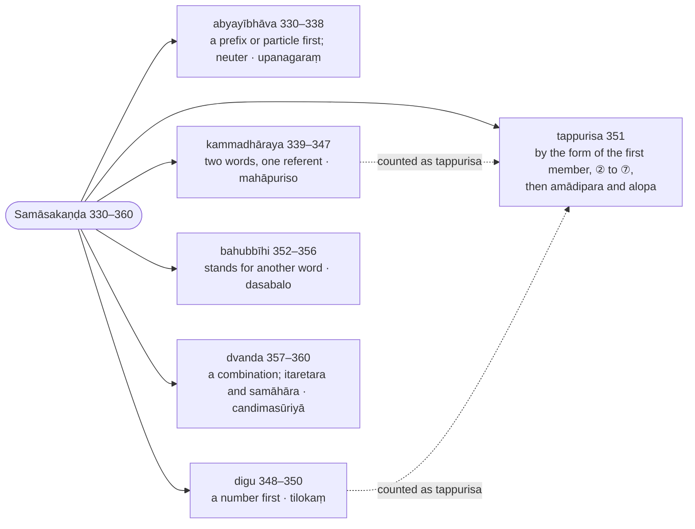
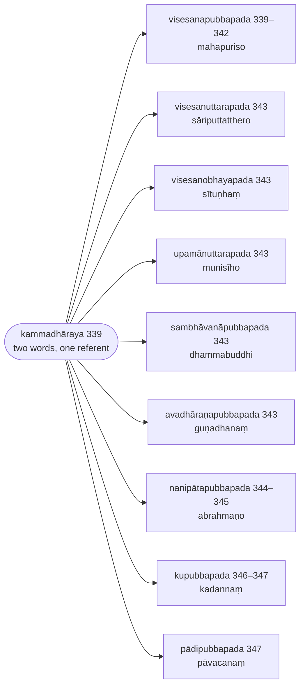

import { LinkCard } from "@astrojs/starlight/components";

:::note
The compounds are taken kind by kind — adverbial (`abyayībhāva`), descriptive (`kammadhāraya`), numerical (`digu`), dependent (`tappurisa`, by the form of its first member), possessive (`bahubbīhi`) and copulative (`dvanda`) — and every example is derived from its analytic phrase through the elision of the inflections to the finished word.

:::

:::note[Reading Rachiwong]
This section is one of the three that Phramaha Sriporn Rachiwong translated in her Pune thesis *Rūpasiddhi: A Study of Some Aspects* (1995), reproduced on this site as [Rachiwong: Rūpasiddhi (1995)](/rupasiddhi/rachiwong). Her rules are headed `(K-N)`, K the Kaccāyana sutta and N the rule's number in the Thai edition of the Padarūpasiddhi (Bangkok 1984), her base text; her N runs fifteen below the number used on this page (her 336 is 351 here), since the Thai and Sinhalese editions do not number the sixteen rules the Burmese text states twice. Her notes compare that Thai edition (Rūp T.) with the Burmese Buddhasāsanasamiti edition (B., the Chaṭṭha Saṅgāyana text these pages print) and the Sinhalese Mahārūpasiddhi (S.). The footnotes below record where this translation's text or construal differs from hers, and nothing more; her own translation and notes are on her page.
:::

:::note[The six compounds in the Samāsakaṇḍa]
Buddhappiya treats the compounds kind by kind; the ranges are Rūpasiddhi numbers, and the nine sub-kinds of the descriptive compound have their own tree under its heading below.

:::

> Atha nāmameva aññamaññasambandhīnaṃ samāsoti nāmanissitattā, sayañca nāmikattā nāmānantaraṃ samāso vuccate.

Now, since a compound (`samāsa`) is [a joining] of nouns alone that are related to one another, it rests on the noun; and since it is itself a nominal word, the compound is stated immediately after the noun. (The Kārakakaṇḍa that has just closed is, in the Chaṭṭha Saṅgāyana's count, the sixth section of Kaccāyana's `nāma` chapter, and the compound its seventh; Buddhappiya keeps that sequence.)

> So ca saññāvasena chabbidho abyayībhāvo kammadhārayo digu tappuriso bahubbīhi dvando cāti.

And by name it is of six kinds: the `abyayībhāva` (adverbial compound), the `kammadhāraya` (descriptive compound), the `digu` (numerical compound), the `tappurisa` (dependent compound), the `bahubbīhi` (possessive compound) and the `dvanda` (copulative compound).

## Abyayībhāvasamāsa (Adverbial compounds)

> Tatra paṭhamaṃ abyayībhāvasamāso vuccate; \
> So ca niccasamāsoti assapadaviggaho.

Of these the `abyayībhāva` compound is stated first; \
and since it is a compulsory compound (`niccasamāsa`), its analysis is not made in its own words (`asapadaviggaha`) [but with a word brought in from outside].

> ‘‘Upanagaraṃ’’itīdha – upa saddato paṭhamekavacanaṃ si, tassa upasaggaparattā ‘‘sabbāsamāvusopasagganipātādīhi cā’’ti lopo, nagara saddato chaṭṭhekavacanaṃ sa, nagarassa samīpanti aññapadena viggahe –

In the case of `upanagaraṃ` ("near the town"): after the word `upa` comes the singular of the first form, `si`, and because it follows a prefix it is elided by [§221 (282): Sabbāsamāvuso pasagganipātādīhi ca](/kaccayana/2-namakappa/4-catutthakanda#m221); after the word `nagara` ("town") comes the singular of the sixth form, `sa`. When the analysis `nagarassa samīpaṃ` ("the vicinity of the town") has been made with a word from outside [`samīpa`, which does not appear in the compound] —

> ‘‘Nāmānaṃ samāso yuttattho’’ti samāsavidhāne sabbattha vattate.

"`Nāmānaṃ samāso yuttattho`" ([§316 (331): Nāmānaṃ samāso yuttattho](/kaccayana/4-samasakappa#m316), the next rule but one in this section) continues in every rule that prescribes a compound.

---

### 330 (§319): Upasagganipātapubbako abyayībhāvo (an `abyayībhāva` begins with a prefix or a particle) :badge[anvattha]{variant=note}

:::tip[Kaccāyana]
<LinkCard title="§319 (330): Upasagganipātapubbako abyayībhāvo" href="/kaccayana/4-samasakappa#m319" description="an `abyayībhāva` begins with a prefix or a particle" />
:::

> Upasagga pubbako, nipāta pubbako ca nāmiko yuttattho teheva attapubbakehi upasagganipātehi saha niccaṃ samasīyate, so ca samāso abyayībhāva sañño hoti. Idha abyayībhāvādisaññāvidhāyakasuttāneva vā saññāvidhānamukhena samāsavidhāyakānīti daṭṭhabbāni.

A nominal word of connected meaning (`yuttattha`) that has a prefix (`upasagga`) or a particle (`nipāta`) before it is always compounded with those very prefixes and particles that precede it[^1], and that compound is named `abyayībhāva`. Alternatively, it should be understood that here the very suttas that lay down the names `abyayībhāva` and the rest are the rules that prescribe the compounds, by way of laying down a name.

> Tattha abyaya miti upasagganipātānaṃ saññā, liṅgavacanabhedepi byayarahitattā, abyayānaṃ atthaṃ vibhāvayatīti abyayībhāvo abyayatthapubbaṅgamattā, anabyayaṃ abyayaṃ bhavatīti vā abyayībhāvo. Pubbapadatthappadhāno hi abyayībhāvo, ettha ca ‘‘upasagganipātapubbako’’ti vuttattā upasagganipātānameva pubbanipāto.

Here `abyaya` ("invariable") is a name for prefixes and particles, because they are free of change (`byaya`) even where gender and number differ. The compound is `abyayībhāva` because it makes clear (`vibhāvayati`) the meaning of the invariables, the meaning of the invariable coming first in it; or else `abyayībhāva` because what was not invariable becomes (`bhavati`) invariable. For the `abyayībhāva` has the meaning of its first member as principal, and here, since the sutta says "having a prefix or a particle first", only the prefix or particle is placed first.

[^1]: The Thai edition read by [Rachiwong (1995)](/rupasiddhi/rachiwong) has `atthapubbakehi` ("whose meaning comes first") for the CST's `attapubbakehi`; the CST is kept.

---

### 331 (§316): Nāmānaṃ samāso yuttattho (a `samāsa` is [a joining of] nouns whose meanings are connected) :badge[anvattha]{variant=note}

:::tip[Kaccāyana]
<LinkCard title="§316 (331): Nāmānaṃ samāso yuttattho" href="/kaccayana/4-samasakappa#m316" description="a `samāsa` is [a joining of] nouns whose meanings are connected" />
:::

> Tesaṃ nāmānaṃ payujjamānapadatthānaṃ yo yuttattho, so samāsasañño hoti, tadaññaṃ vākyamiti ruḷhaṃ.

Of those nouns whose word-meanings are being employed, what has a connected meaning is named `samāsa` (compound); anything else is, by convention, a sentence (`vākya`).

> Nāmāni syā divibhatyantāni, samassateti samāso, saṅkhipiyatīti attho.

Nouns (`nāma`) are words ending in the inflections `si` and the rest. A `samāsa` is what is put together (`samassate`), that is, abbreviated.

> Vuttañhi

For it is said:

> ‘‘Samāso padasaṅkhepo, padappaccayasaṃhitaṃ; \
> Taddhitaṃ nāma hotevaṃ, viññeyyaṃ tesamantara’’nti.

"A compound is the abbreviation of words; a word joined with a suffix \
is called a `taddhita`: thus should the difference between the two be known."

> Duvidhañcassa samasanaṃ saddasamasanamatthasamasanañca, tadubhayampi luttasamāse paripuṇṇameva labbhati. Aluttasamāse pana atthasamasanameva vibhattilopābhāvato, tatthāpi vā ekapadattūpagamanato duvidhampi labbhateva. Dve hi samāsassa payojanāni ekapadattamekavibhattittañcāti.

And its compounding is of two kinds, the compounding of the words (`saddasamasana`) and the compounding of the meanings (`atthasamasana`), and both are found in full in a compound whose inflections are elided (`luttasamāsa`). In a compound whose inflections are not elided (`aluttasamāsa`), however, only the meanings are compounded, since no inflection is dropped — or rather, even there both kinds are indeed found, because the members come to be a single word. For a compound has two purposes: to be a single word (`ekapadatta`) and to have a single inflection (`ekavibhattitta`).

> Yutto attho yuttattho[^2], atha vā yutto saṅgato, sambandho vā attho yassa soyaṃ yuttattho, etena saṅgatatthena yuttattha vacanena bhinnatthānaṃ ekatthībhāvo samāsalakkhaṇanti vuttaṃ hoti. Ettha ca ‘‘nāmāna’’nti vacanena ‘‘devadatto pacatī’’tiādīsu ākhyātena samāso na hotīti dasseti. Sambandhatthena pana yuttattha ggahaṇena ‘‘bhaṭo rañño putto devadattassā’’tiādīsu aññamaññānapekkhesu, ‘‘devadattassa kaṇhā dantā’’tiādīsu ca aññasāpekkhesu ayuttatthatāya samāso na hotīti dīpeti.

`yuttattha` is a joined (`yutta`) meaning (`attha`); or else `yuttattha` is that whose meaning is joined, that is, combined (`saṅgata`), or related (`sambandha`). By this word `yuttattha` in the sense of a combined meaning, it is said that the mark of a compound (`samāsalakkhaṇa`) is that words of distinct meanings become one in meaning. And here the word `nāmānaṃ` ("of nouns") shows that there is no compound with a verb (`ākhyāta`), as in `devadatto pacati` ("Devadatta cooks"), while the mention of `yuttattha` in the sense of a related meaning makes it clear that, for want of a connected meaning, there is no compound where the words do not depend on one another, as in `bhaṭo rañño putto devadattassa` ("the king's soldier, Devadatta's son"), nor where a word depends on another, as in `devadattassa kaṇhā dantā` ("Devadatta's black teeth").

> ‘‘Atthavasā vibhattivipariṇāmo’’ti vipariṇāmena ‘‘yuttatthāna’’nti vattate.

By the maxim "the inflection changes according to the sense" (`atthavasā vibhattivipariṇāmo`), “`yuttatthānaṃ`” ("of those with connected meaning") continues with its inflection changed.

[^2]: CST4 prints `yuttatto`; the word being derived is `yuttattho`, as the rest of the sentence has it.

---

### 332 (§317): Tesaṃ vibhattiyo lopā ca (and the inflections of the members are elided) :badge[utsarga]{variant=success}

:::tip[Kaccāyana]
<LinkCard title="§317 (332): Tesaṃ vibhattiyo lopā ca" href="/kaccayana/4-samasakappa#m317" description="and the inflections of the members are elided" />
:::

> Idha padantarena vā taddhitappaccayehi vā āyā dippaccayehi vā ekatthībhūtā yuttatthā nāma, tena ‘‘tesaṃ yuttatthānaṃ samāsānaṃ, taddhitāyā dippaccayantānañca vibhattiyo lopanīyā hontī’’ti attho. Samāsa ggahaṇādhikāre pana sati tesaṃ gahaṇena vā taddhitāyā dippaccayanta vibhattilopo. Ca ggahaṇaṃ ‘‘pabhaṅkaro’’tiādīsu lopanivattanatthaṃ.

Here what is called `yuttattha` ("of connected meaning") is whatever has become one in meaning, whether with another word, with the `taddhita` suffixes or with the suffixes `āya` and the rest; so the sense is: "the inflections of those words of connected meaning — compounds, and words ending in the `taddhita` suffixes and in `āya` and the rest — are to be elided." If, however, the mention of `samāsa` is a governing rule ([`adhikāra`](/introduction#types-of-suttas)), then the inflections of words ending in the `taddhita` suffixes and in `āya` and the rest are elided by the mention of `tesaṃ` ("of those") instead. The mention of `ca` is there to stop the elision in `pabhaṅkaro` ("the light-maker") and the like.

> Vipariṇāmena ‘‘luttāsu, vibhattīsū’’ti vattate, yuttattha ggahaṇañca.

“`luttāsu vibhattīsu`” ("when the inflections have been elided") continues with its inflection changed, and so does the mention of `yuttattha`.

---

### 333 (§318): Pakati cassa sarantassa (and a member ending in a vowel returns to its original form) :badge[utsarga]{variant=success}

:::tip[Kaccāyana]
<LinkCard title="§318 (333): Pakati cassa sarantassa" href="/kaccayana/4-samasakappa#m318" description="and a member ending in a vowel returns to its original form" />
:::

> Luttāsu vibhattīsu sarantassa assa yuttatthabhūtassa tividhassapi liṅgassa pakatibhāvo hoti. Ca saddena kiṃsamudaya idappaccayatā dīsu niggahītantassapi. Nimittābhāve nemittakābhāvassa idha anicchitattā ayamatideso.

When the inflections have been elided, a lemma of connected meaning that ends in a vowel, of any of the three kinds, keeps its natural form (`pakatibhāva`). By the word `ca`, so does one ending in a `niggahīta`, as in `kiṃsamudaya` ("originating from what?"), `idappaccayatā`[^3] ("conditionality") and the like. Since the absence of the effect (`nemittaka`) when its cause (`nimitta`) is absent is not wanted here, this is an extension (`atidesa`).

:::tip[Derivation]

|     | idaṃ + paccayatā                         | rule            |
| --- | ---------------------------------------- | --------------- |
| →   | idaṃ + paccayatā (the `ṃ` retained)      | 333 (§318) `ca` |
| →   | ida + (ṃ→p) + paccayatā                  | 49 (§31)        |
| →   | **idappaccayatā**                        |                 |

:::

> Sakatthavirahenidha samāsassa ca liṅgabhāvābhāvā vibhattuppattiyamasampattāyaṃ nāmabyapadesātidesamāha.

And since here the compound, having no meaning of its own, lacks the status of a lemma (`liṅga`), so that the arising of an inflection would not apply, the extension that treats it as a noun (`nāmabyapadesa`) is stated:

[^3]: [Rachiwong (1995)](/rupasiddhi/rachiwong) prints `idaṃpaccayatā` for the CST's `idappaccayatā`; the CST is kept.

---

### 334 (§601): Taddhitasamāsakitakā nāmaṃvā’tavetunādīsu ca (Derivatives, compounds and `kita` words count as nouns, except those in `tave`, `tuna` and the like) :badge[saññaṅga]{variant=tip}

:::tip[Kaccāyana]
<LinkCard title="§601 (334): Taddhitasamāsakitakā nāmaṃ vā’ tave tunādīsu ca" href="/kaccayana/7-kibbidhanakappa/4-catutthakanda#m601" description="Derivatives, compounds and `kita` words count as nouns, except those in `tave`, `tuna` and the like" />
:::

> Taddhitantā, kitantā, samāsā ca nāmamiva daṭṭhabbā tavetuna tvāna tvā dippaccayante vajjetvā. Ca ggahaṇaṃ kiccappaccayaāīinī itthippaccayantādissapi nāmabyapadesatthaṃ. Idha samāsa ggahaṇaṃ atthavataṃ samudāyānaṃ nāmabyapadeso samāsassevāti niyamatthanti apare.

Words ending in a `taddhita` suffix, words ending in a `kita` suffix and compounds are to be regarded as nouns, leaving aside those ending in the suffixes `tave`, `tuna`, `tvāna`, `tvā` and the like. The mention of `ca` is there so that words ending in the `kicca` suffixes, in the feminine suffixes `ā`, `ī` and `inī`, and the like are treated as nouns (`nāmabyapadesa`) as well. Others hold that the mention of `samāsa` here is a restriction: among meaningful groups of words, only the compound is treated as a noun.

> ‘‘Abyayībhāvo’’ti vattate.

“`abyayībhāvo`” continues.

---

### 335 (§320): So napuṃsakaliṅgo (it is neuter) :badge[apavada]{variant=success}

:::tip[Kaccāyana]
<LinkCard title="§320 (335): So napuṃsakaliṅgo" href="/kaccayana/4-samasakappa#m320" description="it is neuter" />
:::

:::note[Analysis]

The `abyayībhāvo` carried into this rule by the `vattate` at the end of 334 comes from [330 (§319): Upasagganipātapubbako abyayībhāvo](/rupasiddhi/4-samasakanda#r330).

:::

> So abyayībhāvasamāso napuṃsakaliṅgova daṭṭhabboti napuṃsakaliṅgattaṃ. Ettha hi satipi liṅgātidese ‘‘adhipañña’’ntiādīsu ‘‘adhiñāṇaṃ’’ntiādi rūpappasaṅgo na hoti saddantarattā, ‘‘tipañña’’ntiādīsu viyāti daṭṭhabbaṃ, na cāyaṃ atideso, sutte atidesaliṅgassa iva saddassa adassanato. Pure viya syādyuppatti.

That `abyayībhāva` compound is to be regarded as neuter only: hence its neuter gender. For here, it should be understood, even if there were an extension of gender (`liṅgātidesa`), there would be no risk of a form such as `adhiñāṇaṃ` in `adhipaññaṃ` ("concerning wisdom") and the like, because that is a different word, just as in `tipaññaṃ` ("the three kinds of wisdom") and the like; nor is this an extension (`atidesa`), since the word `iva`, the mark of an extension, is not seen in the sutta. The inflections `si` and the rest arise as before.

:::tip[Derivation]

|     | adhi + paññāya (paññā + sa ⑥⨀)           | rule                   |
| --- | ---------------------------------------- | ---------------------- |
| →   | adhi + paññā + ~~sa~~                    | 332 (§317)             |
| →   | adhipaññ + (ā→a)                         | 335 (§320), 337 (§342) |
| →   | adhipañña + si                           | 334 (§601), 63 (§55)   |
| →   | adhipañña + (si→aṃ)                      | 336 (§341)             |
| →   | **adhipaññaṃ**                           |                        |

:::

> ‘‘Kvacī’’ti vattate.

“`kvaci`” ("sometimes") continues.

---

### 336 (§341): Aṃ vibhattīnamakārantā abyayībhāvā (`aṃ` for the inflections after an `abyayībhāva` in `a`) :badge[apavada]{variant=success}

:::tip[Kaccāyana]
<LinkCard title="§341 (336): Aṃ vibhattīnamakārantā abyayībhāvā" href="/kaccayana/4-samasakappa#m341" description="`aṃ` for the inflections after an `abyayībhāva` in `a`" />
:::

:::note[Analysis]

The `kvaci` carried into this rule by the `vattate` at the end of 335, and the rule quoted below for the suffix `ka`, are [§337 (350): Kvaci samāsantagatānamakāranto](/kaccayana/4-samasakappa#m337), which Buddhappiya states only at [350 (§337)](/rupasiddhi/4-samasakanda#r350).

:::

> Tasmā akārantā abyayībhāvā parāsaṃ vibhattīnaṃ kvaci aṃ hoti, sesaṃ neyyaṃ.

After that `abyayībhāva` ending in `a`, the inflections that follow sometimes become `aṃ`; the rest is to be inferred.

:::tip[Derivation]

|     | upa + si, nagara + sa (⑥⨀) — `nagarassa samīpaṃ`, "near the town"  | rule                   |
| --- | ------------------------------------------------------------------ | ---------------------- |
| →   | upa + ~~si~~ + nagarassa                                           | 282 (§221)             |
| →   | upa nagarassa — an `abyayībhāva`, a `samāsa`                       | 330 (§319), 331 (§316) |
| →   | upa + nagara + ~~sa~~                                              | 332 (§317)             |
| →   | upa + nagara                                                       | 333 (§318)             |
| →   | upanagara + si (as a noun)                                         | 334 (§601)             |
| →   | upanagara + si (neuter)                                            | 335 (§320)             |
| →   | upanagara + (si→aṃ)                                                | 336 (§341)             |
| →   | **upanagaraṃ**                                                     |                        |

:::

> Taṃ upanagaraṃ, nagarassa samīpaṃ tiṭṭhatīti attho. Tāni upanagaraṃ, ālapanepevaṃ, taṃ upanagaraṃ passa, tāni upanagaraṃ.

`taṃ upanagaraṃ` ("that near the town"), meaning "it stands near the town"; `tāni upanagaraṃ` ("those near the town"); likewise in the vocative; `taṃ upanagaraṃ passa` ("see that near the town"), `tāni upanagaraṃ` ("those near the town").

> Na pañcamyāyamambhāvo, kvacī ti adhikārato; \
> Tatiyāsattamīchaṭṭhī-nantu hoti vikappato.

By the governing rule `kvaci`, this `aṃ` is not used for the fifth form ⑤; \
but for the third ③, the seventh ⑦ and the sixth ⑥ it is used optionally.

> Tena upanagaraṃ kataṃ, upanagarena vā, tehi upanagaraṃ, upanagarehi vā, tassa upanagaraṃ dehi, tesaṃ upanagaraṃ, upanagarā ānaya, upanagaramhā upanagarasmā, upanagarehi, upanagaraṃ santakaṃ, upanagarassa vā, tesaṃ upanagaraṃ, upanagarānaṃ vā, upanagaraṃ nidhehi, upanagaramhi upanagarasmiṃ, upanagaraṃ upanagaresu vā. Evaṃ upakumbhaṃ.

`tena upanagaraṃ kataṃ` ("done by that near the town") or `upanagarena`; `tehi upanagaraṃ` or `upanagarehi`; `tassa upanagaraṃ dehi` ("give to that near the town"), `tesaṃ upanagaraṃ`; `upanagarā ānaya` ("bring from near the town"), `upanagaramhā`, `upanagarasmā`, `upanagarehi`; `upanagaraṃ santakaṃ` ("the property of that near the town") or `upanagarassa`; `tesaṃ upanagaraṃ` or `upanagarānaṃ`; `upanagaraṃ nidhehi` ("deposit it near the town"), `upanagaramhi`, `upanagarasmiṃ`; `upanagaraṃ` or `upanagaresu`. Likewise `upakumbhaṃ` ("near the pot").

:::note[Inflection table of `upanagaraṃ`]

The forms of `upanagaraṃ` (near the town), 🚻(upanagara), set out as an inflection table from the two lists above; the forms given as alternatives to `aṃ` stand beside it.

| | ⨀ | ⨂ |
| --- | --- | --- |
| ① | upanagaraṃ | upanagaraṃ |
| ⓪ | upanagaraṃ | upanagaraṃ |
| ② | upanagaraṃ | upanagaraṃ |
| ③ | upanagaraṃ, upanagarena | upanagaraṃ, upanagarehi |
| ④ | upanagaraṃ | upanagaraṃ |
| ⑤ | upanagarā, upanagaramhā, upanagarasmā | upanagarehi |
| ⑥ | upanagaraṃ, upanagarassa | upanagaraṃ, upanagarānaṃ |
| ⑦ | upanagaraṃ, upanagaramhi, upanagarasmiṃ | upanagaraṃ, upanagaresu |

:::

> Abhāve – darathānaṃ abhāvo niddarathaṃ, nimmasakaṃ.

In the sense of absence: `darathānaṃ abhāvo` ("the absence of distress") gives `niddarathaṃ` ("free from distress"); `nimmasakaṃ` ("free from mosquitoes").

> Pacchāatthe – rathassa pacchā anurathaṃ, anuvātaṃ.

In the sense of "behind": `rathassa pacchā` ("behind the chariot") gives `anurathaṃ` ("behind the chariot"); `anuvātaṃ` ("with the wind", "downwind").

> Yoggatāyaṃ – yathāsarūpaṃ, anurūpaṃ, rūpayogganti attho.

In the sense of fitness (`yoggatā`): `yathāsarūpaṃ` ("according to the form"), `anurūpaṃ` ("suitably"), meaning "fit for the form" (`rūpayoggaṃ`).

> Vicchāyaṃ – attānamattānaṃ pati paccattaṃ, addhamāsaṃ addhamāsaṃ anu anvaddhamāsaṃ.

In the distributive sense (`vicchā`): `attānaṃ attānaṃ pati` ("towards each self") gives `paccattaṃ` ("individually"); `addhamāsaṃ addhamāsaṃ anu` ("after each half-month") gives `anvaddhamāsaṃ` ("every fortnight").

> Anupubbiyaṃ – jeṭṭhānaṃ anupubbo anujeṭṭhaṃ.

In the sense of succession (`anupubbī`): `jeṭṭhānaṃ anupubbo` ("the succession of the elders") gives `anujeṭṭhaṃ` ("in order of seniority").

> Paṭilome – sotassa paṭilomaṃ paṭisotaṃ, paṭipathaṃ, pativātaṃ, attānaṃ adhikicca pavattā ajjhattaṃ.

In the sense of "against" (`paṭiloma`): `sotassa paṭilomaṃ` ("against the stream") gives `paṭisotaṃ` ("against the stream"); `paṭipathaṃ` ("against the road", "in the opposite direction"); `pativātaṃ` ("against the wind"); `attānaṃ adhikicca pavattā` ("occurring with reference to oneself") gives `ajjhattaṃ` ("internally").

> Mariyādābhividhīsu[^4] āpāṇakoṭiyā āpāṇakoṭikaṃ, ‘‘kvaci samāsantagatānamakāranto’’ti ka ppaccayo, ākumārehi yaso kaccāyanassa ākumāraṃ.

In the senses of a limit, exclusive (`mariyādā`) and inclusive (`abhividhi`): `āpāṇakoṭiyā` ("up to the end of breath") gives `āpāṇakoṭikaṃ` ("until the last breath"), with the suffix `ka` by [§337 (350): Kvaci samāsantagatānamakāranto](/kaccayana/4-samasakappa#m337); `ā kumārehi yaso kaccāyanassa` ("Kaccāyana's fame, down to the boys") gives `ākumāraṃ` ("boys included").[^5]

:::tip[Derivation]

|     | ni + darathānaṃ (daratha + naṃ ⑥⨂)       | rule                   |
| --- | ---------------------------------------- | ---------------------- |
| →   | ni + daratha + ~~naṃ~~                   | 332 (§317)             |
| →   | ni + (d→dd) + aratha                     | 40 (§28)               |
| →   | niddaratha + si                          | 334 (§601), 63 (§55)   |
| →   | niddaratha + (si→aṃ)                     | 335 (§320), 336 (§341) |
| →   | **niddarathaṃ**                          |                        |

|     | pati + attānaṃ (atta + aṃ ②⨀)            | rule                   |
| --- | ---------------------------------------- | ---------------------- |
| →   | pati + atta + ~~aṃ~~                     | 332 (§317)             |
| →   | pat + (i→y) + atta                       | 21 (§21)               |
| →   | pa + (ty→c) + atta                       | 41 (§269)              |
| →   | pa + (c→cc) + atta                       | 40 (§28)               |
| →   | paccatta + si                            | 334 (§601), 63 (§55)   |
| →   | paccatta + (si→aṃ)                       | 335 (§320), 336 (§341) |
| →   | **paccattaṃ**                            |                        |

|     | anu + addhamāsaṃ (addhamāsa + aṃ ②⨀)     | rule                   |
| --- | ---------------------------------------- | ---------------------- |
| →   | anu + addhamāsa + ~~aṃ~~                 | 332 (§317)             |
| →   | an + (u→v) + addhamāsa                   | 20 (§18)               |
| →   | anvaddhamāsa + si                        | 334 (§601), 63 (§55)   |
| →   | anvaddhamāsa + (si→aṃ)                   | 335 (§320), 336 (§341) |
| →   | **anvaddhamāsaṃ**                        |                        |

|     | adhi + attānaṃ (atta + aṃ ②⨀)            | rule                   |
| --- | ---------------------------------------- | ---------------------- |
| →   | adhi + atta + ~~aṃ~~                     | 332 (§317)             |
| →   | (adhi→ajjh) + atta                       | 25 (§45)               |
| →   | ajjhatta + si                            | 334 (§601), 63 (§55)   |
| →   | ajjhatta + (si→aṃ)                       | 335 (§320), 336 (§341) |
| →   | **ajjhattaṃ**                            |                        |

|     | ā + pāṇakoṭiyā (pāṇakoṭi + sa ⑥⨀)        | rule                   |
| --- | ---------------------------------------- | ---------------------- |
| →   | ā + pāṇakoṭi + ~~sa~~                    | 332 (§317)             |
| →   | ā + pāṇakoṭi + ka                        | 350 (§337)             |
| →   | āpāṇakoṭika + si                         | 334 (§601), 63 (§55)   |
| →   | āpāṇakoṭika + (si→aṃ)                    | 335 (§320), 336 (§341) |
| →   | **āpāṇakoṭikaṃ**                         |                        |

:::

:::tip[Examples]

> `paccattaṃ veditabbo viññūhi` \
> [(7D 3.10: Dhammādāsadhammapariyāya)](https://tipitaka2500.github.io/tipitaka/7D/3/3.10#335) \
🚻②⨀(pati + atta) 🚹①⨀(veditabba) 🚹③⨂(viññū) \
for oneself | to be known | by the wise

> `anvaddhamāsaṃ bhikkhuniyā bhikkhusaṃghato dve dhammā paccāsīsitabbā` \
> [(2V 1.5.3.1: Ovādasikkhāpada)](https://tipitaka2500.github.io/tipitaka/2V/1/1.5/1.5.3/1.5.3.1#501) \
🚻②⨀(anu + addhamāsa) 🚺③⨀(bhikkhunī) 🚹⑤⨀(bhikkhusaṃgha) ⚧️①⨂(dvi) 🚹①⨂(dhamma) 🚹①⨂(paccāsīsitabba) \
every half-month | by a bhikkhunī | from the community of bhikkhus | two | things | are to be expected

> `hatthehi ca pādehi ca paṭisotaṃ vāyameyya` \
> [(18It 4.1.10: Nadīsotasutta)](https://tipitaka2500.github.io/tipitaka/18It/4/4.1/4.1.10#793) \
🚹③⨂(hattha) 🔼(ca) 🚹③⨂(pāda) 🔼(ca) 🚻②⨀(pati + sota) ⏯🤟⨀(vāyamati) \
with hands | and | with feet | and | against the stream | he should strive

> `yāvajīvaṃ āpāṇakoṭikaṃ samādāya sikkhati sikkhāpadesu` \
> [(5V 1.1.1.1: Pārājikakaṇḍa)](https://tipitaka2500.github.io/tipitaka/5V/1/1.1/1.1.1/1.1.1.1#3) \
🚻②⨀(yāva + jīva) 🚻②⨀(ā + pāṇakoṭi + ka) 🔽(samādāya) ▶️🤟⨀(sikkhati) 🚻⑦⨂(sikkhāpada) \
for life | to the last breath | having undertaken | he trains | in the training rules

:::

> Samiddhiyaṃ – bhikkhāya samiddhīti atthe samāseva napuṃsakaliṅgatte ca kate –

In the sense of prosperity (`samiddhi`): when, in the sense `bhikkhāya samiddhi` ("prosperity in alms"), only the compound and the neuter gender have been made —

> ‘‘Samāsassa, anto’’ti ca vattate.

“`samāsassa`” and “`anto`” ("the final of the compound") also continue.

[^4]: CST4 prints `Pariyādābhividhīsu`; `mariyādā` is read, as the Thai edition read by [Rachiwong (1995)](/rupasiddhi/rachiwong) has it.

[^5]: The Thai edition read by [Rachiwong (1995)](/rupasiddhi/rachiwong) orders the words `ā kumārehi yaso ākumāraṃ yaso kaccāyanassa`; the CST's order is kept.

---

### 337 (§342): Saro rasso napuṃsake (the final vowel is shortened in the neuter) :badge[apavada]{variant=success}

:::tip[Kaccāyana]
<LinkCard title="§342 (337): Saro rasso napuṃsake" href="/kaccayana/4-samasakappa#m342" description="the final vowel is shortened in the neuter" />
:::

:::note[Analysis]

The `samāsassa anto` carried into this rule by the `vattate` at the end of 336 comes from [§337 (350): Kvaci samāsantagatānamakāranto](/kaccayana/4-samasakappa#m337), which Buddhappiya states only at [350 (§337)](/rupasiddhi/4-samasakanda#r350).

:::

> Napuṃsake vattamānassa samāsassa anto saro rasso hoti. Ettha ca abyayībhāva ggahaṇaṃ nānuvattetabbaṃ, tena digudvandabahubbīhīsupi napuṃsake vattamānassa samāsantassarassa rassattaṃ siddhaṃ hoti. ‘‘Aṃ vibhattīna’’miccādinā a mādeso, subhikkhaṃ. Gaṅgāya samīpe vattatīti upagaṅgaṃ, maṇikāya samīpaṃ upamaṇikaṃ.

The final vowel of a compound occurring in the neuter becomes short. And here the mention of `abyayībhāva` is not to be carried over, so the shortening of the final vowel of a compound occurring in the neuter is established for the `digu`, the `dvanda` and the `bahubbīhi` as well. `aṃ` is substituted by [§341 (336): Aṃ vibhattīnamakārantā abyayībhāvā](/kaccayana/4-samasakappa#m341) and the rest: `subhikkhaṃ` ("a time of plenty"). `gaṅgāya samīpe vattati` ("it is near the Ganges") gives `upagaṅgaṃ` ("near the Ganges"); `maṇikāya samīpaṃ` ("near the water-jar") gives `upamaṇikaṃ` ("near the water-jar").

:::tip[Derivation]

|     | su + bhikkhāya (bhikkhā + sa ⑥⨀)         | rule                               |
| --- | ---------------------------------------- | ---------------------------------- |
| →   | su + bhikkhā + ~~sa~~                    | 330 (§319), 331 (§316), 332 (§317) |
| →   | subhikkhā (as a noun; neuter)            | 334 (§601), 335 (§320)             |
| →   | subhikkh + (ā→a)                         | 337 (§342)                         |
| →   | subhikkha + si                           | 334 (§601), 63 (§55)               |
| →   | subhikkha + (si→aṃ)                      | 336 (§341)                         |
| →   | **subhikkhaṃ**                           |                                    |

|     | upa + gaṅgāya (gaṅgā + sa ⑥⨀)            | rule                   |
| --- | ---------------------------------------- | ---------------------- |
| →   | upa + gaṅgā + ~~sa~~                     | 332 (§317)             |
| →   | upagaṅg + (ā→a)                          | 335 (§320), 337 (§342) |
| →   | upagaṅga + si                            | 334 (§601), 63 (§55)   |
| →   | upagaṅga + (si→aṃ)                       | 336 (§341)             |
| →   | **upagaṅgaṃ**                            |                        |

:::

:::tip[Examples]

> `subhikkhaṃ bhavissati, dubbhikkhaṃ bhavissati` \
> [(6D 1.2.3: Mahāsīla)](https://tipitaka2500.github.io/tipitaka/6D/1/1.2/1.2.3#52) \
🚻①⨀(su + bhikkhā) ⏯🤟⨀(bhavati) 🚻①⨀(du + bhikkhā) ⏯🤟⨀(bhavati) \
plenty | there will be | famine | there will be

:::

> Itthīsu amikiccāti[^6] atthe samāsanapuṃsakarassattādīsu katesu –

When, in the sense `itthīsu adhikicca` ("with reference to women"), the compound, the neuter gender, the shortening and the rest have been made —

> ‘‘Abyayībhāvā, vibhattīna’’nti ca vattate.

“`abyayībhāvā`” and “`vibhattīnaṃ`” also continue.

[^6]: CST4 prints `amikiccāti`, a misprint for `adhikiccāti` (`itthīsu adhikicca`, "with reference to women"), which is translated; so [Rachiwong (1995)](/rupasiddhi/rachiwong), "in connection with women".

---

### 338 (§343): Aññasmā lopo ca (and elision [of the inflections] after any other [`abyayībhāva`]) :badge[apavada]{variant=success}

:::tip[Kaccāyana]
<LinkCard title="§343 (338): Aññasmā lopo ca" href="/kaccayana/4-samasakappa#m343" description="and elision [of the inflections] after any other [`abyayībhāva`]" />
:::

> A kārantato aññasmā abyayībhāvasamāsā parāsaṃ vibhattīnaṃ lopo ca hoti. Adhitthi[^7], itthīsu adhikicca kathā pavattatīti attho. Adhitthi passa, adhitthi kataṃ iccādi, evaṃ adhikumāri, vadhuyā samīpaṃ upavadhu, gunnaṃ samīpaṃ upagu, o kārassa rassattaṃ u kāro. Evaṃ upasaggapubbako.

After an `abyayībhāva` compound other than one ending in `a`, the inflections that follow are elided as well. `adhitthi` ("concerning women"), meaning "talk goes on with reference to women"; `adhitthi passa` ("see what concerns women"), `adhitthi kataṃ` ("done concerning women") and so on; likewise `adhikumāri` ("concerning girls"); `vadhuyā samīpaṃ` ("near the young wife") gives `upavadhu` ("near the young wife"); `gunnaṃ samīpaṃ` ("near the cows") gives `upagu` ("near the cows"), the short form of the letter `o` being the letter `u`. So much for the kind with a prefix first.

:::tip[Derivation]

|     | adhi + itthīsu (itthī + su ⑦⨂)           | rule                               |
| --- | ---------------------------------------- | ---------------------------------- |
| →   | adhi + itthī + ~~su~~                    | 330 (§319), 331 (§316), 332 (§317) |
| →   | adh + (~~i~~ + i) + tthī                 | 13 (§12)                           |
| →   | adhitth + (ī→i)                          | 335 (§320), 337 (§342)             |
| →   | adhitthi + si (as a noun)                | 334 (§601), 63 (§55)               |
| →   | adhitthi + ~~si~~                        | 338 (§343)                         |
| →   | **adhitthi**                             |                                    |

|     | upa + gunnaṃ (go + naṃ ⑥⨂)               | rule                               |
| --- | ---------------------------------------- | ---------------------------------- |
| →   | upa + go + ~~naṃ~~                       | 330 (§319), 331 (§316), 332 (§317) |
| →   | upag + (o→u)                             | 335 (§320), 337 (§342)             |
| →   | upagu + si (as a noun)                   | 334 (§601), 63 (§55)               |
| →   | upagu + ~~si~~                           | 338 (§343)                         |
| →   | **upagu**                                |                                    |

:::

> Nipātapubbako yathā – vuḍḍhānaṃ paṭipāṭi, ye ye vuḍḍhā vā yathāvuḍḍhaṃ, padatthānatikkame – yathākkamaṃ, yathāsatti, yathābalaṃ karoti, balamanatikkamitvā karotīti attho. Jīvassa yattako paricchedo yāvajīvaṃ, yāvatāyukaṃ, ka ppaccayo. Yattakena attho yāvadatthaṃ, pabbatassa parabhāgo tiropabbataṃ, tiropākāraṃ, tirokuṭṭaṃ, pāsādassa anto antopāsādaṃ, antonagaraṃ, antovassaṃ, nagarassa bahi bahinagaraṃ, pāsādassa upari uparipāsādaṃ, uparimañcaṃ, mañcassa heṭṭhā heṭṭhāmañcaṃ, heṭṭhāpāsādaṃ, bhattassa pure purebhattaṃ, evaṃ pacchābhattaṃ.

The kind with a particle first, for instance: `vuḍḍhānaṃ paṭipāṭi` ("the succession of the elders"), or `ye ye vuḍḍhā` ("whoever are the elders, each in turn"), gives `yathāvuḍḍhaṃ` ("in order of seniority"); in the sense of not overstepping the meaning of the word: `yathākkamaṃ` ("in due order"), `yathāsatti` ("according to ability"), `yathābalaṃ karoti` ("he acts according to his strength"), meaning he acts without exceeding his strength. `jīvassa yattako paricchedo` ("whatever the extent of life") gives `yāvajīvaṃ` ("as long as life lasts"); `yāvatāyukaṃ` ("as long as the life-span"), with the suffix `ka`. `yattakena attho` ("as much as is needed") gives `yāvadatthaṃ` ("as much as one likes"); `pabbatassa parabhāgo` ("the far side of the mountain") gives `tiropabbataṃ` ("beyond the mountain"); `tiropākāraṃ` ("beyond the rampart"), `tirokuṭṭaṃ` ("beyond the wall")[^8]; `pāsādassa anto` ("the inside of the mansion") gives `antopāsādaṃ` ("inside the mansion"); `antonagaraṃ` ("inside the town"), `antovassaṃ` ("within the rains"); `nagarassa bahi` ("the outside of the town")[^9] gives `bahinagaraṃ` ("outside the town"); `pāsādassa upari` ("the top of the mansion") gives `uparipāsādaṃ` ("on top of the mansion"); `uparimañcaṃ` ("on top of the bed"); `mañcassa heṭṭhā` ("the underside of the bed") gives `heṭṭhāmañcaṃ` ("under the bed"); `heṭṭhāpāsādaṃ` ("beneath the mansion"); `bhattassa pure` ("the time before the meal") gives `purebhattaṃ` ("before the meal"); likewise `pacchābhattaṃ` ("after the meal").

:::tip[Derivation]

|     | yathā + si, vuḍḍha + naṃ (⑥⨂) — `vuḍḍhānaṃ paṭipāṭi`  | rule                               |
| --- | ----------------------------------------------------- | ---------------------------------- |
| →   | yathā + ~~si~~ + vuḍḍhānaṃ                            | 282 (§221)                         |
| →   | yathā + vuḍḍha + ~~naṃ~~                              | 330 (§319), 331 (§316), 332 (§317) |
| →   | yathā + vuḍḍha                                        | 333 (§318)                         |
| →   | yathāvuḍḍha + si (as a noun; neuter)                  | 334 (§601), 335 (§320)             |
| →   | yathāvuḍḍha + (si→aṃ)                                 | 336 (§341)                         |
| →   | **yathāvuḍḍhaṃ**                                      |                                    |

|     | yathā + sattiṃ (satti + aṃ ②⨀)           | rule                   |
| --- | ---------------------------------------- | ---------------------- |
| →   | yathā + satti + ~~aṃ~~                   | 332 (§317)             |
| →   | yathāsatti + si (as a noun; neuter)      | 334 (§601), 335 (§320) |
| →   | yathāsatti + ~~si~~                      | 338 (§343)             |
| →   | **yathāsatti**                           |                        |

|     | yāva + attho (attha + si)                | rule                   |
| --- | ---------------------------------------- | ---------------------- |
| →   | yāva + attha + ~~si~~                    | 332 (§317)             |
| →   | yāva + (d) + attha                       | 34 (§35)               |
| →   | yāvadattha + si                          | 334 (§601), 63 (§55)   |
| →   | yāvadattha + (si→aṃ)                     | 335 (§320), 336 (§341) |
| →   | **yāvadatthaṃ**                          |                        |

|     | yāvatā + āyuno (āyu + sa ⑥⨀)             | rule                   |
| --- | ---------------------------------------- | ---------------------- |
| →   | yāvatā + āyu + ~~sa~~                    | 332 (§317)             |
| →   | yāvat + (~~ā~~ + ā) + yu                 | 13 (§12)               |
| →   | yāvatāyu + ka                            | 350 (§337)             |
| →   | yāvatāyuka + si                          | 334 (§601), 63 (§55)   |
| →   | yāvatāyuka + (si→aṃ)                     | 335 (§320), 336 (§341) |
| →   | **yāvatāyukaṃ**                          |                        |

:::

:::tip[Examples]

> `yathāvuḍḍhaṃ abhivādanaṃ paccuṭṭhānaṃ añjalikammaṃ sāmīcikammaṃ karissāma` \
> [(3V 10.1: Kosambakavivādakathā)](https://tipitaka2500.github.io/tipitaka/3V/10/10.1#1949) \
🚻②⨀(yathā + vuḍḍha) 🚻②⨀(abhivādana) 🚻②⨀(paccuṭṭhāna) 🚻②⨀(añjalikamma) 🚻②⨀(sāmīcikamma) ⏯👆⨂(karoti) \
according to seniority | salutation | rising up | reverential greeting | proper respect | we shall do

> `tamahaṃ yathāsatti yathābalaṃ paṭipūjessāmi` \
> [(6D 3.5: Catuapāyamukha)](https://tipitaka2500.github.io/tipitaka/6D/3/3.5#396) \
🚹②⨀(ta) ⚧️①⨀(amha) 🚻②⨀(yathā + satti) 🚻②⨀(yathā + bala) ⏯👆⨀(paṭipūjeti) \
him | I | according to my ability | according to my strength | shall honour

> `bhikkhū yāvadatthaṃ bhuñjiṃsu, yāvadatthaṃ supiṃsu, yāvadatthaṃ nhāyiṃsu` \
> [(1V 1.1.1.3: Santhatabhāṇavāra)](https://tipitaka2500.github.io/tipitaka/1V/1/1.1/1.1.1/1.1.1.3#82) \
🚹①⨂(bhikkhu) 🚻②⨀(yāva + attha) ⏮🤟⨂(bhuñjati) 🚻②⨀(yāva + attha) ⏮🤟⨂(supati) 🚻②⨀(yāva + attha) ⏮🤟⨂(nhāyati) \
the bhikkhus | as much as they liked | ate | as much as they liked | slept | as much as they liked | bathed

> `purebhattaṃ vā pacchābhattaṃ vā rattiṃ vā divā vā` \
> [(1V 1.1.2: Dutiyapārājikasikkhāpada)](https://tipitaka2500.github.io/tipitaka/1V/1/1.1/1.1.2#259) \
🚻②⨀(pure + bhatta) 🔼(vā) 🚻②⨀(pacchā + bhatta) 🔼(vā) 🚺②⨀(ratti) 🔼(vā) 🔼(divā) 🔼(vā) \
before the meal | or | after the meal | or | by night | or | by day | or

:::

> Sākallatthe – saha makkhikāya samakkhikaṃ bhuñjati, na kiñci parivajjetīti attho. ‘‘Tesu vuddhī’’tiādinā saha saddassa sā deso. Gaṅgāya oraṃ oragaṅgamiccādi.

In the sense of entirety (`sākalla`): `saha makkhikāya` ("together with the fly") gives `samakkhikaṃ bhuñjati` ("he eats it flies and all"), meaning he leaves nothing out. The word `saha` is replaced by `sa` by [§404 (370): Tesu vuddhilopāgamavikāraviparītādesā ca](/kaccayana/5-taddhitakappa#m404) and the rest. `gaṅgāya oraṃ` ("the near side of the Ganges") gives `oragaṅgaṃ` ("this side of the Ganges"), and so on.

:::tip[Derivation]

|     | saha + makkhikāya (makkhikā + nā ③⨀)     | rule                   |
| --- | ---------------------------------------- | ---------------------- |
| →   | saha + makkhikā + ~~nā~~                 | 332 (§317)             |
| →   | (saha→sa) + makkhikā                     | 370 (§404)             |
| →   | sa + (m→mm) + akkhikā                    | 40 (§28)               |
| →   | samakkhikā (as a noun; neuter)           | 334 (§601), 335 (§320) |
| →   | samakkhik + (ā→a)                        | 337 (§342)             |
| →   | samakkhika + si                          | 334 (§601), 63 (§55)   |
| →   | samakkhika + (si→aṃ)                     | 336 (§341)             |
| →   | **samakkhikaṃ**                          |                        |

:::

:::tip[Examples]

> `sakaṇṭakaṃ so gilati, jaccandhova samakkhikaṃ` \
> [(22J 12.1.9: Mahāpadumajātaka)](https://tipitaka2500.github.io/tipitaka/22J/12/12.1/12.1.9#2353) \
🚻②⨀(sa + kaṇṭaka) 🚹①⨀(ta) ▶️🤟⨀(gilati) 🚹①⨀(jacca + andha) 🔼(iva) 🚻②⨀(saha + makkhikā) \
thorns and all | he | swallows | one blind from birth | like | flies and all

:::

[^7]: CST4 prints `Adhitti` for the first occurrence; `adhitthi` is read, as the two forms that follow have it and so the Thai text read by [Rachiwong (1995)](/rupasiddhi/rachiwong).

[^8]: The Thai edition read by [Rachiwong (1995)](/rupasiddhi/rachiwong) spells `tirokuḍḍaṃ` for the CST's `tirokuṭṭaṃ`; the CST is kept.

[^9]: The Thai edition read by [Rachiwong (1995)](/rupasiddhi/rachiwong) has `nagarato bahi` for the CST's `nagarassa bahi`; the CST is kept.

---

> _Abyayībhāvasamāso niṭṭhito._

The `abyayībhāva` compound is finished.

---

## Kammadhārayasamāsa (Descriptive compounds)

> Atha kammadhārayasamāso vuccate.

Now the `kammadhāraya` compound is stated.

> So ca navavidho visesanapubbapado visesanuttarapado visesanobhayapado upamānuttarapado sambhāvanāpubbapado avadhāraṇapubbapado na nipātapubbapado ku pubbapado pā dipubbapado cāti.

And it is of nine kinds: with the qualifier first (`visesanapubbapada`), with the qualifier last (`visesanuttarapada`), with both members qualifiers (`visesanobhayapada`), with the standard of comparison last (`upamānuttarapada`), with a word of supposition first (`sambhāvanāpubbapada`), with a word of restriction first (`avadhāraṇapubbapada`), with the particle `na` first (`nanipātapubbapada`), with `ku` first (`kupubbapada`), and with `pa` or another prefix first (`pādipubbapada`).

:::note[The nine kinds of kammadhāraya]

Buddhappiya's nine sub-kinds, with the example derived for each and the rule under which it is treated.

:::

> Tattha visesanapubbapado tāva – ‘‘mahanta purisa’’itīdha ubhayattha paṭhamekavacanaṃ si, tulyādhikaraṇabhāvappasiddhatthaṃ ca sadda ta saddappayogo, mahanto ca so puriso cāti viggahe –

Of these, first the kind with the qualifier first. Here, in `mahanta purisa` ("great", "man"), the first-form singular `si` comes after both words, and the words `ca` and `ta` are used to establish that the two have the same referent (`tulyādhikaraṇabhāva`); when the analysis `mahanto ca so puriso ca` ("he is great, and he is a man") has been made —

> Ito paraṃ ‘‘vibhāsā rukkhatiṇa’’iccādito ‘‘vibhāsā’’ti samāsavidhāne sabbattha vattate.

From here on, “`vibhāsā`” ("optionally"), from [§323 (360): Vibhāsā rukkha tiṇa pasu dhana dhañña janapadā dīnañca](/kaccayana/4-samasakappa#m323), continues in every rule that prescribes a compound.

---

### 339 (§324): Dvipade tulyādhikaraṇe kammadhārayo (two words with the same referent make a `kammadhāraya`) :badge[anvattha]{variant=note}

:::tip[Kaccāyana]
<LinkCard title="§324 (339): Dvipade tulyādhikaraṇe kammadhārayo" href="/kaccayana/4-samasakappa#m324" description="two words with the same referent make a `kammadhāraya`" />
:::

> Dve padāni nāmikāni tulyādhikaraṇāni aññamaññena saha vibhāsā samasyante, tasmiṃ dvipade tulyādhikaraṇe sati so samāso kammadhārayasañño ca hoti.

Two nominal words with the same referent (`tulyādhikaraṇa`)[^10] are optionally compounded with one another, and when there are two such words with the same referent, that compound is also named `kammadhāraya`.

> Dve padāni dvipadaṃ, tulyaṃ samānaṃ adhikaraṇaṃ attho yassa padadvayassa taṃ tulyādhikaraṇaṃ, tasmiṃ dvipade tulyādhikaraṇe. Bhinnappavattinimittānaṃ dvinnaṃ padānaṃ visesanavisesitabbabhāvena ekasmiṃ atthe pavatti tulyādhikaraṇatā. Kammamiva dvayaṃ dhārayatīti kammadhārayo. Yathā hi kammaṃ kriyañca payojanañca dvayaṃ dhārayati, kamme sati kriyāya, payojanassa ca sambhavato, tathā ayaṃ samāso ekassa atthassa dve nāmāni dhārayati, tasmiṃ samāse sati e katthajotakassa nāmadvayassa sambhavato.

`dvipada` is two words; a pair of words whose `adhikaraṇa`, that is, whose meaning, the thing referred to, is `tulya`, the same, is `tulyādhikaraṇa`; `tasmiṃ dvipade tulyādhikaraṇe` means "when there are two such words with the same referent". Having the same referent (`tulyādhikaraṇatā`) is the application of two words with different grounds for their use (`pavattinimitta`) to a single thing, as qualifier (`visesana`) and qualified (`visesitabba`). It holds (`dhārayati`) two things like an action (`kamma`): hence `kammadhāraya`.[^11] For just as an action holds two things, the activity (`kriyā`) and the purpose (`payojana`), because where there is an action an activity and a purpose come about, so this compound holds two names for one meaning, because where there is this compound a pair of names expressing a single meaning comes about.

> Pure viya samāsasaññāvibhattilopapakatibhāvā, samāseneva tulyādhikaraṇabhāvassa vuttattā ‘‘vuttatthānamappayogo’’ti ca sadda ta saddānamappayogo.

The name `samāsa`, the elision of the inflections and the natural form follow as before; and since the compound itself expresses that the two have the same referent, the words `ca` and `ta` are not used, by the maxim "what has already been expressed is not used" (`vuttatthānam appayogo`).

[^10]: [Rachiwong (1995)](/rupasiddhi/rachiwong) renders `tulyādhikaraṇa` "having the same case"; it is rendered here "having the same referent".

[^11]: [Rachiwong (1995)](/rupasiddhi/rachiwong) takes `kamma` in the simile as the grammatical object; it is taken here as the action.

---

### 340 (§330): Mahataṃ mahā tulyādhikaraṇe pade (`mahā` for `mahanta` before a word with the same referent) :badge[apavada]{variant=success}

:::tip[Kaccāyana]
<LinkCard title="§330 (340): Mahataṃ mahā tulyādhikaraṇe pade" href="/kaccayana/4-samasakappa#m330" description="`mahā` for `mahanta` before a word with the same referent" />
:::

> Mahanta saddassa mahā hoti tulyādhikaraṇe uttarapade pare. Mahata nti bahuvacanaggahaṇena kvaci maha ādeso ca, ettha ca visesanassa pubbanipāto visesanabhūtassa pubbapadassa mahā desavidhānatova viññāyati.

The word `mahanta` ("great") becomes `mahā` when a last member with the same referent follows. Because `mahataṃ` is put in the plural, in some places the replacement is `maha` as well; and here the placing of the qualifier first is understood simply from the fact that the replacement `mahā` is prescribed for the first member, the qualifier.

> ‘‘Kammadhārayo, digū’’ti ca vattate.

“`kammadhārayo`” and “`digu`” also continue.

---

### 341 (§326): Ubhe tappurisā (both [`digu` and `kammadhāraya`] are `tappurisa`) :badge[saññaṅga]{variant=tip}

:::tip[Kaccāyana]
<LinkCard title="§326 (341): Ubhe tappurisā" href="/kaccayana/4-samasakappa#m326" description="both [`digu` and `kammadhāraya`] are `tappurisa`" />
:::

:::note[Analysis]

The `kammadhārayo` and `digu` carried into this rule by the `vattate` at the end of 340 come from [339 (§324): Dvipade tulyādhikaraṇe kammadhārayo](/rupasiddhi/4-samasakanda#r339) and from [§325 (348): Saṅkhyāpubbo digu](/kaccayana/4-samasakappa#m325), which Buddhappiya states only at [348 (§325)](/rupasiddhi/4-samasakanda#r348).

:::

> Ubhe kammadhārayadigusamāsā tappurisasaññā honti.

Both the `kammadhāraya` and the `digu` compounds are named `tappurisa`.

> Tassa puriso tappuriso, tappurisasadisattā ayampi samāso anvatthasaññāya tappuriso ti vutto. Yathā hi tappurisa saddo guṇamativatto, tathā ayaṃ samāsopi. Uttarapadatthappadhāno hi tappurisoti. Tato nāmabyapadeso syādyuppatti. Ayaṃ pana tappuriso abhidheyyavacano, paraliṅgo ca.

`tassa puriso` ("his man") is `tappuriso`; because it resembles the word `tappurisa`, this compound too is called `tappurisa`, by a meaningful ([`anvattha`](/introduction#types-of-suttas)) name. For just as the word `tappurisa` goes beyond the attribute (`guṇa`), so does this compound, since the `tappurisa` has the meaning of its last member as principal. Then follow the treatment as a noun and the arising of `si` and the rest. And this `tappurisa` takes the number of the thing named (`abhidheyyavacana`) and the gender of its last member (`paraliṅga`).

> Mahāpuriso, mahāpurisā iccādi purisa saddasamaṃ, evaṃ mahāvīro, mahāmuni, mahantañca taṃ balañcāti mahābalaṃ, mahabbhayaṃ, maha ādeso. Santo ca so puriso cāti sappuriso, ‘‘santasaddassa so bhe bo cante’’ti ettha ca saddena santa saddassa samāse abha kārepi sā deso, tathā pubbapuriso, parapuriso, paṭhamapuriso, majjhimapuriso, uttamapuriso, dantapuriso, paramapuriso, vīrapuriso, setahatthī, kaṇhasappo, nīluppalaṃ, lohitacandanaṃ.

`mahāpuriso` ("a great man"), `mahāpurisā` and so on, like the word `purisa`; likewise `mahāvīro` ("a great hero"), `mahāmuni` ("a great sage"); `mahantañca taṃ balañca` ("it is great, and it is strength") gives `mahābalaṃ` ("great strength"); `mahabbhayaṃ` ("great danger"), with the replacement `maha`. `santo ca so puriso ca` ("he is good, and he is a man") gives `sappuriso` ("a good man"): here, by the word `ca` in [§185 (112): Santasaddassa so bhe bo cante](/kaccayana/2-namakappa/3-tatiyakanda#m185), the word `santa` is replaced by `sa` in a compound even when no `bh` follows. Likewise `pubbapuriso` ("a man of former times"), `parapuriso` ("another man"), `paṭhamapuriso`, `majjhimapuriso`, `uttamapuriso` ("the first, the middle and the highest person"), `dantapuriso` ("a tamed man"), `paramapuriso` ("the supreme man"), `vīrapuriso` ("a heroic man"), `setahatthī` ("a white elephant"), `kaṇhasappo` ("a black snake"), `nīluppalaṃ` ("a blue lotus"), `lohitacandanaṃ` ("red sandalwood").[^12]

:::tip[Derivation]

|     | mahanta + si, purisa + si — `mahanto ca so puriso ca`                | rule                               |
| --- | -------------------------------------------------------------------- | ---------------------------------- |
| →   | mahanta + ~~si~~ + purisa + ~~si~~                                   | 339 (§324), 331 (§316), 332 (§317) |
| →   | mahanta + purisa                                                     | 333 (§318)                         |
| →   | (mahanta→mahā) + purisa                                              | 340 (§330)                         |
| →   | mahāpurisa + si (as a noun; a `tappurisa`, masculine after `purisa`) | 334 (§601), 341 (§326)             |
| →   | mahāpurisa + (si→o)                                                  | 66 (§104)                          |
| →   | **mahāpuriso**                                                       |                                    |

|     | mahanta + si, bhaya + si — `mahantañca taṃ bhayañca`  | rule                               |
| --- | ----------------------------------------------------- | ---------------------------------- |
| →   | mahanta + ~~si~~ + bhaya + ~~si~~                     | 339 (§324), 331 (§316), 332 (§317) |
| →   | (mahanta→maha) + bhaya                                | 340 (§330)                         |
| →   | maha + (bh→bbh) + aya                                 | 42 (§29)                           |
| →   | mahabbhaya + si                                       | 334 (§601), 63 (§55)               |
| →   | mahabbhaya + (si→aṃ)                                  | 341 (§326), 195 (§219)             |
| →   | **mahabbhayaṃ**                                       |                                    |

|     | santa + si, purisa + si — `santo ca so puriso ca`     | rule                               |
| --- | ----------------------------------------------------- | ---------------------------------- |
| →   | santa + ~~si~~ + purisa + ~~si~~                      | 339 (§324), 331 (§316), 332 (§317) |
| →   | (santa→sa) + purisa                                   | 112 (§185) `ca`                    |
| →   | sa + (p→pp) + urisa                                   | 40 (§28)                           |
| →   | sappurisa + si                                        | 334 (§601), 63 (§55)               |
| →   | sappurisa + (si→o)                                    | 341 (§326), 66 (§104)              |
| →   | **sappuriso**                                         |                                    |

:::

> Kvaci vibhāsādhikārato na bhavati, yathā – puṇṇo mantāṇiputto[^13], citto gahapati, sakko devarājāti.

In some places, by the governing rule `vibhāsā`, the compound does not take place, as in `puṇṇo mantāṇiputto` ("Puṇṇa, Mantāṇī's son"), `citto gahapati` ("Citta the householder") and `sakko devarājā` ("Sakka, king of the gods").

:::tip[Examples]

> `assosi kho āyasmā puṇṇo mantāṇiputto` \
> [(9M 3.4: Rathavinītasutta)](https://tipitaka2500.github.io/tipitaka/9M/3/3.4#858) \
⏮🤟⨀(suṇāti) 🔼(kho) 🚹①⨀(āyasmantu) 🚹①⨀(puṇṇa) 🚹①⨀(mantāṇiputta) \
heard | indeed | the venerable | Puṇṇa | Mantāṇī's son

> `yadā citto gahapati saṃghaṃ vā gaṇaṃ vā puggalaṃ vā nimantetukāmo hoti` \
> [(4V 1.4: Paṭisāraṇīyakamma)](https://tipitaka2500.github.io/tipitaka/4V/1/1.4#168) \
🔼(yadā) 🚹①⨀(citta) 🚹①⨀(gahapati) 🚹②⨀(saṃgha) 🔼(vā) 🚹②⨀(gaṇa) 🔼(vā) 🚹②⨀(puggala) 🔼(vā) 🚹①⨀(nimantetukāma) ▶️🤟⨀(hoti) \
when | Citta | the householder | the Saṅgha | or | a group | or | a person | or | wishing to invite | is

> `yadā sakko devarājā, buddhadassanupāgami` \
> [(21Bu 6: Sumanabuddhavaṃsa)](https://tipitaka2500.github.io/tipitaka/21Bu/6#389) \
🔼(yadā) 🚹①⨀(sakka) 🚹①⨀(deva + rāja) 🚻②⨀(buddha + dassana) ⏮🤟⨀(upāgacchati) \
when | Sakka | king of the gods | to see the Buddha | came

:::

> Pumā ca so kokilo cāti atthe samāse kate –

When, in the sense `pumā ca so kokilo ca` ("it is male, and it is a cuckoo"), the compound has been made —

> ‘‘Lopa’’nti vattate.

“`lopaṃ`” ("elision") continues.

[^13]: CST4 prints `mantāniputto`; the canon's `mantāṇiputto` is read.

[^12]: The Thai edition read by [Rachiwong (1995)](/rupasiddhi/rachiwong) adds `setuppalaṃ` and `rattuppalaṃ` after `nīluppalaṃ`; the CST's list is kept.

---

### 342 (§222): Pumassa liṅgādīsu samāsesu (final of `puma` elided before `liṅga` etc. in compounds) :badge[apavada]{variant=success}

:::tip[Kaccāyana]
<LinkCard title="§222 (342): Pumassa liṅgādīsu samāsesu" href="/kaccayana/2-namakappa/4-catutthakanda#m222" description="final of `puma` elided before `liṅga` etc. in compounds" />
:::

:::note[Analysis]

The `lopaṃ` carried into this rule by the `vattate` at the end of 341 comes from [§220 (74): Sesato lopaṃ gasipi](/kaccayana/2-namakappa/4-catutthakanda#m220) ([74 (§220)](/rupasiddhi/2-namakanda/1-pullinga#r74)).

:::

> Puma iccetassa anto a kāro lopamāpajjate liṅgā dīsu parapadesu samāsesu, ‘‘aṃmo niggahītaṃ jhalapehī’’ti ma kārassa niggahītaṃ. Puṅkokilo. Evaṃ punnāgo.

The final letter `a` of this word `puma` ("male") is elided in compounds when `liṅga` and the like follow as the last member, and the letter `m` becomes `niggahīta` by [§82 (149): Aṃmo niggahitaṃ jhalapehi](/kaccayana/2-namakappa/1-pathamakanda#m82): `puṅkokilo` ("a male cuckoo"). Likewise `punnāgo` ("a male elephant").

:::tip[Derivation]

|     | puma + si, kokila + si — `pumā ca so kokilo ca` | rule                               |
| --- | ----------------------------------------------- | ---------------------------------- |
| →   | puma + ~~si~~ + kokila + ~~si~~                 | 339 (§324), 331 (§316), 332 (§317) |
| →   | pum + ~~a~~ + kokila                            | 342 (§222)                         |
| →   | pu + (m→ṃ) + kokila                             | 149 (§82)                          |
| →   | pu + (ṃ→ṅ) + kokila                             | 49 (§31)                           |
| →   | puṅkokila + si                                  | 334 (§601), 63 (§55)               |
| →   | puṅkokila + (si→o)                              | 341 (§326), 66 (§104)              |
| →   | **puṅkokilo**                                   |                                    |

|     | puma + si, nāga + si — `pumā ca so nāgo ca`     | rule                               |
| --- | ----------------------------------------------- | ---------------------------------- |
| →   | puma + ~~si~~ + nāga + ~~si~~                   | 339 (§324), 331 (§316), 332 (§317) |
| →   | pum + ~~a~~ + nāga                              | 342 (§222)                         |
| →   | pu + (m→ṃ) + nāga                               | 149 (§82)                          |
| →   | pu + (ṃ→n) + nāga                               | 49 (§31)                           |
| →   | punnāga + si                                    | 334 (§601), 63 (§55)               |
| →   | punnāga + (si→o)                                | 341 (§326), 66 (§104)              |
| →   | **punnāgo**                                     |                                    |

:::

> Khattiyā ca sā kaññā cāti viggayha samāse kate –

When, having analysed `khattiyā ca sā kaññā ca` ("she is a khattiya, and she is a maiden"), the compound has been made —

> ‘‘Tulyādhikaraṇe, pade, itthiyaṃ bhāsitapumitthī pumāva ce’’ti ca vattate.

“`tulyādhikaraṇe pade`” and [§331 (353): Itthiyaṃ bhāsitapumitthī pumāva ce](/kaccayana/4-samasakappa#m331) also continue.

---

### 343 (§332): Kammadhārayasaññe ca (and in a compound named `kammadhāraya`) :badge[apavada]{variant=success}

:::tip[Kaccāyana]
<LinkCard title="§332 (343): Kammadhārayasaññe ca" href="/kaccayana/4-samasakappa#m332" description="and in a compound named `kammadhāraya`" />
:::

:::note[Analysis]

The `tulyādhikaraṇe pade` carried into this rule by the `vattate` at the end of 342 comes from [340 (§330): Mahataṃ mahā tulyādhikaraṇe pade](/rupasiddhi/4-samasakanda#r340); the §331 quoted with it Buddhappiya states only at [353 (§331): Itthiyaṃ bhāsitapumitthī pumāva ce](/rupasiddhi/4-samasakanda#r353).

:::

> Kammadhārayasaññe ca samāse itthiyaṃ vattamāne tulyādhikaraṇe uttarapade pare pubbabhūto itthivācako saddo pubbe bhāsitapumā ce, so pumā iva daṭṭhabboti pubbapade itthippaccayassa nivatti hoti.

And in a compound named `kammadhāraya`, when a last member with the same referent[^14] occurring in the feminine follows, a word standing first that denotes a female is to be regarded as masculine if it has previously been spoken as masculine; so the feminine suffix of the first member is stopped.

> Khattiyakaññā, khattiyakaññāyo iccādi. Evaṃ rattalatā, dutiyabhikkhā, brāhmaṇī ca sā dārikā cāti brāhmaṇadārikā, nāgamāṇavikā.

`khattiyakaññā` ("a khattiya maiden"), `khattiyakaññāyo` and so on. Likewise `rattalatā` ("a red creeper"), `dutiyabhikkhā` ("a second alms-portion"); `brāhmaṇī ca sā dārikā ca` ("she is a brahmin, and she is a girl") gives `brāhmaṇadārikā` ("a brahmin girl"); `nāgamāṇavikā` ("a nāga maiden").

:::tip[Derivation]

|     | khattiyā + si, kaññā + si — `khattiyā ca sā kaññā ca`  | rule                               |
| --- | ------------------------------------------------------ | ---------------------------------- |
| →   | khattiyā + ~~si~~ + kaññā + ~~si~~                     | 339 (§324), 331 (§316), 332 (§317) |
| →   | (khattiyā→khattiya) + kaññā                            | 353 (§331), 343 (§332)             |
| →   | khattiyakaññā + si (as a noun; feminine after `kaññā`) | 334 (§601), 341 (§326)             |
| →   | khattiyakaññā + ~~si~~                                 | 74 (§220)                          |
| →   | **khattiyakaññā**                                      |                                    |

:::

> Pubbapadassevāyaṃ pumbhāvātideso, tena ‘‘khattiyakumārī kumārasamaṇī taruṇabrāhmaṇī’’tiādīsu uttarapadesu itthippaccayassa na nivatti hoti.

This extension of masculinity (`pumbhāvātidesa`) applies to the first member only; hence in `khattiyakumārī` ("a khattiya girl"), `kumārasamaṇī` ("a young nun"), `taruṇabrāhmaṇī` ("a young brahmin woman") and the like the feminine suffix of the last member is not stopped.

> Itthiya micceva kiṃ? Kumārīratanaṃ, samaṇīpadumaṃ.

By saying `itthiyaṃ` ("in the feminine") precisely we exclude a last member that is not feminine: `kumārīratanaṃ` ("a jewel of a girl"), `samaṇīpadumaṃ` ("a lotus of a nun").

> Bhāsitapumā ti kiṃ? Gaṅgānadī, taṇhānadī, pathavīdhātu. ‘‘Nandāpokkharaṇī, nandādevī’’tiādīsu pana saññāsaddattā na hoti.

By saying `bhāsitapumā` ("spoken as masculine") we exclude a first member that has never been spoken as masculine: `gaṅgānadī` ("the river Ganges"), `taṇhānadī` ("the river of craving"), `pathavīdhātu` ("the earth element").[^15] In `nandāpokkharaṇī` ("the Nandā lotus-pond"), `nandādevī` ("Queen Nandā") and the like, however, the rule does not apply, because the first member is a proper name (`saññāsadda`).

:::tip[Counter-examples]

> `taṇhānadī taṇhājālaṃ taṇhāgaddūlaṃ taṇhāsamuddo` \
> [(24Mn 1.1: Kāmasuttaniddesa)](https://tipitaka2500.github.io/tipitaka/24Mn/1/1.1#28) \
🚺①⨀(taṇhā + nadī) 🚻①⨀(taṇhā + jāla) 🚻①⨀(taṇhā + gaddūla) 🚹①⨀(taṇhā + samudda) \
the river of craving | the net of craving | the leash of craving | the ocean of craving

:::

> Tathā puratthimo ca so kāyo cāti puratthimakāyo, ettha ca kāyekadeso kāya saddo. Evaṃ pacchimakāyo, heṭṭhimakāyo, uparimakāyo, sabbakāyo, purāṇavihāro, navāvāso, kataranikāyo, katamanikāyo, hetuppaccayo, abahulaṃ bahulaṃ katanti bahulīkataṃ, jīvitappadhānaṃ navakaṃ jīvitanavakaṃ iccādi.

Likewise `puratthimo ca so kāyo ca` ("it is the front, and it is the body") gives `puratthimakāyo` ("the front of the body"), where the word `kāya` stands for a part of the body. Likewise `pacchimakāyo` ("the back of the body"), `heṭṭhimakāyo` ("the lower body"), `uparimakāyo` ("the upper body"), `sabbakāyo` ("the whole body"), `purāṇavihāro` ("an old monastery"), `navāvāso` ("a new dwelling")[^16], `kataranikāyo` ("which of the two collections?"), `katamanikāyo` ("which of the many collections?"), `hetuppaccayo` ("the root condition")[^17]; `abahulaṃ bahulaṃ kataṃ` ("what was not frequent made frequent") gives `bahulīkataṃ` ("practised often"); `jīvitappadhānaṃ navakaṃ` ("the group of nine headed by life") gives `jīvitanavakaṃ` ("the life-nonad"), and so on.

:::tip[Examples]

> `saddhindriyaṃ bhāvitaṃ bahulīkataṃ amatogadhaṃ hoti` \
> [(14S5 4.5.4: Pubbakoṭṭhakasutta)](https://tipitaka2500.github.io/tipitaka/14S5/4/4.5/4.5.4#1158) \
🚻①⨀(saddhā + indriya) 🚻①⨀(bhāvita) 🚻①⨀(bahulī + kata) 🚻①⨀(amata + ogadha) ▶️🤟⨀(hoti) \
the faculty of faith | developed | cultivated | merging in the deathless | is

:::

> Visesanuttarapade jinavacanānuparodhato therācariyapaṇḍitādi visesanaṃ parañca bhavati. Yathā – sāriputto ca so thero cāti sāriputtatthero. Evaṃ mahāmoggallānatthero, mahākassapatthero, buddhaghosācariyo, dhammapālācariyo, ācariyaguttiloti vā, mahosadho ca so paṇḍito cāti mahosadhapaṇḍito. Evaṃ vidhurapaṇḍito, vatthuviseso.

In the kind with the qualifier last, so as not to conflict with the Conqueror's word (`jinavacana`), a qualifier such as `thera` ("elder"), `ācariya` ("teacher") or `paṇḍita` ("wise") stands last as well. For instance `sāriputto ca so thero ca` ("he is Sāriputta, and he is an elder") gives `sāriputtatthero` ("the Elder Sāriputta"). Likewise `mahāmoggallānatthero` ("the Elder Mahāmoggallāna"), `mahākassapatthero` ("the Elder Mahākassapa"), `buddhaghosācariyo` ("the teacher Buddhaghosa"), `dhammapālācariyo` ("the teacher Dhammapāla"), or `ācariyaguttilo` ("the teacher Guttila"); `mahosadho ca so paṇḍito ca` ("he is Mahosadha, and he is wise") gives `mahosadhapaṇḍito` ("Mahosadha the wise"). Likewise `vidhurapaṇḍito` ("Vidhura the wise"): a distinction of the thing referred to (`vatthuvisesa`).[^18]

:::tip[Derivation]

|     | sāriputta + si, thera + si — `sāriputto ca so thero ca` | rule                               |
| --- | ------------------------------------------------------- | ---------------------------------- |
| →   | sāriputta + ~~si~~ + thera + ~~si~~                     | 339 (§324), 331 (§316), 332 (§317) |
| →   | sāriputta + (th→tth) + era                              | 42 (§29)                           |
| →   | sāriputtatthera + si                                    | 334 (§601), 63 (§55)               |
| →   | sāriputtatthera + (si→o)                                | 341 (§326), 66 (§104)              |
| →   | **sāriputtatthero**                                     |                                    |

:::

> Visesanobhayapado yathā – sītañca taṃ uṇhañcāti sītuṇhaṃ, siniddho ca so uṇho cāti siniddhuṇho, māso. Khañjo ca so khujjo cāti khañjakhujjo. Evaṃ andhabadhiro, katākataṃ, chiddāvachiddaṃ, uccāvacaṃ, chinnabhinnaṃ, sittasammaṭṭhaṃ, gatapaccāgataṃ.

The kind with both members qualifiers, for instance: `sītañca taṃ uṇhañca` ("it is cold, and it is hot") gives `sītuṇhaṃ` ("cold and heat"); `siniddho ca so uṇho ca` ("it is moist, and it is hot") gives `siniddhuṇho` ("moist and hot"), a bean (`māso`); `khañjo ca so khujjo ca` ("he is lame, and he is hunchbacked") gives `khañjakhujjo` ("lame and hunchbacked"). Likewise `andhabadhiro` ("blind and deaf"), `katākataṃ` ("done and not done"), `chiddāvachiddaṃ` ("full of holes above and below"), `uccāvacaṃ` ("high and low"), `chinnabhinnaṃ` ("cut and broken"), `sittasammaṭṭhaṃ` ("sprinkled and swept"), `gatapaccāgataṃ` ("gone and come back").

:::tip[Derivation]

|     | sīta + si, uṇha + si — `sītañca taṃ uṇhañca` | rule                               |
| --- | -------------------------------------------- | ---------------------------------- |
| →   | sīta + ~~si~~ + uṇha + ~~si~~                | 339 (§324), 331 (§316), 332 (§317) |
| →   | sīt + (~~a~~ + u) + ṇha                      | 13 (§12)                           |
| →   | sītuṇha + si                                 | 334 (§601), 63 (§55)               |
| →   | sītuṇha + (si→aṃ)                            | 341 (§326), 195 (§219)             |
| →   | **sītuṇhaṃ**                                 |                                    |

:::

:::tip[Examples]

> `puriso medakathālikaṃ parihareyya chiddāvachiddaṃ uggharantaṃ paggharantaṃ` \
> [(17A9 1.2.1: Sīhanādasutta)](https://tipitaka2500.github.io/tipitaka/17A9/1/1.2/1.2.1#98) \
🚹①⨀(purisa) 🚺②⨀(medakathālikā) ⏯🤟⨀(pariharati) 🚺②⨀(chidda + avachidda) 🚻②⨀(uggharanta) 🚻②⨀(paggharanta) \
a man | a bowl of fat | might carry about | full of holes | oozing | dripping

:::

> Upamānuttarapade abhidhānānurodhato upamānabhūtaṃ visesanaṃ paraṃ bhavati. Yathā – sīho viya sīho, muni ca so sīho cāti munisīho. Evaṃ munivasabho, munipuṅgavo, buddhanāgo, buddhādicco, raṃsi viya raṃsi, saddhammo ca so raṃsi cāti saddhammaraṃsi. Evaṃ vinayasāgaro, puṇḍarīkamiva puṇḍarīko, samaṇo ca so puṇḍarīko cāti samaṇapuṇḍarīko, samaṇapadumo. Cando viya cando, mukhañca taṃ cando cāti mukhacando. Evaṃ mukhapadumaṃ iccādi.

In the kind with the standard of comparison last, in keeping with the expression (`abhidhāna`), the qualifier that is the standard of comparison (`upamāna`) stands last. For instance: `sīho viya sīho` ("a 'lion', one like a lion"), `muni ca so sīho ca` ("he is a sage, and he is a lion") gives `munisīho` ("a lion of a sage"). Likewise `munivasabho` ("a bull of a sage"), `munipuṅgavo` ("a bull of a sage"), `buddhanāgo` ("an elephant of a Buddha"), `buddhādicco` ("a sun of a Buddha"); `raṃsi viya raṃsi` ("a 'ray', like a ray"), `saddhammo ca so raṃsi ca` ("it is the true Dhamma, and it is a ray") gives `saddhammaraṃsi` ("the ray of the true Dhamma"). Likewise `vinayasāgaro` ("the ocean of the Vinaya"); `puṇḍarīkamiva puṇḍarīko` ("a 'white lotus', like a white lotus"), `samaṇo ca so puṇḍarīko ca` ("he is an ascetic, and he is a white lotus") gives `samaṇapuṇḍarīko` ("a white lotus of an ascetic"), `samaṇapadumo` ("a pink lotus of an ascetic"); `cando viya cando` ("a 'moon', like the moon"), `mukhañca taṃ cando ca` ("it is a face, and it is a moon") gives `mukhacando` ("a moon of a face"). Likewise `mukhapadumaṃ` ("a lotus of a face"), and so on.

:::tip[Derivation]

|     | muni + si, sīha + si — `muni ca so sīho ca` | rule                               |
| --- | ------------------------------------------- | ---------------------------------- |
| →   | muni + ~~si~~ + sīha + ~~si~~               | 339 (§324), 331 (§316), 332 (§317) |
| →   | muni + sīha                                 | 333 (§318)                         |
| →   | munisīha + si                               | 334 (§601), 63 (§55)               |
| →   | munisīha + (si→o)                           | 341 (§326), 66 (§104)              |
| →   | **munisīho**                                |                                    |

:::

:::tip[Examples]

> `samaṇamacalo, samaṇapuṇḍarīko, samaṇapadumo, samaṇesu samaṇasukhumālo` \
> [(15A4 2.4.10: Khandhasutta)](https://tipitaka2500.github.io/tipitaka/15A4/2/2.4/2.4.10#609) \
🚹①⨀(samaṇa + acala) 🚹①⨀(samaṇa + puṇḍarīka) 🚹①⨀(samaṇa + paduma) 🚹⑦⨂(samaṇa) 🚹①⨀(samaṇa + sukhumāla) \
the unshakeable ascetic | the white-lotus ascetic | the pink-lotus ascetic | among ascetics | the delicate ascetic

> `saddhammācārakusalo, buddhanāgo asādiso` \
> [(20Ap1 40.2: Selattheraapadāna)](https://tipitaka2500.github.io/tipitaka/20Ap1/40/40.2#4543) \
🚹①⨀(saddhammācāra + kusala) 🚹①⨀(buddha + nāga) 🚹①⨀(asādisa) \
skilled in the conduct of the true Dhamma | an elephant of a Buddha | peerless

:::

> Sambhāvanāpubbapado yathā – dhammo iti buddhi dhammabuddhi. Evaṃ dhammasaññā, dhammasaṅkhāto, dhammasammato, pāṇasaññitā, asubhasaññā, aniccasaññā, anattasaññā, dhātusaññā, dhītusaññā, attasaññā, atthisaññā, attadiṭṭhi iccādi.

The kind with a word of supposition (`sambhāvanā`) first, for instance: `dhammo iti buddhi` ("the notion 'it is the Dhamma'") gives `dhammabuddhi`.[^19] Likewise `dhammasaññā` ("the perception 'Dhamma'"), `dhammasaṅkhāto` ("reckoned as Dhamma"), `dhammasammato` ("regarded as Dhamma"), `pāṇasaññitā` ("the state of being known as a living being"), `asubhasaññā` ("the perception of the foul"), `aniccasaññā` ("the perception of impermanence"), `anattasaññā` ("the perception of non-self"), `dhātusaññā` ("the perception 'element'"), `dhītusaññā` ("the notion 'daughter'"), `attasaññā` ("the notion 'self'"), `atthisaññā` ("the notion 'it exists'"), `attadiṭṭhi` ("the view 'self'"), and so on.

:::tip[Examples]

> `pañca vimuttiparipācanīyā saññā — aniccasaññā, anicce dukkhasaññā, dukkhe anattasaññā, pahānasaññā, virāgasaññā` \
> [(8D 10.5: Pañcaka)](https://tipitaka2500.github.io/tipitaka/8D/10/10.5#974) \
⚧️①⨂(pañca) 🚺①⨂(vimuttiparipācanīya) 🚺①⨂(saññā) 🚺①⨀(anicca + saññā) 🚻⑦⨀(anicca) 🚺①⨀(dukkha + saññā) 🚻⑦⨀(dukkha) 🚺①⨀(anatta + saññā) 🚺①⨀(pahāna + saññā) 🚺①⨀(virāga + saññā) \
five | ripening liberation | perceptions | the perception of impermanence | in the impermanent | the perception of suffering | in suffering | the perception of non-self | the perception of abandoning | the perception of dispassion

:::

> Avadhāraṇapubbapado yathā – guṇo eva dhanaṃ guṇadhanaṃ. Evaṃ saddhādhanaṃ, sīladhanaṃ, paññādhanaṃ, cakkhu eva indriyaṃ cakkhundriyaṃ. Evaṃ cakkhāyatanaṃ, cakkhudhātu, cakkhudvāraṃ, rūpārammaṇamiccādi.

The kind with a word of restriction (`avadhāraṇa`) first, for instance: `guṇo eva dhanaṃ` ("the wealth that is virtue itself") gives `guṇadhanaṃ` ("the wealth of virtue"). Likewise `saddhādhanaṃ` ("the wealth of faith"), `sīladhanaṃ` ("the wealth of virtue"), `paññādhanaṃ` ("the wealth of wisdom"); `cakkhu eva indriyaṃ` ("the faculty that is the eye itself") gives `cakkhundriyaṃ` ("the eye faculty"). Likewise `cakkhāyatanaṃ` ("the eye base"), `cakkhudhātu` ("the eye element"), `cakkhudvāraṃ` ("the eye door"), `rūpārammaṇaṃ` ("the form object"), and so on.

:::tip[Derivation]

|     | cakkhu + si, indriya + si — `cakkhu eva indriyaṃ` | rule                               |
| --- | ------------------------------------------------- | ---------------------------------- |
| →   | cakkhu + ~~si~~ + indriya + ~~si~~                | 339 (§324), 331 (§316), 332 (§317) |
| →   | cakkhu + (~~i~~)ndriya                            | 15 (§13)                           |
| →   | cakkhundriya + si                                 | 334 (§601), 63 (§55)               |
| →   | cakkhundriya + (si→aṃ)                            | 341 (§326), 195 (§219)             |
| →   | **cakkhundriyaṃ**                                 |                                    |

:::

:::tip[Examples]

> `satta ariyadhanāni — saddhādhanaṃ, sīladhanaṃ, hiridhanaṃ, ottappadhanaṃ, sutadhanaṃ, cāgadhanaṃ, paññādhanaṃ` \
> [(8D 10.7: Sattaka)](https://tipitaka2500.github.io/tipitaka/8D/10/10.7#1012) \
⚧️①⨂(satta) 🚻①⨂(ariya + dhana) 🚻①⨀(saddhā + dhana) 🚻①⨀(sīla + dhana) 🚻①⨀(hirī + dhana) 🚻①⨀(ottappa + dhana) 🚻①⨀(suta + dhana) 🚻①⨀(cāga + dhana) 🚻①⨀(paññā + dhana) \
seven | noble treasures | the wealth of faith | of virtue | of shame | of fear of wrongdoing | of learning | of generosity | of wisdom

> `rakkhati cakkhundriyaṃ, cakkhundriye saṃvaraṃ āpajjati` \
> [(10M 1.1: Kandarakasutta)](https://tipitaka2500.github.io/tipitaka/10M/1/1.1#18) \
▶️🤟⨀(rakkhati) 🚻②⨀(cakkhu + indriya) 🚻⑦⨀(cakkhu + indriya) 🚹②⨀(saṃvara) ▶️🤟⨀(āpajjati) \
he guards | the eye faculty | over the eye faculty | restraint | he undertakes

:::

> Nanipātapubbapado yathā – na brāhmaṇoti atthe kammadhārayasamāse, vibhattilopādimhi ca kate –

The kind with the particle `na` first, for instance: when, in the sense `na brāhmaṇo` ("not a brahmin"), the `kammadhāraya` compound has been made and the elision of the inflections and the rest carried out —

> ‘‘Ubhe tappurisā’’ti tappurisasaññā.

by [341 (§326): Ubhe tappurisā](/rupasiddhi/4-samasakanda#r341) it is named `tappurisa`.

[^14]: [Rachiwong (1995)](/rupasiddhi/rachiwong) again renders `tulyādhikaraṇe` "in the same case", as at [339 (§324): Dvipade tulyādhikaraṇe kammadhārayo](/rupasiddhi/4-samasakanda#r339).

[^15]: The Thai edition read by [Rachiwong (1995)](/rupasiddhi/rachiwong) spells `paṭhavīdhātu` for the CST's `pathavīdhātu`; the CST is kept.

[^17]: The Thai edition read by [Rachiwong (1995)](/rupasiddhi/rachiwong) has `hetupaccayo` for the CST's `hetuppaccayo`; the CST is kept.

[^16]: The Thai edition read by [Rachiwong (1995)](/rupasiddhi/rachiwong) has `navavāso` for the CST's `navāvāso`; the CST is kept.

[^18]: [Rachiwong (1995)](/rupasiddhi/rachiwong) reads `vatthuviseso` as a further example; it is taken here as Buddhappiya's remark.

[^19]: [Rachiwong (1995)](/rupasiddhi/rachiwong) renders `dhammabuddhi` "religious intelligence"; it is taken here as the notion "it is the Dhamma" (`dhammo iti buddhi`).

---

### 344 (§333): Attaṃ nassa tappurise (`a` for `na` in a `tappurisa`) :badge[apavada]{variant=success}

:::tip[Kaccāyana]
<LinkCard title="§333 (344): Attaṃ nassa tappurise" href="/kaccayana/4-samasakappa#m333" description="`a` for `na` in a `tappurisa`" />
:::

> Na ssa nipātapadassa tappurise uttarapade pare sabbasseva a ttaṃ hoti. Tappurisekadesattā tappuriso, abrāhmaṇo.

In a `tappurisa`, when the later member follows, the particle-word `na` becomes `a` in its entirety. [The later member is called] `tappurisa` because it is one part of a `tappurisa`: `abrāhmaṇo` ("a non-brahmin").

:::tip[Derivation]

|     | na + si, brāhmaṇa + si — `na brāhmaṇo`   | rule |
| --- | ---------------------------------------- | ---- |
| →   | na + ~~si~~ + brāhmaṇa + ~~si~~          | 339 (§324), 331 (§316), 332 (§317), 282 (§221) |
| →   | na + brāhmaṇa — a `tappurisa`            | 341 (§326) |
| →   | (na→a) + brāhmaṇa                        | 344 (§333) |
| →   | abrāhmaṇa + si                           | 334 (§601), 63 (§55) |
| →   | abrāhmaṇa + (si→o)                       | 66 (§104) |
| →   | **abrāhmaṇo**                            |      |

:::

> Na nisedho sato yutto, \
> Desādiniyamaṃ vinā; \
> Asato cāphalo tasmā, \
> Kathamabrāhmaṇoti ce?

"Negating what exists is not fitting \
without a restriction of place and the like, \
and negating what does not exist is fruitless; so \
how can one say `abrāhmaṇo`?" — if this is objected:

> Nisedhatthānuvādena, paṭisedhavidhi kvaci; \
> Parassa micchāñāṇattā-khyāpanāyopapajjate.

By restating the thing that is negated, a prohibitive statement \
is in some cases warranted, to make known that another's cognition is mistaken.

> Duvidho cassattho pasajjappaṭisedhapariyudāsavasena.

And its meaning is of two kinds: absolute negation (`pasajjappaṭisedha`) and exclusion (`pariyudāsa`).

> Tattha yo ‘‘asūriyapassā rājadārā’’tiādīsu viya uttarapadatthassa sabbathā abhāvaṃ dīpeti, so pasajjappaṭisedhavācī nāma. Yo pana ‘‘abrāhmaṇa amanussā’’tiādīsu viya uttarapadatthaṃ pariyudāsitvā taṃsadise vatthumhi kāriyaṃ paṭipādayati, so pariyudāsavācī nāma.

Of these, the `na` that shows the complete absence of the later member's meaning, as in `asūriyapassā rājadārā` ("royal ladies who do not see the sun"),[^20] is called expressive of absolute negation; but the `na` that sets the later member's meaning aside and establishes the operation in a thing resembling it, as in `abrāhmaṇamanussā` ("non-brahmin people"),[^21] is called expressive of exclusion.

> Vuttañca

And it is said:

> ‘‘Pasajjappaṭisedhassa, lakkhaṇaṃ vatthunatthitā; \
> Vatthuto aññatra vutti, pariyudāsalakkhaṇa’’nti.

"The mark of absolute negation is the non-existence of the thing; \
occurrence in something other than the thing is the mark of exclusion."

> Na nvevaṃ santepi ‘‘abrāhmaṇo’’tiādīsu kathamuttarapadatthappadhānatā siyāti?

But even so, surely, how can the later member's meaning be the principal one in `abrāhmaṇo` and the like?

> Vuccate – brāhmaṇā disaddānaṃ brāhmaṇādiatthasseva taṃsadisādiatthassāpi vācakattā, brāhmaṇā disaddā hi kevalābrāhmaṇādiatthesveva pākaṭā, bhū saddo viyasattāyaṃ, yadā te pana aññena sadisādivācakena na iti nipātena yujjanti, tadā taṃsadisatadaññatabbiruddhatadabhāvesupi vattanti, bhū saddo viya anvabhi yādiyoge anubhavanaabhibhavanādīsu, tasmā uttarapadatthajotakoyevettha na iti nipātoti na doso, tena abrāhmaṇoti brāhmaṇasadisoti vuttaṃ hoti. Evaṃ amanusso, assamaṇo.

It is answered: because the words `brāhmaṇa` and the like express not only the meaning "brahmin" and so on but also the meaning "one resembling him" and so on. On their own, the words `brāhmaṇa` and the like are evident only in the meanings "brahmin" and so on, just as the word `bhū` is evident in the sense of being; but when they are joined with another word that expresses resemblance and the like, the particle `na`, they then occur also in the senses of what resembles it, what is other than it, what is opposed to it and the absence of it, just as the word `bhū`, when joined with `anu`, `abhi` and the like, occurs in the senses of experiencing, overcoming and the like. So the particle `na` here merely brings out a meaning of the later member, and there is no fault: `abrāhmaṇo` therefore means "one resembling a brahmin". Likewise `amanusso` ("a non-human") and `assamaṇo` ("a sham ascetic").

> Aññatthe – na byākatā abyākatā, asaṃkiliṭṭhā, apariyāpannā.

In the sense of what is other: `na byākatā` ("not declared") gives `abyākatā` ("indeterminate"); likewise `asaṃkiliṭṭhā` ("undefiled"), `apariyāpannā` ("not included").

> Viruddhatthe – na kusalā akusalā, kusalapaṭipakkhāti attho. Evaṃ alobho, amitto.

In the sense of what is opposed: `na kusalā` ("not wholesome") gives `akusalā` ("unwholesome"), meaning the opposite of the wholesome. Likewise `alobho` ("non-greed"), `amitto` ("an enemy").

> Pasajjappaṭisedhe – na katvā akatvā, akātuna puññaṃ akaronto.

In absolute negation: `na katvā` ("not having done") gives `akatvā`; likewise `akātuna` ("without doing"), `puññaṃ akaronto` ("not doing merit").

:::tip[Derivation]

|     | na + si, samaṇa + si — `na samaṇo`       | rule |
| --- | ---------------------------------------- | ---- |
| →   | na + ~~si~~ + samaṇa + ~~si~~            | 339 (§324), 331 (§316), 332 (§317), 282 (§221) |
| →   | (na→a) + samaṇa                          | 341 (§326), 344 (§333) |
| →   | a + (s→ss) + amaṇa                       | 40 (§28) |
| →   | assamaṇa + si                            | 334 (§601), 63 (§55) |
| →   | assamaṇa + (si→o)                        | 66 (§104) |
| →   | **assamaṇo**                             |      |

|     | na + katvā                               | rule |
| --- | ---------------------------------------- | ---- |
| →   | (na→a) + katvā                           | 341 (§326), 344 (§333) |
| →   | **akatvā**                               |      |

:::

:::tip[Examples]

`asūriyapassā rājadārā` is a phrase of the commentaries, not of the Tipiṭaka.

> `manusso vā amanusso vā koci vā viheṭhesi` \
> [(7D 1.2: Bodhisattadhammatā)](https://tipitaka2500.github.io/tipitaka/7D/1/1.2#36) \
🚹①⨀(manussa) 🔼(vā) 🚹①⨀(na + manussa) 🔼(vā) 🚹①⨀(kiṃ + ci) 🔼(vā) ⏮🤟⨀(viheṭheti) \
a human | or | a non-human | or | anyone | or | harmed

> `akatvā kusalaṃ kammaṃ, katvānākusalaṃ bahuṃ` \
> [(18It 2.1.3: Tapanīyasutta)](https://tipitaka2500.github.io/tipitaka/18It/2/2.1/2.1.3#189) \
🔽(na + katvā) 🚻②⨀(kusala) 🚻②⨀(kamma) 🔽(katvāna) 🚻②⨀(na + kusala) 🚻②⨀(bahu) \
not having done | wholesome | action | having done | unwholesome | much

:::

> ‘‘Nassa, tappurise’’ti ca vattate.

“`nassa`” and “`tappurise`” also continue.

[^20]: The Thai edition read by [Rachiwong (1995)](/rupasiddhi/rachiwong) spells `asūriyaṃpassā` for the CST's `asūriyapassā`; the CST is kept.

[^21]: CST4 divides `abrāhmaṇa amanussā`; the one word `abrāhmaṇamanussā` of the Burmese edition, as [Rachiwong (1995)](/rupasiddhi/rachiwong) reports it, is translated (her Thai text has `abrāhmaṇamāṇavo`).

---

### 345 (§334): Sare ana (`ana` before a vowel) :badge[apavada]{variant=success}

:::tip[Kaccāyana]
<LinkCard title="§334 (345): Sare ana" href="/kaccayana/4-samasakappa#m334" description="`ana` before a vowel" />
:::

> Na iccetassa padassa tappurise uttarapade ana hoti sare pare.

In a `tappurisa`, when the later member follows and begins with a vowel, this word `na` becomes `ana`.

> Na asso anasso, na ariyo anariyo. Evaṃ anissaro, aniṭṭho, anupavādo, na ādāya anādāya, anoloketvā iccādi.

`na asso` ("not a horse") gives `anasso`; `na ariyo` ("not noble") gives `anariyo` ("ignoble"). Likewise `anissaro` ("without authority"), `aniṭṭho` ("unwanted"), `anupavādo` ("not blaming");[^22] `na ādāya` ("not taking") gives `anādāya`; likewise `anoloketvā` ("without looking"), and so on.

:::tip[Derivation]

|     | na + si, assa + si — `na asso`           | rule |
| --- | ---------------------------------------- | ---- |
| →   | na + ~~si~~ + assa + ~~si~~              | 339 (§324), 331 (§316), 332 (§317), 282 (§221) |
| →   | (na→ana) + assa                          | 341 (§326), 345 (§334) |
| →   | an + (~~a~~ + a) + ssa                   | 13 (§12) |
| →   | anassa + si                              | 334 (§601), 63 (§55) |
| →   | anassa + (si→o)                          | 66 (§104) |
| →   | **anasso**                               |      |

|     | na + ādāya                               | rule |
| --- | ---------------------------------------- | ---- |
| →   | (na→ana) + ādāya                         | 341 (§326), 345 (§334) |
| →   | an + (~~a~~ + ā) + dāya                  | 13 (§12) |
| →   | **anādāya**                              |      |

:::

:::tip[Examples]

> `yaṃ kāyaduccaritassa aniṭṭho akanto amanāpo vipāko nibbatteyya` \
> [(11M 2.5: Bahudhātukasutta)](https://tipitaka2500.github.io/tipitaka/11M/2/2.5#363) \
🔼(yaṃ) 🚻⑥⨀(kāya + duccarita) 🚹①⨀(na + iṭṭha) 🚹①⨀(na + kanta) 🚹①⨀(na + manāpa) 🚹①⨀(vipāka) ⏯🤟⨀(nibbattati) \
that | of bodily misconduct | an undesired | unpleasant | disagreeable | result | should arise

> `yaṃ anādāya pāpāni, paresaṃ bhāsate piyaṃ` \
> [(12S1 8.1.5: Subhāsitasutta)](https://tipitaka2500.github.io/tipitaka/12S1/8/8.1/8.1.5#1328) \
🚻②⨀(ya) 🔽(na + ādāya) 🚻②⨂(pāpa) 🚹④⨂(para) ▶️🤟⨀(bhāsati) 🚻②⨀(piya) \
which | not taking up | evils | to others | one speaks | what is pleasant

`anasso` and `anoloketvā` are not attested in the Tipiṭaka in these shapes.

:::

> Kupubbapado yathā – kucchitamannanti niccasamāsattā aññapadena viggaho, kammadhārayasamāse kate –

The kind with `ku` as its first member, for example: `kucchitaṃ annaṃ` ("despicable food"); since this is a compulsory compound (`niccasamāsa`), the analysis uses another word (`aññapada`). When the `kammadhāraya` compound has been made —

> ‘‘Tappurise, sare’’ti ca vattate.

“`tappurise`” and “`sare`” also continue.

[^22]: The Thai edition read by [Rachiwong (1995)](/rupasiddhi/rachiwong) adds `anāsavo` after `aniṭṭho`; the CST lacks it.

---

### 346 (§335): Kadada kussa (`kada` for `ku` [before a vowel]) :badge[apavada]{variant=success}

:::tip[Kaccāyana]
<LinkCard title="§335 (346): Kada kussa" href="/kaccayana/4-samasakappa#m335" description="`kada` for `ku` [before a vowel]" />
:::

> Ku iccetassa nipātassa tappurise uttarapade kada hoti sare pare. Kadannaṃ. Evaṃ kadasanaṃ.

In a `tappurisa`, when the later member follows and begins with a vowel, this particle `ku` becomes `kada`.[^23][^24] `kadannaṃ` ("bad food"). Likewise `kadasanaṃ` ("bad fare").

:::tip[Derivation]

|     | ku + si, anna + si — `kucchitaṃ annaṃ`   | rule |
| --- | ---------------------------------------- | ---- |
| →   | ku + ~~si~~ + anna + ~~si~~              | 339 (§324), 331 (§316), 332 (§317), 282 (§221) |
| →   | ku + anna — a `tappurisa`                | 341 (§326) |
| →   | (ku→kada) + anna                         | 346 (§335) |
| →   | kad + (~~a~~ + a) + nna                  | 13 (§12) |
| →   | kadanna + si                             | 334 (§601), 63 (§55) |
| →   | kadanna + (si→aṃ)                        | 195 (§219) |
| →   | **kadannaṃ**                             |      |

:::

> Sare ti kiṃ? Kudārā, kuputtā, kudāsā, kudiṭṭhi.

By saying `sare` (when a vowel follows) we exclude a following consonant: `kudārā` ("bad wives"), `kuputtā` ("bad sons"), `kudāsā` ("bad slaves"), `kudiṭṭhi` ("wrong view").

> ‘‘Kussā’’ti vattate.

“`kussa`” continues.

[^24]: Rachiwong's (1995) text has a further clause here, "sara-lopa is applicable", which the CST lacks.

[^23]: The CST prints the sutta as `Kadada kussa`, a slip for `Kada kussa` (the gloss has `kada hoti`); the heading keeps the edition's text.

---

### 347 (§336): Kāppatthesu ca (and `kā` in the sense of "little") :badge[apavada]{variant=success}

:::tip[Kaccāyana]
<LinkCard title="§336 (347): Kā’ppatthesu ca" href="/kaccayana/4-samasakappa#m336" description="and `kā` in the sense of 'little'" />
:::

> Ku iccetassa appatthe vattamānassa kā hoti tappurise uttarapade pare. Bahuvacanuccāraṇato kucchitatthe ca kvaci tappurise. Appakaṃ lavaṇaṃ kālavaṇaṃ. Evaṃ kāpupphaṃ, kucchito puriso kāpuriso, kupuriso vā.

When this particle `ku` occurs in the sense of "little", it becomes `kā` in a `tappurisa` when the later member follows; and because the plural [`appatthesu`] is uttered, in some places it becomes `kā` in a `tappurisa` in the sense of contempt as well. `appakaṃ lavaṇaṃ` ("a little salt") gives `kālavaṇaṃ`. Likewise `kāpupphaṃ` ("a small flower"); `kucchito puriso` ("a despicable man") gives `kāpuriso`, or `kupuriso`.

:::tip[Derivation]

|     | ku + si, lavaṇa + si — `appakaṃ lavaṇaṃ` | rule |
| --- | ---------------------------------------- | ---- |
| →   | ku + ~~si~~ + lavaṇa + ~~si~~            | 339 (§324), 331 (§316), 332 (§317), 282 (§221) |
| →   | (ku→kā) + lavaṇa                         | 341 (§326), 347 (§336) |
| →   | kālavaṇa + si                            | 334 (§601), 63 (§55) |
| →   | kālavaṇa + (si→aṃ)                       | 195 (§219) |
| →   | **kālavaṇaṃ**                            |      |

|     | ku + si, purisa + si — `kucchito puriso` | rule |
| --- | ---------------------------------------- | ---- |
| →   | ku + ~~si~~ + purisa + ~~si~~            | 339 (§324), 331 (§316), 332 (§317), 282 (§221) |
| →   | (ku→kā) + purisa, or ku + purisa         | 347 (§336) (optional, `kvaci`) |
| →   | kāpurisa + (si→o), kupurisa + (si→o)     | 334 (§601), 66 (§104) |
| →   | **kāpuriso**, **kupuriso**               |      |

:::

> Pādipubbapado ca niccasamāsova, padhānaṃ vacanaṃ pāvacanaṃ, bhusaṃ vaddhaṃ pavaddhaṃ, sarīraṃ, samaṃ, sammā vā ādhānaṃ samādhānaṃ, vividhā mati vimati, vividho kappo vikappo, visiṭṭho vā kappo vikappo, adhiko devo atidevo. Evaṃ adhidevo, adhisīlaṃ, sundaro gandho sugandho, kucchito gandho duggandho, sobhanaṃ kataṃ sukataṃ, asobhanaṃ kataṃ dukkaṭaṃ iccādi.

And [the compound] with `pa` and the like as its first member is likewise only a compulsory compound (`niccasamāsa`): `padhānaṃ vacanaṃ` ("the chief word") gives `pāvacanaṃ` ("the scripture"); `bhusaṃ vaddhaṃ` ("greatly grown") gives `pavaddhaṃ` ("fully grown"), [of] `sarīraṃ` ("a body"); `samaṃ` ("evenly") or `sammā` ("rightly") `ādhānaṃ` ("placing") gives `samādhānaṃ` ("composure"); `vividhā mati` ("varied thought") gives `vimati` ("doubt"); `vividho kappo` ("a varied thought"), or `visiṭṭho kappo` ("a distinguished thought"), gives `vikappo` ("an alternative"); `adhiko devo` ("a god beyond [the gods]") gives `atidevo`. Likewise `adhidevo` ("a god above the gods"), `adhisīlaṃ` ("higher virtue"); `sundaro gandho` ("a fine smell") gives `sugandho`; `kucchito gandho` ("a foul smell") gives `duggandho`; `sobhanaṃ kataṃ` ("well done") gives `sukataṃ`; `asobhanaṃ kataṃ` ("badly done") gives `dukkaṭaṃ` ("a wrong-doing"), and so on.[^25]

:::tip[Derivation]

|     | pa + si, vacana + si — `padhānaṃ vacanaṃ` | rule |
| --- | ----------------------------------------- | ---- |
| →   | pa + ~~si~~ + vacana + ~~si~~             | 339 (§324), 331 (§316), 332 (§317), 282 (§221) |
| →   | p + (a→ā) + vacana                        | 354 (§403) |
| →   | pāvacana + si                             | 334 (§601), 63 (§55) |
| →   | pāvacana + (si→aṃ)                        | 341 (§326), 195 (§219) |
| →   | **pāvacanaṃ**                             |      |

|     | du + si, kata + si — `asobhanaṃ kataṃ`    | rule |
| --- | ----------------------------------------- | ---- |
| →   | du + ~~si~~ + kata + ~~si~~               | 339 (§324), 331 (§316), 332 (§317), 282 (§221) |
| →   | du + (k→kk) + ata                         | 40 (§28) |
| →   | dukka + (t→ṭ) + a                         | 27 (§20) (`ca`: `ṭo tassa`) |
| →   | dukkaṭa + si                              | 334 (§601), 63 (§55) |
| →   | dukkaṭa + (si→aṃ)                         | 341 (§326), 195 (§219) |
| →   | **dukkaṭaṃ**                              |      |

:::

:::tip[Examples]

> `atītasatthukaṃ pāvacanaṃ, natthi no satthā` \
> [(7D 3.35: Tathāgatapacchimavācā)](https://tipitaka2500.github.io/tipitaka/7D/3/3.35#484) \
🚻①⨀(atīta + satthuka) 🚻①⨀(pa + vacana) ▶️🤟⨀(atthi) ⚧️⑥⨂(amha) 🚹①⨀(satthu) \
whose teacher is gone | the scripture | there is not | our | teacher

> `devo ca atidevo ca devātidevo ca` \
> [(25Cn 2.1.5: Dhotakamāṇavapucchāniddesa)](https://tipitaka2500.github.io/tipitaka/25Cn/2/2.1/2.1.5#496) \
🚹①⨀(deva) 🔼(ca) 🚹①⨀(ati + deva) 🔼(ca) 🚹①⨀(deva + atideva) 🔼(ca) \
a god | and | a god beyond the gods | and | the god above the gods | and

:::

> Ye idha avihitalakkhaṇā nāmanipātopasaggā, tesaṃ ‘‘nāmānaṃ samāso’’ti yogavibhāgena samāso daṭṭhabbo. Yathā – apunageyyā gāthā, acandamullokikāni mukhāni, assaddhabhojī, alavaṇabhojītiādīsu ayuttatthattā nāññena samāso.

The nouns, particles and prefixes here for which no rule has been laid down should be understood to be compounded by splitting the rule (`yogavibhāga`) at “`Nāmānaṃ samāso`” ("a compound of nouns"; [331 (§316): Nāmānaṃ samāso yuttattho](/rupasiddhi/4-samasakanda#r331)). For example, in `apunageyyā gāthā` ("verses not to be recited again"), `acandamullokikāni mukhāni` ("faces that do not look up at the moon"), `assaddhabhojī` ("one who does not eat food offered to ancestors"), `alavaṇabhojī` ("one who does not eat salted food") and the like, there is no compound by any other [rule], because the meanings are not connected.[^26]

> Tathā diṭṭho pubbanti diṭṭhapubbo tathāgataṃ. Evaṃ sutapubbo dhammaṃ, gatapubbo maggaṃ, kammani diṭṭhā pubbanti diṭṭhapubbā devā tena. Evaṃ sutapubbā dhammā, gatapubbā disā, pahāro, parābhavo, vihāro, āhāro, upahāro iccādi.

Likewise `diṭṭho pubbaṃ` ("[he] has seen before") gives `diṭṭhapubbo tathāgataṃ` ("one who has seen the Tathāgata before"). Likewise `sutapubbo dhammaṃ` ("one who has heard the Dhamma before"), `gatapubbo maggaṃ` ("one who has travelled the road before"); in the passive, `diṭṭhā pubbaṃ` ("seen before") gives `diṭṭhapubbā devā tena` ("the gods have been seen by him before"). Likewise `sutapubbā dhammā` ("teachings heard before"), `gatapubbā disā` ("regions travelled to before"); `pahāro` ("a blow"), `parābhavo` ("ruin"), `vihāro` ("a dwelling"), `āhāro` ("food"), `upahāro` ("an offering"), and so on.

:::tip[Examples]

> `diṭṭhapubbo pana te, bhikkhu, so bhagavā` \
> [(11M 4.10: Dhātuvibhaṅgasutta)](https://tipitaka2500.github.io/tipitaka/11M/4/4.10#1010) \
🚹①⨀(diṭṭha + pubba) 🔼(pana) ⚧️③⨀(tumha) 🚹⓪⨀(bhikkhu) 🚹①⨀(ta) 🚹①⨀(bhagavantu) \
seen before | but | by you | bhikkhu | that | Blessed One

:::

[^25]: The Thai edition read by [Rachiwong (1995)](/rupasiddhi/rachiwong) has `pabaddhaṃ sarīraṃ` for `pavaddhaṃ, sarīraṃ`, `adhiko devo adhidevo` without `atidevo`, and `dukkataṃ` for `dukkaṭaṃ`; the CST's readings are kept.

[^26]: [Rachiwong (1995)](/rupasiddhi/rachiwong) renders the clause "'samāsa' is not formed with another word in 'apunageyyā gāthā …' etc. in order to avoid ayuttattha"; `ayuttatthattā` is the cause, "because the meanings are not connected", and `aññena` is "by any other [rule]".

---

> _Kammadhārayasamāso._

[The] `kammadhāraya` compound.

---

## Digusamāsa (Numerical compounds)

> Atha digusamāso vuccate.

Now the `digu` compound is stated.

> Tayo lokā samāhaṭā cittena sampiṇḍitā, tiṇṇaṃ lokānaṃ samāhāroti vā atthe –

In the sense `tayo lokā samāhaṭā` ("three worlds gathered"), that is, combined by the mind, or `tiṇṇaṃ lokānaṃ samāhāro` ("the aggregate of three worlds") —

> ‘‘Nāmānaṃ samāso yuttattho’’ti vattamāne ‘‘dvipade’’tiādinā kammadhārayasamāso, tato samāsasaññāyaṃ, vibhattilope, pakatibhāve ca kate –

while “`Nāmānaṃ samāso yuttattho`” ([331 (§316): Nāmānaṃ samāso yuttattho](/rupasiddhi/4-samasakanda#r331)) continues — [it is] a `kammadhāraya` compound by “`Dvipade …`” ([339 (§324): Dvipade tulyādhikaraṇe kammadhārayo](/rupasiddhi/4-samasakanda#r339)) and the rest; then, once the designation `samāsa`, the elision of the inflections and the natural state [of the lemmas] have been brought about —

> ‘‘Kammadhārayo’’ti vattate.

“`kammadhārayo`” continues.

---

### 348 (§325): Saṅkhyāpubbo digu (a `digu` [is a `kammadhāraya`] beginning with a numeral) :badge[anvattha]{variant=note}

:::tip[Kaccāyana]
<LinkCard title="§325 (348): Saṅkhyāpubbo digu" href="/kaccayana/4-samasakappa#m325" description="a `digu` [is a `kammadhāraya`] beginning with a numeral" />
:::

> Saṅkhyāpubbo kammadhārayasamāso digusañño hoti.

A `kammadhāraya` compound with a numeral first is named `digu`.

> Dve gāvo digu, digusadisattā ayampi samāso digū ti vutto. Atha vā saṅkhyāpubbattanapuṃsakekattasaṅkhātehi dvīhi lakkhaṇehi gato avagatoti digūti vuccati, dvīhi vā lakkhaṇehi gacchati pavattatīti digu. Ettha ca ‘‘saṅkhyāpubbo’’ti vuttattā saṅkhyāsaddasseva pubbanipāto, ‘‘ubhe tappurisā’’ti tappurisasaññā.

`dve gāvo` ("two cows") is `digu`, and because it resembles [the word] `digu` this compound too is called `digu`. Or else it is called `digu` because it is known (`gata`), that is, understood (`avagata`), by two (`dvi`) marks, namely having a numeral first and being neuter singular; or it is `digu` because it goes (`gacchati`), that is, proceeds, by two marks. And here, because "with a numeral first" is said, only the numeral word is placed first; and by [341 (§326): Ubhe tappurisā](/rupasiddhi/4-samasakanda#r341) it has the name `tappurisa`.

> ‘‘Napuṃsakaliṅgo’’ti vattate.

“`napuṃsakaliṅgo`” (neuter) continues.

---

### 349 (§321): Digussekattaṃ (a `digu` is singular [and neuter]) :badge[apavada]{variant=success}

:::tip[Kaccāyana]
<LinkCard title="§321 (349): Digussekattaṃ" href="/kaccayana/4-samasakappa#m321" description="a `digu` is singular [and neuter]" />
:::

:::note[Analysis]

The “`napuṃsakaliṅgo`” that continues at the end of 348 comes from [335 (§320): So napuṃsakaliṅgo](#r335).

:::

> Digussa samāsassa ekattaṃ hoti, napuṃsakaliṅgattañca.

A `digu` compound has singular number and neuter gender.

> Samāhāradigussetaṃ gahaṇaṃ, tattha sabbatthekavacanameva hoti, aññatra pana bahuvacanampi, nāmabyapadesasyādyuppatti a mādesādi.

This refers to the collective (`samāhāra`) `digu`: there the singular alone is used throughout, whereas elsewhere the plural is used as well. [Then follow] the designation as a noun, the arising of `si` and the rest, the replacement `aṃ` and so on.

:::tip[Derivation]

|     | ti + yo, loka + yo — `tayo lokā samāhaṭā` | rule |
| --- | ----------------------------------------- | ---- |
| →   | tayo lokā — a `kammadhāraya`, a `samāsa`  | 339 (§324), 331 (§316) |
| →   | ti + ~~yo~~ + loka + ~~yo~~               | 332 (§317) |
| →   | ti + loka                                 | 333 (§318) |
| →   | ti + loka — a `digu`, and a `tappurisa`   | 348 (§325), 341 (§326) |
| →   | tiloka + si — as a noun; singular, neuter | 334 (§601), 349 (§321) |
| →   | tiloka + (si→aṃ)                          | 195 (§219) |
| →   | **tilokaṃ**                               |      |

:::

> Tilokaṃ, he tiloka, tilokaṃ, tilokena, tilokassa, tilokā tilokasmā tilokamhā, tilokassa, tiloke tilokamhi tilokasmiṃ.

`tilokaṃ`; `he tiloka`; `tilokaṃ`; `tilokena`; `tilokassa`;[^27] `tilokā`, `tilokasmā`, `tilokamhā`; `tilokassa`; `tiloke`, `tilokamhi`, `tilokasmiṃ`.

The inflection table of `tiloka` (the three worlds), 🚻(tiloka), singular only:

| | ⨀ | ⨂ |
| --- | --- | --- |
| ① | tilokaṃ | — |
| ⓪ | he tiloka | — |
| ② | tilokaṃ | — |
| ③ | tilokena | — |
| ④ | tilokassa | — |
| ⑤ | tilokā, tilokasmā, tilokamhā | — |
| ⑥ | tilokassa | — |
| ⑦ | tiloke, tilokamhi, tilokasmiṃ | — |

> Evaṃ tayo daṇḍā tidaṇḍaṃ, tīṇi malāni samāhaṭāni, tiṇṇaṃ malānaṃ samāhāroti vā timalaṃ, tilakkhaṇaṃ, catussaccaṃ, catasso disā catuddisaṃ, ‘‘saro rasso napuṃsake’’ti rassattaṃ, pañcasikkhāpadaṃ, saḷāyatanaṃ, sattāhaṃ, aṭṭhasīlaṃ, navalokuttaraṃ, dasasīlaṃ, satayojanaṃ.

Likewise `tayo daṇḍā` ("three staves") gives `tidaṇḍaṃ`; `tīṇi malāni samāhaṭāni` ("three stains gathered"), or `tiṇṇaṃ malānaṃ samāhāro` ("the aggregate of three stains"), gives `timalaṃ`; likewise `tilakkhaṇaṃ` ("the three characteristics"), `catussaccaṃ` ("the four truths");[^28] `catasso disā` ("four directions") gives `catuddisaṃ`, with shortening by [§342 (337): Saro rasso napuṃsake](/kaccayana/4-samasakappa#m342); likewise `pañcasikkhāpadaṃ` ("the five precepts"), `saḷāyatanaṃ` ("the six sense fields"), `sattāhaṃ` ("a week"), `aṭṭhasīlaṃ` ("the eight precepts"), `navalokuttaraṃ` ("the nine supramundane [states]"), `dasasīlaṃ` ("the ten precepts"), `satayojanaṃ` ("a hundred leagues").

:::tip[Derivation]

|     | catu + yo, disā + yo — `catasso disā`    | rule |
| --- | ---------------------------------------- | ---- |
| →   | catu + ~~yo~~ + disā + ~~yo~~            | 339 (§324), 331 (§316), 332 (§317) |
| →   | catu + disā — a `digu`; singular, neuter | 348 (§325), 349 (§321) |
| →   | catu + dis + (ā→a)                       | 337 (§342) |
| →   | catu + (d→dd) + isa                      | 40 (§28) |
| →   | catuddisa + si                           | 334 (§601), 63 (§55) |
| →   | catuddisa + (si→aṃ)                      | 195 (§219) |
| →   | **catuddisaṃ**                           |      |

|     | catu + yo, sacca + yo — `cattāri saccāni` | rule |
| --- | ----------------------------------------- | ---- |
| →   | catu + ~~yo~~ + sacca + ~~yo~~            | 339 (§324), 331 (§316), 332 (§317) |
| →   | catu + (s→ss) + acca                      | 40 (§28) |
| →   | catussacca + si                           | 334 (§601), 63 (§55) |
| →   | catussacca + (si→aṃ)                      | 349 (§321), 195 (§219) |
| →   | **catussaccaṃ**                           |      |

:::

:::tip[Examples]

> `tajjito brahmadaṇḍena, catussaccaṃ apāpuṇi` \
> [(4V 11.3: Brahmadaṇḍakathā)](https://tipitaka2500.github.io/tipitaka/4V/11/11.3#2223) \
🚹①⨀(tajjita) 🚹③⨀(brahma + daṇḍa) 🚻②⨀(catu + sacca) ⏮🤟⨀(pāpuṇāti) \
spurred on | by the supreme penalty | the four truths | he attained

> `nāmarūpapaccayā saḷāyatanaṃ, saḷāyatanapaccayā phasso` \
> [(3V 1.1: Bodhikathā)](https://tipitaka2500.github.io/tipitaka/3V/1/1.1#3) \
🔼(nāmarūpa + paccayā) 🚻①⨀(cha + āyatana) 🔼(saḷāyatana + paccayā) 🚹①⨀(phassa) \
with mind-and-matter as condition | the six sense fields | with the six sense fields as condition | contact

> `daddallamānā ābhanti, samantā satayojanaṃ` \
> [(19Vv 1.4.6: Vihāravimānavatthu)](https://tipitaka2500.github.io/tipitaka/19Vv/1/1.4/1.4.6#586) \
🚹①⨂(daddallamāna) ▶️🤟⨂(ābhāti) 🔼(samantā) 🚻②⨀(sata + yojana) \
blazing | they shine | all round | for a hundred leagues

:::

> Tathā – dve rattiyo dvirattaṃ, tisso rattiyo tirattaṃ, dve aṅguliyo dvaṅgulaṃ, satta godāvariyo, tāsaṃ samāhāroti vā sattagodāvaraṃ.

Likewise `dve rattiyo` ("two nights") gives `dvirattaṃ`; `tisso rattiyo` ("three nights") gives `tirattaṃ`; `dve aṅguliyo` ("two fingers") gives `dvaṅgulaṃ` ("two finger-breadths"); `satta godāvariyo` ("seven Godāvarīs"), or `tāsaṃ samāhāro` ("the aggregate of them"), gives `sattagodāvaraṃ`.[^29]

> Ettha ca ratti aṅguli godāvarīnamantassa –

And here, of the final of `ratti`, `aṅguli` and `godāvarī` —

:::tip[Examples]

> `ekarattaṃ dvirattaṃ vā, bhaveyyaṃ abhipārako` \
> [(23J 18.1.2: Ummādantījātaka)](https://tipitaka2500.github.io/tipitaka/23J/18/18.1/18.1.2#325) \
🚻②⨀(eka + ratti) 🚻②⨀(dvi + ratti) 🔼(vā) ⏯👆⨀(bhavati) 🚹①⨀(abhipāraka) \
for one night | for two nights | or | might I be | Abhipāraka

:::

[^27]: The Thai edition read by [Rachiwong (1995)](/rupasiddhi/rachiwong) adds `tilokāya` in the fourth form; the CST is kept.

[^28]: The Thai edition read by [Rachiwong (1995)](/rupasiddhi/rachiwong) spells `catusaccaṃ` and, below, `chaḷāyatanaṃ`; the CST's `catussaccaṃ`, `saḷāyatanaṃ` are kept.

[^29]: The Thai edition read by [Rachiwong (1995)](/rupasiddhi/rachiwong) spells `godhāvarī` and adds `tivaṅgulaṃ` after `dvaṅgulaṃ`; the CST's text is kept.

---

### 350 (§337): Kvaci samāsantagatānamakāranto (sometimes `a` for the final of a word at the end of a compound) :badge[apavada]{variant=success}

:::tip[Kaccāyana]
<LinkCard title="§337 (350): Kvaci samāsantagatānamakāranto" href="/kaccayana/4-samasakappa#m337" description="sometimes `a` for the final of a word at the end of a compound" />
:::

> Rājādigaṇassetaṃ gahaṇaṃ, tena samāsantagatānaṃ rājādī naṃ nāmānaṃ anto kvaci a kāro hotīti attho. Kāra ggahaṇena bahubbīhādimhi samāsante kvaci ka ppaccayo hoti, surabhi su du pūtī hi gandha ntassikāro ca.

This refers to the `rāja` group (`rājādigaṇa`),[^30] so the sense is that the final of nouns of the `rāja` group standing at the end of a compound sometimes becomes the letter `a`.[^31] By the mention of `kāra`, the suffix `ka` is sometimes used at the end of a `bahubbīhi` and the like, and the final of `gandha` becomes `i` after `surabhi`, `su`, `du` and `pūti`.

> Atha vā a ca ko ca akā, ra kāro padasandhikaro, tena kvaci samāsantagatānamanto hutvā a ka iccete paccayā hontīti attho. Tena pañca gāvo samāhaṭāti atthe samāsādiṃ katvā samāsante a ppaccaye, ‘‘o sare cā’’ti avā dese ca kate ‘‘pañcagava’’ntiādi ca sijjhati. ‘‘Dviratta’’ntiādīsu pana a ppaccaye kate pubbasarassa ‘‘saralopo’’tiādinā lopo.

Or else `a` and `ka` are `akā`, and the letter `r` joins the words; so the sense is that the suffixes `a` and `ka` sometimes come as the final of [words] standing at the end of a compound. Thus, in the sense `pañca gāvo samāhaṭā` ("five cows gathered"), once the compound and the rest have been made, the suffix `a` added at the end of the compound and `o` replaced by `av` by [§78 (31): O sare ca](/kaccayana/2-namakappa/1-pathamakanda#m78), `pañcagavaṃ` ("five cows") and the like are accomplished as well. In `dvirattaṃ` ("two nights") and the like, however, once the suffix `a` has been added, the preceding vowel is elided by [§83 (67): Saralopo’ mādesa paccayādimhi saralope tu pakati](/kaccayana/2-namakappa/1-pathamakanda#m83) and the rest.

:::tip[Derivation]

|     | pañca + yo, go + yo — `pañca gāvo samāhaṭā` | rule |
| --- | ------------------------------------------- | ---- |
| →   | pañca + ~~yo~~ + go + ~~yo~~                | 339 (§324), 331 (§316), 332 (§317) |
| →   | pañca + go — a `digu`; singular, neuter     | 348 (§325), 349 (§321) |
| →   | pañca + go + a                              | 350 (§337) |
| →   | pañca + g + (o→av) + a                      | 31 (§78) |
| →   | pañcagava + si                              | 334 (§601), 63 (§55) |
| →   | pañcagava + (si→aṃ)                         | 195 (§219) |
| →   | **pañcagavaṃ**                              |      |

|     | dvi + yo, ratti + yo — `dve rattiyo`     | rule |
| --- | ---------------------------------------- | ---- |
| →   | dvi + ~~yo~~ + ratti + ~~yo~~            | 339 (§324), 331 (§316), 332 (§317) |
| →   | dvi + ratti — a `digu`; singular, neuter | 333 (§318), 348 (§325), 349 (§321) |
| →   | dvi + ratti + a                          | 350 (§337) |
| →   | dvi + ratt + ~~i~~ + a                   | 67 (§83) |
| →   | dviratta + si                            | 334 (§601), 63 (§55) |
| →   | dviratta + (si→aṃ)                       | 195 (§219) |
| →   | **dvirattaṃ**                            |      |

:::

> Asamāhāradigu yathā – eko ca so puggalo cāti ekapuggalo. Evaṃ ekadhammo, ekaputto, tayo bhavā tibhavā, catasso disā catuddisā, dasasahassacakkavāḷāni iccādi.

The non-collective `digu`, for example: `eko ca so puggalo ca` ("he is one and he is a person") gives `ekapuggalo` ("a single person"). Likewise `ekadhammo` ("a single thing"), `ekaputto` ("an only son"); `tayo bhavā` ("three existences") gives `tibhavā`; `catasso disā` ("four directions") gives `catuddisā`; `dasasahassacakkavāḷāni` ("ten thousand world-systems"),[^32] and so on.

:::tip[Derivation]

|     | eka + si, puggala + si — `eko ca so puggalo ca` | rule |
| --- | ----------------------------------------------- | ---- |
| →   | eka + ~~si~~ + puggala + ~~si~~                 | 339 (§324), 331 (§316), 332 (§317) |
| →   | eka + puggala — a `digu`, not collective        | 348 (§325), 341 (§326) |
| →   | ekapuggala + si                                 | 334 (§601), 63 (§55) |
| →   | ekapuggala + (si→o)                             | 66 (§104) |
| →   | **ekapuggalo**                                  |      |

:::

:::tip[Examples]

> `na sambahulā, na ekapuggalo` \
> [(1V 1.2.1: Sukkavissaṭṭhisikkhāpada)](https://tipitaka2500.github.io/tipitaka/1V/1/1.2/1.2.1#786) \
🔼(na) 🚹①⨂(sambahula) 🔼(na) 🚹①⨀(eka + puggala) \
not | several | not | a single person

> `sabbe aniccā tibhavā upaddutā` \
> [(19Th1 19.1.1: Tālapuṭattheragāthā)](https://tipitaka2500.github.io/tipitaka/19Th1/19/19.1/19.1.1#1495) \
🚹①⨂(sabba) 🚹①⨂(anicca) 🚹①⨂(ti + bhava) 🚹①⨂(upadduta) \
all | impermanent | the three existences | oppressed

> `bhagavantaṃ abhivādetvā catuddisā aṭṭhaṃsu` \
> [(3V 1.12: Uruvelapāṭihāriyakathā)](https://tipitaka2500.github.io/tipitaka/3V/1/1.12#171) \
🚹②⨀(bhagavantu) 🔽(abhivādetvā) 🚺①⨂(catu + disā) ⏮🤟⨂(tiṭṭhati) \
the Blessed One | having saluted | in the four directions | they stood

:::

[^30]: The Thai and Sinhalese editions read `Rājādigaṇassedaṃ` for the CST's `Rājādigaṇassetaṃ` ([Rachiwong 1995](/rupasiddhi/rachiwong)); the CST is kept.

[^31]: The Thai edition read by [Rachiwong (1995)](/rupasiddhi/rachiwong) has `a kāro hotīti attaṃ` for the CST's `a kāro hotīti attho`; the CST is kept.

[^32]: The Thai edition read by [Rachiwong (1995)](/rupasiddhi/rachiwong) has `sahassacakkavāḷāni`, without `dasa-`; the CST is kept.

---

> _Digusamāso._

[The] `digu` compound.

---

## Tappurisasamāsa (Dependent compounds)

> Atha tappurisasamāso vuccate.

Now the `tappurisa` compound is stated.

> So pana dutiyādīsu chasu vibhattīsu bhāvato chabbidho. Tattha dutiyātappuriso gatanissitātītātikkantappattāpannādīhi bhavati.

It is of six kinds, since it occurs in the six inflection forms from the second ② onward. Of these, the `tappurisa` of the second form ② is made with `gata` ("gone to"), `nissita` ("dependent on"), `atīta` ("gone past"), `atikkanta` ("gone beyond"), `patta` ("arrived at"), `āpanna` ("entered upon") and the like.

> Saraṇaṃ gatoti viggahe –

With the analysis (`viggaha`) `saraṇaṃ gato` ("gone to refuge") —

> ‘‘Tappuriso’’ti vattate.

“`tappuriso`” continues.

---

### 351 (§327): Amādayo parapadebhi ([a word in] `aṃ` or a later inflection with the word that follows: `tappurisa`) :badge[anvattha]{variant=note}

:::tip[Kaccāyana]
<LinkCard title="§327 (351): Amādayo parapadebhi" href="/kaccayana/4-samasakappa#m327" description="[a word in] `aṃ` or a later inflection with the word that follows: `tappurisa`" />
:::

:::note[Analysis]

The “`tappuriso`” that continues in the lead-in comes from [341 (§326): Ubhe tappurisā](#r341).

:::

> A mādivibhatyantāni yuttatthāni pubbapadāni nāmehi parapadebhi saha vibhāsā samasyante, so samāso tappurisasañño hoti. Ayañca tappuriso abhidheyyavacanaliṅgo.

First members ending in `aṃ` or a later inflection, when connected in meaning, are optionally compounded with the nouns that follow them, and that compound is named `tappurisa`. And this `tappurisa` takes the number and gender of what it denotes.

> Gatā disaddā kitantattā tiliṅgā, vibhattilopādi sabbaṃ pubbasamaṃ. So saraṇagato, te saraṇagatā. Sā saraṇagatā, tā saraṇagatāyo. Taṃ kulaṃ saraṇagataṃ, tāni kulāni saraṇagatāni iccādi.

The words `gata` and the rest, being `kita` derivatives, occur in all three genders; the elision of the inflections and all the rest is as before: `so saraṇagato` ("he has gone to refuge"), `te saraṇagatā` ("they have gone to refuge"); `sā saraṇagatā` ("she has gone to refuge"), `tā saraṇagatāyo` ("those women have gone to refuge"); `taṃ kulaṃ saraṇagataṃ` ("that family has gone to refuge"), `tāni kulāni saraṇagatāni` ("those families have gone to refuge"), and so on.

:::tip[Derivation]

|     | saraṇa + aṃ, gata + si — `saraṇaṃ gato`                    | rule |
| --- | ---------------------------------------------------------- | ---- |
| →   | saraṇaṃ gato — the two are compounded as a `tappurisa`     | 331 (§316), 351 (§327) |
| →   | saraṇa + ~~aṃ~~ + gata + ~~si~~ — named `samāsa`, inflections elided | 331 (§316), 332 (§317) |
| →   | saraṇa + gata — the lemmas return to their own form        | 333 (§318) |
| →   | saraṇagata + si — treated as a noun, `si` of the referent  | 334 (§601), 63 (§55) |
| →   | saraṇagata + (si→o)                                        | 66 (§104) |
| →   | **saraṇagato**                                             |      |

:::

> Evaṃ araññagato, bhūmigato, dhammaṃ nissito dhammanissito, atthanissito, bhavaṃ atīto bhavātīto, kālātīto, pamāṇaṃ atikkantaṃ pamāṇātikkantaṃ. Lokātikkantaṃ, sukhaṃ patto sukhappatto, dukkhappatto, sotaṃ āpanno sotāpanno, nirodhasamāpanno, rathaṃ āruḷho rathāruḷho, sabbarattiṃ sobhano sabbarattisobhano, muhuttasukhaṃ.

Likewise `araññagato` ("gone to the forest"), `bhūmigato` ("gone into the ground"); `dhammaṃ nissito` ("dependent on the Dhamma") gives `dhammanissito`, and likewise `atthanissito` ("dependent on the meaning"); `bhavaṃ atīto` ("gone past existence") gives `bhavātīto`, and likewise `kālātīto` ("past the time"); `pamāṇaṃ atikkantaṃ` ("gone beyond measure") gives `pamāṇātikkantaṃ`, and likewise `lokātikkantaṃ` ("gone beyond the world"); `sukhaṃ patto` ("arrived at happiness") gives `sukhappatto`, and likewise `dukkhappatto` ("fallen into suffering"); `sotaṃ āpanno` ("entered the stream") gives `sotāpanno`, and likewise `nirodhasamāpanno` ("entered upon cessation"); `rathaṃ āruḷho` ("mounted on a chariot") gives `rathāruḷho`; `sabbarattiṃ sobhano` ("beautiful the whole night") gives `sabbarattisobhano`; `muhuttasukhaṃ` ("happiness for a moment").

> Upapadasamāse pana vuttiyeva tassa niccattā. Yathā – kammaṃ karotīti kammakāro, kumbhakāro, atthaṃ kāmetīti atthakāmo, dhammakāmo, dhammaṃ dhāretīti dhammadharo, vinayadharo, saccaṃ vadituṃ sīlamassāti saccavādī iccādi.

In an `upapada` compound, however, only the compounded form (`vutti`) is used, because it is obligatory. For example, `kammaṃ karoti` ("he does work") gives `kammakāro` ("a workman"), and likewise `kumbhakāro` ("a potter"); `atthaṃ kāmeti` ("he desires welfare") gives `atthakāmo` ("a well-wisher"), and likewise `dhammakāmo` ("a lover of the Dhamma"); `dhammaṃ dhāreti` ("he bears the Dhamma in mind") gives `dhammadharo` ("one who knows the Dhamma by heart"), and likewise `vinayadharo` ("an expert in the Vinaya"); `saccaṃ vadituṃ sīlam assa` ("his habit is to speak the truth") gives `saccavādī` ("a speaker of truth"), and so on.

> Tavantumānantā dikitantehi vākyameva vavatthitavibhāsādhikārato. Yathā – odanaṃ bhuttavā, dhammaṃ suṇamāno, dhammaṃ suṇanto, kaṭaṃ karāno, anabhidhānato vā, abhidhānalakkhaṇā hi taddhitasamāsakitakāti.

With `kita` words ending in `tavantu`, `māna`, `anta` and the like, only the phrase is used, because of the governing restricted option (`vavatthitavibhāsā`): for example `odanaṃ bhuttavā` ("one who has eaten the rice"), `dhammaṃ suṇamāno` ("hearing the Dhamma"), `dhammaṃ suṇanto` ("hearing the Dhamma"), `kaṭaṃ karāno` ("making a mat"); or else because there is no usage (`abhidhāna`) [for the compound],[^33] for `taddhita`, compound and `kita` [formations] have usage as their mark.

> _Dutiyātappuriso._

[The] `tappurisa` of the second form ②.

---

> Tatiyā kitaka pubba sadisa samūnattha kalaha nipuṇa missasakhilādīhi.

The third form ③ [makes a `tappurisa`] with a `kita` word and with `pubba` ("earlier by"), `sadisa` ("like"), `sama` ("equal to") and words in the sense of `ūna` ("less by"), `kalaha` ("a quarrel with"), `nipuṇa` ("skilled in"), `missa` ("mixed with"), `sakhila` ("kind in") and the like.

> Buddhena bhāsito buddhabhāsito, dhammo. Evaṃ jinadesito, satthārā vaṇṇito satthuvaṇṇito, viññūhi garahito viññugarahito, viññuppasattho, issarakataṃ, sayaṃkataṃ, sukehi āhaṭaṃ sukāhaṭaṃ[^34], raññā hato rājahato, rogapīḷito, aggidaḍḍho, sappadaṭṭho, sallena viddho sallaviddho, icchāya apakato icchāpakato, sīlena sampanno sīlasampanno. Evaṃ sukhasahagataṃ, ñāṇasampayuttaṃ, mittasaṃsaggo, piyavippayogo, jātitthaddho, guṇahīno, guṇavuḍḍho, catuvaggakaraṇīyaṃ, catuvaggādikattabbaṃ, kākehi peyyā kākapeyyā, nadī.

`buddhena bhāsito` ("spoken by the Buddha") gives `buddhabhāsito`, [of] `dhammo` ("the Dhamma"). Likewise `jinadesito` ("taught by the Conqueror"); `satthārā vaṇṇito` ("praised by the Teacher") gives `satthuvaṇṇito`; `viññūhi garahito` ("blamed by the wise") gives `viññugarahito`, and likewise `viññuppasattho` ("praised by the wise"), `issarakataṃ` ("made by God"), `sayaṃkataṃ` ("done by oneself"); `sukehi āhaṭaṃ` ("brought by parrots") gives `sukāhaṭaṃ`; `raññā hato` ("killed by the king") gives `rājahato`, and likewise `rogapīḷito` ("afflicted by disease"), `aggidaḍḍho` ("burnt by fire"), `sappadaṭṭho` ("bitten by a snake"); `sallena viddho` ("pierced by an arrow") gives `sallaviddho`; `icchāya apakato` ("led astray by desire") gives `icchāpakato`; `sīlena sampanno` ("endowed with virtue") gives `sīlasampanno`. Likewise `sukhasahagataṃ` ("accompanied by pleasure"), `ñāṇasampayuttaṃ` ("associated with knowledge"), `mittasaṃsaggo` ("association with friends"), `piyavippayogo` ("separation from the dear"), `jātitthaddho` ("proud of birth"), `guṇahīno` ("deficient in virtue"), `guṇavuḍḍho` ("grown in virtue"), `catuvaggakaraṇīyaṃ` ("to be done by a group of four"), `catuvaggādikattabbaṃ` ("to be done by a group of four or more"); `kākehi peyyā` ("drinkable by crows") gives `kākapeyyā`, [of] `nadī` ("a river").

> Kvaci vuttiyeva, urena gacchatīti urago, pādena pivatīti pādapo. Kvaci vākyameva, parasunā chinnavā, kākehi pātabbā, dassanena pahātabbā.

In some cases only the compounded form is used: `urena gacchati` ("it goes on its chest") gives `urago` ("a snake"); `pādena pivati` ("it drinks through its foot") gives `pādapo` ("a tree"). In some cases only the phrase: `parasunā chinnavā` ("one who has cut with an axe"), `kākehi pātabbā` ("to be drunk by crows"), `dassanena pahātabbā` ("to be abandoned by seeing").

> Pubbādiyoge – māsena pubbo māsapubbo. Evaṃ mātusadiso, pitusamo, ekūnavīsati, sīlavikalo, asikalaho, vācānipuṇo, yāvakālikasaṃmissaṃ, vācāsakhilo, satthārā sadiso satthukappo, puññena atthiko puññatthiko, guṇādhiko, guḷena saṃsaṭṭho odano guḷodano, khīrodano, assena yutto ratho assaratho, maggacittaṃ, jambuyā paññāto lakkhito dīpo jambudīpo, ekena adhikā dasa ekādasa, jātiyā andho jaccandho, pakatiyā medhāvī pakatimedhāvī iccādi.

In construction with `pubba` and the rest: `māsena pubbo` ("earlier by a month") gives `māsapubbo`. Likewise `mātusadiso` ("like his mother"), `pitusamo` ("equal to his father"), `ekūnavīsati` ("nineteen", one less than twenty), `sīlavikalo` ("deficient in virtue"), `asikalaho` ("a quarrel with swords"), `vācānipuṇo` ("skilled in speech"), `yāvakālikasaṃmissaṃ` ("mixed with [food] allowed only till midday"), `vācāsakhilo` ("kind in speech"); `satthārā sadiso` ("like the Teacher") gives `satthukappo`; `puññena atthiko` ("in need of merit") gives `puññatthiko`, and likewise `guṇādhiko` ("superior in virtue"); `guḷena saṃsaṭṭho odano` ("rice mixed with molasses") gives `guḷodano`, and likewise `khīrodano` ("rice mixed with milk"); `assena yutto ratho` ("a chariot yoked with a horse") gives `assaratho`, and likewise `maggacittaṃ` ("consciousness joined with the path"); `jambuyā paññāto lakkhito dīpo` ("the continent known and marked by the rose-apple tree") gives `jambudīpo`; `ekena adhikā dasa` ("ten plus one") gives `ekādasa` ("eleven"); `jātiyā andho` ("blind from birth") gives `jaccandho`; `pakatiyā medhāvī` ("wise by nature") gives `pakatimedhāvī`, and so on.

> _Tatiyātappuriso._

[The] `tappurisa` of the third form ③.

---

> Catutthī tadatthaatthahitadeyyādīhi.

The fourth form ④ [makes a `tappurisa`] with [a word expressing] purpose (`tadattha`, "for the sake of that") and with `attha` ("for the sake of"), `hita` ("beneficial to"), `deyya` ("to be given to") and the like.

> Tadatthe – kathinassa dussaṃ kathinadussaṃ, kathinacīvaratthāyāti attho. Evaṃ cīvaradussaṃ, cīvaramūlyaṃ, yāguyā atthāya taṇḍulā yāgutaṇḍulā, bhattataṇḍulā, saṅghassatthāya bhattaṃ saṅghabhattaṃ, āgantukānamatthāya bhattaṃ āgantukabhattaṃ. Evaṃ gamikabhattaṃ, pāsādāya dabbaṃ pāsādadabbaṃ.

In the sense of purpose: `kathinassa dussaṃ` ("cloth for the `kathina`") gives `kathinadussaṃ`, meaning "for the sake of the `kathina` robe". Likewise `cīvaradussaṃ` ("cloth for a robe"), `cīvaramūlyaṃ` ("payment for a robe"); `yāguyā atthāya taṇḍulā` ("rice-grains for gruel") gives `yāgutaṇḍulā`, and likewise `bhattataṇḍulā` ("rice-grains for a meal"); `saṅghassa atthāya bhattaṃ` ("food for the Saṅgha") gives `saṅghabhattaṃ`; `āgantukānam atthāya bhattaṃ` ("food for newcomers") gives `āgantukabhattaṃ`. Likewise `gamikabhattaṃ` ("food for those setting out"); `pāsādāya dabbaṃ` ("timber for a mansion") gives `pāsādadabbaṃ`.

> Atthe bhikkhusaṅghassatthāya vihāro bhikkhusaṅghattho vihāro, bhikkhusaṅghatthā yāgu, bhikkhusaṅghatthaṃ cīvaraṃ. Yassatthāya yadattho, yadatthā, yadatthaṃ. Evaṃ tadattho, tadatthā. Tadatthaṃ. Etadattho vāyāmo, etadatthā kathā, etadatthaṃ sotāvadhānaṃ. Kimatthaṃ, attatthaṃ, paratthaṃ, vinayo saṃvaratthāya, sukhaṃ samādhatthāya, nibbidā virāgatthāya, virāgo vimuttatthāya. Tathā lokassa hito lokahito, buddhassa deyyaṃ buddhadeyyaṃ, pupphaṃ. Saṅghadeyyaṃ, cīvaraṃ. Idha na bhavati, saṅghassa dātabbaṃ, saṅghassa dātuṃ iccādi.

With `attha`: `bhikkhusaṅghassa atthāya vihāro` ("a monastery for the Saṅgha of bhikkhus") gives `bhikkhusaṅghattho vihāro`, and likewise `bhikkhusaṅghatthā yāgu` ("gruel for the Saṅgha of bhikkhus"), `bhikkhusaṅghatthaṃ cīvaraṃ` ("a robe for the Saṅgha of bhikkhus"). `yassa atthāya` ("for whose sake") gives `yadattho`, `yadatthā`, `yadatthaṃ`. Likewise `tadattho`, `tadatthā`, `tadatthaṃ` ("for the sake of that"); `etadattho vāyāmo` ("effort for this purpose"), `etadatthā kathā` ("talk for this purpose"), `etadatthaṃ sotāvadhānaṃ` ("attention for this purpose"); `kimatthaṃ` ("for what purpose?"), `attatthaṃ` ("for one's own sake"), `paratthaṃ` ("for another's sake"); `vinayo saṃvaratthāya` ("the discipline is for the sake of restraint"), `sukhaṃ samādhatthāya` ("happiness is for the sake of concentration"), `nibbidā virāgatthāya` ("disenchantment is for the sake of dispassion"), `virāgo vimuttatthāya` ("dispassion is for the sake of release"). Likewise `lokassa hito` ("beneficial to the world") gives `lokahito`; `buddhassa deyyaṃ` ("to be given to the Buddha") gives `buddhadeyyaṃ`, [of] `pupphaṃ` ("a flower"); `saṅghadeyyaṃ` ("to be given to the Saṅgha"), [of] `cīvaraṃ` ("a robe"). Here [the compound] is not made: `saṅghassa dātabbaṃ` ("to be given to the Saṅgha"), `saṅghassa dātuṃ` ("to give to the Saṅgha"), and the like.

:::tip[Examples]

> `vinayo saṃvaratthāya, saṃvaro avippaṭisāratthāya` \
> [(5V 14.1: Anuvijjakassapaṭipatti)](https://tipitaka2500.github.io/tipitaka/5V/14/14.1#1825) \
🚹①⨀(vinaya) 🚹④⨀(saṃvara + attha) 🚹①⨀(saṃvara) 🚹④⨀(avippaṭisāra + attha) \
the discipline | is for the sake of restraint | restraint | is for the sake of freedom from remorse

:::

> _Catutthītappuriso._

[The] `tappurisa` of the fourth form ④.

---

> Pañcamī apagamana bhaya virati mocanatthādīhi.

The fifth form ⑤ [makes a `tappurisa`] with [words in] the senses of going away (`apagamana`), fear (`bhaya`), abstinence (`virati`), release (`mocana`) and the like.

> Methunasmā apeto methunāpeto. Evaṃ palāpāpagato, nagaraniggato, piṇḍapātapaṭikkanto. Gāmato nikkhantaṃ gāmanikkhantaṃ, rukkhaggā patito rukkhaggapatito, sāsanacuto, āpattivuṭṭhānaṃ, dharaṇitaluggato, sabbabhavehi nissaṭo sabbabhavanissaṭo.

`methunasmā apeto` ("gone away from sexual intercourse") gives `methunāpeto`. Likewise `palāpāpagato` ("free from chaff"), `nagaraniggato` ("gone out from the city"), `piṇḍapātapaṭikkanto` ("returned from the alms-round"); `gāmato nikkhantaṃ` ("gone out from the village") gives `gāmanikkhantaṃ`; `rukkhaggā patito` ("fallen from a tree-top") gives `rukkhaggapatito`, and likewise `sāsanacuto` ("fallen away from the Teaching"), `āpattivuṭṭhānaṃ` ("rising from an offence"), `dharaṇitaluggato` ("risen from the surface of the earth"); `sabbabhavehi nissaṭo` ("escaped from all existences") gives `sabbabhavanissaṭo`.

> Bhayatthādiyoge yathā – rājato bhayaṃ rājabhayaṃ, corehi bhayaṃ corabhayaṃ, amanussehi bhayaṃ amanussabhayaṃ, aggito bhayaṃ aggibhayaṃ. Pāpato bhīto pāpabhīto, pāpabhīruko, akattabbato virati akattabbavirati. Evaṃ kāyaduccaritavirati, vacīduccaritavirati, bandhanā mutto bandhanamutto, vanamutto, bandhanamokkho, kammato samuṭṭhitaṃ kammasamuṭṭhitaṃ, ukkaṭṭhukkaṭṭhaṃ, omakomakaṃ.

In construction with [words in] the sense of fear and the rest, for example: `rājato bhayaṃ` ("fear of the king") gives `rājabhayaṃ`; `corehi bhayaṃ` ("fear of thieves") gives `corabhayaṃ`; `amanussehi bhayaṃ` ("fear of non-humans") gives `amanussabhayaṃ`; `aggito bhayaṃ` ("fear of fire") gives `aggibhayaṃ`; `pāpato bhīto` ("afraid of evil") gives `pāpabhīto`, and likewise `pāpabhīruko` ("fearful of evil"); `akattabbato virati` ("abstinence from what should not be done") gives `akattabbavirati`. Likewise `kāyaduccaritavirati` ("abstinence from bodily misconduct"), `vacīduccaritavirati` ("abstinence from verbal misconduct"); `bandhanā mutto` ("freed from bonds") gives `bandhanamutto`, and likewise `vanamutto` ("freed from craving"), `bandhanamokkho` ("release from bonds"); `kammato samuṭṭhitaṃ` ("arisen from kamma") gives `kammasamuṭṭhitaṃ`, and likewise `ukkaṭṭhukkaṭṭhaṃ` ("higher than the high"), `omakomakaṃ` ("lower than the low").

> Kvaci vuttiyeva, kammato jātaṃ kammajaṃ. Evaṃ cittajaṃ, utujaṃ, āhārajaṃ. Idha na bhavati, pāsādā patito.

In some cases only the compounded form is used: `kammato jātaṃ` ("born from kamma") gives `kammajaṃ`. Likewise `cittajaṃ` ("born from mind"), `utujaṃ` ("born from temperature"), `āhārajaṃ` ("born from nutriment"). Here [the compound] is not made: `pāsādā patito` ("fallen from the mansion").

> _Pañcamītappuriso._

[The] `tappurisa` of the fifth form ⑤.

---

> Chaṭṭhī rañño putto rājaputto. Evaṃ rājapuriso, ācariyapūjako, buddhasāvako, buddharūpaṃ, jinavacanaṃ, samuddaghoso, dhaññānaṃ rāsi dhaññarāsi, pupphagandho, phalaraso, kāyassa lahutā kāyalahutā, maraṇassati, rukkhamūlaṃ, ayassa patto ayopatto, evaṃ suvaṇṇakaṭāhaṃ, pānīyathālakaṃ, sappikumbho.

The sixth form ⑥: `rañño putto` ("the king's son") gives `rājaputto`. Likewise `rājapuriso` ("the king's man"), `ācariyapūjako` ("one who honours the teacher"), `buddhasāvako` ("a disciple of the Buddha"), `buddharūpaṃ` ("an image of the Buddha"), `jinavacanaṃ` ("the word of the Conqueror"), `samuddaghoso` ("the roar of the sea"); `dhaññānaṃ rāsi` ("a heap of grain") gives `dhaññarāsi`, and likewise `pupphagandho` ("the scent of flowers"), `phalaraso` ("the taste of fruit"); `kāyassa lahutā` ("lightness of body") gives `kāyalahutā`, and likewise `maraṇassati` ("mindfulness of death"), `rukkhamūlaṃ` ("the foot of a tree"); `ayassa patto` ("a bowl of iron") gives `ayopatto`; likewise `suvaṇṇakaṭāhaṃ` ("a bowl of gold"), `pānīyathālakaṃ` ("a cup for drinking water"), `sappikumbho` ("a pot of ghee").

> ‘‘Devānaṃ rājā’’ti atthe samāsādimhi kate ‘‘kvaci samāsantagatānamakāranto’’ti a kāro, tato ‘‘syā cā’’ti ā ttaṃ na bhavati. Devarājo, devarājā, devarājaṃ, devarāje iccādi purisa saddasamaṃ. A ttābhāve so devarājā, te devarājāno iccādi rāja saddasamaṃ. Tathā devānaṃ sakhā devasakho, devasakhā, so devasakhā, te devasakhāno iccādi.

When, in the sense `devānaṃ rājā` ("the king of the gods"), the compound and the rest have been made, the final becomes `a` by [§337 (350): Kvaci samāsantagatānamakāranto](/kaccayana/4-samasakappa#m337), and then the `ā` of [§189 (113): Syā ca](/kaccayana/2-namakappa/3-tatiyakanda#m189) does not apply: `devarājo`, `devarājā`, `devarājaṃ`, `devarāje` ("the king of the gods") and so on, like the word `purisa`. When the final is not made `a`: `so devarājā`, `te devarājāno` and so on, like the word `rāja`. Likewise `devānaṃ sakhā` ("the friend of the gods") gives `devasakho`, `devasakhā`; `so devasakhā`, `te devasakhāno`, and so on.

:::tip[Derivation]

|     | deva + naṃ, rāja + si — `devānaṃ rājā`           | rule |
| --- | ------------------------------------------------ | ---- |
| →   | deva + ~~naṃ~~ + rāja + ~~si~~                   | 351 (§327), 331 (§316), 332 (§317) |
| →   | deva + rāj + (a→a) — the final made `a`, `rāja` now an ordinary `a` lemma | 350 (§337) (optional) |
| →   | devarāja + si                                    | 334 (§601), 63 (§55) |
| →   | devarāja + (si→o)                                | 66 (§104) |
| →   | **devarājo**                                     |      |

|     | deva + rāja + si — without the option of 350 (§337) | rule |
| --- | --------------------------------------------------- | ---- |
| →   | devarāja + (si→ā)                                   | 113 (§189) |
| →   | **devarājā**                                        |      |

:::

> Pumassa liṅgaṃ pulliṅgaṃ. Evaṃ pumbhāvo, pumantalopādi.

`pumassa liṅgaṃ` ("the gender of a male") gives `pulliṅgaṃ` ("the masculine gender"). Likewise `pumbhāvo` ("the state of being male"), with the elision of the final of `puma` and the rest.

> Hatthipadaṃ, itthirūpaṃ, bhikkhunisaṅgho, jambusākhā, ettha ca ‘‘kvacādimajjhuttarāna’’ntiādinā majjhe ī kārūkārānaṃ rassattaṃ.

`hatthipadaṃ` ("an elephant's footprint"), `itthirūpaṃ` ("a woman's form"), `bhikkhunisaṅgho` ("the Saṅgha of bhikkhunīs"), `jambusākhā` ("a branch of the rose-apple tree"); and here the letters `ī` and `ū` in the middle are shortened by [§403 (354): Kvacādimajjhuttarānaṃ dīgharassā paccayesu ca](/kaccayana/5-taddhitakappa#m403) and the rest.

> Vibhāsādhikārato kvaci vākyameva, sahasā kammassa kattāro, bhinnānaṃ sandhātā, kappassa tatiyo bhāgo, yā ca pakkhassa aṭṭhamī, manussānaṃ khattiyo sūratamo.

Because of the governing option (`vibhāsā`), in some cases only the phrase is used: `sahasā kammassa kattāro` ("doers of a rash deed"), `bhinnānaṃ sandhātā` ("a reconciler of the divided"), `kappassa tatiyo bhāgo` ("a third part of an aeon"), `yā ca pakkhassa aṭṭhamī` ("and the eighth day of the fortnight"), `manussānaṃ khattiyo sūratamo` ("of humans, the warrior is the bravest").

:::tip[Examples]

> `iti bhinnānaṃ vā sandhātā, sahitānaṃ vā anuppadātā` \
> [(6D 1.2.1: Cūḷasīla)](https://tipitaka2500.github.io/tipitaka/6D/1/1.2/1.2.1#14) \
🔼(iti) 🚹⑥⨂(bhinna) 🔼(vā) 🚹①⨀(sandhātu) 🚹⑥⨂(sahita) 🔼(vā) 🚹①⨀(anuppadātu) \
thus | of the divided | either | a reconciler | of the united | or | a promoter

> `tesaṃ kittakaṃ āyuppamāṇaṃ? kappassa tatiyo bhāgo` \
> [(30Vbh 18.6.2: Āyuppamāṇa)](https://tipitaka2500.github.io/tipitaka/30Vbh/18/18.6/18.6.2#3161) \
🚹⑥⨂(ta) 🚻①⨀(kittaka) 🚻①⨀(āyu + pamāṇa) 🚹⑥⨀(kappa) 🚹①⨀(tatiya) 🚹①⨀(bhāga) \
their | how long | life-span | of an aeon | a third | part

> `cātuddasiṃ pañcadasiṃ, yā ca pakkhassa aṭṭhamī` \
> [(12S1 10.1.5: Sānusutta)](https://tipitaka2500.github.io/tipitaka/12S1/10/10.1/10.1.5#1470) \
🚺②⨀(cātuddasī) 🚺②⨀(pañcadasī) 🚺①⨀(ya) 🔼(ca) 🚹⑥⨀(pakkha) 🚺①⨀(aṭṭhamī) \
on the fourteenth | on the fifteenth | which | and | of the fortnight | the eighth

:::

> Yuttattho icceva? ‘‘Bhaṭo rañño puriso devadattassā’’ti ettha ‘‘bhaṭasambandhe chaṭṭhī’’ti aññamaññānapekkhatāya ayuttatthabhāvato samāso na bhavati, ‘‘kosalassa rañño putto’’tiādīsu pana sāpekkhatāya asamatthattā na bhavati, sambandhī saddānaṃ pana niccaṃ sāpekkhattepi gamakattā samāso, yathā – devadattassa gurukulaṃ, bhagavato sāvakasaṅghotiādi.

By saying `yuttattho` (connected in meaning) we exclude `bhaṭo rañño puriso devadattassa` ("the king's soldier, Devadatta's man"): here, since "the sixth form ⑥ is in relation to `bhaṭa`", the words do not depend on each other, so they are not connected in meaning and no compound is made; and in `kosalassa rañño putto` ("the son of the king of Kosala") and the like none is made either, because [`rañño`] depends on another word and so is not capable [of compounding].[^35] With words of relationship (`sambandhī`), however, the compound is made although they always depend on another word, because the sense is understood (`gamakattā`): `devadattassa gurukulaṃ` ("Devadatta's teacher's household"), `bhagavato sāvakasaṅgho` ("the Blessed One's community of disciples"), and so on.

> _Chaṭṭhītappuriso._

[The] `tappurisa` of the sixth form ⑥.

---

> Sattamī rūpe saññā rūpasaññā, evaṃ rūpasañcetanā, saṃsāradukkhaṃ, cakkhumhi sannissitaṃ viññāṇaṃ cakkhuviññāṇaṃ, dhamme rato dhammarato, dhammābhirati, dhammaruci, dhammagāravo, dhammesu nirutti dhammanirutti, dānādhimutti, bhavantarakataṃ, dassane assādo dassanassādo, araññe vāso araññavāso, vikāle bhojanaṃ vikālabhojanaṃ, kāle vassaṃ kālavassaṃ, vane pupphaṃ vanapupphaṃ. Evaṃ vanamahiso, gāmasūkaro, samuddamaccho, āvāṭakacchapo, āvāṭamaṇḍūko, kūpamaṇḍūko, titthanāvā, itthīsu dhutto itthidhutto chāyāya sukkho chāyāsukkho, aṅgārapakkaṃ, cārakabaddho.

The seventh form ⑦: `rūpe saññā` ("perception of form") gives `rūpasaññā`. Likewise `rūpasañcetanā` ("volition about form"), `saṃsāradukkhaṃ` ("the suffering of the round of rebirth"); `cakkhumhi sannissitaṃ viññāṇaṃ` ("consciousness based on the eye") gives `cakkhuviññāṇaṃ`; `dhamme rato` ("delighting in the Dhamma") gives `dhammarato`, and likewise `dhammābhirati` ("delight in the Dhamma"), `dhammaruci` ("a liking for the Dhamma"), `dhammagāravo` ("respect for the Dhamma"); `dhammesu nirutti` ("the language of the teachings") gives `dhammanirutti`, and likewise `dānādhimutti` ("an inclination to giving"), `bhavantarakataṃ` ("done in another existence"); `dassane assādo` ("enjoyment in seeing") gives `dassanassādo`; `araññe vāso` ("dwelling in the forest") gives `araññavāso`; `vikāle bhojanaṃ` ("eating at the wrong time") gives `vikālabhojanaṃ`; `kāle vassaṃ` ("rain in season") gives `kālavassaṃ`; `vane pupphaṃ` ("a flower in the forest") gives `vanapupphaṃ`. Likewise `vanamahiso` ("a forest buffalo"), `gāmasūkaro` ("a village pig"), `samuddamaccho` ("a fish in the sea"), `āvāṭakacchapo` ("a tortoise in a pit"), `āvāṭamaṇḍūko` ("a frog in a pit"), `kūpamaṇḍūko` ("a frog in a well"), `titthanāvā` ("a boat at the landing-place"); `itthīsu dhutto` ("a rake among women") gives `itthidhutto`; `chāyāya sukkho` ("dried in the shade") gives `chāyāsukkho`, and likewise `aṅgārapakkaṃ` ("cooked on charcoal"), `cārakabaddho` ("bound in prison").

> Idha vuttiyeva, yathā – vane caratīti vanacaro, kucchimhi sayatīti kucchisayo, thale tiṭṭhatīti thalaṭṭho. Evaṃ jalaṭṭho, pabbataṭṭho, maggaṭṭho, paṅke jātaṃ paṅkajaṃ, sire ruhatīti siroruhaṃ iccādi.

Here only the compounded form is used, for example: `vane carati` ("it roams in the forest") gives `vanacaro` ("a forest-dweller"); `kucchimhi sayati` ("it lies in the belly") gives `kucchisayo`; `thale tiṭṭhati` ("it stands on dry land") gives `thalaṭṭho`. Likewise `jalaṭṭho` ("standing in water"), `pabbataṭṭho` ("standing on a mountain"), `maggaṭṭho` ("standing on the path"); `paṅke jātaṃ` ("born in the mud") gives `paṅkajaṃ` ("a lotus"); `sire ruhati` ("it grows on the head") gives `siroruhaṃ` ("hair"), and so on.

> Idha na bhavati, bhojane mattaññutā, indriyesu guttadvāratā, āsane nisinno, āsane nisīditabbaṃ.

Here [the compound] is not made: `bhojane mattaññutā` ("moderation in eating"), `indriyesu guttadvāratā` ("guarding the doors of the sense faculties"), `āsane nisinno` ("seated on a seat"), `āsane nisīditabbaṃ` ("one should sit on the seat").

> _Sattamītappuriso._

[The] `tappurisa` of the seventh form ⑦.

---

> ‘‘Tadanuparodhenā’’ti vuttattā yathābhidhānaṃ tappurise kvaci accantā dīsu a mādivibhatyantaṃ pubbapadaṃ paraṃ sambhavati.

Because [§56 (64): Tadanuparodhena](/kaccayana/2-namakappa/1-pathamakanda#m56) has been stated, in a `tappurisa` the first member ending in `aṃ` or a later inflection sometimes comes to stand last, according to usage, in `accantaṃ` and the like.

> Yathā – antaṃ atikkantaṃ accantaṃ, accantāni, velaṃ atikkanto ativelo, rassattaṃ. Evaṃ mālaṃ atīto atimālo, pattajīviko, āpannajīviko, akkhaṃ patigataṃ nissitanti paccakkhaṃ dassanaṃ, paccakkho attabhāvo, paccakkhā buddhi, atthaṃ anugataṃ anvatthaṃ, kokilāya avakuṭṭhaṃ avakokilaṃ vanaṃ, pariccattanti attho. Avamayūraṃ, ajjhayanāya parigilāno pariyajjhayano, kammassa alaṃ samatthoti alaṃkammo, vacanāya alanti alaṃvacano, vānato nikkhantaṃ nibbānaṃ, kilesehi nikkhanto nikkileso, niraṅgaṇo, kosambiyā nikkhanto nikkosambī, vanato niyyāto nibbano, ācariyato paro pācariyo. Evaṃ payyako, parahiyyo, gaṅgāya upari uparigaṅgaṃ. Evaṃ heṭṭhānadī, antosamāpatti, haṃsānaṃ rājā rājahaṃso, haṃsarājā vā, māsassa addhaṃ addhamāsaṃ, māsaddhaṃ vā, āmalakassa addhaṃ addhāmalakaṃ, āmalakaddhaṃ vā, kahāpaṇassa aḍḍhaṃ aḍḍhakahāpaṇaṃ, aḍḍhamāsakaṃ, rattiyā aḍḍhaṃ aḍḍharattaṃ, rattiyā pubbaṃ pubbarattaṃ, rattiyā pacchā pacchārattaṃ. Ettha ca ‘‘kvaci samāsantagatānamakāranto’’ti ratti saddantassa a ttaṃ, ahassa pubbaṃ pubbanhaṃ. Evaṃ sāyanhaṃ, ‘‘tesu vuddhī’’tiādinā aha ssa anhā deso.

For example `antaṃ atikkantaṃ` ("gone beyond the end") gives `accantaṃ` ("utterly"), `accantāni`; `velaṃ atikkanto` ("gone past the time") gives `ativelo` ("too long"), with shortening. Likewise `mālaṃ atīto` ("gone past the garland") gives `atimālo`, and likewise `pattajīviko` ("one who has come to a livelihood"), `āpannajīviko` ("one who has entered upon a livelihood"); `akkhaṃ patigataṃ nissitaṃ` ("gone to, resting on, the eye") gives `paccakkhaṃ dassanaṃ` ("evident seeing"), `paccakkho attabhāvo` ("an evident being"), `paccakkhā buddhi` ("evident understanding"); `atthaṃ anugataṃ` ("following the meaning") gives `anvatthaṃ`; `kokilāya avakuṭṭhaṃ` ("left by the cuckoo") gives `avakokilaṃ vanaṃ` ("a wood without cuckoos"), meaning "abandoned"; likewise `avamayūraṃ` ("[a wood] without peacocks"); `ajjhayanāya parigilāno` ("weary of study") gives `pariyajjhayano`; `kammassa alaṃ samattho` ("capable of the work") gives `alaṃkammo`; `vacanāya alaṃ` ("capable of speech") gives `alaṃvacano`; `vānato nikkhantaṃ` ("gone out from craving") gives `nibbānaṃ`; `kilesehi nikkhanto` ("gone out from the defilements") gives `nikkileso`, and likewise `niraṅgaṇo` ("free from blemish"); `kosambiyā nikkhanto` ("gone out from Kosambī") gives `nikkosambī`; `vanato niyyāto` ("gone out from the forest") gives `nibbano`; `ācariyato paro` ("beyond the teacher") gives `pācariyo` ("the teacher's teacher"). Likewise `payyako` ("a great-grandfather"), `parahiyyo` ("the day before yesterday"); `gaṅgāya upari` ("above the Ganges") gives `uparigaṅgaṃ`. Likewise `heṭṭhānadī` ("down the river"), `antosamāpatti` ("within the attainment"); `haṃsānaṃ rājā` ("the king of the geese") gives `rājahaṃso`, or `haṃsarājā`; `māsassa addhaṃ` ("half of a month") gives `addhamāsaṃ`, or `māsaddhaṃ`; `āmalakassa addhaṃ` ("half of a myrobalan") gives `addhāmalakaṃ`, or `āmalakaddhaṃ`; `kahāpaṇassa aḍḍhaṃ` ("half of a kahāpaṇa") gives `aḍḍhakahāpaṇaṃ`, and likewise `aḍḍhamāsakaṃ` ("half of a māsaka"); `rattiyā aḍḍhaṃ` ("the half of the night") gives `aḍḍharattaṃ` ("midnight"); `rattiyā pubbaṃ` ("the first part of the night") gives `pubbarattaṃ`; `rattiyā pacchā` ("the last part of the night") gives `pacchārattaṃ`; and here the final of the word `ratti` becomes `a` by [§337 (350): Kvaci samāsantagatānamakāranto](/kaccayana/4-samasakappa#m337). `ahassa pubbaṃ` ("the first part of the day") gives `pubbanhaṃ` ("the forenoon"). Likewise `sāyanhaṃ` ("the evening"), with `anha` replacing `aha` by [§404 (370): Tesu vuddhilopāgamavikāraviparītādesā ca](/kaccayana/5-taddhitakappa#m404) and the rest.

> _Amādiparatappuriso._

[The] `tappurisa` with the `amādi` word last.

---

> Kvaci tappurise ‘‘pabhaṅkarā’’dīsu vibhattilopo na bhavati.

In some cases, in `pabhaṅkaro` and the like, the inflection is not elided in a `tappurisa`.

> Yathā – pabhaṃ karotīti atthe ‘‘amādayo parapadebhī’’ti samāso, ‘‘nāmānaṃ samāso yuttattho’’ti samāsasaññā, tato ‘‘tesaṃ vibhattiyo lopā cā’’ti vibhattilope sampatte tattheva ca ggahaṇena pubbapade vibhattilopābhāvo. Sesaṃ samaṃ. Pabhaṅkaro, amataṃ dadātīti amatandado, raṇaṃ jahātīti raṇañjaho, jutiṃ dhāretīti jutindharo, tathā sahasākataṃ, parassapadaṃ. Attanopadaṃ, bhayato upaṭṭhānaṃ bhayatūpaṭṭhānaṃ, paratoghoso, gavaṃpatitthero, manasikāro, pubbenivāso, pubbenivāsānussati, majjhekalyāṇaṃ, antevāsī, antevāsiko, janesuto, urasilomo, kaṇṭhekāḷo, sarasijamiccādi.

For example, in the sense `pabhaṃ karoti` ("it makes light"), the compound is by [§327 (351): Amādayo parapadebhi](/kaccayana/4-samasakappa#m327) and the name `samāsa` by [§316 (331): Nāmānaṃ samāso yuttattho](/kaccayana/4-samasakappa#m316); then, when the elision of the inflections by [§317 (332): Tesaṃ vibhattiyo lopā ca](/kaccayana/4-samasakappa#m317) would apply, the word `ca` in that very rule keeps the first member's inflection from being elided. The rest is the same: `pabhaṅkaro` ("the light-maker"); `amataṃ dadāti` ("he gives the deathless") gives `amatandado`; `raṇaṃ jahāti` ("he abandons strife") gives `raṇañjaho`; `jutiṃ dhāreti` ("he bears radiance") gives `jutindharo`; likewise `sahasākataṃ` ("done rashly"), `parassapadaṃ` ("the word for another", the active endings), `attanopadaṃ` ("the word for oneself", the middle endings); `bhayato upaṭṭhānaṃ` ("appearance as fearful") gives `bhayatūpaṭṭhānaṃ`, and likewise `paratoghoso` ("another's voice"), `gavaṃpatitthero` ("the Elder Gavampati"), `manasikāro` ("attention"), `pubbenivāso` ("a former abode"), `pubbenivāsānussati` ("recollection of former abodes"), `majjhekalyāṇaṃ` ("good in the middle"), `antevāsī` ("a pupil"), `antevāsiko` ("a pupil"), `janesuto` ("famed among people"), `urasilomo` ("hairy-chested"), `kaṇṭhekāḷo` ("black-throated"), `sarasijaṃ` ("a lotus", born in the lake), and so on.

:::tip[Derivation]

|     | pabhā + aṃ, kara + si — `pabhaṃ karoti`                    | rule |
| --- | ---------------------------------------------------------- | ---- |
| →   | pabhaṃ kara — compounded as a `tappurisa`                  | 331 (§316), 351 (§327) |
| →   | pabhaṃ + kara — named `samāsa`                             | 331 (§316) |
| →   | pabhaṃ + kara + ~~si~~ — the elision due for `aṃ` is blocked by `ca` | 332 (§317) |
| →   | pabha + (ṃ→ṅ) + kara                                       | 49 (§31) |
| →   | pabhaṅkara + si                                            | 334 (§601), 63 (§55) |
| →   | pabhaṅkara + (si→o)                                        | 66 (§104) |
| →   | **pabhaṅkaro**                                             |      |

:::

> _Alopatappuriso._

[The] `tappurisa` without elision.

> _Tappurisasamāso niṭṭhito._

The `tappurisa` compound is finished.

[^33]: The Thai edition read by [Rachiwong (1995)](/rupasiddhi/rachiwong) reads `anābhidhānato` for `anabhidhānato`, `pubbaṇhaṃ`, `aṇha` for `pubbanhaṃ`, `anha`, and `indriyesu guttadvāro` for `indriyesu guttadvāratā`; the CST's readings are kept.

[^35]: [Rachiwong (1995)](/rupasiddhi/rachiwong) renders `vuttiyeva` in `Upapadasamāse pana vuttiyeva tassa niccattā` as "only the paraphrase", `anabhidhānato vā, abhidhānalakkhaṇā hi taddhitasamāsakitakā` as "because they are not referred to directly. The taddhita, samāsa and kitaka are referred to (by abhidhāna) directly", and `sāpekkhatāya asamatthattā na bhavati` as "because the expression has expectancy, the state of non-ability does not exist"; here `vutti` is the compounded form, `anabhidhāna` the want of usage, and the negation belongs to the compound.

---

## Bahubbīhisamāsa (Possessive compounds)

> Atha bahubbīhisamāso vuccate.

Now the `bahubbīhi` compound is stated.

> So ca navavidho dvipado tulyādhikaraṇo, dvipado bhinnādhikaraṇo, tipado na nipātapubbapado, saha pubbapado upamānapubbapado saṅkhyobhayapado disantarāḷattho byatihāralakkhaṇo cāti.

And it is of nine kinds: of two words with the same referent (`tulyādhikaraṇa`), of two words with different referents (`bhinnādhikaraṇa`), of three words, with the particle `na` first, with `saha` ("with") first, with a standard of comparison (`upamāna`) first, with numerals in both members, in the sense of an intermediate direction, and marked by reciprocity (`byatihāra`).

> Tattha dvipado tulyādhikaraṇo bahubbīhi kammādīsu chasu vibhatyatthesu bhavati.

Of these, the two-word `bahubbīhi` with the same referent is made in the six inflection senses beginning with the object ②.

> Tattha dutiyatthe tāva – ‘‘āgatā samaṇā imaṃ saṅghārāma’’nti viggahe –

Of these, first, in the sense of the second form ②, with the analysis `āgatā samaṇā imaṃ saṅghārāmaṃ` ("ascetics have come to this monastery") —

---

### 352 (§328): Aññapadatthesu bahubbīhi ([nouns compounded] in the sense of another word: `bahubbīhi`) :badge[anvattha]{variant=note}

:::tip[Kaccāyana]
<LinkCard title="§328 (352): Aññapadatthesu bahubbīhi" href="/kaccayana/4-samasakappa#m328" description="[nouns compounded] in the sense of another word: `bahubbīhi`" />
:::

> Samasyamānapadato aññesaṃ paṭhamadutiyādivibhatyantānaṃ padānamatthesu yuttatthāni nāmāni vibhāsā samasyante, so samāso bahubbīhisañño ca hoti.

Nouns that are connected in meaning are optionally compounded in the sense of words other than the words being compounded, words that end in the first ①, the second ② or another inflection,[^36] and that compound is also named `bahubbīhi`.

> Bahavo vīhayo yassa so bahubbīhi, bahubbīhisadisattā ayampisamāso anvatthasaññāvasena bahubbīhī ti vutto, aññapadatthappadhāno hi bahubbīhi.

One who has much rice (`bahavo vīhayo yassa so`) is `bahubbīhi`, and because it resembles that word this compound too is called `bahubbīhi`, a name that is meaningful ([`anvattha`](/introduction#types-of-suttas)), for in a `bahubbīhi` the meaning of another word is principal.

> Duvidho cāyaṃ bahubbīhi tagguṇasaṃviññāṇātagguṇasaṃviññāṇavasena, tesu yattha visesanabhūto attho aññapadattha ggahaṇena gayhati, so tagguṇasaṃviññāṇo, yathā – lambakaṇṇamānayāti.

And this `bahubbīhi` is of two kinds, `tagguṇasaṃviññāṇa` and `atagguṇasaṃviññāṇa`, "with" and "without the inclusion of its quality". Of these, where the meaning that serves as the qualifier is taken along in the taking of the other word's meaning, it is `tagguṇasaṃviññāṇa`, as in `lambakaṇṇam ānaya` ("bring the long-eared one").

> Yattha pana na gayhati, so atagguṇasaṃviññāṇo, yathā – bahudhanamānayāti.

But where it is not taken along, it is `atagguṇasaṃviññāṇa`, as in `bahudhanam ānaya` ("bring the wealthy one").

> Idha bahubbīhi sadde viya visesanassa pubbanipāto, sesaṃ pubbasamaṃ.

Here the qualifier stands first, as in the word `bahubbīhi` itself; the rest is as before.

:::tip[Derivation]

|     | āgatā samaṇā imaṃ saṅghārāmaṃ (āgata + yo, samaṇa + yo) | rule |
| --- | --------------------------------------------------------- | ---- |
| →   | āgatā samaṇā — compounded in the sense of `imaṃ saṅghārāmaṃ` ② | 352 (§328) |
| →   | āgata + ~~yo~~ + samaṇa + ~~yo~~ — named `samāsa`, inflections elided | 331 (§316), 332 (§317) |
| →   | āgata + samaṇa                                            | 333 (§318) |
| →   | āgatasamaṇa + si — treated as a noun, `si` of the monastery denoted | 334 (§601) |
| →   | āgatasamaṇa + (si→o)                                      | 66 (§104) |
| →   | **āgatasamaṇo**                              |      |

:::

> Āgatasamaṇo saṅghārāmo. Ettha ca āgata saddo, samaṇa saddo ca attano atthe aṭṭhatvā dutiyāvibhatyatthabhūte saṅghārāmasaṅkhāte aññapadatthe vattanti, tadatthajotanatthameva tadanantaraṃ ‘‘saṅghārāmo’’ti padantaraṃ payujjati, tato samāseneva kammatthassa abhihitattā puna dutiyā na hoti. Idaṃ saddassa ca appayogo, evaṃ sabbattha. Bahubbīhi cāyaṃ abhidheyyaliṅgavacano.

`āgatasamaṇo saṅghārāmo` ("a monastery to which ascetics have come"). And here the words `āgata` and `samaṇa` do not rest in their own meaning but occur in the meaning of another word, the monastery, which is the sense of the second inflection ②; the further word `saṅghārāmo` is used right after them only to bring out that meaning, and since the sense of the object is already expressed (`abhihita`) by the compound itself, no second inflection ② is used again. And the word `idaṃ` is not used; so in every case. And this `bahubbīhi` takes the gender and number of what it denotes.

> Tathā āgatasamaṇā sāvatthi, āgatasamaṇaṃ jetavanaṃ, paṭipannā addhikā yaṃ pathaṃ soyaṃ paṭipannaddhiko patho, abhiruḷhā vāṇijā yaṃ nāvaṃ sā abhiruḷhavāṇijā nāvā. Evaṃ kammatthe bahubbīhi.

Likewise `āgatasamaṇā sāvatthi` ("Sāvatthī, to which ascetics have come") and `āgatasamaṇaṃ jetavanaṃ` ("the Jeta Grove, to which ascetics have come"); `paṭipannā addhikā yaṃ pathaṃ so` ("the road on which travellers have set out") gives `paṭipannaddhiko patho`, and `abhiruḷhā vāṇijā yaṃ nāvaṃ sā` ("the ship which merchants have boarded") gives `abhiruḷhavāṇijā nāvā`. Such is the `bahubbīhi` in the sense of the object.

> Tatiyatthe bahubbīhi yathā – jitāni indriyāni yena samaṇena soyaṃ jitindriyo samaṇo. Evaṃ diṭṭhadhammo, pattadhammo, katakicco, jitā mārā anenāti jitamāro[^37] bhagavā, paṭividdhasabbadhammo.

The `bahubbīhi` in the sense of the third inflection ③: `jitāni indriyāni yena samaṇena so` ("the ascetic by whom the senses have been conquered") gives `jitindriyo samaṇo`. Likewise `diṭṭhadhammo` ("one who has seen the Dhamma"), `pattadhammo` ("one who has attained the Dhamma"), `katakicco` ("one who has done what had to be done"); `jitā mārā anena` ("by whom the Māras have been conquered") gives `jitamāro bhagavā` ("the Blessed One"), and `paṭividdhasabbadhammo` ("one who has penetrated all things").

> Catutthiyatthe bahubbīhi yathā – dinno suṅko yassa rañño soyaṃ dinnasuṅko rājā, upanītaṃ bhojanaṃ assa samaṇassāti upanītabhojano samaṇo, upahaṭo bali assāti upahaṭabali yakkho.

The `bahubbīhi` in the sense of the fourth inflection ④: `dinno suṅko yassa rañño so` ("the king to whom tax is paid") gives `dinnasuṅko rājā`; `upanītaṃ bhojanaṃ assa samaṇassa` ("the ascetic to whom food has been brought") gives `upanītabhojano samaṇo`; `upahaṭo bali assa` ("the yakkha to whom an offering has been made") gives `upahaṭabali yakkho`.

> Pañcamiyatthe bahubbīhi yathā – niggatā janā asmā gāmā soyaṃ niggatajano gāmo, niggato ayo asmāti nirayo, niggatā kilesā etasmāti nikkileso, apetaṃ viññāṇaṃ asmāti apetaviññāṇo matakāyo, apagataṃ bhayabheravaṃ asmāti apagatabhayabheravo arahā.

The `bahubbīhi` in the sense of the fifth inflection ⑤: `niggatā janā asmā gāmā so` ("the village from which the people have gone") gives `niggatajano gāmo`; `niggato ayo asmā` ("from which good fortune has gone") gives `nirayo` ("hell"); `niggatā kilesā etasmā` ("from whom the defilements have gone") gives `nikkileso`; `apetaṃ viññāṇaṃ asmā` ("from which consciousness has departed") gives `apetaviññāṇo matakāyo` ("a corpse"); `apagataṃ bhayabheravaṃ asmā` ("from whom fear and dread have gone") gives `apagatabhayabheravo arahā` ("an arahant").

> Chaṭṭhiyatthe bahubbīhi yathā – chinnā hatthā yassa purisassa soyaṃ chinnahattho puriso. Evaṃ paripuṇṇasaṅkappo, khīṇāsavo, vīto rāgo assāti vītarāgo, dve padāni assāti dvipado, dvihattho paṭo, tevijjo, catuppado, pañca cakkhūni assāti pañcacakkhu bhagavā, chaḷabhiñño, rassattaṃ, navaṅgaṃ satthusāsanaṃ, dasabalo, anantañāṇo, tīṇi dasa parimāṇametesanti tidasā devā, samāsantassa a ttaṃ, idha parimāṇa saddassa sannidhānato dasa saddo saṅkhyāne vattate, ayaṃ paccayo etesanti idappaccayā, ko pabhavo assāti kiṃpabhavo ayaṃ kāyo, vigataṃ malamassāti vimalo, sundaro gandho assāti sugandhaṃ candanaṃ. Evaṃ susīlo, sumukho, kucchito gandho assāti duggandhaṃ kuṇapaṃ, duṭṭhu mano assāti dummano. Evaṃ dussīlo, dummukho, tapo eva dhanaṃ assāti tapodhano, khantisaṅkhātaṃ balaṃ assāti khantibalo, indoti nāmaṃ etassāti indanāmo.

The `bahubbīhi` in the sense of the sixth inflection ⑥: `chinnā hatthā yassa purisassa so` ("the man whose hands are cut off") gives `chinnahattho puriso`. Likewise `paripuṇṇasaṅkappo` ("one whose intention is fulfilled") and `khīṇāsavo` ("one whose taints are destroyed"); `vīto rāgo assa` ("whose passion is gone") gives `vītarāgo`; `dve padāni assa` ("which has two feet") gives `dvipado`; `dvihattho paṭo` ("a cloth two cubits long"), `tevijjo` ("one who has the three knowledges"), `catuppado` ("four-footed"); `pañca cakkhūni assa` ("who has the five eyes") gives `pañcacakkhu bhagavā` ("the Blessed One"); `chaḷabhiñño` ("one who has the six higher knowledges"), with shortening; `navaṅgaṃ satthusāsanaṃ` ("the Teacher's dispensation, which has nine parts"), `dasabalo` ("one who has the ten powers"), `anantañāṇo` ("one whose knowledge is without end"); `tīṇi dasa parimāṇam etesaṃ` ("their measure is three tens") gives `tidasā devā` ("the gods of the Thirty"), with `a` for the final of the compound — here the word `dasa` occurs as a number because the word `parimāṇa` stands beside it; `ayaṃ paccayo etesaṃ` ("these have this as their condition") gives `idappaccayā`; `ko pabhavo assa` ("what is its origin?") gives `kiṃpabhavo ayaṃ kāyo` ("this body"); `vigataṃ malam assa` ("whose stain is gone") gives `vimalo`; `sundaro gandho assa` ("whose scent is good") gives `sugandhaṃ candanaṃ` ("sandalwood"). Likewise `susīlo` ("one whose conduct is good") and `sumukho` ("one whose face is fair"); `kucchito gandho assa` ("whose smell is vile") gives `duggandhaṃ kuṇapaṃ` ("a corpse"); `duṭṭhu mano assa` ("whose mind is bad") gives `dummano` ("dejected"). Likewise `dussīlo` ("one whose conduct is bad") and `dummukho` ("one whose face is bad"); `tapo eva dhanaṃ assa` ("whose wealth is austerity alone") gives `tapodhano`; `khantisaṅkhātaṃ balaṃ assa` ("whose strength is what is called patience") gives `khantibalo`; `indo ti nāmaṃ etassa` ("whose name is Inda") gives `indanāmo`.

> Chandajātā dīsu visesanavisesitabbānaṃ yathicchitattā ubhayaṃ pubbaṃ nipatati, yathā – chando jāto assāti chandajāto, jāto chando assātipi jātachando. Evaṃ sañjātapītisomanasso, pītisomanassasañjāto, māsajāto, jātamāso, chinnahattho, hatthacchinno.

In `chandajāta` and the like, because the qualifier and the qualified may be taken as one wishes, either stands first: `chando jāto assa` ("in whom desire has arisen") gives `chandajāto`, and `jāto chando assa` gives `jātachando` as well. Likewise `sañjātapītisomanasso` and `pītisomanassasañjāto` ("one in whom joy and gladness have arisen"), `māsajāto` and `jātamāso` ("one a month old"), `chinnahattho` and `hatthacchinno` ("one whose hands are cut off").

> ‘‘Dīghā jaṅghāyassā’’ti viggayha samāsādimhi kate –

When the analysis `dīghā jaṅghā yassa` ("whose shins are long") has been made and the compound and the rest have been formed —

> ‘‘Tulyādhikaraṇe, pade’’ti ca vattate.

“`tulyādhikaraṇe`” and “`pade`” also continue.

[^36]: The Thai and Sinhalese editions read `aññesaṃ samapaṭhamādutiyādivibhatyantānaṃ` for the CST's `aññesaṃ paṭhamadutiyādivibhatyantānaṃ` ([Rachiwong (1995)](/rupasiddhi/rachiwong), who prefers their reading); the CST is kept.

[^37]: [Rachiwong (1995)](/rupasiddhi/rachiwong) prints `vijitamāro bhagavā`; the CST's `jitamāro` is kept.

---

### 353 (§331): Itthiyaṃ bhāsitapumitthī pumāva ce (a feminine word also spoken as masculine counts as masculine before a feminine word with the same referent) :badge[apavada]{variant=success}

:::tip[Kaccāyana]
<LinkCard title="§331 (353): Itthiyaṃ bhāsitapumitthī pumāva ce" href="/kaccayana/4-samasakappa#m331" description="a feminine word also spoken as masculine counts as masculine before a feminine word with the same referent" />
:::

:::note[Analysis]

The words `tulyādhikaraṇe` and `pade`, which the end of 352 says continue, come from [340 (§330): Mahataṃ mahā tulyādhikaraṇe pade](#r340).

:::

> Itthiyaṃ vattamāne tulyādhikaraṇe pade pare pubbe bhāsitapumā itthivācako saddo atthi ce, so pumā iva daṭṭhabboti pubbapade itthippaccayābhāvo, bahubbīhivisayoyaṃ, upari ‘‘kammadhārayasaññe cā’’ti vakkhamānattā.

If, when a word of the same referent that occurs in the feminine follows, there stands before it a word denoting a feminine that has also been spoken as masculine, that word is to be regarded just as masculine; hence the first member has no feminine suffix. This rule has the `bahubbīhi` as its scope, since [§332 (343): Kammadhārayasaññe ca](/kaccayana/4-samasakappa#m332) is to be stated further on.[^38]

[^38]: [Rachiwong (1995)](/rupasiddhi/rachiwong) renders `upari ‘‘kammadhārayasaññe cā’’ti vakkhamānattā` as "because of the rule 'kammadhārayasaññe ca' … being referred to before"; the Pāḷi is future, "is to be stated further on".

---

### 354 (§403): Kvacādimajjhuttarānaṃ dīgharassāpaccayesu ca (sometimes first, middle and last [vowels] are lengthened or shortened, with or without a suffix) :badge[apavada]{variant=success}

:::tip[Kaccāyana]
<LinkCard title="§403 (354): Kvacādimajjhuttarānaṃ dīgharassā paccayesu ca" href="/kaccayana/5-taddhitakappa#m403" description="sometimes first, middle and last [vowels] are lengthened or shortened, with or without a suffix" />
:::

> Kvaci taddhitasamāsanāmopasaggādīsu padesu ādimajjhuttarabhūtānaṃ sarānaṃ jinavacanānuparodhena dīgharassā honti paccayesu, apaccayesu paresu, aparabhūtesu ca.

Sometimes, in words that are `taddhita` derivatives, compounds, nouns, prefixes and the like, the vowels that stand first, in the middle or last are lengthened or shortened, so far as this does not obstruct the Conqueror's word, when suffixes follow, when what are not suffixes follow, and when nothing follows at all.

> Tattha

On this:

> Dīghattaṃ pākaṭānūpa- ghātādo madhuvādisu; \
> Rassattaṃ ajjave itthi- rūpādo ca ka, tādisūti.

Lengthening in `pākaṭa` ("manifest"), `anūpaghāta` ("non-injury") and the like, and in `madhuvā` ("like honey") and the like; \
shortening in `ajjava` ("uprightness"), in `itthirūpa` ("a woman's form") and the like, and before `ka`, `tā` and the like.

:::tip[Derivation]

|     | pa + kaṭa                                                 | rule |
| --- | --------------------------------------------------------- | ---- |
| →   | p + (a→ā) + kaṭa — the first vowel lengthened             | 354 (§403) |
| →   | pākaṭa + si                                               | 334 (§601), 63 (§55) |
| →   | pākaṭa + (si→o)                                           | 66 (§104) |
| →   | **pākaṭo**                                                |      |

|     | na + si, upaghāta + si — `na upaghāto`                    | rule |
| --- | --------------------------------------------------------- | ---- |
| →   | na + ~~si~~ + upaghāta + ~~si~~                           | 339 (§324), 331 (§316), 332 (§317), 282 (§221) |
| →   | (na→ana) + upaghāta                                       | 341 (§326), 345 (§334) |
| →   | an + (~~a~~ + u) + paghāta                                | 13 (§12) |
| →   | an + (u→ū) + paghāta — the vowel lengthened               | 354 (§403) |
| →   | anūpaghāta + si                                           | 334 (§601), 63 (§55) |
| →   | anūpaghāta + (si→o)                                       | 66 (§104) |
| →   | **anūpaghāto**                                            |      |

|     | madhu + va — `madhu iva`                                  | rule |
| --- | --------------------------------------------------------- | ---- |
| →   | madhu + v + (a→ā) — the final lengthened                  | 354 (§403) |
| →   | **madhuvā**                                               |      |

:::

> Bahubbīhisamāse sati pulliṅge uttarapadantassa rassattaṃ. Dīghajaṅgho puriso, tathā pahūtā jivhā assāti pahūtajivho bhagavā. Mahatī paññā assāti mahāpañño. ‘‘Mahataṃ mahā tulyādhikaraṇe pade’’ti mahā deso.

When there is a `bahubbīhi` compound in the masculine, the final of the last member is shortened: `dīghajaṅgho puriso` ("a man whose shins are long"); likewise `pahūtā jivhā assa` ("whose tongue is large") gives `pahūtajivho bhagavā` ("the Blessed One"); `mahatī paññā assa` ("whose wisdom is great") gives `mahāpañño`, with `mahā` as the replacement by [§330 (340): Mahataṃ mahā tulyādhikaraṇe pade](/kaccayana/4-samasakappa#m330).

:::tip[Derivation]

|     | mahatī paññā assa (mahatī + si, paññā + si) → so         | rule |
| --- | --------------------------------------------------------- | ---- |
| →   | mahatī + ~~si~~ + paññā + ~~si~~                          | 352 (§328), 331 (§316), 332 (§317) |
| →   | (mahatī→mahanta) + paññā — the feminine of `mahanta` withdrawn | 353 (§331) |
| →   | (mahanta→mahā) + paññā                                    | 340 (§330) |
| →   | mahā + paññ + (ā→a)                                       | 354 (§403) |
| →   | mahāpañña + si                                            | 334 (§601), 63 (§55) |
| →   | mahāpañña + (si→o)                                        | 66 (§104) |
| →   | **mahāpañño**                                             |      |

:::

> Itthiya miti kiṃ? Khamādhano. Bhāsitapumā ti kiṃ? Saddhādhuro, saddhāpakatiko, paññāpakatiko, paññāvisuddhiko, ettha ca ‘‘kvaci samāsantagatānamakāranto’’ti ka ppaccayo. Tulyādhikaraṇe icceva? Samaṇibhattiko, kumāribhattiko, kumāribhatti.

By saying `itthiyaṃ` ("before a feminine") [in 353] we exclude `khamādhano` ("one whose wealth is patience"). By saying `bhāsitapumā` ("also spoken as masculine") we exclude `saddhādhuro` ("one whose burden is faith"), `saddhāpakatiko` ("one whose nature is faith"), `paññāpakatiko` ("one whose nature is wisdom") and `paññāvisuddhiko` ("one whose purity is wisdom") — and here the suffix `ka` is by [§337 (350): Kvaci samāsantagatānamakāranto](/kaccayana/4-samasakappa#m337). By saying just `tulyādhikaraṇe` ("with the same referent") we exclude `samaṇibhattiko` ("one devoted to a nun"), `kumāribhattiko` ("one devoted to a girl") and `kumāribhatti` ("devotion to a girl").[^39]

> Pubbapadassevāyaṃ pumbhāvātideso, tena idha na bhavati. Bahudāsiko puriso. Bahukumārikaṃ kulaṃ.

This extension (`atidesa`) of masculine status applies to the first member only; hence it does not take place here: `bahudāsiko puriso` ("a man who has many slave-women"), `bahukumārikaṃ kulaṃ` ("a family that has many girls").

> ‘‘Gāṇṭhivo dhanu assā’’ti viggayha samāsādimhi kate –

When the analysis `gāṇṭhivo dhanu assa` ("whose bow is Gāṇṭhiva") has been made and the compound and the rest have been formed —

[^39]: [Rachiwong (1995)](/rupasiddhi/rachiwong) prints `samaṇībhattiko`, `kumārībhattiko`, `kumārītthiko` and `bahudārikaṃ, bahukadalikaṃ` for the CST's `samaṇibhattiko`, `kumāribhattiko`, `kumāribhatti` and `bahukumārikaṃ kulaṃ`; the CST is kept.

---

### 355 (§340): Dhanumhā ca (and `ā` after `dhanu`) :badge[apavada]{variant=success}

:::tip[Kaccāyana]
<LinkCard title="§340 (355): Dhanumhā ca" href="/kaccayana/4-samasakappa#m340" description="and `ā` after `dhanu`" />
:::

> Tipadamidaṃ. Kvacisamāsantagatā dhanu saddā ā paccayo hoti, ca saddena dhammā dito ca, ‘‘vamodudantāna’’nti va kāro, gāṇṭhivadhanvā. Evaṃ paccakkhadhammā.

This sutta has three words. Sometimes the suffix `ā` is used after the word `dhanu` standing at the end of a compound, and by the word `ca` after `dhamma` and the like as well; the letter `v` is by [§18 (20): Vamodudantānaṃ](/kaccayana/1-sandhikappa#m18): `gāṇṭhivadhanvā` ("he whose bow is Gāṇṭhiva"). Likewise `paccakkhadhammā` ("one to whom the teachings are evident").

:::tip[Derivation]

|     | gāṇṭhivo dhanu assa (gāṇṭhiva + si, dhanu + si) → so       | rule |
| --- | ----------------------------------------------------------- | ---- |
| →   | gāṇṭhiva + ~~si~~ + dhanu + ~~si~~                          | 352 (§328), 331 (§316), 332 (§317) |
| →   | gāṇṭhiva + dhanu + ā — the suffix at the end of the compound | 355 (§340) |
| →   | gāṇṭhiva + dhan + (u→v) + ā                                 | 20 (§18) |
| →   | gāṇṭhivadhanvā + ~~si~~ — `si` elided after the `ā` final   | 334 (§601), 74 (§220) |
| →   | **gāṇṭhivadhanvā**                                          |      |

:::

> Kvacī ti kiṃ? Sahassathāmadhanu, paccakkhadhammo, viditadhammo.

By saying `kvaci` ("sometimes") we exclude `sahassathāmadhanu` ("he whose bow has the strength of a thousand"), `paccakkhadhammo` ("one to whom the teachings are evident") and `viditadhammo` ("one to whom the Dhamma is known").

> Nānādumapatitapupphavāsitasānu iccatra – nānappakārā dumā nānādumā, nānādumehi patitāni nānādumapatitāni, nānādumapatitāni ca tāni pupphāni cāti nānādumapatitapupphāni, tehi vāsitā nānādumapatitapupphavāsitā, nānādumapatitapupphavāsitā sānū yassa pabbatassa soyaṃ nānādumapatitapupphavāsitasānu pabbato. Ayaṃ pana kammadhārayatappurisagabbho tulyādhikaraṇabahubbīhi.

In `nānādumapatitapupphavāsitasānu`: `nānappakārā dumā` ("trees of many kinds") gives `nānādumā`; `nānādumehi patitāni` ("fallen from the many trees") gives `nānādumapatitāni`; `nānādumapatitāni ca tāni pupphāni ca` ("they are fallen from the many trees and they are blossoms") gives `nānādumapatitapupphāni`; `tehi vāsitā` ("scented with them") gives `nānādumapatitapupphavāsitā`; and `nānādumapatitapupphavāsitā sānū yassa pabbatassa so` ("the mountain whose ridges are scented with blossoms fallen from trees of many kinds") gives `nānādumapatitapupphavāsitasānu pabbato`. This, however, is a `bahubbīhi` of members with the same referent that has a `kammadhāraya` and a `tappurisa` inside it.

> Tathā byālambo ambudharo byālambambudharo, tassa bindūni byālambambudharabindūni, tehi cumbito byālambambudharabinducumbito, tādiso kūṭo yassa soyaṃ byālambambudharabinducumbitakūṭo iccādi.

Likewise `byālambo ambudharo` ("a hanging rain-cloud") gives `byālambambudharo`; `tassa bindūni` ("its drops") gives `byālambambudharabindūni`; `tehi cumbito` ("kissed by them") gives `byālambambudharabinducumbito`; and `tādiso kūṭo yassa so` ("whose peak is such") gives `byālambambudharabinducumbitakūṭo` ("whose peak is kissed by the drops of the hanging rain-cloud"), and so on.

> Sattamiyatthe bahubbīhi yathā – sampannāni sassāni yasmiṃ janapade soyaṃ sampannasasso janapado, sulabho piṇḍo imasminti sulabhapiṇḍo deso. Ākiṇṇā manussā yassaṃ rājadhāniyaṃ sā ākiṇṇamanussā rājadhānī, bahavo tāpasā etasminti bahutāpaso assamo, upacitaṃ maṃsalohitaṃ asminti upacitamaṃsalohitaṃ sarīraṃ, bahavo sāmino asminti bahussāmikaṃ nagaraṃ.

The `bahubbīhi` in the sense of the seventh inflection ⑦: `sampannāni sassāni yasmiṃ janapade so` ("the country in which the crops have ripened") gives `sampannasasso janapado`; `sulabho piṇḍo imasmiṃ` ("in which alms are easy to get") gives `sulabhapiṇḍo deso` ("a region"); `ākiṇṇā manussā yassaṃ rājadhāniyaṃ sā` ("the capital city in which people are crowded") gives `ākiṇṇamanussā rājadhānī`; `bahavo tāpasā etasmiṃ` ("in which there are many ascetics") gives `bahutāpaso assamo` ("a hermitage"); `upacitaṃ maṃsalohitaṃ asmiṃ` ("in which flesh and blood have accumulated") gives `upacitamaṃsalohitaṃ sarīraṃ` ("a body"); `bahavo sāmino asmiṃ` ("in which there are many lords") gives `bahussāmikaṃ nagaraṃ` ("a city").

> ‘‘Bahū nadiyo asmi’’nti atthe samāsādimhi kate –

When, in the sense `bahū nadiyo asmiṃ` ("in which there are many rivers"), the compound and the rest have been formed —

> Samāsanta ggahaṇaṃ, ka ppaccayo ca vattate.

The mention of `samāsanta` ("the end of a compound") and the suffix `ka` continue.

---

### 356 (§338): Nadimhā ca (and `ka` after a `nadī` [feminine `ī`, `ū`] final) :badge[apavada]{variant=success}

:::tip[Kaccāyana]
<LinkCard title="§338 (356): Nadimhā ca" href="/kaccayana/4-samasakappa#m338" description="and `ka` after a `nadī` [feminine `ī`, `ū`] final" />
:::

:::note[Analysis]

The word `samāsanta` and the suffix `ka`, which the end of 355 says continue, come from [350 (§337): Kvaci samāsantagatānamakāranto](#r350).

:::

> Samāsantagatā nadi mhā ka ppaccayo hoti, ca saddena tuantā ca. Niccatthaṃ vacanaṃ. Nadī ti cettha itthivācakānaṃ ī kārūkārānaṃ parasamaññā, tato ‘‘kvacādimajjhuttarāna’’ntiādinā nadisaññassa ka ppaccaye rassattaṃ, bahunadiko janapado. Evaṃ bahujambukaṃ vanaṃ. Bahunārikoti chaṭṭhībahubbīhinā siddhaṃ. Bahavo kattāro asmiṃ, assāti vā bahukattuko deso. Evaṃ bahubhattuko.

The suffix `ka` is used after a `nadī` standing at the end of a compound, and by the word `ca` after [lemmas] ending in `tu` as well. The statement is made so that the suffix is obligatory. And `nadī` here is the terminology of others (`parasamaññā`) for the letters `ī` and `ū` that denote a feminine; then the final named `nadī` is shortened before the suffix `ka` by [§403 (354): Kvacādimajjhuttarānaṃ dīgharassā paccayesu ca](/kaccayana/5-taddhitakappa#m403) and the rest: `bahunadiko janapado` ("a country in which there are many rivers"). Likewise `bahujambukaṃ vanaṃ` ("a wood in which there are many rose-apple trees"). `bahunāriko` ("one who has many women") is formed by the `bahubbīhi` in the sense of the sixth inflection ⑥. `bahavo kattāro asmiṃ`, or `assa` ("in which, or whose, there are many doers"), gives `bahukattuko deso` ("a region"); likewise `bahubhattuko` ("one who has many husbands").

:::tip[Derivation]

|     | bahū nadiyo asmiṃ (bahu + yo, nadī + yo) → so             | rule |
| --- | --------------------------------------------------------- | ---- |
| →   | bahu + ~~yo~~ + nadī + ~~yo~~                             | 352 (§328), 331 (§316), 332 (§317) |
| →   | bahu + nadī + ka — the suffix after the `nadī` final      | 356 (§338) |
| →   | bahu + nad + (ī→i) + ka                                   | 354 (§403) |
| →   | bahunadika + si                                           | 334 (§601), 63 (§55) |
| →   | bahunadika + (si→o)                                       | 66 (§104) |
| →   | **bahunadiko**                                 |      |

|     | bahū jambū asmiṃ (bahu + yo, jambū + yo) → taṃ            | rule |
| --- | --------------------------------------------------------- | ---- |
| →   | bahu + ~~yo~~ + jambū + ~~yo~~                            | 352 (§328), 331 (§316), 332 (§317) |
| →   | bahu + jambū + ka — the suffix after the `nadī` final     | 356 (§338) |
| →   | bahu + jamb + (ū→u) + ka                                  | 354 (§403) |
| →   | bahujambuka + (si→aṃ) — neuter, with `vanaṃ`              | 334 (§601), 195 (§219) |
| →   | **bahujambukaṃ**                                  |      |

:::

> Bhinnādhikaraṇo yathā – ekarattiṃ vāso assāti ekarattivāso, samānena janena saddhiṃ vāso assāti samānavāso puriso. Ubhato byañjanamassa atthīti ubhatobyañjanako[^40], chattaṃ pāṇimhi assāti chattapāṇi puriso. Evaṃ daṇḍapāṇi, satthapāṇi, vajirapāṇi, khaggahattho, satthahattho, dāne ajjhāsayo assāti dānajjhāsayo, dānādhimuttiko, buddhabhattiko, saddhammagāravo iccādi.

The `bahubbīhi` of members with different referents (`bhinnādhikaraṇa`): `ekarattiṃ vāso assa` ("whose stay is for one night") gives `ekarattivāso`; `samānena janena saddhiṃ vāso assa` ("whose dwelling is together with his equals") gives `samānavāso puriso` ("a man"); `ubhato byañjanam assa atthi` ("who has the marks of both sexes") gives `ubhatobyañjanako`; `chattaṃ pāṇimhi assa` ("in whose hand is a sunshade") gives `chattapāṇi puriso` ("a man"). Likewise `daṇḍapāṇi` ("with a staff in hand"), `satthapāṇi` ("with a knife in hand"), `vajirapāṇi` ("with a thunderbolt in hand"), `khaggahattho` ("with a sword in hand"), `satthahattho` ("with a knife in hand"); `dāne ajjhāsayo assa` ("whose inclination is towards giving") gives `dānajjhāsayo`; `dānādhimuttiko` ("who is intent on giving"), `buddhabhattiko` ("devoted to the Buddha"), `saddhammagāravo` ("who has reverence for the true Dhamma"), and so on.

> Tipado yathā – parakkamenādhigatā sampadā yehi te bhavanti parakkamādhigatasampadā mahāpurisā. Evaṃ dhammādhigatabhogā, oṇīto pattato pāṇi yena soyaṃ oṇītapattapāṇi, sīhassa pubbaddhaṃ viya kāyo assāti sīhapubbaddhakāyo, mattā bahavo mātaṅgā asminti mattabahumātaṅgaṃ vanaṃ iccādi.

The `bahubbīhi` of three words: `parakkamena adhigatā sampadā yehi te` ("those by whom success has been attained by exertion") gives `parakkamādhigatasampadā mahāpurisā` ("great men"). Likewise `dhammādhigatabhogā` ("those whose wealth has been gained righteously"); `oṇīto pattato pāṇi yena so` ("by whom the hand has been withdrawn from the bowl") gives `oṇītapattapāṇi`; `sīhassa pubbaddhaṃ viya kāyo assa` ("whose body is like the forepart of a lion") gives `sīhapubbaddhakāyo`; `mattā bahavo mātaṅgā asmiṃ` ("in which there are many rutting elephants") gives `mattabahumātaṅgaṃ vanaṃ` ("a forest"), and so on.

> Nanipātapubbapado yathā – natthi etassa samoti asamo bhagavā. Idha ‘‘attaṃ nassa tappurise’’ti sutte ‘‘attaṃ nassā’’ti yogavibhāgena na ssa a ttaṃ. Evaṃ appaṭipuggalo, aputtako, ahetuko, ‘‘kvaci samāsanta’’iccādinā ka ppaccayo, natthi saṃvāso etesanti asaṃvāsā, na vijjate vuṭṭhi etthāti avuṭṭhiko janapado, abhikkhuko vihāro, natthi etassa uttaroti anuttaro, ‘‘sare ana’’ti ana, tappurisa ggahaṇamupalakkhaṇaṃ, athavā ‘‘tesu vuddhī’’tiādinā na ssa ana. Evaṃ natthi anto assāti anantaṃ, na vijjanti āsavā etesanti anāsavā iccādi.

The `bahubbīhi` with the particle `na` as first member: `natthi etassa samo` ("he has no equal") gives `asamo bhagavā` ("the Blessed One"). Here, in the sutta [§333 (344): Attaṃ nassa tappurise](/kaccayana/4-samasakappa#m333), `na` becomes `a` by splitting the rule (`yogavibhāga`) at `attaṃ nassa`. Likewise `appaṭipuggalo` ("who has no counterpart"), `aputtako` ("who has no son") and `ahetuko` ("which has no cause"), the suffix `ka` being by [§337 (350): Kvaci samāsantagatānamakāranto](/kaccayana/4-samasakappa#m337) and the rest; `natthi saṃvāso etesaṃ` ("they have no communion") gives `asaṃvāsā`; `na vijjate vuṭṭhi ettha` ("there is no rain here") gives `avuṭṭhiko janapado` ("a country"), and `abhikkhuko vihāro` ("a monastery in which there is no bhikkhu"). `natthi etassa uttaro` ("there is none higher than he") gives `anuttaro`, with `ana` by [§334 (345): Sare ana](/kaccayana/4-samasakappa#m334), the mention of `tappurisa` there being a pointer (`upalakkhaṇa`); or else `na` becomes `ana` by [§404 (370): Tesu vuddhilopāgamavikāraviparītādesā ca](/kaccayana/5-taddhitakappa#m404) and the rest. Likewise `natthi anto assa` ("it has no end") gives `anantaṃ`, and `na vijjanti āsavā etesaṃ` ("they have no taints") gives `anāsavā`, and so on.

> Paṭhamāyatthe sahapubbapado yathā – saha hetunā yo vattateti sahetuko, sahetu vā, ‘‘tesu vuddhī’’tiādinā saha saddassa sā deso, ‘‘kvaci samāsanta’’iccādinā ka ppaccayo ca, saha pītiyā ime vattantīti sappītikā. Evaṃ saha paccayehi vattantīti sappaccayā, sakileso, saupādāno, saparivāro, saha mūlena uddhato samūluddhato rukkho.

In the sense of the first inflection ①, the `bahubbīhi` with `saha` as first member: `saha hetunā yo vattate` ("that which occurs together with a cause") gives `sahetuko`, or `sahetu`, with `sa` replacing the word `saha` by [§404 (370): Tesu vuddhilopāgamavikāraviparītādesā ca](/kaccayana/5-taddhitakappa#m404) and the rest, and the suffix `ka` by [§337 (350): Kvaci samāsantagatānamakāranto](/kaccayana/4-samasakappa#m337) and the rest; `saha pītiyā ime vattanti` ("these occur together with joy") gives `sappītikā`. Likewise `saha paccayehi vattanti` ("they occur together with conditions") gives `sappaccayā`; `sakileso` ("accompanied by defilement"), `saupādāno` ("accompanied by clinging"), `saparivāro` ("accompanied by a retinue"); `saha mūlena uddhato` ("pulled up together with its root") gives `samūluddhato rukkho` ("a tree").

> Upamānapubbapado paṭhamāyatthe tāva – upamānopameyyabhāvappasiddhatthaṃ iva saddappayogo, kāyabyāmānaṃ samappamāṇatāya nigrodho iva parimaṇḍalo yo rājakumāro soyaṃnigrodhaparimaṇḍalo rājakumāro. ‘‘Vuttatthānamappayogo’’ti iva saddassa appayogo, saṅkho viya paṇḍaro ayanti saṅkhapaṇḍaro, kāko viya sūro ayanti kākasūro, cakkhu iva bhūto ayaṃ paramatthadassanatoti cakkhubhūto bhagavā. Evaṃ atthabhūto. Dhammabhūto, brahmabhūto, andho viya bhūto ayanti andhabhūto bālo. Muñjapabbajamiva bhūtā ayanti muñjapabbajabhūtā kudiṭṭhi. Tantākulakamiva jātā ayanti tantākulakajātā.

The `bahubbīhi` with a standard of comparison (`upamāna`) as first member, first in the sense of the first inflection ①: the word `iva` ("like") is used to establish the relation of standard and thing compared; `nigrodho iva parimaṇḍalo yo rājakumāro so` ("the prince who is rounded like a banyan tree"), from the equal measure of his body and his arm-span, gives `nigrodhaparimaṇḍalo rājakumāro`. By "`vuttatthānam appayogo`" ("words whose meaning has been expressed are not used") the word `iva` is not used: `saṅkho viya paṇḍaro ayaṃ` ("he is white like a conch") gives `saṅkhapaṇḍaro`; `kāko viya sūro ayaṃ` ("he is bold like a crow") gives `kākasūro`; `cakkhu iva bhūto ayaṃ` ("he has become like an eye"), because he sees the ultimate truth, gives `cakkhubhūto bhagavā` ("the Blessed One"). Likewise `atthabhūto` ("who has become like the meaning"), `dhammabhūto` ("who has become like the Dhamma"), `brahmabhūto` ("who has become like Brahmā"); `andho viya bhūto ayaṃ` ("he has become like a blind man") gives `andhabhūto bālo` ("a fool"); `muñjapabbajam iva bhūtā ayaṃ` ("it has become like `muñja` grass and bulrushes") gives `muñjapabbajabhūtā kudiṭṭhi` ("a wrong view"); `tantākulakam iva jātā ayaṃ` ("it has become like a tangled skein") gives `tantākulakajātā`.

> Chaṭṭhiyatthe – suvaṇṇavaṇṇo viya vaṇṇo yassa soyaṃ suvaṇṇavaṇṇo bhagavā. Uttarapadalopo, nāgassa viya assa gatīti nāgagati. Evaṃ sīhagati, nāgavikkamo, sīhavikkamo, sīhahanu, eṇissa viya assa jaṅghāti eṇijaṅgho, sīhassa pubbaddhaṃ viya assa kāyoti sīhapubbaddhakāyo, brahmuno viya aṭṭhaṅgasamannāgato saro assāti brahmassaro.

In the sense of the sixth inflection ⑥: `suvaṇṇavaṇṇo viya vaṇṇo yassa so` ("he whose colour is like the colour of gold") gives `suvaṇṇavaṇṇo bhagavā` ("the Blessed One"), with elision of the last member. `nāgassa viya assa gati` ("his gait is like an elephant's") gives `nāgagati`. Likewise `sīhagati` ("whose gait is like a lion's"), `nāgavikkamo` ("whose vigour is like an elephant's"), `sīhavikkamo` ("whose vigour is like a lion's"), `sīhahanu` ("whose jaw is like a lion's"); `eṇissa viya assa jaṅghā` ("his shins are like an antelope's") gives `eṇijaṅgho`; `sīhassa pubbaddhaṃ viya assa kāyo` ("his body is like the forepart of a lion") gives `sīhapubbaddhakāyo`; `brahmuno viya aṭṭhaṅgasamannāgato saro assa` ("his voice, endowed with eight qualities, is like Brahmā's") gives `brahmassaro`.

> Vāsaddatthe saṅkhyobhayapado yathā – dve vā tayo vā pattā dvattipattā, ‘‘dvekaṭṭhānamākāro vā’’ti dvi saddantassa ā ttaṃ, rassattaṃ, dvīhaṃ vā tīhaṃ vā dvīhatīhaṃ, cha vā pañca vā vācā chappañcavācā. Evaṃ sattaṭṭhamāsā, ekayojanadviyojanāni.

The `bahubbīhi` with numerals in both members, in the sense of the word `vā` ("or"): `dve vā tayo vā pattā` ("two or three bowls") gives `dvattipattā`, with `ā`[^41] for the final of the word `dvi` by [§383 (253): Dvekaṭṭhānamākāro vā](/kaccayana/5-taddhitakappa#m383) and then shortening; `dvīhaṃ vā tīhaṃ vā` ("two or three days") gives `dvīhatīhaṃ`; `cha vā pañca vā vācā` ("six or five words") gives `chappañcavācā`. Likewise `sattaṭṭhamāsā` ("seven or eight months") and `ekayojanadviyojanāni` ("one or two leagues").

> Disantarāḷattho yathā – pubbassā ca dakkhiṇassā ca disāya yadantarāḷaṃ sāyaṃ pubbadakkhiṇā vidisā. Ettha tulyādhikaraṇapadaparattābhāvā na pumbhāvātideso, ‘‘kvacādimajjhuttarāna’’ntiādinā disantarāḷatthe pubbapadassa rassattaṃ. Evaṃ pubbuttarā, aparadakkhiṇā, pacchimuttarā. Yadā pana dakkhiṇā ca sā pubbā cāti kammadhārayasamāso hoti, tadā pumbhāvātideso uttarapadatthappadhānattā, sabbanāmikavidhānampi niccaṃ bhavatiyeva, yathā – dakkhiṇapubbassā, dakkhiṇapubbassamiti.

The `bahubbīhi` in the sense of an intermediate direction: `pubbassā ca dakkhiṇassā ca disāya yad antarāḷaṃ sā` ("the direction that is the interval between the eastern and the southern direction") gives `pubbadakkhiṇā vidisā` ("the south-east"). Here there is no extension (`atidesa`) of masculine status, because no word of the same referent follows; in the sense of an intermediate direction the first member is shortened by [§403 (354): Kvacādimajjhuttarānaṃ dīgharassā paccayesu ca](/kaccayana/5-taddhitakappa#m403) and the rest. Likewise `pubbuttarā` ("the north-east"), `aparadakkhiṇā` ("the south-west"), `pacchimuttarā` ("the north-west"). But when it is the `kammadhāraya` compound `dakkhiṇā ca sā pubbā ca` ("it is southern and it is eastern"), then the extension of masculine status does take place, because the meaning of the last member is principal, and the pronominal operation too always applies: `dakkhiṇapubbassā`, `dakkhiṇapubbassaṃ`.

> Byatihāralakkhaṇo yathā – kesesu ca kesesu ca gahetvā idaṃ yuddhaṃ pavattatīti kesākesi, daṇḍehi ca daṇḍehi ca paharitvā idaṃ yuddhaṃ pavattatīti daṇḍādaṇḍi, ‘‘kvacādimajjhuttarāna’’ntiādinā majjhedīgho, ‘‘tesu vuddhī’’tiādinā antassikāro.

The `bahubbīhi` characterised by reciprocal action (`byatihāra`): `kesesu ca kesesu ca gahetvā idaṃ yuddhaṃ pavattati` ("this fight goes on with each seizing the other by the hair") gives `kesākesi`; `daṇḍehi ca daṇḍehi ca paharitvā idaṃ yuddhaṃ pavattati` ("this fight goes on with each striking the other with sticks") gives `daṇḍādaṇḍi`; the middle vowel is lengthened by [§403 (354): Kvacādimajjhuttarānaṃ dīgharassā paccayesu ca](/kaccayana/5-taddhitakappa#m403) and the rest, and the final becomes `i` by [§404 (370): Tesu vuddhilopāgamavikāraviparītādesā ca](/kaccayana/5-taddhitakappa#m404) and the rest.

> _Paṭhamāvibhatyatthabahubbīhi._

The `bahubbīhi` in the sense of the first inflection ①.

> _Bahubbīhisamāso niṭṭhito._

The `bahubbīhi` compound is finished.

[^41]: The Thai and Sinhalese editions read `attaṃ` for the CST's `ā ttaṃ` ([Rachiwong (1995)](/rupasiddhi/rachiwong)); the CST is kept.

---

## Dvandasamāsa (Copulative compounds)

> Atha dvandasamāso vuccate.

Now the `dvanda` compound is stated.

> So ca duvidho itarītarayoga samāhāratthabhedena.

And it is of two kinds, distinguished by the sense of "one and the other" (`itarītarayoga`) and the collective sense (`samāhāra`).

> Tattha itarītarayoge tāva – ‘‘sāriputtamoggallāna’’itīdha ubhayatthāpi paṭhamekavacanaṃ, samuccayajotanatthaṃ ca saddappayogo ca.

Of these, the `itarītarayoga` first: here, in `sāriputtamoggallāna`, both members alike carry the first-inflection singular, and the word `ca` ("and") is used to bring out the gathering together (`samuccaya`).

> ‘‘Sāriputto ca moggallāno cā’’ti viggahe –

With the analysis `sāriputto ca moggallāno ca` ("Sāriputta and Moggallāna") —

---

### 357 (§329): Nāmānaṃ samuccayo dvando (a combination of nouns is a `dvanda`) :badge[anvattha]{variant=note}

:::tip[Kaccāyana]
<LinkCard title="§329 (357): Nāmānaṃ samuccayo dvando" href="/kaccayana/4-samasakappa#m329" description="a combination of nouns is a `dvanda`" />
:::

> Nānānāmānameva ekavibhattikānaṃ yuttatthānaṃ yo samuccayo, so vibhāsā samāso bhavati, dvandasañño ca.

A gathering together (`samuccaya`) of different nouns only, which have one and the same inflection and are connected in meaning, is optionally a compound, and it is named `dvanda`.[^42]

> Ettha ca samuccayo nāma sampiṇḍanaṃ, so pana atthavasena kevalasamuccayo anvācayo itarītarayogo samāhāro cāti catubbidho.

And here `samuccaya` means a bringing together; by its sense, however, it is of four kinds: mere enumeration (`kevalasamuccaya`), the addition of a secondary item (`anvācaya`), "one and the other" (`itarītarayoga`) and collection (`samāhāra`).

> Tattha kevalasamuccaye, anvācaye ca samāso na bhavati, kriyāsāpekkhatāya nāmānaṃ aññamaññaṃ ayuttatthabhāvato, yathā – cīvaraṃ piṇḍapātañca paccayaṃ sayanāsanaṃ adāsi, dānañca dehi, sīlañca rakkhāhi. Itarītarayoge, samāhāre ca samāso bhavati, tattha nāmānaṃ aññamaññaṃ yuttatthabhāvato.

Of these, in mere enumeration and in addition there is no compound, because the nouns each look to the action and so are not connected in meaning with one another, as in `cīvaraṃ piṇḍapātañ ca paccayaṃ sayanāsanaṃ adāsi` ("he gave a robe, and alms-food, a requisite, a lodging") and `dānañ ca dehi, sīlañ ca rakkhāhi` ("give a gift, and keep the precepts"). In "one and the other" and in collection there is a compound, because there the nouns are connected in meaning with one another.

> Dve dve padāni dvandā, dvandaṭṭhā vā dvandā, dvandasadisattā ayaṃ samāsopi anvatthasaññāya dvando ti vuccati, ubhayapadatthappadhāno hi dvando.

Words two by two are `dvanda` ("pairs"), or words standing in a pair are `dvanda`;[^43] because it resembles a pair this compound too is called `dvanda`, a name that is meaningful ([`anvattha`](/introduction#types-of-suttas)), for in a `dvanda` the meanings of both members are principal.

> Nanu ca ubhayapadatthappadhānatte sati dvande kathamekatthībhāvo siyāti? Vuccate – sadisādiatthepi saddappavattisambhavenadvinnaṃ padānaṃ ekakkhaṇeyeva atthadvayadīpakattā na virodho, tañca dvandavisayameva, tesamatthadvayadīpakattā. Yathā hi bhū saddo anubhavaabhibhavādike atthe anvabhi ādiupasaggasahitova dīpeti, na kevalo, evaṃ ‘‘gavassaka’’ntiādīsu gavādīnaṃ assā disaddantarasahitānameva atthadvayadīpanaṃ, na kevalānanti tañca dvandavisayameva, na sabbatthāti daṭṭhabbaṃ. Atha vā dvinnampi yathāvuttasamuccayadīpakattā atthi dvandepekatthitāti na koci virodho, tato samāsasaññāvibhattilopādi vuttanayameva, samāseneva catthassa vuttattā ‘‘vuttatthānamappayogo’’ti ca saddassa appayogo.

But if in a `dvanda` the meanings of both members are principal, how can it have the single meaning (`ekatthībhāva`) of a compound? The answer is this: since a word can occur even in a sense such as "like", the two words express two meanings at one and the same moment, so there is no contradiction; and this holds only within the scope of the `dvanda`, because only there do they express two meanings. For just as the word `bhū` expresses senses such as "experience" and "overpower" only together with the prefixes `anu`, `abhi` and the rest, and not alone, so in `gavassakaṃ` ("cattle and horses") and the like, `go` and its fellows express two meanings only together with another word such as `assa`, not alone; so it should be understood that this holds only within the scope of the `dvanda`, not everywhere. Or else, since both words express the gathering together described above, there is a single meaning in the `dvanda` too, and there is no contradiction at all. After that, the name `samāsa`, the elision of the inflections and the rest are just as already stated, and since the sense of `ca` is expressed by the compound itself, the word `ca` is not used, by "`vuttatthānam appayogo`" ("words whose meaning has been expressed are not used").

> Idha dvande accitataraṃ pubbaṃ nipatati, parasseva liṅgañca. Itarītarayogassa avayavappadhānattā sabbattha bahuvacanameva.

Here, in a `dvanda`, the more honoured word stands first,[^44] and the gender is that of the last member only. Because in the `itarītarayoga` the constituents are principal, there is only the plural throughout.

> Sāriputtamoggallānā, sāriputtamoggallāne, sāriputtamoggallānehi iccādi, samaṇo ca brāhmaṇo ca samaṇabrāhmaṇā. Evaṃ brāhmaṇagahapatikā, khattiyabrāhmaṇā, devamanussā, candimasūriyā, mātā ca pitā ca mātāpitaro, ‘‘tesu vuddhī’’tiādinā dvande mātu ādipubbapadu kārassa ā kāro. Evaṃ pitāputtā.

`sāriputtamoggallānā` ("Sāriputta and Moggallāna"), `sāriputtamoggallāne`, `sāriputtamoggallānehi` and so on; `samaṇo ca brāhmaṇo ca` ("ascetics and brahmins") gives `samaṇabrāhmaṇā`. Likewise `brāhmaṇagahapatikā` ("brahmins and householders"), `khattiyabrāhmaṇā` ("warriors and brahmins"), `devamanussā` ("gods and men"), `candimasūriyā` ("moon and sun"); `mātā ca pitā ca` ("mother and father") gives `mātāpitaro`, the `u` of `mātu` and the like as first member of a `dvanda` becoming the letter `ā` by [§404 (370): Tesu vuddhilopāgamavikāraviparītādesā ca](/kaccayana/5-taddhitakappa#m404) and the rest. Likewise `pitāputtā` ("father and son").

:::tip[Derivation]

|     | sāriputto ca moggallāno ca (sāriputta + si, moggallāna + si) | rule |
| --- | ------------------------------------------------------------- | ---- |
| →   | sāriputto moggallāno — gathered as a `dvanda`; `ca` not used   | 357 (§329) |
| →   | sāriputta + ~~si~~ + moggallāna + ~~si~~                      | 331 (§316), 332 (§317) |
| →   | sāriputta + moggallāna                                        | 333 (§318) |
| →   | sāriputtamoggallāna + yo — a noun; plural, two persons        | 334 (§601) |
| →   | sāriputtamoggallān + (~~a~~ + yo → ā)                         | 69 (§107) |
| →   | **sāriputtamoggallānā**                                       |      |

:::

> ‘‘Jāyā ca pati cāti jāyāpati’’itīdha –

Here, in `jāyā ca pati ca` ("wife and husband"), that is, `jāyāpati` —

> ‘‘Kvacī’’ti vattate.

“`kvaci`” continues.

[^42]: The Thai and Sinhalese editions spell the name `dvandva`, and the Thai has `itaretarayoga` and `sārīputta` ([Rachiwong (1995)](/rupasiddhi/rachiwong)); the CST's `dvanda`, `itarītarayoga`, `sāriputta` are kept.

[^43]: [Rachiwong (1995)](/rupasiddhi/rachiwong) renders `dvandaṭṭhā vā dvandā` as "or double meaning (dvandvaṭṭha)"; the `-ṭṭha` is from `ṭhā`, "standing in a pair".

[^44]: The Thai edition read by [Rachiwong (1995)](/rupasiddhi/rachiwong) has `kvacitappassaraṃ`, that is `kvaci appasaraṃ` ("sometimes the word with fewer vowels [stands first]"), for the CST's `accitataraṃ`, which the Burmese and Sinhalese editions read; the CST is kept.

---

### 358 (§339): Jāyāya tudaṃ jāni patimhi (`tudaṃ`, `jāni` for `jāyā` before `pati`) :badge[apavada]{variant=success}

:::tip[Kaccāyana]
<LinkCard title="§339 (358): Jāyāya tudaṃ jāni patimhi" href="/kaccayana/4-samasakappa#m339" description="`tudaṃ`, `jāni` for `jāyā` before `pati`" />
:::

> Jāyā saddassa tudaṃ jāni iccete ādesā honti pati sadde pare kvaci. Tudaṃpati, jānipati, jayampatikā. E ttha niggahītāgamo, ‘‘kvacā’’dinā rassattañca.

The word `jāyā` is sometimes replaced by `tudaṃ` and `jāni` when the word `pati` follows: `tudaṃpati`, `jānipati` ("wife and husband"), and `jayampatikā`, where a niggahīta is inserted ([`āgama`](/introduction#types-of-vidhi-operation)) and there is shortening by [§403 (354): Kvacādimajjhuttarānaṃ dīgharassā paccayesu ca](/kaccayana/5-taddhitakappa#m403) and the rest.

:::tip[Derivation]

|     | jāyā ca pati ca (jāyā + si, pati + si)                    | rule |
| --- | --------------------------------------------------------- | ---- |
| →   | jāyā + ~~si~~ + pati + ~~si~~                             | 357 (§329), 331 (§316), 332 (§317) |
| →   | (jāyā→tudaṃ) + pati                                       | 358 (§339) (optional) |
| →   | tudaṃpati + si                                            | 334 (§601), 63 (§55) |
| →   | tudaṃpati + ~~si~~                                        | 146 (§118) |
| →   | **tudaṃpati**                                             |      |

|     | jāyā ca pati ca                                           | rule |
| --- | --------------------------------------------------------- | ---- |
| →   | jāyā + ~~si~~ + pati + ~~si~~                             | 357 (§329), 331 (§316), 332 (§317) |
| →   | (jāyā→jāni) + pati                                        | 358 (§339) (optional) |
| →   | jānipati + si                                             | 334 (§601), 63 (§55) |
| →   | jānipati + ~~si~~                                         | 146 (§118) |
| →   | **jānipati**                                              |      |

|     | jāyā ca pati ca                                           | rule |
| --- | --------------------------------------------------------- | ---- |
| →   | jāyā + ~~si~~ + pati + ~~si~~                             | 357 (§329), 331 (§316), 332 (§317) |
| →   | jay + (ā→a) + pati — the option of 358 (§339) not taken, `jā` shortened | 354 (§403) |
| →   | jaya + (ṃ) + pati — a niggahīta inserted                  | 57 (§37) |
| →   | jaya + (ṃ→m) + pati + ka — the suffix at the end of the compound | 49 (§31), 350 (§337) |
| →   | jayampatik + (~~a~~ + yo → ā)                             | 334 (§601), 69 (§107) |
| →   | **jayampatikā**                                           |      |

:::

> Kvaci appasaraṃ pubbaṃ nipatati, yathā – cando ca sūriyo ca candasūriyā, nigamā ca janapadā ca nigamajanapadā, surā ca asurā ca garuḷā ca manujā ca bhujagā ca gandhabbā ca surāsuragaruḷamanujabhujagagandhabbā.

Sometimes the word with fewer vowels stands first, as in `cando ca sūriyo ca` ("moon and sun"), `candasūriyā`; `nigamā ca janapadā ca` ("market-towns and provinces"), `nigamajanapadā`; `surā ca asurā ca garuḷā ca manujā ca bhujagā ca gandhabbā ca` ("gods, titans, garuḷas, men, snakes and gandhabbas"), `surāsuragaruḷamanujabhujagagandhabbā`.

> Kvaci ivaṇṇu vaṇṇantānaṃ pubbanipāto, yathā – aggi ca dhūmo ca aggidhūmā. Evaṃ gatibuddhibhujapaṭhaharakarasayā, dhātavo ca liṅgāni ca dhātuliṅgāni.

Sometimes a word ending in `i`, `ī`, `u` or `ū` stands first, as in `aggi ca dhūmo ca` ("fire and smoke"), `aggidhūmā`. Likewise `gatibuddhibhujapaṭhaharakarasayā` ("going, knowing, eating, reciting, taking, making and lying down"), and `dhātavo ca liṅgāni ca` ("roots and lemmas"), `dhātuliṅgāni`.

> Kvaci sarādia kārantānaṃ pubbanipāto, yathā – attho ca dhammo ca atthadhammā. Evaṃ atthasaddā, saddatthā vā.

Sometimes a word beginning with a vowel and ending in `a` stands first, as in `attho ca dhammo ca` ("meaning and text"), `atthadhammā`. Likewise `atthasaddā`, or `saddatthā` ("meaning and word").

> Samāhāre pana – ‘‘cakkhu ca sotañcā’’ti atthe ‘‘nāmānaṃ samuccayo dvando’’ti dvandasamāsaṃ katvā vibhattilopādimhi kate –

In the collective sense, however: when, in the sense `cakkhu ca sotañ ca` ("eye and ear"), the `dvanda` compound has been made by [§329 (357): Nāmānaṃ samuccayo dvando](/kaccayana/4-samasakappa#m329) and the elision of the inflections and the rest have been carried out —

> ‘‘Napuṃsakaliṅgaṃ, ekattañcā’’ti vattate.

“`napuṃsakaliṅgaṃ`” and “`ekattaṃ`” continue.

---

### 359 (§322): Tathā dvande pāṇi tūriya yogga senaṅga khuddajantuka vividha viruddha visabhāgatthādīnañca (likewise in a `dvanda` of limbs, instruments, gear, army parts, small creatures, natural enemies, unlike pairs and the rest) :badge[apavada]{variant=success}

:::tip[Kaccāyana]
<LinkCard title="§322 (359): Tathā dvande pāṇi tūriya yoggasenaṅgakhuddajantuka vividhaviruddha visabhāgatthādīnañca" href="/kaccayana/4-samasakappa#m322" description="likewise in a `dvanda` of limbs, instruments, gear, army parts, small creatures, natural enemies, unlike pairs and the rest" />
:::

:::note[Analysis]

The words `napuṃsakaliṅgaṃ` and `ekattaṃ`, which the end of 358 says continue, come from [335 (§320): So napuṃsakaliṅgo](#r335) and [349 (§321): Digussekattaṃ](#r349).

:::

> Yathā digusamāse, tathā samāhāradvandasamāsepi pāṇi tūriya yogga senaṅgatthānaṃ, khuddajantukavividha viruddhavisabhāgatthaiccevamādīnañca ekattaṃ hoti, napuṃsakaliṅgattañca.

As in a `digu` compound, so in a collective `dvanda` compound too, [words] with the senses of the limbs of living beings, the parts of musical instruments, the parts of gear and the parts of an army, and of small creatures, natural enemies, the dissimilar (`visabhāga`) and the like, take singular number and neuter gender.[^45]

> Pāṇino ca tūriyāni ca yoggāni ca senā cāti pāṇitūriya yoggasenā, tāsamaṅgāni pāṇitūriyayoggasenaṅgāni, dvandato parattā aṅga saddo paccekamabhisambajjhate. Khuddā ca te jantukā ceti khuddajantukā, vividhenākārena viruddhā vividhaviruddhā, niccavirodhino. Samāno bhāgo yesaṃ te sabhāgā, ‘‘tesu vuddhī’’tiādinā samāna ssa sa ādeso, vividhā ca te lakkhaṇato sabhāgā ca kiccatoti visabhāgā. Pāṇitūriyayoggasenaṅgāni ca khuddajantukā ca vividhaviruddhā ca visabhāgā cāti dvando, idha bahuttā pubbanipātassa aniyamo, te atthā yesaṃ te pāṇitūriyayoggasenaṅgakhuddajantukavividhaviruddhavisabhāgatthā, te ādayo yesaṃ te tadādayo.

`pāṇino ca tūriyāni ca yoggāni ca senā ca` ("living beings, musical instruments, gear and armies") gives `pāṇitūriyayoggasenā`; `tāsam aṅgāni` ("their parts") gives `pāṇitūriyayoggasenaṅgāni`, the word `aṅga`, standing after a `dvanda`, being applied with each member. `khuddā ca te jantukā ca` ("they are small and they are creatures") gives `khuddajantukā`; `vividhena ākārena viruddhā` ("opposed in various ways") gives `vividhaviruddhā`, perpetual enemies. `samāno bhāgo yesaṃ te` ("those which have a common part") gives `sabhāgā`, with `sa` replacing `samāna` by [§404 (370): Tesu vuddhilopāgamavikāraviparītādesā ca](/kaccayana/5-taddhitakappa#m404) and the rest, and `vividhā ca te lakkhaṇato sabhāgā ca kiccato` ("they are unlike in characteristic and alike in function") gives `visabhāgā`. `pāṇitūriyayoggasenaṅgāni ca khuddajantukā ca vividhaviruddhā ca visabhāgā ca` is a `dvanda`, and here, because the members are many, there is no fixed order; `te atthā yesaṃ te` ("those which have these as their senses") gives `pāṇitūriyayoggasenaṅgakhuddajantukavividhaviruddhavisabhāgatthā`, and `te ādayo yesaṃ te` ("those which have these as their first") gives `tadādayo`.

> Ādi ggahaṇena aññoññaliṅgavisesita saṅkhyāparimāṇattha pacanacaṇḍālattha disatthādīnañca dvande ekattaṃ, napuṃsakaliṅgattañca, iti pāṇyaṅgatthabhāvato cakkhusotasaddānaṃ iminā ekattaṃ, napuṃsakaliṅgattañca katvā samāsattā nāmabyapadese kate syā dyuppatti a mādesādi.

By the mention of `ādi` ("and the rest"), a `dvanda` of [words] distinguished from one another by gender, of numbers and measures, of butchers and outcastes, of directions and the like also takes singular number and neuter gender. So, since they have the sense of the limbs of a living being, the words `cakkhu` and `sota` are made singular and neuter by this rule; the word, being a compound, is designated a noun, `si` and the rest arise, `aṃ` replaces [`si`], and so on.

:::tip[Derivation]

|     | cakkhu ca sotañ ca (cakkhu + si, sota + si)              | rule |
| --- | -------------------------------------------------------- | ---- |
| →   | cakkhu sotaṃ — gathered as a `dvanda`                    | 357 (§329) |
| →   | cakkhu + ~~si~~ + sota + ~~si~~                          | 331 (§316), 332 (§317) |
| →   | cakkhu + sota                                            | 333 (§318) |
| →   | cakkhusota — singular and neuter, as a collective of limbs | 359 (§322) |
| →   | cakkhusota + si — treated as a noun                      | 334 (§601), 63 (§55) |
| →   | cakkhusota + (si→aṃ)                                     | 195 (§219) |
| →   | **cakkhusotaṃ**                                          |      |

:::

> Cakkhusotaṃ, he cakkhusota, cakkhusotaṃ, cakkhusotena. Evaṃ sabbatthekavacanameva. Mukhañca nāsikā ca mukhanāsikaṃ, ‘‘saro rasso napuṃsake’’ti antassa rassattaṃ, hanu ca gīvā ca hanugīvaṃ. Evaṃ kaṇṇanāsaṃ, pāṇipādaṃ, chavimaṃsalohitaṃ. Hatthapādā maṃsalohitānītiādīnaṃ pana itarītarayogena siddhaṃ. Evaṃ pāṇyaṅgatthe.

`cakkhusotaṃ` ("eye and ear"), `he cakkhusota`, `cakkhusotaṃ`, `cakkhusotena`; so in every inflection there is only the singular. `mukhañ ca nāsikā ca` ("mouth and nose") gives `mukhanāsikaṃ`, with the final shortened by [§342 (337): Saro rasso napuṃsake](/kaccayana/4-samasakappa#m342); `hanu ca gīvā ca` ("jaw and neck") gives `hanugīvaṃ`. Likewise `kaṇṇanāsaṃ` ("ears and nose"), `pāṇipādaṃ` ("hands and feet"), `chavimaṃsalohitaṃ` ("skin, flesh and blood"). But `hatthapādā` ("hands and feet"), `maṃsalohitāni` ("flesh and blood") and the like are formed by the `itarītarayoga`. Such is the `dvanda` in the sense of the limbs of a living being.

| | ⨀ |
| --- | --- |
| ① | cakkhusotaṃ |
| ⓪ | he cakkhusota |
| ② | cakkhusotaṃ |
| ③ | cakkhusotena |

> Tūriyaṅgatthe gītañca vāditañca gītavāditaṃ, sammañca tāḷañca sammatāḷaṃ, samma nti kaṃsatāḷaṃ. Tāḷa nti hatthatāḷaṃ. Saṅkhe ca paṇavo ca ḍiṇḍimo ca, saṅkhā ca paṇavā ca ḍiṇḍimā[^46] cāti vā saṅkhapaṇavaḍiṇḍimaṃ, paṇavādayo dvepi bheriviseso.

In the sense of the parts of musical instruments: `gītañ ca vāditañ ca` ("song and instrumental music") gives `gītavāditaṃ`; `sammañ ca tāḷañ ca` ("cymbal and clapping") gives `sammatāḷaṃ` — `samma` is a bronze cymbal, and `tāḷa` the clapping of hands;[^47] `saṅkho ca paṇavo ca ḍiṇḍimo ca`, or `saṅkhā ca paṇavā ca ḍiṇḍimā ca` ("conch, drum and tabor"), gives `saṅkhapaṇavaḍiṇḍimaṃ` — `paṇava` and `ḍiṇḍima` are both kinds of drum.

> Yoggaṅgatthe yathā – phālo ca pācanañca phālapācanaṃ, yugañca naṅgalañca yuganaṅgalaṃ.

In the sense of the parts of gear: `phālo ca pācanañ ca` ("ploughshare and goad") gives `phālapācanaṃ`; `yugañ ca naṅgalañ ca` ("yoke and plough") gives `yuganaṅgalaṃ`.

> Senaṅgatthe hatthino ca assā ca hatthiassaṃ, rathā ca pattikā ca rathapattikaṃ, asi ca cammañca asicammaṃ, camma nti saravāraṇaphalakaṃ. Dhanu ca kalāpo ca dhanukalāpaṃ, kalāpo ti tūṇīraṃ.

In the sense of the parts of an army: `hatthino ca assā ca` ("elephants and horses") gives `hatthiassaṃ`; `rathā ca pattikā ca` ("chariots and foot-soldiers") gives `rathapattikaṃ`; `asi ca cammañ ca` ("sword and shield") gives `asicammaṃ` — `camma` is the board that wards off arrows; `dhanu ca kalāpo ca` ("bow and quiver") gives `dhanukalāpaṃ` — `kalāpa` is a quiver.

> Khuddajantukatthe ḍaṃsā ca makasā ca ḍaṃsamakasaṃ. Evaṃ kunthakipillikaṃ, kīṭapaṭaṅgaṃ, kīṭasarīsapaṃ. Tattha kunthā sukhumakipillikā, kīṭā kapālapiṭṭhikapāṇā.

In the sense of small creatures: `ḍaṃsā ca makasā ca` ("gadflies and mosquitoes") gives `ḍaṃsamakasaṃ`. Likewise `kunthakipillikaṃ` ("tiny ants and ants"), `kīṭapaṭaṅgaṃ` ("beetles and grasshoppers"), `kīṭasarīsapaṃ` ("beetles and creeping things"). Here `kuntha` are tiny ants, and `kīṭa` are creatures with a shell on their back.

> Vividhaviruddhatthe ahi ca nakulo ca, ahī ca nakulā cāti vā ahinakulaṃ. Evaṃ biḷāramūsikaṃ, antassa rassattaṃ, kākolūkaṃ, sappamaṇḍūkaṃ, garuḷasappaṃ.

In the sense of natural enemies: `ahi ca nakulo ca`, or `ahī ca nakulā ca` ("snake and mongoose"), gives `ahinakulaṃ`. Likewise `biḷāramūsikaṃ` ("cat and mouse"), with the final shortened, `kākolūkaṃ` ("crow and owl"), `sappamaṇḍūkaṃ` ("snake and frog"), `garuḷasappaṃ` ("garuḷa and snake").

> Visabhāgatthe sīlañca paññāṇañca sīlapaññāṇaṃ, samatho ca vipassanā ca samathavipassanaṃ. Evaṃ nāmarūpaṃ, hirottappaṃ. Satisampajaññaṃ, lobhamohaṃ, dosamohaṃ, ahirikānottappaṃ, thinamiddhaṃ, uddhaccakukkuccamiccādi. ‘‘Aṃmo niggahītaṃ jhalapehī’’ti ettha ‘‘aṃmo’’ti niddesadassanato katthaci napuṃsakaliṅgattaṃ na hotīti daṭṭhabbaṃ, tena ādhipaccaparivāro chandapārisuddhi paṭisandhippavattiyantiādi sijjhati.

In the sense of the dissimilar (`visabhāga`): `sīlañ ca paññāṇañ ca` ("virtue and wisdom") gives `sīlapaññāṇaṃ`; `samatho ca vipassanā ca` ("calm and insight") gives `samathavipassanaṃ`. Likewise `nāmarūpaṃ` ("name and form"), `hirottappaṃ` ("shame and fear of wrongdoing"), `satisampajaññaṃ` ("mindfulness and clear awareness"), `lobhamohaṃ` ("greed and delusion"), `dosamohaṃ` ("hatred and delusion"), `ahirikānottappaṃ` ("shamelessness and recklessness"), `thinamiddhaṃ` ("sloth and torpor"), `uddhaccakukkuccaṃ` ("restlessness and worry") and so on. Since the designation in [§82 (149): Aṃmo niggahitaṃ jhalapehi](/kaccayana/2-namakappa/1-pathamakanda#m82) is seen to be `aṃmo`, it should be understood that in some places the neuter gender does not take place; hence `ādhipaccaparivāro` ("lordship and retinue"), `chandapārisuddhi` ("consent and declaration of purity"), `paṭisandhippavattiyaṃ` ("at rebirth and in the course of life") and the like are established.

> Aññoññaliṅgavisesitānaṃ dvande dāsī ca dāso ca dāsidāsaṃ, ‘‘kvacādī’’tiādinā majjhe rassattaṃ. Evaṃ itthipumaṃ, pattacīvaraṃ, sākhāpalāsamiccādi.

In a `dvanda` of [words] distinguished from one another by gender: `dāsī ca dāso ca` ("slave-woman and slave") gives `dāsidāsaṃ`, with shortening in the middle by [§403 (354): Kvacādimajjhuttarānaṃ dīgharassā paccayesu ca](/kaccayana/5-taddhitakappa#m403) and the rest. Likewise `itthipumaṃ` ("woman and man"), `pattacīvaraṃ` ("bowl and robe"), `sākhāpalāsaṃ` ("branches and leaves") and so on.

> Saṅkhyāparimāṇatthānaṃ dvande ekakañca dukañca ekakadukaṃ, saṅkhyādvande appasaṅkhyā pubbaṃ nipatati. Evaṃ dukatikaṃ, tikacatukkaṃ, catukkapañcakaṃ, dīgho ca majjhimo ca dīghamajjhimaṃ.

In a `dvanda` of numbers and measures: `ekakañ ca dukañ ca` ("the ones and the twos") gives `ekakadukaṃ`; in a `dvanda` of numbers the smaller number stands first. Likewise `dukatikaṃ` ("twos and threes"), `tikacatukkaṃ` ("threes and fours"), `catukkapañcakaṃ` ("fours and fives"); `dīgho ca majjhimo ca` ("long and middle") gives `dīghamajjhimaṃ`.

> Pacanacaṇḍālatthānaṃ dvande orabbhikā ca sūkarikā ca orabbhikasūkarikaṃ. Evaṃ sākuṇikamāgavikaṃ, sapāko ca caṇḍālo ca sapākacaṇḍālaṃ, pukkusachavaḍāhakaṃ, venarathakāraṃ. Tattha venā tacchakā, rathakārā cammakārā.

In a `dvanda` of butchers and outcastes: `orabbhikā ca sūkarikā ca` ("sheep-butchers and pork-butchers") gives `orabbhikasūkarikaṃ`. Likewise `sākuṇikamāgavikaṃ` ("fowlers and deer-hunters"); `sapāko ca caṇḍālo ca` ("dog-eater and caṇḍāla") gives `sapākacaṇḍālaṃ`; `pukkusachavaḍāhakaṃ` ("refuse-sweepers and corpse-burners"), `venarathakāraṃ` ("carpenters and leather-workers"). Here `vena` are carpenters, and `rathakāra` leather-workers.

> Disatthānaṃ dvande pubbā ca aparā cāti atthe dvandasamāsaṃ, vibhattilopañca katvā idhādi ggahaṇena ekatte, napuṃsakaliṅgatte ca kate ‘‘saro rasso napuṃsake’’ti rassattaṃ, pubbāparaṃ, he pubbāpara, pubbāparaṃ, pubbāparena, pubbāparassa iccādi. Evaṃ puratthimapacchimaṃ, dakkhiṇuttaraṃ, adharuttaraṃ.

In a `dvanda` of directions: when, in the sense `pubbā ca aparā ca` ("east and west"), the `dvanda` compound has been made and the inflections elided, and the singular and the neuter have been made here by the mention of `ādi`, the final is shortened by [§342 (337): Saro rasso napuṃsake](/kaccayana/4-samasakappa#m342): `pubbāparaṃ`, `he pubbāpara`, `pubbāparaṃ`, `pubbāparena`, `pubbāparassa` and so on. Likewise `puratthimapacchimaṃ` ("east and west"), `dakkhiṇuttaraṃ` ("south and north"), `adharuttaraṃ` ("below and above").

:::tip[Derivation]

|     | pubbā ca aparā ca (pubbā + si, aparā + si)               | rule |
| --- | -------------------------------------------------------- | ---- |
| →   | pubbā + ~~si~~ + aparā + ~~si~~                          | 357 (§329), 331 (§316), 332 (§317) |
| →   | pubb + (~~ā~~ + a → ā) + parā — the vowels merge         | 13 (§12), 17 (§15) |
| →   | pubbāparā — singular and neuter, by the `ādi` of this rule | 359 (§322) |
| →   | pubbāpar + (ā→a)                                         | 337 (§342) |
| →   | pubbāpara + si                                           | 334 (§601), 63 (§55) |
| →   | pubbāpara + (si→aṃ)                                      | 195 (§219) |
| →   | **pubbāparaṃ**                                           |      |

:::

> ‘‘Napuṃsakaliṅgaṃ, ekattaṃ, dvande’’ti ca vattate.

“`napuṃsakaliṅgaṃ`”, “`ekattaṃ`” and “`dvande`” also continue.

[^45]: [Rachiwong (1995)](/rupasiddhi/rachiwong) construes the sutta as "factors of army such as pāṇi, tūriya, yogga and … khuddajantuka, vividha, viruddha and visabhāga etc.", renders `visabhāgā` "various by lakkhaṇa and different by action", and takes `aññoññaliṅgavisesita` as an epithet of the numbers and the rest; here `aṅga` goes with each of `pāṇi`, `tūriya`, `yogga` and `senā`, `vividhaviruddha` is one class, `visabhāgā` are "unlike in characteristic, alike in function", and the words distinguished by gender are a class of their own.

[^47]: [Rachiwong (1995)](/rupasiddhi/rachiwong) glosses `samma` "bronze gong (beaten by one hand)" and `tāḷa` "a gong beaten by (both) hands"; `hatthatāḷa` is taken here as the clapping of hands.

---

### 360 (§323): Vibhāsā rukkha tiṇa pasu dhana dhañña janapadādīnañca (optionally for trees, grasses, animals, wealth, grain, countries and the rest) :badge[apavada]{variant=success}

:::tip[Kaccāyana]
<LinkCard title="§323 (360): Vibhāsā rukkha tiṇa pasu dhana dhañña janapadā dīnañca" href="/kaccayana/4-samasakappa#m323" description="optionally for trees, grasses, animals, wealth, grain, countries and the rest" />
:::

> Rukkha tiṇa pasu dhana dhañña janapadādīnamekattaṃ, napuṃsakaliṅgattañca vibhāsā hoti dvande samāse. E kattābhāve bahuvacanaṃ, parasseva liṅgañca.

In a `dvanda` compound of trees, grasses, animals, kinds of wealth, grains, countries and the like, singular number and neuter gender are optional. When there is no singular, the compound takes the plural, and the gender of the last member only.

> Tattha rukkhānaṃ dvande assatthā ca kapitthā cāti atthe samāhāre dvandasamāsādimhi kate iminā vikappenekattaṃ, napuṃsakaliṅgattañca. Assatthakapitthaṃ, assatthakapitthā vā. Evaṃ ambapanasaṃ, ambapanasā vā, khadirapalāsaṃ, khadirapalāsā vā, dhavassakaṇṇakaṃ, dhavassakaṇṇakā vā.

Of these, in a `dvanda` of trees: when, in the collective sense `assatthā ca kapitthā ca` ("sacred figs and wood-apples"), the `dvanda` compound and the rest have been formed, by this rule singular number and neuter gender are optional: `assatthakapitthaṃ`,[^48] or `assatthakapitthā`. Likewise `ambapanasaṃ`, or `ambapanasā` ("mango and jack trees"); `khadirapalāsaṃ`, or `khadirapalāsā` ("acacia and flame-of-the-forest trees"); `dhavassakaṇṇakaṃ`, or `dhavassakaṇṇakā` ("`dhava` and sal trees").

:::tip[Derivation]

|     | assatthā ca kapitthā ca (assattha + yo, kapittha + yo)   | rule |
| --- | -------------------------------------------------------- | ---- |
| →   | assattha + ~~yo~~ + kapittha + ~~yo~~                    | 357 (§329), 331 (§316), 332 (§317) |
| →   | assattha + kapittha                                      | 333 (§318) |
| →   | assatthakapittha — singular and neuter, the option taken | 360 (§323) (optional) |
| →   | assatthakapittha + si                                    | 334 (§601), 63 (§55) |
| →   | assatthakapittha + (si→aṃ)                               | 195 (§219) |
| →   | **assatthakapitthaṃ**                                    |      |

|     | assatthakapittha — the option not taken                  | rule |
| --- | -------------------------------------------------------- | ---- |
| →   | assatthakapittha + yo — plural, masculine after `kapittha` | 334 (§601) |
| →   | assatthakapitth + (~~a~~ + yo → ā)                       | 69 (§107) |
| →   | **assatthakapitthā**                                     |      |

:::

> Tiṇānaṃ dvande usīrāni ca bīraṇāni ca usīrabīraṇaṃ, usīrabīraṇāni vā. Evaṃ muñjapabbajaṃ, muñjapabbajā vā, kāsakusaṃ, kāsakusā vā.

In a `dvanda` of grasses: `usīrāni ca bīraṇāni ca` ("vetiver roots and vetiver grass") gives `usīrabīraṇaṃ`, or `usīrabīraṇāni`. Likewise `muñjapabbajaṃ`, or `muñjapabbajā` ("`muñja` grass and bulrushes"); `kāsakusaṃ`, or `kāsakusā` ("`kāsa` and `kusa` grass").

> Pasūnaṃ dvande ajā ca eḷakā ca ajeḷakaṃ, ajeḷakā vā, hatthī ca gāvo ca assā ca vaḷavā ca hatthigavassavaḷavaṃ, hatthigavassavaḷavā vā, ‘‘kvacā’’tiādinā rassattaṃ, ‘‘osare cā’’ti avā deso ca, gomahiṃsaṃ, gomahiṃsā vā, eṇeyyavarāhaṃ, eṇeyyavarāhā vā, sīhabyagghataracchaṃ, sīhabyagghataracchā vā.

In a `dvanda` of animals: `ajā ca eḷakā ca` ("goats and sheep") gives `ajeḷakaṃ`, or `ajeḷakā`; `hatthī ca gāvo ca assā ca vaḷavā ca` ("elephants, cattle, horses and mares") gives `hatthigavassavaḷavaṃ`, or `hatthigavassavaḷavā`, with shortening by [§403 (354): Kvacādimajjhuttarānaṃ dīgharassā paccayesu ca](/kaccayana/5-taddhitakappa#m403) and the rest and `av` as the replacement by [§78 (31): O sare ca](/kaccayana/2-namakappa/1-pathamakanda#m78); `gomahiṃsaṃ`, or `gomahiṃsā` ("cattle and buffaloes"); `eṇeyyavarāhaṃ`, or `eṇeyyavarāhā` ("antelopes and boars"); `sīhabyagghataracchaṃ`, or `sīhabyagghataracchā` ("lions, tigers and hyenas").

> Dhanānaṃ dvande hiraññañca suvaṇṇañca hiraññasuvaṇṇaṃ, hiraññasuvaṇṇāni vā. Evaṃ jātarūparajataṃ, jātarūparajatāni vā, maṇimuttasaṅkhaveḷuriyaṃ, maṇimuttasaṅkhaveḷuriyā vā.

In a `dvanda` of kinds of wealth: `hiraññañ ca suvaṇṇañ ca` ("unwrought and wrought gold") gives `hiraññasuvaṇṇaṃ`, or `hiraññasuvaṇṇāni`. Likewise `jātarūparajataṃ`, or `jātarūparajatāni` ("gold and silver"); `maṇimuttasaṅkhaveḷuriyaṃ`, or `maṇimuttasaṅkhaveḷuriyā` ("gems, pearls, conch and beryl").

> Dhaññānaṃ dvande sālī ca yavā ca sāliyavaṃ, sāliyavā vā. Evaṃ tilamuggamāsaṃ, tilamuggamāsā vā.

In a `dvanda` of grains: `sālī ca yavā ca` ("rice and barley") gives `sāliyavaṃ`, or `sāliyavā`. Likewise `tilamuggamāsaṃ`, or `tilamuggamāsā` ("sesame, mung beans and black gram").

> Janapadānaṃ dvande kāsī ca kosalā ca kāsikosalaṃ, kāsikosalā vā, vajjī ca mallā ca vajjimallaṃ, vajjimallā vā, aṅgā ca magadhā ca aṅgamagadhaṃ, aṅgamagadhā vā.

In a `dvanda` of countries: `kāsī ca kosalā ca` ("Kāsi and Kosala") gives `kāsikosalaṃ`, or `kāsikosalā`; `vajjī ca mallā ca` ("the Vajjis and the Mallas") gives `vajjimallaṃ`, or `vajjimallā`; `aṅgā ca magadhā ca` ("Aṅga and Magadha") gives `aṅgamagadhaṃ`, or `aṅgamagadhā`.

> Ādi ggahaṇena aññoññappaṭipakkhadhammānaṃ, sakuṇatthānañca dvande vibhāsā ekattaṃ hoti, napuṃsakaliṅgattañca. Kusalañca akusalañca kusalākusalaṃ, kusalākusalā vā, evaṃ sāvajjānavajjaṃ, sāvajjānavajjā vā, hīnappaṇītaṃ, hīnappaṇītā vā, kaṇhasukkaṃ, kaṇhasukkā vā, sukhadukkhaṃ, sukhadukkhāni vā, paṭighānunayaṃ, paṭighānunayā vā, chāyātapaṃ, chāyātapā vā, ālokandhakāraṃ, ālokandhakārā vā, ratti ca divā ca rattindivaṃ, rattindivā vā, ahañca ratti ca ahorattaṃ, ahorattā vā, ‘‘kvaci samāsanta’’iccādinā ā kārikārānamattaṃ.

By the mention of `ādi`, a `dvanda` of qualities opposed to one another, and of birds, also optionally takes singular number and neuter gender. `kusalañ ca akusalañ ca` ("the wholesome and the unwholesome") gives `kusalākusalaṃ`, or `kusalākusalā`; likewise `sāvajjānavajjaṃ`, or `sāvajjānavajjā` ("the blameworthy and the blameless"); `hīnappaṇītaṃ`, or `hīnappaṇītā` ("the inferior and the superior"); `kaṇhasukkaṃ`, or `kaṇhasukkā` ("the dark and the bright"); `sukhadukkhaṃ`, or `sukhadukkhāni` ("pleasure and pain"); `paṭighānunayaṃ`, or `paṭighānunayā` ("aversion and attraction"); `chāyātapaṃ`, or `chāyātapā` ("shade and sunshine"); `ālokandhakāraṃ`, or `ālokandhakārā` ("light and darkness"); `ratti ca divā ca` ("night and day") gives `rattindivaṃ`, or `rattindivā`; `ahañ ca ratti ca` ("day and night") gives `ahorattaṃ`, or `ahorattā`, with `a` replacing the `ā` and the `i` by [§337 (350): Kvaci samāsantagatānamakāranto](/kaccayana/4-samasakappa#m337) and the rest.

> Sakuṇānaṃ dvande haṃsā ca bakā ca haṃsabakaṃ, haṃsabakā vā. Evaṃ kāraṇḍavacakkavākaṃ, kāraṇḍavacakkavākā vā, mayūrakoñcaṃ, mayūrakoñcā vā, sukasālikaṃ, sukasālikā vā.

In a `dvanda` of birds: `haṃsā ca bakā ca` ("geese and herons") gives `haṃsabakaṃ`, or `haṃsabakā`. Likewise `kāraṇḍavacakkavākaṃ`, or `kāraṇḍavacakkavākā` ("ducks and ruddy sheldrakes"); `mayūrakoñcaṃ`, or `mayūrakoñcā` ("peacocks and sarus cranes"); `sukasālikaṃ`, or `sukasālikā` ("parrots and mynas").

> _Samāhāradvando._

The collective (`samāhāra`) `dvanda`.

> Yebhuyyena cettha –

And here, for the most part —

> Accitappasaraṃ pubbaṃ, ivaṇṇuvaṇṇakaṃ kvaci; \
> Dvande sarādyakārantaṃ, bahūsvaniyamo bhave.

The more honoured word and the one with fewer vowels stand first, and sometimes one ending in `i` or `u`; \
in a `dvanda` also one that begins with a vowel and ends in `a`; where the members are many there is no fixed order.

> _Dvandasamāso niṭṭhito._

The `dvanda` compound is finished.

> Pubbuttarubhayaññattha-ppadhānattā catubbidho; \
> Samāsoyaṃ digu kamma-dhārayehi ca chabbidho.

By the predominance of the first member, of the last, of both, or of another word, this compound is of four kinds; \
with the `digu` and the `kammadhāraya` it is of six.

> Duvidho abyayībhāvo, navadhā kammadhārayo; \
> Digu dudhā tappuriso, aṭṭhadhā navadhā bhave; \
> Bahubbīhi dvidhā dvando, samāso caturaṭṭhadhāti.

The `abyayībhāva` is of two kinds, the `kammadhāraya` of nine; \
the `digu` of two, the `tappurisa` of eight, of nine \
the `bahubbīhi`, of two the `dvanda`: so the compound is of four times eight kinds.

> _Iti padarūpasiddhiyaṃ samāsakaṇḍo catuttho._

Thus ends the Samāsakaṇḍa, the fourth section of the Padarūpasiddhi.

[^40]: CST4 prints `ubhabhobyañjanako`; the analysis `ubhato byañjanam assa atthi` gives `ubhatobyañjanako`, so the Thai text read by [Rachiwong (1995)](/rupasiddhi/rachiwong).

[^46]: CST4 prints `ḍaṃṇḍimā`; the same sentence has `ḍiṇḍimo` and `saṅkhapaṇavaḍiṇḍimaṃ`, and `ḍiṇḍimā` is read here.

[^34]: CST4 prints `sukāhataṃ`, as does the Thai text read by [Rachiwong (1995)](/rupasiddhi/rachiwong); the analysis `sukehi āhaṭaṃ` gives `sukāhaṭaṃ`, which is read here.

[^48]: The Thai edition read by [Rachiwong (1995)](/rupasiddhi/rachiwong) spells `assatthakapiṭṭhaṃ`, `usīravīraṇaṃ`, `gomahisaṃ`, `maṇimuttasaṅkhaveḍūriyaṃ`, `karaṇḍavacakkavākaṃ` and `sukasāḷikaṃ`; the CST's spellings are kept.

---
