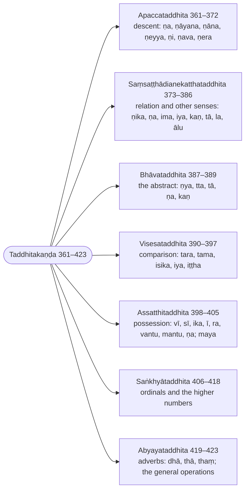

import { LinkCard } from "@astrojs/starlight/components";

:::note
The `taddhita` suffixes are grouped by the sense they express: descent (`apacca`), relation and the many other senses of `ṇika` and its kin, the abstract, comparison, possession, number and the adverbial suffixes. Each derivation shows the vuddhi, the elision of the marker `ṇ` and the sandhi that the Kaccāyana rules prescribe.

:::

:::note[The seven kinds of taddhita]
Buddhappiya groups the secondary suffixes by sense, in Kaccāyana's order, and brings the operations they share forward to the first derivation that needs them. The ranges are Rūpasiddhi numbers.

:::

## Apaccataddhita (Suffixes of descent)

> Atha nāmato eva vibhatyantā apaccādiatthavisese taddhituppattīti nāmato paraṃ taddhitavidhānamārabhīyate.

Now, because a `taddhita` (secondary derivative) arises only from a noun — from a lemma that carries an inflection — in a particular sense such as "offspring", the treatment of the `taddhita` is begun after that of the noun [and its compounds].

> Tattha tasmā tividhaliṅgato paraṃ hutvā hitā sahitāti taddhitā, ṇā dipaccayānametaṃ adhivacanaṃ, tesaṃ vā nāmikānaṃ hitā upakārā taddhitāti anvatthabhūtaparasamaññāvasenāpi ṇā dippaccayāva taddhitā nāma.

Here `taddhita` means "placed (`hita`), that is, joined on, after (`paraṃ hutvā`) that (`tasmā`) lemma of three genders"; it is a name for the suffixes `ṇa` and the rest. Or else they are `taddhita` because they are of service (`hitā`), helpful, to those (`tesaṃ`) nominal lemmas. So even by way of the terminology of the other grammars, which here says what it means (`anvattha`), it is precisely the suffixes `ṇa` and the rest that are called `taddhita`.

> ‘‘Vasiṭṭhassa apacca’’nti viggahe –

In the analysis (`viggaha`) "Vasiṭṭha's offspring" —

> ‘‘Liṅgañca nipaccate’’ti ito liṅga ggahaṇamanuvattate.

the word `liṅga` (lemma) continues [into the rule] from [61 (§53): Liṅgañca nipaccate](/rupasiddhi/2-namakanda/1-pullinga#r61), Kaccāyana's [§53 (61): Liṅgañca nippajjate](/kaccayana/2-namakappa/1-pathamakanda#m53).

---

### 361 (§344): Vā ṇa’pacce (Optionally `ṇa` in the sense of offspring) :badge[apavada]{variant=success}

:::tip[Kaccāyana]
<LinkCard title="§344 (361): Vāṇa’pacce" href="/kaccayana/5-taddhitakappa#m344" description="Optionally `ṇa` in the sense of offspring" />
:::

> Chaṭṭhiyantato liṅgamhā ṇa ppaccayo hoti vikappena ‘‘tassa apacca’’miccetasmiṃ atthe.

After a lemma ending in the sixth form ⑥, the suffix `ṇa` is used optionally (`vikappena`) in the sense "his offspring" (`tassa apaccaṃ`).

> So ca –

And that [suffix] —

---

### 362 (§432): Dhātuliṅgehi parā paccayā (suffixes come after roots and lemmas: a governing statement) :badge[sīhagatika]{variant=caution}

:::tip[Kaccāyana]
<LinkCard title="§432 (362): Dhātuliṅgehi parā paccayā" href="/kaccayana/6-akhyatakappa/2-dutiyakanda#m432" description="suffixes come after roots and lemmas: a governing statement" />
:::

> Dhātūhi, liṅgehi ca paccayā parāva hontīti paribhāsato apaccatthasambandhiliṅgato chaṭṭhiyantāyeva paro hoti. Paṭicca etasmā attho etīti paccayo, patīyanti anena atthāti vā paccayo, ‘‘vuttatthānamappayogo’’ti apacca saddassa appayogo, ‘‘tesaṃ vibhattiyo lopā ce’’ti vibhattilopo ca.

By the metarule ([`paribhāsā`](/introduction#types-of-suttas)) "suffixes come only after roots (`dhātu`) and after lemmas (`liṅga`)", the suffix comes only after the lemma that is connected with the sense of offspring and ends in the sixth form ⑥. It is called a suffix (`paccaya`) because the meaning comes (`eti`) from it, depending on it (`paṭicca`), or because meanings are understood (`patīyanti`) by means of it. The word `apacca` is not used, by [the maxim] "what has already been expressed is not used" (`vuttatthānaṃ appayogo`), and the inflection is elided by [§317 (332): Tesaṃ vibhattiyo lopā ca](/kaccayana/4-samasakappa#m317).

---

### 363 (§396): Tesaṃ ṇo lopaṃ (the `ṇ` of these suffixes is elided) :badge[utsarga]{variant=success}

:::tip[Kaccāyana]
<LinkCard title="§396 (363): Tesaṃ ṇo lopaṃ" href="/kaccayana/5-taddhitakappa#m396" description="the `ṇ` of these suffixes is elided" />
:::

> Tesaṃ taddhitappaccayānaṃ ṇā nubandhānaṃ ṇa kāro lopamāpajjate.

The letter `ṇ` of these `taddhita` suffixes that carry the marker `ṇ` (`ṇānubandha`) is elided.

---

### 364 (§400): Vuddhādisarassa vāsaṃyogantassa saṇe ca (optionally `vuddhi` of the first vowel not before a conjunct, before a `ṇ` suffix) :badge[apavada]{variant=success}

:::tip[Kaccāyana]
<LinkCard title="§400 (364): Vuddhādisarassa vā’saṃyogantassa saṇe ca" href="/kaccayana/5-taddhitakappa#m400" description="optionally `vuddhi` of the first vowel not before a conjunct, before a `ṇ` suffix" />
:::

> Ādisarassa vā ādibyañjanassa vā asaṃyogantassa vuddhi hoti saṇa kārappaccaye pare. Saṃyogo anto assāti saṃyoganto, tadañño asaṃyoganto. Atha vā vavatthitavibhāsatthoyaṃ vā saddo, tadā ca pakatibhūte liṅge sarānamādisarassa asaṃyogantassa vuddhi hoti saṇa kāre taddhitappaccaye pareti attho.

When a suffix with the letter `ṇ` follows, the initial vowel, or [the vowel of] the initial consonant, is strengthened (`vuddhi`), provided it is not followed by a conjunct: what has a conjunct (`saṃyoga`) after it is `saṃyoganta`, "ending in a conjunct", and what is other than that is `asaṃyoganta`. Or else this word `vā` has the sense of a restricted option (`vavatthitavibhāsā`), and then the meaning is that, among the vowels of the lemma that is the base (`pakati`), the initial vowel not followed by a conjunct is strengthened when a `taddhita` suffix with the letter `ṇ` follows.

> Tena –

Hence —

> Vāsiṭṭhādīsu niccāyaṃ, aniccoḷumpikādisu; \
> Na vuddhi nīlapītādo, vavatthitavibhāsato.

In `vāsiṭṭha` ("Vasiṭṭha's offspring") and the like this [strengthening] is invariable (`nicca`); in `oḷumpika` ("one who crosses by raft") and the like it is optional (`anicca`); \
in `nīla` ("dyed blue"), `pīta` ("dyed yellow") and the like there is no strengthening — by the restricted option.

> Ca saddaggahaṇamavadhāraṇatthaṃ.

The mention of the word `ca` is for restriction (`avadhāraṇa`).

> Tassā vuddhiyā aniyamappasaṅge niyamatthaṃ paribhāsamāha.

Since that strengthening would otherwise apply without restriction, a metarule ([`paribhāsā`](/introduction#types-of-suttas)) is stated to restrict it:

---

### 365 (§405): Ayuvaṇṇānañcāyo vuddhī (the `vuddhi` of `a`, `i`, `u` is `ā`, `e`, `o`) :badge[anvattha]{variant=note}

:::tip[Kaccāyana]
<LinkCard title="§405 (365): Ayuvaṇṇānañcāyo vuddhi" href="/kaccayana/5-taddhitakappa#m405" description="the `vuddhi` of `a`, `i`, `u` is `ā`, `e`, `o`" />
:::

> Tesaṃ a kārai vaṇṇu vaṇṇānameva yathākkamaṃ ā eo iccete vuddhiyo honti. Ca saddaggahaṇamavuddhisampiṇḍanatthaṃ, avadhāraṇatthaṃ vā. I ca u ca yu, yu eva vaṇṇā yuvaṇṇā, a ca yuvaṇṇā ca ayuvaṇṇā. Ā ca e ca o ca āyo. Puna vuddhi ggahaṇaṃ ‘‘negamajānapadā’’tiādīsu uttarapadavuddhibhāvatthaṃ, ettha ca ‘‘ayuvaṇṇāna’’nti ṭhānaniyamavacanaṃ āyonaṃ vuddhibhāvappasaṅganivattanatthaṃ.

The strengthened forms (`vuddhi`) of those — of the letter `a`, the `i`-sound and the `u`-sound, and of those alone — are `ā`, `e` and `o` respectively. The mention of the word `ca` is either to include (`sampiṇḍana`) the absence of strengthening or for delimitation. `i` and `u` are `yu`; the sounds that are just `yu` are the `yuvaṇṇā`; `a` together with the `yuvaṇṇā` are the `ayuvaṇṇā`; and `ā`, `e` and `o` are `āyo`. `vuddhi` is mentioned again so that the last member (`uttarapada`) is strengthened in `negamajānapadā` ("townspeople and country people") and the like; and here `ayuvaṇṇānaṃ`, the statement that restricts the locus (`ṭhānaniyama`), is there to stop (`nivattana`) `ā`, `e` and `o` from being liable to strengthening.

> Yathā hi katavuddhīnaṃ, puna vuddhi na hotiha; \
> Tathā sabhāvavuddhīnaṃ, āyonaṃ puna vuddhi na.

For just as vowels already strengthened receive no second strengthening here, \
so `ā`, `e` and `o`, which are strengthened by nature, receive no further strengthening.

> Tato a kārassa ā kāro vuddhi, ‘‘saralopomādesappaccayādimhi saralope tu pakatī’’ti saralopapakatibhāvā, ‘‘naye paraṃ yutte’’ti paranayanaṃ katvā taddhitattā ‘‘taddhitasamāsa’’iccādinā nāmabyapadese kate pure viya syā dyuppatti.

Then the letter `ā` is the strengthening of the letter `a`; the vowel is elided and [the following vowel] keeps its natural form by [§83 (67): Saralopo’ mādesa paccayādimhi saralope tu pakati](/kaccayana/2-namakappa/1-pathamakanda#m83); the [consonant] is joined on to what follows by [§11 (14): Naye paraṃ yutte](/kaccayana/1-sandhikappa#m11); and since the word is a `taddhita`, once it has been designated a noun by [§601 (334): Taddhitasamāsakitakā nāmaṃ vā’ tave tunādīsu ca](/kaccayana/7-kibbidhanakappa/4-catutthakanda#m601), the inflections `si` and the rest arise as before.

> Vāsiṭṭho, vasiṭṭhassa putto vā, vāsiṭṭhā iccādi purisa saddasamaṃ. Tassa nattupanattādayopi tadupacārato vāsiṭṭhāyeva. Evaṃ sabbattha gottataddhite paṭhamappakatitoyeva paccayo hoti.

`vāsiṭṭho` ("Vasiṭṭha's offspring"), or `vasiṭṭhassa putto` ("Vasiṭṭha's son"); `vāsiṭṭhā` and so on, the same as the word `purisa`. His grandsons, great-grandsons and the rest are also just `vāsiṭṭhā`, by figurative use (`upacāra`) of that [name]. So in a clan derivative (`gottataddhita`) the suffix is everywhere used after the first base only.

> Itthiyaṃ ṇappaccayantattā ‘‘ṇava ṇika ṇeyya ṇa ntūhī’’ti vāsiṭṭha saddato īpaccayo. Saralopādiṃ katvā itthippaccayantattā ‘‘taddhitasamāsa’’iccādisutte ca ggahaṇena nāmabyapadese kate syā dyuppatti, vāsiṭṭhī kaññā, vāsiṭṭhī, vāsiṭṭhiyo iccādi itthi saddasamaṃ.

In the feminine, because the word ends in the suffix `ṇa`, the suffix `ī` is used after the word `vāsiṭṭha` by [§239 (190): Ṇava ṇika ṇeyya ṇa ntuhi](/kaccayana/2-namakappa/4-catutthakanda#m239). After the vowel elision and the rest, since the word ends in a feminine suffix, it is designated a noun by the mention of `ca` in the sutta beginning “`Taddhitasamāsa`” [§601], and the inflections `si` and the rest arise: `vāsiṭṭhī kaññā` ("a girl of Vasiṭṭha's line"); `vāsiṭṭhī`, `vāsiṭṭhiyo` and so on, the same as the word `itthī`.

> Napuṃsake vāsiṭṭhaṃ apaccaṃ, vāsiṭṭhāni apaccāni iccādi citta saddasamaṃ. Evaṃ uparipi taddhitantassa tiliṅgatā veditabbā.

In the neuter, `vāsiṭṭhaṃ apaccaṃ` ("Vasiṭṭha's offspring"), `vāsiṭṭhāni apaccāni` and so on, the same as the word `citta`. In the same way, further on too, a word ending in a `taddhita` suffix should be understood to have all three genders (`tiliṅgatā`).

> Bhāradvājassa putto bhāradvājo, vesāmittassa putto vesāmitto, gotamassa putto gotamo. Ettha ca ayuvaṇṇattābhāvā ā kārādīnaṃ na vuddhi hoti. Vasudevassa apaccaṃ vāsudevo, bāladevo[^1]. ‘‘Cittako’’tiādīsu pana saṃyogantattā vuddhi na bhavati.

Bhāradvāja's son is `bhāradvājo`, Vesāmitta's son `vesāmitto` and Gotama's son `gotamo`; here `ā` and the rest are not strengthened, because they are not `a`, `i` or `u`. Vasudeva's offspring is `vāsudevo`; `bāladevo` ("Baladeva's offspring"). In `cittako` ("Cittaka's offspring") and the like, however, there is no strengthening, because [the first vowel] is followed by a conjunct.

> ‘‘Vacchassa apacca’’nti viggahe ṇa mhi sampatte ‘‘vā ṇa’pacce’’ti ito vā ti taddhitavidhāne sabbattha vattate, tena sabbattha vākyavuttiyo bhavanti. ‘‘Apacce’’ti padaṃ yāva saṃsaṭṭha ggahaṇāva vattate.

In the analysis "Vaccha's offspring", when `ṇa` would apply, “`vā`” continues from [361 (§344): Vā ṇa’pacce](/rupasiddhi/5-taddhitakanda#r361) everywhere in the treatment of the `taddhita`; hence everywhere both the phrase (`vākya`) and the derivative (`vutti`) occur. The word `apacce` continues only as far as the mention of `saṃsaṭṭha`.

:::tip[Derivation]

|     | vasiṭṭha + sa (⑥⨀) + ṇa        | rule |
| --- | ------------------------------- | ---- |
| →   | vasiṭṭha + ~~sa~~ + ṇa          | 332 (§317) |
| →   | vasiṭṭha + (~~ṇ~~a)             | 363 (§396) |
| →   | v + (a→ā) + siṭṭha + a          | 364 (§400), 365 (§405) |
| →   | vāsiṭṭh + (~~a~~ + a)           | 67 (§83)  |
| →   | vāsiṭṭha                        | 14 (§11)  |
| →   | vāsiṭṭha + si (a noun)          | 334 (§601), 63 (§55) |
| →   | vāsiṭṭha + (si→o)               | 66 (§104) |
| →   | **vāsiṭṭho**                    |      |

|     | vāsiṭṭha (🚺) + ī               | rule |
| --- | ------------------------------- | ---- |
| →   | vāsiṭṭh + (~~a~~ + ī)           | 190 (§239), 67 (§83) |
| →   | vāsiṭṭhī + si (a noun)          | 334 (§601), 63 (§55) |
| →   | vāsiṭṭhī + ~~si~~               | 74 (§220) |
| →   | **vāsiṭṭhī**                    |      |

|     | vāsiṭṭha (🚻)                   | rule |
| --- | ------------------------------- | ---- |
| →   | vāsiṭṭha + si                   | 334 (§601), 63 (§55) |
| →   | vāsiṭṭha + (si→aṃ)              | 195 (§219) |
| →   | **vāsiṭṭhaṃ**                   |      |

:::

[^1]: CST4 prints `baladevo`; `bāladevo` is read with Kaccāyana's vutti under §344.

---

### 366 (§345): Ṇāyana ṇāna vacchādito (`ṇāyana`, `ṇāna` after `vaccha` and the like) :badge[apavada]{variant=success}

:::tip[Kaccāyana]
<LinkCard title="§345 (366): Ṇāyana ṇāna vacchādito" href="/kaccayana/5-taddhitakappa#m345" description="`ṇāyana`, `ṇāna` after `vaccha` and the like" />
:::

> Vaccha kacca iccevamādito chaṭṭhiyantato gottagaṇato ṇāyana ṇāna iccete[^2] paccayā honti vā ‘‘tassāpacca’’miccetasmiṃ atthe. Sabbattha ṇa kārānubandho vuddhattho, sesaṃ pubbasamaṃ, saṃyogantattā vuddhiabhāvova viseso.

After the group of clan names (`gottagaṇa`) `vaccha`, `kacca` and the like, ending in the sixth form ⑥, the suffixes `ṇāyana` and `ṇāna` are optionally used in the sense "his offspring". Everywhere the marker `ṇ` is there for the strengthening; the rest is the same as before, and the only difference is that there is no strengthening, because [the first vowel] is followed by a conjunct.

> Vacchāyano vacchāno vacchassa putto vā. Evaṃ kaccassa putto kaccāyano kaccāno, moggallassa putto moggallāyano moggallāno. Evaṃ aggivessāyano aggivessāno, kaṇhāyano kaṇhāno, sākaṭāyano sākaṭāno, muñcāyano muñcāno, kuñjāyano kuñjāno iccādi. Ākatigaṇo’yaṃ.

`vacchāyano`, `vacchāno` ("Vaccha's offspring"), or `vacchassa putto` ("Vaccha's son"). Likewise Kacca's son is `kaccāyano`, `kaccāno`, and Moggalla's son `moggallāyano`, `moggallāno`; likewise `aggivessāyano`, `aggivessāno` ("Aggivessa's son"); `kaṇhāyano`, `kaṇhāno` ("Kaṇha's son"); `sākaṭāyano`, `sākaṭāno` ("Sakaṭa's son"); `muñcāyano`, `muñcāno` ("Muñca's son"); `kuñjāyano`, `kuñjāno` ("Kuñja's son"), and so on. This is a group defined by form (`ākatigaṇa`).

:::tip[Derivation]

|     | vaccha + sa (⑥⨀) + ṇāyana       | rule |
| --- | ------------------------------- | ---- |
| →   | vaccha + ~~sa~~ + ṇāyana        | 332 (§317) |
| →   | vaccha + (~~ṇ~~āyana)           | 363 (§396) |
| →   | vacch + (~~a~~ + āyana)         | 67 (§83)  |
| →   | vacchāyana + si                 | 334 (§601), 63 (§55) |
| →   | vacchāyana + (si→o)             | 66 (§104) |
| →   | **vacchāyano**                  |      |

|     | sakaṭa + sa (⑥⨀) + ṇāna         | rule |
| --- | ------------------------------- | ---- |
| →   | sakaṭa + ~~sa~~ + ṇāna          | 332 (§317) |
| →   | sakaṭa + (~~ṇ~~āna)             | 363 (§396) |
| →   | s + (a→ā) + kaṭa + āna          | 364 (§400), 365 (§405) |
| →   | sākaṭ + (~~a~~ + āna)           | 67 (§83)  |
| →   | sākaṭāna + si                   | 334 (§601), 63 (§55) |
| →   | sākaṭāna + (si→o)               | 66 (§104) |
| →   | **sākaṭāno**                    |      |

:::

> ‘‘Kattikāya apacca’’nti viggahe –

In the analysis "Kattikā's offspring" —

[^2]: CST4 prints `iccate`; the form Buddhappiya uses everywhere else is `iccete`.

---

### 367 (§346): Ṇeyyo kattikādīhi (`ṇeyya` after `kattikā` and the like) :badge[apavada]{variant=success}

:::tip[Kaccāyana]
<LinkCard title="§346 (367): Ṇeyyo kattikādīhi" href="/kaccayana/5-taddhitakappa#m346" description="`ṇeyya` after `kattikā` and the like" />
:::

> Ādi saddoyaṃ pakāre vattate. Kattikā vinatārohiṇī iccevamādīhi itthiyaṃ vattamānehi liṅgehi ṇeyya ppaccayo hoti vā ‘‘tassāpacca’’miccetasmiṃ atthe.

This word `ādi` occurs in the sense of "kind" (`pakāra`). After lemmas occurring in the feminine, of the kind of `kattikā`, `vinatā` and `rohiṇī`, the suffix `ṇeyya` is optionally used in the sense "his offspring".

> Vibhattilope ‘‘pakati cassa sarantassā’’ti pakatibhāvo. Kattikeyyo, kattikāya putto vā. Evaṃ vinatāya apaccaṃ venateyyo, i kārasse kāro vuddhi, rohiṇiyā putto rohiṇeyyo, gaṅgāya apaccaṃ gaṅgeyyo, bhaginiyā putto bhāgineyyo, nadiyāputto nādeyyo. Evaṃ anteyyo, āheyyo, kāmeyyo. Suciyā apaccaṃ soceyyo, ettha u kārasso kāro vuddhi, bālāya apaccaṃ bāleyyo iccādi.

When the inflection is elided, the lemma keeps its natural form (`pakatibhāva`) by [§318 (333): Pakati cassa sarantassa](/kaccayana/4-samasakappa#m318): `kattikeyyo` ("Kattikā's offspring"), or `kattikāya putto` ("Kattikā's son"). Likewise Vinatā's offspring is `venateyyo`, where the letter `e` is the strengthening of the letter `i`; Rohiṇī's son is `rohiṇeyyo`, Gaṅgā's offspring `gaṅgeyyo`, a sister's (`bhaginī`) son `bhāgineyyo` and a river's (`nadī`) son `nādeyyo`; likewise `anteyyo`, `āheyyo`, `kāmeyyo`. Suci's offspring is `soceyyo`, where the letter `o` is the strengthening of the letter `u`; Bālā's offspring is `bāleyyo`, and so on.

:::tip[Derivation]

|     | kattikā + āya (⑥⨀) + ṇeyya      | rule |
| --- | ------------------------------- | ---- |
| →   | kattikā + ~~āya~~ + ṇeyya       | 332 (§317) |
| →   | kattikā + ṇeyya                 | 333 (§318) |
| →   | kattikā + (~~ṇ~~eyya)           | 363 (§396) |
| →   | kattik + (~~ā~~ + eyya)         | 67 (§83)  |
| →   | kattikeyya + si                 | 334 (§601), 63 (§55) |
| →   | kattikeyya + (si→o)             | 66 (§104) |
| →   | **kattikeyyo**                  |      |

|     | vinatā + āya (⑥⨀) + ṇeyya       | rule |
| --- | ------------------------------- | ---- |
| →   | vinatā + ~~āya~~ + ṇeyya        | 332 (§317), 333 (§318) |
| →   | vinatā + (~~ṇ~~eyya)            | 363 (§396) |
| →   | v + (i→e) + natā + eyya         | 364 (§400), 365 (§405) |
| →   | venat + (~~ā~~ + eyya)          | 67 (§83)  |
| →   | venateyya + si                  | 334 (§601), 63 (§55) |
| →   | venateyya + (si→o)              | 66 (§104) |
| →   | **venateyyo**                   |      |

|     | suci + yā (⑥⨀) + ṇeyya          | rule |
| --- | ------------------------------- | ---- |
| →   | suci + ~~yā~~ + ṇeyya           | 332 (§317), 333 (§318) |
| →   | suci + (~~ṇ~~eyya)              | 363 (§396) |
| →   | s + (u→o) + ci + eyya           | 364 (§400), 365 (§405) |
| →   | soc + (~~i~~ + eyya)            | 67 (§83)  |
| →   | soceyya + si                    | 334 (§601), 63 (§55) |
| →   | soceyya + (si→o)                | 66 (§104) |
| →   | **soceyyo**                     |      |

:::

> ‘‘Dakkhassāpacca’’nti viggahe ṇamhi sampatte –

In the analysis "Dakkha's offspring", when `ṇa` would apply —

---

### 368 (§347): Ato ṇi vā (Optionally `ṇi` after a lemma in `a`) :badge[apavada]{variant=success}

:::tip[Kaccāyana]
<LinkCard title="§347 (368): Ato ṇi vā" href="/kaccayana/5-taddhitakappa#m347" description="Optionally `ṇi` after a lemma in `a`" />
:::

> A kārantato liṅgamhā ṇi paccayo hoti vā ‘‘tassāpacca’’miccetasmiṃ atthe. Dakkhi, dakkhī, dakkhayo, doṇassa apaccaṃ doṇi. Evaṃ vāsavi, sakyaputti, nāṭaputti, dāsaputti, dāsarathi. Vāruṇi, kaṇḍi, bāladevi, pāvaki, jinadattassa apaccaṃ jenadatti, suddhodani, anuruddhi iccādi.

After a lemma ending in the letter `a`, the suffix `ṇi` is optionally used in the sense "his offspring": `dakkhi` ("Dakkha's offspring"), `dakkhī`, `dakkhayo`; Doṇa's offspring is `doṇi`. Likewise `vāsavi` ("Vāsava's offspring"), `sakyaputti` ("Sakyaputta's offspring"), `nāṭaputti` ("Nāṭaputta's offspring"), `dāsaputti` ("Dāsaputta's offspring"), `dāsarathi` ("Dasaratha's offspring"); `vāruṇi` ("Varuṇa's offspring"), `kaṇḍi` ("Kaṇḍa's offspring"), `bāladevi` ("Baladeva's offspring"), `pāvaki` ("Pāvaka's offspring"); Jinadatta's offspring is `jenadatti`; `suddhodani` ("Suddhodana's offspring"), `anuruddhi` ("Anuruddha's offspring"), and so on.

> Puna vā ggahaṇena apaccatthe ṇika ppaccayo, aditi ādito ṇya ppaccayo ca. Yathā – sakyaputtassa putto sakyaputtiko, ‘‘tesu vuddhī’’tiādinā ka kārassa ya kāro, sakyaputtiyo. Evaṃ nāṭaputtiko, jenadattiko, vimātuyā putto vemātiko.

By the repeated mention of `vā`, the suffix `ṇika` is used in the sense of offspring, and the suffix `ṇya` after `aditi` and the like. For instance, Sakyaputta's son is `sakyaputtiko`, and with the letter `k` replaced by the letter `y` by [§404 (370): Tesu vuddhilopāgamavikāraviparītādesā ca](/kaccayana/5-taddhitakappa#m404), `sakyaputtiyo`; likewise `nāṭaputtiko` ("Nāṭaputta's son"), `jenadattiko` ("Jinadatta's son"); a step-mother's (`vimātu`) son is `vemātiko`.

> ‘‘Aditiyā putto’’ti atthe ṇya ppaccayo, vuddhi ca.

In the sense "Aditi's son", the suffix `ṇya` [is used], and the strengthening —

:::tip[Derivation]

|     | dakkha + sa (⑥⨀) + ṇi           | rule |
| --- | ------------------------------- | ---- |
| →   | dakkha + ~~sa~~ + ṇi            | 332 (§317) |
| →   | dakkha + (~~ṇ~~i)               | 363 (§396) |
| →   | dakkh + (~~a~~ + i)             | 67 (§83)  |
| →   | dakkhi + si                     | 334 (§601), 63 (§55) |
| →   | dakkhi + ~~si~~                 | 74 (§220) |
| →   | **dakkhi**                      |      |

|     | jinadatta + sa (⑥⨀) + ṇi        | rule |
| --- | ------------------------------- | ---- |
| →   | jinadatta + ~~sa~~ + ṇi         | 332 (§317) |
| →   | jinadatta + (~~ṇ~~i)            | 363 (§396) |
| →   | j + (i→e) + nadatta + i         | 364 (§400), 365 (§405) |
| →   | jenadatt + (~~a~~ + i)          | 67 (§83)  |
| →   | jenadatti + si                  | 334 (§601), 63 (§55) |
| →   | jenadatti + ~~si~~              | 74 (§220) |
| →   | **jenadatti**                   |      |

|     | sakyaputta + sa (⑥⨀) + ṇika     | rule |
| --- | ------------------------------- | ---- |
| →   | sakyaputta + ~~sa~~ + ṇika      | 332 (§317) |
| →   | sakyaputta + (~~ṇ~~ika)         | 363 (§396) |
| →   | sakyaputt + (~~a~~ + ika)       | 67 (§83)  |
| →   | sakyaputtika + si               | 334 (§601), 63 (§55) |
| →   | sakyaputtika + (si→o)           | 66 (§104) |
| →   | sakyaputti + (k→y) + o          | 370 (§404) (optional) |
| →   | **sakyaputtiko**, **sakyaputtiyo** |      |

|     | vimātu + yā (⑥⨀) + ṇika         | rule |
| --- | ------------------------------- | ---- |
| →   | vimātu + ~~yā~~ + ṇika          | 332 (§317), 333 (§318) |
| →   | vimātu + (~~ṇ~~ika)             | 363 (§396) |
| →   | v + (i→e) + mātu + ika          | 364 (§400), 365 (§405) |
| →   | vemāt + (~~u~~ + ika)           | 67 (§83)  |
| →   | vemātika + si                   | 334 (§601), 63 (§55) |
| →   | vemātika + (si→o)               | 66 (§104) |
| →   | **vemātiko**                    |      |

:::

---

### 369 (§261): Avaṇṇo ye lopañca (`a`/`ā` elided before the suffix `ya`) :badge[apavada]{variant=success}

:::tip[Kaccāyana]
<LinkCard title="§261 (369): Avaṇṇo ye lopañca" href="/kaccayana/2-namakappa/5-pancamakanda#m261" description="`a`/`ā` elided before the suffix `ya`" />
:::

> A vaṇṇo taddhitabhūte ya ppaccaye pare lopamāpajjate. Ca saddena ivaṇṇopīti i kāralopo, ‘‘yavataṃ talanadakārānaṃ byañjanāni ca la ña jakāratta’’nti tya kārasaṃyogassa ca kāro, ‘‘paradvebhāvo ṭhāne’’ti dvittaṃ, ādicco. Evaṃ ditiyā putto decco.

The `a`-vowel is elided when the `taddhita` suffix `ya` follows, and by the word `ca` the `i`-vowel too. Hence the letter `i` is elided, the conjunct `ty` becomes the letter `c` by [§269 (41): Yavataṃ ta la ṇa dakārānaṃ byañjanāni ca la ña jakārattaṃ](/kaccayana/2-namakappa/5-pancamakanda#m269), and it is doubled (`dvitta`) by [§28 (40): Para dvebhāvo ṭhāne](/kaccayana/1-sandhikappa#m28): `ādicco` ("Aditi's son"). Likewise Diti's son is `decco`.

:::tip[Derivation]

|     | aditi + yā (⑥⨀) + ṇya           | rule |
| --- | ------------------------------- | ---- |
| →   | aditi + ~~yā~~ + ṇya            | 332 (§317), 333 (§318) |
| →   | aditi + (~~ṇ~~ya)               | 363 (§396) |
| →   | (a→ā) + diti + ya               | 364 (§400), 365 (§405) |
| →   | ādit + (~~i~~ + ya)             | 369 (§261) |
| →   | ādi + (ty→c) + a                | 41 (§269) |
| →   | ādi + (c→cc) + a                | 40 (§28)  |
| →   | ādicca + si                     | 334 (§601), 63 (§55) |
| →   | ādicca + (si→o)                 | 66 (§104) |
| →   | **ādicco**                      |      |

|     | diti + yā (⑥⨀) + ṇya            | rule |
| --- | ------------------------------- | ---- |
| →   | diti + ~~yā~~ + ṇya             | 332 (§317), 333 (§318) |
| →   | diti + (~~ṇ~~ya)                | 363 (§396) |
| →   | d + (i→e) + ti + ya             | 364 (§400), 365 (§405) |
| →   | det + (~~i~~ + ya)              | 369 (§261) |
| →   | de + (ty→c) + a                 | 41 (§269) |
| →   | de + (c→cc) + a                 | 40 (§28)  |
| →   | decca + si                      | 334 (§601), 63 (§55) |
| →   | decca + (si→o)                  | 66 (§104) |
| →   | **decco**                       |      |

:::

> ‘‘Kuṇḍaniyā putto’’ti atthe ṇya ppaccaye kate –

When the suffix `ṇya` has been added in the sense "Kuṇḍanī's son" —

> ‘‘Kvacādimajjhuttaresū’’ti vattate.

“`Kvacādimajjhuttaresu`” ("in some places, in the first, middle and last [positions]") continues from [§403 (354): Kvacādimajjhuttarānaṃ dīgharassā paccayesu ca](/kaccayana/5-taddhitakappa#m403).

---

### 370 (§404): Tesu vuddhilopāgamavikāraviparītādesā ca (and in these, `vuddhi`, elision, insertion, modification, metathesis, replacement) :badge[apavada]{variant=success}

:::tip[Kaccāyana]
<LinkCard title="§404 (370): Tesu vuddhilopāgamavikāraviparītādesā ca" href="/kaccayana/5-taddhitakappa#m404" description="and in these, `vuddhi`, elision, insertion, modification, metathesis, replacement" />
:::

> Tesu ādimajjhuttaresu avihitalakkhaṇesu jinavacanānuparodhena kvaci vuddhi lopa āgama vikāra viparītaādesā hontīti saṃyogantattepi ādivuddhi, i kāralope nya ssañā deso, koṇḍañño, kuruno putto korabyo, etthāpi teneva u kārassa avā deso, bhātuno putto bhātabyo.

In these — the first, middle and last [positions] — where no rule has been laid down, strengthening (`vuddhi`), elision ([`lopa`](/introduction#types-of-vidhi-operation)), insertion ([`āgama`](/introduction#types-of-vidhi-operation)), modification ([`vikāra`](/introduction#types-of-vidhi-operation)), metathesis ([`viparīta`](/introduction#types-of-vidhi-operation)) and replacement ([`ādesa`](/introduction#types-of-vidhi-operation)) take place in some places (`kvaci`), without conflicting with the word of the Conqueror. Hence the initial vowel is strengthened even though it is followed by a conjunct, and when the letter `i` is elided `ny` is replaced by `ñ`: `koṇḍañño` ("Kuṇḍanī's son"). Kuru's son is `korabyo`, and here too, by the same rule, the letter `u` is replaced by `ava`; a brother's (`bhātu`) son is `bhātabyo`.

:::tip[Derivation]

|     | kuṇḍanī + yā (⑥⨀) + ṇya         | rule |
| --- | ------------------------------- | ---- |
| →   | kuṇḍanī + ~~yā~~ + ṇya          | 332 (§317), 333 (§318) |
| →   | kuṇḍanī + (~~ṇ~~ya)             | 363 (§396) |
| →   | k + (u→o) + ṇḍanī + ya          | 370 (§404) |
| →   | koṇḍan + (~~ī~~ + ya)           | 369 (§261) |
| →   | koṇḍa + (ny→ñ) + a              | 370 (§404) |
| →   | koṇḍa + (ñ→ññ) + a              | 40 (§28)  |
| →   | koṇḍañña + si                   | 334 (§601), 63 (§55) |
| →   | koṇḍañña + (si→o)               | 66 (§104) |
| →   | **koṇḍañño**                    |      |

|     | kuru + no (⑥⨀) + ṇya            | rule |
| --- | ------------------------------- | ---- |
| →   | kuru + ~~no~~ + ṇya             | 332 (§317) |
| →   | kuru + (~~ṇ~~ya)                | 363 (§396) |
| →   | k + (u→o) + ru + ya             | 364 (§400), 365 (§405) |
| →   | kor + (u→ava) + ya              | 370 (§404) |
| →   | kora + (v→b) + ya               | 370 (§404) |
| →   | korabya + si                    | 334 (§601), 63 (§55) |
| →   | korabya + (si→o)                | 66 (§104) |
| →   | **korabyo**                     |      |

|     | bhātu + no (⑥⨀) + ṇya           | rule |
| --- | ------------------------------- | ---- |
| →   | bhātu + ~~no~~ + ṇya            | 332 (§317) |
| →   | bhātu + (~~ṇ~~ya)               | 363 (§396) |
| →   | bhāt + (u→ava) + ya             | 370 (§404) |
| →   | bhāta + (v→b) + ya              | 370 (§404) |
| →   | bhātabya + si                   | 334 (§601), 63 (§55) |
| →   | bhātabya + (si→o)               | 66 (§104) |
| →   | **bhātabyo**                    |      |

:::

> ‘‘Upagussa apacca’’nti viggahe –

In the analysis "Upagu's offspring" —

---

### 371 (§348): Ṇavopagvādīhi (`ṇava` after `upaku` and the like) :badge[apavada]{variant=success}

:::tip[Kaccāyana]
<LinkCard title="§348 (371): Ṇavo’ pakvādīhi" href="/kaccayana/5-taddhitakappa#m348" description="`ṇava` after `upaku` and the like" />
:::

> Upagu manu iccevamādīhi u kārantehi gottagaṇehi ṇava ppaccayo hoti vā ‘‘tassāpacca’’miccetasmiṃ atthe. Ādi saddassa cettha pakāravācakattā u kārantatoyevāyaṃ. Opagavo, opagavī, opagavaṃ, manuno apaccaṃ mānavo, ‘‘mānuso’’ti ṇa ppaccaye, sā game ca kate rūpaṃ, bhagguno apaccaṃ bhaggavo, paṇḍuno apaccaṃ paṇḍavo, upavindussa apaccaṃ opavindavo iccādi.

After clan names (`gottagaṇa`) ending in the letter `u`, of the kind of `upagu` and `manu`, the suffix `ṇava` is optionally used in the sense "his offspring"; and since the word `ādi` here expresses "kind", this suffix comes only after [lemmas] ending in the letter `u`. `opagavo` ("Upagu's offspring"), `opagavī`, `opagavaṃ`; Manu's offspring is `mānavo`, while `mānuso` is the form when the suffix `ṇa` is used and the insertion ([`āgama`](/introduction#types-of-vidhi-operation)) of `s` is made; Bhaggu's offspring is `bhaggavo`, Paṇḍu's offspring `paṇḍavo`, Upavindu's offspring `opavindavo`, and so on.

:::tip[Derivation]

|     | upagu + ssa (⑥⨀) + ṇava         | rule |
| --- | ------------------------------- | ---- |
| →   | upagu + ~~ssa~~ + ṇava          | 332 (§317) |
| →   | upagu + (~~ṇ~~ava)              | 363 (§396) |
| →   | (u→o) + pagu + ava              | 364 (§400), 365 (§405) |
| →   | opag + (~~u~~ + ava)            | 67 (§83)  |
| →   | opagava + si                    | 334 (§601), 63 (§55) |
| →   | opagava + (si→o)                | 66 (§104) |
| →   | **opagavo**                     |      |

|     | manu + no (⑥⨀) + ṇa             | rule |
| --- | ------------------------------- | ---- |
| →   | manu + ~~no~~ + ṇa              | 332 (§317) |
| →   | manu + (~~ṇ~~a)                 | 363 (§396) |
| →   | m + (a→ā) + nu + a              | 364 (§400), 365 (§405) |
| →   | mānu + (s) + a                  | 96 (§184) |
| →   | mānusa + si                     | 334 (§601), 63 (§55) |
| →   | mānusa + (si→o)                 | 66 (§104) |
| →   | **mānuso**                      |      |

:::

> ‘‘Vidhavāya apacca’’nti atthe –

In the sense "a widow's offspring" —

---

### 372 (§349): Ṇera vidhavādito (`ṇera` after `vidhavā` and the like) :badge[apavada]{variant=success}

:::tip[Kaccāyana]
<LinkCard title="§349 (372): Ṇera vidhavādito" href="/kaccayana/5-taddhitakappa#m349" description="`ṇera` after `vidhavā` and the like" />
:::

> Vidhavā dito ṇera ppaccayo hoti vā apaccatthe. Vigato dhavo pati etissāti vidhavā, vedhavero, bandhukiyā abhisāriṇiyā putto bandhukero, samaṇassa upajjhāyassa putto puttaṭṭhāniyattāti sāmaṇero, nāḷikero iccādi.

After `vidhavā` and the like, the suffix `ṇera` is optionally used in the sense of offspring. A `vidhavā` (widow) is a woman whose husband (`dhava`), her lord, is gone; [her son is] `vedhavero` ("a widow's son"). The son of a `bandhukī`, a woman who goes out to her lovers (`abhisāriṇī`), is `bandhukero`; the son of an ascetic (`samaṇa`), that is, of a preceptor, is `sāmaṇero` ("a novice"), because he stands in the place of a son; `nāḷikero`, and so on.

:::tip[Derivation]

|     | vidhavā + āya (⑥⨀) + ṇera       | rule |
| --- | ------------------------------- | ---- |
| →   | vidhavā + ~~āya~~ + ṇera        | 332 (§317), 333 (§318) |
| →   | vidhavā + (~~ṇ~~era)            | 363 (§396) |
| →   | v + (i→e) + dhavā + era         | 364 (§400), 365 (§405) |
| →   | vedhav + (~~ā~~ + era)          | 67 (§83)  |
| →   | vedhavera + si                  | 334 (§601), 63 (§55) |
| →   | vedhavera + (si→o)              | 66 (§104) |
| →   | **vedhavero**                   |      |

|     | samaṇa + ssa (⑥⨀) + ṇera        | rule |
| --- | ------------------------------- | ---- |
| →   | samaṇa + ~~ssa~~ + ṇera         | 332 (§317) |
| →   | samaṇa + (~~ṇ~~era)             | 363 (§396) |
| →   | s + (a→ā) + maṇa + era          | 364 (§400), 365 (§405) |
| →   | sāmaṇ + (~~a~~ + era)           | 67 (§83)  |
| →   | sāmaṇera + si                   | 334 (§601), 63 (§55) |
| →   | sāmaṇera + (si→o)               | 66 (§104) |
| →   | **sāmaṇero**                    |      |

:::

---

> _Apaccataddhitaṃ._

[Here end] the suffixes of descent.

---

## Saṃsaṭṭhādianekatthataddhita (Suffixes of relation and other senses)

> ‘‘Tilena saṃsaṭṭha’’nti viggahe –

In the analysis "mixed with sesame" —

---

### 373 (§350): Yena vā saṃsaṭṭhaṃ tarati carati vahati ṇiko (`ṇika` for "mixed with", "crosses by", "goes by", "carries by" that) :badge[apavada]{variant=success}

:::tip[Kaccāyana]
<LinkCard title="§350 (373): Yena vā saṃsaṭṭhaṃ tarati carati vahati ṇiko" href="/kaccayana/5-taddhitakappa#m350" description="`ṇika` for 'mixed with', 'crosses by', 'goes by', 'carries by' that" />
:::

> Yena vā saṃsaṭṭhaṃ, yena vā tarati, yena vā carati, yena vā vahati, tato tatiyantato liṅgamhā tesu saṃsaṭṭhādīsvatthesu ṇika ppaccayo hoti vā. Telikaṃ bhojanaṃ, tilena abhisaṅkhatanti attho. Telikī yāgu. Guḷena saṃsaṭṭhaṃ goḷikaṃ[^3]. Evaṃ ghātikaṃ, dādhikaṃ, māricikaṃ, loṇikaṃ.

After a lemma ending in the third form ③ — that with which something is mixed, by which one crosses, by which one goes or by which one carries — the suffix `ṇika` is optionally used in those senses, "mixed with" and the rest: `telikaṃ bhojanaṃ` ("food mixed with sesame"), meaning prepared (`abhisaṅkhata`) with sesame; `telikī yāgu` ("gruel mixed with sesame"); mixed with molasses (`guḷa`), `goḷikaṃ`; likewise `ghātikaṃ` ("mixed with ghee"), `dādhikaṃ` ("with curds"), `māricikaṃ` ("with pepper"), `loṇikaṃ` ("with salt").

> Nāvāya taratīti nāviko, uḷumpena taratīti oḷumpiko, vuddhiabhāvapakkhe uḷumpiko. Evaṃ kulliko, gopucchiko. Sakaṭena caratīti sākaṭiko. Evaṃ pādiko, daṇḍiko, dhammena carati pavattatīti dhammiko. Sīsena vahatīti sīsiko, vā ggahaṇena ī kārassa vuddhi na hoti. Evaṃ aṃsiko, khandhiko, hatthiko, aṅguliko.

One who crosses by boat (`nāvā`) is `nāviko`; one who crosses by raft (`uḷumpa`) is `oḷumpiko`, or `uḷumpiko` on the alternative without strengthening; likewise `kulliko` ("one who crosses by a `kulla` raft"), `gopucchiko` ("by a cow's tail"). One who goes by cart (`sakaṭa`) is `sākaṭiko`; likewise `pādiko` ("one who goes on foot"), `daṇḍiko` ("with a staff"); one who goes, that is, proceeds (`pavattati`), by the Dhamma is `dhammiko`. One who carries on the head (`sīsa`) is `sīsiko`, and by the mention of `vā` the letter `ī` is not strengthened; likewise `aṃsiko` ("one who carries on the shoulder"), `khandhiko` ("on the back"), `hatthiko` ("in the hand"), `aṅguliko` ("with the fingers").

> Puna vā ggahaṇena aññatthesupi ṇika ppaccayo, paradāraṃ gacchatīti pāradāriko, pathaṃ gacchatīti pathiko.

By the repeated mention of `vā`, the suffix `ṇika` is used in other senses as well: one who goes to another's wife (`paradāra`) is `pāradāriko`, and one who goes along the road (`patha`) is `pathiko`.

:::tip[Derivation]

|     | tila + nā (③⨀) + ṇika           | rule |
| --- | ------------------------------- | ---- |
| →   | tila + ~~nā~~ + ṇika            | 332 (§317) |
| →   | tila + (~~ṇ~~ika)               | 363 (§396) |
| →   | t + (i→e) + la + ika            | 364 (§400), 365 (§405) |
| →   | tel + (~~a~~ + ika)             | 67 (§83)  |
| →   | telika + si                     | 334 (§601), 63 (§55) |
| →   | telika + (si→aṃ)                | 195 (§219) |
| →   | **telikaṃ**                     |      |

|     | telika (🚺) + ī                 | rule |
| --- | ------------------------------- | ---- |
| →   | telik + (~~a~~ + ī)             | 190 (§239), 67 (§83) |
| →   | telikī + si                     | 334 (§601), 63 (§55) |
| →   | telikī + ~~si~~                 | 74 (§220) |
| →   | **telikī**                      |      |

|     | uḷumpa + nā (③⨀) + ṇika         | rule |
| --- | ------------------------------- | ---- |
| →   | uḷumpa + ~~nā~~ + ṇika          | 332 (§317) |
| →   | uḷumpa + (~~ṇ~~ika)             | 363 (§396) |
| →   | (u→o) + ḷumpa + ika             | 364 (§400), 365 (§405) |
| →   | oḷump + (~~a~~ + ika)           | 67 (§83)  |
| →   | oḷumpika + si                   | 334 (§601), 63 (§55) |
| →   | oḷumpika + (si→o)               | 66 (§104) |
| →   | **oḷumpiko**                    |      |

:::

> ‘‘Vinayamadhīte, aveccādhīte’’ti vā viggahe –

In the analysis "he studies the Vinaya", or "he studies [it] thoroughly (`avecca`)" —

> ‘‘Ṇiko’’ti vattate.

“`ṇiko`” continues.

[^3]: CST4 prints `egāḷikaṃ`; `goḷikaṃ` is read with Kaccāyana's vutti under §350.

---

### 374 (§351): Tamadhīte tenakatādisannidhānaniyogasippabhaṇḍajīvikatthesu ca (And `ṇika` for "studies that", "made by that" and the like, location, appointment, craft, goods, livelihood) :badge[apavada]{variant=success}

:::tip[Kaccāyana]
<LinkCard title="§351 (374): Tamadhīte tenakatādi sannidhāna niyoga sippa bhaṇḍa jīvikatthesu ca" href="/kaccayana/5-taddhitakappa#m351" description="And `ṇika` for 'studies that', 'made by that' and the like, location, appointment, craft, goods, livelihood" />
:::

> Catuppadamidaṃ. Tamadhīteti atthe, tena katādīsvatthesu ca tamhi sannidhāno, tattha niyutto, tamassa sippaṃ, tamassa bhaṇḍaṃ, tamassa jīvikā iccetesvatthesu ca dutiyādivibhatyantehi liṅgehi ṇika ppaccayo hoti vā. Venayiko. Evaṃ suttantiko, ābhidhammiko.

This sutta has four words. After lemmas ending in the second ② and the other inflection forms, the suffix `ṇika` is optionally used in the sense "he studies that", in the senses "made by that" and the like, and in the senses "located in that", "appointed to that", "that is his craft", "that is his merchandise" and "that is his livelihood": `venayiko` ("one who studies the Vinaya"); likewise `suttantiko` ("one who studies the Suttanta"), `ābhidhammiko` ("one who studies the Abhidhamma").

:::tip[Derivation]

|     | vinaya + aṃ (②⨀) + ṇika         | rule |
| --- | ------------------------------- | ---- |
| →   | vinaya + ~~aṃ~~ + ṇika          | 332 (§317) |
| →   | vinaya + (~~ṇ~~ika)             | 363 (§396) |
| →   | v + (i→e) + naya + ika          | 364 (§400), 365 (§405) |
| →   | venay + (~~a~~ + ika)           | 67 (§83)  |
| →   | venayika + si                   | 334 (§601), 63 (§55) |
| →   | venayika + (si→o)               | 66 (§104) |
| →   | **venayiko**                    |      |

:::

> ‘‘Byākaraṇamadhīte’’ti atthe ṇika ppaccayādimhi kate –

When the suffix `ṇika` and the rest have been applied in the sense "he studies grammar" (`byākaraṇa`) —

> ‘‘Vuddhādisarassa vāsaṃyogantassa saṇe cā’’ti vattamāne –

while [364 (§400): Vuddhādisarassa vāsaṃyogantassa saṇe ca](/rupasiddhi/5-taddhitakanda#r364) continues —

---

### 375 (§401): Māyūnamāgamo ṭhāne (no `vuddhi` of initial `i`, `u`; the insertion of `e`, `o` in its place) :badge[apavada]{variant=success}

:::tip[Kaccāyana]
<LinkCard title="§401 (375): Māyūnamāgamo ṭhāne" href="/kaccayana/5-taddhitakappa#m401" description="no `vuddhi` of initial `i`, `u`; the insertion of `e`, `o` in its place" />
:::

> I u iccetesaṃ[^4] ādisarānaṃ asaṃyogantānaṃ mā vuddhi hoti saṇe, tatreva vuddhi āgamo hoti ca ṭhāneti ekāravuddhāgamo.

The initial vowels `i` and `u`, when not followed by a conjunct, are not strengthened (`mā vuddhi`) before a `ṇ` [suffix]; instead, right there in its place (`ṭhāne`), the strengthened vowel comes as an insertion ([`āgama`](/introduction#types-of-vidhi-operation)). Hence the insertion of the strengthened vowel `e`.

> ‘‘Ṭhāne’’ti vacanā cettha, yū namādesabhūtato; \
> Yave hi pubbeva eo-vuddhiyo honti āgamā.

And here, because of the word `ṭhāne`, it is before what stands as the replacement of `i` and `u`, \
that is, only before `y` and `v`, that the strengthened vowels `e` and `o` come as insertions.

> Ya kārassa dvibhāvo.

The letter `y` is doubled.

> Veyyākaraṇiko, nyāyamadhīteti neyyāyiko. Evaṃ takkiko, vediko, nemittiko, kāyena kato payogo kāyiko, kāyena kataṃ kammaṃ kāyikaṃ, vacasā kataṃ kammaṃ vācasikaṃ. Evaṃ mānasikaṃ, ettha ca ‘‘sasare vāgamo’’ti sutte vavatthitavā saddena paccaye parepi sā gamo, therehi katā saṅgīti therikā. Evaṃ pañcasatikā, sattasatikā, ettha ‘‘ṇavaṇikā’’disutte anuvattitavā ggahaṇena īpaccayo na hoti.

`veyyākaraṇiko` ("one who studies grammar"); one who studies logic (`nyāya`) is `neyyāyiko`; likewise `takkiko` ("one who studies reasoning"), `vediko` ("the Veda"), `nemittiko` ("omens"). An act (`payoga`) done by the body is `kāyiko`, a deed (`kamma`) done by the body `kāyikaṃ`, and a deed done by speech (`vacasā`) `vācasikaṃ`; likewise `mānasikaṃ` ("done by the mind"), and here the insertion of `s` comes even when a suffix follows, by the restricted (`vavatthita`) word `vā` in the sutta [§184 (96): Sa sare vāgamo](/kaccayana/2-namakappa/3-tatiyakanda#m184). The recitation (`saṅgīti`) made by the elders (`thera`) is `therikā`; likewise `pañcasatikā` ("made by the five hundred"), `sattasatikā` ("made by the seven hundred"), and here the suffix `ī` is not used, by the mention of `vā` that continues into the sutta [§239 (190): Ṇava ṇika ṇeyya ṇa ntuhi](/kaccayana/2-namakappa/4-catutthakanda#m239).

:::tip[Derivation]

|     | vyākaraṇa (byākaraṇa) + aṃ (②⨀) + ṇika | rule |
| --- | --------------------------------------- | ---- |
| →   | vyākaraṇa + ~~aṃ~~ + ṇika               | 332 (§317) |
| →   | vyākaraṇa + (~~ṇ~~ika)                  | 363 (§396) |
| →   | v + (e) + yākaraṇa + ika                | 375 (§401) |
| →   | ve + (y) + yākaraṇa + ika               | 40 (§28)  |
| →   | veyyākaraṇ + (~~a~~ + ika)              | 67 (§83)  |
| →   | veyyākaraṇika + si                      | 334 (§601), 63 (§55) |
| →   | veyyākaraṇika + (si→o)                  | 66 (§104) |
| →   | **veyyākaraṇiko**                       |      |

|     | vaca + sā (③⨀) + ṇika           | rule |
| --- | ------------------------------- | ---- |
| →   | vaca + ~~sā~~ + ṇika            | 332 (§317) |
| →   | vaca + (~~ṇ~~ika)               | 363 (§396) |
| →   | v + (a→ā) + ca + ika            | 364 (§400), 365 (§405) |
| →   | vāca + (s) + ika                | 96 (§184) |
| →   | vācasika + si                   | 334 (§601), 63 (§55) |
| →   | vācasika + (si→aṃ)              | 195 (§219) |
| →   | **vācasikaṃ**                   |      |

|     | thera + hi (③⨂) + ṇika          | rule |
| --- | ------------------------------- | ---- |
| →   | thera + ~~hi~~ + ṇika           | 332 (§317) |
| →   | thera + (~~ṇ~~ika)              | 363 (§396) |
| →   | ther + (~~a~~ + ika)            | 67 (§83)  |
| →   | therik + (~~a~~ + ā)            | 176 (§237), 67 (§83) |
| →   | therikā + si                    | 334 (§601), 63 (§55) |
| →   | therikā + ~~si~~                | 74 (§220) |
| →   | **therikā**                     |      |

:::

> Sannidhānatthe sarīre sannidhānā vedanā sārīrikā, sārīrikaṃ dukkhaṃ. Evaṃ mānasikā, mānasikaṃ.

In the sense of location (`sannidhāna`): a feeling located in the body (`sarīra`) is `sārīrikā`, and `sārīrikaṃ dukkhaṃ` ("bodily pain"); likewise `mānasikā` ("located in the mind"), `mānasikaṃ`.

> Niyuttatthe dvāre niyutto dovāriko, ettha ‘‘māyūnamāgamo ṭhāne’’ti va kārato pubbeo kārāgamo. Evaṃ bhaṇḍāgāriko, nāgariko, navakammiko, vanakammiko, ādikammiko, odariko, rathiko, pathiko, upāye niyutto opāyiko, cetasi niyuttā cetasikā.

In the sense of appointment (`niyutta`): one appointed to the door (`dvāra`) is `dovāriko`, and here the insertion of the letter `o` comes before the letter `v` by “`Māyūnamāgamo ṭhāne`”; likewise `bhaṇḍāgāriko` ("appointed to the storehouse"), `nāgariko` ("to the city"), `navakammiko` ("to building work"), `vanakammiko` ("to forest work"), `ādikammiko` ("engaged in the first deed"), `odariko` ("devoted to the belly"), `rathiko` ("appointed to a chariot"), `pathiko` ("to the road"); one engaged in a means (`upāya`) is `opāyiko`, and [states] engaged in the mind (`cetas`) are `cetasikā`.

> Sippatthe vīṇāvādanaṃ vīṇā, vīṇā assa sippaṃ veṇiko. E vaṃ pāṇaviko, modiṅgiko, vaṃsiko.

In the sense of a craft (`sippa`): `vīṇā` means lute-playing (`vīṇāvādana`), and one whose craft is the lute is `veṇiko`; likewise `pāṇaviko` ("whose craft is the small drum"), `modiṅgiko` ("the `mudiṅga` drum"), `vaṃsiko` ("the bamboo pole").

> Bhaṇḍatthe gandho assa bhaṇḍanti gandhiko. Evaṃ teliko, goḷiko, pūviko, paṇṇiko, tambūliko, loṇiko.

In the sense of merchandise (`bhaṇḍa`): one whose merchandise is perfume (`gandha`) is `gandhiko`; likewise `teliko` ("whose merchandise is oil"), `goḷiko` ("molasses"), `pūviko` ("cakes"), `paṇṇiko` ("greens"), `tambūliko` ("betel"), `loṇiko` ("salt").

> Jīvikatthe urabbhaṃ hantvā jīvati, urabbhamassa jīvikāti vā orabbhiko. Evaṃ māgaviko, ettha va kārāgamo. Sūkariko, sākuṇiko, macchiko iccādi.

In the sense of a livelihood (`jīvikā`): one who lives by killing sheep (`urabbha`), or whose livelihood is sheep, is `orabbhiko`; likewise `māgaviko` ("one who lives by killing deer"), where the letter `v` is inserted; `sūkariko` ("pigs"), `sākuṇiko` ("birds"), `macchiko` ("fish"), and so on.

:::tip[Derivation]

|     | dvāra + smiṃ (⑦⨀) + ṇika        | rule |
| --- | ------------------------------- | ---- |
| →   | dvāra + ~~smiṃ~~ + ṇika         | 332 (§317) |
| →   | dvāra + (~~ṇ~~ika)              | 363 (§396) |
| →   | d + (o) + vāra + ika            | 375 (§401) |
| →   | dovār + (~~a~~ + ika)           | 67 (§83)  |
| →   | dovārika + si                   | 334 (§601), 63 (§55) |
| →   | dovārika + (si→o)               | 66 (§104) |
| →   | **dovāriko**                    |      |

|     | maga + aṃ (②⨀) + ṇika           | rule |
| --- | ------------------------------- | ---- |
| →   | maga + ~~aṃ~~ + ṇika            | 332 (§317) |
| →   | maga + (~~ṇ~~ika)               | 363 (§396) |
| →   | m + (a→ā) + ga + ika            | 364 (§400), 365 (§405) |
| →   | māga + (v) + ika                | 370 (§404) |
| →   | māgavika + si                   | 334 (§601), 63 (§55) |
| →   | māgavika + (si→o)               | 66 (§104) |
| →   | **māgaviko**                    |      |

:::

> ‘‘Tena katādī’’ti ettha ādi ggahaṇena tena hataṃ, tena baddhaṃ, tena kītaṃ, tena dibbati, so assa āvudho, so assa ābādho, tattha pasanno, tassa santakaṃ, tamassa parimāṇaṃ, tassa rāsi, taṃ arahati, tamassa sīlaṃ, tattha jāto, tattha vasati, tatra vidito, tadatthāya saṃvattati, tato āgato, tato sambhūto, tadassa payojananti evamādiatthe ca ṇika ppaccayo hoti. Yathā – jālena hato, hanatīti vā jāliko. Evaṃ bāḷisiko, vākariko, suttena baddho suttiko, varattāya baddho vārattiko nāgo.

By the mention of `ādi` in “`tena katādi`” ("made by that, and the like"), the suffix `ṇika` is used also in such senses as these: killed by that, bound with that, bought with that, plays with that, that is his weapon, that is his ailment, devoted to that, the property of that, that is its measure, a heap of that, deserves that, that is his habit, born there, dwells there, known there, conduces to that, come from there, arisen from there, that is its purpose. For instance, one killed with a net (`jāla`), or who kills with one, is `jāliko`; likewise `bāḷisiko` ("one who fishes with a hook"), `vākariko` ("one who hunts with a snare"); one bound with a thread (`sutta`) is `suttiko`, and an elephant bound with a leather strap (`varattā`) is `vārattiko nāgo`.

> Vatthena kītaṃ bhaṇḍaṃ vatthikaṃ. Evaṃ kumbhikaṃ, phālikaṃ, sovaṇṇikaṃ, sātikaṃ. Akkhena dibbatīti akkhiko. Evaṃ sālākiko, tindukiko, ambaphaliko. Cāpo assa āvudhoti cāpiko. Evaṃ tomariko, muggariko, mosaliko.

Goods bought with cloth (`vattha`) are `vatthikaṃ`; likewise `kumbhikaṃ` ("bought with a pot"), `phālikaṃ` ("with a ploughshare"), `sovaṇṇikaṃ` ("with gold"), `sātikaṃ` ("with a hundred"). One who plays with dice (`akkha`) is `akkhiko`; likewise `sālākiko` ("one who plays with sticks"), `tindukiko` ("with `tinduka` fruits"), `ambaphaliko` ("with mangoes"). One whose weapon is the bow (`cāpa`) is `cāpiko`; likewise `tomariko` ("whose weapon is the goad"), `muggariko` ("the club"), `mosaliko` ("the pestle").

> Vāto assa ābādhoti vātiko. Evaṃ semhiko, pittiko.

One whose ailment is wind (`vāta`) is `vātiko`; likewise `semhiko` ("whose ailment is phlegm"), `pittiko` ("bile").

> Buddhe pasanno buddhiko. Evaṃ dhammiko, saṅghiko. Buddhassa santako buddhiko. Evaṃ dhammiko, saṅghiko vihāro, saṅghikā bhūmi, saṅghikaṃ cīvaraṃ, puggalikaṃ.

One devoted to the Buddha is `buddhiko`; likewise `dhammiko` ("devoted to the Dhamma"), `saṅghiko` ("to the Saṅgha"). What is the Buddha's property is `buddhiko`; likewise `dhammiko` ("the Dhamma's"), `saṅghiko vihāro` ("a monastery belonging to the Saṅgha"), `saṅghikā bhūmi` ("land belonging to the Saṅgha"), `saṅghikaṃ cīvaraṃ` ("a robe belonging to the Saṅgha"), `puggalikaṃ` ("belonging to an individual").

> Kumbho assa parimāṇanti kumbhikaṃ. Evaṃ khārikaṃ, doṇikaṃ. Kumbhassa rāsi kumbhiko. Kumbhaṃ arahatīti kumbhiko. Evaṃ doṇiko, aṭṭhamāsiko, kahāpaṇiko, āsītikā gāthā, nāvutikā, sātikaṃ, sāhassikaṃ. Sandiṭṭhamarahatīti sandiṭṭhiko, ‘‘ehi passā’’ti imaṃ vidhiṃ arahatīti ehipassiko.

That whose measure is a pot (`kumbha`) is `kumbhikaṃ`; likewise `khārikaṃ` ("measuring a `khārī`"), `doṇikaṃ` ("measuring a `doṇa`"). A heap of a pot is `kumbhiko`. What deserves a pot is `kumbhiko`; likewise `doṇiko` ("worth a `doṇa`"), `aṭṭhamāsiko` ("worth eight `māsaka`s"), `kahāpaṇiko` ("worth a `kahāpaṇa`"), `āsītikā gāthā` ("a verse worth eighty"), `nāvutikā` ("worth ninety"), `sātikaṃ` ("worth a hundred"), `sāhassikaṃ` ("worth a thousand"). What deserves to be seen for oneself (`sandiṭṭha`) is `sandiṭṭhiko`, and what deserves this procedure ([`vidhi`](/introduction#types-of-suttas)), "come, see" (`ehi passa`), is `ehipassiko`.

> Sīlatthe paṃsukūladhāraṇaṃ paṃsukūlaṃ, taṃ sīlamassāti paṃsukūliko. Evaṃ tecīvariko, ekāsane bhojanasīlo ekāsaniko, rukkhamūle vasanasīlo rukkhamūliko, tathā āraññiko, sosāniko.

In the sense of a habit (`sīla`): `paṃsukūla` means the wearing of rag-robes, and one who has that as his habit is `paṃsukūliko`; likewise `tecīvariko` ("whose habit is the three robes"); one whose habit is eating at a single sitting is `ekāsaniko`, and one whose habit is dwelling at the root of a tree `rukkhamūliko`; so too `āraññiko` ("whose habit is dwelling in the forest"), `sosāniko` ("in a charnel ground").

> Jātatthe apāye jāto āpāyiko. Evaṃ nerayiko, sāmuddiko maccho, vassesu jāto vassiko, vassikā, vassikaṃ pupphaṃ, sāradiko, hemantiko, vāsantiko, cātuddasiko, rājagahe jāto, rājagahe vasatīti vā rājagahiko jano, magadhesu jāto, vasatīti vā māgadhiko, māgadhikā, māgadhikaṃ, sāvatthiyaṃ jāto, vasatīti vā sāvatthiko, kāpilavatthiko, vesāliko.

In the sense of birth (`jāta`): one born in a state of loss (`apāya`) is `āpāyiko`; likewise `nerayiko` ("born in hell"), `sāmuddiko maccho` ("a fish born in the sea"); born in the rains (`vassa`), `vassiko`, `vassikā`, `vassikaṃ pupphaṃ` ("a flower born in the rains"); `sāradiko` ("born in autumn"), `hemantiko` ("in winter"), `vāsantiko` ("in spring"), `cātuddasiko` ("on the fourteenth day"); a person born in Rājagaha, or who dwells in Rājagaha, is `rājagahiko jano`; born, or dwelling, among the Magadhans, `māgadhiko`, `māgadhikā`, `māgadhikaṃ`; born, or dwelling, in Sāvatthī, `sāvatthiko`; `kāpilavatthiko` ("of Kapilavatthu"), `vesāliko` ("of Vesālī").

> Loke vidito lokiko, lokāya saṃvattatītipi lokiko. Tathā mātito āgataṃ mātikaṃ, pitito āgataṃ pettikaṃ nāmaṃ.

What is known in the world (`loka`) is `lokiko`, and what conduces to the world is also `lokiko`. So too, what has come from the mother (`mātito`) is `mātikaṃ`, and a name that has come from the father is `pettikaṃ nāmaṃ`.

> Sambhūtatthe mātito sambhūtaṃ mattikaṃ. Evaṃ pettikaṃ. Upadhitassa payojanaṃ opadhikaṃ.

In the sense of origin (`sambhūta`): what has arisen from the mother is `mattikaṃ`; likewise `pettikaṃ` ("arisen from the father"). That whose purpose is acquisition (`upadhi`) is `opadhikaṃ`.

> Sakatthepi asaṅkhāroyeva asaṅkhārikaṃ. Evaṃ sasaṅkhārikaṃ, nāmameva nāmikaṃ. Evaṃ ākhyātikaṃ, opasaggikaṃ, nepātikaṃ, catumahārāje bhatti etesanti cātumahārājikā. Evaṃ aññatthepi yojetabbaṃ.

Also in the word's own sense (`sakattha`): `asaṅkhārikaṃ` is just `asaṅkhāro` ("unprompted"); likewise `sasaṅkhārikaṃ` ("prompted"); `nāmikaṃ` is just `nāma` ("a noun"); likewise `ākhyātikaṃ` ("a verb"), `opasaggikaṃ` ("a prefix"), `nepātikaṃ` ("a particle"); those whose devotion (`bhatti`) is to the Four Great Kings are `cātumahārājikā`. It should be applied in the same way in other senses too.

:::tip[Examples]

> `svākkhāto bhagavatā dhammo sandiṭṭhiko akāliko ehipassiko opaneyyiko` \
> [(7D 3.10: Dhammādāsadhammapariyāya)](https://tipitaka2500.github.io/tipitaka/7D/3/3.10#335) \
🚹①⨀(svākkhāta) 🚹③⨀(bhagavantu) 🚹①⨀(dhamma) 🚹①⨀(sandiṭṭha + ṇika) 🚹①⨀(akālika) 🚹①⨀(ehipassa + ṇika) 🚹①⨀(upaneyya + ṇika) \
well proclaimed | by the Blessed One | the Dhamma | visible here and now | timeless | inviting one to come and see | leading onward

:::

> ‘‘Kasāvena ratta’’nti viggahe –

In the analysis "dyed with the brown dye" (`kasāva`) —

[^4]: CST4 prints `iccebhesaṃ`; Buddhappiya's word is `iccetesaṃ`, as in the next sutta.

---

### 376 (§352): Ṇa rāgā tenarattaṃ tassedamaññatthesu ca (`ṇa` after a dye for "dyed with that"; and for "this is his" and other senses) :badge[apavada]{variant=success}

:::tip[Kaccāyana]
<LinkCard title="§352 (376): Ṇa rāgā tasse damaññatthesu ca" href="/kaccayana/5-taddhitakappa#m352" description="`ṇa` after a dye for 'dyed with that'; and for 'this is his' and other senses" />
:::

:::note[Analysis]

Buddhappiya's sutta has `tena rattaṃ` ("dyed with that"), which the CST text of Kaccāyana's §352 lacks and its vutti supplies.

:::

> Rāgatthavācakā liṅgamhā ‘‘tena ratta’’miccetasmiṃ atthe, ‘‘tasse’’ti chaṭṭhiyantato ‘‘ida’’miccetasmiṃ atthe ca aññatthesu ca ṇa ppaccayo hoti vā.

The suffix `ṇa` is optionally used after a lemma that expresses a dye (`rāga`) in the sense "dyed with that", after a lemma ending in the sixth form ⑥ — `tassa` ("his") — in the sense "this [is his]", and in other senses too.

> Kāsāvaṃ vatthaṃ. Evaṃ kāsāyaṃ, kusumbhena rattaṃ kosumbhaṃ, haliddiyā rattaṃ hāliddaṃ, pattaṅgaṃ, mañjiṭṭhaṃ, kuṅkumaṃ, nīlena rattaṃ nīlaṃ. Evaṃ pītaṃ.

`kāsāvaṃ vatthaṃ` ("cloth dyed with the brown dye"); likewise `kāsāyaṃ`; dyed with safflower (`kusumbha`), `kosumbhaṃ`; dyed with turmeric (`haliddī`), `hāliddaṃ`; `pattaṅgaṃ` ("dyed with red sandal"), `mañjiṭṭhaṃ` ("with madder"), `kuṅkumaṃ` ("with saffron"); dyed with blue (`nīla`), `nīlaṃ`; likewise `pītaṃ` ("dyed yellow").

> Idamatthe mahiṃsassa idaṃ māhiṃsaṃ maṃsaṃ, dadhi sappi cammādikaṃ vā, sūkarassa idaṃ sūkaraṃ, kaccāyanassa idaṃ kaccāyanaṃ byākaraṇaṃ. Evaṃ sogataṃ sāsanaṃ.

In the sense "this [is his]": what is the buffalo's (`mahiṃsa`) is `māhiṃsaṃ maṃsaṃ` ("buffalo meat"), or its curds, ghee, hide and the like; what is the pig's (`sūkara`) is `sūkaraṃ`; what is Kaccāyana's is `kaccāyanaṃ byākaraṇaṃ` ("the Kaccāyana grammar"); likewise `sogataṃ sāsanaṃ` ("the Sugata's dispensation").

:::tip[Derivation]

|     | kasāva + nā (③⨀) + ṇa           | rule |
| --- | ------------------------------- | ---- |
| →   | kasāva + ~~nā~~ + ṇa            | 332 (§317) |
| →   | kasāva + (~~ṇ~~a)               | 363 (§396) |
| →   | k + (a→ā) + sāva + a            | 364 (§400), 365 (§405) |
| →   | kāsāv + (~~a~~ + a)             | 67 (§83)  |
| →   | kāsāva + si                     | 334 (§601), 63 (§55) |
| →   | kāsāva + (si→aṃ)                | 195 (§219) |
| →   | **kāsāvaṃ**                     |      |

|     | sugata + ssa (⑥⨀) + ṇa          | rule |
| --- | ------------------------------- | ---- |
| →   | sugata + ~~ssa~~ + ṇa           | 332 (§317) |
| →   | sugata + (~~ṇ~~a)               | 363 (§396) |
| →   | s + (u→o) + gata + a            | 364 (§400), 365 (§405) |
| →   | sogat + (~~a~~ + a)             | 67 (§83)  |
| →   | sogata + si                     | 334 (§601), 63 (§55) |
| →   | sogata + (si→aṃ)                | 195 (§219) |
| →   | **sogataṃ**                     |      |

:::

> ‘‘Isissa ida’’nti atthe ṇa ppaccaye kate vuddhimhi sampatte –

When the suffix `ṇa` has been added in the sense "this is the sage's" (`isissa idaṃ`) and the strengthening would apply —

> ‘‘Saṇe, yūnamāgamo ṭhāne’’ti ca vattate.

And “`saṇe`” and “`yūnamāgamo ṭhāne`” continue.

---

### 377 (§402): Āttañca (and `ā` [for initial `i`, `u`], with the insertion of `ri`) :badge[apavada]{variant=success}

:::tip[Kaccāyana]
<LinkCard title="§402 (377): Āttañca" href="/kaccayana/5-taddhitakappa#m402" description="and `ā` [for initial `i`, `u`], with the insertion of `ri`" />
:::

:::note[Analysis]

“`saṇe`” continues from [364 (§400): Vuddhādisarassa vāsaṃyogantassa saṇe ca](/rupasiddhi/5-taddhitakanda#r364), and “`yūnamāgamo ṭhāne`” from [375 (§401): Māyūnamāgamo ṭhāne](/rupasiddhi/5-taddhitakanda#r375).

:::

> I u iccetesaṃ ādisarānaṃ ā ttañca hoti saṇa kārappaccaye pare, ca saddena ri kārāgamo ca ṭhāneti i kārassa ā ttaṃ.

The initial vowels `i` and `u` also become `ā` when a suffix with the letter `ṇ` follows, and by the word `ca` there is also the insertion ([`āgama`](/introduction#types-of-vidhi-operation)) of the letter `ri`, in its place (`ṭhāne`). Hence the letter `i` becomes `ā`.

> Ṭhānādhikārato āttaṃ, isūsabhaujādinaṃ; \
> Isissa tu rikārāga-mo cāttānantare bhave.

By the governing rule ([`adhikāra`](/introduction#types-of-suttas)) `ṭhāne`, `isi`, `usabha`, `uju` and the like take `ā`; \
but for `isi` the letter `ri` is inserted as well, immediately after the `ā`.

> Ārisyaṃ, usabhassa idaṃ āsabhaṃ ṭhānaṃ, āsabhī vācā.

`ārisyaṃ` ("the sage's"); this belongs to the bull (`usabhassa idaṃ`): `āsabhaṃ ṭhānaṃ` ("the bull's place, the position of a leader"), `āsabhī vācā` ("bull-like, lordly speech").

:::tip[Derivation]

|     | isi + ssa (⑥⨀) + ṇa             | rule |
| --- | ------------------------------- | ---- |
| →   | isi + ~~ssa~~ + ṇa              | 332 (§317) |
| →   | isi + (~~ṇ~~a)                  | 363 (§396) |
| →   | (i→ā) + si + a                  | 377 (§402) |
| →   | ā + (ri) + si + a               | 377 (§402) |
| →   | āris + (i→y) + a                | 21 (§21) |
| →   | ārisya + si                     | 334 (§601), 63 (§55) |
| →   | ārisya + (si→aṃ)                | 195 (§219) |
| →   | **ārisyaṃ**                     |      |

|     | usabha + ssa (⑥⨀) + ṇa          | rule |
| --- | ------------------------------- | ---- |
| →   | usabha + ~~ssa~~ + ṇa           | 332 (§317) |
| →   | usabha + (~~ṇ~~a)               | 363 (§396) |
| →   | (u→ā) + sabha + a               | 377 (§402) |
| →   | āsabh + (~~a~~ + a)             | 67 (§83) |
| →   | āsabha + si                     | 334 (§601), 63 (§55) |
| →   | āsabha + (si→aṃ)                | 195 (§219) |
| →   | **āsabhaṃ**                     |      |

:::

> Aññattha ggahaṇena pana avidūrabhavo, tatra bhavo, tatra jāto, tato āgato, so assa nivāso, tassa issaro, kattikādīhi niyutto māso, sāssa devatā, tamaveccādhīte, tassa visayo deso, tasmiṃ dese atthi, tena nibbattaṃ, taṃ arahati, tassa vikāro, tamassa parimāṇanti iccevamādīsvatthesu ca ṇa ppaccayo. Yathā – vidisāya avidūre bhavo vediso gāmo, udumbarassa avidūre bhavaṃ odumbaraṃ vimānaṃ.

By the mention of `aññattha` ("in other senses"), however, the suffix `ṇa` is used also in senses such as these: existing not far from that, existing there, born there, come from there, that is his dwelling, lord of that, the month joined with Kattikā and the rest, that is his deity, studies that thoroughly, the region that is the domain of that [people], [something] exists in that region, produced by that, deserves that, a modification of that, that is its measure. For example, a village that exists not far from Vidisā is `vediso gāmo`, and a palace that exists not far from a fig tree (`udumbara`) is `odumbaraṃ vimānaṃ`.

> Bhavatthe manasi bhavaṃ mānasaṃ sukhaṃ, sāgamo. Sare bhavo sāraso sakuṇo, sārasā sakuṇī, sārasaṃ pupphaṃ, urasi bhavo oraso putto, urasi saṃvaḍḍhitattā, mitte bhavā mettā, mettī vā, pure bhavā porī vācā.

In the sense "existing in": happiness that exists in the mind (`manasi`) is `mānasaṃ sukhaṃ`, with the insertion of `s`. A bird that exists on a lake (`sare`) is `sāraso sakuṇo` ("a water bird"); so too `sārasā sakuṇī` ("a female water bird") and `sārasaṃ pupphaṃ` ("a lake flower"). A son who exists at the breast (`urasi`) is `oraso putto` ("one's own son"), because he is reared at the breast. What exists in a friend (`mitte`) is `mettā` ("friendliness"), or `mettī`; and speech that exists in the city (`pure`) is `porī vācā` ("urbane speech").

> Jātādīsu pāvuse jāto pāvuso megho, pāvusā ratti, pāvusaṃ abbhaṃ, sarade jāto sārado māso, sāradā ratti, sāradaṃ pupphaṃ. Evaṃ sisiro, hemanto, vasanto, gimho[^5], mathurāyaṃ jāto māthuro jano, māthurā gaṇikā, māthuraṃ vatthaṃ. Mathurāya āgato māthuro, mathurā assa nivāsoti māthuro, mathurāya issaro māthuro rājā. ‘‘Sabbato ko’’ti ettha puna sabbato ggahaṇena taddhitatopi kvaci sasaraka kārāgamo, māthurako vā, rājagahe jāto, rājagahā āgato, rājagaho assa nivāsoti vā, rājagahassa issaroti vā rājagaho, rājagahako vā. Evaṃ sāgalo, sāgalako vā, pāṭaliputto, pāṭaliputtako vā, vesāliyaṃ jātotiādiatthe vesālo, vesālako vā, kusināre jāto kosināro, kosinārako vā. Evaṃ sāketo, sāketako vā, kosambo, kosambako vā, indapatto, indapattako vā, kapillo, kapillako vā, bhārukaccho, bhārukacchako vā, nagare jāto, nagarā āgato, nagare vasatīti vā nāgaro, nāgarako vā. Evaṃ jānapado.

In the senses "born in" and the rest: a cloud born in the rainy season (`pāvuse`) is `pāvuso megho`; so too `pāvusā ratti` ("a night of the rains") and `pāvusaṃ abbhaṃ` ("a rain cloud"); a month born in autumn (`sarade`) is `sārado māso`, and so `sāradā ratti` ("an autumn night") and `sāradaṃ pupphaṃ` ("an autumn flower"). Likewise `sisiro` ("of the cool season"), `hemanto` ("of winter"), `vasanto` ("of spring") and `gimho` ("of the hot season"). A person born in Mathurā is `māthuro jano`; so too `māthurā gaṇikā` ("a courtesan of Mathurā") and `māthuraṃ vatthaṃ` ("cloth of Mathurā"). One come from Mathurā is `māthuro`; one whose dwelling is Mathurā is `māthuro`; the lord of Mathurā is `māthuro rājā`. Because `sabbato` is mentioned again in [§178 (224): Sabbato ko](/kaccayana/2-namakappa/3-tatiyakanda#m178), the letter `ka` with its vowel is inserted in some places (`kvaci`) even after a `taddhita` [suffix]: `māthurako` as well. One born in Rājagaha, come from Rājagaha, whose dwelling is Rājagaha, or the lord of Rājagaha, is `rājagaho` or `rājagahako`. Likewise `sāgalo` or `sāgalako` ("of Sāgala"), `pāṭaliputto` or `pāṭaliputtako` ("of Pāṭaliputta"); in the senses "born in Vesālī" and the rest, `vesālo` or `vesālako`; one born in Kusinārā is `kosināro` or `kosinārako`. Likewise `sāketo` or `sāketako` ("of Sāketa"), `kosambo` or `kosambako` ("of Kosambī"), `indapatto` or `indapattako` ("of Indapatta"), `kapillo` or `kapillako` ("of Kapilla"), `bhārukaccho` or `bhārukacchako` ("of Bhārukaccha"); one born in a city (`nagare`), come from a city, or dwelling in a city, is `nāgaro` or `nāgarako`. Likewise `jānapado` ("of the country").

> Janapadanāmesu pana sabbattha bahuvacanameva bhavati. Yathā – aṅgesu jāto, aṅgehi āgato, aṅgā assa nivāso, aṅgānaṃ issaro vā aṅgo, aṅgako vā, māgadho, māgadhako vā, kosalo, kosalako vā, vedeho, vedehako vā, kambojo, kambojako vā, gandhāro, gandhārako vā, sovīro, sovīrako vā, sindhavo, sindhavako vā, assako, kāliṅgo, pañcālo, sakko, tathā suraṭṭhe jāto, suraṭṭhassa issaro vā soraṭṭho, soraṭṭhako vā. Evaṃ mahāraṭṭho, mahāraṭṭhako vā iccādi.

In the names of countries, however, it is in every case only the plural that is used: one born among the Aṅgas (`aṅgesu`), come from the Aṅgas (`aṅgehi`), whose dwelling is the Aṅgas (`aṅgā`), or lord of the Aṅgas (`aṅgānaṃ`), is `aṅgo` or `aṅgako`; likewise `māgadho` or `māgadhako` ("of the Magadhans"), `kosalo` or `kosalako` ("of the Kosalans"), `vedeho` or `vedehako` ("of the Videhans"), `kambojo` or `kambojako` ("of the Kambojans"), `gandhāro` or `gandhārako` ("of the Gandhārans"), `sovīro` or `sovīrako` ("of the Sovīras"), `sindhavo` or `sindhavako` ("of the Sindhus"), `assako` ("of the Assakas"), `kāliṅgo` ("of the Kaliṅgas"), `pañcālo` ("of the Pañcālas"), `sakko` ("of the Sakyans"); so too one born in Suraṭṭha, or the lord of Suraṭṭha, is `soraṭṭho` or `soraṭṭhako`. Likewise `mahāraṭṭho` or `mahāraṭṭhako` ("of Mahāraṭṭha"), and so on.

:::tip[Derivation]

|     | mathurā + yaṃ (⑦⨀) + ṇa         | rule |
| --- | ------------------------------- | ---- |
| →   | mathurā + ~~yaṃ~~ + ṇa          | 332 (§317), 333 (§318) |
| →   | mathurā + (~~ṇ~~a)              | 363 (§396) |
| →   | m + (a→ā) + thurā + a           | 364 (§400), 365 (§405) |
| →   | māthur + (~~ā~~ + a)            | 67 (§83) |
| →   | māthura + si                    | 334 (§601), 63 (§55) |
| →   | māthura + (si→o)                | 66 (§104) |
| →   | māthura + (ka) + o              | 224 (§178) (optional) |
| →   | **māthuro**, **māthurako**      |      |

|     | mana + smiṃ (⑦⨀) + ṇa           | rule |
| --- | ------------------------------- | ---- |
| →   | mana + ~~smiṃ~~ + ṇa            | 332 (§317) |
| →   | mana + (~~ṇ~~a)                 | 363 (§396) |
| →   | m + (a→ā) + na + a              | 364 (§400), 365 (§405) |
| →   | māna + (s) + a                  | 96 (§184) |
| →   | mānasa + si                     | 334 (§601), 63 (§55) |
| →   | mānasa + (si→aṃ)                | 195 (§219) |
| →   | **mānasaṃ**                     |      |

:::

> Nakkhattayoge kattikāya puṇṇacandayuttāya yutto māso kattiko, magasirena candayuttena nakkhattena yutto māso māgasiro. Evaṃ phussena yutto māso phusso, maghāya yutto māso māgho, phagguniyā yutto māso phagguno, cittāya yutto māso citto, visākhāya yutto māso vesākho, jeṭṭhāya yutto māso jeṭṭho, uttarāsāḷhāya yutto māso āsāḷho, āsāḷhī vā, savaṇena yutto māso sāvaṇo, sāvaṇī. Bhaddena yutto māso bhaddo, assayujena yutto māso assayujo, buddho assa devatāti buddho. Evaṃ sogato, māhindo, yāmo, somo.

In the sense of conjunction with a constellation (`nakkhattayoga`): the month joined with Kattikā when she is joined with the full moon is `kattiko`; the month joined with the constellation Magasira when it is joined with the moon is `māgasiro`. Likewise the month joined with Phussa is `phusso`, with Maghā `māgho`, with Phaggunī `phagguno`, with Cittā `citto`, with Visākhā `vesākho`, with Jeṭṭhā `jeṭṭho`, with Uttarāsāḷhā `āsāḷho` or `āsāḷhī`, with Savaṇa `sāvaṇo`, `sāvaṇī`, with Bhadda `bhaddo`, and with Assayuja `assayujo`. One whose deity is the Buddha is `buddho`; likewise `sogato` ("whose deity is the Sugata"), `māhindo` ("whose deity is Mahinda"), `yāmo` ("whose deity is Yama") and `somo` ("whose deity is Soma").

> Byākaraṇaṃ aveccādhīte veyyākaraṇo. Evaṃ mohutto, nemitto, aṅgavijjo, vatthuvijjo. Vasātīnaṃ visayo deso vāsāto, udumbarā asmiṃ padese santīti odumbaro deso.

One who studies grammar (`byākaraṇaṃ`) thoroughly (`avecca`) is `veyyākaraṇo` ("a grammarian"); likewise `mohutto` ("one who studies the hours, an astrologer"), `nemitto` ("one who studies omens, a diviner"), `aṅgavijjo` ("one who studies the lore of bodily marks") and `vatthuvijjo` ("one who studies the lore of sites"). The region that is the domain of the Vasātīs is `vāsāto`, and a region in which there are fig trees (`udumbarā`) is `odumbaro deso`.

> Sahassena nibbattā sāhassī parikhā, payasā nibbattaṃ pāyāsaṃ, sahassaṃ arahatīti sāhassī gāthā, ayaso vikāro āyaso. Evaṃ sovaṇṇo, puriso parimāṇamassāti porisaṃ udakaṃ.

A moat produced with a thousand (`sahassena`) is `sāhassī parikhā`; what is produced from milk (`payasā`) is `pāyāsaṃ` ("milk-rice"); a verse that deserves a thousand is `sāhassī gāthā`; a modification of iron (`ayaso`) is `āyaso` ("made of iron"), and likewise `sovaṇṇo` ("made of gold"); water whose measure is a man (`puriso`) is `porisaṃ udakaṃ`.

:::tip[Derivation]

|     | visākhā + āya (③⨀) + ṇa         | rule |
| --- | ------------------------------- | ---- |
| →   | visākhā + ~~āya~~ + ṇa          | 332 (§317), 333 (§318) |
| →   | visākhā + (~~ṇ~~a)              | 363 (§396) |
| →   | v + (i→e) + sākhā + a           | 364 (§400), 365 (§405) |
| →   | vesākh + (~~ā~~ + a)            | 67 (§83) |
| →   | vesākha + si                    | 334 (§601), 63 (§55) |
| →   | vesākha + (si→o)                | 66 (§104) |
| →   | **vesākho**                     |      |

:::

> Ca ggahaṇena tattha jāto, tattha vasati, tassa hitaṃ, taṃ arahatītiādīsu ṇeyya ppaccayo. Bārāṇasiyaṃ jāto, vasatīti vā bārāṇaseyyako, pure viya ka kārāgamo. Evaṃ campeyyako, sāgaleyyako, mithileyyako jano, gaṅgeyyo maccho, silāya jātaṃ seleyyakaṃ, kule jāto koleyyako sunakho, vane jātaṃ vāneyyaṃ pupphaṃ. Evaṃ pabbateyyo mānuso, pabbateyyā nadī, pabbateyyaṃ osadhaṃ, pathassa hitaṃ pātheyyaṃ, sapatissa hitaṃ sāpateyyaṃ dhanaṃ, padīpeyyaṃ telaṃ, mātu hitaṃ matteyyaṃ. Evaṃ petteyyaṃ. Dakkhiṇamarahatīti dakkhiṇeyyo iccādi.

By the mention of `ca`, the suffix `ṇeyya` is used in the senses "born there", "dwells there", "good for that", "deserves that" and the like. One born, or dwelling, in Bārāṇasī is `bārāṇaseyyako`, with the letter `ka` inserted as before; likewise `campeyyako` ("of Campā"), `sāgaleyyako` ("of Sāgala"), `mithileyyako jano` ("a man of Mithilā") and `gaṅgeyyo maccho` ("a fish of the Ganges"). What is born on rock (`silāya`) is `seleyyakaṃ` ("lichen"); a dog born in a [good] family (`kule`) is `koleyyako sunakho` ("a dog of good breed"); a flower born in the forest (`vane`) is `vāneyyaṃ pupphaṃ`. Likewise `pabbateyyo mānuso` ("a man of the mountains"), `pabbateyyā nadī` ("a mountain river") and `pabbateyyaṃ osadhaṃ` ("a mountain herb"). What is good for the road (`pathassa`) is `pātheyyaṃ` ("provisions for a journey"); wealth that is good for its owner (`sapatissa`) is `sāpateyyaṃ dhanaṃ` ("one's own property"); `padīpeyyaṃ telaṃ` ("oil for the lamp"); what is good for one's mother (`mātu`) is `matteyyaṃ`, and likewise `petteyyaṃ` ("good for one's father"). One who deserves an offering (`dakkhiṇaṃ`) is `dakkhiṇeyyo`, and so on.

:::tip[Derivation]

|     | gaṅgā + yaṃ (⑦⨀) + ṇeyya        | rule |
| --- | ------------------------------- | ---- |
| →   | gaṅgā + ~~yaṃ~~ + ṇeyya         | 332 (§317), 333 (§318) |
| →   | gaṅgā + (~~ṇ~~eyya)             | 363 (§396) |
| →   | gaṅg + (~~ā~~ + eyya)           | 67 (§83) |
| →   | gaṅgeyya + si                   | 334 (§601), 63 (§55) |
| →   | gaṅgeyya + (si→o)               | 66 (§104) |
| →   | **gaṅgeyyo**                    |      |

|     | bārāṇasī + yaṃ (⑦⨀) + ṇeyya     | rule |
| --- | ------------------------------- | ---- |
| →   | bārāṇasī + ~~yaṃ~~ + ṇeyya      | 332 (§317), 333 (§318) |
| →   | bārāṇasī + (~~ṇ~~eyya)          | 363 (§396) |
| →   | bārāṇas + (~~ī~~ + eyya)        | 67 (§83) |
| →   | bārāṇaseyya + (ka) + (si→o)     | 224 (§178), 66 (§104) |
| →   | **bārāṇaseyyako**               |      |

:::

[^5]: CST4 prints `vimho`; `gimho`, from `gimha`, the hot season, is read.

---

### 378 (§353): Jātādīnamimiyā ca (And `ima`, `iya` in the sense "born" and the like) :badge[utsarga]{variant=success}

:::tip[Kaccāyana]
<LinkCard title="§353 (378): Jātādīnamimiyā ca" href="/kaccayana/5-taddhitakappa#m353" description="And `ima`, `iya` in the sense 'born' and the like" />
:::

> Jāta iccevamādīnaṃ saddānaṃ atthe ima iya iccete paccayā honti vā.

In the sense of the words `jāta` ("born") and the like, the suffixes `ima` and `iya` are optionally used.

> Pacchā jāto pacchimo, pacchimā janatā, pacchimaṃ cittaṃ, ante jāto antimo, antimā, antimaṃ. Evaṃ majjhimo, purimo, uparimo, heṭṭhimo, paccantimo, gopphimo, ganthimo.

One born after (`pacchā`) is `pacchimo` ("last"); so too `pacchimā janatā` ("later people") and `pacchimaṃ cittaṃ` ("the last thought"); one born at the end (`ante`) is `antimo` ("final"), `antimā`, `antimaṃ`. Likewise `majjhimo` ("middle"), `purimo` ("former"), `uparimo` ("upper"), `heṭṭhimo` ("lower"), `paccantimo` ("of the border"), `gopphimo` ("at the ankle") and `ganthimo` ("tied").

> Tathā iya ppaccaye manussajātiyā jāto manussajātiyo, manussajātiyā, manussajātiyaṃ. Evaṃ assajātiyo, hatthijātiyo, bodhisattajātiyo, dabba jātiyo, samānajātiyo, lokiyo iccādi.

So too with the suffix `iya`: one born of the human kind (`manussajātiyā`) is `manussajātiyo`, `manussajātiyā`, `manussajātiyaṃ`. Likewise `assajātiyo` ("of the horse kind"), `hatthijātiyo` ("of the elephant kind"), `bodhisattajātiyo` ("of the Bodhisatta's kind"), `dabbajātiyo` ("of the kind of a substance"), `samānajātiyo` ("of the same kind") and `lokiyo` ("worldly"), and so on.

:::tip[Derivation]

|     | pacchā + ima                    | rule |
| --- | ------------------------------- | ---- |
| →   | pacch + (~~ā~~ + ima)           | 67 (§83) |
| →   | pacchima + si                   | 334 (§601), 63 (§55) |
| →   | pacchima + (si→o)               | 66 (§104) |
| →   | **pacchimo**                    |      |

|     | manussajāti + yā (⑥⨀) + iya     | rule |
| --- | ------------------------------- | ---- |
| →   | manussajāti + ~~yā~~ + iya      | 332 (§317), 333 (§318) |
| →   | manussajāt + (~~i~~ + iya)      | 67 (§83) |
| →   | manussajātiya + si              | 334 (§601), 63 (§55) |
| →   | manussajātiya + (si→o)          | 66 (§104) |
| →   | **manussajātiyo**               |      |

:::

> Ādi ggahaṇena tattha niyutto, tadassa atthi, tattha bhavotiādīsvapi ima iya ppaccayā honti, ca saddena ika ppaccayo ca. Ante niyutto antimo, antiyo, antiko, putto assa atthi, tasmiṃ vā vijjatīti puttimo, puttiyo, puttiko[^6], kappo assa atthīti kappiyo, jaṭā assa atthīti jaṭiyo, hānabhāgo assa atthīti hānabhāgiyo. Evaṃ ṭhitibhāgiyo, bodhissa pakkhe bhavā bodhipakkhiyā, pañcavagge bhavā pañcavaggiyā. Evaṃ chabbaggiyā, udariyaṃ, attano idanti attaniyaṃ, nakārāgamo.

By the mention of `ādi` ("and the like"), the suffixes `ima` and `iya` are used also in the senses "assigned to that", "he has that", "existing in that" and the like, and by the word `ca` the suffix `ika` as well. One assigned to the end (`ante`) is `antimo`, `antiyo`, `antiko`; one who has a son (`putto`), or in whom a son is found, is `puttimo`, `puttiyo`, `puttiko`; what has fitness (`kappo`) is `kappiyo` ("allowable"); one who has matted hair (`jaṭā`) is `jaṭiyo`; what has a share in decline (`hānabhāgo`) is `hānabhāgiyo`, and likewise `ṭhitibhāgiyo` ("sharing in stability"); [states] existing on the side of awakening (`bodhissa pakkhe`) are `bodhipakkhiyā`; those existing in the group of five (`pañcavagge`) are `pañcavaggiyā`, and likewise `chabbaggiyā` ("of the group of six") and `udariyaṃ` ("what is in the stomach"); what is one's own (`attano idaṃ`) is `attaniyaṃ`, with the insertion ([`āgama`](/introduction#types-of-vidhi-operation)) of the letter `n`.

> Ca saddaggahaṇena kiya yaṇya ppaccayā ca. Jātiyā niyutto jātikiyo. Evaṃ andhakiyo, jaccandhe niyutto jaccandhakiyo. Sassa ayanti sakiyo. Evaṃ parakiyo.

By the mention of the word `ca`, the suffixes `kiya`, `ya` and `ṇya` as well. One assigned to a class (`jātiyā`) is `jātikiyo`; likewise `andhakiyo` ("assigned to the blind"); one assigned to those blind from birth (`jaccandhe`) is `jaccandhakiyo`. What belongs to oneself (`sassa ayaṃ`) is `sakiyo`, and likewise `parakiyo` ("another's").

:::tip[Derivation]

|     | atta + no (⑥⨀) + iya            | rule |
| --- | ------------------------------- | ---- |
| →   | atta + ~~no~~ + iya             | 332 (§317) |
| →   | atta + (n) + iya                | 370 (§404) |
| →   | attaniya + si                   | 334 (§601), 63 (§55) |
| →   | attaniya + (si→aṃ)              | 195 (§219) |
| →   | **attaniyaṃ**                   |      |

:::

> Ya ppaccayo sādhuhitabhavajātā diatthesu. Yathā – kammani sādhu kammaññaṃ. Sabhāyaṃ sādhu sabbhaṃ, ‘‘yavataṃ talanā’’dinā u kārādi[^7]. Evaṃ medhāya hitaṃ mejjhaṃ ghaṭaṃ. Pādānaṃ hitaṃ pajjaṃ telaṃ, rathassa hitā racchā, gāme bhavo gammo, gave bhavaṃ gabyaṃ, ‘‘osare cā’’ti sutte ca saddena ya ppaccaye parepi avā deso. Kavimhi bhavaṃ kabyaṃ, divi bhavā dibyā, tha nato jātaṃ thaññaṃ, dhanāya saṃvattatīti dhaññaṃ.

The suffix `ya` is used in the senses "good at", "good for", "existing in", "born of" and the like. For example, what is good at work (`kammani`) is `kammaññaṃ` ("fit for work"); what is good in an assembly (`sabhāyaṃ`) is `sabbhaṃ`, by [§269 (41): Yavataṃ ta la ṇa dakārānaṃ byañjanāni ca la ña jakārattaṃ](/kaccayana/2-namakappa/5-pancamakanda#m269) and the rest. Likewise what is good for the intellect (`medhāya`) is `mejjhaṃ ghaṭaṃ`; what is good for the feet (`pādānaṃ`) is `pajjaṃ telaṃ` ("foot-oil"); what is good for a chariot (`rathassa`) is `racchā` ("a carriage road"); what exists in a village (`gāme`) is `gammo` ("rustic"); what exists in a cow (`gave`) is `gabyaṃ` ("bovine"), since by the word `ca` in the rule [§78 (31): O sare ca](/kaccayana/2-namakappa/1-pathamakanda#m78) the replacement by `ava` takes place before the suffix `ya` as well; what exists in a poet (`kavimhi`) is `kabyaṃ` ("poetry"); what exists in the sky (`divi`) is `dibyā` ("divine"); what is born of the breast (`thanato`) is `thaññaṃ` ("mother's milk"); what conduces to wealth (`dhanāya`) is `dhaññaṃ` ("grain").

> Ṇya ppaccayo parisāyaṃ sādhu pārisajjo, da kārāgamo, samaṇānaṃ hitā sāmaññā janā, brāhmaṇānaṃ hitā brāhmaññā, arūpe bhavā āruppā iccādi.

With the suffix `ṇya`: one good in an assembly (`parisāyaṃ`) is `pārisajjo` ("a councillor"), with the insertion of the letter `d`; people good for ascetics (`samaṇānaṃ`) are `sāmaññā janā`; those good for brahmins (`brāhmaṇānaṃ`) are `brāhmaññā`; [states] existing in the formless (`arūpe`) are `āruppā`, and so on.

:::tip[Derivation]

|     | pāda + naṃ (⑥⨂) + ya            | rule |
| --- | ------------------------------- | ---- |
| →   | pāda + ~~naṃ~~ + ya             | 332 (§317) |
| →   | pād + (~~a~~ + ya)              | 369 (§261) |
| →   | pā + (dy→j) + a                 | 41 (§269) |
| →   | pā + (j→jj) + a                 | 40 (§28) |
| →   | p + (ā→a) + jja                 | 354 (§403) |
| →   | pajja + si                      | 334 (§601), 63 (§55) |
| →   | pajja + (si→aṃ)                 | 195 (§219) |
| →   | **pajjaṃ**                      |      |

|     | go + smiṃ (⑦⨀) + ya             | rule |
| --- | ------------------------------- | ---- |
| →   | go + ~~smiṃ~~ + ya              | 332 (§317) |
| →   | g + (o→ava) + ya                | 31 (§78) |
| →   | ga + (v→b) + ya                 | 370 (§404) |
| →   | gabya + si                      | 334 (§601), 63 (§55) |
| →   | gabya + (si→aṃ)                 | 195 (§219) |
| →   | **gabyaṃ**                      |      |

|     | parisā + yaṃ (⑦⨀) + ṇya         | rule |
| --- | ------------------------------- | ---- |
| →   | parisā + ~~yaṃ~~ + ṇya          | 332 (§317), 333 (§318) |
| →   | parisā + (~~ṇ~~ya)              | 363 (§396) |
| →   | p + (a→ā) + risā + ya           | 364 (§400), 365 (§405) |
| →   | pāris + (~~ā~~ + ya)            | 369 (§261) |
| →   | pārisa + (d) + ya               | 370 (§404) |
| →   | pārisa + (dy→j) + a             | 41 (§269) |
| →   | pārisa + (j→jj) + a             | 40 (§28) |
| →   | pārisajja + si                  | 334 (§601), 63 (§55) |
| →   | pārisajja + (si→o)              | 66 (§104) |
| →   | **pārisajjo**                   |      |

:::

> ‘‘Rājaputtānaṃ samūho’’ti viggahe –

In the analysis `rājaputtānaṃ samūho` ("a collection of princes") —

[^6]: CST4 prints `vuttiko`; `puttiko` is read with Kaccāyana's vutti under §353.

[^7]: CST4 prints `ukārādi`, which yields no sense; the Pāḷi is left as printed.

---

### 379 (§354): Samūhatthe kaṇaṇā (`kaṇ`, `ṇa` in the sense of a collection) :badge[utsarga]{variant=success}

:::tip[Kaccāyana]
<LinkCard title="§354 (379): Samūhatthe kaṇa ṇā" href="/kaccayana/5-taddhitakappa#m354" description="`kaṇ`, `ṇa` in the sense of a collection" />
:::

> Chaṭṭhiyantato ‘‘tesaṃ samūho’’ti atthe kaṇaṇa iccete paccayā honti. Rājaputtako, rājaputtakaṃ vā, rājaputto. Evaṃ mānussako, mānusso, māthurako, māthuro, porisako, poriso, vuddhānaṃ samūho vuddhako, vuddho. Evaṃ māyūrako, māyūro, kāpoto, kokilo, māhiṃsako, māhiṃso, oṭṭhako, orabbhako, aṭṭhannaṃ samūho aṭṭhako, rājānaṃ samūho rājako, bhikkhānaṃ samūho bhikkho, sikkhānaṃ samūho sikkho, dvinnaṃ samūho dvayaṃ, ‘‘tesu vuddhī’’tiādinā i kārassa ayā deso. Evaṃ tiṇṇaṃ samūho tayaṃ iccādi.

After a word ending in the sixth form ⑥, the suffixes `kaṇ` and `ṇa` are used in the sense "a collection of them" (`tesaṃ samūho`): `rājaputtako`, or `rājaputtakaṃ`, and `rājaputto`. Likewise `mānussako` and `mānusso` ("a collection of men"), `māthurako` and `māthuro` ("a collection of Mathurā men"), `porisako` and `poriso` ("a collection of men"); a collection of elders (`vuddhānaṃ`) is `vuddhako` or `vuddho`. Likewise `māyūrako` and `māyūro` ("a flock of peacocks"), `kāpoto` ("a flock of pigeons"), `kokilo` ("a flock of cuckoos"), `māhiṃsako` and `māhiṃso` ("a herd of buffaloes"), `oṭṭhako` ("a herd of camels"), `orabbhako` ("a flock of sheep"); a collection of eight (`aṭṭhannaṃ`) is `aṭṭhako`; a collection of kings (`rājānaṃ`) is `rājako`; a collection of alms (`bhikkhānaṃ`) is `bhikkho`; a collection of trainings (`sikkhānaṃ`) is `sikkho`; a collection of two (`dvinnaṃ`) is `dvayaṃ`, where the letter `i` is replaced by `aya` by [§404 (370): Tesu vuddhilopāgamavikāraviparītādesā ca](/kaccayana/5-taddhitakappa#m404) and the rest; likewise a collection of three (`tiṇṇaṃ`) is `tayaṃ`, and so on.

:::tip[Derivation]

|     | manussa + naṃ (⑥⨂) + kaṇ        | rule |
| --- | ------------------------------- | ---- |
| →   | manussa + ~~naṃ~~ + kaṇ         | 332 (§317) |
| →   | manussa + (ka~~ṇ~~)             | 363 (§396) |
| →   | m + (a→ā) + nussa + ka          | 364 (§400), 365 (§405) |
| →   | mānussaka + si                  | 334 (§601), 63 (§55) |
| →   | mānussaka + (si→o)              | 66 (§104) |
| →   | **mānussako**                   |      |

|     | purisa + naṃ (⑥⨂) + ṇa          | rule |
| --- | ------------------------------- | ---- |
| →   | purisa + ~~naṃ~~ + ṇa           | 332 (§317) |
| →   | purisa + (~~ṇ~~a)               | 363 (§396) |
| →   | p + (u→o) + risa + a            | 364 (§400), 365 (§405) |
| →   | poris + (~~a~~ + a)             | 67 (§83) |
| →   | porisa + si                     | 334 (§601), 63 (§55) |
| →   | porisa + (si→o)                 | 66 (§104) |
| →   | **poriso**                      |      |

|     | dvi + nnaṃ (⑥⨂) + ṇa            | rule |
| --- | ------------------------------- | ---- |
| →   | dvi + ~~nnaṃ~~ + ṇa             | 332 (§317) |
| →   | dvi + (~~ṇ~~a)                  | 363 (§396) |
| →   | dv + (i→aya) + a                | 370 (§404) |
| →   | dvay + (~~a~~ + a)              | 67 (§83) |
| →   | dvaya + si                      | 334 (§601), 63 (§55) |
| →   | dvaya + (si→aṃ)                 | 195 (§219) |
| →   | **dvayaṃ**                      |      |

:::

> ‘‘Samūhatthe’’ti vattate.

“`samūhatthe`” ("in the sense of a collection") continues.

---

### 380 (§355): Gāmajanabandhusahāyādīhi tā (`tā` after `gāma`, `jana`, `bandhu`, `sahāya` and the like [for a collection]) :badge[apavada]{variant=success}

:::tip[Kaccāyana]
<LinkCard title="§355 (380): Gāma jana bandhu sahāyādīhitā" href="/kaccayana/5-taddhitakappa#m355" description="`tā` after `gāma`, `jana`, `bandhu`, `sahāya` and the like [for a collection]" />
:::

> Gāmajanabandhusahāya iccevamādīhi tā paccayo hoti samūhatthe. Gāmānaṃ samūho gāmatā. Evaṃ janatā, bandhutā, sahāyatā, nāgaratā. ‘‘Tā’’ti yogavibhāgena sakatthepi devoyeva devatā, tā paccayantassa niccamitthiliṅgatā.

After `gāma`, `jana`, `bandhu`, `sahāya` and the like, the suffix `tā` is used in the sense of a collection: a collection of villages (`gāmānaṃ`) is `gāmatā`; likewise `janatā` ("a body of people"), `bandhutā` ("a body of kinsmen"), `sahāyatā` ("a company of friends") and `nāgaratā` ("a body of townsmen"). By splitting the rule (`yogavibhāga`) at `tā`, [the suffix is used] also in the word's own sense (`sakattha`): `devatā` is simply `devo` ("a deity"). A word ending in the suffix `tā` is always feminine.

:::tip[Derivation]

|     | gāma + naṃ (⑥⨂) + tā            | rule |
| --- | ------------------------------- | ---- |
| →   | gāma + ~~naṃ~~ + tā             | 332 (§317) |
| →   | gāmatā + si                     | 334 (§601), 63 (§55) |
| →   | gāmatā + ~~si~~                 | 74 (§220) |
| →   | **gāmatā**                      |      |

:::

---

### 381 (§356): Tadassa ṭhānamiyo ca (And `iya` in the sense "that is the occasion of it") :badge[utsarga]{variant=success}

:::tip[Kaccāyana]
<LinkCard title="§356 (381): Tadassa ṭhānamiyo ca" href="/kaccayana/5-taddhitakappa#m356" description="And `iya` in the sense 'that is the occasion of it'" />
:::

> ‘‘Tadassa ṭhāna’’miccetasmiṃ atthe chaṭṭhiyantato iya ppaccayo hoti. Madanassa ṭhānaṃ madaniyo, madaniyā, madaniyaṃ, bandhanassa ṭhānaṃ bandhaniyaṃ. Evaṃ mucchaniyaṃ. Rajaniyaṃ, gamaniyaṃ, dassaniyaṃ, upādāniyaṃ, pasādaniyaṃ. Ca saddena hitā diatthepi upādānānaṃ hitā upādāniyā iccādi.

After a word ending in the sixth form ⑥, the suffix `iya` is used in the sense "that is the occasion (`ṭhāna`) of it" (`tadassa ṭhānaṃ`): an occasion of intoxication (`madanassa`) is `madaniyo` ("intoxicating"), `madaniyā`, `madaniyaṃ`; an occasion of bondage (`bandhanassa`) is `bandhaniyaṃ` ("captivating"). Likewise `mucchaniyaṃ` ("an occasion of infatuation"), `rajaniyaṃ` ("an occasion of passion"), `gamaniyaṃ` ("an occasion of going"), `dassaniyaṃ` ("an occasion of seeing"), `upādāniyaṃ` ("an occasion of grasping") and `pasādaniyaṃ` ("an occasion of confidence"). By the word `ca`, [the suffix is used] also in the sense "good for" and the like: [states] good for the graspings (`upādānānaṃ`) are `upādāniyā`, and so on.

:::tip[Derivation]

|     | madana + ssa (⑥⨀) + iya         | rule |
| --- | ------------------------------- | ---- |
| →   | madana + ~~ssa~~ + iya          | 332 (§317) |
| →   | madan + (~~a~~ + iya)           | 67 (§83) |
| →   | madaniya + si                   | 334 (§601), 63 (§55) |
| →   | madaniya + (si→o)               | 66 (§104) |
| →   | **madaniyo**                    |      |

:::

---

### 382 (§357): Upamatthāyitattaṃ (`āyitatta` in the sense of comparison) :badge[utsarga]{variant=success}

:::tip[Kaccāyana]
<LinkCard title="§357 (382): Upamatthāyitattaṃ" href="/kaccayana/5-taddhitakappa#m357" description="`āyitatta` in the sense of comparison" />
:::

> Upamatthe upamāvāciliṅgato āyitatta ppaccayo hoti. Dhūmo viya dissatīti dhūmāyitattaṃ. Evaṃ timirāyitattaṃ.

In the sense of comparison (`upamā`), after a lemma expressing the comparison, the suffix `āyitatta` is used: "it appears like smoke" (`dhūmo viya dissati`), `dhūmāyitattaṃ` ("a smoke-like state"); likewise `timirāyitattaṃ` ("a darkness-like state").

:::tip[Derivation]

|     | dhūma + āyitatta                | rule |
| --- | ------------------------------- | ---- |
| →   | dhūm + (~~a~~ + āyitatta)       | 67 (§83) |
| →   | dhūmāyitatta + si               | 334 (§601), 63 (§55) |
| →   | dhūmāyitatta + (si→aṃ)          | 195 (§219) |
| →   | **dhūmāyitattaṃ**               |      |

:::

> ‘‘Tadassa ṭhāna’’nti vattate.

“`tadassa ṭhāna`” ("that is the occasion of it") continues.

---

### 383 (§358): Tannissitatthe lo (`la` in the sense "resting on that" [and "the occasion of that"]) :badge[utsarga]{variant=success}

:::tip[Kaccāyana]
<LinkCard title="§358 (383): Tannissitatthe lo" href="/kaccayana/5-taddhitakappa#m358" description="`la` in the sense 'resting on that' [and 'the occasion of that']" />
:::

:::note[Analysis]

“`tadassa ṭhāna`” continues from [381 (§356): Tadassa ṭhānamiyo ca](/rupasiddhi/5-taddhitakanda#r381), across rule 382.

:::

> ‘‘Tannissita’’nti atthe, ‘‘tadassaṭhāna’’nti atthe ca la ppaccayo hoti. Duṭṭhu nissitaṃ, duṭṭhu ṭhānaṃ vā duṭṭhullaṃ, duṭṭhullā vācā, la ssa dvibhāvo. Evaṃ vedallaṃ.

The suffix `la` is used in the sense "resting on that" (`tannissita`) and in the sense "that is the occasion of it" (`tadassa ṭhāna`): what rests on what is bad (`duṭṭhu`), or is an occasion of what is bad, is `duṭṭhullaṃ` ("coarse"); `duṭṭhullā vācā` ("coarse speech"), with the doubling of the `l`. Likewise `vedallaṃ` ("the catechism").

:::tip[Derivation]

|     | duṭṭhu + la                     | rule |
| --- | ------------------------------- | ---- |
| →   | duṭṭhu + (l) + la               | 370 (§404) |
| →   | duṭṭhulla + si                  | 334 (§601), 63 (§55) |
| →   | duṭṭhulla + (si→aṃ)             | 195 (§219) |
| →   | **duṭṭhullaṃ**                  |      |

:::

> ‘‘Abhijjhā assa pakati, abhijjhā assa bahulā’’ti vā viggahe –

In the analysis `abhijjhā assa pakati` ("covetousness is his nature"), or `abhijjhā assa bahulā` ("covetousness abounds in him") —

---

### 384 (§359): Ālu tabbahule (`ālu` in the sense "abounding in that") :badge[utsarga]{variant=success}

:::tip[Kaccāyana]
<LinkCard title="§359 (384): Ālu tabbahule" href="/kaccayana/5-taddhitakappa#m359" description="`ālu` in the sense 'abounding in that'" />
:::

> Paṭhamāvibhatyantato ālu ppaccayo hoti ‘‘tadassa bahula’’miccetasmiṃ atthe. Abhijjhālu, abhijjhālū, abhijjhālavo. Evaṃ sītālu, dhajālu, dayālu. ‘‘Sabbato ko’’ti ettha puna sabbato ggahaṇena ka kārāgamo, abhijjhāluko, abhijjhālukā, abhijjhālukaṃ. Evaṃ sītāluko, dayāluko, tathā hīnova hīnako. Evaṃ potako, kumārako, māṇavako, muduko, ujuko, appamattakaṃ, oramattakaṃ, sīlamattakaṃ iccādi.

After a word ending in the first inflection ①, the suffix `ālu` is used in the sense "that abounds in him" (`tadassa bahulaṃ`): `abhijjhālu` ("covetous"), `abhijjhālū`, `abhijjhālavo`; likewise `sītālu` ("sensitive to cold"), `dhajālu` ("full of banners") and `dayālu` ("compassionate"). Because `sabbato` is mentioned again in [§178 (224): Sabbato ko](/kaccayana/2-namakappa/3-tatiyakanda#m178), the insertion ([`āgama`](/introduction#types-of-vidhi-operation)) of the letter `ka` takes place: `abhijjhāluko`, `abhijjhālukā`, `abhijjhālukaṃ`; likewise `sītāluko` and `dayāluko`, and so too `hīnako` is simply `hīno` ("low"). Likewise `potako` ("a young one"), `kumārako` ("a boy"), `māṇavako` ("a youth"), `muduko` ("soft"), `ujuko` ("straight"), `appamattakaṃ` ("a trifle"), `oramattakaṃ` ("a trifle"), `sīlamattakaṃ` ("mere virtue"), and so on.

> ‘‘Yadanupapannā nipātanā sijjhantī’’ti iminā paṭibhāgakucchitasaññānukampādiatthesu ka ppaccayo. Paṭibhāgatthe hatthino iva hatthikā. Evaṃ assakā. Kucchitatthe kucchito samaṇo samaṇako. Evaṃ brāhmaṇako, muṇḍako, paṇḍitako, veyyākaraṇako. Saññāyaṃ katako, bhaṭako. Anukampāyaṃ puttako.

By [§391 (423): Yadanupapannā nipātanā sijjhanti](/kaccayana/5-taddhitakappa#m391), the suffix `ka` [is used] in the senses of resemblance (`paṭibhāga`), contempt (`kucchita`), a name (`saññā`), compassion (`anukampā`) and the like. In the sense of resemblance, [things] like elephants (`hatthino iva`) are `hatthikā` ("toy elephants"); likewise `assakā` ("toy horses"). In the sense of contempt, a despicable ascetic (`kucchito samaṇo`) is `samaṇako`; likewise `brāhmaṇako` ("a wretched brahmin"), `muṇḍako` ("a shaveling"), `paṇḍitako` ("a would-be scholar") and `veyyākaraṇako` ("a would-be grammarian"). As a name: `katako`, `bhaṭako`. In compassion: `puttako` ("little son").

> Tathā kiṃyateta to parimāṇatthe ttakavantu ppaccayā. Kiṃ parimāṇamassāti kittakaṃ. Evaṃ yattakaṃ, tattakaṃ, ettakaṃ. Vantumhi ā ttañca, yaṃ parimāṇamassāti yāvā, yāvanto, guṇavantusamaṃ. Evaṃ tāvā, tāvanto. Etāvā, etāvanto iccādi.

So too, after `kiṃ`, `ya`, `ta` and `eta`, the suffixes `ttaka` and `vantu` [are used] in the sense of measure (`parimāṇa`): "what is its measure?" (`kiṃ parimāṇaṃ assa`), `kittakaṃ` ("how much"); likewise `yattakaṃ` ("as much as"), `tattakaṃ` ("so much") and `ettakaṃ` ("this much"). Before `vantu` there is also the change to `ā`: "its measure is that which" (`yaṃ parimāṇaṃ assa`), `yāvā`, `yāvanto` ("as much as"), like `guṇavantu`; likewise `tāvā`, `tāvanto` ("so much"), `etāvā`, `etāvanto` ("this much"), and so on.

:::tip[Derivation]

|     | abhijjhā + si (①⨀) + ālu        | rule |
| --- | ------------------------------- | ---- |
| →   | abhijjhā + ~~si~~ + ālu         | 332 (§317) |
| →   | abhijjh + (~~ā~~ + ālu)         | 67 (§83) |
| →   | abhijjhālu + si                 | 334 (§601), 63 (§55) |
| →   | abhijjhālu + ~~si~~             | 74 (§220) |
| →   | **abhijjhālu**                  |      |

|     | abhijjhālu + si (①⨀)            | rule |
| --- | ------------------------------- | ---- |
| →   | abhijjhālu + (ka) + si          | 224 (§178) |
| →   | abhijjhāluka + (si→o)           | 66 (§104) |
| →   | **abhijjhāluko**                |      |

|     | kiṃ + ttaka                     | rule |
| --- | ------------------------------- | ---- |
| →   | ki + ~~ṃ~~ + ttaka              | 423 (§391) |
| →   | kittaka + si                    | 334 (§601), 63 (§55) |
| →   | kittaka + (si→aṃ)               | 195 (§219) |
| →   | **kittakaṃ**                    |      |

:::

> ‘‘Suvaṇṇena pakata’’nti viggahe –

In the analysis `suvaṇṇena pakataṃ` ("made of gold") —

---

### 385 (§372): Tappakativacane mayo (`maya` in the sense "made of that") :badge[utsarga]{variant=success}

:::tip[Kaccāyana]
<LinkCard title="§372 (385): Tappakativacane mayo" href="/kaccayana/5-taddhitakappa#m372" description="`maya` in the sense 'made of that'" />
:::

> Tappakativacanatthe maya ppaccayo hoti, pakarīyatīti pakati, tena pakati tappakati, tappakatiyā vacanaṃ kathanaṃ tappakativacanaṃ. Suvaṇṇamayo ratho, sovaṇṇamayo vā, suvaṇṇamayā bhājanavikati, suvaṇṇamayaṃ bhājanaṃ. Evaṃ rūpiyamayaṃ, rajatamayaṃ, jatumayaṃ, dārumayaṃ, mattikāmayaṃ, iddhiyā nibbattaṃ iddhimayaṃ.

The suffix `maya` is used in the sense of stating that as the material (`tappakativacana`): the material (`pakati`) is so called because it is made (`pakarīyati`); the material [consisting] of that (`tena pakati`) is `tappakati`; and the statement (`vacana`), that is, the telling (`kathana`), of `tappakati` is `tappakativacana`. A chariot made of gold is `suvaṇṇamayo ratho`, or `sovaṇṇamayo`; `suvaṇṇamayā bhājanavikati` ("a worked vessel of gold"); `suvaṇṇamayaṃ bhājanaṃ` ("a golden vessel"). Likewise `rūpiyamayaṃ` ("made of silver"), `rajatamayaṃ` ("made of silver"), `jatumayaṃ` ("made of lac"), `dārumayaṃ` ("made of wood") and `mattikāmayaṃ` ("made of clay"); what is produced by psychic power (`iddhiyā`) is `iddhimayaṃ`.

> Manato nipphannā manomayā, ayasāpakataṃ ayomayaṃ. Ettha ca ‘‘manogaṇādīna’’nti vattamāne –

[Things] produced from mind (`manato`) are `manomayā` ("mind-made"); what is made of iron (`ayasā`) is `ayomayaṃ`. And here, while “`manogaṇādīnaṃ`” ("of the `mano`-group and the like") continues from [§181 (95): Manogaṇādito smiṃnānamiā](/kaccayana/2-namakappa/3-tatiyakanda#m181) —

:::tip[Derivation]

|     | suvaṇṇa + nā (③⨀) + maya        | rule |
| --- | ------------------------------- | ---- |
| →   | suvaṇṇa + ~~nā~~ + maya         | 332 (§317) |
| →   | suvaṇṇamaya + si                | 334 (§601), 63 (§55) |
| →   | suvaṇṇamaya + (si→o)            | 66 (§104) |
| →   | s + (u→o) + vaṇṇamayo           | 423 (§391) (optional) |
| →   | **suvaṇṇamayo**, **sovaṇṇamayo** |      |

:::

---

### 386 (§183): Etesamo lope (`o` for the final of these when the inflection is elided) :badge[apavada]{variant=success}

:::tip[Kaccāyana]
<LinkCard title="§183 (48): Etesamo lope" href="/kaccayana/2-namakappa/3-tatiyakanda#m183" description="`o` for the final of these when the inflection is elided" />
:::

:::note[Analysis]

This sutta was already stated in the Sandhikaṇḍa as [48 (§183): Etesamo lope](/rupasiddhi/1-sandhikanda#r48); the Kaccāyana card above keeps that number.

:::

> Etesaṃ manogaṇādīnaṃ anto o ttamāpajjate vibhattilope kateti o kāro.

The final of these, the `mano`-group and the like, becomes `o` once the inflection has been elided; hence the letter `o`.

> Gavena pakataṃ karīsaṃ, goto nibbattanti vā gomayaṃ. ‘‘Mayo’’tiyogavibhāgena sakatthepi dānameva dānamayaṃ, sīlamayaṃ iccādi.

Dung (`karīsaṃ`) made by a cow (`gavena`), or produced from a cow (`goto`), is `gomayaṃ`. By splitting the rule (`yogavibhāga`) at `mayo`, [the suffix is used] also in the word's own sense (`sakattha`): `dānamayaṃ` is simply `dānaṃ` ("giving"); so too `sīlamayaṃ` ("virtue"), and so on.

:::tip[Derivation]

|     | go + nā (③⨀) + maya             | rule |
| --- | ------------------------------- | ---- |
| →   | go + ~~nā~~ + maya              | 332 (§317) |
| →   | gomaya + si                     | 334 (§601), 63 (§55) |
| →   | gomaya + (si→aṃ)                | 195 (§219) |
| →   | **gomayaṃ**                     |      |

:::

---

> _Saṃsaṭṭhādianekatthataddhitaṃ._

[Here ends] the `taddhita` [section] of "mixed with" and the rest, and of the many senses.

---

## Bhāvataddhita (Abstract suffixes)

> ‘‘Alasassa bhāvo’’ti viggahe –

In the analysis `alasassa bhāvo` ("the state of a lazy man") —

---

### 387 (§360): Ṇyattatā bhāve tu (`ṇya`, `tta`, `tā` in the sense of the abstract state; and `ttana`) :badge[utsarga]{variant=success}

:::tip[Kaccāyana]
<LinkCard title="§360 (387): Ṇya tta tā bhāve tu" href="/kaccayana/5-taddhitakappa#m360" description="`ṇya`, `tta`, `tā` in the sense of the abstract state; and `ttana`" />
:::

> Chaṭṭhiyantato ṇyattatā iccete paccayā honti ‘‘tassa bhāvo’’ iccetasmiṃ atthe, tu saddaggahaṇena ttanaṇeyyā dippaccayā ca. Bhavanti etasmā buddhisaddā iti bhāvo, saddappavattinimittaṃ vuccati, vuttañca – ‘‘yassa guṇassa hi bhāvā dabbe saddaniveso tadabhidhāneṇyattatādayo’’ti. Ṇyattattana ntānaṃ niccaṃ napuṃsakattaṃ, tā paccayantassa sabhāvato niccamitthiliṅgatā. Ṇya ppaccayoyaṃ guṇavacane brāhmaṇā dīhi, tattha ‘‘avaṇṇo ye lopañcā’’ti avaṇṇa lopo, ādivuddhi.

After a word ending in the sixth form ⑥, the suffixes `ṇya`, `tta` and `tā` are used in the sense "the state of that" (`tassa bhāvo`), and by the mention of the word `tu` the suffixes `ttana`, `ṇeyya` and the rest as well. The abstract state (`bhāva`) is that from which the idea and the word arise (`bhavanti etasmā buddhisaddā`); it is called the ground for the application of a word (`saddappavattinimitta`), and it is said: "It is because of the presence (`bhāva`) of a quality in a thing that a word is applied to the thing; `ṇya`, `tta`, `tā` and the rest express that [quality]." A word ending in `ṇya`, `tta` or `ttana` is always neuter, while a word ending in the suffix `tā` is by its nature always feminine. This suffix `ṇya` comes after words expressing a quality and after `brāhmaṇa` and the like; there the `a`-vowel is elided by [§261 (369): Avaṇṇo ye lopañca](/kaccayana/2-namakappa/5-pancamakanda#m261), and the first vowel takes `vuddhi`.

> Ālasyaṃ. Evaṃ ārogyaṃ, udaggassa bhāvo odagyaṃ, sakhino bhāvo sakhyaṃ, aṇaṇassa bhāvo āṇaṇyaṃ, vidhavāya bhāvo vedhabyaṃ, dubbalassa bhāvo dubbalyaṃ, capalassa bhāvo cāpalyaṃ.

`ālasyaṃ` ("laziness"). Likewise `ārogyaṃ` ("health"); the state of one who is elated (`udaggassa bhāvo`) is `odagyaṃ`; the state of a friend (`sakhino bhāvo`) is `sakhyaṃ`; the state of one free of debt (`aṇaṇassa bhāvo`) is `āṇaṇyaṃ`; the state of a widow (`vidhavāya bhāvo`) is `vedhabyaṃ`; the state of a weak man (`dubbalassa bhāvo`) is `dubbalyaṃ`; the state of a fickle man (`capalassa bhāvo`) is `cāpalyaṃ`.

:::tip[Derivation]

|     | alasa + sa (⑥⨀) + ṇya           | rule |
| --- | ------------------------------- | ---- |
| →   | alasa + ~~sa~~ + ṇya            | 332 (§317) |
| →   | alasa + (~~ṇ~~)ya               | 363 (§396) |
| →   | (a→ā)lasa + ya                  | 364 (§400), 365 (§405) |
| →   | ālas + (~~a~~ + ya)             | 369 (§261) |
| →   | ālasya + si                     | 334 (§601), 63 (§55) |
| →   | ālasya + (si→aṃ)                | 195 (§219) |
| →   | **ālasyaṃ**                     |      |

|     | udagga + sa (⑥⨀) + ṇya          | rule |
| --- | ------------------------------- | ---- |
| →   | udagga + ~~sa~~ + ṇya           | 332 (§317) |
| →   | udagga + (~~ṇ~~)ya              | 363 (§396) |
| →   | (u→o)dagga + ya                 | 364 (§400), 365 (§405) |
| →   | odagg + (~~a~~ + ya)            | 369 (§261) |
| →   | odagya + si                     | 334 (§601), 63 (§55) |
| →   | odagya + (si→aṃ)                | 195 (§219) |
| →   | **odagyaṃ**                     |      |

|     | sakhi + sa (⑥⨀) + ṇya           | rule |
| --- | ------------------------------- | ---- |
| →   | sakhi + ~~sa~~ + ṇya            | 332 (§317) |
| →   | sakhi + (~~ṇ~~)ya               | 363 (§396) |
| →   | sakh + (~~i~~ + ya)             | 369 (§261) |
| →   | sakhya + si                     | 334 (§601), 63 (§55) |
| →   | sakhya + (si→aṃ)                | 195 (§219) |
| →   | **sakhyaṃ**                     |      |

:::

> Viyattassa bhāvo veyyattiyaṃ, maccharassa bhāvo macchariyaṃ. Evaṃ issariyaṃ, ālasiyaṃ, muṇḍiyaṃ, mūḷhiyaṃ. Ettha ‘‘veyyattiya’’ntiādīsu ‘‘tesu vuddhī’’tiādinā ya mhi i kārāgamo.

The state of one who is accomplished (`viyattassa bhāvo`) is `veyyattiyaṃ`; the state of a selfish man (`maccharassa bhāvo`) is `macchariyaṃ`. Likewise `issariyaṃ` ("lordship"), `ālasiyaṃ` ("laziness"), `muṇḍiyaṃ` ("the shaven state") and `mūḷhiyaṃ` ("bewilderment"). Here, in `veyyattiyaṃ` and the rest, the insertion ([`āgama`](/introduction#types-of-vidhi-operation)) of the letter `i` before the `ya` comes by [§404 (370): Tesu vuddhilopāgamavikāraviparītādesā ca](/kaccayana/5-taddhitakappa#m404) and the rest.

:::tip[Derivation]

|     | viyatta + sa (⑥⨀) + ṇya         | rule |
| --- | ------------------------------- | ---- |
| →   | viyatta + ~~sa~~ + ṇya          | 332 (§317) |
| →   | viyatta + (~~ṇ~~)ya             | 363 (§396) |
| →   | v(i→e)yatta + ya                | 364 (§400), 365 (§405) |
| →   | ve + (y)yatta + ya              | 40 (§28) |
| →   | veyyatt + (~~a~~ + ya)          | 369 (§261) |
| →   | veyyatt + (i) + ya              | 370 (§404) |
| →   | veyyattiya + si                 | 334 (§601), 63 (§55) |
| →   | veyyattiya + (si→aṃ)            | 195 (§219) |
| →   | **veyyattiyaṃ**                 |      |

:::

> ‘‘Paṇḍitassa bhāvo paṇḍitya’’ntiādīsu ‘‘yavataṃ talanadakārānaṃ byañjanāni calañajakāratta’’nti tya kārasaṃyogādīnaṃ calañaja kārādesā, dvittaṃ. Paṇḍiccaṃ, bahussutassa bhāvo bāhussaccaṃ, ‘‘tesu vuddhī’’tiādinā u kārassa a kāro, evaṃ porohiccaṃ, adhipatissa bhāvo ādhipaccaṃ, muṭṭhassatissa bhāvo muṭṭhassaccaṃ, ivaṇṇa lopo. Kusalassa bhāvo kosallaṃ. Evaṃ vepullaṃ, samānānaṃ bhāvo sāmaññaṃ, gilānassa bhāvo gelaññaṃ, ‘‘kvacādimajjhuttarā’’disuttena saṃyoge pare rassattaṃ.

In `paṇḍitassa bhāvo paṇḍitya` ("the state of a learned man") and the like, the conjunct `ty` and the rest are replaced by the letters `c`, `l`, `ñ` and `j` by [§269 (41): Yavataṃ ta la ṇa dakārānaṃ byañjanāni ca la ña jakārattaṃ](/kaccayana/2-namakappa/5-pancamakanda#m269), and there is doubling: `paṇḍiccaṃ` ("learning"). The state of one who has heard much (`bahussutassa bhāvo`) is `bāhussaccaṃ`, where the letter `u` becomes `a` by §404 and the rest; likewise `porohiccaṃ` ("the office of chaplain"); the state of a lord (`adhipatissa bhāvo`) is `ādhipaccaṃ`; the state of one whose mindfulness is lost (`muṭṭhassatissa bhāvo`) is `muṭṭhassaccaṃ`, with elision of the `i`-vowel. The state of one who is skilled (`kusalassa bhāvo`) is `kosallaṃ`; likewise `vepullaṃ` ("abundance"); the state of equals (`samānānaṃ bhāvo`) is `sāmaññaṃ`; the state of a sick man (`gilānassa bhāvo`) is `gelaññaṃ`, with shortening before the conjunct by the rule [§403 (354): Kvacādimajjhuttarānaṃ dīgharassā paccayesu ca](/kaccayana/5-taddhitakappa#m403) and the rest.

:::tip[Derivation]

|     | paṇḍita + sa (⑥⨀) + ṇya         | rule |
| --- | ------------------------------- | ---- |
| →   | paṇḍita + ~~sa~~ + ṇya          | 332 (§317) |
| →   | paṇḍita + (~~ṇ~~)ya             | 363 (§396) |
| →   | paṇḍit + (~~a~~ + ya)           | 369 (§261) |
| →   | paṇḍi + (ty→c) + a              | 41 (§269) |
| →   | paṇḍi + (c→cc) + a              | 40 (§28) |
| →   | paṇḍicca + si                   | 334 (§601), 63 (§55) |
| →   | paṇḍicca + (si→aṃ)              | 195 (§219) |
| →   | **paṇḍiccaṃ**                   |      |

|     | bahussuta + sa (⑥⨀) + ṇya       | rule |
| --- | ------------------------------- | ---- |
| →   | bahussuta + ~~sa~~ + ṇya        | 332 (§317) |
| →   | bahussuta + (~~ṇ~~)ya           | 363 (§396) |
| →   | b(a→ā)hussuta + ya              | 364 (§400), 365 (§405) |
| →   | bāhuss(u→a)ta + ya              | 370 (§404) |
| →   | bāhussat + (~~a~~ + ya)         | 369 (§261) |
| →   | bāhussa + (ty→c) + a            | 41 (§269) |
| →   | bāhussa + (c→cc) + a            | 40 (§28) |
| →   | bāhussacca + si                 | 334 (§601), 63 (§55) |
| →   | bāhussacca + (si→aṃ)            | 195 (§219) |
| →   | **bāhussaccaṃ**                 |      |

|     | kusala + sa (⑥⨀) + ṇya          | rule |
| --- | ------------------------------- | ---- |
| →   | kusala + ~~sa~~ + ṇya           | 332 (§317) |
| →   | kusala + (~~ṇ~~)ya              | 363 (§396) |
| →   | k(u→o)sala + ya                 | 364 (§400), 365 (§405) |
| →   | kosal + (~~a~~ + ya)            | 369 (§261) |
| →   | kosa + (ly→l) + a               | 41 (§269) |
| →   | kosa + (l→ll) + a               | 40 (§28) |
| →   | kosalla + si                    | 334 (§601), 63 (§55) |
| →   | kosalla + (si→aṃ)               | 195 (§219) |
| →   | **kosallaṃ**                    |      |

|     | samāna + naṃ (⑥⨂) + ṇya         | rule |
| --- | ------------------------------- | ---- |
| →   | samāna + ~~naṃ~~ + ṇya          | 332 (§317) |
| →   | samāna + (~~ṇ~~)ya              | 363 (§396) |
| →   | s(a→ā)māna + ya                 | 364 (§400), 365 (§405) |
| →   | sāmān + (~~a~~ + ya)            | 369 (§261) |
| →   | sāmā + (ny→ñ) + a               | 41 (§269) |
| →   | sāmā + (ñ→ññ) + a               | 40 (§28) |
| →   | sām(ā→a)ñña                     | 354 (§403) |
| →   | sāmañña + si                    | 334 (§601), 63 (§55) |
| →   | sāmañña + (si→aṃ)               | 195 (§219) |
| →   | **sāmaññaṃ**                    |      |

:::

> Suhadassa bhāvosohajjaṃ. Evaṃ vesārajjaṃ, kusīdassabhāvokosajjaṃ, ‘‘tesu vuddhī’’tiādinā īkārassa a kāro. Tathā ‘‘purisassa bhāvo porisa’’ntiādīsu ‘‘yavataṃ talanā’’disutte kāra ggahaṇena yavataṃ sa kārakacaṭapa vaggānaṃ sa kārakacaṭapa vaggādesā. Sumanassa bhāvo somanassaṃ. Evaṃ domanassaṃ, sovacassaṃ, dovacassaṃ, ettha sa kārāgamo. Tathā nipakassa bhāvo nepakkaṃ, dvittaṃ. Evaṃ ādhikkaṃ, dubhagassa bhāvo dobhaggaṃ, vāṇijassa bhāvo vāṇijjaṃ, rājino bhāvo rajjaṃ, ‘‘kvacā’’dinā rassattaṃ. Sarūpassa bhāvo sāruppaṃ. Evaṃ opammaṃ, sokhummaṃ.

The state of a good-hearted man (`suhadassa bhāvo`) is `sohajjaṃ`; likewise `vesārajjaṃ` ("confidence"); the state of an idle man (`kusīdassa bhāvo`) is `kosajjaṃ`, where the letter `ī` becomes `a` by §404 and the rest. So too, in `purisassa bhāvo porisaṃ` ("the state of a man") and the like, by the mention of the word `kāra` in the rule §269, an `s` or a consonant of the `k`, `c`, `ṭ` or `p` class that carries a `y` is replaced by that `s` or by a consonant of the same class. The state of one of good mind (`sumanassa bhāvo`) is `somanassaṃ`; likewise `domanassaṃ` ("dejection"), `sovacassaṃ` ("compliance") and `dovacassaṃ` ("obstinacy"), where the letter `s` is inserted. So too the state of a prudent man (`nipakassa bhāvo`) is `nepakkaṃ`, with doubling; likewise `ādhikkaṃ` ("excess"); the state of an unfortunate man (`dubhagassa bhāvo`) is `dobhaggaṃ`; the state of a merchant (`vāṇijassa bhāvo`) is `vāṇijjaṃ`; the state of a king (`rājino bhāvo`) is `rajjaṃ`, with shortening by §403 and the rest. The state of what is of like form (`sarūpassa bhāvo`) is `sāruppaṃ`; likewise `opammaṃ` ("comparison") and `sokhummaṃ` ("subtlety").

:::tip[Derivation]

|     | suhada + sa (⑥⨀) + ṇya          | rule |
| --- | ------------------------------- | ---- |
| →   | suhada + ~~sa~~ + ṇya           | 332 (§317) |
| →   | suhada + (~~ṇ~~)ya              | 363 (§396) |
| →   | s(u→o)hada + ya                 | 364 (§400), 365 (§405) |
| →   | sohad + (~~a~~ + ya)            | 369 (§261) |
| →   | soha + (dy→j) + a               | 41 (§269) |
| →   | soha + (j→jj) + a               | 40 (§28) |
| →   | sohajja + si                    | 334 (§601), 63 (§55) |
| →   | sohajja + (si→aṃ)               | 195 (§219) |
| →   | **sohajjaṃ**                    |      |

|     | kusīda + sa (⑥⨀) + ṇya          | rule |
| --- | ------------------------------- | ---- |
| →   | kusīda + ~~sa~~ + ṇya           | 332 (§317) |
| →   | kusīda + (~~ṇ~~)ya              | 363 (§396) |
| →   | k(u→o)sīda + ya                 | 364 (§400), 365 (§405) |
| →   | kos(ī→a)da + ya                 | 370 (§404) |
| →   | kosad + (~~a~~ + ya)            | 369 (§261) |
| →   | kosa + (dy→j) + a               | 41 (§269) |
| →   | kosa + (j→jj) + a               | 40 (§28) |
| →   | kosajja + si                    | 334 (§601), 63 (§55) |
| →   | kosajja + (si→aṃ)               | 195 (§219) |
| →   | **kosajjaṃ**                    |      |

|     | purisa + sa (⑥⨀) + ṇya          | rule |
| --- | ------------------------------- | ---- |
| →   | purisa + ~~sa~~ + ṇya           | 332 (§317) |
| →   | purisa + (~~ṇ~~)ya              | 363 (§396) |
| →   | p(u→o)risa + ya                 | 364 (§400), 365 (§405) |
| →   | poris + (~~a~~ + ya)            | 369 (§261) |
| →   | pori + (sy→s) + a               | 41 (§269) |
| →   | porisa + si                     | 334 (§601), 63 (§55) |
| →   | porisa + (si→aṃ)                | 195 (§219) |
| →   | **porisaṃ**                     |      |

|     | sumana + sa (⑥⨀) + ṇya          | rule |
| --- | ------------------------------- | ---- |
| →   | sumana + ~~sa~~ + ṇya           | 332 (§317) |
| →   | sumana + (~~ṇ~~)ya              | 363 (§396) |
| →   | s(u→o)mana + ya                 | 364 (§400), 365 (§405) |
| →   | somana + (s) + ya               | 370 (§404) |
| →   | somana + (sy→ss) + a            | 41 (§269) |
| →   | somanassa + si                  | 334 (§601), 63 (§55) |
| →   | somanassa + (si→aṃ)             | 195 (§219) |
| →   | **somanassaṃ**                  |      |

|     | nipaka + sa (⑥⨀) + ṇya          | rule |
| --- | ------------------------------- | ---- |
| →   | nipaka + ~~sa~~ + ṇya           | 332 (§317) |
| →   | nipaka + (~~ṇ~~)ya              | 363 (§396) |
| →   | n(i→e)paka + ya                 | 364 (§400), 365 (§405) |
| →   | nepak + (~~a~~ + ya)            | 369 (§261) |
| →   | nepa + (ky→k) + a               | 41 (§269) |
| →   | nepa + (k→kk) + a               | 40 (§28) |
| →   | nepakka + si                    | 334 (§601), 63 (§55) |
| →   | nepakka + (si→aṃ)               | 195 (§219) |
| →   | **nepakkaṃ**                    |      |

|     | rāja + sa (⑥⨀) + ṇya            | rule |
| --- | ------------------------------- | ---- |
| →   | rāja + ~~sa~~ + ṇya             | 332 (§317) |
| →   | rāja + (~~ṇ~~)ya                | 363 (§396) |
| →   | rāj + (~~a~~ + ya)              | 369 (§261) |
| →   | rā + (jy→j) + a                 | 41 (§269) |
| →   | rā + (j→jj) + a                 | 40 (§28) |
| →   | r(ā→a)jja                       | 354 (§403) |
| →   | rajja + si                      | 334 (§601), 63 (§55) |
| →   | rajja + (si→aṃ)                 | 195 (§219) |
| →   | **rajjaṃ**                      |      |

:::

> Tathassa bhāvo tacchaṃ, dummedhassa bhāvo dummejjhaṃ, samaṇassa bhāvo sāmaññaṃ. Evaṃ brāhmaññaṃ, nipuṇassa bhāvo nepuññaṃ. ‘‘Taccha’’ntiādīsupi kāra ggahaṇeneva yavataṃ thadhaṇa kārānaṃ chajhaña kārādesā.

The state of what is so (`tathassa bhāvo`) is `tacchaṃ`; the state of a dull-witted man (`dummedhassa bhāvo`) is `dummejjhaṃ`; the state of an ascetic (`samaṇassa bhāvo`) is `sāmaññaṃ`; likewise `brāhmaññaṃ` ("the brahmin state"); the state of a skilful man (`nipuṇassa bhāvo`) is `nepuññaṃ`. In `tacchaṃ` and the rest too, it is only by the mention of the word `kāra` that the letters `th`, `dh` and `ṇ` carrying a `y` are replaced by the letters `ch`, `jh` and `ñ`.

:::tip[Derivation]

|     | tatha + sa (⑥⨀) + ṇya           | rule |
| --- | ------------------------------- | ---- |
| →   | tatha + ~~sa~~ + ṇya            | 332 (§317) |
| →   | tatha + (~~ṇ~~)ya               | 363 (§396) |
| →   | tath + (~~a~~ + ya)             | 369 (§261) |
| →   | ta + (thy→ch) + a               | 41 (§269) |
| →   | ta + (ch→cch) + a               | 42 (§29) |
| →   | taccha + si                     | 334 (§601), 63 (§55) |
| →   | taccha + (si→aṃ)                | 195 (§219) |
| →   | **tacchaṃ**                     |      |

|     | samaṇa + sa (⑥⨀) + ṇya          | rule |
| --- | ------------------------------- | ---- |
| →   | samaṇa + ~~sa~~ + ṇya           | 332 (§317) |
| →   | samaṇa + (~~ṇ~~)ya              | 363 (§396) |
| →   | s(a→ā)maṇa + ya                 | 364 (§400), 365 (§405) |
| →   | sāmaṇ + (~~a~~ + ya)            | 369 (§261) |
| →   | sāma + (ṇy→ñ) + a               | 41 (§269) |
| →   | sāma + (ñ→ññ) + a               | 40 (§28) |
| →   | sāmañña + si                    | 334 (§601), 63 (§55) |
| →   | sāmañña + (si→aṃ)               | 195 (§219) |
| →   | **sāmaññaṃ**                    |      |

:::

> Ttatā paccayesu – paṃsukūlikassa bhāvo paṃsukūlikattaṃ, paṃsukūlikatā. Evaṃ tecīvarikattaṃ, tecīvarikatā, odarikattaṃ, odarikatā, manussattaṃ, manussatā jāti, nīlattaṃ, nīlatā guṇo, yācakattaṃ, yācakatā kriyā, daṇḍittaṃ, daṇḍitā dabbaṃ, saccavāditā, pāramitā, kataññutā, sabbaññutā, ‘‘kvacā’’dinā tā paccaye rassattaṃ, appicchatā, asaṃsaggatā, bhassārāmatā, niddārāmatā, lahutā iccādi.

With the suffixes `tta` and `tā`: the state of a wearer of rag robes (`paṃsukūlikassa bhāvo`) is `paṃsukūlikattaṃ`, `paṃsukūlikatā`. Likewise `tecīvarikattaṃ`, `tecīvarikatā` ("the state of a wearer of the three robes"); `odarikattaṃ`, `odarikatā` ("gluttony"); `manussattaṃ`, `manussatā` ("humanity") — a kind (`jāti`); `nīlattaṃ`, `nīlatā` ("blueness") — a quality (`guṇa`); `yācakattaṃ`, `yācakatā` ("the state of a beggar") — an action (`kriyā`); `daṇḍittaṃ`, `daṇḍitā` ("the state of a staff-bearer") — a substance (`dabba`); `saccavāditā` ("truthfulness"), `pāramitā` ("perfection"), `kataññutā` ("gratitude"), `sabbaññutā` ("omniscience"), with shortening before the suffix `tā` by [§403 (354): Kvacādimajjhuttarānaṃ dīgharassā paccayesu ca](/kaccayana/5-taddhitakappa#m403) and the rest; `appicchatā` ("fewness of wishes"), `asaṃsaggatā` ("aloofness"), `bhassārāmatā` ("delight in talk"), `niddārāmatā` ("delight in sleep"), `lahutā` ("lightness"), and so on.

:::tip[Derivation]

|     | paṃsukūlika + sa (⑥⨀) + tta     | rule |
| --- | ------------------------------- | ---- |
| →   | paṃsukūlika + ~~sa~~ + tta      | 332 (§317) |
| →   | paṃsukūlikatta + si             | 334 (§601), 63 (§55) |
| →   | paṃsukūlikatta + (si→aṃ)        | 195 (§219) |
| →   | **paṃsukūlikattaṃ**             |      |

|     | manussa + sa (⑥⨀) + tā          | rule |
| --- | ------------------------------- | ---- |
| →   | manussa + ~~sa~~ + tā           | 332 (§317) |
| →   | manussatā + si                  | 334 (§601), 63 (§55) |
| →   | manussatā + ~~si~~              | 74 (§220) |
| →   | **manussatā**                   |      |

|     | daṇḍī + sa (⑥⨀) + tā            | rule |
| --- | ------------------------------- | ---- |
| →   | daṇḍī + ~~sa~~ + tā             | 332 (§317) |
| →   | daṇḍ(ī→i)tā                     | 354 (§403) |
| →   | daṇḍitā + si                    | 334 (§601), 63 (§55) |
| →   | daṇḍitā + ~~si~~                | 74 (§220) |
| →   | **daṇḍitā**                     |      |

|     | kataññū + sa (⑥⨀) + tā          | rule |
| --- | ------------------------------- | ---- |
| →   | kataññū + ~~sa~~ + tā           | 332 (§317) |
| →   | katañ(ñū→ñu)tā                  | 354 (§403) |
| →   | kataññutā + si                  | 334 (§601), 63 (§55) |
| →   | kataññutā + ~~si~~              | 74 (§220) |
| →   | **kataññutā**                   |      |

:::

:::tip[Examples]

> `kammārāmatā, bhassārāmatā, niddārāmatā, saṅgaṇikārāmatā` \
> [(16A5 2.4.9: Paṭhamasekhasutta)](https://tipitaka2500.github.io/tipitaka/16A5/2/2.4/2.4.9#556) \
🚺①⨀(kammārāma + tā) 🚺①⨀(bhassārāma + tā) 🚺①⨀(niddārāma + tā) 🚺①⨀(saṅgaṇikārāma + tā) \
delight in work | delight in talk | delight in sleep | delight in company

> `appicchatā, santuṭṭhitā, sallekhatā` \
> [(5V 7.3: Tikavāra)](https://tipitaka2500.github.io/tipitaka/5V/7/7.3#1464) \
🚺①⨀(appiccha + tā) 🚺①⨀(santuṭṭhi + tā) 🚺①⨀(sallekha + tā) \
fewness of wishes | contentment | austerity

:::

> Ttana paccaye – puthujjanassa bhāvo puthujjanattanaṃ, vedanattanaṃ, jāyattanaṃ.

With the suffix `ttana`: the state of an ordinary person (`puthujjanassa bhāvo`) is `puthujjanattanaṃ`; `vedanattanaṃ` ("the state of feeling"); `jāyattanaṃ` ("wifehood").

:::tip[Derivation]

|     | puthujjana + sa (⑥⨀) + ttana    | rule |
| --- | ------------------------------- | ---- |
| →   | puthujjana + ~~sa~~ + ttana     | 332 (§317) |
| →   | puthujjanattana + si            | 334 (§601), 63 (§55) |
| →   | puthujjanattana + (si→aṃ)       | 195 (§219) |
| →   | **puthujjanattanaṃ**            |      |

:::

> Ṇeyye – sucissa bhāvo soceyyaṃ. Evaṃ ādhipateyyaṃ[^8], kavissa bhāvokāveyyaṃ, thenassa bhāvo theyyaṃ, mahāvuttinā na kārassa lopo.

[^8]: CST4 prints `ādhipabheyyaṃ`; `ādhipateyyaṃ` is read.

With `ṇeyya`: the state of one who is pure (`sucissa bhāvo`) is `soceyyaṃ`; likewise `ādhipateyyaṃ` ("supremacy"); the state of a poet (`kavissa bhāvo`) is `kāveyyaṃ`; the state of a thief (`thenassa bhāvo`) is `theyyaṃ`, with elision of the letter `n` by the great rule (`mahāvutti`).

:::tip[Derivation]

|     | suci + sa (⑥⨀) + ṇeyya          | rule |
| --- | ------------------------------- | ---- |
| →   | suci + ~~sa~~ + ṇeyya           | 332 (§317) |
| →   | suci + (~~ṇ~~)eyya              | 363 (§396) |
| →   | s(u→o)ci + eyya                 | 364 (§400), 365 (§405) |
| →   | soc + (~~i~~ + eyya)            | 67 (§83) |
| →   | soceyya + si                    | 334 (§601), 63 (§55) |
| →   | soceyya + (si→aṃ)               | 195 (§219) |
| →   | **soceyyaṃ**                    |      |

|     | thena + sa (⑥⨀) + ṇeyya         | rule |
| --- | ------------------------------- | ---- |
| →   | thena + ~~sa~~ + ṇeyya          | 332 (§317) |
| →   | thena + (~~ṇ~~)eyya             | 363 (§396) |
| →   | then + (~~a~~ + eyya)           | 67 (§83) |
| →   | the + (~~n~~) + eyya            | 370 (§404) |
| →   | theyya + si                     | 334 (§601), 63 (§55) |
| →   | theyya + (si→aṃ)                | 195 (§219) |
| →   | **theyyaṃ**                     |      |

:::

> ‘‘Ṇyattatā’’ti yogavibhāgena kammani, sakatthe ca ṇyā dayo, vīrānaṃ bhāvo, kammaṃ vā vīriyaṃ, paribhaṭassa kammaṃ pāribhaṭyaṃ, pāribhaṭyassa bhāvo pāribhaṭyatā. Evaṃ sovacassatā, bhisaggassa kammaṃ bhesajjaṃ, byāvaṭassa kammaṃ veyyāvaccaṃ, saṭhassa bhāvo, kammaṃ vā sāṭheyyaṃ.

By splitting the rule (`yogavibhāga`) at `Ṇyattatā`, `ṇya` and the rest [are used] also in the sense of the action (`kamma`) and in the word's own sense (`sakattha`): the state, or the action, of heroes (`vīrānaṃ bhāvo, kammaṃ vā`) is `vīriyaṃ` ("energy"); the work of one who is nursed (`paribhaṭassa kammaṃ`) is `pāribhaṭyaṃ` ("nursing"); the state of nursing (`pāribhaṭyassa bhāvo`) is `pāribhaṭyatā`; likewise `sovacassatā` ("compliance"); the work of a physician (`bhisaggassa kammaṃ`) is `bhesajjaṃ` ("medicine"); the work of one who is busy (`byāvaṭassa kammaṃ`) is `veyyāvaccaṃ` ("service"); the state, or the act, of a cheat (`saṭhassa bhāvo, kammaṃ vā`) is `sāṭheyyaṃ` ("fraud").

:::tip[Derivation]

|     | vīra + naṃ (⑥⨂) + ṇya           | rule |
| --- | ------------------------------- | ---- |
| →   | vīra + ~~naṃ~~ + ṇya            | 332 (§317) |
| →   | vīra + (~~ṇ~~)ya                | 363 (§396) |
| →   | vīr + (~~a~~ + ya)              | 369 (§261) |
| →   | vīr + (i) + ya                  | 370 (§404) |
| →   | vīriya + si                     | 334 (§601), 63 (§55) |
| →   | vīriya + (si→aṃ)                | 195 (§219) |
| →   | **vīriyaṃ**                     |      |

|     | bhisagga + sa (⑥⨀) + ṇya        | rule |
| --- | ------------------------------- | ---- |
| →   | bhisagga + ~~sa~~ + ṇya         | 332 (§317) |
| →   | bhisagga + (~~ṇ~~)ya            | 363 (§396) |
| →   | bh(i→e)sagga + ya               | 364 (§400), 365 (§405) |
| →   | bhesa(gg→j) + (~~a~~ + ya)      | 369 (§261), 370 (§404) |
| →   | bhesa + (jy→j) + a              | 41 (§269) |
| →   | bhesa + (j→jj) + a              | 40 (§28) |
| →   | bhesajja + si                   | 334 (§601), 63 (§55) |
| →   | bhesajja + (si→aṃ)              | 195 (§219) |
| →   | **bhesajjaṃ**                   |      |

:::

> Sakatthe pana – yathābhūtameva yathābhuccaṃ, karuṇāyeva kāruññaṃ, pattakālameva pattakallaṃ, ākāsānantameva ākāsānañcaṃ, kāyapāguññameva kāyapāguññatā iccādi.

In the word's own sense, however: `yathābhuccaṃ` is simply `yathābhūtaṃ` ("as it really is"); `kāruññaṃ` is simply `karuṇā` ("compassion"); `pattakallaṃ` is simply `pattakālaṃ` ("the fitting time"); `ākāsānañcaṃ` is simply `ākāsānantaṃ` ("the infinity of space"); `kāyapāguññatā` is simply `kāyapāguññaṃ` ("proficiency of the body"), and so on.

:::tip[Derivation]

|     | karuṇā + sa (⑥⨀) + ṇya          | rule |
| --- | ------------------------------- | ---- |
| →   | karuṇā + ~~sa~~ + ṇya           | 332 (§317) |
| →   | karuṇā + (~~ṇ~~)ya              | 363 (§396) |
| →   | k(a→ā)ruṇā + ya                 | 364 (§400), 365 (§405) |
| →   | kāruṇ + (~~ā~~ + ya)            | 369 (§261) |
| →   | kāru + (ṇy→ñ) + a               | 41 (§269) |
| →   | kāru + (ñ→ññ) + a               | 40 (§28) |
| →   | kāruñña + si                    | 334 (§601), 63 (§55) |
| →   | kāruñña + (si→aṃ)               | 195 (§219) |
| →   | **kāruññaṃ**                    |      |

:::

> ‘‘Visamassa bhāvo’’ti viggahe –

In the analysis `visamassa bhāvo` ("the state of what is uneven") —

> ‘‘Ttatā, bhāve’’ti ca vattate.

“`ttatā`” and “`bhāve`” also continue.

---

### 388 (§361): Ṇa visamādīhi (`ṇa` after `visama` and the like [for the abstract state]) :badge[apavada]{variant=success}

:::tip[Kaccāyana]
<LinkCard title="§361 (388): Ṇa visamādīhi" href="/kaccayana/5-taddhitakappa#m361" description="`ṇa` after `visama` and the like [for the abstract state]" />
:::

> Visama iccevamādīhi chaṭṭhiyantehi ṇa ppaccayo hoti, tta tā ca ‘‘tassa bhāvo’’ iccetasmiṃ atthe. Ākatigaṇoyaṃ. Vesamaṃ, visamattaṃ, visamatā. Sucissa bhāvo socaṃ, sucittaṃ, sucitā, garuno bhāvo gāravo, ādivuddhi, ‘‘o sare cā’’ti sutte ca saddaggahaṇena u kārassa ca avā deso. Paṭuno bhāvo pāṭavaṃ, paṭuttaṃ, paṭutā.

After `visama` ("uneven") and the like, in the sixth form ⑥, the suffix `ṇa` is used in the sense "the state of that" (`tassa bhāvo`), and so are `tta` and `tā`. This is a group defined by its form (`ākatigaṇa`). `vesamaṃ`, `visamattaṃ`, `visamatā` ("unevenness"). `sucissa bhāvo` ("the state of one who is pure"): `socaṃ`, `sucittaṃ`, `sucitā` ("purity"); `garuno bhāvo` ("the state of a teacher"): `gāravo` ("respect"), with vuddhi of the first vowel, and with the `u` replaced by `ava` through the mention of the word `ca` in the rule [§78 (31): O sare ca](/kaccayana/2-namakappa/1-pathamakanda#m78); `paṭuno bhāvo` ("the state of one who is clever"): `pāṭavaṃ`, `paṭuttaṃ`, `paṭutā` ("cleverness").

:::tip[Derivation]

|     | visama + sa (⑥⨀) + ṇa           | rule |
| --- | ------------------------------- | ---- |
| →   | visama + ~~sa~~ + ṇa            | 332 (§317) |
| →   | visama + (~~ṇ~~)a               | 363 (§396) |
| →   | v(i→e)sama + a                  | 364 (§400), 365 (§405) |
| →   | vesam + (~~a~~ + a)             | 67 (§83) |
| →   | vesama + si                     | 334 (§601), 63 (§55) |
| →   | vesama + (si→aṃ)                | 195 (§219) |
| →   | **vesamaṃ**                     |      |

|     | suci + sa (⑥⨀) + ṇa             | rule |
| --- | ------------------------------- | ---- |
| →   | suci + ~~sa~~ + ṇa              | 332 (§317) |
| →   | suci + (~~ṇ~~)a                 | 363 (§396) |
| →   | s(u→o)ci + a                    | 364 (§400), 365 (§405) |
| →   | soc + (~~i~~ + a)               | 67 (§83) |
| →   | soca + si                       | 334 (§601), 63 (§55) |
| →   | soca + (si→aṃ)                  | 195 (§219) |
| →   | **socaṃ**                       |      |

|     | garu + sa (⑥⨀) + ṇa             | rule |
| --- | ------------------------------- | ---- |
| →   | garu + ~~sa~~ + ṇa              | 332 (§317) |
| →   | garu + (~~ṇ~~)a                 | 363 (§396) |
| →   | g(a→ā)ru + a                    | 364 (§400), 365 (§405) |
| →   | gār(u→ava) + a                  | 31 (§78) |
| →   | gārava + si                     | 334 (§601), 63 (§55) |
| →   | gārava + (si→o)                 | 66 (§104) |
| →   | **gāravo**                      |      |

:::

> Ujuno bhāvo ajjavaṃ, muduno bhāvo maddavaṃ iccatra ‘‘āttañcā’’ti ṇa mhi i kārukārānaṃ ā ttaṃ, dvi bhāvo, saṃyoge ādirassattañca. Ujutā, mudutā. Evaṃ isissa bhāvo ārisyaṃ, āsabhaṃ, kumārassa bhāvokomāraṃ, yuvassa bhāvo yobbanaṃ, mahāvuttinā na kārāgamo, paramānaṃ bhāvo, kammaṃ vā pāramī dānādikriyā, ‘‘ṇavaṇikā’’disuttena ī paccayo, samaggānaṃ bhāvo sāmaggī.

In `ajjavaṃ` ("straightness"), from `ujuno bhāvo` ("the state of what is straight"), and `maddavaṃ` ("softness"), from `muduno bhāvo` ("the state of what is soft"), the letters `i` and `u` become `ā` before `ṇa` by [§402 (377): Āttañca](/kaccayana/5-taddhitakappa#m402); there is doubling, and the initial vowel is shortened before the conjunct. `ujutā` ("straightness"), `mudutā` ("softness"). In the same way `isissa bhāvo` ("the state of a sage"): `ārisyaṃ`; `āsabhaṃ` ("the state of a bull"); `kumārassa bhāvo` ("the state of a boy"): `komāraṃ` ("boyhood"); `yuvassa bhāvo` ("the state of a young man"): `yobbanaṃ` ("youth"), with the insertion ([`āgama`](/introduction#types-of-vidhi-operation)) of the letter `n` by the great rule (`mahāvutti`); `paramānaṃ bhāvo, kammaṃ vā` ("the state, or the action, of the supreme ones"): `pāramī` ("perfection"), the action of giving and the rest, with the suffix `ī` by the sutta [§239 (190): Ṇava ṇika ṇeyya ṇa ntuhi](/kaccayana/2-namakappa/4-catutthakanda#m239); `samaggānaṃ bhāvo` ("the state of those in concord"): `sāmaggī` ("concord").

:::tip[Derivation]

|     | uju + sa (⑥⨀) + ṇa              | rule |
| --- | ------------------------------- | ---- |
| →   | uju + ~~sa~~ + ṇa               | 332 (§317) |
| →   | uju + (~~ṇ~~)a                  | 363 (§396) |
| →   | (u→ā)ju + a                     | 377 (§402) |
| →   | āj(u→ava) + a                   | 31 (§78) |
| →   | ā + (j)java                     | 40 (§28) |
| →   | (ā→a)jjava                      | 354 (§403) |
| →   | ajjava + si                     | 334 (§601), 63 (§55) |
| →   | ajjava + (si→aṃ)                | 195 (§219) |
| →   | **ajjavaṃ**                     |      |

|     | yuva + sa (⑥⨀) + ṇa             | rule |
| --- | ------------------------------- | ---- |
| →   | yuva + ~~sa~~ + ṇa              | 332 (§317) |
| →   | yuva + (~~ṇ~~)a                 | 363 (§396) |
| →   | y(u→o)va + a                    | 364 (§400), 365 (§405) |
| →   | yova + (n) + a                  | 370 (§404) |
| →   | yo(va→bba)na                    | 370 (§404) |
| →   | yobbana + si                    | 334 (§601), 63 (§55) |
| →   | yobbana + (si→aṃ)               | 195 (§219) |
| →   | **yobbanaṃ**                    |      |

|     | parama + naṃ (⑥⨂) + ṇa          | rule |
| --- | ------------------------------- | ---- |
| →   | parama + ~~naṃ~~ + ṇa           | 332 (§317) |
| →   | parama + (~~ṇ~~)a               | 363 (§396) |
| →   | p(a→ā)rama + a                  | 364 (§400), 365 (§405) |
| →   | pāram + (~~a~~ + a)             | 67 (§83) |
| →   | pārama + ī                      | 190 (§239) |
| →   | pāram + (~~a~~ + ī)             | 67 (§83) |
| →   | pāramī + si                     | 334 (§601), 63 (§55) |
| →   | pāramī + ~~si~~                 | 74 (§220) |
| →   | **pāramī**                      |      |

:::

---

### 389 (§362): Ramaṇīyādito kaṇa (`kaṇ` after `ramaṇīya` and the like [for the abstract state]) :badge[apavada]{variant=success}

:::tip[Kaccāyana]
<LinkCard title="§362 (389): Ramaṇīyādito kaṇa" href="/kaccayana/5-taddhitakappa#m362" description="`kaṇ` after `ramaṇīya` and the like [for the abstract state]" />
:::

> Ramaṇīya iccevamādito kaṇa paccayo hoti, tta tā ca bhāvatthe. Ramaṇīyassa bhāvo rāmaṇīyakaṃ, ramaṇīyattaṃ, ramaṇīyatā. Evaṃ mānuññakaṃ, manuññattaṃ, manuññatā, piyarūpakaṃ, piyarūpattaṃ, piyarūpatā, kalyāṇakaṃ, kalyāṇattaṃ, kalyāṇatā, corakaṃ, corikā vā, corattaṃ, coratā, aḍḍhakaṃ, aḍḍhattaṃ, aḍḍhatā iccādi.

After `ramaṇīya` ("delightful") and the like the suffix `kaṇ` is used in the sense of the abstract state (`bhāva`), and so are `tta` and `tā`. `ramaṇīyassa bhāvo` ("the state of what is delightful"): `rāmaṇīyakaṃ`, `ramaṇīyattaṃ`, `ramaṇīyatā` ("delightfulness"). In the same way `mānuññakaṃ`, `manuññattaṃ`, `manuññatā` ("pleasantness"); `piyarūpakaṃ`, `piyarūpattaṃ`, `piyarūpatā` ("agreeableness"); `kalyāṇakaṃ`, `kalyāṇattaṃ`, `kalyāṇatā` ("goodness"); `corakaṃ` ("thievery"), or `corikā` ("theft"), `corattaṃ`, `coratā` ("the state of a thief"); `aḍḍhakaṃ`, `aḍḍhattaṃ`, `aḍḍhatā` ("wealthiness"); and so on.

:::tip[Derivation]

|     | ramaṇīya + sa (⑥⨀) + kaṇ        | rule |
| --- | ------------------------------- | ---- |
| →   | ramaṇīya + ~~sa~~ + kaṇ         | 332 (§317) |
| →   | ramaṇīya + ka(~~ṇ~~)            | 363 (§396) |
| →   | r(a→ā)maṇīya + ka               | 364 (§400), 365 (§405) |
| →   | rāmaṇīyaka + si                 | 334 (§601), 63 (§55) |
| →   | rāmaṇīyaka + (si→aṃ)            | 195 (§219) |
| →   | **rāmaṇīyakaṃ**                 |      |

|     | manuñña + sa (⑥⨀) + kaṇ         | rule |
| --- | ------------------------------- | ---- |
| →   | manuñña + ~~sa~~ + kaṇ          | 332 (§317) |
| →   | manuñña + ka(~~ṇ~~)             | 363 (§396) |
| →   | m(a→ā)nuñña + ka                | 364 (§400), 365 (§405) |
| →   | mānuññaka + si                  | 334 (§601), 63 (§55) |
| →   | mānuññaka + (si→aṃ)             | 195 (§219) |
| →   | **mānuññakaṃ**                  |      |

|     | ramaṇīya + sa (⑥⨀) + tā         | rule |
| --- | ------------------------------- | ---- |
| →   | ramaṇīya + ~~sa~~ + tā          | 332 (§317) |
| →   | ramaṇīyatā + si                 | 334 (§601), 63 (§55) |
| →   | ramaṇīyatā + ~~si~~             | 74 (§220) |
| →   | **ramaṇīyatā**                  |      |

:::

---

> _Bhāvataddhitaṃ._

[Thus ends] the `bhāvataddhita`, the abstract suffixes.

---

## Visesataddhita (Suffixes of comparison)

> ‘‘Sabbe ime pāpā ayamimesaṃ visesena pāpo’’ti viggahe –

In the analysis `sabbe ime pāpā, ayaṃ imesaṃ visesena pāpo` ("all these are bad; this one among them is bad by distinction") —

---

### 390 (§363): Visese taratamisikiyiṭṭhā (`tara`, `tama`, `isika`, `iya`, `iṭṭha` in the sense of distinction) :badge[utsarga]{variant=success}

:::tip[Kaccāyana]
<LinkCard title="§363 (390): Visese taratamisikiyiṭṭhā" href="/kaccayana/5-taddhitakappa#m363" description="`tara`, `tama`, `isika`, `iya`, `iṭṭha` in the sense of distinction" />
:::

> Visesatthe tara tama isika iya iṭṭha iccete paccayā honti. Pāpataro, pāpatarā, pāpataraṃ. Tatopi adhiko pāpatamo, pāpatamā, pāpatamaṃ. Pāpisiko, pāpisikā, pāpisikaṃ. Pāpiyo, pāpiyā, pāpiyaṃ. Pāpiṭṭho, pāpiṭṭhā, pāpiṭṭhaṃ. Atisayena pāpiṭṭho, pāpiṭṭhataro. Evaṃ paṭutaro, paṭutamo, paṭisiko, paṭiyo, paṭiṭṭho. Sabbesaṃ atisayena varo varataro, varatamo, varisiko, variyo, variṭṭho. Evaṃ paṇītataro, paṇītatamo.

In the sense of distinction (`visesa`) the suffixes `tara`, `tama`, `isika`, `iya` and `iṭṭha` are used. `pāpataro`, `pāpatarā`, `pāpataraṃ` ("worse"); one who exceeds even that one: `pāpatamo`, `pāpatamā`, `pāpatamaṃ` ("worst"); `pāpisiko`, `pāpisikā`, `pāpisikaṃ`, and `pāpiyo`, `pāpiyā`, `pāpiyaṃ` ("worse"); `pāpiṭṭho`, `pāpiṭṭhā`, `pāpiṭṭhaṃ` ("worst"); exceedingly bad: `pāpiṭṭho`, and `pāpiṭṭhataro` ("worse than the worst"). In the same way `paṭutaro`, `paṭutamo`, `paṭisiko`, `paṭiyo`, `paṭiṭṭho` ("cleverer", "cleverest"); exceedingly excellent among all: `varataro`, `varatamo`, `varisiko`, `variyo`, `variṭṭho` ("more excellent", "most excellent"); and in the same way `paṇītataro`, `paṇītatamo` ("finer", "finest").

:::tip[Derivation]

|     | pāpa + si (①⨀) + tara           | rule |
| --- | ------------------------------- | ---- |
| →   | pāpa + ~~si~~ + tara            | 332 (§317) |
| →   | pāpatara + si                   | 334 (§601), 63 (§55) |
| →   | pāpatara + (si→o)               | 66 (§104) |
| →   | **pāpataro**                    |      |

|     | pāpa + si (①⨀) + iya            | rule |
| --- | ------------------------------- | ---- |
| →   | pāpa + ~~si~~ + iya             | 332 (§317) |
| →   | pāp + (~~a~~ + iya)             | 67 (§83) |
| →   | pāpiya + si                     | 334 (§601), 63 (§55) |
| →   | pāpiya + (si→o)                 | 66 (§104) |
| →   | **pāpiyo**                      |      |

|     | pāpa + si (①⨀) + iṭṭha          | rule |
| --- | ------------------------------- | ---- |
| →   | pāpa + ~~si~~ + iṭṭha           | 332 (§317) |
| →   | pāp + (~~a~~ + iṭṭha)           | 67 (§83) |
| →   | pāpiṭṭha + si                   | 334 (§601), 63 (§55) |
| →   | pāpiṭṭha + (si→o)               | 66 (§104) |
| →   | **pāpiṭṭho**                    |      |

|     | pāpatara + ā (🚺)               | rule |
| --- | ------------------------------- | ---- |
| →   | pāpatar + (~~a~~ + ā)           | 176 (§237), 67 (§83) |
| →   | pāpatarā + si                   | 334 (§601), 63 (§55) |
| →   | pāpatarā + ~~si~~               | 74 (§220) |
| →   | **pāpatarā**                    |      |

:::

> ‘‘Sabbe ime vuḍḍhā ayamimesaṃ visesena vuḍḍho’’ti atthe iyaiṭṭha ppaccayā honti.

In the sense `sabbe ime vuḍḍhā, ayaṃ imesaṃ visesena vuḍḍho` ("all these are old; this one among them is old by distinction"), the suffixes `iya` and `iṭṭha` are used.

---

### 391 (§262): Vuḍḍhassa jo iyiṭṭhesu (`ja` for `vuḍḍha` before `iya`, `iṭṭha`) :badge[apavada]{variant=success}

:::tip[Kaccāyana]
<LinkCard title="§262 (391): Vuḍḍhassa jo iyiṭṭhesu" href="/kaccayana/2-namakappa/5-pancamakanda#m262" description="`ja` for `vuḍḍha` before `iya`, `iṭṭha`" />
:::

> Sabbasseva vuḍḍha saddassa jo hoti iya iṭṭha iccetesu paccayesu. Jeyyo, jeṭṭho, ettha ca ‘‘saralopādi’’sutte tu ggahaṇena lopamakatvā ‘‘sarā sare lopa’’nti pubbasare lutte ‘‘kvacāsavaṇṇaṃ lutte’’ti e kāro.

The entire word `vuḍḍha` ("old") becomes `ja` before the suffixes `iya` and `iṭṭha`: `jeyyo` ("older"), `jeṭṭho` ("oldest"). And here, because of the mention of `tu` in the rule [§83 (67): Saralopo’ mādesa paccayādimhi saralope tu pakati](/kaccayana/2-namakappa/1-pathamakanda#m83), that elision is not made; instead, once the preceding vowel has been elided by [§12 (13): Sarā sare lopaṃ](/kaccayana/1-sandhikappa#m12), the letter `e` is used by [§14 (16): Kvacāsavaṇṇaṃ lutte](/kaccayana/1-sandhikappa#m14).

:::tip[Derivation]

|     | vuḍḍha + si (①⨀) + iya          | rule |
| --- | ------------------------------- | ---- |
| →   | vuḍḍha + ~~si~~ + iya           | 332 (§317) |
| →   | (vuḍḍha→ja) + iya               | 391 (§262) |
| →   | j + (~~a~~ + iya)               | 13 (§12) |
| →   | j + (i→e) + ya                  | 16 (§14) |
| →   | je + (y)ya                      | 40 (§28) |
| →   | jeyya + si                      | 334 (§601), 63 (§55) |
| →   | jeyya + (si→o)                  | 66 (§104) |
| →   | **jeyyo**                       |      |

|     | vuḍḍha + si (①⨀) + iṭṭha        | rule |
| --- | ------------------------------- | ---- |
| →   | vuḍḍha + ~~si~~ + iṭṭha         | 332 (§317) |
| →   | (vuḍḍha→ja) + iṭṭha             | 391 (§262) |
| →   | j + (~~a~~ + iṭṭha)             | 13 (§12) |
| →   | j + (i→e) + ṭṭha                | 16 (§14) |
| →   | jeṭṭha + si                     | 334 (§601), 63 (§55) |
| →   | jeṭṭha + (si→o)                 | 66 (§104) |
| →   | **jeṭṭho**                      |      |

:::

> ‘‘Iyiṭṭhesū’’ti adhikāro, ‘‘jo’’ti ca vattate.

“`iyiṭṭhesu`” ("before `iya` and `iṭṭha`") is a governing rule ([`adhikāra`](/introduction#types-of-suttas)), and “`jo`” ("becomes `ja`") also continues.

---

### 392 (§263): Pasatthassa so ca (`sa`, and `ja`, for `pasattha`) :badge[apavada]{variant=success}

:::tip[Kaccāyana]
<LinkCard title="§263 (392): Pasatthassa so ca" href="/kaccayana/2-namakappa/5-pancamakanda#m263" description="`sa`, and `ja`, for `pasattha`" />
:::

> Sabbasseva pasattha saddassa sā deso hoti, jo ca iyiṭṭhesu. Ayañca pasattho ayañca pasattho sabbe ime pasatthā ayamimesaṃ visesena pasatthoti seyyo, seṭṭho, jeyyo, jeṭṭho.

The entire word `pasattha` ("praised") is replaced by `sa`, and also by `ja`, before `iya` and `iṭṭha`. `ayañca pasattho ayañca pasattho, sabbe ime pasatthā, ayaṃ imesaṃ visesena pasattho` ("this one is praised and this one is praised; all these are praised; this one among them is praised by distinction"): `seyyo` ("better"), `seṭṭho` ("best"), `jeyyo` ("better"), `jeṭṭho` ("best").

:::tip[Derivation]

|     | pasattha + si (①⨀) + iya        | rule |
| --- | ------------------------------- | ---- |
| →   | pasattha + ~~si~~ + iya         | 332 (§317) |
| →   | (pasattha→sa) + iya             | 392 (§263) |
| →   | s + (~~a~~ + iya)               | 13 (§12) |
| →   | s + (i→e) + ya                  | 16 (§14) |
| →   | se + (y)ya                      | 40 (§28) |
| →   | seyya + si                      | 334 (§601), 63 (§55) |
| →   | seyya + (si→o)                  | 66 (§104) |
| →   | **seyyo**                       |      |

|     | pasattha + si (①⨀) + iṭṭha      | rule |
| --- | ------------------------------- | ---- |
| →   | pasattha + ~~si~~ + iṭṭha       | 332 (§317) |
| →   | (pasattha→sa) + iṭṭha           | 392 (§263) |
| →   | s + (~~a~~ + iṭṭha)             | 13 (§12) |
| →   | s + (i→e) + ṭṭha                | 16 (§14) |
| →   | seṭṭha + si                     | 334 (§601), 63 (§55) |
| →   | seṭṭha + (si→o)                 | 66 (§104) |
| →   | **seṭṭho**                      |      |

:::

---

### 393 (§264): Antikassa nedo (`neda` for `antika`) :badge[apavada]{variant=success}

:::tip[Kaccāyana]
<LinkCard title="§264 (393): Antikassa nedo" href="/kaccayana/2-namakappa/5-pancamakanda#m264" description="`neda` for `antika`" />
:::

> Sabbasseva antika saddassa nedā deso hoti iyiṭṭhesu. Visesena antikoti nediyo, nediṭṭho.

The entire word `antika` ("near") is replaced by `neda` before `iya` and `iṭṭha`. `visesena antiko` ("near by distinction"): `nediyo` ("nearer"), `nediṭṭho` ("nearest").

:::tip[Derivation]

|     | antika + si (①⨀) + iya          | rule |
| --- | ------------------------------- | ---- |
| →   | antika + ~~si~~ + iya           | 332 (§317) |
| →   | (antika→neda) + iya             | 393 (§264) |
| →   | ned + (~~a~~ + iya)             | 67 (§83) |
| →   | nediya + si                     | 334 (§601), 63 (§55) |
| →   | nediya + (si→o)                 | 66 (§104) |
| →   | **nediyo**                      |      |

:::

---

### 394 (§265): Bāḷhassa sādho (`sādha` for `bāḷha`) :badge[apavada]{variant=success}

:::tip[Kaccāyana]
<LinkCard title="§265 (394): Bāḷhassa sādho" href="/kaccayana/2-namakappa/5-pancamakanda#m265" description="`sādha` for `bāḷha`" />
:::

> Sabbasseva bā ḷhasaddassa sādhā deso hoti iyiṭṭhesu. Visesena bāḷhoti sādhiyo, sādhiṭṭho.

The entire word `bāḷha` ("strong") is replaced by `sādha` before `iya` and `iṭṭha`. `visesena bāḷho` ("strong by distinction"): `sādhiyo` ("stronger"), `sādhiṭṭho` ("strongest").

:::tip[Derivation]

|     | bāḷha + si (①⨀) + iṭṭha         | rule |
| --- | ------------------------------- | ---- |
| →   | bāḷha + ~~si~~ + iṭṭha          | 332 (§317) |
| →   | (bāḷha→sādha) + iṭṭha           | 394 (§265) |
| →   | sādh + (~~a~~ + iṭṭha)          | 67 (§83) |
| →   | sādhiṭṭha + si                  | 334 (§601), 63 (§55) |
| →   | sādhiṭṭha + (si→o)              | 66 (§104) |
| →   | **sādhiṭṭho**                   |      |

:::

---

### 395 (§266): Appassa kaṇa (`kaṇa` for `appa`) :badge[apavada]{variant=success}

:::tip[Kaccāyana]
<LinkCard title="§266 (395): Appassa kaṇa" href="/kaccayana/2-namakappa/5-pancamakanda#m266" description="`kaṇa` for `appa`" />
:::

> Sabbassa appa saddassa kaṇa hoti iyiṭṭhesu. Visesena appoti kaṇiyo, kaṇiṭṭho.

The entire word `appa` ("little") becomes `kaṇa` before `iya` and `iṭṭha`. `visesena appo` ("little by distinction"): `kaṇiyo` ("less"), `kaṇiṭṭho` ("least").

:::tip[Derivation]

|     | appa + si (①⨀) + iya            | rule |
| --- | ------------------------------- | ---- |
| →   | appa + ~~si~~ + iya             | 332 (§317) |
| →   | (appa→kaṇa) + iya               | 395 (§266) |
| →   | kaṇ + (~~a~~ + iya)             | 67 (§83) |
| →   | kaṇiya + si                     | 334 (§601), 63 (§55) |
| →   | kaṇiya + (si→o)                 | 66 (§104) |
| →   | **kaṇiyo**                      |      |

:::

> ‘‘Visesena yuvā’’ti atthe ‘‘kaṇa’’iti vattate.

In the sense `visesena yuvā` ("young by distinction"), “`kaṇa`” continues.

---

### 396 (§267): Yuvānañca (And [`kaṇa`] for `yuva`) :badge[apavada]{variant=success}

:::tip[Kaccāyana]
<LinkCard title="§267 (396): Yuvānañca" href="/kaccayana/2-namakappa/5-pancamakanda#m267" description="And [`kaṇa`] for `yuva`" />
:::

> Sabbassa yuva saddassa kaṇa hoti iyiṭṭhesu. ‘‘Tesu vuddhī’’tiādinā ṇa kārassa na kāro. Kaniyo, kaniṭṭho.

The entire word `yuva` ("young") becomes `kaṇa` before `iya` and `iṭṭha`, and by [§404 (370): Tesu vuddhilopāgamavikāraviparītādesā ca](/kaccayana/5-taddhitakappa#m404) and the rest the letter `ṇ` becomes the letter `n`: `kaniyo` ("younger"), `kaniṭṭho` ("youngest").

:::tip[Derivation]

|     | yuva + si (①⨀) + iṭṭha          | rule |
| --- | ------------------------------- | ---- |
| →   | yuva + ~~si~~ + iṭṭha           | 332 (§317) |
| →   | (yuva→kaṇa) + iṭṭha             | 396 (§267) |
| →   | ka(ṇ→n)a + iṭṭha                | 370 (§404) |
| →   | kan + (~~a~~ + iṭṭha)           | 67 (§83) |
| →   | kaniṭṭha + si                   | 334 (§601), 63 (§55) |
| →   | kaniṭṭha + (si→o)               | 66 (§104) |
| →   | **kaniṭṭho**                    |      |

:::

---

### 397 (§268): Vantu mantu vīnañca lopo (`vantu`, `mantu`, `vī` elided before `iya`, `iṭṭha`) :badge[apavada]{variant=success}

:::tip[Kaccāyana]
<LinkCard title="§268 (397): Vantu mantu vīnañca lopo" href="/kaccayana/2-namakappa/5-pancamakanda#m268" description="`vantu`, `mantu`, `vī` elided before `iya`, `iṭṭha`" />
:::

> Vantumantuvī iccetesaṃ paccayānaṃ lopo hoti iyiṭṭhesu. Sabbe ime guṇavanto ayamimesaṃ visesena guṇavāti guṇiyo, guṇiṭṭho, visesena satimāti satiyo, satiṭṭho, visesena medhāvīti medhiyo, medhiṭṭho iccādi.

The suffixes `vantu`, `mantu` and `vī` are elided before `iya` and `iṭṭha`. `sabbe ime guṇavanto, ayaṃ imesaṃ visesena guṇavā` ("all these are virtuous; this one among them is virtuous by distinction"): `guṇiyo` ("more virtuous"), `guṇiṭṭho` ("most virtuous"); `visesena satimā` ("mindful by distinction"): `satiyo` ("more mindful"), `satiṭṭho` ("most mindful"); `visesena medhāvī` ("wise by distinction"): `medhiyo` ("wiser"), `medhiṭṭho` ("wisest"); and so on.

:::tip[Derivation]

|     | guṇavantu + si (①⨀) + iya       | rule |
| --- | ------------------------------- | ---- |
| →   | guṇavantu + ~~si~~ + iya        | 332 (§317) |
| →   | guṇa + (~~vantu~~) + iya        | 397 (§268) |
| →   | guṇ + (~~a~~ + iya)             | 67 (§83) |
| →   | guṇiya + si                     | 334 (§601), 63 (§55) |
| →   | guṇiya + (si→o)                 | 66 (§104) |
| →   | **guṇiyo**                      |      |

|     | satimantu + si (①⨀) + iṭṭha     | rule |
| --- | ------------------------------- | ---- |
| →   | satimantu + ~~si~~ + iṭṭha      | 332 (§317) |
| →   | sati + (~~mantu~~) + iṭṭha      | 397 (§268) |
| →   | sat + (~~i~~ + iṭṭha)           | 67 (§83) |
| →   | satiṭṭha + si                   | 334 (§601), 63 (§55) |
| →   | satiṭṭha + (si→o)               | 66 (§104) |
| →   | **satiṭṭho**                    |      |

|     | medhāvī + si (①⨀) + iya         | rule |
| --- | ------------------------------- | ---- |
| →   | medhāvī + ~~si~~ + iya          | 332 (§317) |
| →   | medhā + (~~vī~~) + iya          | 397 (§268) |
| →   | medh + (~~ā~~ + iya)            | 67 (§83) |
| →   | medhiya + si                    | 334 (§601), 63 (§55) |
| →   | medhiya + (si→o)                | 66 (§104) |
| →   | **medhiyo**                     |      |

:::

---

> _Visesataddhitaṃ._

[Thus ends] the `visesataddhita`, the suffixes of comparison.

---

## Assatthitaddhita (Possessive suffixes)

> ‘‘Medhā yassa atthi, tasmiṃ vā vijjatī’’ti viggahe –

In the analysis `medhā yassa atthi, tasmiṃ vā vijjati` ("he who has wisdom, or in whom it is found") —

---

### 398 (§364): Tadassatthīti vī ca (And `vī` in the sense "he has that") :badge[utsarga]{variant=success}

:::tip[Kaccāyana]
<LinkCard title="§364 (398): Tadassatthīti vī ca" href="/kaccayana/5-taddhitakappa#m364" description="And `vī` in the sense 'he has that'" />
:::

> Paṭhamāvibhatyantā ‘‘tadassa atthi, tasmiṃ vā vijjati’’ iccetesvatthesu vī paccayo hoti. Medhāmāyā saddehi cāyaṃ. Medhāvī, medhāvino. Itthiyaṃ ī kārantattā ‘‘patibhikkhurājīkārantehi inī’’ti inī, medhāvinī, medhāviniyo. Napuṃsake medhāvi kulaṃ. Evaṃ māyāvī, māyāvinī, māyāvi cittaṃ.

After a word in the first form ① the suffix `vī` is used in the senses "he has that" (`tadassa atthi`) and "it is found in him" (`tasmiṃ vā vijjati`); and this suffix comes after the words `medhā` ("wisdom") and `māyā` ("deceit"). `medhāvī` ("wise"), `medhāvino` ("wise men"). In the feminine, because the word ends in `ī`, `inī` is used by [§240 (193): Pati bhikkhurājīkārantehi inī](/kaccayana/2-namakappa/4-catutthakanda#m240): `medhāvinī` ("a wise woman"), `medhāviniyo` ("wise women"). In the neuter, `medhāvi kulaṃ` ("a wise family"). In the same way `māyāvī` ("deceitful"), `māyāvinī` ("a deceitful woman"), `māyāvi cittaṃ` ("a deceitful mind").

:::tip[Derivation]

|     | medhā + si (①⨀) + vī            | rule |
| --- | ------------------------------- | ---- |
| →   | medhā + ~~si~~ + vī             | 332 (§317) |
| →   | medhāvī + si                   | 334 (§601), 63 (§55) |
| →   | medhāvī + ~~si~~ (🚹①⨀)         | 74 (§220) |
| →   | **medhāvī**                     |      |

|     | medhāvī (🚹①⨂)                  | rule |
| --- | ------------------------------- | ---- |
| →   | medhāv(ī→i)                     | 144 (§84) |
| →   | medhāvi + yo                    | 334 (§601), 63 (§55) |
| →   | medhāvi + (yo→no)               | 151 (§225) |
| →   | **medhāvino**                   |      |

|     | medhāvī + inī (🚺)              | rule |
| --- | ------------------------------- | ---- |
| →   | medhāv + (~~ī~~ + inī)          | 193 (§240), 67 (§83) |
| →   | medhāvinī + si                  | 334 (§601), 63 (§55) |
| →   | medhāvinī + ~~si~~              | 74 (§220) |
| →   | **medhāvinī**                   |      |

|     | medhāvī (🚻①⨀)                  | rule |
| --- | ------------------------------- | ---- |
| →   | medhāv(ī→i)                     | 144 (§84) |
| →   | medhāvi + si                    | 334 (§601), 63 (§55) |
| →   | medhāvi + ~~si~~                | 74 (§220) |
| →   | **medhāvi**                     |      |

:::

> Ca ggahaṇena so i lava ālā dippaccayā ca. Yathā – sumedhā yassa atthi, tasmiṃ vā vijjatīti sumedhaso, rassattaṃ. Evaṃ lomaso. Picchaṃ assa atthi, tasmiṃ vā vijjatīti picchilo. Evaṃ phenilo, tuṇḍilo, jaṭilo. Kesā assa atthīti kesavo, vācālo iccādi.

By the mention of `ca`, the suffixes `sa`, `ila`, `va`, `āla` and the rest are used as well. For example, `sumedhā yassa atthi, tasmiṃ vā vijjati` ("he who has great wisdom, or in whom it is found"): `sumedhaso` ("very wise"), with shortening; in the same way `lomaso` ("hairy"). `picchaṃ assa atthi, tasmiṃ vā vijjati` ("it has gum, or gum is found in it"): `picchilo` ("slimy"); in the same way `phenilo` ("having foam"), `tuṇḍilo` ("having a beak"), `jaṭilo` ("wearing matted hair"). `kesā assa atthi` ("he has hair"): `kesavo` ("having hair"); `vācālo` ("talkative"); and so on.

:::tip[Derivation]

|     | sumedhā + si (①⨀) + sa          | rule |
| --- | ------------------------------- | ---- |
| →   | sumedhā + ~~si~~ + sa           | 332 (§317) |
| →   | sumedh(ā→a)sa                   | 354 (§403) |
| →   | sumedhasa + si                  | 334 (§601), 63 (§55) |
| →   | sumedhasa + (si→o)              | 66 (§104) |
| →   | **sumedhaso**                   |      |

|     | piccha + si (①⨀) + ila          | rule |
| --- | ------------------------------- | ---- |
| →   | piccha + ~~si~~ + ila           | 332 (§317) |
| →   | picch + (~~a~~ + ila)           | 67 (§83) |
| →   | picchila + si                   | 334 (§601), 63 (§55) |
| →   | picchila + (si→o)               | 66 (§104) |
| →   | **picchilo**                    |      |

|     | vācā + si (①⨀) + āla            | rule |
| --- | ------------------------------- | ---- |
| →   | vācā + ~~si~~ + āla             | 332 (§317) |
| →   | vāc + (~~ā~~ + āla)             | 67 (§83) |
| →   | vācāla + si                     | 334 (§601), 63 (§55) |
| →   | vācāla + (si→o)                 | 66 (§104) |
| →   | **vācālo**                      |      |

:::

> ‘‘Tapo assa atthi, tasmiṃ vā vijjatī’’ti viggahe –

In the analysis `tapo assa atthi, tasmiṃ vā vijjati` ("he has austerity, or it is found in him") —

> ‘‘Tadassatthī’’ti adhikāro.

“`tadassatthi`” ("he has that") is a governing rule ([`adhikāra`](/introduction#types-of-suttas)).

---

### 399 (§365): Tapādito sī (`sī` after `tapa` and the like: "having austerity") :badge[apavada]{variant=success}

:::tip[Kaccāyana]
<LinkCard title="§365 (399): Tapādito sī" href="/kaccayana/5-taddhitakappa#m365" description="`sī` after `tapa` and the like: 'having austerity'" />
:::

> Tapa iccevamādito sī paccayo hoti ‘‘tadassatthi’’ iccetasmiṃ atthe. Sassa dvibhāvo. Tapassī, tapassino, tapassinī, tapassi. Evaṃ tejassī, yasassī, manassī, payassī.

After `tapa` ("austerity") and the like the suffix `sī` is used in the sense "he has that", and the `s` is doubled: `tapassī` ("an ascetic"), `tapassino` ("ascetics"), `tapassinī` ("a female ascetic"), `tapassi` ("ascetic", neuter). In the same way `tejassī` ("splendid"), `yasassī` ("famous"), `manassī` ("intelligent"), `payassī` ("rich in milk").

:::tip[Derivation]

|     | tapa + si (①⨀) + sī             | rule |
| --- | ------------------------------- | ---- |
| →   | tapa + ~~si~~ + sī              | 332 (§317) |
| →   | tapa + (s)sī                    | 40 (§28) |
| →   | tapassī + si                    | 334 (§601), 63 (§55) |
| →   | tapassī + ~~si~~                | 74 (§220) |
| →   | **tapassī**                     |      |

|     | tapassī + inī (🚺)              | rule |
| --- | ------------------------------- | ---- |
| →   | tapass + (~~ī~~ + inī)          | 193 (§240), 67 (§83) |
| →   | tapassinī + si                  | 334 (§601), 63 (§55) |
| →   | tapassinī + ~~si~~              | 74 (§220) |
| →   | **tapassinī**                   |      |

:::

> ‘‘Daṇḍo assa atthi, tasmiṃ vā vijjatī’’ti viggahe –

In the analysis `daṇḍo assa atthi, tasmiṃ vā vijjati` ("he has a staff, or it is found on him") —

---

### 400 (§366): Daṇḍādito ikaī (`ika`, `ī` after `daṇḍa` and the like: "having a staff") :badge[apavada]{variant=success}

:::tip[Kaccāyana]
<LinkCard title="§366 (400): Daṇḍādito ikaī" href="/kaccayana/5-taddhitakappa#m366" description="`ika`, `ī` after `daṇḍa` and the like: 'having a staff'" />
:::

> Ādi saddoyaṃ pakārattho, daṇḍa iccevamādito avaṇṇantā ika ī iccete paccayā honti ‘‘tadassatthi’’ iccetasmiṃ atthe. Daṇḍiko, daṇḍī, daṇḍino, daṇḍinī. Evaṃ māliko, mālī, mālinī, chattiko, chattī, rūpiko, rūpī, kesiko, kesī, saṅghī, ñāṇī, hatthī iccādi.

Here the word `ādi` ("and the like") has the sense of "kind" (`pakāra`): after `daṇḍa` ("a staff") and words of that kind, ending in `a` or `ā`, the suffixes `ika` and `ī` are used in the sense "he has that". `daṇḍiko`, `daṇḍī` ("a staff-bearer"), `daṇḍino` ("staff-bearers"), `daṇḍinī` ("a woman with a staff"). In the same way `māliko`, `mālī` ("garlanded"), `mālinī` ("a garlanded woman"); `chattiko`, `chattī` ("carrying a parasol"); `rūpiko`, `rūpī` ("having form"); `kesiko`, `kesī` ("having hair"); `saṅghī` ("having a following"); `ñāṇī` ("having knowledge"); `hatthī` ("an elephant"); and so on.

:::tip[Derivation]

|     | daṇḍa + si (①⨀) + ika           | rule |
| --- | ------------------------------- | ---- |
| →   | daṇḍa + ~~si~~ + ika            | 332 (§317) |
| →   | daṇḍ + (~~a~~ + ika)            | 67 (§83) |
| →   | daṇḍika + si                    | 334 (§601), 63 (§55) |
| →   | daṇḍika + (si→o)                | 66 (§104) |
| →   | **daṇḍiko**                     |      |

|     | daṇḍa + si (①⨀) + ī             | rule |
| --- | ------------------------------- | ---- |
| →   | daṇḍa + ~~si~~ + ī              | 332 (§317) |
| →   | daṇḍ + (~~a~~ + ī)              | 67 (§83) |
| →   | daṇḍī + si (①⨀)                | 334 (§601), 63 (§55) |
| →   | daṇḍī + ~~si~~                  | 74 (§220) |
| →   | **daṇḍī**                       |      |

|     | mālā + si (①⨀) + ī              | rule |
| --- | ------------------------------- | ---- |
| →   | mālā + ~~si~~ + ī               | 332 (§317) |
| →   | māl + (~~ā~~ + ī)               | 67 (§83) |
| →   | mālī + si (①⨀)                  | 334 (§601), 63 (§55) |
| →   | mālī + ~~si~~                   | 74 (§220) |
| →   | **mālī**                        |      |

:::

---

### 401 (§367): Madhvādito ro (`ra` after `madhu` and the like: "having sweetness") :badge[apavada]{variant=success}

:::tip[Kaccāyana]
<LinkCard title="§367 (401): Madhvādito ro" href="/kaccayana/5-taddhitakappa#m367" description="`ra` after `madhu` and the like: 'having sweetness'" />
:::

> Madhu ādito ra ppaccayo hoti ‘‘tadassatthī’’ti atthe. Madhu assa atthi, tasmiṃ vā vijjatīti madhuro guḷo, madhurā sakkharā, madhuraṃ khīraṃ, kuñjā hanū etassa santīti kuñjaro, sabbasmiṃ vattabbe mukhamassa atthīti mukharo, susi assa atthīti susiro. Evaṃ ruciro, nagaro.

After `madhu` ("honey") and the like the suffix `ra` is used in the sense "he has that". `madhu assa atthi, tasmiṃ vā vijjati` ("it has honey, or honey is found in it"): `madhuro guḷo` ("sweet molasses"), `madhurā sakkharā` ("sweet sugar"), `madhuraṃ khīraṃ` ("sweet milk"); `kuñjā hanū etassa santi` ("its jaws are `kuñjā`"): `kuñjaro` ("an elephant"); `sabbasmiṃ vattabbe mukhaṃ assa atthi` ("he has a mouth for everything that can be said"): `mukharo` ("talkative"); `susi assa atthi` ("it has a hollow"): `susiro` ("hollow"). In the same way `ruciro` ("beautiful"), `nagaro` ("a town").

:::tip[Derivation]

|     | madhu + si (①⨀) + ra            | rule |
| --- | ------------------------------- | ---- |
| →   | madhu + ~~si~~ + ra             | 332 (§317) |
| →   | madhura + si                    | 334 (§601), 63 (§55) |
| →   | madhura + (si→o)                | 66 (§104) |
| →   | **madhuro**                     |      |

|     | madhura + ā (🚺)                | rule |
| --- | ------------------------------- | ---- |
| →   | madhur + (~~a~~ + ā)            | 176 (§237), 67 (§83) |
| →   | madhurā + si                    | 334 (§601), 63 (§55) |
| →   | madhurā + ~~si~~                | 74 (§220) |
| →   | **madhurā**                     |      |

|     | kuñjā + si (①⨀) + ra            | rule |
| --- | ------------------------------- | ---- |
| →   | kuñjā + ~~si~~ + ra             | 332 (§317) |
| →   | kuñj(ā→a)ra                     | 354 (§403) |
| →   | kuñjara + si                    | 334 (§601), 63 (§55) |
| →   | kuñjara + (si→o)                | 66 (§104) |
| →   | **kuñjaro**                     |      |

:::

> ‘‘Guṇo assa atthi, tasmiṃ vā vijjatī’’ti viggahe –

In the analysis `guṇo assa atthi, tasmiṃ vā vijjati` ("he has virtue, or it is found in him") —

---

### 402 (§368): Guṇāditovantu (`vantu` after `guṇa` and the like: "having virtue") :badge[apavada]{variant=success}

:::tip[Kaccāyana]
<LinkCard title="§368 (402): Guṇādito vantu" href="/kaccayana/5-taddhitakappa#m368" description="`vantu` after `guṇa` and the like: 'having virtue'" />
:::

> Guṇa iccevamādito vantu ppaccayo hoti ‘‘tadassa atthī’’ti atthe. Vibhattilope, nāmabyapadese ca kate syā dyuppatti. Guṇavantu si, ‘‘savibhattissa, ntussā’’ti adhikicca ‘‘ā simhī’’ti ā ttaṃ, guṇavā puriso, sesaṃ ñeyyaṃ. Evaṃ gaṇavā, kulavā iccādayo. Itthiyaṃ ‘‘ṇava ṇika ṇeyyaṇantūhī’’ti īpaccayo, ‘‘vā’’ti vattamāne ‘‘ntussa tamīkāre’’ti ta kāro, guṇavatī, guṇavantī iccādi. Napuṃsake ‘‘aṃ napuṃsake’’ti savibhattissa ntussa a mādeso, guṇavaṃ iccādi.

After `guṇa` ("virtue") and the like the suffix `vantu` is used in the sense "he has that". Once the inflection has been elided and the word designated a noun, `si` and the rest arise. In `guṇavantu` + `si`, with “`savibhattissa`” ([§120 (243): Amhassa mamaṃ savibhattissa se](/kaccayana/2-namakappa/2-dutiyakanda#m120)) and “`ntussa`” ([§122 (99): Ntussa nto](/kaccayana/2-namakappa/2-dutiyakanda#m122)) governing, the change to `ā` is made by [§124 (98): Ā simhi](/kaccayana/2-namakappa/2-dutiyakanda#m124): `guṇavā puriso` ("a virtuous man"); the rest should be understood. In the same way `gaṇavā` ("having a following"), `kulavā` ("of good family"), and so on. In the feminine, the suffix `ī` is used by [§239 (190): Ṇava ṇika ṇeyya ṇa ntuhi](/kaccayana/2-namakappa/4-catutthakanda#m239), and, while “`vā`” continues, the letter `ta` by [§241 (191): Ntussa tamīkāre](/kaccayana/2-namakappa/4-catutthakanda#m241): `guṇavatī`, `guṇavantī` ("a virtuous woman"), and so on. In the neuter, by [§125 (198): Aṃ napuṃsake](/kaccayana/2-namakappa/2-dutiyakanda#m125) `ntu` together with its inflection is replaced by `aṃ`: `guṇavaṃ`, and so on.

:::tip[Derivation]

|     | guṇa + si (①⨀) + vantu          | rule |
| --- | ------------------------------- | ---- |
| →   | guṇa + ~~si~~ + vantu           | 332 (§317) |
| →   | guṇavantu + si (①⨀)            | 334 (§601), 63 (§55) |
| →   | guṇava + (ntu + si→ā)           | 98 (§124) |
| →   | **guṇavā**                      |      |

|     | guṇavantu + ī (🚺)              | rule |
| --- | ------------------------------- | ---- |
| →   | guṇava + (ntu→ta) + ī           | 190 (§239), 191 (§241) |
| →   | guṇavat + (~~a~~ + ī)           | 67 (§83) |
| →   | guṇavatī + si                   | 334 (§601), 63 (§55) |
| →   | guṇavatī + ~~si~~               | 74 (§220) |
| →   | **guṇavatī**                    |      |

|     | guṇavantu + ī (🚺)              | rule |
| --- | ------------------------------- | ---- |
| →   | guṇavant + (~~u~~ + ī)          | 190 (§239), 67 (§83) |
| →   | guṇavantī + si                  | 334 (§601), 63 (§55) |
| →   | guṇavantī + ~~si~~              | 74 (§220) |
| →   | **guṇavantī**                   |      |

|     | guṇavantu + si (🚻①⨀)           | rule |
| --- | ------------------------------- | ---- |
| →   | guṇava + (ntu + si → aṃ)        | 198 (§125) |
| →   | **guṇavaṃ**                     |      |

:::

> ‘‘Sati assa atthi, tasmiṃ vā vijjatī’’ti viggahe –

In the analysis `sati assa atthi, tasmiṃ vā vijjati` ("he has mindfulness, or it is found in him") —

> ‘‘Tadassatthī’’ti vattate.

“`tadassatthi`” ("he has that") continues.

---

### 403 (§369): Satyādīhi mantu (`mantu` after `sati` and the like: "having mindfulness") :badge[apavada]{variant=success}

:::tip[Kaccāyana]
<LinkCard title="§369 (403): Satyādīhi mantu" href="/kaccayana/5-taddhitakappa#m369" description="`mantu` after `sati` and the like: 'having mindfulness'" />
:::

> Sati iccevamādīhi avaṇṇantarahitehi paṭhamāvibhatyantehi liṅgehi mantu ppaccayo hoti ‘‘tadassatthī’’ti atthe. Sesaṃ guṇava ntusamaṃ. Satimā, satimatī, satimantī, satimaṃ. Evaṃ dhitimā, gatimā iccādayo.

After `sati` ("mindfulness") and the like, lemmas in the first form ① that do not end in `a` or `ā`, the suffix `mantu` is used in the sense "he has that"; the rest is the same as for `guṇavantu`. `satimā` ("mindful"), `satimatī`, `satimantī` ("a mindful woman"), `satimaṃ` ("mindful", neuter). In the same way `dhitimā` ("resolute"), `gatimā` ("retentive"), and so on.

:::tip[Derivation]

|     | sati + si (①⨀) + mantu          | rule |
| --- | ------------------------------- | ---- |
| →   | sati + ~~si~~ + mantu           | 332 (§317) |
| →   | satimantu + si (🚹①⨀)           | 334 (§601), 63 (§55) |
| →   | satima + (ntu + si → ā)         | 98 (§124) |
| →   | **satimā**                      |      |

|     | satimantu + ī (🚺)              | rule |
| --- | ------------------------------- | ---- |
| →   | satima + (ntu→ta) + ī           | 190 (§239), 191 (§241) |
| →   | satimatī + si                   | 334 (§601), 63 (§55) |
| →   | satimatī + ~~si~~               | 74 (§220) |
| →   | **satimatī**                    |      |

:::

> Tathā ‘‘āyu assa atthīti āyu mantu’’ iccatra –

Likewise, in `āyu assa atthi` ("he has life"), `āyu` + `mantu`, here —

---

### 404 (§371): Āyussukārāsamantumhi (`asa` for the `u` of `āyu` before `mantu`: `āyasmā`) :badge[apavada]{variant=success}

:::tip[Kaccāyana]
<LinkCard title="§371 (404): Āyussukārāsa mantumhi" href="/kaccayana/5-taddhitakappa#m371" description="`asa` for the `u` of `āyu` before `mantu`: `āyasmā`" />
:::

> Āyussa ukāro asa hoti mantu mhīti asādeso. Āyasmā, sesaṃ samaṃ. Gāvo assa santīti gomā, gomanto, gomatī, gomantī, gomaṃ kulaṃ iccādi.

The letter `u` of `āyu` ("life") becomes `asa` before `mantu`: hence the replacement `asa`. `āyasmā` ("venerable"); the rest is the same. `gāvo assa santi` ("he has cattle"): `gomā` ("an owner of cattle"), `gomanto` ("owners of cattle"), `gomatī`, `gomantī` ("a woman who owns cattle"), `gomaṃ kulaṃ` ("a cattle-owning family"), and so on.

:::tip[Derivation]

|     | āyu + si (①⨀) + mantu           | rule |
| --- | ------------------------------- | ---- |
| →   | āyu + ~~si~~ + mantu            | 332 (§317) |
| →   | āy(u→asa) + mantu               | 404 (§371) |
| →   | āyasmantu + si (🚹①⨀)           | 334 (§601), 63 (§55) |
| →   | āyasma + (ntu + si → ā)         | 98 (§124) |
| →   | **āyasmā**                      |      |

|     | go + yo (①⨂) + mantu            | rule |
| --- | ------------------------------- | ---- |
| →   | go + ~~yo~~ + mantu             | 332 (§317) |
| →   | gomantu + si (🚹①⨀)             | 334 (§601), 63 (§55) |
| →   | goma + (ntu + si → ā)           | 98 (§124) |
| →   | **gomā**                        |      |

|     | gomantu + yo (🚹①⨂)             | rule |
| --- | ------------------------------- | ---- |
| →   | goma + (ntu + yo → nto)         | 99 (§122) |
| →   | **gomanto**                     |      |

:::

> ‘‘Saddhā assa atthī’’ti viggahe –

In the analysis `saddhā assa atthi` ("he has faith") —

---

### 405 (§370): Saddhādito ṇa (`ṇa` after `saddhā` and the like: "having faith") :badge[apavada]{variant=success}

:::tip[Kaccāyana]
<LinkCard title="§370 (405): Saddhāditoṇa" href="/kaccayana/5-taddhitakappa#m370" description="`ṇa` after `saddhā` and the like: 'having faith'" />
:::

> Saddhā paññā iccevamādito ṇa ppaccayo hoti ‘‘tadassatthi’’iccetasmiṃ atthe. Saddho puriso, saddhā kaññā, saddhaṃ kulaṃ. Evaṃ pañño, amaccharo, tathā buddhaṃ, buddhi assa atthīti buddho iccādi.

After `saddhā` ("faith"), `paññā` ("wisdom") and the like the suffix `ṇa` is used in the sense "he has that". `saddho puriso` ("a faithful man"), `saddhā kaññā` ("a faithful girl"), `saddhaṃ kulaṃ` ("a faithful family"). In the same way `pañño` ("wise"), `amaccharo` ("unselfish"); so too `buddhaṃ` ("having understanding", neuter), and `buddhi assa atthi` ("he has understanding"): `buddho` ("having understanding"); and so on.

:::tip[Derivation]

|     | saddhā + si (①⨀) + ṇa           | rule |
| --- | ------------------------------- | ---- |
| →   | saddhā + ~~si~~ + ṇa            | 332 (§317) |
| →   | saddhā + (~~ṇ~~)a               | 363 (§396) |
| →   | saddh + (~~ā~~ + a)             | 67 (§83) |
| →   | saddha + si                     | 334 (§601), 63 (§55) |
| →   | saddha + (si→o)                 | 66 (§104) |
| →   | **saddho**                      |      |

|     | buddhi + si (①⨀) + ṇa           | rule |
| --- | ------------------------------- | ---- |
| →   | buddhi + ~~si~~ + ṇa            | 332 (§317) |
| →   | buddhi + (~~ṇ~~)a               | 363 (§396) |
| →   | buddh + (~~i~~ + a)             | 67 (§83) |
| →   | buddha + si                     | 334 (§601), 63 (§55) |
| →   | buddha + (si→o)                 | 66 (§104) |
| →   | **buddho**                      |      |

:::

---

> _Assatthitaddhitaṃ._

[Thus ends] the `assatthitaddhita`, the possessive suffixes.

---

## Saṅkhyātaddhita (Numeral suffixes)

> ‘‘Pañcannaṃ pūraṇo’’ti viggahe –

In the analysis `pañcannaṃ pūraṇo` ("the completer of five") —

---

### 406 (§373): Saṅkhyāpūraṇe mo (`ma` in the sense of completing a number: the ordinal) :badge[utsarga]{variant=success}

:::tip[Kaccāyana]
<LinkCard title="§373 (406): Saṅkhyāpūraṇe mo" href="/kaccayana/5-taddhitakappa#m373" description="`ma` in the sense of completing a number: the ordinal" />
:::

> Pūrayati saṅkhyā anenāti pūraṇo, saṅkhyāya pūraṇo saṅkhyāpūraṇo, tasmiṃ saṅkhyāpūraṇatthe chaṭṭhiyantato ma ppaccayo hoti. Pañcamo, pañcannaṃ pūraṇī pañcamī, ‘‘nadādito vā ī’’ti īpaccayo. ‘‘Itthiyamato āpaccayo’’ti ā paccayo, pañcamā vīriyapāramī, pañcamaṃ jhānaṃ. Evaṃ sattamo, sattamī, sattamā, sattamaṃ, aṭṭhamo, aṭṭhamī, aṭṭhamā, aṭṭhamaṃ, navamo, navamī, navamā, navamaṃ, dasamo, dasamī, dasamā, dasamaṃ iccādi.

A number (`saṅkhyā`) is completed (`pūrayati`) by it: hence a completer (`pūraṇa`); and the completer of a number is a `saṅkhyāpūraṇa` (an ordinal). In that sense of completing a number, after a word in the sixth form ⑥ the suffix `ma` is used: `pañcamo` ("the fifth"); `pañcannaṃ pūraṇī` ("the completer of five", feminine): `pañcamī`, with the suffix `ī` by [§238 (187): Nadādito vā ī](/kaccayana/2-namakappa/4-catutthakanda#m238); with the suffix `ā` by [§237 (176): Itthīyamato āpaccayo](/kaccayana/2-namakappa/4-catutthakanda#m237): `pañcamā vīriyapāramī` ("the fifth perfection, energy"); `pañcamaṃ jhānaṃ` ("the fifth `jhāna`"). In the same way `sattamo`, `sattamī`, `sattamā`, `sattamaṃ` ("the seventh"); `aṭṭhamo`, `aṭṭhamī`, `aṭṭhamā`, `aṭṭhamaṃ` ("the eighth"); `navamo`, `navamī`, `navamā`, `navamaṃ` ("the ninth"); `dasamo`, `dasamī`, `dasamā`, `dasamaṃ` ("the tenth"); and so on.

:::tip[Derivation]

|     | pañca + naṃ (⑥⨂) + ma           | rule |
| --- | ------------------------------- | ---- |
| →   | pañca + ~~naṃ~~ + ma            | 332 (§317) |
| →   | pañcama + si                    | 334 (§601), 63 (§55) |
| →   | pañcama + (si→o)                | 66 (§104) |
| →   | **pañcamo**                     |      |

|     | pañcama + ī (🚺)                | rule |
| --- | ------------------------------- | ---- |
| →   | pañcam + (~~a~~ + ī)            | 187 (§238), 67 (§83) |
| →   | pañcamī + si                    | 334 (§601), 63 (§55) |
| →   | pañcamī + ~~si~~                | 74 (§220) |
| →   | **pañcamī**                     |      |

|     | pañcama + ā (🚺)                | rule |
| --- | ------------------------------- | ---- |
| →   | pañcam + (~~a~~ + ā)            | 176 (§237), 67 (§83) |
| →   | pañcamā + si                    | 334 (§601), 63 (§55) |
| →   | pañcamā + ~~si~~                | 74 (§220) |
| →   | **pañcamā**                     |      |

|     | pañcama + si (🚻①⨀)             | rule |
| --- | ------------------------------- | ---- |
| →   | pañcama + (si→aṃ)               | 195 (§219) |
| →   | **pañcamaṃ**                    |      |

:::

> ‘‘Saṅkhyāpūraṇe’’ti adhikāro.

“`saṅkhyāpūraṇe`” ("in the sense of completing a number") is a governing rule ([`adhikāra`](/introduction#types-of-suttas)).

---

### 407 (§384): Catucchehi thaṭhā (`tha`, `ṭha` after `catu`, `cha`: `catuttho`, `chaṭṭho`) :badge[apavada]{variant=success}

:::tip[Kaccāyana]
<LinkCard title="§384 (407): Catucche hi tha ṭhā" href="/kaccayana/5-taddhitakappa#m384" description="`tha`, `ṭha` after `catu`, `cha`: `catuttho`, `chaṭṭho`" />
:::

> Catucha iccetehi thaṭha iccete paccayā honti saṅkhyāpūraṇatthe. Catunnaṃ pūraṇo catuttho, dvittaṃ, catutthī, catutthā, catutthaṃ, channaṃ pūraṇo chaṭṭho, chaṭṭhī, chaṭṭhā, chaṭṭhaṃ, chaṭṭho eva chaṭṭhamo.

After `catu` ("four") and `cha` ("six") the suffixes `tha` and `ṭha` are used in the sense of completing a number. `catunnaṃ pūraṇo` ("the completer of four"): `catuttho` ("the fourth"), with doubling; `catutthī`, `catutthā`, `catutthaṃ`. `channaṃ pūraṇo` ("the completer of six"): `chaṭṭho` ("the sixth"); `chaṭṭhī`, `chaṭṭhā`, `chaṭṭhaṃ`. `chaṭṭhamo` is simply `chaṭṭho`.

:::tip[Derivation]

|     | catu + naṃ (⑥⨂) + tha           | rule |
| --- | ------------------------------- | ---- |
| →   | catu + ~~naṃ~~ + tha            | 332 (§317) |
| →   | catu + (th→tth) + a             | 42 (§29) |
| →   | catuttha + si                   | 334 (§601), 63 (§55) |
| →   | catuttha + (si→o)               | 66 (§104) |
| →   | **catuttho**                    |      |

|     | cha + naṃ (⑥⨂) + ṭha            | rule |
| --- | ------------------------------- | ---- |
| →   | cha + ~~naṃ~~ + ṭha             | 332 (§317) |
| →   | cha + (ṭ)ṭha                    | 42 (§29) |
| →   | chaṭṭha + si                    | 334 (§601), 63 (§55) |
| →   | chaṭṭha + (si→o)                | 66 (§104) |
| →   | **chaṭṭho**                     |      |

|     | chaṭṭha + ma                    | rule |
| --- | ------------------------------- | ---- |
| →   | chaṭṭhama + si                  | 334 (§601), 63 (§55) |
| →   | chaṭṭhama + (si→o)              | 66 (§104) |
| →   | **chaṭṭhamo**                   |      |

:::

> Chāhaṃ, chaḷāyatanaṃ iccatra –

In `chāhaṃ` ("six days") and `chaḷāyatanaṃ` ("the six sense bases"), here —

---

### 408 (§374): Sa chassa vā (Optionally `sa` for `cha` [in the ordinal]: `saṭṭho`) :badge[apavada]{variant=success}

:::tip[Kaccāyana]
<LinkCard title="§374 (408): Sa chassavā" href="/kaccayana/5-taddhitakappa#m374" description="Optionally `sa` for `cha` [in the ordinal]: `saṭṭho`" />
:::

> Cha ssa sa kārādeso hoti vā saṅkhyāne. Chāhamassa jīvitaṃ sāhaṃ, chāhaṃ vā, saḷāyatanaṃ.

In a numeral, `cha` is optionally replaced by the letter `sa`. `chāhaṃ assa jīvitaṃ` ("his life is six days"): `sāhaṃ`, or `chāhaṃ` ("six days"); `saḷāyatanaṃ` ("the six sense bases").

:::tip[Derivation]

|     | cha + aha                       | rule |
| --- | ------------------------------- | ---- |
| →   | ch + (~~a~~ + a)ha              | 13 (§12) |
| →   | ch + (a→ā)ha                    | 17 (§15) |
| →   | (cha→sa) + āha                  | 408 (§374) (optional) |
| →   | sāha + si                       | 334 (§601), 63 (§55) |
| →   | sāha + (si→aṃ)                  | 195 (§219) |
| →   | **sāhaṃ**, **chāhaṃ**           |      |

|     | cha + āyatana                   | rule |
| --- | ------------------------------- | ---- |
| →   | cha + (ḷ) + āyatana             | 34 (§35) |
| →   | (cha→sa) + ḷāyatana             | 408 (§374) (optional) |
| →   | saḷāyatana + si                 | 334 (§601), 63 (§55) |
| →   | saḷāyatana + (si→aṃ)            | 195 (§219) |
| →   | **saḷāyatanaṃ**, **chaḷāyatanaṃ** |      |

:::

:::tip[Examples]

> `nāmarūpapaccayā saḷāyatanaṃ, saḷāyatanapaccayā phasso` \
> [(3V 1.1: Bodhikathā)](https://tipitaka2500.github.io/tipitaka/3V/1/1.1#3) \
🚹⑤⨀(nāmarūpa + paccaya) 🚻①⨀(cha + āyatana) 🚹⑤⨀(saḷāyatana + paccaya) 🚹①⨀(phassa) \
with name-and-form as condition | the six sense bases | with the six sense bases as condition | contact

:::

> ‘‘Dvinnaṃ pūraṇo’’ti viggahe –

In the analysis `dvinnaṃ pūraṇo` ("the completer of two") —

---

### 409 (§385): Dvitīhi tiyo (`tiya` after `dvi`, `ti`: `dutiyo`, `tatiyo`) :badge[apavada]{variant=success}

:::tip[Kaccāyana]
<LinkCard title="§385 (409): Dvitīhi tiyo" href="/kaccayana/5-taddhitakappa#m385" description="`tiya` after `dvi`, `ti`: `dutiyo`, `tatiyo`" />
:::

> Dviti iccetehi tiya ppaccayo hoti saṅkhyāpūraṇatthe. Vipariṇāmena ‘‘dvi tiṇṇa’’nti vattamāne –

After `dvi` ("two") and `ti` ("three") the suffix `tiya` is used in the sense of completing a number. While “`dvitiṇṇaṃ`” ("of `dvi` and `ti`") continues, by a change of inflection (`vipariṇāma`) —

---

### 410 (§386): Tiye dutāpi ca (`du`, `ta` for `dvi`, `ti` before `tiya`; `du`, `di` elsewhere too) :badge[apavada]{variant=success}

:::tip[Kaccāyana]
<LinkCard title="§386 (410): Tiye dutāpi ca" href="/kaccayana/5-taddhitakappa#m386" description="`du`, `ta` for `dvi`, `ti` before `tiya`; `du`, `di` elsewhere too" />
:::

> Dviti iccetesaṃ duta iccādesā honti tiya ppaccaye pare. Dutiyo puriso, dutiyā, dutiyaṃ. Evaṃ tiṇṇaṃ pūraṇo tatiyo, tatiyā, tatiyaṃ. Api ggahaṇena aññatthāpi dvi saddassa du ādeso hoti, ca saddena di ca. Dve rattiyo durattaṃ, duvidhaṃ, duvaṅgaṃ, dirattaṃ, diguṇaṃ, digu.

`dvi` and `ti` are replaced by `du` and `ta` when the suffix `tiya` follows: `dutiyo puriso` ("the second man"), `dutiyā`, `dutiyaṃ`. In the same way `tiṇṇaṃ pūraṇo` ("the completer of three"): `tatiyo` ("the third"), `tatiyā`, `tatiyaṃ`. By the mention of `api`, the word `dvi` is replaced by `du` elsewhere too, and by the word `ca`, by `di` as well: `dve rattiyo` ("two nights"): `durattaṃ`; `duvidhaṃ` ("twofold"), `duvaṅgaṃ` ("two-membered"); `dirattaṃ` ("two nights"), `diguṇaṃ` ("double"), `digu` ("two cows", the numerical compound).

:::tip[Derivation]

|     | dvi + naṃ (⑥⨂) + tiya           | rule |
| --- | ------------------------------- | ---- |
| →   | dvi + ~~naṃ~~ + tiya            | 332 (§317) |
| →   | (dvi→du) + tiya                 | 410 (§386) |
| →   | dutiya + si                     | 334 (§601), 63 (§55) |
| →   | dutiya + (si→o)                 | 66 (§104) |
| →   | **dutiyo**                      |      |

|     | ti + naṃ (⑥⨂) + tiya            | rule |
| --- | ------------------------------- | ---- |
| →   | ti + ~~naṃ~~ + tiya             | 332 (§317) |
| →   | (ti→ta) + tiya                  | 410 (§386) |
| →   | tatiya + si                     | 334 (§601), 63 (§55) |
| →   | tatiya + (si→o)                 | 66 (§104) |
| →   | **tatiyo**                      |      |

|     | dvi + ratti (digu)              | rule |
| --- | ------------------------------- | ---- |
| →   | (dvi→du) + ratti                | 410 (§386) (or `di`, by its `ca`) |
| →   | duratt + (~~i~~ + a)            | 350 (§337), 67 (§83) |
| →   | duratta + si                    | 334 (§601), 63 (§55) |
| →   | duratta + (si→aṃ)               | 195 (§219) |
| →   | **durattaṃ**, **dirattaṃ**      |      |

:::

---

### 411 (§387): Tesamaḍḍhūpapadena aḍḍhuḍḍhadivaḍḍhadiyaḍḍhaḍḍhatiyā (with `aḍḍha` before them: `aḍḍhuḍḍha`, `divaḍḍha`, `diyaḍḍha`, `aḍḍhatiya`) :badge[apavada]{variant=success}

:::tip[Kaccāyana]
<LinkCard title="§387 (411): Tesamaḍḍhūpapadena aḍḍhuḍḍha divaḍḍha diyaḍḍhaḍḍhatiyā" href="/kaccayana/5-taddhitakappa#m387" description="with `aḍḍha` before them: `aḍḍhuḍḍha`, `divaḍḍha`, `diyaḍḍha`, `aḍḍhatiya`" />
:::

> Tesaṃ catutthadutiyatatiyānaṃ aḍḍhūpapadānaṃ aḍḍhūpapadena saha aḍḍhuḍḍhadivaḍḍhadiyaḍḍhaaḍḍhatiyā desā honti.

Of these, `catuttha` ("fourth"), `dutiya` ("second") and `tatiya` ("third"), when `aḍḍha` ("half") is their accompanying word (`upapada`), are replaced, together with that preceding word `aḍḍha`, by `aḍḍhuḍḍha`, `divaḍḍha`, `diyaḍḍha` and `aḍḍhatiya`.

> Ettha ca –

And here —

> Aḍḍhūpapadapādāna-sāmatthā aḍḍhapubbakā; \
> Tesaṃ saddena gayhante, catutthadutiyādayo.

By the force of the mention of the preceding word `aḍḍha`, \
`catuttha`, `dutiya` and the rest, with `aḍḍha` before them, are taken in by the word `tesaṃ`.

> Aḍḍhena catuttho aḍḍhuḍḍho, aḍḍhena dutiyo divaḍḍho, diyaḍḍho, aḍḍhena tatiyo aḍḍhatiyo.

`aḍḍhena catuttho` ("the fourth by a half"): `aḍḍhuḍḍho` ("three and a half"); `aḍḍhena dutiyo` ("the second by a half"): `divaḍḍho`, `diyaḍḍho` ("one and a half"); `aḍḍhena tatiyo` ("the third by a half"): `aḍḍhatiyo` ("two and a half").

:::tip[Derivation]

|     | aḍḍha + catuttha                | rule |
| --- | ------------------------------- | ---- |
| →   | (aḍḍha catuttha → aḍḍhuḍḍha)    | 411 (§387) |
| →   | aḍḍhuḍḍha + si                  | 334 (§601), 63 (§55) |
| →   | aḍḍhuḍḍha + (si→o)              | 66 (§104) |
| →   | **aḍḍhuḍḍho**                   |      |

|     | aḍḍha + dutiya                  | rule |
| --- | ------------------------------- | ---- |
| →   | (aḍḍha dutiya → divaḍḍha, diyaḍḍha) | 411 (§387) |
| →   | divaḍḍha + si                   | 334 (§601), 63 (§55) |
| →   | divaḍḍha + (si→o)               | 66 (§104) |
| →   | **divaḍḍho**, **diyaḍḍho**      |      |

|     | aḍḍha + tatiya                  | rule |
| --- | ------------------------------- | ---- |
| →   | (aḍḍha tatiya → aḍḍhatiya)      | 411 (§387) |
| →   | aḍḍhatiya + si                  | 334 (§601), 63 (§55) |
| →   | aḍḍhatiya + (si→o)              | 66 (§104) |
| →   | **aḍḍhatiyo**                   |      |

:::

> ‘‘Ekañca dasa cā’’ti atthe dvandasamāse, ‘‘ekena adhikā dasā’’ti atthe tappurisasamāse vā kate ‘‘saṅkhyāne’’ti vattamāne ‘‘dvekaṭṭhānamākāro vā’’ti ā ttaṃ. Vavatthitavibhāsatthoyaṃ vā saddo.

When a `dvanda` compound has been made in the sense `ekaṃ ca dasa ca` ("one and ten"), or a `tappurisa` compound in the sense `ekena adhikā dasa` ("ten exceeded by one"), then, while “`saṅkhyāne`” ("in a numeral") continues, the change to `ā` is made by [§383 (253): Dvekaṭṭhānamākāro vā](/kaccayana/5-taddhitakappa#m383). This word `vā` has the sense of a restricted option (`vavatthitavibhāsā`).

> Tena cettha –

And therefore here —

> Dvekaṭṭhānaṃ dase niccaṃ, dvissā’navutiyā navā; \
> Itaresa’masantañca, āttaṃ dīpeti vā suti.

Constant for `dvi`, `eka` and `aṭṭha` before `dasa`, in some places (`navā`) for `dvi` as far as `navuti`, \
and absent for the rest: such is the change to `ā` that the word `vā` shows.

> ‘‘Ekādito dasara saṅkhyāne’’ti rattaṃ.

The change to `r` is made by [§381 (254): Ekādito dassa ra saṅkhyāne](/kaccayana/5-taddhitakappa#m381).

> Rā deso vaṇṇamattattā, vaṇṇamattappasaṅgipi; \
> Siyā dasassa dasseva, nimittāsannabhāvato.

Though the replacement `ra`, being a mere letter, could apply to any mere letter, \
let it be of the `d` of `dasa` alone, because of the nearness of the condition (`nimitta`).

> Tato bahuvacanaṃ yo, ‘‘pañcādīnamakāro’’ti savibhattissa antassa a ttaṃ. Ekārasa, ekādasa, liṅgattayepi samānaṃ.

Then comes the plural `yo`, and by [§134 (251): Pañcādīnamakāro](/kaccayana/2-namakappa/2-dutiyakanda#m134) the final together with its inflection becomes `a`: `ekārasa`, `ekādasa` ("eleven"), the same in all three genders too.

:::tip[Derivation]

|     | eka + dasa (dvanda)             | rule |
| --- | ------------------------------- | ---- |
| →   | eka + ~~si~~ + dasa + ~~yo~~    | 332 (§317) |
| →   | ek(a→ā) + dasa                  | 253 (§383) |
| →   | ekā + (d→r)asa                  | 254 (§381) (optional) |
| →   | ekārasa + yo (①⨂)               | 334 (§601), 63 (§55) |
| →   | ekāras(a + yo → a)              | 251 (§134) |
| →   | **ekārasa**, **ekādasa**        |      |

:::

> ‘‘Vā’’ti vattate.

“`vā`” continues.

---

### 412 (§375): Ekādito dasassī (Optionally `ī` after `dasa` preceded by `eka` and the like: the feminine ordinal) :badge[apavada]{variant=success}

:::tip[Kaccāyana]
<LinkCard title="§375 (412): Ekādito dasassī" href="/kaccayana/5-taddhitakappa#m375" description="Optionally `ī` after `dasa` preceded by `eka` and the like: the feminine ordinal" />
:::

:::note[Analysis]

The “`gaṇane dasassa`” quoted under `catuddasa` below opens [413 (§389): Gaṇane dasassa…](/rupasiddhi/5-taddhitakanda#r413), which is stated only after this rule; the “`saṅkhyānaṃ`” said to continue under `soḷasa` is the “`saṅkhyāne`” of [408 (§374): Sa chassa vā](/rupasiddhi/5-taddhitakanda#r408).

:::

> E kādito parassa dasa ssa ante īpaccayo hoti vā pūraṇatthe.

After `dasa` preceded by `eka` and the like, the suffix `ī` is optionally added at the end, in the sense of completing a number.

> Dasassa paccayāyogā, laddhamanteti atthato; \
> Tadantassa sabhāvena, itthiyaṃyeva sambhavo.

Since a suffix cannot be joined to `dasa`, the word `ante` ("at the end") is obtained from the sense; \
and by the nature of what ends in that `ī`, it occurs in the feminine alone.

> Ekādasannaṃ pūraṇī e kādasī, aññatra ekādasamo, ekādasamaṃ.

`ekādasannaṃ pūraṇī` ("the completer of eleven"): `ekādasī` ("the eleventh"); elsewhere `ekādasamo`, `ekādasamaṃ` ("the eleventh", masculine and neuter).

:::tip[Derivation]

|     | ekādasa + naṃ (⑥⨂) + ī          | rule |
| --- | ------------------------------- | ---- |
| →   | ekādasa + ~~naṃ~~ + ī           | 332 (§317) |
| →   | ekādas + (~~a~~ + ī)            | 412 (§375), 67 (§83) |
| →   | ekādasī + si                    | 334 (§601), 63 (§55) |
| →   | ekādasī + ~~si~~                | 74 (§220) |
| →   | **ekādasī**                     |      |

|     | ekādasa + naṃ (⑥⨂) + ma         | rule |
| --- | ------------------------------- | ---- |
| →   | ekādasa + ~~naṃ~~ + ma          | 332 (§317) |
| →   | ekādasama + si                  | 334 (§601), 63 (§55) |
| →   | ekādasama + (si→o)              | 66 (§104) |
| →   | **ekādasamo**                   |      |

:::

> Dve ca dasa ca, dvīhi vā adhikā dasāti ‘‘dvi dasa’’iccatra ‘‘vā’’ti vattate.

`dve ca dasa ca` ("two and ten"), or `dvīhi adhikā dasa` ("ten exceeded by two"): here, in `dvi` + `dasa`, “`vā`” continues.

> ‘‘Vīsati dasesu bā dvissa tū’’ti bā deso, da ssa rā deso. Bārasa, aññatra ā ttaṃ, dvādasa. Dvādasannaṃ pūraṇo bārasamo, dvādasamo, dvādasī.

By [§380 (255): Vīsati dasesu bā dvissa tu](/kaccayana/5-taddhitakappa#m380) `bā` is the replacement, and the `d` is replaced by `r`: `bārasa` ("twelve"); otherwise, with the change to `ā`, `dvādasa`. `dvādasannaṃ pūraṇo` ("the completer of twelve"): `bārasamo`, `dvādasamo` ("the twelfth"); `dvādasī`.

:::tip[Derivation]

|     | dvi + dasa (dvanda)             | rule |
| --- | ------------------------------- | ---- |
| →   | dvi + ~~yo~~ + dasa + ~~yo~~    | 332 (§317) |
| →   | (dvi→bā) + dasa                 | 255 (§380) |
| →   | bā + (d→r)asa                   | 254 (§381) |
| →   | bāras(a + yo → a)               | 251 (§134) |
| →   | **bārasa**                      |      |

|     | dvi + dasa (dvanda)             | rule |
| --- | ------------------------------- | ---- |
| →   | dvi + ~~yo~~ + dasa + ~~yo~~    | 332 (§317) |
| →   | dv(i→ā) + dasa                  | 253 (§383) |
| →   | dvādas(a + yo → a)              | 251 (§134) |
| →   | **dvādasa**                     |      |

:::

> Tayo ca dasa ca, tīhi vā adhikā dasāti terasa, ‘‘tesu vuddhi lopā’’dinā ti ssa te ādeso[^9] ānavutiyā, terasamo, terasī.

[^9]: CST4 prints `teādaso`; the word is `ādeso`, as in the `bādeso` and `rādeso` of the sentence before.

`tayo ca dasa ca` ("three and ten"), or `tīhi adhikā dasa` ("ten exceeded by three"): `terasa` ("thirteen"); by [§404 (370): Tesu vuddhilopāgamavikāraviparītādesā ca](/kaccayana/5-taddhitakappa#m404) `ti` is replaced by `te`, as far as `navuti`; `terasamo`, `terasī` ("the thirteenth").

:::tip[Derivation]

|     | ti + dasa (dvanda)              | rule |
| --- | ------------------------------- | ---- |
| →   | ti + ~~yo~~ + dasa + ~~yo~~     | 332 (§317) |
| →   | (ti→te) + dasa                  | 370 (§404) |
| →   | te + (d→r)asa                   | 254 (§381) |
| →   | teras(a + yo → a)               | 251 (§134) |
| →   | **terasa**                      |      |

:::

> Cattāro ca dasa ca, catūhi vā adhikā dasāti catuddasa iccatra ‘‘gaṇane dasassā’’ti ca vattamāne ‘‘catūpapadassa lopo tuttarapadādi cassa cucopi navā’’ti tu lopo, cuco ca. Cuddasa, coddasa, catuddasa. Cuddasamo, catuddasamo, catuddasī[^10], cātuddasī vā.

[^10]: CST4 prints `cakuddasī`; the form is `catuddasī`, the feminine ordinal beside `cātuddasī` with the lengthening.

`cattāro ca dasa ca` ("four and ten"), or `catūhi adhikā dasa` ("ten exceeded by four"): `catuddasa` ("fourteen"). Here, while “`gaṇane dasassa`” ([§389 (413): Gaṇane dasassa dviticatupañcachasattaaṭṭhanavakānaṃ vī ti cattāra paññā cha sattāsanavā yosu, yonañcīsamāsaṃ ṭhi ri tī tuti](/kaccayana/5-taddhitakappa#m389)) also continues, by [§390 (256): Catūpapadassa lopo tuttarapadādicassa cucopi navā](/kaccayana/5-taddhitakappa#m390) the `tu` is elided, and `cu` and `co` come in as well: `cuddasa`, `coddasa`, `catuddasa`. `cuddasamo`, `catuddasamo` ("the fourteenth"); `catuddasī`, or `cātuddasī`.

:::tip[Derivation]

|     | catu + dasa (dvanda)            | rule |
| --- | ------------------------------- | ---- |
| →   | catu + ~~yo~~ + dasa + ~~yo~~   | 332 (§317) |
| →   | ca + (~~tu~~) + dasa            | 256 (§390) (optional) |
| →   | (ca→cu, co) + dasa              | 256 (§390) (optional) |
| →   | cu + (d)dasa                    | 40 (§28)  |
| →   | cuddas(a + yo → a)              | 251 (§134) |
| →   | **cuddasa**, **coddasa**, **catuddasa** |      |

|     | catuddasa + naṃ (⑥⨂) + ī        | rule |
| --- | ------------------------------- | ---- |
| →   | catuddasa + ~~naṃ~~ + ī         | 332 (§317) |
| →   | catuddas + (~~a~~ + ī)          | 412 (§375), 67 (§83) |
| →   | c(a→ā)tuddasī                   | 354 (§403) (optional) |
| →   | cātuddasī + si                  | 334 (§601), 63 (§55) |
| →   | cātuddasī + ~~si~~              | 74 (§220) |
| →   | **cātuddasī**, **catuddasī**    |      |

:::

> Pañca ca dasa ca, pañcahi vā adhikā dasāti pañcadasa, ‘‘tesu vuddhi lopā’’dinā pañcasaddassa dasa vīsesu pannapaṇṇa ādesāpi, ‘‘aṭṭhādito cā’’ti rattaṃ. Pannarasa, pañcadasa. Pannarasamo, pañcadasamo, pannarasī, pañcadasī.

`pañca ca dasa ca` ("five and ten"), or `pañcahi adhikā dasa` ("ten exceeded by five"): `pañcadasa` ("fifteen"). By [§404 (370): Tesu vuddhilopāgamavikāraviparītādesā ca](/kaccayana/5-taddhitakappa#m404) the word `pañca` is also replaced by `panna` and `paṇṇa` before `dasa` and `vīsa`, and the change to `r` is made by [§382 (259): Aṭṭhādito ca](/kaccayana/5-taddhitakappa#m382): `pannarasa`, `pañcadasa`. `pannarasamo`, `pañcadasamo` ("the fifteenth"); `pannarasī`, `pañcadasī`.

:::tip[Derivation]

|     | pañca + dasa (dvanda)           | rule |
| --- | ------------------------------- | ---- |
| →   | pañca + ~~yo~~ + dasa + ~~yo~~  | 332 (§317) |
| →   | (pañca→panna) + dasa            | 370 (§404) (optional) |
| →   | panna + (d→r)asa                | 259 (§382) (optional) |
| →   | pannaras(a + yo → a)            | 251 (§134) |
| →   | **pannarasa**, **pañcadasa**    |      |

:::

> ‘‘Cha ca dasa ca, chahi vā adhikā dasā’’ti samāse kate ‘‘chassā’’ti vattamāne ‘‘dase so niccañcā’’ti so, ‘‘saṅkhyānaṃ, vā’’ti ca vattate, ‘‘la darāna’’nti lattaṃ, vavatthitavibhāsatthoyaṃ vā saddo.

When the compound has been made in the sense `cha ca dasa ca` ("six and ten"), or `chahi adhikā dasa` ("ten exceeded by six"), then, while “`chassa`” ("of `cha`") continues, it is replaced by `so` by [§376 (257): Dase so niccañca](/kaccayana/5-taddhitakappa#m376); “`saṅkhyānaṃ`” and “`vā`” also continue, and the change to `l` is made by [§379 (258): La darānaṃ](/kaccayana/5-taddhitakappa#m379). This word `vā` has the sense of a restricted option (`vavatthitavibhāsā`).

> Ḷo niccaṃ soḷase dassa, cattālīse ca terase; \
> Aññatra na ca hotāyaṃ, vavatthitavibhāsato.

`ḷ` for the `d` is constant in `soḷasa`, and occurs in `cattālīsa` and `terasa`; \
elsewhere it does not occur at all, by the restricted option.

> Laḷānamaviseso kvaci, soḷasa. Teḷasa, cattālīsaṃ, cattārīsaṃ. Soḷasamo, soḷasī.

In some places there is no distinction between `l` and `ḷ`: `soḷasa` ("sixteen"); `teḷasa` ("thirteen"); `cattālīsaṃ`, `cattārīsaṃ` ("forty"). `soḷasamo`, `soḷasī` ("the sixteenth").

:::tip[Derivation]

|     | cha + dasa (dvanda)             | rule |
| --- | ------------------------------- | ---- |
| →   | cha + ~~yo~~ + dasa + ~~yo~~    | 332 (§317) |
| →   | (cha→so) + dasa                 | 257 (§376) |
| →   | so + (d→ḷ)asa                   | 258 (§379) |
| →   | soḷas(a + yo → a)               | 251 (§134) |
| →   | **soḷasa**                      |      |

:::

> ‘‘Vā, dasara saṅkhyāne’’ti adhikicca ‘‘aṭṭhādito cā’’ti rattaṃ. Aṭṭhārasa, aṭṭhādasa, ā ttaṃ. Aṭṭhārasannaṃ pūraṇo aṭṭhārasamo, aṭṭhādasamo. Evaṃ sattarasa, sattadasa. Sattarasamo, sattadasamo.

With “`vā`” and “`dasara saṅkhyāne`” ([§381 (254): Ekādito dassa ra saṅkhyāne](/kaccayana/5-taddhitakappa#m381)) governing, the change to `r` is made by [§382 (259): Aṭṭhādito ca](/kaccayana/5-taddhitakappa#m382): `aṭṭhārasa`, `aṭṭhādasa` ("eighteen"), with the change to `ā`. `aṭṭhārasannaṃ pūraṇo` ("the completer of eighteen"): `aṭṭhārasamo`, `aṭṭhādasamo` ("the eighteenth"). In the same way `sattarasa`, `sattadasa` ("seventeen"); `sattarasamo`, `sattadasamo` ("the seventeenth").

:::tip[Derivation]

|     | aṭṭha + dasa (dvanda)           | rule |
| --- | ------------------------------- | ---- |
| →   | aṭṭha + ~~yo~~ + dasa + ~~yo~~  | 332 (§317) |
| →   | aṭṭh(a→ā) + dasa                | 253 (§383) |
| →   | aṭṭhā + (d→r)asa                | 259 (§382) (optional) |
| →   | aṭṭhāras(a + yo → a)            | 251 (§134) |
| →   | **aṭṭhārasa**, **aṭṭhādasa**    |      |

|     | satta + dasa (dvanda)           | rule |
| --- | ------------------------------- | ---- |
| →   | satta + ~~yo~~ + dasa + ~~yo~~  | 332 (§317) |
| →   | satta + (d→r)asa                | 259 (§382) (optional) |
| →   | sattaras(a + yo → a)            | 251 (§134) |
| →   | **sattarasa**, **sattadasa**    |      |

:::

> Aṭṭhādito ti kimatthaṃ? Catuddasa.

By saying `aṭṭhādito` ("after `aṭṭha` and the like") we exclude the change to `r` after the other numerals: `catuddasa` ("fourteen").

> Ekena ūnā vīsatīti tappuriso, ekūnavīsati. Ekūnavīsatādayo ānavutiyā e kavacanantā, itthiliṅgā ca daṭṭhabbā, te ca saṅkhyāne, saṅkhyeyye ca vattante, yadā saṅkhyāne vattante, tadā bhikkhūnamekūnavīsati tiṭṭhati, bhoti bhikkhūnamekūnavīsati tiṭṭhatu, bhikkhūnamekūnavīsatiṃ passa, bhikkhūnamekūnavīsatiyā kataṃ iccādi.

`ekena ūnā vīsati` ("twenty less by one"), a `tappurisa`: `ekūnavīsati` ("nineteen"). `ekūnavīsati` and the rest, as far as `navuti`, should be understood as singular and feminine, and they occur both in the sense of the number (`saṅkhyāna`) and in that of the thing counted (`saṅkhyeyya`). When they occur in the sense of the number: `bhikkhūnaṃ ekūnavīsati tiṭṭhati` ("a nineteen of monks stands"), `bhoti bhikkhūnaṃ ekūnavīsati tiṭṭhatu` ("O nineteen of monks, let it stand!"), `bhikkhūnaṃ ekūnavīsatiṃ passa` ("see the nineteen of monks"), `bhikkhūnaṃ ekūnavīsatiyā kataṃ` ("done by the nineteen of monks"), and so on.

> Saṅkhyeyye pana ekūnavīsati bhikkhavo tiṭṭhanti, bhonto ekūnavīsati bhikkhavo tiṭṭhatha, ekūnavīsatiṃ bhikkhū passa, ekūnavīsatiyā bhikkhūhi kataṃ iccādi. Evaṃ vīsatādīsupi yojetabbaṃ, ekūnavīsatiyā pūraṇo ekūnavīsatimo.

But in the sense of the thing counted: `ekūnavīsati bhikkhavo tiṭṭhanti` ("nineteen monks stand"), `bhonto ekūnavīsati bhikkhavo tiṭṭhatha` ("O nineteen monks, stand!"), `ekūnavīsatiṃ bhikkhū passa` ("see nineteen monks"), `ekūnavīsatiyā bhikkhūhi kataṃ` ("done by nineteen monks"), and so on. The same should be applied to `vīsati` and the rest too. `ekūnavīsatiyā pūraṇo` ("the completer of nineteen"): `ekūnavīsatimo` ("the nineteenth").

:::tip[Derivation]

|     | eka + ūna + vīsati (tappurisa)  | rule |
| --- | ------------------------------- | ---- |
| →   | eka + ~~nā~~ + ūna + vīsati + ~~si~~ | 332 (§317) |
| →   | ek + (~~a~~ + ū)na + vīsati     | 13 (§12)  |
| →   | ekūnavīsati + si                | 334 (§601), 63 (§55) |
| →   | ekūnavīsati + ~~si~~            | 74 (§220) |
| →   | **ekūnavīsati**                 |      |

:::

> Dasa ca dasa cāti atthe dvandasamāsaṃ katvā ‘‘dasadasā’’ti vattabbe ‘‘sarūpānamekasesvasaki’’nti ekasese kate dasa saddato paṭhamābahuvacanaṃ yo. ‘‘Dasa yo’’itīdha –

Having made a `dvanda` compound in the sense `dasa ca dasa ca` ("ten and ten"), when `dasadasa` would have to be said, one alone is left (`ekasesa`) by [§388 (68): Sarūpānamekasesvasakiṃ](/kaccayana/5-taddhitakappa#m388), and after the word `dasa` comes the plural `yo` of the first form ①⨂. Here, in `dasa` + `yo` —

---

### 413 (§389): Gaṇane dasassa dviti catu pañca cha satta aṭṭhanavakānaṃ vīti cattāra paññā cha sattāsa navā yosu yonañcī samāsaṃ ṭhiri tītuti (the tens: `vī`…`nava` for repeated `dasa`, `īsaṃ`…`uti` for its `yo`) :badge[apavada]{variant=success}

:::tip[Kaccāyana]
<LinkCard title="§389 (413): Gaṇane dasassa dviticatupañcachasattaaṭṭhanavakānaṃ vī ti cattāra paññā cha sattāsanavā yosu, yonañcīsamāsaṃ ṭhi ri tī tuti" href="/kaccayana/5-taddhitakappa#m389" description="the tens: `vī`…`nava` for repeated `dasa`, `īsaṃ`…`uti` for its `yo`" />
:::

> Gaṇane dasassa sambandhīnaṃ dvika tika catukka pañcaka chakkasattaka aṭṭhaka navakānaṃ katekasesānaṃ yathākkamaṃ vīti cattāra paññā cha satta asa nava iccādesā honti yo su paresu, yonañca īsaṃ āsaṃ ṭhi riti īti uti iccete ādesā hontīti dvidasatthavācakassa dasa ssa vī ādeso hoti, yo vacanassa īsa ñca, saralopādi.

In counting, when `dasa` belongs to a set of two, three, four, five, six, seven, eight or nine and one alone has been left, it is replaced in order by `vī`, `ti`, `cattāra`, `paññā`, `cha`, `satta`, `asa` and `nava` when `yo` follows, and the `yo` is replaced by `īsaṃ`, `āsaṃ`, `ṭhi`, `ri`, `ti`, `īti` and `uti`. So the `dasa` that expresses two tens is replaced by `vī`, and the inflection `yo` by `īsaṃ`; then the elision of the vowel and the rest.

> ‘‘Saṅkhyānaṃ, vā, ante’’ti ca vattate.

“`saṅkhyānaṃ`”, “`vā`” and “`ante`” also continue.

---

### 414 (§378): Ti ca (And `ti` at the end: `vīsati`, `tiṃsati`) :badge[apavada]{variant=success}

:::tip[Kaccāyana]
<LinkCard title="§378 (414): Ti ca" href="/kaccayana/5-taddhitakappa#m378" description="And `ti` at the end: `vīsati`, `tiṃsati`" />
:::

:::note[Analysis]

The “`vā`” and “`saṅkhyānaṃ`” that continue into this rule are those of [408 (§374): Sa chassa vā](/rupasiddhi/5-taddhitakanda#r408), and the “`ante`” is that of [412 (§375): Ekādito dasassī](/rupasiddhi/5-taddhitakanda#r412).

:::

> Tāsaṃ saṅkhyānamante ti kārāgamo hoti vā. Vavatthitavibhāsatthoyaṃ vā saddo.

At the end of those numerals, `ti` is optionally added as an insertion ([`āgama`](/introduction#types-of-vidhi-operation)). This word `vā` has the sense of a restricted option (`vavatthitavibhāsā`).

> Vibhāsā vīsa tiṃsāna-mante hoti tiāgamo; \
> Aññattha na ca hoteva, vavatthitavibhāsato.

The insertion of `ti` is optional (`vibhāsā`) at the end of `vīsa` and `tiṃsa`; \
elsewhere it does not occur at all, by the restricted option.

> ‘‘Byañjane cā’’ti niggahītalopo, puna taddhitattā nāmabyapadese syā dyuppatti. Bhikkhūnaṃ vīsati, vīsaṃ vā, vīsati bhikkhū, vīsaṃ vā iccādi. Vīsatimo. Tathā ekavīsati kusalacittāni, ekavīsaṃ vā. Ekavīsatimo. Bāvīsati, bāvīsaṃ vā. Bāvīsatimo. Dvāvīsati, dvāvīsaṃ vā. Dvāvīsatimo. Tevīsati, tevīsaṃ vā. Tevīsatimo. Catuvīsati, catuvīsaṃ vā. Catuvīsatimo. Paṇṇavīsati, paṇṇavīsaṃ vā. Paṇṇavīsatimo. Pañcavīsati, pañcavīsaṃ vā. Pañcavīsatimo. Chabbīsati, chabbīsaṃ vā. Chabbīsatimo. Sattavīsati, sattavīsaṃ vā. Sattavīsatimo. Aṭṭhavīsati, aṭṭhavīsaṃ vā. Aṭṭhavīsatimo. Ekūnatiṃsati, ekūnatiṃsaṃvā. Ekūnatiṃsatimo.

The niggahīta is elided by [§39 (54): Byañjane ca](/kaccayana/1-sandhikappa#m39); then, since the word is a `taddhita`, it is treated as a noun again and the inflections `si` and the rest arise: `bhikkhūnaṃ vīsati` ("a twenty of monks"), or `vīsaṃ`; `vīsati bhikkhū` ("twenty monks"), or `vīsaṃ`; and so on. `vīsatimo` ("the twentieth"). Likewise `ekavīsati kusalacittāni` ("the twenty-one wholesome consciousnesses"), or `ekavīsaṃ`; `ekavīsatimo` ("the twenty-first"). `bāvīsati` ("twenty-two"), or `bāvīsaṃ`; `bāvīsatimo`. `dvāvīsati`, or `dvāvīsaṃ`; `dvāvīsatimo`. `tevīsati` ("twenty-three"), or `tevīsaṃ`; `tevīsatimo`. `catuvīsati` ("twenty-four"), or `catuvīsaṃ`; `catuvīsatimo`. `paṇṇavīsati` ("twenty-five"), or `paṇṇavīsaṃ`; `paṇṇavīsatimo`. `pañcavīsati`, or `pañcavīsaṃ`; `pañcavīsatimo`. `chabbīsati` ("twenty-six"), or `chabbīsaṃ`; `chabbīsatimo`. `sattavīsati` ("twenty-seven"), or `sattavīsaṃ`; `sattavīsatimo`. `aṭṭhavīsati` ("twenty-eight"), or `aṭṭhavīsaṃ`; `aṭṭhavīsatimo`. `ekūnatiṃsati` ("twenty-nine"), or `ekūnatiṃsaṃ`; `ekūnatiṃsatimo`.

| number | with `ti` | with `ṃ` | ordinal |
| --- | --- | --- | --- |
| 20 | vīsati | vīsaṃ | vīsatimo |
| 21 | ekavīsati | ekavīsaṃ | ekavīsatimo |
| 22 | bāvīsati | bāvīsaṃ | bāvīsatimo |
| 22 | dvāvīsati | dvāvīsaṃ | dvāvīsatimo |
| 23 | tevīsati | tevīsaṃ | tevīsatimo |
| 24 | catuvīsati | catuvīsaṃ | catuvīsatimo |
| 25 | paṇṇavīsati | paṇṇavīsaṃ | paṇṇavīsatimo |
| 25 | pañcavīsati | pañcavīsaṃ | pañcavīsatimo |
| 26 | chabbīsati | chabbīsaṃ | chabbīsatimo |
| 27 | sattavīsati | sattavīsaṃ | sattavīsatimo |
| 28 | aṭṭhavīsati | aṭṭhavīsaṃ | aṭṭhavīsatimo |
| 29 | ekūnatiṃsati | ekūnatiṃsaṃ | ekūnatiṃsatimo |

:::tip[Derivation]

|     | vīsaṃ                           | rule |
| --- | ------------------------------- | ---- |
| →   | vīsaṃ + (ti)                    | 414 (§378) (optional) |
| →   | vīsa + ~~ṃ~~ + ti               | 54 (§39)  |
| →   | vīsati + si                     | 334 (§601), 63 (§55) |
| →   | vīsati + ~~si~~                 | 74 (§220) |
| →   | **vīsati**, **vīsaṃ**           |      |

|     | dvi + vīsati                    | rule |
| --- | ------------------------------- | ---- |
| →   | (dvi→bā) + vīsati               | 255 (§380) (optional) |
| →   | **bāvīsati**, **dvāvīsati**     |      |

|     | cha + vīsati                    | rule |
| --- | ------------------------------- | ---- |
| →   | cha + (v→b)īsati                | 370 (§404) |
| →   | cha + (b)bīsati                 | 40 (§28)  |
| →   | **chabbīsati**                  |      |

:::

> Dasa ca dasa ca dasa cāti ‘‘dasa dasa dasā’’ti vattabbe ekasese kate ‘‘gaṇane dasassā’’tiādinā tiīsa mādesā, ‘‘kvacā’’dinā rassattaṃ, niggahītāgamo ca, sesaṃ vīsatisamaṃ. Tiṃsati, tiṃsaṃ, tiṃsa vassāni, niggahītalopo, tiṃsaṃ, tiṃsāya iccādi. Ekatiṃsati, ekatiṃsaṃ vā, bāttiṃsaṃ, dvattiṃsaṃ, tettiṃsaṃ iccādi.

`dasa ca dasa ca dasa ca` ("ten and ten and ten"): when `dasa dasa dasa` would have to be said, one alone is left, and the replacements `ti` and `īsaṃ` are made by [§389 (413): Gaṇane dasassa dviticatupañcachasattaaṭṭhanavakānaṃ vī ti cattāra paññā cha sattāsanavā yosu, yonañcīsamāsaṃ ṭhi ri tī tuti](/kaccayana/5-taddhitakappa#m389), the shortening by [§403 (354): Kvacādimajjhuttarānaṃ dīgharassā paccayesu ca](/kaccayana/5-taddhitakappa#m403), and a niggahīta is inserted; the rest is the same as for `vīsati`: `tiṃsati`, `tiṃsaṃ` ("thirty"); `tiṃsa vassāni` ("thirty years"), with the niggahīta elided; `tiṃsaṃ`, `tiṃsāya` ("by thirty"), and so on. `ekatiṃsati`, or `ekatiṃsaṃ` ("thirty-one"); `bāttiṃsaṃ`, `dvattiṃsaṃ` ("thirty-two"), `tettiṃsaṃ` ("thirty-three"), and so on.

:::tip[Derivation]

|     | dasa + dasa + dasa (①⨂)         | rule |
| --- | ------------------------------- | ---- |
| →   | (dasa dasa dasa → dasa)         | 68 (§388) |
| →   | (dasa→ti)                       | 413 (§389) |
| →   | ti + yo                         | 334 (§601), 63 (§55) |
| →   | ti + (yo→īsaṃ)                  | 413 (§389) |
| →   | t + (~~i~~ + īsaṃ)              | 13 (§12)  |
| →   | t(ī→i)saṃ                       | 354 (§403) |
| →   | ti + (ṃ) + saṃ                  | 57 (§37)  |
| →   | **tiṃsaṃ**                      |      |

|     | tiṃsaṃ                          | rule |
| --- | ------------------------------- | ---- |
| →   | tiṃsaṃ + (ti)                   | 414 (§378) |
| →   | tiṃsa + ~~ṃ~~ + ti              | 54 (§39)  |
| →   | **tiṃsati**                     |      |

:::

:::tip[Examples]

> `tiṃsa vassāni tiṭṭhati` \
> [(32Kv 1.2.7: Cittaṭṭhitikathā)](https://tipitaka2500.github.io/tipitaka/32Kv/1/1.2/1.2.7#989) \
⚧️②⨂(ti + dasa) 🚻②⨂(vassa) ▶️🤟⨀(tiṭṭhati) \
thirty | years | it lasts

:::

> Catudasatthavācakassa katekasesassa da sassa cattāra, yo vacanassa īsaṃ, cattālīsaṃ, ‘‘la darāna’’nti rassa la ttaṃ, tālīsaṃ vā. Cattālīsatimo. Ekacattālīsaṃ, dvācattālīsaṃ, dvicattālīsaṃ, tecattālīsaṃ, ticattālīsaṃ iccādi.

For the `dasa` that expresses four tens, of which one alone has been left, `cattāra`, and for the inflection `yo`, `īsaṃ`: `cattālīsaṃ` ("forty"), with the `r` changed to `l` by [§379 (258): La darānaṃ](/kaccayana/5-taddhitakappa#m379); or `tālīsaṃ`. `cattālīsatimo` ("the fortieth"). `ekacattālīsaṃ` ("forty-one"); `dvācattālīsaṃ`, `dvicattālīsaṃ` ("forty-two"); `tecattālīsaṃ`, `ticattālīsaṃ` ("forty-three"); and so on.

:::tip[Derivation]

|     | dasa ×4 (①⨂)                    | rule |
| --- | ------------------------------- | ---- |
| →   | (dasa … dasa → dasa)            | 68 (§388) |
| →   | (dasa→cattāra)                  | 413 (§389) |
| →   | cattāra + yo                    | 334 (§601), 63 (§55) |
| →   | cattāra + (yo→īsaṃ)             | 413 (§389) |
| →   | cattār + (~~a~~ + īsaṃ)         | 13 (§12)  |
| →   | cattā + (r→l)īsaṃ               | 258 (§379) (optional) |
| →   | **cattālīsaṃ**, **cattārīsaṃ**  |      |

|     | cattālīsaṃ                      | rule |
| --- | ------------------------------- | ---- |
| →   | ~~ca~~ttālīsaṃ                  | 256 (§390) |
| →   | **tālīsaṃ**                     |      |

:::

> Pañcadasatthavācakassa dasa ssa paññā, yo vacanassa āsa ñca. Paññāsaṃ, ‘‘tesu vuddhi lopā’’dinā paṇṇā deso, paṇṇāsaṃ vā. Ekapaññāsaṃ, dvepaññāsaṃ, dvipaññāsaṃ.

For the `dasa` that expresses five tens, `paññā`, and for the inflection `yo`, `āsaṃ`: `paññāsaṃ` ("fifty"); by [§404 (370): Tesu vuddhilopāgamavikāraviparītādesā ca](/kaccayana/5-taddhitakappa#m404) `paṇṇā` is the replacement: or `paṇṇāsaṃ`. `ekapaññāsaṃ` ("fifty-one"); `dvepaññāsaṃ`, `dvipaññāsaṃ` ("fifty-two").

:::tip[Derivation]

|     | dasa ×5 (①⨂)                    | rule |
| --- | ------------------------------- | ---- |
| →   | (dasa … dasa → dasa)            | 68 (§388) |
| →   | (dasa→paññā)                    | 413 (§389) |
| →   | paññā + yo                      | 334 (§601), 63 (§55) |
| →   | paññā + (yo→āsaṃ)               | 413 (§389) |
| →   | paññ + (~~ā~~ + āsaṃ)           | 13 (§12)  |
| →   | (paññ→paṇṇ)āsaṃ                 | 370 (§404) (optional) |
| →   | **paññāsaṃ**, **paṇṇāsaṃ**      |      |

:::

> Chadasatthavācakassa dasa ssa cha, yo vacanassa ṭhi ādeso, ‘‘sa chassa vā’’ti sa kārādeso, saṭṭhi, dvāsaṭṭhi, dvesaṭṭhi, dvisaṭṭhi, tesaṭṭhi, tisaṭṭhi.

For the `dasa` that expresses six tens, `cha`, and for the inflection `yo` the replacement `ṭhi`; by [408 (§374): Sa chassa vā](/rupasiddhi/5-taddhitakanda#r408) `cha` is replaced by the letter `sa`: `saṭṭhi` ("sixty"); `dvāsaṭṭhi`, `dvesaṭṭhi`, `dvisaṭṭhi` ("sixty-two"); `tesaṭṭhi`, `tisaṭṭhi` ("sixty-three").

:::tip[Derivation]

|     | dasa ×6 (①⨂)                    | rule |
| --- | ------------------------------- | ---- |
| →   | (dasa … dasa → dasa)            | 68 (§388) |
| →   | (dasa→cha)                      | 413 (§389) |
| →   | cha + yo                        | 334 (§601), 63 (§55) |
| →   | cha + (yo→ṭhi)                  | 413 (§389) |
| →   | (cha→sa) + ṭhi                  | 408 (§374) |
| →   | sa + (ṭ)ṭhi                     | 42 (§29)  |
| →   | saṭṭhi + si                     | 334 (§601), 63 (§55) |
| →   | saṭṭhi + ~~si~~                 | 74 (§220) |
| →   | **saṭṭhi**                      |      |

:::

> Sattadasatthavācakassa dasa ssa satta, yo vacanassa ri, ti ca. Sattari, sattati, dvāsattari, dvāsattati, dvisattari, disattati, tesattati, tisattati iccādi.

For the `dasa` that expresses seven tens, `satta`, and for the inflection `yo`, `ri` and `ti`: `sattari`, `sattati` ("seventy"); `dvāsattari`, `dvāsattati`, `dvisattari`, `disattati` ("seventy-two"); `tesattati`, `tisattati` ("seventy-three"); and so on.

:::tip[Derivation]

|     | dasa ×7 (①⨂)                    | rule |
| --- | ------------------------------- | ---- |
| →   | (dasa … dasa → dasa)            | 68 (§388) |
| →   | (dasa→satta)                    | 413 (§389) |
| →   | satta + yo                      | 334 (§601), 63 (§55) |
| →   | satta + (yo→ri, ti)             | 413 (§389) |
| →   | **sattari**, **sattati**        |      |

:::

> Aṭṭhadasatthavācakassa dasa ssa asa, yo vacanassa īti ādeso ca. Asīti, ekāsīti, dveasīti, teasīti, caturāsīti, ‘‘kvacā’’dinā dīgho.

For the `dasa` that expresses eight tens, `asa`, and for the inflection `yo` the replacement `īti`: `asīti` ("eighty"); `ekāsīti` ("eighty-one"), `dveasīti` ("eighty-two"), `teasīti` ("eighty-three"), `caturāsīti` ("eighty-four"), with lengthening by [§403 (354): Kvacādimajjhuttarānaṃ dīgharassā paccayesu ca](/kaccayana/5-taddhitakappa#m403).

:::tip[Derivation]

|     | dasa ×8 (①⨂)                    | rule |
| --- | ------------------------------- | ---- |
| →   | (dasa … dasa → dasa)            | 68 (§388) |
| →   | (dasa→asa)                      | 413 (§389) |
| →   | asa + yo                        | 334 (§601), 63 (§55) |
| →   | asa + (yo→īti)                  | 413 (§389) |
| →   | as + (~~a~~ + īti)              | 13 (§12)  |
| →   | **asīti**                       |      |

|     | catu + asīti                    | rule |
| --- | ------------------------------- | ---- |
| →   | catu + (r) + asīti              | 34 (§35)  |
| →   | catur + (a→ā)sīti               | 354 (§403) |
| →   | **caturāsīti**                  |      |

:::

> Navadasatthavācakassa dasa ssa nava, yo vacanassa uti ca, navuti, dvānavuti, dvenavuti, dvinavuti, tenavuti, tinavuti, catunavuti, channavutiyā, channavutīnaṃ pāsaṇḍānaṃ.

For the `dasa` that expresses nine tens, `nava`, and for the inflection `yo`, `uti`: `navuti` ("ninety"); `dvānavuti`, `dvenavuti`, `dvinavuti` ("ninety-two"); `tenavuti`, `tinavuti` ("ninety-three"); `catunavuti` ("ninety-four"); `channavutiyā` ("by ninety-six"); `channavutīnaṃ pāsaṇḍānaṃ` ("of the ninety-six sects").

:::tip[Derivation]

|     | dasa ×9 (①⨂)                    | rule |
| --- | ------------------------------- | ---- |
| →   | (dasa … dasa → dasa)            | 68 (§388) |
| →   | (dasa→nava)                     | 413 (§389) |
| →   | nava + yo                       | 334 (§601), 63 (§55) |
| →   | nava + (yo→uti)                 | 413 (§389) |
| →   | nav + (~~a~~ + uti)             | 13 (§12)  |
| →   | **navuti**                      |      |

|     | cha + navuti                    | rule |
| --- | ------------------------------- | ---- |
| →   | cha + (n)navuti                 | 40 (§28)  |
| →   | **channavuti**                  |      |

:::

> ‘‘Gaṇane, dasassā’’ti ca vattate.

“`gaṇane`” and “`dasassa`” also continue.

---

### 415 (§393): Dasadasakaṃ sataṃ dasakānaṃ sataṃ sahassañca yomhi (ten tens is `sataṃ`, a hundred tens `sahassaṃ`, before `yo`) :badge[apavada]{variant=success}

:::tip[Kaccāyana]
<LinkCard title="§393 (415): Dasadasakaṃ sataṃ dasakānaṃ sataṃ sahassañca yomhi" href="/kaccayana/5-taddhitakappa#m393" description="ten tens is `sataṃ`, a hundred tens `sahassaṃ`, before `yo`" />
:::

> Gaṇane pariyāpannassa dasadasakatthavācakassa dasa saddassa sataṃ hoti, satadasakatthavācakassa dasa ssa sahassaṃ hoti yo mhi. Iminā nipātanena yo lopo, taddhitattā puna nāmabyapadese syā dyuppatti, niggahītassa lopo, ‘‘si’’nti a mādeso, yojanānaṃ sataṃ, sahassaṃ. Sataṃ napuṃsakamekavacanantañca, tathā sahassaṃ, vaggabhede sabbattha bahuvacanampi bhavati. Dve vīsatiyo. Evaṃ tiṃsādīsupi, dve satāni, bahūni satāni, dve sahassāni, bahūni sahassāni.

The word `dasa` that is included in counting and expresses ten tens becomes `sataṃ`, and the `dasa` that expresses a hundred tens becomes `sahassaṃ`, when `yo` follows. By this direct statement (`nipātana`) the `yo` is elided; since the word is a `taddhita`, it is treated as a noun again and the inflections `si` and the rest arise; the niggahīta is elided, and `si` is replaced by `aṃ` by [§219 (195): Siṃ](/kaccayana/2-namakappa/4-catutthakanda#m219): `yojanānaṃ sataṃ` ("a hundred leagues"), `sahassaṃ` ("a thousand"). `sataṃ` is neuter and singular, and so is `sahassaṃ`; when groups are distinguished, the plural occurs everywhere too: `dve vīsatiyo` ("two twenties"). In the same way with `tiṃsa` and the rest too: `dve satāni` ("two hundreds"), `bahūni satāni` ("many hundreds"), `dve sahassāni` ("two thousands"), `bahūni sahassāni` ("many thousands").

:::tip[Derivation]

|     | dasa ×10 + yo (①⨂)              | rule |
| --- | ------------------------------- | ---- |
| →   | (dasa … dasa → dasa) + yo       | 68 (§388) |
| →   | (dasa + yo → sataṃ)             | 415 (§393) |
| →   | sata + ~~ṃ~~ (🚻①⨀)             |      |
| →   | sata + si                       | 334 (§601), 63 (§55) |
| →   | sata + (si→aṃ)                  | 195 (§219) |
| →   | **sataṃ**                       |      |

|     | sata + yo (🚻①⨂)                | rule |
| --- | ------------------------------- | ---- |
| →   | sata + (yo→ni)                  | 199 (§217) |
| →   | sat(a→ā)ni                      | 147 (§88)  |
| →   | **satāni**                      |      |

:::

:::tip[Examples]

> `yojanānaṃ sataṃ pañca` \
> [(19Pv 4.3: Nandakapetavatthu)](https://tipitaka2500.github.io/tipitaka/19Pv/4/4.3#735) \
🚻⑥⨂(yojana) 🚻①⨀(dasa ×10) ⚧️①⨂(pañca) \
of leagues | hundred | five

:::

> Satassa dvikanti atthe chaṭṭhītappurisaṃ katvā ‘‘sataṃ dvika’’nti vattabbe ‘‘dvikādīnaṃ taduttarapadānañca nipaccante’’ti vuttiyaṃ vacanato iminā nipātanena uttarapadassa pubbanipāto, ka kāralopo ca hoti. Dvisataṃ. Evaṃ satassa tikaṃ tisataṃ, tathā catusataṃ, pañcasataṃ, chasataṃ, sattasataṃ, aṭṭhasataṃ, navasataṃ, dasasataṃ sahassaṃ hoti. Atha vā dve satāni dvisatanti digusamāso. Evaṃ tisataṃ, catusataṃ iccādi.

Having made a `tappurisa` of the sixth form ⑥ in the sense `satassa dvikaṃ` ("a pair of hundred"), when `sataṃ dvikaṃ` would have to be said, then, because the vutti says "`dvika` and the rest, together with the words that follow them, are laid down", by this direct statement (`nipātana`) the later member is placed first and the `ka` is elided: `dvisataṃ` ("two hundred"). In the same way `satassa tikaṃ` ("a triad of hundred"), `tisataṃ` ("three hundred"); likewise `catusataṃ` ("four hundred"), `pañcasataṃ` ("five hundred"), `chasataṃ` ("six hundred"), `sattasataṃ` ("seven hundred"), `aṭṭhasataṃ` ("eight hundred"), `navasataṃ` ("nine hundred"), and `dasasataṃ` ("ten hundred") is `sahassaṃ` ("a thousand"). Or else `dve satāni` ("two hundreds"), `dvisataṃ`, a `digu` compound; in the same way `tisataṃ`, `catusataṃ`, and so on.

:::tip[Derivation]

|     | sata + sa (⑥⨀) + dvika (tappurisa) | rule |
| --- | ------------------------------- | ---- |
| →   | sata + ~~sa~~ + dvika + ~~si~~  | 332 (§317) |
| →   | (sata dvika → dvi sata)         | 415 (§393) |
| →   | dvi + sata + (~~ka~~)           | 415 (§393) |
| →   | dvisata + si                    | 334 (§601), 63 (§55) |
| →   | dvisata + (si→aṃ)               | 195 (§219) |
| →   | **dvisataṃ**                    |      |

|     | dvi + sata (digu)               | rule |
| --- | ------------------------------- | ---- |
| →   | dvi + ~~yo~~ + sata + ~~yo~~    | 332 (§317) |
| →   | dvisata + si                    | 334 (§601), 63 (§55) |
| →   | dvisata + (si→aṃ)               | 349 (§321), 195 (§219) |
| →   | **dvisataṃ**                    |      |

:::

---

### 416 (§394): Yāva taduttari dasaguṇitañca (and beyond these, each next number by multiplying by ten) :badge[vidhyaṅga]{variant=tip}

:::tip[Kaccāyana]
<LinkCard title="§394 (416): Yāva taduttari dasaguṇitañca" href="/kaccayana/5-taddhitakappa#m394" description="and beyond these, each next number by multiplying by ten" />
:::

> Yāva tāsaṃ saṅkhyānamuttari, tāva dasaguṇitañca kātabbaṃ, ettha da kāro sandhijo. Yathā – dasassa gaṇanassa dasaguṇitaṃ sataṃ hoti, satassa dasaguṇitaṃ sahassaṃ, sahassassa dasaguṇitaṃ dasasahassaṃ, idaṃ nahuta ntipi vuccati, dasasahassassa dasaguṇitaṃ satasahassaṃ, taṃ lakkha ntipi vuccati, satasahassassa dasaguṇitaṃ dasasatasahassaṃ.

As far as the numbers go beyond those numerals, so far is each also to be made by multiplying by ten; here the letter `d` is born of sandhi. For example: the number ten multiplied by ten is a hundred (`sataṃ`); a hundred multiplied by ten is a thousand (`sahassaṃ`); a thousand multiplied by ten is ten thousand (`dasasahassaṃ`), which is also called `nahutaṃ`; ten thousand multiplied by ten is a hundred thousand (`satasahassaṃ`), which is also called `lakkhaṃ`; a hundred thousand multiplied by ten is ten hundred thousand (`dasasatasahassaṃ`).

:::tip[Derivation]

|     | taṃ + uttari                    | rule |
| --- | ------------------------------- | ---- |
| →   | ta + ~~ṃ~~ + uttari             | 53 (§38)  |
| →   | ta + (d) + uttari               | 34 (§35)  |
| →   | **taduttari**                   |      |

:::

> ‘‘Yadanupapannā nipātanā sijjhantī’’ti vattate.

[423 (§391): Yadanupapannā nipātanā sijjhanti](/rupasiddhi/5-taddhitakanda#r423) continues.

---

### 417 (§395): Sakanāmehi ([the higher numbers are formed] by their own names) :badge[vidhyaṅga]{variant=tip}

:::tip[Kaccāyana]
<LinkCard title="§395 (417): Sakanāmehi" href="/kaccayana/5-taddhitakappa#m395" description="[the higher numbers are formed] by their own names" />
:::

> Yāsaṃ pana saṅkhyānaṃ aniddiṭṭhanāmadheyyānaṃ yāni rūpāni, tāni sakehi nāmehi nipaccante. Satasahassānaṃ sataṃ koṭi, itthiliṅgā, ekavacanantā ca, vaggabhede bahuvacanañca bhavati, koṭisatasahassānaṃ sataṃ pakoṭi, pakoṭisatasahassānaṃ sataṃ koṭippakoṭi. Evaṃ nahutaṃ, ninnahutaṃ, akkhobhinī, bindu, abbudaṃ, nirabbudaṃ, ahahaṃ, ababaṃ, aṭaṭaṃ, sogandhikaṃ, uppalaṃ, kumudaṃ, puṇḍarīkaṃ, padumaṃ, kathānaṃ, mahākathānaṃ, asaṅkhyeyyanti.

But the forms of those numbers whose names have not been stated are laid down by their own names. A hundred hundred-thousands is a `koṭi` ("ten million", 10⁷), feminine and singular, and plural when groups are distinguished; a hundred hundred-thousand `koṭi` is a `pakoṭi` (10¹⁴); a hundred hundred-thousand `pakoṭi` is a `koṭippakoṭi` (10²¹). In the same way `nahutaṃ` (10²⁸), `ninnahutaṃ` (10³⁵), `akkhobhinī` (10⁴²), `bindu` (10⁴⁹), `abbudaṃ` (10⁵⁶), `nirabbudaṃ` (10⁶³), `ahahaṃ` (10⁷⁰), `ababaṃ` (10⁷⁷), `aṭaṭaṃ` (10⁸⁴), `sogandhikaṃ` (10⁹¹), `uppalaṃ` (10⁹⁸), `kumudaṃ` (10¹⁰⁵), `puṇḍarīkaṃ` (10¹¹²), `padumaṃ` (10¹¹⁹), `kathānaṃ` (10¹²⁶), `mahākathānaṃ` (10¹³³) and `asaṅkhyeyyaṃ` ("the incalculable", 10¹⁴⁰).

> Iccevaṃ ṭhānato ṭhānaṃ, satalakkhaguṇaṃ mataṃ; \
> Koṭippabhutinaṃ vīsa-saṅkhyānañca yathākkamaṃ.

Thus, from place to place, each is held to be a hundred `lakkha` times the one before, \
for the twenty numbers beginning with `koṭi`, in their order.

> ‘‘Dve parimāṇāni etassā’’ti viggahe –

In the analysis `dve parimāṇāni etassa` ("its measures are two") —

---

### 418 (§392): Dvādito konekatthe ca (`ka` after `dvi` etc. in the sense of a group; and by `nipātana`) :badge[apavada]{variant=success}

:::tip[Kaccāyana]
<LinkCard title="§392 (418): Dvādito ko’nekattheca" href="/kaccayana/5-taddhitakappa#m392" description="`ka` after `dvi` etc. in the sense of a group; and by `nipātana`" />
:::

> Dvi iccevamādito gaṇanato ka ppaccayo hoti anekatthe. Dviko rāsi dvikaṃ. Evaṃ tikaṃ, catukkaṃ, pañcakaṃ, chakkaṃ, sattakaṃ, aṭṭhakaṃ, navakaṃ, dasakaṃ, paṇṇāsakaṃ, satakaṃ, sahassakaṃ iccādi.

After the numerals `dvi` and the rest, the suffix `ka` is used in the sense of more than one (`anekattha`): `dviko rāsi` ("a heap of two"), `dvikaṃ` ("a pair"). In the same way `tikaṃ` ("a group of three"), `catukkaṃ` ("of four"), `pañcakaṃ` ("of five"), `chakkaṃ` ("of six"), `sattakaṃ` ("of seven"), `aṭṭhakaṃ` ("of eight"), `navakaṃ` ("of nine"), `dasakaṃ` ("of ten"), `paṇṇāsakaṃ` ("of fifty"), `satakaṃ` ("of a hundred"), `sahassakaṃ` ("of a thousand"), and so on.

:::tip[Derivation]

|     | dvi + yo (①⨂) + ka              | rule |
| --- | ------------------------------- | ---- |
| →   | dvi + ~~yo~~ + ka               | 332 (§317) |
| →   | dvika + si                      | 334 (§601), 63 (§55) |
| →   | dvika + (si→aṃ)                 | 195 (§219) |
| →   | **dvikaṃ**                      |      |

|     | catu + yo (①⨂) + ka             | rule |
| --- | ------------------------------- | ---- |
| →   | catu + ~~yo~~ + ka              | 332 (§317) |
| →   | catu + (k)ka                    | 40 (§28)  |
| →   | catukka + si                    | 334 (§601), 63 (§55) |
| →   | catukka + (si→aṃ)               | 195 (§219) |
| →   | **catukkaṃ**                    |      |

:::

---

> _Saṅkhyātaddhitaṃ._

[Thus ends] the `saṅkhyātaddhita`, the numeral suffixes.

---

## Abyayataddhita (Adverbial suffixes)

> ‘‘Ekasmiṃ vāre bhuñjati, dvivāre bhuñjatī’’ti viggahe –

In the analysis `ekasmiṃ vāre bhuñjati` ("he eats on one occasion"), `dvivāre bhuñjati` ("he eats on two occasions") —

---

### 419 (§646): Ekādito sakissa kkhattuṃ (`kkhattuṃ` for `sakiṃ` after `eka` and the other numerals: "once", "twice") :badge[apavada]{variant=success}

:::tip[Kaccāyana]
<LinkCard title="§646 (419): Ekādito sakissa kkhattuṃ" href="/kaccayana/8-unadikappa#m646" description="`kkhattuṃ` for `sakiṃ` after `eka` and the other numerals: 'once', 'twice'" />
:::

> Ekadviti iccevamādito gaṇanato sakissa ṭhāne vāratthe kkhattuṃ paccayo hoti. Ekakkhattuṃ, dvikkhattuṃ bhuñjati, ‘‘sabbāsamāvuso’’tiādinā si lopo. Evaṃ tikkhattuṃ, catukkhattuṃ, pañcakkhattuṃ, chakkhattuṃ, sattakkhattuṃ, aṭṭhakkhattuṃ, navakkhattuṃ, dasakkhattuṃ, satakkhattuṃ, sahassakkhattuṃ, bahukkhattuṃ, katikkhattuṃ.

After the numerals `eka`, `dvi`, `ti` and the rest, in place of `sakiṃ` ("once"), the suffix `kkhattuṃ` is used in the sense of occasions: `ekakkhattuṃ` ("once"), `dvikkhattuṃ bhuñjati` ("he eats twice"); the `si` is elided by [§221 (282): Sabbāsamāvuso pasagganipātādīhi ca](/kaccayana/2-namakappa/4-catutthakanda#m221). In the same way `tikkhattuṃ` ("three times"), `catukkhattuṃ` ("four times"), `pañcakkhattuṃ` ("five times"), `chakkhattuṃ` ("six times"), `sattakkhattuṃ` ("seven times"), `aṭṭhakkhattuṃ` ("eight times"), `navakkhattuṃ` ("nine times"), `dasakkhattuṃ` ("ten times"), `satakkhattuṃ` ("a hundred times"), `sahassakkhattuṃ` ("a thousand times"), `bahukkhattuṃ` ("many times"), `katikkhattuṃ` ("how many times?").

:::tip[Derivation]

|     | eka + smiṃ (⑦⨀) + kkhattuṃ      | rule |
| --- | ------------------------------- | ---- |
| →   | eka + ~~smiṃ~~ + kkhattuṃ       | 332 (§317) |
| →   | ekakkhattuṃ + si                | 334 (§601), 63 (§55) |
| →   | ekakkhattuṃ + ~~si~~            | 282 (§221) |
| →   | **ekakkhattuṃ**                 |      |

|     | dvi + smiṃ (⑦⨀) + kkhattuṃ      | rule |
| --- | ------------------------------- | ---- |
| →   | dvi + ~~smiṃ~~ + kkhattuṃ       | 332 (§317) |
| →   | dvikkhattuṃ + si                | 334 (§601), 63 (§55) |
| →   | dvikkhattuṃ + ~~si~~            | 282 (§221) |
| →   | **dvikkhattuṃ**                 |      |

:::

:::tip[Examples]

> `sahassakkhattuṃ attānaṃ abhinimminitvā` \
> [(12S1 6.1.6: Brahmalokasutta)](https://tipitaka2500.github.io/tipitaka/12S1/6/6.1/6.1.6#1065) \
🔼(sahassa + kkhattuṃ) 🚹②⨀(atta) 🔽(abhinimminitvā) \
a thousand times | himself | having created

:::

> ‘‘Ekena vibhāgenā’’ti viggahe –

In the analysis `ekena vibhāgena` ("by one division") —

> Maṇḍūkagatiyā saṅkhyā ggahaṇamanuvattate.

The mention of the numeral (`saṅkhyā`) continues selectively ([`maṇḍūkagati`](/introduction#types-of-suttas)).

---

### 420 (§397): Vibhāge dhā ca (`dhā` in the sense of division; and `so`) :badge[apavada]{variant=success}

:::tip[Kaccāyana]
<LinkCard title="§397 (420): Vibhāge dhā ca" href="/kaccayana/5-taddhitakappa#m397" description="`dhā` in the sense of division; and `so`" />
:::

:::note[Analysis]

The mention of the numeral (`saṅkhyā`) that continues selectively into this rule is that of [406 (§373): Saṅkhyāpūraṇe mo](/rupasiddhi/5-taddhitakanda#r406), over the rules between.

:::

> Vibhāgatthe ekādisaṅkhyāto dhā paccayo hoti. Ca saddena eka dvito jjha ca, suttā dito so ca. Ekadhā. Dvīhi vibhāgehi dvidhā, dudhā vā, dvedhā. Tīhi vibhāgehi tidhā, tedhā vā, ‘‘tesu vuddhī’’tiādinā ikārassekāro. Evaṃ catudhā, pañcadhā, chadhā, sattadhā, aṭṭhadhā, navadhā, dasadhā, satadhā, sahassadhā, katidhā, bahudhā.

In the sense of division (`vibhāga`), the suffix `dhā` is used after the numerals `eka` and the rest; by the word `ca`, `jjha` too after `eka` and `dvi`, and `so` after `sutta` and the like. `ekadhā` ("in one way"). `dvīhi vibhāgehi` ("by two divisions"): `dvidhā`, or `dudhā`, `dvedhā` ("in two ways"). `tīhi vibhāgehi` ("by three divisions"): `tidhā`, or `tedhā` ("in three ways"), the `i` becoming `e` by [§404 (370): Tesu vuddhilopāgamavikāraviparītādesā ca](/kaccayana/5-taddhitakappa#m404). In the same way `catudhā` ("in four ways"), `pañcadhā` ("in five"), `chadhā` ("in six"), `sattadhā` ("in seven"), `aṭṭhadhā` ("in eight"), `navadhā` ("in nine"), `dasadhā` ("in ten"), `satadhā` ("in a hundred"), `sahassadhā` ("in a thousand ways"), `katidhā` ("in how many ways?"), `bahudhā` ("in many ways").

:::tip[Derivation]

|     | eka + nā (③⨀) + dhā             | rule |
| --- | ------------------------------- | ---- |
| →   | eka + ~~nā~~ + dhā              | 332 (§317) |
| →   | ekadhā + si                     | 334 (§601), 63 (§55) |
| →   | ekadhā + ~~si~~                 | 282 (§221) |
| →   | **ekadhā**                      |      |

|     | dvi + hi (③⨂) + dhā             | rule |
| --- | ------------------------------- | ---- |
| →   | dvi + ~~hi~~ + dhā              | 332 (§317) |
| →   | dvidhā + si                     | 334 (§601), 63 (§55) |
| →   | dvidhā + ~~si~~                 | 282 (§221) |
| →   | **dvidhā**, **dudhā**, **dvedhā** |      |

|     | ti + hi (③⨂) + dhā              | rule |
| --- | ------------------------------- | ---- |
| →   | ti + ~~hi~~ + dhā               | 332 (§317) |
| →   | t(i→e)dhā                       | 370 (§404) (optional) |
| →   | tedhā + si                      | 334 (§601), 63 (§55) |
| →   | tedhā + ~~si~~                  | 282 (§221) |
| →   | **tedhā**, **tidhā**            |      |

:::

> Jjhappaccaye ekadhā karotīti ekajjhaṃ. Evaṃ dvejjhaṃ.

With the suffix `jjha`: `ekadhā karoti` ("he makes into one"), `ekajjhaṃ` ("together"). In the same way `dvejjhaṃ` ("in two").

> So paccaye suttena vibhāgena suttaso. Evaṃ byañjanaso, padaso, atthaso, bahuso, sabbākārena sabbaso, upāyaso, hetuso, ṭhānaso, yoniso.

With the suffix `so`: `suttena vibhāgena` ("by division into suttas"), `suttaso` ("sutta by sutta"). In the same way `byañjanaso` ("letter by letter"), `padaso` ("word by word"), `atthaso` ("according to the sense"), `bahuso` ("frequently"); `sabbākārena` ("in every way"), `sabbaso`; `upāyaso` ("by way of means"), `hetuso` ("by cause"), `ṭhānaso` ("on the spot"), `yoniso` ("thoroughly").

:::tip[Derivation]

|     | eka + jjha                      | rule |
| --- | ------------------------------- | ---- |
| →   | ekajjha + si                    | 334 (§601), 63 (§55) |
| →   | ekajjha + (si→aṃ)               | 195 (§219) |
| →   | **ekajjhaṃ**                    |      |

|     | sutta + nā (③⨀) + so            | rule |
| --- | ------------------------------- | ---- |
| →   | sutta + ~~nā~~ + so             | 332 (§317) |
| →   | suttaso + si                    | 334 (§601), 63 (§55) |
| →   | suttaso + ~~si~~                | 282 (§221) |
| →   | **suttaso**                     |      |

:::

---

### 421 (§398): Sabbanāmehi pakāravacane tu thā (`thā` after pronouns in the sense of manner; and `thattā`) :badge[apavada]{variant=success}

:::tip[Kaccāyana]
<LinkCard title="§398 (421): Sabbanāmehi pakāravacane tu thā" href="/kaccayana/5-taddhitakappa#m398" description="`thā` after pronouns in the sense of manner; and `thattā`" />
:::

> Sabbanāmehi pakāravacanatthe thā paccayo hoti, tu saddena thattā paccayo ca. Sāmaññassa bhedako viseso pakāro, tassābhidhāneti attho, so pakāro tathā, taṃ pakāraṃ tathā, tena pakārena tathā, yena pakārena yathā. Evaṃ sabbathā, aññathā, itarathā, ubhayathā, thattā paccaye tena pakārena tathattā. Evaṃ yathattā, aññathattā.

After pronouns, the suffix `thā` is used in the sense of the expression of manner (`pakāravacana`), and by the word `tu` the suffix `thattā` as well. The manner (`pakāra`) is the particular that distinguishes the general; the meaning is "in the expression of that". `so pakāro` ("that manner"), `tathā` ("thus"); `taṃ pakāraṃ` ("that manner", ②), `tathā`; `tena pakārena` ("by that manner"), `tathā`; `yena pakārena` ("by which manner"), `yathā` ("as"). In the same way `sabbathā` ("in every way"), `aññathā` ("otherwise"), `itarathā` ("in another way"), `ubhayathā` ("in both ways"). With the suffix `thattā`: `tena pakārena`, `tathattā` ("in that manner"). In the same way `yathattā` ("in which manner"), `aññathattā` ("otherwise").

:::tip[Derivation]

|     | ta + si (①⨀) + thā              | rule |
| --- | ------------------------------- | ---- |
| →   | ta + ~~si~~ + thā               | 332 (§317) |
| →   | tathā + si                      | 334 (§601), 63 (§55) |
| →   | tathā + ~~si~~                  | 282 (§221) |
| →   | **tathā**                       |      |

|     | ta + nā (③⨀) + thattā           | rule |
| --- | ------------------------------- | ---- |
| →   | ta + ~~nā~~ + thattā            | 332 (§317) |
| →   | tathattā + si                   | 334 (§601), 63 (§55) |
| →   | tathattā + ~~si~~               | 282 (§221) |
| →   | **tathattā**                    |      |

:::

> Ko pakāroti atthe –

In the sense `ko pakāro` ("what manner?") —

---

### 422 (§399): Kimimehi thaṃ (`thaṃ` after `kiṃ` and `ima` in the sense of manner) :badge[apavada]{variant=success}

:::tip[Kaccāyana]
<LinkCard title="§399 (422): Kimimehi thaṃ" href="/kaccayana/5-taddhitakappa#m399" description="`thaṃ` after `kiṃ` and `ima` in the sense of manner" />
:::

> Kiṃima iccetehi thaṃ paccayo hoti pakāravacanatthe. ‘‘Kissa ka ve cā’’ti ettha ca saddena ki ssa kā deso. Kathaṃ, kaṃ pakāraṃ kathaṃ, kena pakārena kathaṃ, ayaṃ pakāro itthaṃ, imaṃ pakāraṃ itthaṃ. Anena pakārena itthaṃ, ‘‘imassi thaṃ dāniha to dhesu cā’’ti ima saddassa i kāro, dvittaṃ. Ettha hi kkhattuṃ ādithaṃ pariyosānappaccayantānaṃ abyayataddhitattā nāmabyapadesaṃ katvā vibhattimhi kate ‘‘sabbāsamāvuso’’tiādinā vibhattilopo, ‘‘kvaci to pañcamyatthe’’tiādinā vuttato ādippaccayantā ca idheva a byayataddhite saṅgayhanti.

After `kiṃ` and `ima`, the suffix `thaṃ` is used in the sense of the expression of manner. By the word `ca` in [§227 (270): Kissa ka ve ca](/kaccayana/2-namakappa/4-catutthakanda#m227), `kiṃ` is replaced by `ka`: `kathaṃ` ("how?"); `kaṃ pakāraṃ` ("what manner?", ②), `kathaṃ`; `kena pakārena` ("by what manner?"), `kathaṃ`. `ayaṃ pakāro` ("this manner"), `itthaṃ` ("thus"); `imaṃ pakāraṃ`, `itthaṃ`; `anena pakārena` ("by this manner"), `itthaṃ`; by [§234 (265): Imassi thaṃ dāni ha to dhesu ca](/kaccayana/2-namakappa/4-catutthakanda#m234) the word `ima` becomes the letter `i`, and there is doubling. Here, indeed, the words ending in the suffixes from `kkhattuṃ` to `thaṃ` are uninflected derivatives (`abyayataddhita`), so once they have been treated as nouns and an inflection has been added, that inflection is elided by [§221 (282): Sabbāsamāvuso pasagganipātādīhi ca](/kaccayana/2-namakappa/4-catutthakanda#m221); and the words ending in `to` and the other suffixes taught from [§248 (260): Kvaci to pañcamyatthe](/kaccayana/2-namakappa/5-pancamakanda#m248) onward are also included right here, among the uninflected derivatives.

:::tip[Derivation]

|     | kiṃ + si (①⨀) + thaṃ            | rule |
| --- | ------------------------------- | ---- |
| →   | kiṃ + ~~si~~ + thaṃ             | 332 (§317) |
| →   | (kiṃ→ka) + thaṃ                 | 270 (§227) |
| →   | kathaṃ + si                     | 334 (§601), 63 (§55) |
| →   | kathaṃ + ~~si~~                 | 282 (§221) |
| →   | **kathaṃ**                      |      |

|     | ima + si (①⨀) + thaṃ            | rule |
| --- | ------------------------------- | ---- |
| →   | ima + ~~si~~ + thaṃ             | 332 (§317) |
| →   | (ima→i) + thaṃ                  | 265 (§234) |
| →   | i + (thaṃ→tthaṃ)                | 42 (§29)  |
| →   | itthaṃ + si                     | 334 (§601), 63 (§55) |
| →   | itthaṃ + ~~si~~                 | 282 (§221) |
| →   | **itthaṃ**                      |      |

:::

---

### 423 (§391): Yadanupapannā nipātanā sijjhanti (forms not reached by a rule are established by direct statement) :badge[vidhyaṅga]{variant=tip}

:::tip[Kaccāyana]
<LinkCard title="§391 (423): Yadanupapannā nipātanā sijjhanti" href="/kaccayana/5-taddhitakappa#m391" description="forms not reached by a rule are established by direct statement" />
:::

> Ye saddā lakkhaṇena anupapannā a niddiṭṭhalakkhaṇā akkharādito, nāmopasagganipātato vā samāsataddhitādito vā, te nipātanā sijjhanti.

Those words which are not accounted for by a rule (`lakkhaṇa`), for which no rule has been stated — whether from the letters and the rest, from nouns, prefixes and particles, or from compounds, `taddhita` and the rest — are established by direct statement (`nipātana`).

> Taddhitato tāva –

From the `taddhita` first —

> Imasmā jja siyā kāle, samānāparato jju ca; \
> Imasaddassa’kāro ca, samānassa ca so siyā.

After `ima`, in the sense of time, let there be `jja`, and `jju` after `samāna` and `apara`; \
and let the word `ima` become the letter `a`, and `samāna` become `sa`.

> Imasmiṃ kāle, imasmiṃ divase vā ajja, samāne kāle sajju, aparasmiṃdivase aparajju. Nipātehi bhavatthe tana ppaccayo. Ajja bhavaṃ ajjatanaṃ, ajja bhavā ajjatanī, sve bhavaṃ svātanaṃ. Evaṃ purātanaṃ, hiyyo bhavaṃ hiyyattanaṃ, hiyyo bhavā hiyyattanī iccādi.

`imasmiṃ kāle` ("at this time"), or `imasmiṃ divase` ("on this day"): `ajja` ("today"). `samāne kāle` ("at the same time"): `sajju` ("at once"). `aparasmiṃ divase` ("on the following day"): `aparajju` ("the next day"). After particles, the suffix `tana` is used in the sense of being (`bhava`): `ajja bhavaṃ` ("being today"), `ajjatanaṃ` ("of today"); `ajja bhavā`, `ajjatanī` ("of today": the aorist tense); `sve bhavaṃ` ("being tomorrow"), `svātanaṃ` ("of tomorrow"). In the same way `purātanaṃ` ("of old"); `hiyyo bhavaṃ` ("being yesterday"), `hiyyattanaṃ` ("of yesterday"); `hiyyo bhavā`, `hiyyattanī` ("of yesterday": the imperfect tense); and so on.

:::tip[Derivation]

|     | ima + smiṃ (⑦⨀) + jja           | rule |
| --- | ------------------------------- | ---- |
| →   | ima + ~~smiṃ~~ + jja            | 332 (§317) |
| →   | (ima→a) + jja                   | 423 (§391) |
| →   | ajja + si                       | 334 (§601), 63 (§55) |
| →   | ajja + ~~si~~                   | 282 (§221) |
| →   | **ajja**                        |      |

|     | samāna + smiṃ (⑦⨀) + jju        | rule |
| --- | ------------------------------- | ---- |
| →   | samāna + ~~smiṃ~~ + jju         | 332 (§317) |
| →   | (samāna→sa) + jju               | 423 (§391) |
| →   | sajju + si                      | 334 (§601), 63 (§55) |
| →   | sajju + ~~si~~                  | 282 (§221) |
| →   | **sajju**                       |      |

|     | ajja + tana                     | rule |
| --- | ------------------------------- | ---- |
| →   | ajjatana + si                   | 334 (§601), 63 (§55) |
| →   | ajjatana + (si→aṃ)              | 195 (§219) |
| →   | **ajjatanaṃ**                   |      |

|     | ajjatana + ī (🚺)               | rule |
| --- | ------------------------------- | ---- |
| →   | ajjatan + (~~a~~ + ī)           | 187 (§238), 67 (§83) |
| →   | ajjatanī + si                   | 334 (§601), 63 (§55) |
| →   | ajjatanī + ~~si~~               | 74 (§220) |
| →   | **ajjatanī**                    |      |

|     | hiyyo + tana                    | rule |
| --- | ------------------------------- | ---- |
| →   | hiyy(o→a) + (t)tana             | 370 (§404), 40 (§28) |
| →   | hiyyattana + si                 | 334 (§601), 63 (§55) |
| →   | hiyyattana + (si→aṃ)            | 195 (§219) |
| →   | **hiyyattanaṃ**                 |      |

:::

---

> _Abyayataddhitaṃ._

[Thus ends] the `abyayataddhita`, the uninflected derivatives.

---

> Sāmaññavuttibhāvatthā-byayato taddhitaṃ tidhā; \
> Tatrādi catudhāpaccā-nekatthassatthisaṅkhyāto.

The `taddhita` is threefold: of general application, in the abstract sense, and uninflected; \
the first of these is fourfold: of descent, of many senses, of possession and of number.

---

> _Iti padarūpasiddhiyaṃ taddhitakaṇḍo pañcamo._

Thus ends the fifth section of the Padarūpasiddhi, the Taddhitakaṇḍa.

---
